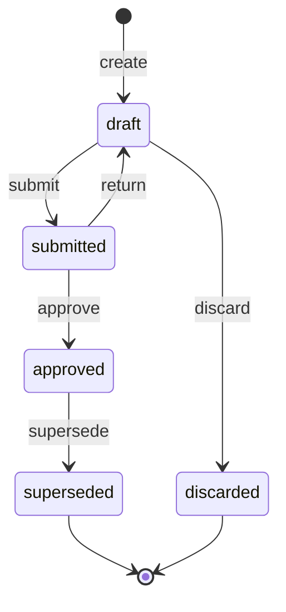

# Epic: wl-invoicing — negative flows

> Status: in use (F1–F10 built; open items in [README](../README.md) §7) · Last updated: 2026-10-24

This epic builds the negative flows that the negative-flow review added to
[wl-invoicing](../../modules/wl-invoicing.md): bad-debt write-off, VAT relief and recovery
(X-01), the invoice dispute flag (X-02), reopening paid documents after a reversed payment or a
failed refund (X-03, X-06), the e-invoice transmission lifecycle (X-04), supplier bill duplicate
holds, vendor contract bills after the contract end (D-13), supplier debit notes and landed
cost lines (X-08, X-10), payer bill negatives (05-N3-c, 05-N5-a, 05-N7-a), subscription
reactions to disputes, reversals and party blocks (X-18, 10-N3-f), and billing corrections from
deliveries and adjustment timesheets (X-11, X-16).

Since 2026-10-16 it also carries two capabilities from the
[SME problem map](../../reviews/2026-10-16-sme-problem-map.md) §3, labelled `area:sme-gap`:
the company budget with owner drawings (G5, `FIN.BUD.01`: BL-INV-25 to 27) and the cash-flow
forecast (G2, `FIN.CFL.01`: BL-INV-28 to 30).

| ID | Title | Priority | Size | Milestone | Depends on |
|---|---|---|---|---|---|
| BL-INV-01 | Write off an invoice balance as a bad debt | high | m | Build 1 | Base: wl-invoicing Invoice lifecycle; Epic wl-kernel: approval returned/failed |
| BL-INV-02 | Propose bad-debt VAT relief (`FIN.RUL.14`) | high | s | Build 1 | BL-INV-01; Base: wl-invoicing VAT summary lifecycle |
| BL-INV-03 | Recover a written-off invoice | high | s | Build 1 | BL-INV-01, BL-INV-02 |
| BL-INV-04 | Flag and resolve an invoice dispute | medium | m | Build 1 | Base: wl-invoicing Invoice lifecycle; Epic wl-ticketing: billing dispute ticket |
| BL-INV-05 | Escalate an open dispute (`FIN.RUL.15`) | medium | s | Build 1 | BL-INV-04 |
| BL-INV-06 | Flag and resolve a dispute from a disputed delivery | medium | s | Launch 03 | BL-INV-04; Epic wl-delivery: delivery review, reversal, lost |
| BL-INV-07 | Reopen an invoice when a payment is reversed (`unallocate`) | high | m | Build 1 | Base: wl-invoicing Invoice lifecycle; BL-PAY-01 |
| BL-INV-08 | Reopen a credit note when its refund fails | high | s | Build 1 | Base: wl-invoicing Credit note lifecycle; BL-PAY-06 |
| BL-INV-09 | Queue and send e-invoice transmissions | high | m | Build 1 | Base: wl-invoicing Invoice and Credit note lifecycle; Epic wl-kernel: integration down |
| BL-INV-10 | Handle an e-invoice rejection or a stuck transmission | high | m | Build 1 | BL-INV-09 |
| BL-INV-11 | Hold a possible duplicate supplier bill | medium | s | Build 1 | Base: wl-invoicing Supplier bill lifecycle |
| BL-INV-12 | Reopen a supplier bill when an outgoing payment is reversed | high | s | Build 1 | Base: wl-invoicing Supplier bill lifecycle; BL-PAY-01 |
| BL-INV-13 | Draft and issue a supplier debit note | high | m | Launch 02 | Base: wl-invoicing Supplier bill lifecycle; Epic wl-inventory: return to supplier |
| BL-INV-14 | Settle or cancel a supplier debit note | high | m | Launch 02 | BL-INV-13, BL-INV-12 |
| BL-INV-15 | Approve supplier bill lines coded to a landed cost | medium | s | Launch 02 | Base: wl-invoicing Supplier bill lifecycle; Epic wl-inventory: landed cost adjust |
| BL-INV-16 | Return a payer bill to draft after a technical rejection | high | s | Launch 05 | Base: wl-invoicing Payer bill lifecycle |
| BL-INV-17 | Record a payer overpayment and a recoupment | high | m | Launch 05 | Base: wl-invoicing Payer bill lifecycle; BL-PAY-01 |
| BL-INV-18 | Close a payer bill from draft (late submission) and void it | high | m | Launch 05 | Base: wl-invoicing Payer bill lifecycle; Epic wl-kernel: void |
| BL-INV-19 | Subscription goes past due on a reopened invoice, not on a disputed one | medium | s | Launch 04 | Base: wl-invoicing Subscription lifecycle; BL-INV-04, BL-INV-07 |
| BL-INV-20 | Pause and resume a subscription with its agreement or a party block | high | m | Launch 04 | Base: wl-invoicing Subscription lifecycle; Epic wl-parties: block effects |
| BL-INV-21 | Cancel a subscription when its agreement ends | high | s | Launch 04 | Base: wl-invoicing Subscription lifecycle; BL-INV-20 |
| BL-INV-22 | Bill only the delivered quantity and handle a COD difference | high | s | Launch 03 | Base: wl-invoicing billing run; Epic wl-delivery: proof of delivery per line |
| BL-INV-23 | Bill or credit hours from an adjustment timesheet | high | s | Launch 02 | Base: wl-invoicing usage billing; Epic wl-attendance: adjustment timesheets |
| BL-INV-24 | Match a vendor contract bill only for work done before the contract end | high | s | Build 1 | Base: wl-invoicing Supplier bill lifecycle; BL-INV-11; BL-TKT-04 |
| BL-INV-25 | Keep a company budget per entity, category and month | medium | m | Build 1 | Base: wl-kernel approvals, Excel import |
| BL-INV-26 | Report budget vs actual and warn on overspending (`FIN.RUL.24`) | medium | m | Build 1 | BL-INV-25; Base: Invoice, Supplier bill, Expense claim, Payroll run lifecycles |
| BL-INV-27 | Approve owner drawings and keep them out of operating cost (`FIN.ACL.21`) | high | m | Build 1 | BL-INV-25, BL-INV-26; Base: `CostPoster` |
| BL-INV-28 | Project the cash position by week from open documents | high | m | Build 1 | BL-PAY-25; Base: Invoice, Charge, Subscription, Supplier bill, Payer bill, VAT summary lifecycles; wl-hr `PayrollCalendar`, Payroll run, Final settlement |
| BL-INV-29 | Add budget fill and days-late adjustment to the cash-flow forecast | medium | s | Build 1 | BL-INV-28, BL-INV-25, BL-INV-26 |
| BL-INV-30 | Warn when the projected balance falls below the threshold (`FIN.RUL.23`) | high | s | Build 1 | BL-INV-28, BL-INV-29 |
| BL-INV-31 | Show the party's invoices and statement of account in the portal, with the dispute button | high | s | Build 1 | BL-POR-02; BL-INV-04; BL-POR-01 |

---

### BL-INV-01 — wl-invoicing: write off an invoice balance as a bad debt

**Labels:** `module:wl-invoicing` `area:negative-flow` `priority:high` `size:m` `blocked:open-item` `surface:back-office` `surface:system` · **Milestone:** Build 1 · **Size:** m
**Depends on:** Base: wl-invoicing Invoice lifecycle (`issue`, `allocate`, `mark_overdue`) · Epic wl-kernel: approval returned/failed (`PLT.APR.01`, request `fail`) · **Blocks:** BL-INV-02, BL-INV-03, BL-PAY-13, BL-ACC-24, BL-AUT-18, BL-CON-02, BL-CON-17, BL-EDU-18, BL-LOG-26, BL-MFG-14, BL-MPW-21, BL-PRP-18, BL-PRP-26, BL-MPW-29
**Review items:** X-01

#### Goal
A receivables user can write off the open balance of an unpaid invoice as a bad debt. Every
write-off (default limit AED 0) goes to an approval by someone other than the requester. The tax
invoice stays valid: no credit note, no change to lines or VAT. A pending VAT adjustment for
bad-debt relief is created so that `FIN.RUL.14` (BL-INV-02) can propose it later.

#### Surfaces
- **Back office:** a receivables user runs `write_off` on the invoice with a reason code;
  the approval request appears under "Needs your action" for another approver, and the
  invoice then shows `written_off` with the write-off amount.
- **System:** at final approval the balance and the "not `disputed`" guard are checked again
  and the request fails if they changed; `FIN.RUL.01` sends no more reminders for the
  invoice.

#### Files to read
- `docs/modules/wl-invoicing.md` §3 (Invoice fields: write-off; VAT adjustment), §4 *Invoice*
  (states, transitions, diagram), §5.9, §6 (`FIN.ACL.15`, `FIN.RUL.01`, event
  `InvoiceWrittenOff`), §7 (write-off settings), §10 (VAT, bad-debt relief)
- `docs/modules/wl-kernel.md` §4 *Approval request* (`fail` when guards no longer pass)
- `docs/ACCESS-CONTROL.md` §3 (`LIM`, `SOD`), §5 (approvals)

#### Terms
- **Open balance:** invoice total minus allocated payments and credit notes.
- **`LIM` / `SOD` rule:** an access rule that turns an action above a limit into an approval
  request (`LIM`) and forbids the requester from approving it (`SOD`).
- **Approval request (`PLT.APR.01`):** wl-kernel record; the action runs only at final approval,
  as the requester. If the guards fail at that moment the request goes to `failed` and nothing runs.
- **VAT share:** the part of an amount that is VAT, computed per VAT category (§5.9 step 3).
- **`bad_debt_relief` VAT adjustment:** a VAT adjustment record (§3) of kind bad-debt relief,
  created with status `pending`.
- **Customer write-off notice:** a document generated with `DOC.GEN.01` and sent through
  wl-notify; its date is evidence for VAT relief. Its content is `⚠ open: accountant (A-09)`;
  the spec default (§10) is a letter to the party's billing contact with the invoice number,
  issue date, date of supply, gross total, amount written off, VAT share of it, write-off date
  and a statement that the amount was written off as a bad debt, sent by email.

#### Spec excerpt (authoritative for this issue)

| State | Tone | Terminal | Meaning |
|---|---|---|---|
| `written_off` | neutral | no | Open balance written off as a bad debt; only `recover` leaves it |

| Transition | From | To | By | Guards | Effects |
|---|---|---|---|---|---|
| `write_off` | issued, partially_paid, overdue | written_off | `invoices.write_off` | balance > 0; reason code given (insolvent, untraceable, uneconomic to pursue, settlement agreed, other with text); not `disputed`; `FIN.ACL.15`: above the limit an approval request (`PLT.APR.01`), approver ≠ requester; at final approval the balance still equals the amount in the request, otherwise the request `fail`s and the requester submits again for the new balance | open balance recorded as the write-off amount (no credit note: the supply stood and the tax invoice stays valid); reminders stop; customer write-off notice generated (`DOC.GEN.01`) and sent (wl-notify) when configured, its date recorded; a `bad_debt_relief` VAT adjustment is created as pending for the VAT share of the written-off amount, and `FIN.RUL.14` proposes it once the conditions are met (§10); write-off exported to accounting; event `InvoiceWrittenOff` |

| ID | Rule | Pattern | Parameter (default) |
|---|---|---|---|
| `FIN.ACL.15` | Writing off an invoice balance as a bad debt above the limit needs approval, and the requester cannot approve it | `LIM`, `SOD` | AED 0 (every write-off approved) |

| ID | When | If | Then | Parameters (default) |
|---|---|---|---|---|
| `FIN.RUL.01` | N days before / M days after `invoice.due_date` | balance > 0; not `disputed`; not `written_off` | notify the party | N = 3; M = 1, 7, 14 |

Settings (§7): *Bad-debt write-off limit (`FIN.ACL.15`) and reason codes* — AED 0 (every
write-off approved); insolvent, untraceable, uneconomic to pursue, settlement agreed, other.
*Customer write-off notice sent on `write_off`* — on (needed for VAT bad-debt relief).

§5.9 step 3 (VAT share): "The VAT share is computed per VAT category in proportion to the
invoice's open balance: for each category, written-off amount × (category VAT ÷ invoice gross
total), rounded half-up to fils per category. Zero-rated, exempt and out-of-scope lines carry no
VAT and give no relief. One adjustment is created per invoice; its amount is the sum of the
rounded per-category shares. For an invoice in a foreign currency the shares use the invoice's
AED VAT figures: category AED VAT × (written-off amount ÷ gross total in the invoice currency);
the write-off amount itself stays in the invoice currency. How relief applies to a partly paid
invoice is still
`⚠ open: accountant (A-09)`; this is the default until answered. While the write-off waits for
approval, a payment can still be allocated; the request then fails at approval (the balance
changed) and is submitted again."

Effects in order:
1. Store on the invoice: write-off amount (= open balance), reason code (+ text), approval id,
   recovered amount = 0.
2. Generate and send the customer notice when the setting is on; store its sent date.
3. Create one `VatAdjustment { kind: bad_debt_relief, amount: VAT share, source: invoice,
   status: pending }` per invoice; amount = sum of the per-category shares, each rounded first.
4. Mark the write-off for accounting export (export itself is `FIN.EXT.01`, Later).
5. Emit `InvoiceWrittenOff { invoice, party, source, amount written off, reason code, approver }`.

#### Edge cases decided
- **Payment or credit note allocated while the request waits:** the balance changes, so the
  request `fail`s at approval (spec). The requester submits a new request for the new balance.
- **Dispute raised while the request waits:** the guard "not `disputed`" is checked again at
  final approval; it fails and the request goes to `failed` (kernel behaviour).
- **Approve clicked twice / two approvers at once:** the kernel runs the action once; a second
  run finds the invoice `written_off` and does nothing.
- **Partly paid invoice:** relief is computed on the written-off amount only (spec default,
  `⚠ open: accountant (A-09)`).
- **Rounding:** per category, half-up to 0.01 AED. Example: balance AED 333.33 on an invoice of
  AED 1,050.00 gross with AED 50.00 standard VAT → 333.33 × 50 ÷ 1,050 = 15.8728 → AED 15.87.
- **Foreign-currency invoice:** the VAT share uses the invoice's AED figures (§5.9 step 3), i.e. category AED VAT × (written-off amount ÷ gross total in invoice currency),
  rounded half-up to fils; the write-off amount itself stays in the invoice currency.
- **Notice setting off:** no notice and no notice date; the pending adjustment is still created
  (BL-INV-02 will never propose it until a notice date exists).
- **Date of the write-off:** the approval time, stored as a date in Asia/Dubai.
- **Locked VAT period:** the write-off changes no tax document, so `FIN.ACL.09` does not block it.

#### Must not
- Must not issue a credit note or change lines, totals or VAT of the invoice.
- Must not let the requester approve their own write-off, even as an admin.
- Must not write off a `disputed`, `paid`, `draft` or `credited` invoice.
- Must not propose the relief to a VAT summary here (that is BL-INV-02).
- Must not write the status directly; only through the `write_off` transition.

#### Done when
- [ ] Given an `overdue` invoice, gross AED 1,050.00 (1,000 + 50 VAT), balance AED 1,050.00, when
      user A runs `write_off` with reason `insolvent`, then an approval request is created and
      the invoice stays `overdue`.
- [ ] When user A tries to approve the request, it is refused (`SOD`).
- [ ] When user B approves, the invoice is `written_off`, write-off amount AED 1,050.00, a pending
      `bad_debt_relief` adjustment of AED 50.00 exists, the notice is sent and its date stored,
      `InvoiceWrittenOff` is emitted and a history row is written.
- [ ] Given a `partially_paid` invoice gross AED 1,050.00 with AED 420.00 paid, write-off of
      AED 630.00 gives relief AED 30.00.
- [ ] Given lines 1,000 standard (VAT 50) + 500 zero-rated, balance AED 775.00, relief is AED 25.00.
- [ ] Each write-off creates exactly one `bad_debt_relief` adjustment for the invoice.
- [ ] The notice sent to the billing contact carries the invoice number, issue date, date of
      supply, gross total, amount written off, its VAT share and the write-off date; its sent
      date equals the stored notice date.
- [ ] Given a pending request for AED 1,050.00, when a payment of AED 100.00 is allocated and
      user B approves, the request is `failed`, the invoice stays `partially_paid`, no adjustment exists.
- [ ] When user B rejects, the invoice keeps its state and no adjustment exists.
- [ ] Given `disputed = true`, `write_off` is not offered and an API call is refused.
- [ ] `FIN.RUL.01` sends no reminder for a `written_off` invoice.

#### Out of scope
`FIN.RUL.14` proposal (BL-INV-02); `recover` and reversed payments after write-off (BL-INV-03,
BL-INV-07); cheque write-off that calls this transition (BL-PAY-13); export to accounting software
(`FIN.EXT.01`, Later).

---

### BL-INV-02 — wl-invoicing: propose bad-debt VAT relief (`FIN.RUL.14`)

**Labels:** `module:wl-invoicing` `area:negative-flow` `priority:high` `size:s` `blocked:open-item` `surface:back-office` `surface:system` · **Milestone:** Build 1 · **Size:** s
**Depends on:** BL-INV-01 · Base: wl-invoicing VAT summary lifecycle · **Blocks:** BL-INV-03, BL-ACC-24, BL-AUT-18, BL-LOG-26, BL-MFG-14
**Review items:** X-01

#### Goal
A daily automation checks every written-off invoice with a pending bad-debt relief adjustment.
When the legal conditions are recorded, it proposes the adjustment on the entity's next open VAT
summary and tells the accountant, who includes or excludes it while preparing the summary.

#### Surfaces
- **Back office:** the accountant sees the proposed `bad_debt_relief` adjustment on the open
  VAT summary while preparing it, and includes or excludes it with a reason.
- **System:** `FIN.RUL.14` runs daily at 02:00 (Asia/Dubai) and proposes each eligible
  pending adjustment on the entity's `open` VAT summary, then notifies the accountant.

#### Files to read
- `docs/modules/wl-invoicing.md` §3 (VAT adjustment), §4 *VAT summary*, §5.7 step 3, §5.9 step 3,
  §6 (`FIN.RUL.14`), §7, §10 (bad-debt relief)
- `docs/WORKFLOW.md` §4 (automation rules)

#### Terms
- **Date of supply:** the tax point of the invoice (its issue date unless a different date of
  supply is recorded).
- **Next open VAT summary:** the entity's VAT summary in state `open` (the running period).
- **Period of the original supply locked:** the entity's VAT summary whose period contains the
  date of supply is in state `locked` (evidence the output VAT was declared).
- **Adjustment status:** `pending` → `proposed` (by this rule) → `included` or `excluded` (by the preparer).

#### Spec excerpt (authoritative for this issue)

| ID | When | If | Then | Parameters (default) |
|---|---|---|---|---|
| `FIN.RUL.14` | daily at T | invoice `written_off` with a pending bad-debt relief; more than M months since the date of supply (first eligible the day after the date of supply + M months); customer write-off notice date recorded; the period of the original supply is `locked` | propose the `bad_debt_relief` adjustment on the entity's `open` VAT summary; notify the accountant. When the entity has no `open` summary, nothing is proposed and the next run tries again | T = 02:00; M = 6 (legal minimum, not below 6) ✔ [S2] |

Setting (§7): *Bad-debt relief proposal (`FIN.RUL.14`): run time; months after the date of
supply* — on; daily at 02:00; more than 6 months (not below 6).

§10: "Bad-debt relief: output VAT can be reduced when the debt is written off, more than 6 months
have passed since the supply, and the customer was notified (Decree-Law Art. 64). … `FIN.RUL.14`
proposes the adjustment only when all three conditions are recorded, and the period of the supply
is locked (as evidence that the output VAT was declared). Still `⚠ open: accountant (A-09)`: the
form and content of the customer notice, the period in which the relief is claimed …"

§5.7 step 3: "Bad-debt relief proposed by `FIN.RUL.14`, bad-debt recoveries and supplier debit
notes appear as adjustments too; the preparer includes or excludes each proposed adjustment with
a reason."

#### Edge cases decided
- **Six months:** "more than M months" (spec): propose only when today (Asia/Dubai) is after
  date of supply + M months. Example: supply 2026-03-15 → first eligible run 2026-09-16.
- **M below 6:** the setting refuses values below 6.
- **Run time:** 02:00 Asia/Dubai (spec); a run that missed a day catches up on the next run
  (conditions are re-evaluated, not tied to a date).
- **Idempotency:** only adjustments in `pending` are picked; after proposing, status is
  `proposed`, so a second run does nothing.
- **No summary in `open` state for the entity** (e.g. the running period was already prepared
  early): skip and retry on the next daily run (spec); notify nobody until it is proposed.
- **Excluded by the preparer:** stays `excluded` (§5.9 step 3); the rule does not
  propose it again.
- **Period reopened later:** an adjustment already proposed stays; a pending one waits until the
  period is `locked` again.
- **Partial recovery before the proposal:** handled in BL-INV-03 (pending amount reduced).
- **Multi-entity:** the summary is the one of the invoice's issuing entity.

#### Must not
- Must not change the invoice or issue a credit note.
- Must not mark the adjustment `included`; only the preparer does that.
- Must not propose when any of the three recorded conditions or the locked-period condition is missing.

#### Done when
- [ ] Given an invoice written off on 2026-07-01, supply 2026-03-15, notice date 2026-07-01, Q1 2026
      summary `locked`, when the rule runs on 2026-09-16, then the adjustment is `proposed` on the
      entity's `open` summary and the accountant is notified.
- [ ] The same invoice on 2026-09-15 is not proposed.
- [ ] Without a notice date, it is not proposed.
- [ ] With the Q1 summary `reviewed` (not `locked`), it is not proposed.
- [ ] Running twice on the same day proposes once and notifies once.
- [ ] The setting refuses M = 5.

#### Out of scope
Writing off (BL-INV-01); recovery adjustments (BL-INV-03); preparing and locking the VAT summary (base).

---

### BL-INV-03 — wl-invoicing: recover a written-off invoice

**Labels:** `module:wl-invoicing` `area:negative-flow` `priority:high` `size:s` `blocked:open-item` `surface:back-office` `surface:system` · **Milestone:** Build 1 · **Size:** s
**Depends on:** BL-INV-01, BL-INV-02 · **Blocks:** BL-PRP-18
**Review items:** X-01

#### Goal
When a party pays an invoice after it was written off, the payment is allocated to it through
`recover`. The recovered amount is recorded; if relief was already claimed, a bad-debt recovery
VAT adjustment adds the VAT back; when the whole write-off is recovered the invoice becomes `paid`.

#### Surfaces
- **Back office:** the invoice shows the recovered amount and becomes `paid` when the whole
  write-off is recovered; the accountant sees a `bad_debt_recovery` adjustment on the open
  VAT summary when relief was claimed.
- **System:** a payment allocated to a written-off invoice runs `recover`, which reduces a
  pending or proposed relief or creates the recovery adjustment.

#### Files to read
- `docs/modules/wl-invoicing.md` §4 *Invoice* (`recover`), §5.9 step 4, §6 (events
  `BadDebtRecovered`, `InvoicePaid`), §10 (bad-debt relief)
- `docs/modules/wl-payments.md` §5.1 (allocation)

#### Terms
- **Recovered amount:** sum of payments allocated to the invoice after its write-off.
- **Relief claimed:** the `bad_debt_relief` adjustment is `included` in a VAT summary (spec).
- **`bad_debt_recovery` adjustment:** VAT adjustment kind that adds output VAT back.

#### Spec excerpt (authoritative for this issue)

| Transition | From | To | By | Guards | Effects |
|---|---|---|---|---|---|
| `recover` | written_off | written_off, paid | system (payment allocated to a written-off invoice) | — | recovered amount recorded against the write-off; if bad-debt relief was already claimed (its adjustment `included` in a VAT summary), a `bad_debt_recovery` VAT adjustment adds the VAT share of the recovered amount back in the next open period `⚠ open: accountant (A-09)`; if the relief is still `pending` or `proposed`, it is reduced by that VAT share instead, and set `excluded` with reason *recovered before claim* when the whole write-off is recovered; `paid` when the whole write-off is recovered (event `InvoicePaid`); accountant notified; event `BadDebtRecovered` |

Event `BadDebtRecovered`: invoice, party, amount recovered, relief claimed (yes/no).

#### Edge cases decided
- **Allocation above the remaining write-off:** the allocation proposal caps at write-off amount
  − recovered amount; any rest stays as the party's credit.
- **VAT share of the recovered amount:** same formula and rounding as BL-INV-01 (per category,
  half-up to fils), applied to the recovered amount.
- **Relief still `pending` or `proposed` (not claimed):** no recovery adjustment; the
  pending/proposed relief is reduced by the VAT share of the recovered amount; when fully
  recovered, it is set `excluded` with reason "recovered before claim" (spec).
- **Relief `excluded`:** no recovery adjustment.
- **Next open period:** the entity's VAT summary in `open` state at the allocation date (Asia/Dubai).
- **Several partial recoveries:** each runs `recover`; state stays `written_off` until the sum
  equals the write-off amount, then `paid`.
- **Reversal of a recovery payment:** handled in BL-INV-07.

#### Must not
- Must not reverse the write-off or change the invoice's lines or VAT.
- Must not create a recovery adjustment when relief was not claimed.
- Must not move to `paid` before the whole write-off is recovered.

#### Done when
- [ ] Given an invoice written off for AED 1,050.00 (relief AED 50.00 `included`), when AED 525.00
      is allocated, the invoice stays `written_off`, recovered = 525.00, a `bad_debt_recovery`
      adjustment of AED 25.00 is proposed on the open summary, the accountant is notified,
      `BadDebtRecovered` (relief claimed = yes) is emitted.
- [ ] When the remaining AED 525.00 is allocated, the invoice is `paid` and `InvoicePaid` is emitted.
- [ ] Given relief still `pending`, a recovery of AED 525.00 creates no recovery adjustment and
      the pending relief becomes AED 25.00.
- [ ] An allocation of AED 2,000.00 to a write-off of AED 1,050.00 allocates 1,050.00 and leaves
      950.00 as party credit.

#### Out of scope
Write-off (BL-INV-01); relief proposal (BL-INV-02); payment reversal (BL-INV-07).

---

### BL-INV-04 — wl-invoicing: flag and resolve an invoice dispute

**Labels:** `module:wl-invoicing` `area:negative-flow` `priority:medium` `size:m` `surface:back-office` `surface:portal` `surface:system` · **Milestone:** Build 1 · **Size:** m
**Depends on:** Base: wl-invoicing Invoice lifecycle · Epic wl-ticketing: billing dispute ticket (`WRK.TKT.01`) · **Blocks:** BL-INV-05, BL-INV-06, BL-INV-19, BL-ACC-22, BL-ACC-24, BL-AUT-18, BL-CLN-16, BL-CON-06, BL-CON-08, BL-CON-17, BL-EDU-18, BL-INV-23, BL-LOG-26, BL-MFG-13, BL-MFG-14, BL-MPW-01, BL-MPW-21, BL-PRP-13, BL-PRP-14, BL-PRP-26, BL-INV-31, BL-TKT-12
**Review items:** X-02, 09-N4-a, 01-N4-c (invoice side)

#### Goal
Staff, or the party in the portal when allowed, can flag an issued invoice as disputed. The flag
is not a state: it pauses reminders and escalation, opens or links a ticket, and is cleared by
`resolve_dispute` with outcome `upheld` (the invoice stands) or `credited` (a credit note for the
agreed amount). This keeps the business from chasing money that is honestly contested.

#### Surfaces
- **Back office:** a user with `invoices.dispute` flags an issued invoice as disputed
  (reason, amount, optional lines) and later resolves it `upheld` or `credited`; ageing
  shows disputed amounts in their own column.
- **Portal:** when the client turns it on (off by default), the party flags its own invoice
  as disputed (screen not specified yet: wl-portal lists no dispute action).
- **System:** a billing-dispute ticket is opened or linked and assigned to the invoice
  owner; reminders and overdue escalation pause, and resume after the grace period when the
  outcome is `upheld`.

#### Files to read
- `docs/modules/wl-invoicing.md` §3 (Invoice field `dispute`), §4 *Invoice* ("Dispute flag"),
  §5.3, §5.10 steps 1–4, §6 (events, permissions, `FIN.RUL.01`), §7 (Disputes settings)
- `docs/WORKFLOW.md` §8 (pattern "Dispute")
- `docs/modules/wl-ticketing.md` (`WRK.TKT.01`)

#### Terms
- **`disputed` flag:** fields on the invoice: flag, reason, disputed amount, disputed lines
  (optional), ticket, raised by and at.
- **Disputed lines:** the invoice lines the person disputing ticks; none ticked means the
  dispute is not tied to lines.
- **Invoice owner:** the user who ran the invoice's `issue`; when the system issued it or that
  user is no longer active, the holders of `invoices.issue` in the invoice's scope (the
  receivables role) (wl-invoicing §3 *Invoice owner*).
- **Grace period:** days after an `upheld` outcome before reminders resume (default 7).
- **`FIN.ACL.07`:** a waiver or discount on an invoice or charge needs approval.
- **Adjustment timesheet:** wl-attendance correction of a locked timesheet; origin `client_dispute`.

#### Spec excerpt (authoritative for this issue)

| Action | Allowed in | By | Guards | Effects |
|---|---|---|---|---|
| `dispute` | issued, partially_paid, overdue | `invoices.dispute`, the party in the portal when allowed, or system (wl-delivery `DeliveryDisputed`, for each issued invoice that bills lines of the delivery; reason *delivery disputed*, disputed amount = that invoice's amount for the delivery's lines, capped at its balance, the delivery's ticket linked) | reason given; disputed amount ≤ balance; disputed lines optional: when given, lines of this invoice, and the disputed amount defaults to their amount (still editable, ≤ balance); not already `disputed` (for the system, an invoice already `disputed` is not flagged again: the delivery's ticket is linked to the open dispute with a note) | `disputed` set; a ticket is linked or opened (wl-ticketing `WRK.TKT.01`, category billing dispute) and assigned to the invoice owner; `FIN.RUL.01` reminders paused; the invoice is left out of overdue escalation (subscription `mark_past_due` and `suspend`, collection tasks, `write_off`); `FIN.RUL.02` still marks it `overdue` because the due date is a fact; ageing shows disputed amounts in their own column; disputed lines (if any) marked on the invoice and in the ticket; party gets an acknowledgement; event `InvoiceDisputed` |
| `resolve_dispute` | any state while `disputed` | `invoices.dispute` (outcome `credited` also needs `invoices.credit`), or system (`DeliveryDisputeClosed` with outcome *upheld* → `upheld`, only for a dispute the system raised for that delivery) | outcome `upheld` (the invoice stands) or `credited` (a credit note for the agreed amount, through `credit` or a partial credit note; above `FIN.ACL.07` an approval request); for hours billed from timesheets, `credited` names the adjustment timesheet (origin `client_dispute`) that carries the agreed hours; resolution note | `disputed` cleared; linked ticket resolved; party notified of the outcome with the credit note if any; `upheld`: reminders and the overdue escalation (subscription `mark_past_due` and `suspend`, collection tasks, `write_off`) resume after the grace period, the due date is not moved; event `InvoiceDisputeResolved` (outcome, credited amount) |

Settings (§7): *Disputes: party may dispute in the portal; escalation (`FIN.RUL.15`); grace before
reminders resume after `upheld`* — off; 14 days; 7 days.

#### Edge cases decided
- **Partial dispute:** the whole invoice stops being reminded (the flag pauses chasing for the invoice).
- **Disputed lines:** optional; only lines of the disputed invoice; when ticked, the disputed
  amount is prefilled with their amount and may be lowered (a part of a line is disputed) but
  not raised above the balance. They are carried in `InvoiceDisputed` so a vertical can act
  on them (07: NCRs on the lots of the disputed lines).
- **Payments while disputed:** allowed; if the balance reaches zero the invoice is `paid` and the
  flag stays until resolved (`resolve_dispute` runs from any state).
- **Disputed amount later above the balance:** the stored disputed amount is not changed (§5.10
  step 2); the ageing disputed column shows min(disputed amount, balance).
- **Credit above the waiver limit:** an approval request; if rejected, the flag stays and the
  ticket stays open.
- **Agreed amount above remaining credit:** refused (credit note guard: lines do not exceed the
  invoice's remaining credit). Full balance with no payments: `credit` transition; otherwise a partial credit note.
- **Reminders after `upheld`:** (§5.3 step 2) at grace end, the latest reminder step
  whose day has passed is sent once, then later steps on their days. Example: due 2026-11-01,
  upheld 2026-11-20 → grace ends 2026-11-27 (26 days overdue) → the 14-day step is sent on
  2026-11-27, no more steps after.
- **Time zone:** dates and the grace period in Asia/Dubai.
- **Two users dispute at once:** the second is refused by the guard "not already `disputed`".
- **Lines from timesheets:** the `credited` outcome is refused unless an approved adjustment
  timesheet with origin `client_dispute` is named.
- **Portal off (default):** the party cannot dispute; staff can.

#### Must not
- Must not change the invoice state, due date or balance when flagging.
- Must not stop `FIN.RUL.02` from marking a disputed invoice `overdue`.
- Must not edit the issued invoice to resolve (`FIN.ACL.01`); only credit notes.
- Must not allow `credited` without `invoices.credit`.

#### Done when
- [ ] Given an `issued` invoice balance AED 5,000.00, when user A disputes AED 1,200.00 with reason
      "wrong hours", the flag is set, a billing-dispute ticket is opened and assigned to the
      owner, the party gets an acknowledgement, `InvoiceDisputed` is emitted.
- [ ] No `FIN.RUL.01` reminder is sent while disputed; on the due date `FIN.RUL.02` still marks it `overdue`.
- [ ] Ageing shows AED 1,200.00 in the disputed column.
- [ ] Disputing with lines 2 and 3 ticked (AED 800.00 and AED 400.00) prefills AED 1,200.00;
      `InvoiceDisputed` carries both lines; a line of another invoice is refused.
- [ ] Disputing AED 6,000.00 on a balance of AED 5,000.00 is refused; disputing an already
      disputed invoice is refused.
- [ ] `resolve_dispute` `credited` AED 1,200.00 issues a partial credit note, clears the flag,
      resolves the ticket, notifies the party with the credit note, emits `InvoiceDisputeResolved`.
- [ ] With `FIN.ACL.07` limit AED 500, the AED 1,200.00 credit becomes an approval request and the
      flag stays until approval.
- [ ] `upheld` clears the flag; reminders resume after 7 days; the due date is unchanged.
- [ ] A user without `invoices.credit` cannot resolve `credited`.

#### Out of scope
`FIN.RUL.15` escalation (BL-INV-05); system dispute from wl-delivery (BL-INV-06); subscription
reaction (BL-INV-19); write-off guard (BL-INV-01); adjustment timesheet billing (BL-INV-23);
deposit deductions dispute (BL-PAY-15).

---

### BL-INV-05 — wl-invoicing: escalate an open dispute (`FIN.RUL.15`)

**Labels:** `module:wl-invoicing` `area:negative-flow` `priority:medium` `size:s` `surface:system` · **Milestone:** Build 1 · **Size:** s
**Depends on:** BL-INV-04 · **Blocks:** BL-ACC-24, BL-CLN-16, BL-CON-17, BL-LOG-26, BL-MFG-13, BL-PRP-26
**Review items:** X-02

#### Goal
An open dispute must not sit forever. Every N days while the invoice stays disputed, the invoice
owner is reminded; from the second reminder on, the finance manager is told too.

#### Surfaces
- **System:** every 14 days while the invoice stays disputed, `FIN.RUL.15` notifies the
  invoice owner, and from the second time also the finance manager; nothing changes on any
  screen.

#### Files to read
- `docs/modules/wl-invoicing.md` §5.10 step 3, §6 (`FIN.RUL.15`), §7

#### Terms
- **Finance manager:** the role configured as finance manager for the invoice's entity.

#### Spec excerpt (authoritative for this issue)

| ID | When | If | Then | Parameters (default) |
|---|---|---|---|---|
| `FIN.RUL.15` | N days after an invoice is flagged `disputed`, then every N days | still `disputed` | notify the invoice owner; from the second time, also the finance manager | N = 14 |

#### Edge cases decided
- **Counting:** from the flag's "raised at" time, in whole days in Asia/Dubai. Raised 2026-11-01 →
  reminders 2026-11-15 (owner), 2026-11-29 (owner + finance manager), 2026-12-13, …
- **Resolved and disputed again:** the count starts again from the new "raised at"; the second
  dispute's first reminder goes to the owner only.
- **Owner left the company:** notify the receivables role instead (§3 *Invoice owner*); from the
  second time the finance manager too, as for any escalation.
- **Idempotency:** one notification per invoice per due step.

#### Must not
- Must not change the invoice or the ticket.
- Must not notify after the dispute is resolved.

#### Done when
- [ ] Given a dispute raised 2026-11-01, the owner is notified on 2026-11-15, owner and finance
      manager on 2026-11-29.
- [ ] Resolved on 2026-11-20, no notification on 2026-11-29.
- [ ] With N = 7, the first reminder is on 2026-11-08.

#### Out of scope
Flagging and resolving (BL-INV-04).

---

### BL-INV-06 — wl-invoicing: flag and resolve a dispute from a disputed delivery

**Labels:** `module:wl-invoicing` `area:negative-flow` `priority:medium` `size:s` `surface:back-office` `surface:system` · **Milestone:** Launch 03 · **Size:** s
**Depends on:** BL-INV-04 · Epic wl-delivery: delivery `under_review`, `reverse_delivery`, `lost` · **Blocks:** BL-LOG-09
**Review items:** X-11, 03-N11-a
**Progress:** part 1 of 5 is on main: the kernel delivery contract and the dispute request source (28de883). The flag, resolve and task flows are not built yet.

#### Goal
When a recipient denies a delivery, wl-delivery puts it under review. wl-invoicing must flag
each issued invoice that bills the delivery's lines as disputed by the system, close the flag
when the review upholds the delivery, and give the invoice owner a task when the delivery is
reversed or lost (usually resolved `credited` for the undelivered lines).

#### Surfaces
- **Back office:** the invoice owner gets a task when the delivery is reversed or lost; for
  a draft that bills the delivery, the receivables role gets a task *delivery disputed
  before issue*.
- **System:** `DeliveryDisputed` flags each issued invoice that bills the delivery's lines,
  with the delivery's ticket; `DeliveryDisputeClosed` (*upheld*) resolves the disputes it
  raised.

#### Files to read
- `docs/modules/wl-invoicing.md` §4 *Invoice* ("Dispute flag"), §5.10 step 5, §6 (Consumes:
  wl-delivery)
- `docs/modules/wl-delivery.md` (events `DeliveryDisputed`, `DeliveryDisputeClosed`,
  `DeliveryReversed`, `DeliveryLost`)

#### Terms
- **Delivery's source:** the record the delivery fulfils (sales order, shipment).
- **Invoices of the delivery:** every issued invoice (`issued`, `partially_paid`, `overdue`)
  with lines whose origin is a line of the delivery. One delivery can touch several invoices.
- **Delivery's lines:** the delivered lines of the delivery; per invoice, the invoiced amount of
  those lines, capped at that invoice's balance, is the disputed amount (spec).

#### Spec excerpt (authoritative for this issue)
The `dispute` and `resolve_dispute` rows in BL-INV-04 apply, with By = system:
- `dispute` by "system (wl-delivery `DeliveryDisputed`, for each issued invoice that bills lines
  of the delivery; reason *delivery disputed*, disputed amount = that invoice's amount for the
  delivery's lines, capped at its balance, the delivery's ticket linked)"; guard "not already
  `disputed` (for the system, an invoice already `disputed` is not flagged again: the
  delivery's ticket is linked to the open dispute with a note)".
- `resolve_dispute` by "system (`DeliveryDisputeClosed` with outcome *upheld* → `upheld`, only
  for a dispute the system raised for that delivery)".

§5.10 step 5: "A delivery put under review in wl-delivery (`DeliveryDisputed`) flags, by the
system and with the same ticket, each issued invoice that bills lines of the delivery, for that
invoice's amount of those lines capped at its balance. An invoice already `disputed` is not
flagged again; the delivery's ticket is linked to its open dispute with a note.
`DeliveryDisputeClosed` (*upheld*) resolves `upheld` the disputes the system raised for that
delivery; a dispute it was only linked to stays open. When the delivery is reversed or marked
lost instead (`DeliveryReversed`, `DeliveryLost`), the flag stays and the invoice owner gets a
task to resolve it, usually `credited` for the undelivered lines. When the delivery's lines are
not on an issued invoice yet (draft or not billed), nothing is flagged: a draft that bills them
is not issued automatically while the delivery is under review, and the receivables role gets a
task *delivery disputed before issue*."

#### Edge cases decided
- **No issued invoice yet (draft or not billed):** no flag (§5.10 step 5); the draft is
  not issued automatically while the delivery is under review, and the receivables role gets a
  task "delivery disputed before issue" (a draft has no owner yet).
- **Invoice already disputed:** the guard refuses a second flag (spec); the delivery's ticket is
  linked to the existing dispute and a note is added; the disputed amount is unchanged. A later
  `DeliveryDisputeClosed` does not resolve that existing dispute.
- **Delivery lines worth more than the balance (partly paid):** the disputed amount is capped at
  the balance (spec), so the guard "disputed amount ≤ balance" passes.
- **Delivery lines on several invoices:** each issued invoice with those lines is flagged for its
  own amount of them (spec).
- **Event received twice:** the second finds the flag set with the same ticket and does nothing.
- **`DeliveryDisputeClosed` for an invoice whose dispute was already resolved by a user:** nothing happens.

#### Must not
- Must not resolve the flag automatically on `DeliveryReversed` or `DeliveryLost`.
- Must not open a second ticket: use the delivery's ticket.

#### Done when
- [ ] Given an `issued` invoice of AED 3,000.00 with delivery lines worth AED 800.00, when
      `DeliveryDisputed` arrives, the invoice is flagged with reason *delivery disputed*, amount
      AED 800.00 and the delivery's ticket.
- [ ] When `DeliveryDisputeClosed` (*upheld*) arrives, the dispute resolves `upheld`.
- [ ] When `DeliveryReversed` arrives instead, the flag stays and the owner gets a task.
- [ ] When the invoice is still a draft, no flag is set, it is not auto-issued, and the owner gets a task.
- [ ] Given the same invoice `partially_paid` with balance AED 500.00, the flag is set with
      disputed amount AED 500.00.
- [ ] Given delivery lines of AED 800.00 billed AED 300.00 on invoice A and AED 500.00 on invoice
      B, both are flagged, A for AED 300.00 and B for AED 500.00.
- [ ] Given an invoice already disputed by a user, `DeliveryDisputed` sets no second flag and the
      delivery's ticket is linked with a note; `DeliveryDisputeClosed` (*upheld*) leaves that
      dispute open.

#### Out of scope
Manual dispute and resolution (BL-INV-04); the delivery review itself (Epic wl-delivery).

---

### BL-INV-07 — wl-invoicing: reopen an invoice when a payment is reversed (`unallocate`)

**Labels:** `module:wl-invoicing` `area:negative-flow` `priority:high` `size:m` `surface:back-office` `surface:system` · **Milestone:** Build 1 · **Size:** m
**Depends on:** Base: wl-invoicing Invoice lifecycle · BL-PAY-01 · **Blocks:** BL-INV-19, BL-PAY-04, BL-EDU-06, BL-PRP-08, BL-PAY-29
**Review items:** X-03

#### Goal
`paid` is no longer terminal. When wl-payments reverses a payment (recorded in error, bank return,
chargeback) or an allocation is moved to another document, each removed allocation runs
`unallocate` on the invoice: the balance goes back up, the state is set by balance and due date,
reminders resume and people are told why. The issued document and its VAT never change.

#### Surfaces
- **Back office:** the invoice shows its new balance and state; the accountant gets a task
  when a payment made before a write-off is reversed, or when a reversal amount is refused.
- **System:** each allocation removed by `PaymentReversed` runs `unallocate`; the state is
  set by balance and due date (a reversed recovery goes back to `written_off`), and
  reminders resume at the matching step.

#### Files to read
- `docs/modules/wl-invoicing.md` §4 *Invoice* (intro, `unallocate`, diagram, paragraph after the
  diagram on written-off invoices), §5.3 step 4, §5.11 steps 1, 2, 4, §6 (`InvoiceReopened`)
- `docs/modules/wl-payments.md` §4 *Payment* (`reverse`, `charge_back`), §6 (`PaymentReversed`)

#### Terms
- **Allocation:** part of a payment applied to a document (wl-payments §3).
- **`PaymentReversed`:** wl-payments event with payment, party, reason, allocations removed
  (target, amount), prepaid subject.
- **Receivables role:** the role that follows up receivables for the entity.

#### Spec excerpt (authoritative for this issue)

| State | Tone | Terminal | Meaning |
|---|---|---|---|
| `paid` | success | no | Balance is zero; only `unallocate` leaves it |
| `written_off` | neutral | no | Open balance written off as a bad debt; only `recover` leaves it (a reversed recovery brings it back, `unallocate`) |

| Transition | From | To | By | Guards | Effects |
|---|---|---|---|---|---|
| `unallocate` | paid, partially_paid, overdue, written_off | issued, partially_paid, overdue, written_off | system (wl-payments payment `reverse`, consumed as `PaymentReversed`; or an allocation moved to another document) | amount not above what is allocated to this invoice; on a `written_off` invoice, or a `paid` one that left `written_off` through `recover`, only an allocation made through `recover` | balance increased by the amount; new state by balance and due date: `overdue` if the due date has passed, otherwise `issued` when nothing remains allocated, else `partially_paid`; reminders (`FIN.RUL.01`) resume at the step matching the days overdue. A reversed recovery instead reduces the recovered amount and the invoice goes back to, or stays, `written_off` (never `overdue`; reminders stay stopped); the VAT share of the amount is undone on the relief side: a pending or proposed `bad_debt_relief` is increased again, an open `bad_debt_recovery` adjustment is reduced, and one already included gets a `bad_debt_relief` adjustment for that VAT share, created as `proposed` on the entity's `open` VAT summary because its conditions were met when the relief was first claimed (as `pending` while the entity has no `open` summary, so `FIN.RUL.14` proposes it later) `⚠ open: accountant (A-09)`; accountant notified. In every case the invoice owner and the receivables role are notified with the reversal reason; the issued document and its VAT are unchanged; event `InvoiceReopened` |

After the diagram: "A payment that was allocated to an invoice before it was written off and is
later reversed does not change the write-off: the reversal creates a task for the accountant, who
decides whether to write off more (a second `write_off` approval) or pursue the party. A payment
allocated after the write-off (through `recover`) that is reversed runs `unallocate` and puts the
invoice back to `written_off` with the recovered amount reduced."

Diagram adds `paid --> written_off: unallocate` and `written_off --> written_off: unallocate`.

Event `InvoiceReopened`: invoice, party, source, amount reopened, balance, new state, reason
(payment reversed, allocation moved, recovery reversed).

#### Edge cases decided
- **Reminder step "matching the days overdue":** (§5.3 step 2) at the next reminder run
  the latest step whose day has passed is sent once (unless it was already sent before the payment),
  then later steps on their days. Example: steps 1, 7, 14; reopened at 10 days overdue → the 7-day
  reminder is sent once, the 14-day one on day 14.
- **Disputed invoice reopened:** reminders stay paused (flag rule).
- **Invoice `written_off`, payment from before the write-off reversed:** no `unallocate` (the
  guard refuses it); task for the accountant (spec paragraph).
- **Invoice `paid` through `recover` (or `written_off` with recoveries) and the recovery payment is
  reversed:** `unallocate` runs (spec): recovered amount reduced, state back to or stays
  `written_off` (never `overdue`), reminders stay stopped, accountant notified. VAT side: a
  pending or proposed relief is increased again by the VAT share; an open `bad_debt_recovery`
  adjustment is reduced; one already `included` gets a new `bad_debt_relief` adjustment for that
  VAT share, created directly as `proposed` on the entity's `open` VAT summary (spec: the
  `FIN.RUL.14` conditions were met when the relief was first claimed, so it does not start
  `pending`; `⚠ open: accountant (A-09)`). With no `open` summary it waits as `pending` and
  `FIN.RUL.14` proposes it on its next run.
- **Idempotency:** one `unallocate` per (payment, invoice) allocation; a repeated event is ignored.
- **Amount above the allocated amount:** refused by the guard; the event is logged as failed and
  the accountant gets a task.
- **Credited invoice:** cannot have allocations (`credit` needs none).
- **Locked VAT period:** no tax document changes, so `FIN.ACL.09` does not block it.
- **Time zone:** "due date passed" means the due date is before today in Asia/Dubai.

#### Must not
- Must not edit the invoice, issue a credit note or change VAT.
- Must not let a user run `unallocate` directly (system only).
- Must not change the write-off amount or put a written-off invoice back to `overdue`.

#### Done when
- [ ] Given a `paid` invoice AED 2,000.00, due 2026-12-31, when a payment of AED 2,000.00 is reversed
      on 2026-12-10, the invoice is `issued`, balance AED 2,000.00, owner and receivables role are
      notified with "bank return", `InvoiceReopened` is emitted.
- [ ] Same with two payments (1,200 + 800) and only the 800 reversed: `partially_paid`, balance AED 800.00.
- [ ] Reversed on 2027-01-10 (after due date): `overdue`, and the 7-day reminder is sent at the
      next reminder run.
- [ ] Given a `written_off` invoice whose earlier payment is reversed, the invoice is unchanged and
      the accountant gets a task.
- [ ] Given an invoice written off for AED 1,050.00 and `paid` after a recovery of AED 1,050.00
      (relief `included`, recovery adjustment AED 50.00 `included`), when the recovery payment is
      reversed, the invoice is `written_off`, recovered = 0.00, a `bad_debt_relief` adjustment of
      AED 50.00 is proposed on the open summary, `InvoiceReopened` (recovery reversed) is emitted.
- [ ] Given a recovery of AED 525.00 with relief still `pending` (reduced to AED 25.00), when it is
      reversed, the invoice stays `written_off` and the pending relief is AED 50.00 again.
- [ ] A duplicate `PaymentReversed` event changes nothing.
- [ ] The issued PDF and VAT totals are byte-identical before and after.

#### Out of scope
The payment reversal itself (BL-PAY-01); subscription `past_due` on `InvoiceReopened`
(BL-INV-19); payer bill recoupment on reversal (BL-INV-17); supplier bill reversal (BL-INV-12);
vertical reactions to `InvoiceReopened`.

---

### BL-INV-08 — wl-invoicing: reopen a credit note when its refund fails

**Labels:** `module:wl-invoicing` `area:negative-flow` `priority:high` `size:s` `surface:system` · **Milestone:** Build 1 · **Size:** s
**Depends on:** Base: wl-invoicing Credit note lifecycle · BL-PAY-06 · **Blocks:** BL-EDU-03
**Review items:** X-03, X-06

#### Goal
When a refund paid from a credit note fails, the party's credit must come back so it can be
refunded again or used on an invoice. `applied` is no longer terminal: `reopen` returns the
failed amount to the credit note.

#### Surfaces
- **System:** `RefundFailed` for a refund from the credit note runs `reopen`; the failed
  amount returns to the credit note's remaining balance and so to the party's available
  credit.

#### Files to read
- `docs/modules/wl-invoicing.md` §4 *Credit note* (states, `reopen`, paragraph after the table),
  §5.11 step 3, §6 (`CreditNoteReopened`)
- `docs/modules/wl-payments.md` §4 *Refund* (`fail`), §6 (`RefundFailed`)

#### Terms
- **Remaining balance (credit note):** credit note total minus what was applied or refunded.
- **`RefundFailed`:** wl-payments event with refund, party, amount, source (type and id), method,
  failure reason, attempt.

#### Spec excerpt (authoritative for this issue)

| State | Tone | Terminal | Meaning |
|---|---|---|---|
| `applied` | success | no | Fully applied to invoices or refunded; only `reopen` leaves it |

| Transition | From | To | By | Guards | Effects |
|---|---|---|---|---|---|
| `reopen` | applied | issued | system (wl-payments `RefundFailed` for a refund whose source is this credit note; or an allocation of it removed) | — | the failed or removed amount returns to the credit note's remaining balance and so to the party's available credit; the refund requester and the accountant are notified with the failure reason; the issued document is unchanged; event `CreditNoteReopened` |

"A refund that fails while the credit note is still `issued` (partly applied) restores the amount
the same way without a state change."

#### Edge cases decided
- **Same refund fails twice (after a retry):** each `RefundFailed` with a new attempt restores
  only if the amount was taken again by the retry; the credit note keeps a
  per-refund ledger so a restore never exceeds what that refund consumed.
- **Event received twice for the same attempt:** ignored.
- **Allocation of the credit note to an invoice removed:** same `reopen` (and the invoice runs `unallocate`, BL-INV-07).

#### Must not
- Must not change the credit note document or its VAT.
- Must not restore more than the refund consumed.

#### Done when
- [ ] Given a credit note AED 500.00 `applied` by a refund of AED 500.00, when `RefundFailed`
      arrives, the credit note is `issued` with remaining AED 500.00, the requester and the
      accountant are notified with the reason, `CreditNoteReopened` is emitted.
- [ ] Given a credit note AED 500.00 with AED 200.00 applied and a refund of AED 300.00 that fails,
      the remaining is AED 300.00 and the state stays `issued`.
- [ ] A duplicate event changes nothing.

#### Out of scope
Refund failure handling in wl-payments (BL-PAY-06, BL-PAY-07).

---

### BL-INV-09 — wl-invoicing: queue and send e-invoice transmissions

**Labels:** `module:wl-invoicing` `area:negative-flow` `priority:high` `size:m` `blocked:open-item` `surface:back-office` `surface:system` · **Milestone:** Build 1 · **Size:** m
**Depends on:** Base: wl-invoicing Invoice and Credit note lifecycle · Epic wl-kernel: integration down (connections, banner) · **Blocks:** BL-INV-10, BL-ACC-23, BL-LOG-25, BL-PRP-26
**Review items:** X-04, 09-N7-a

#### Goal
From an entity's e-invoicing go-live date, every invoice and credit note to a B2B or B2G recipient
gets an e-invoice transmission to the entity's accredited service provider (ASP). The transmission
is sent at once and retried while the ASP is unreachable. Issuing must also refuse simplified tax
invoices and missing recipient identifiers once e-invoicing applies.

#### Surfaces
- **Back office:** `issue` refuses a simplified tax invoice after go-live and an in-scope
  recipient without an identifier, with a clear message; a banner shows the queued
  transmissions while the ASP is unreachable.
- **System:** issuing an in-scope invoice or credit note queues a transmission, sends it to
  the ASP at once and retries on the schedule until it is sent.

#### Files to read
- `docs/modules/wl-invoicing.md` §3 (E-invoice transmission entity; "E-invoicing" paragraph),
  §4 *Invoice* (`issue`), §4 *Credit note* (`issue`), §4 *E-invoice transmission* (`queue`,
  `submit`, note on A-10), §5.12 steps 1–2, 5, §7 (E-invoicing settings), §8 (`EInvoiceAdapter`,
  `EInvoiceScope`), §10 (E-invoicing)
- `docs/WORKFLOW.md` §8 (pattern "Integration down")
- `docs/OPEN-ITEMS.md` A-10

#### Terms
- **ASP:** accredited service provider that receives e-invoices (Peppol-based).
- **Go-live date:** per legal entity; e-invoicing applies to documents issued on or after it.
- **`EInvoiceScope`:** strategy that decides if a document and recipient are in the mandate
  (B2B, B2G; B2C out; 03 air waybill exclusion).
- **Recipient identifier:** Peppol ID or TRN of the recipient (wl-parties).
- **Payload:** structured data and hash built from the issued document, plus the recipient
  identifier read from the party; the identifier is stored on the transmission, never on the
  issued document. Field list: see the §4 note below (spec default until A-10 is answered).

#### Spec excerpt (authoritative for this issue)

| State | Tone | Terminal | Meaning |
|---|---|---|---|
| `queued` | neutral | no | Waiting to be sent, or waiting for a retry while the ASP is unreachable |
| `submitted` | info | no | Received by the ASP; waiting for its validation result |
| `accepted` | success | yes | Validated by the ASP and passed on |

| Transition | From | To | By | Guards | Effects |
|---|---|---|---|---|---|
| `queue` | — | queued | system (invoice or credit note `issue`) | e-invoicing applies to the entity on the issue date of the document being queued (a credit note follows its own issue date, not the invoice's); recipient in scope (`EInvoiceScope`) | structured payload built from the issued document (no data typed again), with the recipient identifier read from the party (wl-parties) and stored on the transmission, not on the document |
| `submit` | queued | submitted, queued | system (immediately, then retries) | ASP adapter configured for the entity | sent through the ASP adapter; ASP reference stored. If the ASP cannot be reached, the transmission stays `queued`, retries on the schedule (§7) and then every 6 hours until sent (a queued transmission is never dropped), and a banner shows the queue; `FIN.RUL.16` raises a task when it is still not sent H hours after `issue` (integration-down pattern, wl-kernel) |
| `accept` | submitted | accepted | system (ASP response) | — | invoice's e-invoice status set; event `EInvoiceAccepted` |

Changed rows (only the e-invoicing parts are new):
- Invoice `issue` guards add: "kind is not `simplified_tax_invoice` once e-invoicing applies to the
  entity; when the recipient is in e-invoicing scope, the party has a recipient identifier
  (wl-parties)"; effects add
  "e-invoice transmission `queued` when in scope".
- Credit note `issue` effects add: "e-invoice transmission `queued` when e-invoicing applies to the
  entity on the credit note's issue date and the recipient is in scope, also for a credit note
  against an invoice issued before go-live".

Note (§4): "Whether a document counts as issued for VAT before the ASP accepts it, the time allowed
to transmit, and the full data fields are `⚠ open: accountant (A-10)` / `authority` (§12 question
4). Until answered, the document is issued and its PDF is sent at `issue` as today, and the
payload carries the fields printed on the tax document: issuer snapshot (names, TRN, address), the
recipient's name, TRN and recipient identifier, document kind, number, issue date and date of
supply, currency and exchange rate, each line (description, quantity, unit price, discount, VAT
category, VAT amount), totals per VAT category and AED VAT total, and for a credit note the invoice
it credits. The adapter maps these to the ASP's format; the hash is computed over the stored
payload so a recomputation must match it.

Retry times (§7) are measured from `issue` (the first attempt), not from the previous attempt:
with the default, attempts at issue, +5 min, +30 min, +2 h, +6 h, then +12 h, +18 h, +24 h, …"

Settings (§7): *E-invoicing per entity: go-live date, ASP adapter, recipients in scope* — none
(off); none; B2B and B2G. *E-invoice retries and task after (`FIN.RUL.16`)* — 5 min, 30 min, 2 h,
6 h after `issue`, then every 6 h until sent; 24 hours.

#### Edge cases decided
- **Issue date vs go-live:** compared as dates in Asia/Dubai. Go-live 2027-01-01: an invoice issued
  2026-12-31 23:30 Dubai time is not queued.
- **Credit note after go-live for an invoice issued before go-live:** queued (spec): the credit
  note follows its own issue date and the recipient's scope, not the invoice's.
- **Adapter not configured but go-live set:** `submit` guard fails; the transmission stays
  `queued` and the banner shows it; FIN.RUL.16 raises the task at H hours (BL-INV-10).
- **After the last retry (6 h):** keep retrying every 6 h until sent; never drop a queued
  transmission (spec).
- **Double send:** the adapter call is idempotent per transmission id; a response for an old
  attempt updates only that transmission.
- **Document validity before acceptance:** the PDF is sent at `issue` as today (spec default, A-10 open).

#### Must not
- Must not change the issued invoice or credit note when building or sending the payload.
- Must not let anyone type data into the payload; it is built from the document.
- Must not issue a simplified tax invoice for an entity whose go-live date has passed.
- Must not block `issue` because the ASP is down.

#### Done when
- [ ] Given entity E with go-live 2027-01-01 and a B2B party with a Peppol ID, when an invoice is
      issued on 2027-01-05, a transmission is `queued`, then `submitted` with an ASP reference.
- [ ] When the ASP accepts, the transmission is `accepted`, the invoice's e-invoice status is set,
      `EInvoiceAccepted` is emitted.
- [ ] Given a B2C party, no transmission is created.
- [ ] Given a B2B party without a recipient identifier, `issue` is refused with a clear message.
- [ ] Given entity E after go-live, `issue` of a `simplified_tax_invoice` is refused.
- [ ] Given the ASP unreachable and an invoice issued at 10:00, the transmission stays `queued`
      and is retried at 10:05, 10:30, 12:00, 16:00, 22:00, then 04:00 next day and every 6 h
      until sent, and the banner shows the queue count.
- [ ] The payload of an invoice issued on 2027-01-05 (2 lines, AED 1,000.00 + AED 50.00 VAT)
      carries the issuer TRN, the party's TRN and Peppol ID, number, issue date, both lines with
      their VAT category and VAT amount, totals per category and AED VAT total 50.00; the stored
      hash matches a recomputation over the stored payload.
- [ ] Given go-live 2027-01-01, a credit note issued 2027-01-10 against an invoice issued
      2026-12-20 to a B2B party gets a `queued` transmission.
- [ ] Given an invoice issued 2026-12-31, no transmission is created.

#### Out of scope
Rejections, resubmission, supersede and `FIN.RUL.16` (BL-INV-10); ASP-specific adapters beyond the trait.

---

### BL-INV-10 — wl-invoicing: handle an e-invoice rejection or a stuck transmission

**Labels:** `module:wl-invoicing` `area:negative-flow` `priority:high` `size:m` `blocked:open-item` `surface:back-office` `surface:system` · **Milestone:** Build 1 · **Size:** m
**Depends on:** BL-INV-09 · **Blocks:** BL-CON-17, BL-EDU-18, BL-LOG-25, BL-MPW-21
**Review items:** X-04, 09-N7-a

#### Goal
When the ASP rejects a transmission, the invoice owner and the accountant get a task with the
error codes; the invoice, its balance and its reminders do not change. If the cause is outside
the document they fix it and resubmit; if it is in the document, the invoice is credited with
reason `e-invoice correction` and reissued, and the old transmission becomes `superseded`.
Transmissions stuck for H hours also raise a task.

#### Surfaces
- **Back office:** the invoice owner and the accountant get a task with the ASP error codes;
  a user with `einvoices.manage` runs `resubmit` after fixing a cause outside the document,
  or a credit note with reason `e-invoice correction` is issued.
- **System:** ASP responses run `reject`; a correction credit note runs `supersede`;
  `FIN.RUL.16` raises a task for a transmission not sent 24 hours after `issue` and notifies
  the company admin once per outage.

#### Files to read
- `docs/modules/wl-invoicing.md` §4 *E-invoice transmission* (all), §5.12 steps 3–5, §6
  (`FIN.RUL.16`, `EInvoiceRejected`, `einvoices.manage`), §7, §10 (E-invoicing)
- `docs/OPEN-ITEMS.md` A-10

#### Terms
- **Cause outside the document:** recipient identifier, party master data, ASP or format setting.
  These are read from wl-parties and the entity's settings each time the payload is built, so a
  fix there reaches the rebuilt payload while the issued document stays the same (spec).
- **Cause in the document:** amounts, VAT, TRN, lines.
- **Company admin:** the client's admin role.

#### Spec excerpt (authoritative for this issue)

| State | Tone | Terminal | Meaning |
|---|---|---|---|
| `rejected` | error | no | Refused by the ASP, with error codes |
| `superseded` | neutral | yes | Not sent again: the document was corrected by a credit note and a new invoice |

| Transition | From | To | By | Guards | Effects |
|---|---|---|---|---|---|
| `reject` | submitted | rejected | system (ASP response) | — | error codes and messages stored; `FIN.RUL.16` task for the invoice owner and the accountant; the issued invoice, its balance and its reminders are not changed; event `EInvoiceRejected` |
| `resubmit` | rejected | queued | `einvoices.manage` | the cause is outside the issued document (recipient identifier, party master data, ASP or format setting) and has been fixed | payload rebuilt from the same document, with the recipient identifier and party data read again from wl-parties and the entity's current ASP and format settings, so the fixed cause is sent; attempt count + 1 |
| `supersede` | rejected | superseded | system (credit note issued against the document with reason `e-invoice correction`) | the cause is in the issued document (amounts, VAT, TRN, lines) | linked to the credit note at once and to the new invoice when it is issued (the user names, on the new invoice, the invoice it replaces), each with its own transmission (`FIN.ACL.01`); task closed |

| ID | When | If | Then | Parameters (default) |
|---|---|---|---|---|
| `FIN.RUL.16` | e-invoice transmission `rejected`, or still `queued` or `submitted` H hours after `issue` | — | create a task for the invoice owner and the accountant with the error codes or the waiting time; notify the company admin, once per outage, when the ASP has been unreachable for all of the entity's transmissions (every transmission of the entity sent in the last H hours is still `queued`) | H = 24; retries at 5 min, 30 min, 2 h, 6 h, then every 6 h until sent |

§4 *E-invoice transmission* intro: "A rejection blocks nothing already issued; it raises a task."

`submit` effects (§4): "If the ASP cannot be reached, the transmission stays `queued`, retries on
the schedule (§7) and then every 6 hours until sent (a queued transmission is never dropped), and a
banner shows the queue; `FIN.RUL.16` raises a task when it is still not sent H hours after `issue`"

#### Edge cases decided
- **Task timing for an unreachable ASP:** the task is raised H hours (24 h) after `issue` when the
  transmission is still `queued` or `submitted` (spec); retries go on every 6 h after the last
  scheduled one. Never a second task for the same transmission while the first is open.
- **"Unreachable for all transmissions":** (`FIN.RUL.16`) every transmission of the entity
  sent in the last H hours is still `queued`; notify the admin once per outage.
- **Who decides the cause:** the user. `resubmit` asks the user to confirm the cause is outside
  the document; `supersede` is only triggered by a credit note with reason `e-invoice correction`.
- **Supersede on a partly paid invoice:** (§5.12 step 4) the credit note may be for the full
  invoice value; the part above the balance becomes party credit and is allocated to the new invoice.
- **New invoice linking:** the user names, on the new invoice, the invoice it replaces; at its
  `issue` the superseded transmission is linked to it (spec). Between the credit note and the new
  invoice, the superseded transmission links only to the credit note.
- **Retry times:** measured from `issue` (spec §4 note): +5 min, +30 min, +2 h, +6 h, then every
  6 h (+12 h, +18 h, +24 h, …).
- **Rejection after the invoice was paid:** no change to balance or state.
- **Repeated rejections:** each `reject` creates or updates the same open task (one per transmission).

#### Must not
- Must not change the invoice, its balance or its reminders on a rejection.
- Must not edit the issued document to fix a content error (`FIN.ACL.01`).
- Must not resubmit a document whose cause is in the document.

#### Done when
- [ ] Given a `submitted` transmission, when the ASP rejects with code "BR-CO-15", it is `rejected`,
      codes are stored, owner and accountant get a task, `EInvoiceRejected` is emitted, the
      invoice's balance and reminders are unchanged.
- [ ] After fixing the party's Peppol ID in wl-parties, user B (`einvoices.manage`) resubmits:
      `queued`, attempt 2, and the rebuilt payload carries the new Peppol ID; the issued invoice
      is unchanged.
- [ ] When a credit note with reason `e-invoice correction` is issued against the invoice, the
      transmission is `superseded`, linked to the credit note, the task is closed, and the credit
      note has its own transmission. When the new invoice naming the old one as replaced is
      issued, the superseded transmission is also linked to it and the new invoice has its own
      `queued` transmission.
- [ ] Given a transmission still `queued` 24 h after issue, the task exists (once); at 9 h after
      issue (the retries at +5 min, +30 min, +2 h and +6 h after `issue` failed) there is no task
      yet, and the next retry runs at +12 h after `issue`.
- [ ] When every transmission of entity E is queued for 24 h, the company admin is notified once.

#### Out of scope
Queueing and sending (BL-INV-09); A-10 answer (whether the document is valid before acceptance).

---

### BL-INV-11 — wl-invoicing: hold a possible duplicate supplier bill

**Labels:** `module:wl-invoicing` `area:negative-flow` `priority:medium` `size:s` `surface:back-office` `surface:system` · **Milestone:** Build 1 · **Size:** s
**Depends on:** Base: wl-invoicing Supplier bill lifecycle · **Blocks:** BL-INV-24, BL-PRP-26
**Review items:** 01 MEDIUM "duplicate vendor bills" (§6 of the review)

#### Goal
When a supplier bill is submitted with the same supplier and supplier invoice number as a bill
that is not void (or matches on another key set the client turns on), it goes to `exception` as
a possible duplicate. It stays there until another user than its creator approves it with a
reason, or a user with `supplier_bills.approve` voids it with a reason; nothing voids it
automatically.

#### Surfaces
- **Back office:** the held bill shows the reason *possible duplicate* and a link to the
  earlier bill; a user other than the creator approves it with a reason, or a user with
  `supplier_bills.approve` voids it.
- **System:** at `submit` the duplicate check puts a bill matching a non-void bill of the
  same supplier in `exception` and notifies the accountant.

#### Files to read
- `docs/modules/wl-invoicing.md` §4 *Supplier bill* (`exception` state, `submit`, `approve`,
  `void`), §5.4 step 3, §6 (`FIN.ACL.03`), §7 (duplicate check setting)
- `docs/verticals/01-property.md` (`PRP.ACL.22`)

#### Terms
- **Duplicate keys:** key sets, each checked on its own (a match on any one holds the bill),
  always within the same supplier: (1) supplier invoice number (default); (2) for 01, contract,
  period and amount (spec §7, `PRP.ACL.22` "or the same contract, period and amount").
- **Creator:** the user who created the bill.

#### Spec excerpt (authoritative for this issue)

| State | Tone | Terminal | Meaning |
|---|---|---|---|
| `exception` | warning | no | Match failed: price, quantity or missing goods received; or held as a possible duplicate |

| Transition | From | To | By | Guards | Effects |
|---|---|---|---|---|---|
| `submit` | draft | matched, exception | `supplier_bills.create` | supplier, lines and VAT entered; receiving entity set; a bill against a service contract has a service date on every line | duplicate check (§7): a bill with the same supplier and supplier invoice number (compared without surrounding spaces and ignoring case) as a bill that is not `void`, or a match on any other key set the client turns on (each key set is checked on its own, always within the same supplier; e.g. the same contract, period and amount), goes to `exception` with reason *possible duplicate*, the earlier bill linked and the accountant notified; otherwise the match runs against the PO and goods received (when a PO exists), or against the service contract's billing terms (`ServiceContracts::coverage` in wl-ticketing); bills without a PO or contract go to `matched` if none is required for the category (e.g. freelance tutor bills built from recorded sessions, 10) |

| ID | Rule | Pattern | Parameter (default) |
|---|---|---|---|
| `FIN.ACL.03` | A supplier bill is approved for payment only after a 3-way match within tolerance, otherwise it needs approval; a bill held as a *possible duplicate* is approved only by another user than its creator, with a reason (or voided) | `STA`, `LIM`, `SOD` | 2%; duplicate hold on (01: `PRP.ACL.22`) |

Setting (§7): *Supplier bill duplicate check (`FIN.ACL.03`): keys* — on; same supplier and
supplier invoice number, trimmed and case-insensitive (01 adds, as a second key set checked on its
own: same supplier, contract, period and amount).

§5.4 step 3: "A bill held as a possible duplicate (…) stays in `exception` until a user other than
its creator approves it with a reason, or a user with `supplier_bills.approve` voids it with a
reason. Nothing voids it automatically."

#### Edge cases decided
- **Comparison:** supplier invoice numbers compared after trimming spaces, case-insensitive (spec).
- **Two bills submitted at the same moment:** the check runs under a lock per supplier; the second
  goes to `exception`.
- **Earlier bill `void`:** not a duplicate.
- **Held bill also fails the 3-way match:** it stays in `exception`; both reasons are shown; one
  approval with a reason covers both, by a user other than the creator.
- **Duplicate check turned off:** no hold.
- **Void of a held bill:** the existing `void` transition (from `exception`,
  `supplier_bills.approve`, reason given), run by a user; any user with the permission, the
  creator included, may void.
- **Same contract, period and amount but another supplier:** not a duplicate.

#### Must not
- Must not delete or merge the held bill.
- Must not let the creator approve a held duplicate.

#### Done when
- [ ] Given bill #1 from supplier S with number "INV-77" (`approved`), when user A submits bill #2
      from S with "inv-77 ", it goes to `exception` with reason *possible duplicate*, linked to #1,
      the accountant is notified.
- [ ] User A cannot approve bill #2; user B approves it with reason "two deliveries, same number".
- [ ] Approve without a reason is refused.
- [ ] Given bill #1 `void`, bill #2 is matched normally.
- [ ] With 01 keys, a bill from S with a different number but the same contract, period and
      amount is held.
- [ ] User A (creator, with `supplier_bills.approve`) voids held bill #2 with reason "duplicate":
      it is `void`; without a reason the void is refused.
- [ ] A held bill left untouched for 30 days is still in `exception`.

#### Out of scope
The 3-way match itself (base).

---

### BL-INV-12 — wl-invoicing: reopen a supplier bill when an outgoing payment is reversed

**Labels:** `module:wl-invoicing` `area:negative-flow` `priority:high` `size:s` `surface:back-office` `surface:system` · **Milestone:** Build 1 · **Size:** s
**Depends on:** Base: wl-invoicing Supplier bill lifecycle · BL-PAY-01 · **Blocks:** BL-INV-14, BL-PAY-28
**Review items:** X-03

#### Goal
When an outgoing payment to a supplier is reversed (BL-PAY-01 `reverse`: transfer entered in
error or returned by the bank), the supplier bill's open balance comes back, the bill returns to
`approved` or `partially_paid`, and the accountant is told to pay again or fix the bank details.
An issued cheque is not a source: its payment is recorded only at `clear` (wl-payments §4
*Cheque*), so a cheque cancelled (`returned`) or bounced before that never reduced the bill.

#### Surfaces
- **Back office:** the supplier bill shows `approved` or `partially_paid` again with its
  restored balance; the accountant gets a task when a reversed amount is above what was
  applied to the bill.
- **System:** `PaymentReversed` on an outgoing payment, or `SupplierDebitNoteCancelled`,
  runs `unallocate` on the bill.

#### Files to read
- `docs/modules/wl-invoicing.md` §4 *Supplier bill* (`paid` state, `pay`, `unallocate`, diagram)
- `docs/modules/wl-payments.md` §4 *Payment* (`reverse`), §6 (`PaymentReversed`)

#### Terms
- **Outgoing payment:** a payment with direction out, allocated to supplier bills.

#### Spec excerpt (authoritative for this issue)

| State | Tone | Terminal | Meaning |
|---|---|---|---|
| `paid` | success | no | Fully paid; reopened only if the outgoing payment is reversed or a debit note that reduced it is cancelled |

| Transition | From | To | By | Guards | Effects |
|---|---|---|---|---|---|
| `pay` | approved, partially_paid | partially_paid, paid | system (payment from wl-payments, or a supplier debit note applied) | — | open balance reduced; `paid` when it reaches zero |
| `unallocate` | partially_paid, paid | approved, partially_paid | system (wl-payments `PaymentReversed` on an outgoing payment, e.g. a transfer entered in error or returned by the bank; an issued cheque records its payment only at `clear`, so cancelling it or its bounce before that reopens nothing; or `SupplierDebitNoteCancelled` for a debit note that reduced this bill through `pay`) | amount not above what the payment or debit note applied to this bill | open balance restored by the reversed payment or the cancelled debit note's amount; `approved` when nothing remains paid or reduced by a debit note, otherwise `partially_paid`; accountant notified to pay again or fix the supplier's bank details (or, for a cancelled debit note, that the full amount is payable again); event `SupplierBillReopened` |

#### Edge cases decided
- **Amount above what the payment allocated to this bill:** refused by the guard (spec); the
  accountant gets a task.
- **"Nothing remains paid" with a debit note applied:** a debit note applied counts as paid
  (spec); the bill is `partially_paid` if a debit note remains applied.
- **Trigger `SupplierDebitNoteCancelled`:** the transition accepts it (spec); BL-INV-14 sends it.
- **Duplicate event:** ignored per (payment, bill).
- **Issued cheque cancelled or bounced:** no `PaymentReversed`, nothing to reopen; the bill was
  never reduced because the cheque's outgoing payment is created only at `clear` (spec).
- **Cost and input VAT:** unchanged (approval effects stay).

#### Must not
- Must not undo the bill's approval, cost postings or input VAT.
- Must not be run by a user directly.

#### Done when
- [ ] Given a `paid` bill AED 10,500.00, when the transfer of AED 10,500.00 is reversed, the bill is
      `approved` with balance AED 10,500.00, the accountant is notified, `SupplierBillReopened` is emitted.
- [ ] Given two payments (6,000 + 4,500) and the 4,500 reversed, the bill is `partially_paid`, balance AED 4,500.00.
- [ ] A duplicate event changes nothing.
- [ ] Given an `approved` bill AED 10,500.00 with a linked issued cheque that is cancelled
      (`returned`) before it clears, the bill stays `approved`, balance AED 10,500.00.
- [ ] Given a bill AED 10,500.00 `partially_paid` by a debit note of AED 315.00 only, `unallocate`
      for that debit note gives `approved`, balance AED 10,500.00, reason "debit note cancelled".

#### Out of scope
The payment reversal (BL-PAY-01); the debit note cancellation itself (BL-INV-14).

---

### BL-INV-13 — wl-invoicing: draft and issue a supplier debit note

**Labels:** `module:wl-invoicing` `area:negative-flow` `priority:high` `size:m` `blocked:open-item` `surface:back-office` `surface:system` · **Milestone:** Launch 02 · **Size:** m
**Depends on:** Base: wl-invoicing Supplier bill lifecycle · Epic wl-inventory: return to supplier (`SupplierReturnDispatched`) · **Blocks:** BL-INV-14, BL-CON-17, BL-MFG-08
**Review items:** X-08, 02-N10-a, 06-N10-b, 07-N10-a
**Progress:** parts 1 and 2 of 7 are on main: kernel contracts for supplier debit notes and cost posting (b9207b7); entities, lines and the machine with manual drafts, edits, discard and the quantity and net caps (f6fcaf1, test `supplier_debit_note_drafts.rs`). Open: drafting from a dispatched return, issue with number, bill balance, cost and VAT reversal, notices, approval of a manual note, the debit balance on a paid bill, re-pricing a draft when the bill is approved.

#### Goal
When goods are returned to a supplier, or a price difference or short delivery is found after
billing, the business issues its own supplier debit note against the bill. It reduces what is owed
(or opens a supplier debit balance if the bill is paid), reverses the cost on the cost objects and
reduces input VAT. Return-based drafts are automatic (`FIN.RUL.17`); manual ones need a second person.

#### Surfaces
- **Back office:** the accountant drafts a manual debit note with a reason code, and a user
  with `supplier_bills.approve` issues it (another person than the creator for a manual
  one); the bill shows its reduced balance or the supplier's debit balance.
- **System:** `FIN.RUL.17` drafts a debit note from `SupplierReturnDispatched`, at the
  bill's prices or at the PO price until the bill is approved and linked.

#### Files to read
- `docs/modules/wl-invoicing.md` §3 (Supplier debit note entity; "Supplier debit notes"
  paragraph), §4 *Supplier bill* (paragraph after the table), §4 *Supplier debit note* (`draft`,
  `issue`), §5.13 steps 1–3, §6 (`SupplierDebitNotes`, `FIN.ACL.17`, `FIN.RUL.17`, events), §7
  (debit note settings), §10 (Supplier debit notes)
- `docs/OPEN-ITEMS.md` A-11

#### Terms
- **Return to supplier:** wl-inventory record of goods sent back; `SupplierReturnDispatched` when dispatched.
- **Supplier debit balance:** amount a supplier owes the business after a debit note on a paid bill.
- **`CostPoster`:** service that posts or reverses cost on cost objects.
- **Input VAT timing setting:** reduce input VAT on debit note `issue` (default) or on the
  supplier's credit note.

#### Spec excerpt (authoritative for this issue)

| State | Tone | Terminal | Meaning |
|---|---|---|---|
| `draft` | neutral | no | Drafted from a return to supplier or by hand; may wait for the bill |
| `issued` | info | no | Sent to the supplier; payable reduced; waiting for the supplier's tax credit note |

| Transition | From | To | By | Guards | Effects |
|---|---|---|---|---|---|
| `draft` | — | draft | system (`FIN.RUL.17` on wl-inventory `SupplierReturnDispatched`) or `supplier_bills.create` | supplier set; lines from the return, or entered by hand with a reason code (price difference, short delivery, quality, other) | lines priced at the bill's prices; when the bill for the returned lines has not arrived, the lines take the PO price from the event, the draft waits, and when that bill is approved it is linked and re-priced at the bill's prices |
| `issue` | draft | issued | `supplier_bills.approve` | linked to an `approved`, `partially_paid` or `paid` bill; quantities and amounts not above the bill lines less earlier debit notes; date not in a locked VAT period of the entity (`FIN.ACL.09`); manual debit note (no dispatched return): approval per `FIN.ACL.17` | number from the receiving entity's debit-note sequence; PDF; supplier notified (wl-notify); bill balance reduced through `pay`, or supplier debit balance opened if the bill is paid; actual cost reversed on the cost objects (`CostPoster`); input VAT reduced in the VAT summary per the input VAT timing setting (§7); event `SupplierDebitNoteIssued` |

| ID | Rule | Pattern | Parameter (default) |
|---|---|---|---|
| `FIN.ACL.17` | A supplier debit note not drafted from a dispatched return to supplier needs approval, and its creator cannot approve it | `SOD` | on |

| ID | When | If | Then | Parameters (default) |
|---|---|---|---|---|
| `FIN.RUL.17` | wl-inventory `SupplierReturnDispatched` | — | draft a supplier debit note for the returned lines at the bill's prices; when the bill has not arrived, at the PO price from the event, re-priced at the bill's prices when the bill is approved and linked; notify the accountant | on |

Supplier bill note: "A debit note issued against a bill that is already `paid` leaves the bill as
it is; the amount becomes the supplier's debit balance … Quantities rejected at goods receipt
never reach the match (only accepted quantity is matched, wl-inventory), so they need no debit
note unless the bill was approved before the rejection."

Settings (§7): input VAT timing — reduce input VAT on debit note `issue`; supplier's tax credit
note required to settle — required; number format `DN-{ENTITY}-{YYYY}-{0000}`.
§10: timing is `⚠ open: accountant (A-11)`; the default reduces at `issue`.

#### Edge cases decided
- **Return dispatched before the bill arrives:** draft with an empty bill; when a bill from that
  supplier covering the returned PO lines is `approved`, the draft links to it.
- **Prices before the bill exists:** lines priced at the PO price from `SupplierReturnDispatched`
  until the bill links, then re-priced at the bill's prices (spec; same in wl-inventory).
- **Bill partly paid, debit note above the open balance:** (§5.13 step 3) `pay` reduces the
  balance to zero and the rest opens a supplier debit balance.
- **Over-crediting:** quantities and amounts are checked against bill lines less earlier issued
  (not cancelled) debit notes.
- **Locked period:** issue refused; the accountant dates it in an open period.
- **VAT rounding:** per line, half-up to fils.
- **`FIN.RUL.17` received twice for one return:** one draft per return.

#### Must not
- Must not edit the supplier bill lines.
- Must not let the creator approve a manual debit note.
- Must not issue against a `draft`, `matched`, `exception` or `void` bill.

#### Done when
- [ ] Given an `approved` bill with 10 units × AED 100.00 + 5% VAT, when a return of 3 units is
      dispatched, a draft debit note for AED 300.00 + AED 15.00 VAT is created and the accountant notified.
- [ ] When issued, it gets number `DN-E1-2027-0001`, the supplier is notified, the bill balance falls
      by AED 315.00, cost of AED 300.00 is reversed on the cost object, input VAT falls by AED 15.00,
      `SupplierDebitNoteIssued` is emitted.
- [ ] Given the bill `paid`, issue opens a supplier debit balance of AED 315.00 and the bill stays `paid`.
- [ ] A manual debit note by user A is approved only by user B.
- [x] A debit note for 8 units after an earlier one for 3 (bill of 10) is refused.
- [ ] A return dispatched before the bill waits as a draft priced at the PO price (AED 95.00 a unit)
      and, when the bill at AED 100.00 a unit is approved, links to it and is re-priced to AED 100.00.

#### Out of scope
Settle and cancel (BL-INV-14); return to supplier in wl-inventory; receiving the supplier's refund (BL-INV-14).

---

### BL-INV-14 — wl-invoicing: settle or cancel a supplier debit note

**Labels:** `module:wl-invoicing` `area:negative-flow` `priority:high` `size:m` `surface:back-office` `surface:system` · **Milestone:** Launch 02 · **Size:** m
**Depends on:** BL-INV-13 · BL-INV-12 · **Blocks:** BL-AUT-11
**Review items:** X-08
**Progress:** part 1 of 6 is on main: the kernel contract for settling and cancelling supplier debit notes (2bbc617, test `crates/wl-kernel/tests/package.rs`). Nothing of the settle, cancel and set-off flows is built yet.

#### Goal
An issued debit note is settled when the supplier's tax credit note is recorded and the amount is
set off against a bill or refunded by the supplier. If the supplier refuses the claim or the return
is cancelled, the debit note is cancelled and every effect is reversed.

#### Surfaces
- **Back office:** a user with `supplier_bills.approve` records the supplier's tax credit
  note, sets off the debit balance on a later bill of the same supplier, or cancels the
  debit note with a reason; the accountant gets a task "record the supplier's tax credit
  note".
- **System:** a supplier refund received or the last set off settles the debit note once the
  tax credit note is recorded; `cancel` runs supplier bill `unallocate`.

#### Files to read
- `docs/modules/wl-invoicing.md` §4 *Supplier debit note* (`settle`, `cancel`, diagram), §5.13 steps 4–5
- `docs/modules/wl-payments.md` §3 (Allocation target "supplier debit note"), §5.5a paragraph
  "Balances owed between the business and a supplier or payer"

#### Terms
- **Supplier's tax credit note:** the supplier's own VAT document confirming the reduction.
- **Set off:** the debit balance reduces a later bill of the same supplier.

#### Spec excerpt (authoritative for this issue)

| State | Tone | Terminal | Meaning |
|---|---|---|---|
| `settled` | success | yes | Supplier's tax credit note received and the amount set off or refunded |
| `cancelled` | neutral | yes | Withdrawn; effects reversed |

| Transition | From | To | By | Guards | Effects |
|---|---|---|---|---|---|
| `settle` | issued | settled | `supplier_bills.approve` or system (supplier refund received in wl-payments, or set off on the next bill) | supplier's tax credit note recorded (number, date, file), unless the client's setting accepts the debit note alone; amount matches the debit note, otherwise the difference is recorded with a reason | input VAT adjustment confirmed (when timed on the supplier's credit note); event `SupplierDebitNoteSettled` |
| `cancel` | draft, issued | cancelled | `supplier_bills.approve` | reason; issued: the return to supplier was cancelled or the supplier rejected the claim | issued: bill balance restored (supplier bill `unallocate` for the amount it reduced, also when that left the bill `paid`; the supplier debit balance it opened is closed), cost and input VAT effects reversed (in the next open period when the debit note's period is locked, `FIN.ACL.09`); supplier notified; wl-inventory told through the event; event `SupplierDebitNoteCancelled` |

Supplier bill `unallocate` (§4, changed): | `unallocate` | partially_paid, paid | approved, partially_paid | system (wl-payments `PaymentReversed` on an outgoing payment, e.g. a transfer entered in error or returned by the bank; an issued cheque records its payment only at `clear`, so cancelling it or its bounce before that reopens nothing; or `SupplierDebitNoteCancelled` for a debit note that reduced this bill through `pay`) | amount not above what the payment or debit note applied to this bill | open balance restored by the reversed payment or the cancelled debit note's amount; `approved` when nothing remains paid or reduced by a debit note, otherwise `partially_paid`; accountant notified to pay again or fix the supplier's bank details (or, for a cancelled debit note, that the full amount is payable again); event `SupplierBillReopened` |

§5.13 step 4 (set off): "To set off, a user with `supplier_bills.approve` applies the debit
balance to an `approved` or `partially_paid` bill of the same supplier and receiving entity; that
bill runs `pay` for the amount applied. Set off and refund move money only, so they may happen
before the tax credit note is recorded. The debit note runs `settle` once its whole amount is
applied (to its own bill at `issue`, set off on a later bill, or refunded) and the tax credit note
is recorded (or the setting accepts the debit note alone): by the system when the last set off or
refund completes it, or by the user who records the tax credit note when that comes last. Until
then it stays `issued`; a `cancel` in that time also runs `unallocate` on any later bill it was
set off on."

wl-payments §5.5a: "A *supplier debit balance* (wl-invoicing `SupplierDebitNotes`, a supplier owes
the business after a debit note on a paid bill) is not a refund: the supplier's payment is recorded
as an incoming payment allocated to the debit note, which then runs `settle`."

#### Edge cases decided
- **System settle without a tax credit note recorded:** with the default setting (required), the
  set off or refund is applied but the system does not settle; the debit note stays `issued` and
  the accountant gets a task "record the supplier's tax credit note". Recording it later runs
  `settle` (spec).
- **Supplier pays less:** the difference is recorded with a reason (spec); the debit note settles.
- **Cancel after the bill was moved to `paid` by this debit note:** supplier bill `unallocate` runs
  with the debit note amount on `SupplierDebitNoteCancelled` (spec; BL-INV-12 transition, reason
  "debit note cancelled").
- **Cancel when a supplier debit balance was opened:** the balance is closed.
- **Cancel in a locked VAT period:** the input VAT reversal goes to the next open period (`FIN.ACL.09`).
- **Set off on the next bill:** the accountant applies the debit balance to an `approved` or
  `partially_paid` bill of the same supplier and receiving entity; that bill runs `pay` (spec
  §5.13 step 4). The debit note settles when its whole amount is applied and the tax credit note
  is recorded, whichever comes last.
- **Debit note on an unpaid bill:** its amount was already applied to its own bill at `issue`;
  recording the tax credit note runs `settle`.

#### Must not
- Must not settle with the default setting until the supplier's tax credit note is recorded.
- Must not treat the supplier's payment as a refund.
- Must not delete a cancelled debit note; its number is kept.

#### Done when
- [ ] Given an `issued` debit note AED 315.00 on a paid bill, when an incoming payment of AED 315.00
      from the supplier is allocated to it and the tax credit note is recorded, it is `settled`.
- [ ] With a payment of AED 300.00, it settles with difference AED 15.00 and the reason stored.
- [ ] Given an `issued` debit note and the return cancelled, `cancel` restores the bill balance,
      re-posts cost AED 300.00 and input VAT AED 15.00, notifies the supplier, emits `SupplierDebitNoteCancelled`.
- [ ] Given a bill AED 10,500.00 paid AED 10,185.00 and set `paid` by a debit note of AED 315.00,
      `cancel` of the debit note runs supplier bill `unallocate`: the bill is `partially_paid`,
      balance AED 315.00, `SupplierBillReopened` is emitted.
- [ ] `settle` without a tax credit note (setting required) is refused.
- [ ] Given a debit balance of AED 315.00 and an `approved` bill #2 of AED 2,000.00 from the same
      supplier and entity, without a tax credit note recorded: setting off gives bill #2
      `partially_paid`, balance AED 1,685.00; the debit note stays `issued` and the accountant
      gets a task. When the tax credit note is recorded, the debit note is `settled`.
- [ ] Setting off on a bill of another supplier or another receiving entity is refused.
- [ ] Given an `issued` debit note AED 315.00 on an `approved` bill (balance already reduced at
      issue), recording the tax credit note gives `settled`.

#### Out of scope
Drafting and issuing (BL-INV-13); return cancellation in wl-inventory.

---

### BL-INV-15 — wl-invoicing: approve supplier bill lines coded to a landed cost

**Labels:** `module:wl-invoicing` `area:negative-flow` `priority:medium` `size:s` `surface:back-office` `surface:system` · **Milestone:** Launch 02 · **Size:** s
**Depends on:** Base: wl-invoicing Supplier bill lifecycle · Epic wl-inventory: landed cost allocation and `adjust` · **Blocks:** None.
**Review items:** X-10, 08 MEDIUM "landed cost adjustment"
**Progress:** part 1 of 5 is on main: the kernel contract for landed costs and the bill approval payload (90764f2). The posting of landed-cost lines on bill approval is not built yet.

#### Goal
A freight, duty or clearing line on a supplier bill can be coded to a wl-inventory landed cost.
On approval those lines post no cost to cost objects; the amount goes to wl-inventory with
`SupplierBillApproved`, which allocates it or, if the landed cost is already allocated, drafts an
adjustment. This prevents double counting cost.

#### Surfaces
- **Back office:** on a supplier bill, a freight, duty or clearing line is coded to a landed
  cost, and the bill is approved as usual.
- **System:** on approval those lines post no cost to cost objects, and
  `SupplierBillApproved` carries the landed cost reference for wl-inventory.

#### Files to read
- `docs/modules/wl-invoicing.md` §3 (Supplier bill field "landed cost"), §4 *Supplier bill*
  (`approve`), §5.4 step 4, §6 (`SupplierBillApproved` payload)
- `docs/modules/wl-inventory.md` (landed cost)

#### Terms
- **Landed cost:** wl-inventory record that spreads freight, duty and clearing over received goods.

#### Spec excerpt (authoritative for this issue)

| Transition | From | To | By | Guards | Effects |
|---|---|---|---|---|---|
| `approve` | matched, exception | approved | `supplier_bills.approve` | `FIN.ACL.03`: `matched`, or approval of the exception; bill date not in a locked VAT period (`FIN.ACL.09`), otherwise it is recorded as an adjustment of the next open period | actual cost posted to cost objects, split by the allocation basis; lines coded to a landed cost post no cost here (wl-inventory allocates them to the receipts, or adjusts after allocation); input VAT recorded for the bill's period; event `SupplierBillApproved`; for PO-linked bills, event `SupplierBillMatched` (PO lines and billed quantities; wl-inventory closes the PO when every line is billed) |

Event `SupplierBillApproved`: bill, supplier, amount, cost objects, landed cost reference per line
(when coded to a landed cost; wl-inventory drafts a landed cost adjustment).

#### Edge cases decided
- **Input VAT on a landed cost line:** recorded as normal (only the cost posting is skipped).
- **Landed cost reference to a record of another entity:** refused at submit (§3 *Supplier
  bill*); the landed cost must belong to the bill's receiving entity.

#### Must not
- Must not post cost to cost objects for landed cost lines.

#### Done when
- [ ] Given a bill with goods AED 5,000.00 (standard, VAT AED 250.00) and freight AED 400.00
      (standard, VAT AED 20.00) coded to landed cost LC-12, on approval cost AED 5,000.00 is
      posted, AED 0.00 for freight, input VAT of AED 270.00 (250.00 + 20.00) is recorded for the
      bill's period, and `SupplierBillApproved` carries LC-12 for the freight line.

#### Out of scope
Allocation and adjustment of landed cost (Epic wl-inventory).

---

### BL-INV-16 — wl-invoicing: return a payer bill to draft after a technical rejection

**Labels:** `module:wl-invoicing` `area:negative-flow` `priority:high` `size:s` `surface:back-office` `surface:system` · **Milestone:** Launch 05 · **Size:** s
**Depends on:** Base: wl-invoicing Payer bill lifecycle · **Blocks:** BL-CLN-07
**Review items:** 05-N7-a

#### Goal
When the submission channel rejects a payer bill for technical or format reasons before
adjudication, the bill goes back to `draft` with the error codes, keeps its number, and is fixed
and issued again. It does not count as a resubmission.

#### Surfaces
- **Back office:** the billing coordinator gets a task with the error codes and the
  submission deadline, fixes the payer bill and issues it again under the same number.
- **System:** a technical rejection from the submission channel runs `submission_rejected`:
  the payer bill goes back to `draft` with the errors and leaves ageing.

#### Files to read
- `docs/modules/wl-invoicing.md` §3 (Payer bill: submission errors), §4 *Payer bill* (`issue`,
  `submission_rejected`, vertical mapping row "technical rejection at submission"), §5.8 step 6,
  §6 (`PayerBillSubmissionRejected`)
- `docs/verticals/05-clinics.md` (claim)

#### Terms
- **Payer bill:** what one payer (insurer) is asked to pay for one source (visit, insurance claim).
- **Resubmission count:** number of `resubmit` runs, limited by the payer agreement.
- **Billing coordinator:** the role that submits claims.

#### Spec excerpt (authoritative for this issue)

| Transition | From | To | By | Guards | Effects |
|---|---|---|---|---|---|
| `issue` | draft | issued | `payer_bills.issue` or system (vertical: 05 claim `submit`, 08 claim `invoice`) | payer agreement active; payer reference set where the agreement requires it; every line has a claimed amount; when the payer is the VAT recipient, the payer's tax invoice passes the Invoice `issue` guards | number from the entity's sequence (kept when issued again after `submission_rejected`); payer's tax invoice issued (payer is recipient; not again if it already exists) or payer share recorded on the customer's tax invoice (customer is recipient); payer receivable opened; event `PayerBillIssued` |
| `submission_rejected` | issued | draft | system (submission channel response, via the vertical: 05 claim) or `payer_bills.issue` | rejected before adjudication for technical or format reasons; no remittance recorded | error codes and messages stored with the attempt; resubmission count unchanged (this is not a resubmission); payer receivable taken out of ageing until issued again; an existing payer tax invoice stays, and a corrected amount goes through a credit note or an extra invoice (`FIN.ACL.01`); task for the billing coordinator with the errors and the submission deadline; event `PayerBillSubmissionRejected` |

Vertical mapping:

| Vertical | Its version | Maps to |
|---|---|---|
| 05 | technical rejection at submission | `submission_rejected`: back to `draft` with the channel's error codes, not counted against the resubmission limit; the claim returns to `draft` in apps/clinics (05 claim `reject_submission`) |

#### Edge cases decided
- **Submission deadline shown:** the payer agreement's first-submission window from the source date.
- **Corrected amount lower than the existing payer tax invoice:** a credit note for the difference;
  higher: an extra tax invoice to the payer for the difference only (spec "a credit note or an
  extra invoice", `FIN.ACL.01`). The original tax invoice is never edited, and it is never
  issued again in full.
- **Rejected several times:** each attempt keeps its own errors; the count stays.
- **Event arrives after a remittance was recorded:** refused by the guard; task for the coordinator.

#### Must not
- Must not assign a new number on re-issue.
- Must not increase the resubmission count.
- Must not issue the payer tax invoice again in full on re-issue (the `issue` effect "not again
  if it already exists"); the only new tax documents are a credit note or an extra invoice for
  the difference of a corrected amount.

#### Done when
- [ ] Given payer bill PB-0042 `issued`, when the channel rejects with "invalid member ID", it is
      `draft`, the error is stored, resubmission count stays 0, the receivable leaves ageing, the
      coordinator gets a task with the deadline, `PayerBillSubmissionRejected` is emitted.
- [ ] Re-issued with an unchanged amount, it keeps number PB-0042 and no new tax document is
      created.
- [ ] With an existing payer tax invoice of AED 900.00 and a corrected amount of AED 850.00, a
      credit note of AED 50.00 is issued.
- [ ] With an existing payer tax invoice of AED 900.00 and a corrected amount of AED 950.00, an
      extra tax invoice of AED 50.00 is issued to the payer; the AED 900.00 invoice is unchanged.

#### Out of scope
Coding and validation in apps/clinics (`CLN.CLM.01`–`03`); late submission write-off (BL-INV-18).

---

### BL-INV-17 — wl-invoicing: record a payer overpayment and a recoupment

**Labels:** `module:wl-invoicing` `area:negative-flow` `priority:high` `size:m` `surface:back-office` `surface:system` · **Milestone:** Launch 05 · **Size:** m
**Depends on:** Base: wl-invoicing Payer bill lifecycle · BL-PAY-01 · **Blocks:** BL-PAY-08, BL-CLN-08
**Review items:** 05-N3-c

#### Goal
A payer may pay more than is open on a line, or take back money it paid earlier (recoupment) in a
later remittance or through a reversed payment. Overpayments move to the payer credit balance only
with a second person's approval. A recoupment reopens the earlier bill's lines as denied, so they
are resubmitted, moved to the customer or written off.

#### Surfaces
- **Back office:** the reconciler records a remittance; an overpayment or a recoupment waits
  under "Needs your action" for a second person, and the bill then shows the recouped lines
  as denied with the payer's code.
- **System:** a remittance import, or `PaymentReversed` for a payment allocated to the bill,
  runs `record_recoupment` (without approval for a reversal).

#### Files to read
- `docs/modules/wl-invoicing.md` §3 (Payer bill, Remittance advice, Payer credit balance), §4
  *Payer bill* (`paid`, `closed` states; `record_remittance`, `record_recoupment`; vertical
  mapping row for 05 overpayment), §5.8 step 7, §6 (`FIN.ACL.16`, `PayerRecoupmentRecorded`), §7
- `docs/modules/wl-payments.md` §6 (`PaymentReversed`)

#### Terms
- **Recoupment:** a negative remittance line that takes back money paid on an earlier bill's line.
- **Payer credit balance:** money a payer paid beyond what it owes; held in wl-payments as the
  party credit, movements recorded here.

#### Spec excerpt (authoritative for this issue)

| State | Tone | Terminal | Meaning |
|---|---|---|---|
| `paid` | success | no | Every line paid as billed; only `record_recoupment` leaves it |
| `closed` | neutral | no | Open amount written off or moved to the customer; only `record_recoupment` leaves it |

| Transition | From | To | By | Guards | Effects |
|---|---|---|---|---|---|
| `record_remittance` | issued | paid, partially_paid, denied | `payer_bills.reconcile` or system (remittance import) | every remittance line matched to a bill line; amounts not above the open line amounts, except an overpayment moved to the payer credit balance with approval (`FIN.ACL.16`) | paid amounts allocated per line through wl-payments; denial codes and reasons stored; an approved overpayment goes to the payer credit balance; recoupment lines on the same advice run `record_recoupment` on the earlier bills; event `PayerRemittanceRecorded` |
| `record_recoupment` | paid, partially_paid, closed | partially_paid, denied | `payer_bills.reconcile` or system (remittance import; wl-payments `PaymentReversed` for a payment allocated to the bill) | recouped amount not above the paid amount of the lines; payer's recoupment code or reason; approval per `FIN.ACL.16` (not needed for a reversal from wl-payments) | paid amounts on the lines reduced and reopened as denied with the payer's code; the money is taken from the payer credit balance first, otherwise deducted from the later remittance that carried it (through wl-payments); payer receivable reopened; billing coordinator notified (the vertical's denial task, e.g. 05 `CLN.RUL.05`, reacts to the event); the reopened amount then follows `resubmit`, `transfer_to_customer` or `write_off`; event `PayerRecoupmentRecorded` |

| ID | Rule | Pattern | Parameter (default) |
|---|---|---|---|
| `FIN.ACL.16` | Moving a payer overpayment to the payer credit balance, or recording a payer recoupment, needs approval by a second person (a reversal from wl-payments is exempt) | `SOD`, `LIM` | any amount |

§5.8 step 7: "A remittance that pays more than is open on a line is held until a second person
approves moving the excess to the payer credit balance (`FIN.ACL.16`). A remittance that recoups
money paid earlier … runs `record_recoupment` on that bill, also with approval; the earlier bill
reopens and is resubmitted, moved to the customer or written off. A payer credit balance is set
off against later recoupments or refunded to the payer through a wl-payments refund."

#### Edge cases decided
- **Remittance held for approval:** the whole remittance waits (not recorded) until the
  overpayment approval; rejected → the remittance is not recorded and the reconciler corrects it.
- **Recoupment approval rejected:** the earlier bill is unchanged; the remittance with that line
  is not recorded; the reconciler gets the rejection comment.
- **`paid` vs `denied` after recoupment:** `denied` when every line's paid amount is zero, else `partially_paid`.
- **Credit balance smaller than the recoupment:** the credit balance is used to zero, the rest is
  deducted from the remittance that carried the recoupment.
- **Rounding:** amounts in fils; no proration (line amounts are given by the payer).
- **Same remittance imported twice:** refused by the remittance reference per payer (§3
  *Remittance advice*).
- **Recoupment of a line written off (`closed`):** the line reopens as denied; the write-off amount
  stays recorded.

#### Must not
- Must not move an overpayment to credit without a second person's approval.
- Must not let the reconciler approve their own recoupment.
- Must not recoup more than was paid on the lines.

#### Done when
- [ ] Given a payer bill line open AED 400.00 and a remittance paying AED 450.00, the remittance is
      held; user B approves; AED 400.00 is allocated, AED 50.00 goes to the payer credit balance.
- [ ] User A (the reconciler) cannot approve it.
- [ ] Given a `paid` bill (one line AED 400.00) and a later remittance recouping AED 400.00 with
      code "R07", after user B approves the bill is `denied`, the line shows code R07, the payer
      credit balance of AED 50.00 is used first and AED 350.00 is deducted from the remittance,
      `PayerRecoupmentRecorded` is emitted.
- [ ] A `PaymentReversed` for a payment allocated to the bill runs `record_recoupment` without approval.
- [ ] A recoupment of AED 500.00 on lines paid AED 400.00 is refused.

#### Out of scope
Refunding the payer credit balance (BL-PAY-08); resubmit, transfer and write-off of reopened lines (base and BL-INV-18).

---

### BL-INV-18 — wl-invoicing: close a payer bill from draft (late submission) and void it

**Labels:** `module:wl-invoicing` `area:negative-flow` `priority:high` `size:m` `surface:back-office` · **Milestone:** Launch 05 · **Size:** m
**Depends on:** Base: wl-invoicing Payer bill lifecycle · Epic wl-kernel: void (`PLT.ACL.09`) · **Blocks:** BL-CLN-09, BL-CLN-10, BL-CLN-16
**Review items:** 05-N5-a, 05 MEDIUM "void a claim"

#### Goal
A draft payer bill that missed the payer's first-submission window can be written off (with
approval above the limit) or moved to the customer where the agreement allows. A draft created in
error (duplicate, wrong payer or policy) is voided: the number is kept, the split is removed and
the source can be split again.

#### Surfaces
- **Back office:** a user with `payer_bills.write_off` writes off a late draft payer bill
  (approval above the limit) or moves it to the customer, flagged *not submitted in time*; a
  user with `payer_bills.issue` voids a draft created in error, which stays listed as void
  with its number.

#### Files to read
- `docs/modules/wl-invoicing.md` §4 *Payer bill* (`voided` state, `transfer_to_customer`,
  `write_off`, `void`, vertical mapping rows for 05), §5.8 step 5, §6 (`FIN.ACL.14`, `PayerBillClosed`)
- `docs/modules/wl-kernel.md` §5.12 (void), `PLT.ACL.09`
- `docs/verticals/05-clinics.md` (`CLN.ACL.14`, `CLN.ACL.16`)

#### Terms
- **First-submission window:** days after the service in which the payer accepts a first claim.
- **Late submissions accepted:** a payer agreement flag.
- **`FIN.ACL.14`:** payer write-off above the agreement's limit needs approval (05: AED 1,000).

#### Spec excerpt (authoritative for this issue)

| State | Tone | Terminal | Meaning |
|---|---|---|---|
| `voided` | neutral | yes | Created in error (duplicate, wrong payer or policy) before it reached the payer; number kept, shown as void |

| Transition | From | To | By | Guards | Effects |
|---|---|---|---|---|---|
| `transfer_to_customer` | draft, partially_paid, denied | closed | `payer_bills.write_off` | the agreement allows billing the customer for the lines; reason given; from `draft`: the payer's first-submission window has passed and the agreement does not accept late submissions | customer is recipient: the open amount moves to the customer's share of the same tax invoice; payer is recipient: credit note to the payer (none for a `draft` whose payer tax invoice was never issued) and a tax invoice to the customer; customer notified; event `PayerBillClosed` |
| `write_off` | draft, partially_paid, denied | closed | `payer_bills.write_off` | reason given; above the agreement's write-off limit, an approval request (`PLT.APR.01`, `FIN.ACL.14`); from `draft`: the payer's first-submission window has passed and the agreement does not accept late submissions | credit note for the written-off amount against the tax document that carries it: when the customer is the VAT recipient, the customer's tax invoice, issued for the full supply when the customer's share was billed (§3, §5.8 step 2), so it carries the payer lines even while the payer bill is a `draft`; when the payer is the recipient, the payer's tax invoice, so none for a `draft` whose payer tax invoice was never issued; the amount is reported as *not submitted in time* when closed from `draft`; event `PayerBillClosed` |
| `void` | draft | voided | `payer_bills.issue` | reason given (duplicate, wrong payer or policy); never once a remittance was recorded (`PLT.ACL.09`); the vertical may allow it only before the first submission (05: `CLN.ACL.14`) | payer split removed from the source, which may be split again to the right payer (a new payer bill); a payer tax invoice already issued is cancelled by a credit note (`FIN.ACL.01`); billing coordinator notified; event `PayerBillClosed` (outcome voided) |

| ID | Rule | Pattern | Parameter (default) |
|---|---|---|---|
| `FIN.ACL.14` | Writing off a payer bill's open amount above the limit needs approval (generalises the 05 claim `write_off` guard) | `LIM` | per payer agreement; 05: AED 1,000 |

#### Edge cases decided
- **Window computed:** in days, Asia/Dubai, from the source date (visit or job date) as set in the
  agreement; "passed" means today is after the last day.
- **Approval waiting while the amount changes:** the kernel `fail`s the request if guards no longer
  pass at approval.
- **Draft after `submission_rejected` (already submitted once):** 05 forbids `void` (`CLN.ACL.14`:
  only before the first submission); other verticals allow it if no remittance.
- **Customer is recipient (05):** the customer's tax invoice is issued for the full supply when
  the customer's share is billed at the visit (spec §3, §5.8 step 2), so it already carries the
  payer lines while the payer bill is still a `draft` (the payer bill's `issue` only records the
  payer's receivable share on it). A write-off from `draft` therefore issues a credit note
  against that customer's tax invoice, for the payer share being written off only (spec).
- **Payer is recipient, from `draft`:** the payer's tax invoice was never issued, so `write_off`
  issues no credit note and `transfer_to_customer` issues only the customer's tax invoice (spec).
- **Report "not submitted in time":** a flag on the closed bill, filterable in payer receivables.

#### Must not
- Must not delete a voided bill or reuse its number.
- Must not write off or transfer a draft while the window is open or late submissions are accepted.
- Must not void after a remittance was recorded.

#### Done when
- [ ] Given a 05 visit (customer is recipient) whose customer tax invoice INV-0100 of AED 1,000.00
      was issued at the visit (customer share AED 400.00, payer lines AED 600.00), a draft payer
      bill AED 600.00 whose window ended 2026-10-01 and an agreement that does not accept late
      submissions, `write_off` by user A on 2026-10-05 (limit AED 1,000) closes it, issues a
      credit note of AED 600.00 against INV-0100, flags *not submitted in time*.
- [ ] AED 1,500.00 needs an approval request.
- [ ] With the window still open, `write_off` from draft is refused.
- [ ] Given the same draft bill, window ended 2026-10-01, the agreement does not accept late
      submissions and allows billing the customer, `transfer_to_customer` on 2026-10-05 closes
      it, moves AED 600.00 to the customer's share of INV-0100 and notifies the customer.
- [ ] Given a draft payer bill AED 600.00 where the payer is recipient and no payer tax invoice
      was issued, `write_off` after the window closes it with no credit note.
- [ ] `void` with reason "wrong payer" sets `voided`, keeps number PB-0050, removes the split; the
      visit can be split to another payer.
- [ ] `void` of a 05 bill that was submitted once is refused.

#### Out of scope
Technical rejection (BL-INV-16); recoupments (BL-INV-17).

---

### BL-INV-19 — wl-invoicing: subscription goes past due on a reopened invoice, not on a disputed one

**Labels:** `module:wl-invoicing` `area:negative-flow` `priority:medium` `size:s` `surface:system` · **Milestone:** Launch 04 · **Size:** s
**Depends on:** Base: wl-invoicing Subscription lifecycle · BL-INV-04 · BL-INV-07 · **Blocks:** BL-ACC-24, BL-EDU-06
**Review items:** X-02, X-03

#### Goal
A subscription must not be marked past due (and later suspended) because of a disputed cycle
invoice. It must be marked past due when a paid cycle invoice is reopened by a reversed payment,
such as a chargeback.

#### Surfaces
- **System:** `mark_past_due` skips a subscription whose overdue cycle invoices are disputed
  and runs on `InvoiceReopened` for a paid cycle invoice; `FIN.RUL.06` does not suspend
  while only disputed invoices are overdue.

#### Files to read
- `docs/modules/wl-invoicing.md` §4 *Subscription* (`mark_past_due`, `suspend`), §5.10 step 2,
  §5.11 step 2, §6 (`FIN.RUL.06`)

#### Terms
- **Cycle invoice:** the invoice for one billing cycle of the subscription.

#### Spec excerpt (authoritative for this issue)

| Transition | From | To | By | Guards | Effects |
|---|---|---|---|---|---|
| `mark_past_due` | active | past_due | system | cycle invoice `overdue`, not `disputed` and not within the grace period after a dispute resolved `upheld`, or automatic charge failed (event from wl-payments), or a paid cycle invoice reopened by a reversed payment (`InvoiceReopened`, e.g. a chargeback) | party notified; retry schedule starts for automatic payment (`FIN.RUL.06`) |
| `suspend` | past_due | suspended | system (`FIN.RUL.06`) | last retry or reminder done; suspension enabled for the client; not while the only overdue cycle invoices are `disputed` (the subscription stays `past_due`) | event `SubscriptionSuspended` |

From the dispute effects (BL-INV-04): "the invoice is left out of overdue escalation (subscription
`mark_past_due` and `suspend` …)"; and from `resolve_dispute`: "`upheld`: reminders and the overdue
escalation (subscription `mark_past_due` and `suspend`, collection tasks, `write_off`) resume after
the grace period".

#### Edge cases decided
- **Already `past_due` and an invoice gets disputed:** stays `past_due`, but
  `suspend` is skipped while the only overdue cycle invoices are disputed.
- **Dispute resolved `upheld` on an overdue cycle invoice:** the subscription stays `active`
  during the grace period (default 7 days, spec); the first evaluation after the grace ends
  marks it `past_due`, which starts the retry schedule (automatic payment).
- **Reopened invoice not yet overdue (state `issued`):** still `mark_past_due` (the guard names
  `InvoiceReopened`, not overdue).
- **Subscription `paused`:** no `mark_past_due` (only from `active`).

#### Must not
- Must not mark past due or suspend on a disputed cycle invoice.

#### Done when
- [ ] Given an `active` subscription with an `overdue` disputed cycle invoice, it stays `active`.
- [ ] Given an `active` subscription whose paid cycle invoice is reopened by a chargeback, it is
      `past_due` and the party is notified.
- [ ] Given `past_due` with only disputed overdue invoices, `FIN.RUL.06` does not suspend it.
- [ ] Given an `active` subscription whose overdue cycle invoice is resolved `upheld` on
      2027-03-01 (grace 7 days, ending 2027-03-08 as in BL-INV-04), it stays `active` through
      2027-03-07 and is `past_due` at the first evaluation on 2027-03-08.

#### Out of scope
Pause and resume (BL-INV-20); chargebacks (BL-PAY-04).

---

### BL-INV-20 — wl-invoicing: pause and resume a subscription with its agreement or a party block

**Labels:** `module:wl-invoicing` `area:negative-flow` `priority:high` `size:m` `surface:system` · **Milestone:** Launch 04 · **Size:** m
**Depends on:** Base: wl-invoicing Subscription lifecycle · Epic wl-parties: block effects (`PartyBlocked`, `PartyUnblocked`) · **Blocks:** BL-INV-21, BL-ACC-03, BL-ACC-23, BL-EDU-05, BL-EDU-18
**Review items:** X-18, 04-N8-a, 04 MEDIUM "suspension and retainer", 10 MEDIUM "freeze linked to membership pause"

#### Goal
When the vertical's agreement is paused (10 enrolment `freeze`, 04 engagement `suspend`) or the
party is blocked with block effect *pause*, the system pauses the subscription without counting
the pause allowance. When the agreement resumes or the party is unblocked, it resumes, back to
`past_due` if cycle invoices from before the pause are still overdue.

#### Surfaces
- **System:** an agreement pause (10 enrolment `freeze`, 04 engagement `suspend`) or
  `PartyBlocked` with effect pause runs `pause` and stores its cause; the agreement resuming
  or `PartyUnblocked` removes that cause and resumes when none remains.

#### Files to read
- `docs/modules/wl-invoicing.md` §4 *Subscription* (`pause`, `resume`, vertical mapping), §6
  (Consumes: wl-parties)
- `docs/modules/wl-parties.md` §5.6 (block effects)

#### Terms
- **Block effect *pause*:** wl-parties setting per agreement kind; the agreement stays, service and billing stop.
- **Pause allowance:** maximum pause per year for user pauses (10 membership).
- **System pause:** a pause run by the system, not by a user.

#### Spec excerpt (authoritative for this issue)

| Transition | From | To | By | Guards | Effects |
|---|---|---|---|---|---|
| `pause` | active, past_due, paused | paused | `subscriptions.manage`, or system (the vertical's agreement is paused, e.g. 10 enrolment `freeze`, 04 engagement `suspend`; `PartyBlocked` where the block effect is pause, wl-parties §5.6) | reason; pause allowance not exceeded (not counted for a system pause) | billing stops for cycles starting after the pause (no pro rata credit for the current paid cycle); end date extended if configured; each pause cause is stored (user pause with its end date, the agreement's pause, a party block), and a `pause` on an already `paused` subscription only adds its cause (the state stays `paused`, and the allowance guard applies only to a user pause); a block pause records the reason `on_hold` and sends the party nothing (wl-parties §5.6); from `past_due` the overdue cycle invoices stay open and their reminders continue unless the invoice is `disputed` |
| `resume` | paused | active, past_due | `subscriptions.manage` or system (pause end date; the vertical's agreement resumed; `PartyUnblocked`) | after a block: party no longer blocked; each trigger removes only its own pause cause, and the subscription resumes only when no cause remains (a user pause ends on its end date) | next cycle date recalculated from the resume date and the anchor day; back to `past_due` when cycle invoices from before the pause are still overdue |

Vertical mapping (04): "paused and resumed with the engagement (`suspend`/`resume`, also on a party
block) … System `pause`, `resume` and `cancel` driven by the engagement." (10): "paused and resumed
with enrolment `freeze`/`unfreeze` and `PartyBlocked`/`PartyUnblocked`".

wl-parties §5.6 step 3: "The pause or hold reason recorded on each agreement is the neutral
`on_hold`, never the real reason. Automatic messages to the party that would announce the pause
are suppressed."

#### Edge cases decided
- **Reason on a block pause:** `on_hold` (never the real reason); no message to the party.
- **Already paused by a user when the block arrives:** stays paused; the record stores each pause
  cause; `resume` by the system only removes its own cause and resumes when no cause remains (a
  user pause still ends on its own end date) (spec).
- **`PartyUnblocked` while the agreement is still frozen:** stays paused (a cause remains).
- **Mid-cycle pause:** billing stops for cycles starting after the pause; no pro rata credit for
  the current paid cycle (row `pause`).
- **Next cycle date:** recalculated from the resume date and the anchor day (Asia/Dubai).
- **Party blocked again during a pause:** `pause` runs from `paused` (spec: From includes
  `paused`); the state stays `paused` and only the cause is added.

#### Must not
- Must not count a system pause against the pause allowance.
- Must not show or send the real block reason.
- Must not stop reminders on overdue cycle invoices because of a pause.

#### Done when
- [ ] Given an `active` 10 membership, when the enrolment is frozen, the subscription is `paused`,
      the allowance used is unchanged, no new cycle invoice is billed.
- [ ] Given `PartyBlocked` (effect pause) for a 04 retainer, it is `paused` with reason `on_hold`
      and no message is sent to the party.
- [ ] Given a `past_due` subscription paused, its overdue invoice still gets reminders.
- [ ] On `PartyUnblocked`, it resumes to `past_due` when a pre-pause cycle invoice is still overdue,
      else `active`.
- [ ] Given a user pause until 2027-02-01 and a block/unblock in January, it stays paused until 2027-02-01.
- [ ] Given a subscription `paused` by the enrolment freeze, `PartyBlocked` (effect pause) runs
      `pause` again: still `paused`, two causes stored, allowance unchanged.

#### Out of scope
Cancel on agreement end (BL-INV-21); the block itself (Epic wl-parties).

---

### BL-INV-21 — wl-invoicing: cancel a subscription when its agreement ends

**Labels:** `module:wl-invoicing` `area:negative-flow` `priority:high` `size:s` `surface:back-office` `surface:portal` `surface:system` · **Milestone:** Launch 04 · **Size:** s
**Depends on:** Base: wl-invoicing Subscription lifecycle · BL-INV-20 · **Blocks:** BL-ACC-06, BL-ACC-24, BL-EDU-03
**Review items:** 10-N3-f, 04-N8-b, X-18

#### Goal
When the vertical ends the agreement (10 enrolment `withdraw`, 04 engagement `end`), the system
cancels the subscription at once, without a notice period, with a pro rata credit note for the
unused part of a paid cycle (or a final pro rata invoice) unless the vertical's settlement already
did it. Refunds to a blocked party wait. A user or party cancel prorates only when the setting
*pro rata on cancel* is on (default off).

#### Surfaces
- **Back office:** a user with `subscriptions.manage` who cancels gets a final pro rata
  invoice or credit only when *pro rata on cancel* is on (default off).
- **Portal:** a party who cancels in the portal (if allowed) follows the same proration rule
  (screen not specified yet: wl-portal lists no subscription cancel).
- **System:** the vertical's agreement ending (10 enrolment `withdraw`, 04 engagement `end`)
  cancels the subscription at once with a pro rata credit note, unless the vertical already
  settled.

#### Files to read
- `docs/modules/wl-invoicing.md` §4 *Subscription* (`cancel`, vertical mapping), §7 (subscription settings)
- `docs/modules/wl-parties.md` §5.6 (`PTY.ACL.03`)

#### Terms
- **Pro rata:** amount × (unused days ÷ days in the cycle).
- **`PTY.ACL.03`:** money out to a blocked party waits for unblock or an approved exception.

#### Spec excerpt (authoritative for this issue)

| Transition | From | To | By | Guards | Effects |
|---|---|---|---|---|---|
| `cancel` | active, past_due, paused, suspended | cancelled | `subscriptions.manage`, the party (portal, if allowed), or system (the vertical's agreement ended or withdrawn, e.g. 10 enrolment `withdraw`, 04 engagement `end`) | notice period respected (not for a system cancel) | ends at period end or immediately; a system cancel ends at once with a pro rata credit note for the unused part of a paid cycle (or a final pro rata invoice) unless the vertical's own settlement has already done it; when the cycle invoice is still unpaid, the credit note reduces it (the unused part is not owed) and nothing is refunded; pro rata is by calendar days, the cancel day counted as used; when cancelled while `paused`, the unused part is the paid cycle's days from the pause start day (the first day not used) to the cycle end, whatever the cancel date; a user or party cancel gives a final pro rata invoice or credit only when the setting *pro rata on cancel* is on (default off), otherwise there is no proration; refunds to a blocked party wait (`PTY.ACL.03`); event `SubscriptionCancelled` |

#### Edge cases decided
- **Pro rata basis:** calendar days in Asia/Dubai; the cancel day counts as used (spec). Example: monthly AED 3,100.00 (incl. VAT) for 1–31 March, withdrawn 10 March → unused 21 days
  → credit AED 2,100.00, VAT split by the invoice's categories, half-up to fils.
- **Cycle invoice unpaid:** (row `cancel`) the credit note still reduces the cycle invoice
  (the unused part is not owed); no refund.
- **"Already done by the vertical":** the vertical passes a flag in the cancel call; then no credit note.
- **Paused when cancelled:** the unused part is the paid cycle's days from the pause start day
  (the first day not used) to the cycle end, whatever the cancel date (spec). Example: March
  cycle AED 3,100.00 paid, paused from 2027-03-11, cancelled 2027-04-15 → unused 11–31 March =
  21 days → credit AED 2,100.00.
- **User or party cancel:** prorated only when *pro rata on cancel* (§7) is on; default off, so
  no final invoice or credit (spec).
- **Blocked party:** the credit note is issued; any refund waits (`PTY.ACL.03`).

#### Must not
- Must not apply the notice period to a system cancel.
- Must not credit twice when the vertical already settled.

#### Done when
- [ ] Given a paid March cycle AED 3,100.00 and withdrawal on 2027-03-10, the subscription is
      `cancelled` at once and a credit note of AED 2,100.00 is issued; `SubscriptionCancelled` emitted.
- [ ] With the vertical's flag "settled", no credit note is issued.
- [ ] Given a blocked party, the credit note is issued and no refund is paid.
- [ ] Given the March cycle AED 3,100.00 paid, paused from 2027-03-11 and the enrolment withdrawn
      on 2027-04-15, a credit note of AED 2,100.00 is issued.
- [ ] Given a user cancel with *pro rata on cancel* off (default), no credit note or final
      invoice is issued; with it on and the same dates as the first item, AED 2,100.00 is credited.

#### Out of scope
User cancel with notice (base); refunds (wl-payments).

---

### BL-INV-22 — wl-invoicing: bill only the delivered quantity and handle a COD difference

**Labels:** `module:wl-invoicing` `area:negative-flow` `priority:high` `size:s` `surface:back-office` `surface:system` · **Milestone:** Launch 03 · **Size:** s
**Depends on:** Base: wl-invoicing billing run · Epic wl-delivery: proof of delivery per line, COD difference · **Blocks:** BL-LOG-08
**Review items:** X-11, 07-N4-a, 03-N3-a

#### Goal
Goods billed on delivery are billed for the quantity the customer accepted per line, never the
refused quantity. A cash-on-delivery shortfall is handled by who absorbs it: the customer (stays
open on the invoice), the client (03: goes to the remittance line), or the business or driver (not billed).

#### Surfaces
- **Back office:** a COD difference absorbed by the business or the driver shows on the
  draft as a negative line *COD difference absorbed* (a credit note once issued); one
  absorbed by the client (03) shows on its remittance line.
- **System:** `DeliveryDelivered` makes the draft bill the delivered quantity per line,
  never the refused quantity.

#### Files to read
- `docs/modules/wl-invoicing.md` §5.2 step 4, §6 (Consumes: wl-delivery `DeliveryDelivered`)
- `docs/modules/wl-delivery.md` (`DeliveryDelivered` payload, COD difference)
- `docs/verticals/03-logistics.md` §4 (COD difference row)

#### Terms
- **Delivered qty / refused qty:** per line, from proof of delivery.
- **COD difference:** cash collected below the COD amount, with who absorbs it.

#### Spec excerpt (authoritative for this issue)
§5.2 step 4: "Goods billed on delivery are billed for the delivered quantity only: the draft takes
the per-line delivered qty of `DeliveryDelivered` (through the source's fulfilment, e.g. wl-sales
`fulfil`); refused qty is never billed. A COD difference that the customer still owes stays open on
the invoice and is chased as usual; one absorbed by the client (03) goes to its remittance line;
one absorbed by the business or the driver is not billed. A difference that is not billed
reduces a draft by a negative line *COD difference absorbed* (reason and absorber named), or, when
the invoice was already issued, gets a credit note for the difference with the same reason
(`FIN.ACL.01`); the driver's share is recovered in the cash handover (wl-payments), never from the
customer."

#### Edge cases decided
- **Delivered 0 on every line:** no draft invoice.
- **Invoice already issued before delivery (prepaid order):** out of this issue (credit via wl-sales return flow).
- **"Not billed" for business/driver:** (§5.2 step 4) while the invoice
  is a draft, a negative line "COD difference absorbed" (reason and absorber named) reduces it by
  the difference; when it was already issued, a credit note for the difference with the same
  reason (`FIN.ACL.01`). The driver's share is then recovered in the cash handover (wl-payments),
  never from the customer.
- **Rounding:** quantities as recorded; amounts per line half-up to fils.

#### Must not
- Must not bill refused quantity.
- Must not reduce the invoice for a difference the customer still owes.

#### Done when
- [ ] Given an order line of 10 cartons × AED 50.00 and `DeliveryDelivered` with 8 delivered, 2
      refused, the draft bills 8 × AED 50.00 = AED 400.00 + VAT.
- [ ] Given a COD difference of AED 30.00 owed by the customer, the invoice keeps AED 30.00 open and reminders apply.
- [ ] Given AED 30.00 absorbed by the client (03), the remittance line shows −AED 30.00 with the reason.
- [ ] Given AED 30.00 absorbed by the business on a draft, the draft has a −AED 30.00 line
      "COD difference absorbed (business)"; on an issued invoice, a credit note of AED 30.00.

#### Out of scope
Proof of delivery per line (Epic wl-delivery); COD remittance (apps/logistics `LOG.COD.01`).

---

### BL-INV-23 — wl-invoicing: bill or credit hours from an adjustment timesheet

**Labels:** `module:wl-invoicing` `area:negative-flow` `priority:high` `size:s` `surface:back-office` `surface:system` · **Milestone:** Launch 02 · **Size:** s
**Depends on:** Base: wl-invoicing usage billing · Epic wl-attendance: adjustment timesheets · BL-INV-04 · **Blocks:** None.
**Review items:** X-16, 09-N4-a

#### Goal
Hours corrected after billing arrive as an approved adjustment timesheet. If the original is not
yet invoiced, the change is billed with it. If it is invoiced, fewer hours give a credit note
against the original invoice and extra hours give an extra usage line (or a separate invoice). The
credit note or line names the adjustment, and a dispute resolved `credited` links to it.

#### Surfaces
- **Back office:** the coordinator gets a task when a credit is above the original invoice's
  remaining credit; a disputed invoice resolved `credited` shows the link to the credit
  note.
- **System:** an approved adjustment timesheet that affects billing gives a credit note
  against the original invoice, an extra usage line or a separate draft invoice, each naming
  the adjustment.

#### Files to read
- `docs/modules/wl-invoicing.md` §5.2 step 5, §5.10 step 4, §6 (Consumes: wl-attendance)
- `docs/modules/wl-attendance.md` (Adjustment timesheet, `TimesheetApproved`)

#### Terms
- **Adjustment timesheet:** a timesheet of kind `adjustment` with signed hours (+/−) correcting a
  locked one; `affects` billing, payroll or both.
- **Origin `client_dispute`:** an adjustment created from a client's dispute of hours.

#### Spec excerpt (authoritative for this issue)
§5.2 step 5: "Hours corrected after billing arrive as an approved adjustment timesheet
(wl-attendance, `TimesheetApproved` kind `adjustment`, `affects` billing or both). Not yet
invoiced: billed with the original. Already invoiced: − hours give a credit note against the
original invoice (`FIN.ACL.01`); + hours give an extra usage line on the next invoice (or a
separate invoice, per the client's setting *Adjustment of already-invoiced hours (+)* in
wl-attendance §7, default: extra line on the next usage invoice). The hours are priced with the
rate card line, multipliers and rate date of the original usage record, not today's rate; the +
and − entries of one adjustment are netted per invoice line (a negative net gives the credit
note, a positive net the extra line). The credit note or line names the adjustment, and a
dispute resolved `credited` is linked to it (§5.10)."

#### Edge cases decided
- **Price of the hours:** the rate card line and multipliers used on the original usage record
  (same rate and date as the original, not today's rate; §5.2 step 5).
- **Mixed + and − entries in one adjustment:** net per invoice line (§5.2 step 5); a
  negative net gives a credit note, a positive net an extra line.
- **`affects` = payroll only:** ignored here.
- **+ hours setting:** wl-attendance §7 *Adjustment of already-invoiced hours (+)*: default
  `extra line on the next usage invoice`; alternative `separate invoice`, issued as a draft
  usage invoice for the party at once with only the adjustment line.
- **Original invoice disputed:** the credit note becomes the `credited` resolution (BL-INV-04).
- **Credit above the original invoice's remaining credit:** refused; the coordinator gets a task.
- **Event received twice:** one credit note or line per adjustment.

#### Must not
- Must not edit the original invoice (`FIN.ACL.01`).
- Must not bill an adjustment with `affects` = payroll.

#### Done when
- [ ] Given invoice INV-100 with 160 h × AED 40.00 and an approved adjustment of −8 h (origin
      `client_dispute`), a credit note of AED 320.00 + VAT is issued against INV-100 naming the adjustment.
- [ ] Given +6 h and the setting at its default, the next invoice has an extra line
      6 h × AED 40.00 = AED 240.00 naming the adjustment.
- [ ] Given +6 h and the setting `separate invoice`, a separate draft invoice with one line
      6 h × AED 40.00 = AED 240.00 naming the adjustment is created; the next invoice has no such line.
- [ ] Given the original not yet invoiced, the draft bills 152 h.
- [ ] A disputed INV-100 resolved `credited` links to that credit note.

#### Out of scope
Creating adjustment timesheets (Epic wl-attendance); payroll effects (Epic wl-hr).

---

### BL-INV-24 — wl-invoicing: match a vendor contract bill only for work done before the contract end

**Labels:** `module:wl-invoicing` `area:negative-flow` `priority:high` `size:s` `surface:back-office` `surface:system` · **Milestone:** Build 1 · **Size:** s
**Depends on:** Base: wl-invoicing Supplier bill lifecycle · BL-INV-11 (`exception` hold) · BL-TKT-04 (contract end) · **Blocks:** BL-PRP-26, BL-PRP-34
**Review items:** D-13

#### Goal
When a vendor's service contract has ended or been terminated, the vendor may still send bills.
The bill match against the contract checks each line's service date: work up to the contract's
end date (or termination date) is matched; a line for work after it sends the bill to
`exception` with reason *work after contract end*, so it is not paid without a reasoned
approval.

#### Surfaces
- **Back office:** a contract bill needs a service date on every line at `submit`; the
  accountant (not the creator) approves a bill in `exception` for *work after contract end*
  with a reason, or voids it.
- **System:** the match checks each line's service date against the contract's end or
  termination date through `ServiceContracts::coverage`.

#### Files to read
- `docs/modules/wl-invoicing.md` §3 *Supplier bill* (lines with service date), §4 *Supplier
  bill* (rows `submit`, `approve`), §5.4 step 3
- `docs/modules/wl-ticketing.md` §4 *Service contract* (rows `expire`, `terminate`), §6
  `ServiceContracts::coverage(subject, category, date)`
- `docs/verticals/01-property.md` §4.5 "When it goes wrong" (row "The vendor bills twice, or for
  work after the end date")

#### Terms
- **Service date:** the date (or period) of the work a bill line charges for.
- **Contract end:** the contract's end date; for a `terminated` contract, its termination date.
- **`ServiceContracts::coverage`:** wl-ticketing call that returns the contract covering a
  subject and category on a date, if any.
- **`FIN.ACL.03`:** a bill is approved only after a match, otherwise through an approval.

#### Spec excerpt (authoritative for this issue)

| Transition | From | To | By | Guards | Effects |
|---|---|---|---|---|---|
| `submit` | draft | matched, exception | `supplier_bills.create` | supplier, lines and VAT entered; receiving entity set; a bill against a service contract has a service date on every line | duplicate check (§7): a bill with the same supplier and supplier invoice number (compared without surrounding spaces and ignoring case) as a bill that is not `void`, or a match on any other key set the client turns on (each key set is checked on its own, always within the same supplier; e.g. the same contract, period and amount), goes to `exception` with reason *possible duplicate*, the earlier bill linked and the accountant notified; otherwise the match runs against the PO and goods received (when a PO exists), or against the service contract's billing terms (`ServiceContracts::coverage` in wl-ticketing, checked per line on its service date: a line for work after the contract's end date, or after its termination date when terminated, is not covered and sends the bill to `exception` with reason *work after contract end*); bills without a PO or contract go to `matched` if none is required for the category (e.g. freelance tutor bills built from recorded sessions, 10) |
| `approve` | matched, exception | approved | `supplier_bills.approve` | `FIN.ACL.03`: `matched`, or approval of the exception; bill date not in a locked VAT period (`FIN.ACL.09`), otherwise it is recorded as an adjustment of the next open period | actual cost posted to cost objects, split by the allocation basis; lines coded to a landed cost post no cost here (wl-inventory allocates them to the receipts, or adjusts after allocation); input VAT recorded for the bill's period; event `SupplierBillApproved`; for PO-linked bills, event `SupplierBillMatched` (PO lines and billed quantities; wl-inventory closes the PO when every line is billed) |

§5.4 step 3 (end): A contract bill is matched only for work done up to the contract's end
date (or termination date). Each line needs a service date; a period line counts by its last
day. A line dated after the end sends the bill to `exception` with reason *work after contract
end*. The accountant approves the exception with a reason (`FIN.ACL.03`), e.g. agreed work to
finish an open visit, or voids the bill and asks the vendor for a corrected one (the later work
billed on a ticket or a new contract).

#### Edge cases decided
- **Line without a service date** on a contract bill: `submit` is refused until it is entered.
- **Period line spanning the end date:** counts by its last day, so it is after the end; the
  accountant approves with a reason or asks for a corrected bill.
- **Termination date in the future:** lines up to the termination date match; the contract still
  covers its subjects until then.
- **Contract renewed** (a new version or contract active from the next day): lines after the old
  end are matched against the contract covering the service date, when the bill names it.
- **Duplicate and after-end at once:** both reasons are listed on the exception.
- **Time zone:** dates compared in Asia/Dubai.

#### Must not
- Must not let an after-end line reach `matched`.
- Must not let the bill's creator approve the exception (`FIN.ACL.03`).

#### Done when
- [ ] Given AMC contract SC-12 ending 2026-09-30 and a bill from its vendor with lines for
      2026-09-28 (AED 800) and 2026-10-05 (AED 600), `submit` puts the bill in `exception` with
      reason *work after contract end* naming the 2026-10-05 line.
- [ ] Given the same bill with only the 2026-09-28 line, it is `matched`.
- [ ] Given SC-12 terminated with termination date 2026-09-15, a line dated 2026-09-20 sends the
      bill to `exception`.
- [ ] Accountant B (not the creator A) approves the exception with reason "finish open visit";
      the bill is `approved`; A cannot approve it.
- [ ] A contract bill line without a service date is refused on `submit`.

#### Out of scope
Duplicate holds (BL-INV-11); closing open visits at contract end (BL-TKT-04).

---

### BL-INV-25 — wl-invoicing: keep a company budget per entity, category and month

**Labels:** `module:wl-invoicing` `area:sme-gap` `priority:medium` `size:m` `surface:back-office` `surface:system` · **Milestone:** Build 1 · **Size:** m
**Depends on:** Base: wl-kernel approvals (`PLT.APR.01`), state machines, automations, Excel import (`PLT.IMP.01`) · **Blocks:** BL-INV-26, BL-INV-27, BL-INV-29, BL-ACC-24, BL-AUT-18, BL-CLN-16, BL-CON-17, BL-EDU-18, BL-FNB-16, BL-LOG-26, BL-MFG-14, BL-MPW-21, BL-PRP-26
**Review items:** G5 (SME problem map 11, 14)

#### Goal
The accountant prepares the budget of a legal entity for its fiscal year, as an amount per
budget category and month, and submits it; a holder of `budgets.approve` approves or returns it.
One approved version per entity and year is in force; a change is a new version that replaces
the old one only when approved. A draft nobody will finish can be discarded, and the
accountant is reminded before a fiscal year starts without an approved budget (`FIN.RUL.26`).
Budget vs actual (BL-INV-26) and the cash-flow forecast (BL-INV-29) read the approved version.

#### Surfaces
- **Back office:** the accountant creates a budget version (empty, a copy of last year's
  budget or actual, or filled by Excel import), enters amounts per category and month and
  submits it; a holder of `budgets.approve` approves or returns it from "Needs your action".
- **System:** an approval request that ends without a yes returns the version to `draft`;
  `FIN.RUL.26` notifies the accountant and the finance manager before a fiscal year with no
  approved budget.

#### Files to read
- `docs/modules/wl-invoicing.md` §2 (`FIN.BUD.01`), §3 *Budget category*, *Company budget*,
  *Company budget line*, §4 *Company budget*, §5.15 step 1, §6 `CompanyBudgets`, event
  `CompanyBudgetApproved`, `FIN.RUL.26`, permissions, §7 (fiscal year start month, budget
  categories, revising past months, budget reminder)
- `docs/modules/wl-kernel.md` §4 *Approval request* (what happens when the answer is not yes)
- `docs/WORKFLOW.md` §3.5 (how a state machine is documented and built)

#### Terms
- **Budget category:** a line of the company budget; kind `income`, `expense` or
  `owner_drawings`, mapped to charge types, catalogue item groups, cost codes, expense
  categories, payroll and ledger export accounts.
- **Fiscal year:** 12 months from the start month set in §7 (default January).
- **Version:** each revision of a budget for the same entity and year; numbered from 1.
- **`FIN.CST.01` budget line:** the budget of a cost object (project, job); a different thing,
  not changed by this issue.

#### Spec excerpt (authoritative for this issue)

| Entity | Description | Important fields |
|---|---|---|
| Budget category | A line of the company budget and of the budget vs actual report (`FIN.BUD.01`) | code, names EN/AR, kind (`income`, `expense`, `owner_drawings`), parent (optional, for subtotals), mapping (charge types and catalogue item groups for income; cost codes, wl-payments expense categories and payroll for expense; ledger export accounts of `FIN.EXT.01`; each mapping key belongs to at most one category, checked on save), owner role (receives `FIN.RUL.24`; none: the finance manager only), owner party (kind `owner_drawings` only, required: the owner or partner whose drawings it records), active. The kind cannot be changed once the category has a budget line or an actual; a new category is created instead |
| Company budget | One version of the budget of one legal entity for one fiscal year (`FIN.BUD.01`) | entity, fiscal year (12 months from the start month in §7), version, name, prepared by, submitted at, approved by and at (`PLT.APR.01`), supersedes (the earlier approved version), revision reason, return or discard reason, lines, status |
| Company budget line | Budgeted amount for one category and month | budget, category, month, amount (AED, without VAT), note, locked (a month that had ended when the version was created) |

| State | Tone | Terminal | Meaning |
|---|---|---|---|
| `draft` | neutral | no | Being prepared; lines editable |
| `submitted` | info | no | Waiting for approval; not editable |
| `approved` | success | no | The budget in force for the entity and year; used by budget vs actual and the cash-flow forecast |
| `superseded` | neutral | yes | Replaced by a newer approved version; kept for comparison |
| `discarded` | neutral | yes | A draft given up; kept for the history, used by nothing |

| Transition | From | To | By | Guards | Effects |
|---|---|---|---|---|---|
| `create` | — | draft | `budgets.manage` | entity and fiscal year set; for a revision, an `approved` version of the same entity and year exists and no other version is `draft` or `submitted` | a revision copies the approved version's lines, version + 1, and locks the lines of months already ended (editable only when §7 allows revising past months, with a revision reason); a first version starts, as the creating user chooses once at `create`, empty or as a copy of last year's approved budget or of last year's actual per category and month |
| `submit` | draft | submitted | `budgets.manage` | at least one line; every line has an active category and a month in the fiscal year; revision reason given for a revision | approval request (`PLT.APR.01`) to the holders of `budgets.approve` |
| `return` | submitted | draft | `budgets.approve`, or system (the approval request is `rejected`, `returned`, `withdrawn`, `expired` or `failed`, wl-kernel §4.1) | reason given (the approver's comment, or the kernel's fixed reason) | preparer notified with the reason |
| `discard` | draft | discarded | `budgets.manage` | reason given | the entity and year are free for a new version; an `approved` version stays in force |
| `approve` | submitted | approved | `budgets.approve` (final step of the approval request) | approver ≠ the user who submitted the version (`SOD`, wl-kernel approval request) | the earlier `approved` version of the entity and year runs `supersede`; budget vs actual and the cash-flow forecast use this version from now; event `CompanyBudgetApproved` |
| `supersede` | approved | superseded | system (`approve` of a newer version) | — | — |

| ID | When | If | Then | Parameters (default) |
|---|---|---|---|---|
| `FIN.RUL.26` | N days before an entity's fiscal year starts | no version of the company budget for that entity and year is `approved` | notify the accountant and the finance manager; again on the first day of the year if still none | N = 30 |

| Setting | Default |
|---|---|
| Fiscal year start month (company budget) | January; a change applies from the next fiscal year that has no budget version yet |
| Budget categories (`FIN.BUD.01`) and their mapping | seeded: income (sales and services; other income), expense (cost of sales, salaries and staff costs, rent and utilities, marketing, transport and fuel, professional fees, bank charges, other), owner drawings; mapped from the vertical's starter charge types, cost codes and expense categories |
| Revising past months in a new budget version | off (lines of ended months locked) |
| Budget reminder before the fiscal year (`FIN.RUL.26`) | 30 days before |

Permissions: `budgets.view`, `budgets.manage`, `budgets.approve`, `budget_categories.manage`.

#### Edge cases decided
- **Two versions at once:** a second `draft` or `submitted` version of the same entity and year
  is refused at `create`.
- **No approved version yet:** a first version is created without a revision reason; until it
  is approved, reports say "no approved budget".
- **Start of a first version:** the user who creates it chooses once, at `create`: empty, a
  copy of last year's approved budget, or last year's actual per category and month
  (categories inactive now are skipped). The choice is per version and recorded on it; a
  revision always copies the approved version. The *actual* option reads the actual of
  BL-INV-26 and is tested there; this issue builds the choice and the other two options.
- **Preparer approving:** the user who submitted a version cannot approve it, even holding
  `budgets.approve` (kernel `SOD` on the approval request); another holder approves.
- **Approval while the old version is read:** `approve` and `supersede` happen in one
  transaction; a report run in between sees either the old or the new version, never both.
- **Category deactivated after approval:** lines stay and still count; a new version cannot use
  it (`submit` guard).
- **Import:** an Excel import (`PLT.IMP.01`) fills lines of a `draft` only; a row with an
  unknown category or a month outside the year is rejected with its row number (dry run first).
- **Amounts:** AED with 2 decimals, without VAT; negative amounts refused.
- **Seeded categories:** exactly one category of kind `owner_drawings` is seeded (*Owner
  drawings*); the client may add more of that kind.
- **Time zone:** "month already ended" is decided in Asia/Dubai on the day of `create`.
- **Approval request ends without a yes** (rejected, returned, withdrawn, expired, failed):
  the system `return` puts the version back to `draft` with the kernel's reason; the approved
  version, if any, stays in force.
- **Stale draft:** `discard` frees the entity and year; a discarded version is never used by a
  report and cannot be reopened.
- **Duplicate import rows:** two rows with the same category and month are rejected with
  both row numbers.
- **Category mapping:** saving a category whose mapping key (charge type, item group, cost
  code, expense category, payroll) is already used by another category is refused, naming it.
- **Category kind:** changing the kind of a category that has a budget line or an actual is
  refused.
- **Fiscal year start month changed:** existing versions keep their months; the new start
  month applies from the next fiscal year without a version.
- **`FIN.RUL.26`:** runs once at N days and once on the first day of the year; a version
  approved in between stops the second notice.

#### Must not
- Must not edit the lines of a `submitted`, `approved`, `superseded` or `discarded` version.
- Must not keep two `approved` versions for the same entity and year.
- Must not change `FIN.CST.01` budget lines of cost objects.

#### Done when
- [ ] Given entity E1 and fiscal year 2027, accountant A creates a draft with 12 lines for
      *Rent and utilities* (AED 20,000 each) and submits it; an approval request goes to
      holders of `budgets.approve`.
- [ ] Owner B returns it with reason "add marketing"; it is `draft` again and A is notified.
- [ ] A submits again and B approves; version 1 is `approved`; event `CompanyBudgetApproved`.
- [ ] User C, holding both `budgets.manage` and `budgets.approve`, submits a version and
      cannot approve it.
- [ ] A first 2028 version for E1 created as *copy of last year's budget* has version 2's
      2027 lines moved to 2028 months; created *empty*, it has no lines.
- [ ] On 2027-04-10, A creates a revision: version 2 copies the lines, January to March are
      locked; editing the March line is refused.
- [ ] B approves version 2; version 1 becomes `superseded` in the same step.
- [ ] Creating a third version while version 2 is `draft` is refused.
- [ ] `submit` with a line whose category is inactive is refused.
- [ ] Version 3 is submitted and the approval request expires: version 3 is `draft` again with
      reason "approval expired"; version 2 stays `approved`.
- [ ] A discards version 3 with a reason; it is `discarded`, and a new version 4 can be created.
- [ ] Saving category *Fuel* mapped to expense category *fuel*, already mapped to *Transport
      and fuel*, is refused.
- [ ] On 2027-12-02, with no approved 2028 budget for E1, the accountant and the finance
      manager are notified (`FIN.RUL.26`).

#### Out of scope
Actual, variance and `FIN.RUL.24` (BL-INV-26); owner drawings rules (BL-INV-27); budget fill in
the cash-flow forecast (BL-INV-29).

---

### BL-INV-26 — wl-invoicing: report budget vs actual and warn on overspending (`FIN.RUL.24`)

**Labels:** `module:wl-invoicing` `area:sme-gap` `priority:medium` `size:m` `surface:back-office` `surface:system` · **Milestone:** Build 1 · **Size:** m
**Depends on:** BL-INV-25 · Base: wl-invoicing Invoice, Credit note and Supplier bill lifecycles · Base: wl-payments Expense claim lifecycle · Base: wl-hr Payroll run lifecycle · **Blocks:** BL-INV-27, BL-INV-29, BL-ACC-24, BL-AUT-18, BL-CLN-16, BL-CON-17, BL-EDU-18, BL-FNB-16, BL-LOG-26, BL-MFG-14, BL-MPW-21, BL-PRP-26
**Review items:** G5 (SME problem map 11, 14)

#### Goal
The owner sees, per entity, category and month (or year to date), the budget, the actual, and
the variance, with the operating result and owner drawings on their own line below it. When a
month's actual expense or drawings reach the budget (a category of kind `expense` or
`owner_drawings`), the category's owner role and the finance manager are told, so overspending is noticed in the month and not at year end. Users without
`drawings.approve` see the drawings total only (`FIN.ACL.22`).

#### Surfaces
- **Back office:** the owner opens the budget vs actual report per entity, category and
  month (or year to date) with variance, *Uncategorised*, the operating result and the owner
  drawings line; without `drawings.approve` only the drawings total shows.
- **System:** `FIN.RUL.24` notifies the category's owner role and the finance manager once
  per entity, category and month when the actual reaches the budget.

#### Files to read
- `docs/modules/wl-invoicing.md` §3 *Budget category*, §5.15 steps 2–4, §6 `CompanyBudgets`,
  `FIN.RUL.24`, `FIN.ACL.22`, event `CompanyBudgetVarianceReached`, §7 (budget variance
  warning)
- `docs/modules/wl-payments.md` §3 *Expense line*, *Expense category*
- `docs/modules/wl-hr.md` §3 *Payroll run*, §4 *Payroll run* (`confirm_paid`)

#### Terms
- **Actual:** the amount of documents mapped to a category in a month, without recoverable VAT.
- **Variance:** actual less budget; unfavourable when income is below, or expense above, budget.
- **Uncategorised:** the row for document lines whose mapping finds no category.
- **Operating result:** income less expense; owner drawings are not part of it.

#### Spec excerpt (authoritative for this issue)

§5.15 steps 2–4:

2. **Actual** per entity, category and month, without recoverable VAT (blocked VAT stays in
   the cost): income from issued invoices less credit notes by date of supply, mapped through
   the line's charge type or catalogue item group; expense from approved supplier bill lines
   by bill date (cost code or account mapping), approved expense claim lines by expense date
   (expense category, wl-payments) and paid payroll runs by period (employer cost, wl-hr);
   owner drawings as in §3, less repayments by the owner. A line whose mapping finds no
   category goes to *Uncategorised*, so the totals always agree with the documents; a mapping
   key used by two categories is refused on save, so nothing is counted twice.
3. The **budget vs actual** report shows per category and month (or year to date): budget,
   actual, variance in AED and %, marked unfavourable when income is below or expense above
   the budget; with a budget of 0 the variance % shows "—", never 0 or infinity. The
   operating result is income less expense; owner drawings follow on their own line, then
   the result after drawings. The report can be shown for all entities together (sums only;
   no intercompany elimination, §11), and only for the entities of the user's scope. Without
   `drawings.approve` the drawings line shows its total only (`FIN.ACL.22`).
4. `FIN.RUL.24` warns the category's owner role and the finance manager when a month's actual
   expense or drawings reach P% of the budget line. It does not run for an entity and year
   with no approved budget (the report already says so).

| ID | When | If | Then | Parameters (default) |
|---|---|---|---|---|
| `FIN.RUL.24` | an actual is posted to a budget category of kind `expense` or `owner_drawings` (§5.15) | the entity has an approved budget for the year; the month's actual reaches P% of the approved budget line for the entity, category and month (a category with no line counts as budget 0) | notify the category's owner role and the finance manager; event `CompanyBudgetVarianceReached`. Once per entity, category and month | P = 100 |

| ID | Rule | Pattern | Parameter (default) |
|---|---|---|---|
| `FIN.ACL.22` | The lines, payees and notes of owner drawings (in budget vs actual, the cash-flow forecast, payment and bill lists) are shown only to holders of `drawings.approve`; other users see the drawings totals | `FLD` | on |

| Event | When | Payload |
|---|---|---|
| `CompanyBudgetVarianceReached` | `FIN.RUL.24` | entity, category, month, budget, actual, % used |

#### Edge cases decided
- **Credit note in a later month:** reduces the income of the month of the credit note's date,
  not the original invoice's month.
- **Supplier debit note:** reduces the expense of the month of its date, in the bill line's
  category.
- **Mapping changed later:** actual is computed when the report runs, with the current mapping;
  the report notes the date of the last mapping change.
- **Foreign currency:** amounts in AED as stored on the document (rate of the date of supply).
- **No approved budget for the year:** actual is shown with budget 0 and the notice "no
  approved budget"; `FIN.RUL.24` does not run, so an entity without a budget gets no warnings.
- **Variance % with budget 0:** shown as "—" (never 0 or infinity); the AED variance equals the
  actual.
- **Drawings payments:** drawings and repayments paid as wl-payments payments come from the
  read added with the *owner drawings* purpose (BL-PAY-26); until it exists the drawings line
  shows bill and expense lines only, and BL-PAY-26 tests the payment part.
- **Drawings warning:** `FIN.RUL.24` also runs for categories of kind `owner_drawings`.
- **Approved budget, no line for the category:** the category counts as budget 0, so the first
  expense posted in the month reaches 100% and `FIN.RUL.24` warns once for that category and
  month.
- **Category with no owner role:** only the finance manager is notified.
- **Repayment by the owner:** an incoming payment with purpose *owner drawings* reduces the
  drawings of its month; the drawings line can go below zero for a month.
- **Self-approved drawings** (`FIN.ACL.23`): shown with the *self-approved* flag on the
  drawings lines for holders of `drawings.approve`.
- **Scope:** a user scoped to E1 sees only E1, also in the all-entities view.
- **Repeated postings:** after the warning for a category and month, later postings in the same
  month do not warn again (idempotent per entity, category, month).
- **Reversals:** an actual that goes back below P% does not clear the warning for that month.
- **Time zone and month:** document dates in Asia/Dubai.

#### Must not
- Must not include VAT that is recoverable; must not drop blocked VAT from the cost.
- Must not count owner drawings in expense or the operating result.
- Must not hide uncategorised amounts: the report totals equal the documents.

#### Done when
- [ ] Given an approved 2027 budget for E1 with *Marketing* AED 10,000 in March, and approved
      supplier bills in March for AED 6,000 + 5% VAT and AED 4,500 + 5% VAT coded to marketing,
      the March actual is AED 10,500 and the variance AED +500 (5%), unfavourable.
- [ ] The second bill makes the actual reach 100%: the marketing owner role and the finance
      manager are notified once; a third bill in March does not notify again.
- [ ] An invoice line with a charge type mapped to no category appears in *Uncategorised*.
- [ ] An approved supplier bill line of AED 3,000 in March coded to *Owner drawings* appears on
      the owner drawings line, below the operating result, and not in expense.
- [ ] With *Owner drawings* budgeted AED 2,500 for March, that AED 3,000 notifies the finance
      manager once (`FIN.RUL.24`; the category has no owner role).
- [ ] A category with actual AED 800 and no budget line shows variance AED +800 and "—" as %.
- [ ] A first 2028 version created as *copy of last year's actual* (BL-INV-25 option) has, for
      *Marketing* in March, the March 2027 actual of AED 10,500.
- [ ] A paid March payroll run with employer cost AED 80,000 counts in *Salaries and staff
      costs* for March.
- [ ] The all-entities view shows the sums of E1 and E2; a user scoped to E1 sees E1 only.
- [ ] A user with `budgets.view` but not `drawings.approve` sees the drawings total of March
      (AED 3,000) but cannot open its lines.
- [ ] For entity E3 with no approved 2027 budget, approved bills post actual and nobody is
      notified.

#### Out of scope
Budget entry and approval (BL-INV-25); the drawings approval (BL-INV-27); export of the report to
accounting (`FIN.EXT.01`, Later).

---

### BL-INV-27 — wl-invoicing: approve owner drawings and keep them out of operating cost (`FIN.ACL.21`)

**Labels:** `module:wl-invoicing` `area:sme-gap` `priority:high` `size:m` `blocked:open-item` `surface:back-office` `surface:system` · **Milestone:** Build 1 · **Size:** m
**Depends on:** BL-INV-25, BL-INV-26 · Base: wl-invoicing Supplier bill lifecycle · Base: wl-payments Expense claim lifecycle · Base: wl-invoicing `CostPoster` (job costing, `FIN.CST.01`) · **Blocks:** BL-PAY-26, BL-ACC-24, BL-AUT-18, BL-CLN-16, BL-CON-17, BL-EDU-18, BL-FNB-16, BL-LOG-26, BL-MFG-14, BL-MPW-21, BL-PRP-26
**Review items:** G5 (SME problem map 11, 14)

#### Goal
Owners of small companies often pay personal costs from the business account. The accountant
records such money as an owner drawing: a supplier bill or expense line coded to the owner
drawings category (this issue), or a payment with purpose *owner drawings* (BL-PAY-26). Every
drawing needs approval by someone other than the requester (a sole owner records their own,
flagged, `FIN.ACL.23`), drawings never reach operating cost, cost objects or margin reports,
and their details are shown only to holders of `drawings.approve` (`FIN.ACL.22`).

#### Surfaces
- **Back office:** the accountant codes a supplier bill or expense line to *Owner drawings*;
  another holder of `drawings.approve` approves the drawing before the bill or claim can be
  approved, and a rejection and any recoding are shown to the bill's approver.
- **System:** `CostPoster` refuses drawings lines; a sole owner's drawing is recorded at
  once, flagged *self-approved*, and the accountant is notified.

#### Files to read
- `docs/modules/wl-invoicing.md` §3 paragraph *Owner drawings*, §3 *Budget category* (owner
  party), §5.16, §6 `CostPoster`, `CompanyBudgets`, `FIN.ACL.21`–`23`, permissions, §7 (owner
  drawings approval), §10 *Owner drawings and budgets*, §12 question 14
- `docs/modules/wl-payments.md` §3 *Expense category* (budget category), §4 *Expense claim*
  (`approve`), §7 (expense categories)
- `docs/OPEN-ITEMS.md` A-16

#### Terms
- **Owner drawing:** money or goods the owner takes from the business for personal use.
- **Budget category of kind `owner_drawings`:** the seeded *Owner drawings* category, or any
  other of that kind.
- **Requester:** the user who submits the bill or claim, or saves the payment.
- **`CostPoster`:** the service that posts cost on cost objects (job costing).

#### Spec excerpt (authoritative for this issue)

**Owner drawings** (`FIN.BUD.01`): money the owner takes out of the business for personal
use. They are recorded in a budget category of kind `owner_drawings` (seeded as *Owner
drawings*, one per client; more may be added, e.g. one per partner, each with its owner
party): an outgoing payment in wl-payments with purpose *owner drawings* and that category,
paid to the category's owner party (also from an outgoing bank statement line, wl-payments
§5.7); or a supplier bill line coded to that category, or an expense line in the wl-payments
expense category mapped to it (a personal bill paid by the company). Every drawing needs
approval (`FIN.ACL.21`, with the sole-owner case in `FIN.ACL.23`). An incoming payment from
the owner party with purpose *owner drawings* is a repayment: it reduces the drawings of its
month and needs no approval. Drawings are never operating cost: they post no cost to cost
objects (`CostPoster` refuses them), are left out of operating cost and profit in every
report (budget vs actual, job costing, vertical margin reports), and are shown on their own
line below the operating result. Only the totals are shown to users without
`drawings.approve`; the lines, payees and notes are hidden (`FIN.ACL.22`). Goods or services
of the business taken by the owner (stock, a service done for the owner) are not recorded as
drawings in the MVP; the accountant records them in the accounting software (A-16). Their tax
treatment is the accountant's (§10).

| ID | Rule | Pattern | Parameter (default) |
|---|---|---|---|
| `FIN.ACL.21` | An owner drawing (a wl-payments payment with purpose *owner drawings*, or a supplier bill or expense line coded to a budget category of kind `owner_drawings`) needs approval by a holder of `drawings.approve` other than the requester before the payment is recorded or the bill or claim approved | `SOD`, `LIM` | AED 0 (every drawing approved) |
| `FIN.ACL.22` | The lines, payees and notes of owner drawings (in budget vs actual, the cash-flow forecast, payment and bill lists) are shown only to holders of `drawings.approve`; other users see the drawings totals | `FLD` | on |
| `FIN.ACL.23` | When the requester of a drawing is the entity's only active holder of `drawings.approve`, the drawing is recorded without a second approver, flagged *self-approved* in its history and in budget vs actual, and the accountant role is notified; with the setting off, such a drawing waits until a second holder exists | `SOD` | on (sole-owner companies) |

§5.16 steps 2–4:

2. An approval request (`PLT.APR.01`) goes to a holder of `drawings.approve` other than the
   requester (`FIN.ACL.21`). For a payment or a statement line, saving it creates the request
   instead of the payment, and the final approval records it with the details entered; a
   rejection, withdrawal or expiry records nothing (a statement line goes back to
   `unmatched` with the reason, and the accountant is told). A bill or claim with a drawings
   line is approved only after the request. When the request is rejected, the bill or claim
   stays in its state with the rejection shown; it is approved only after the drawings line
   is removed or recoded, and the recoding and the rejection are shown to whoever approves
   the bill or claim; a recoded line that stays a drawing needs a new request.
3. When the requester is the entity's only active holder of `drawings.approve` (a sole owner),
   `FIN.ACL.23` applies: the drawing is recorded without a second approver, flagged
   *self-approved*, and the accountant role is notified.
4. A drawing recorded in error is corrected with the payment's `reverse` (reason *entered in
   error*) or the bill's or claim's own correction; the holders of `drawings.approve` are
   notified. A repayment by the owner is an incoming payment with purpose *owner drawings*.

wl-payments expense category: budget category (the seeded *Owner drawings* category maps to a
category of kind `owner_drawings`: VAT blocked, no cost object, every line approved under
`FIN.ACL.21`).

| Setting | Default |
|---|---|
| Owner drawings approval (`FIN.ACL.21`); sole owner records own drawings (`FIN.ACL.23`) | every drawing (AED 0); on |

§10: How drawings are treated for VAT (e.g. goods or services of the business taken for
private use) and for corporate tax is `⚠ open: accountant (A-16)`; the platform only records and
approves them and keeps them out of operating cost (§12 question 14). Until it is answered,
input VAT on a supplier bill or expense line coded to owner drawings is not recovered: it is
reported as blocked in the VAT summary.

#### Edge cases decided
- **Bill with drawings and business lines:** the whole bill waits for the drawings approval;
  only the drawings lines are excluded from cost.
- **Input VAT on a drawings line:** not recovered (shown as blocked in the VAT summary), the
  default in §10 until the accountant answers §12 question 14 (OPEN-ITEMS A-16, gate Launch
  01; built with this default, the open part flagged in the app).
- **Cost object on a drawings line:** refused at entry; `CostPoster` refuses a drawings posting
  from any caller.
- **Owner and accountant:** the accountant records, the owner approves; the owner cannot
  approve a drawing the owner requested while another holder of `drawings.approve` exists.
- **Sole owner** (the requester is the entity's only active holder of `drawings.approve`):
  `FIN.ACL.23` records the drawing at once, flagged *self-approved*, and notifies the
  accountant role; with `FIN.ACL.23` off the request waits for a second holder.
- **Request rejected for a bill or claim line:** the bill stays `matched` or `exception` (the
  claim `submitted`) with the rejection shown; removing or recoding the line to a business
  category allows approval, and the bill's approver sees the rejection and the recoding;
  recoding to another drawings category needs a new request.
- **Request withdrawn, expired or failed:** as rejected; nothing is approved.
- **Expense line in the *Owner drawings* expense category:** counts as a drawings line (via its
  budget category); VAT blocked; no cost object; claim reimbursed as usual.
- **Category of kind `owner_drawings` without an owner party:** refused on save.
- **Correction after approval:** reversing or correcting a drawing notifies the holders of
  `drawings.approve`; the drawings line of budget vs actual follows.
- **Goods taken by the owner:** not recorded here in the MVP (A-16).
- **Limit raised above AED 0:** drawings at or below the limit skip approval; the SoD part
  still applies above it.
- **Amount changed while the request waits:** the request `fail`s and is submitted again
  (wl-kernel approval returned/failed pattern).

#### Must not
- Must not post a drawings line to a cost object or include it in job costing or margins.
- Must not let the requester approve the drawing while another holder of `drawings.approve`
  exists (`FIN.ACL.23` is the only exception).
- Must not recover input VAT on drawings lines by default.
- Must not show drawings lines, payees or notes to users without `drawings.approve`.
- Must not approve a bill or claim whose drawings request was rejected while the line is
  still coded to drawings.

#### Done when
- [ ] Given accountant A submits supplier bill SB-90 with a line of AED 2,000 coded to *Owner
      drawings*, the bill cannot be approved until owner B (holder of `drawings.approve`)
      approves the drawing; A cannot approve it.
- [ ] After approval SB-90 is `approved`; no cost entry is created for the drawings line; the
      line appears on the owner drawings line of budget vs actual.
- [ ] A drawings line with a cost object is refused.
- [ ] Expense claim EC-12 by A with a drawings line waits for B's drawings approval.
- [ ] A `CostPoster` call for a drawings category is refused with a clear error.
- [ ] The VAT on the drawings line is shown as blocked in the VAT summary.
- [ ] B rejects the drawing on SB-91; SB-91 cannot be approved until A recodes the line to
      *Other* expense; the approver of SB-91 sees the rejection and the recoding.
- [ ] In entity E4 whose only holder of `drawings.approve` is owner O, O's expense line in
      *Owner drawings* is approved without a second approver, flagged *self-approved*, and the
      accountant is notified.
- [ ] A user without `drawings.approve` sees the drawings total in budget vs actual but not
      SB-90's drawings line.

#### Out of scope
Drawings paid as a payment with purpose *owner drawings* (BL-PAY-26); the VAT and corporate tax
answer (§12 question 14).

---

### BL-INV-28 — wl-invoicing: project the cash position by week from open documents

**Labels:** `module:wl-invoicing` `area:sme-gap` `priority:high` `size:m` `surface:back-office` · **Milestone:** Build 1 · **Size:** m
**Depends on:** BL-PAY-25 · Base: wl-invoicing Invoice, Charge, Subscription, Supplier bill, Payer bill and VAT summary lifecycles · Base: wl-hr `PayrollCalendar`, Payroll run and Final settlement lifecycles · Base: wl-parties block effects · **Blocks:** BL-INV-29, BL-INV-30, BL-ACC-24, BL-AUT-18, BL-CLN-16, BL-CON-17, BL-EDU-18, BL-FNB-16, BL-LOG-26, BL-MFG-14, BL-MPW-21, BL-PRP-26
**Review items:** G2 (SME problem map 12, 14)

#### Goal
The owner opens a read-only grid of the next 13 weeks for one entity or all: the opening bank
balance, the receipts and payments expected each week from recorded documents and post-dated
cheques, payroll and final settlements, VAT at the return due date, lines that modules and
verticals add through `CashForecastSource`, and the projected balance week by week. Money that
is doubtful (disputed, bounced, owed by a blocked party, possible duplicate bills) is shown on
memo lines, not counted. Each cell opens the documents behind it, as far as the user may see
them. Budget fill and days-late adjustment come in BL-INV-29.

#### Surfaces
- **Back office:** the owner or the accountant opens a read-only 13-week grid per entity or
  for all entities, with opening balance, expected receipts and payments, memo lines and
  warnings; each cell opens its documents, and a user with `cashflow.manage` enters or voids
  an opening cash balance.

#### Files to read
- `docs/modules/wl-invoicing.md` §3 *Opening cash balance*, *Cash-flow forecast*, §5.14 steps
  1–6 and 8, §6 `CashForecast`, consumes (wl-payments, wl-hr), `FIN.ACL.22`, permissions
  `cashflow.view`, `cashflow.manage`, §7 (cash-flow forecast), §8 `CashForecastSource`, §10
  *VAT in the cash-flow forecast*
- `docs/modules/wl-payments.md` §6 `Cheques`, `BankStatements`, `PaymentRecorder`
- `docs/modules/wl-hr.md` §4 *Payroll run*, *Final settlement*, §6 `PayrollCalendar`
- `docs/modules/wl-parties.md` §5.6 (blocked party)

#### Terms
- **Week 1:** the current week, seven days from the week start day (§7, default Monday:
  Monday to Sunday), Asia/Dubai.
- **PDC:** post-dated cheque, received or issued (`FIN.CHQ.01`).
- **WPS due date:** the date salaries must be paid through the Wage Protection System, from
  `PayrollCalendar`.
- **Opening cash balance:** a bank balance entered by hand with its date.
- **Memo line:** an amount shown in the grid but not counted in the balance.
- **`CashForecastSource`:** the extension trait through which a module or vertical adds
  expected lines with the documents each line stands for.

#### Spec excerpt (authoritative for this issue)

| Entity | Description | Important fields |
|---|---|---|
| Opening cash balance | A balance entered by hand for a bank account, used by the cash-flow forecast when no newer statement balance exists (`FIN.CFL.01`) | entity, bank account (wl-payments), amount, as of date (today or earlier, never in the future), entered by and at, note, voided (by, at, reason). Never edited: a wrong balance is voided with a reason, or replaced by a newer one; voided balances stay in the history and are never used |
| Cash-flow forecast | A read-only projection, computed when opened and by `FIN.RUL.23`; not stored | entity (or all entities), as of date, weeks (13 weekly buckets), opening balance per bank account with its source and date, lines (source, document, party, category, expected date, amount in or out), projected closing balance per week, memo lines (disputed amounts, bounced or legal-case cheques, receivables of blocked parties, supplier bills held as possible duplicates; shown, not counted), warnings (bank account without a balance, balance older than the stale limit in §7, unpriced currency, no payroll history, months of the horizon without an approved budget) |

§5.14 steps 1–6 and 8:

1. The owner or the accountant opens the forecast for one entity or for all entities. It is
   computed on opening (read-only) for 13 weeks ahead: week 1 is the current week, weeks run
   seven days from the week start day (§7; default Monday, so Monday to Sunday), dates in
   Asia/Dubai, amounts in AED (foreign amounts at the latest rate from `ExchangeRates`).
2. **Opening balance**, per bank account of the entity (wl-payments): the closing balance of
   the latest completed statement import (`FIN.BNK.01`) or the latest opening cash balance
   entered by hand (not voided), whichever has the later date (a balance is as of the end of
   its date); then the payments in that account with a payment date after that date (not on
   it; by payment date, whenever they were recorded) are added (in) and subtracted (out),
   and so are the payroll runs and WPS-paid final settlements confirmed paid after that date
   (wl-hr; WPS salary payments are not wl-payments payments), from the entity's payroll
   account (§7). An account with neither is shown with a warning and counts as zero; a
   balance older than the stale limit (§7) is used but warned, and `FIN.RUL.25` asks the
   accountant for a statement.
3. **Expected receipts:** issued invoices by due date, for their balance less the disputed
   amount (shown on a memo line, not counted); payer bills by due date for their open amount
   (`FIN.TPP.01`); scheduled charges not yet invoiced by due date; active subscription cycles
   not yet invoiced by their cycle date; received post-dated cheques not yet cleared
   (`received`, `due_for_deposit`, `deposited`) by cheque date for their open amount. The
   balance of an invoice or payer bill whose party is blocked (wl-parties §5.6) goes to a
   memo line, not counted.
4. **Expected payments:** approved and partially paid supplier bills by due date for their
   balance; supplier bills `matched` or in `exception` (not yet approved) by due date, marked
   *not yet approved*, except a bill held as a possible duplicate, which goes to a memo line;
   issued cheques not yet cleared by cheque date; approved refunds not yet paid, and failed
   refunds not cancelled, in week 1; payroll per entity and period at the WPS due date
   (`PayrollCalendar`, wl-hr), for the net total of the period's regular run, or of the
   entity's last paid regular run while the period has none, plus approved `off_cycle` and
   `supplementary` runs not yet paid at their WPS due date and the failed lines of a
   `partially_rejected` run in week 1; approved final settlements not yet paid (wl-hr) for
   their unpaid net at their legal deadline (14 days after the end of the contract, wl-hr
   `HRM.RUL.09`), or in week 1 when it has passed; VAT per entity and tax period at the
   return due date (28th day after the period end ✔ [S1], `FIN.RUL.09`): the net payable of the
   period's VAT summary once `prepared`, otherwise an estimate from the documents of the period
   so far (output VAT less recoverable input VAT), marked *estimate*; a net refundable is not
   counted as a receipt. An outgoing payment recorded with the VAT summary as its reference
   removes the line; once the due date has passed without one, the line is dropped with the
   warning *VAT for the period past due: check that it is paid*. **Vertical and module
   sources:** receipts and payments contributed through `CashForecastSource` (§8), each with
   its source, party, category, date, amount and direction, and the documents it stands for so
   they are not counted twice (e.g. 01 owner payouts, 02 retention releases, 03 COD remittances
   to clients, 06 aggregator payouts, 09 visa and insurance costs).
5. **No double counting:** a charge already invoiced counts through its invoice; the part of
   an invoice or supplier bill covered by a linked cheque counts through the cheque, by cheque
   date; a bounced or `legal_case` received cheque is not counted, and the balance of the
   invoices it covered goes to the memo line *bounced cheques* until the cheque is
   re-presented (`deposited` again), replaced or written off; for an issued cheque that
   bounced, the supplier bill's balance counts by due date (week 1 when past).
6. **Past dates:** an item whose expected date has passed (an overdue invoice, a late bill)
   counts in week 1. *(The days-late adjustment in the rest of step 6 is BL-INV-29.)*
8. **Projected balance:** opening balance plus receipts less payments, week after week. Every
   cell opens the documents behind it, as far as the user may see them: payroll and final
   settlements show one total per entity and period (the runs open only with the wl-hr payroll
   permissions), and drawings show their total only (`FIN.ACL.22`). A user sees the entities of
   their scope; *all entities* covers only those. The grid exports to Excel as a report export
   marked sensitive (wl-kernel).

| Setting | Default |
|---|---|
| Cash-flow forecast (`FIN.CFL.01`): horizon; week start; adjust receipts by each party's average days late; disputed amounts counted | 13 weeks; Monday; off; off |
| Cash-flow forecast: VAT payable counted; supplier bills not yet approved counted; payroll account per entity | on; on; the entity's default account for outgoing payments (wl-payments) |
| Stale bank balance limit (forecast warning and `FIN.RUL.25`) | 7 days |

#### Edge cases decided
- **Statement balance and manual balance on the same date:** the statement balance wins.
- **Payment dated today after the balance date:** included in the opening balance; not also
  counted as an expected item (it is no longer open).
- **Payment dated on the balance date:** already in the balance (a balance is as of the end of
  its date), so not added again, even when it was recorded later. "After" compares the
  payment's date, never the time it was recorded (BL-PAY-25 read).
- **Week start:** a setting (§7, default Monday). Set to Sunday, weeks run Sunday to Saturday
  and week 1 is the week containing today; changing it only changes the grid.
- **Cheque linked to several invoices:** counted once, by cheque date; each invoice's balance is
  reduced by its linked share.
- **Cheque open amount after partial honour:** the cheque's open amount, not its face value.
- **Subscription paid by automatic charge:** counted on its cycle date like any other cycle.
- **Payroll with no run ever paid:** no payroll line, and a warning "no payroll history".
- **Payroll paid after the balance date:** a regular run confirmed paid on 2027-01-28 with a
  statement balance of 2027-01-25 is subtracted from the payroll account in the opening
  balance, and no longer counted as expected.
- **Partly rejected payroll run:** the failed lines (to be paid again) count in week 1; the
  paid lines are already in the opening balance.
- **Final settlement:** approved and unpaid, at its legal deadline; paid through wl-payments
  (transfer), it is a payment like any other; paid through WPS, it is handled like a run.
- **VAT summary states:** `open` → estimate from the documents so far; `prepared`, `reviewed`
  or `locked` → its net payable. A VAT payment recorded in wl-payments with the summary as its
  reference is in the opening balance and removes the line; a payment without that reference
  is not recognised, and the line stays until the due date, then drops with the warning.
- **Bounced cheque:** CHQ-8 bounced against INV-5: INV-5's balance sits on the memo line,
  not in week 1; after `represent` it counts again by the new deposit date.
- **Blocked party:** its receivables go to the memo line; payments owed to a blocked
  supplier still count (the debt stands, even if money out is held).
- **Duplicate-held bill:** on the memo line until approved (then counted) or voided.
- **`CashForecastSource` line that stands for a document also counted here:** the document's
  own line wins and the source line is dropped, so nothing counts twice.
- **Opening cash balance in the future or edited:** refused; voiding needs `cashflow.manage`
  and a reason, and the forecast falls back to the next latest balance.
- **Foreign currency without a rate:** the item is left out and listed under warnings.
- **All entities:** the sum of the entities' grids; nothing eliminated between own entities.
- **Rounding:** amounts kept to 2 decimals; the grid shows whole AED; totals computed before
  rounding.
- **Access:** `cashflow.view` to open, for the entities of the user's scope;
  `cashflow.manage` to enter or void opening cash balances. Costs visibility rules
  (`FIN.ACL.08`) do not apply: no margins are shown. Drill-down follows the target's own
  permissions: payroll runs only with the wl-hr payroll permissions, drawings lines only with
  `drawings.approve` (`FIN.ACL.22`).

#### Must not
- Must not store or post anything when the forecast is opened (read-only).
- Must not count the same money twice (charge and its invoice; invoice and its PDC).
- Must not count a bounced cheque, a disputed amount, or a blocked party's receivable as a
  receipt.
- Must not show individual salaries, or drawings lines to users without `drawings.approve`.

#### Done when
- [ ] Given on Wednesday 2027-01-13 bank account BA1 of E1 with a completed statement closing
      balance of AED 50,000 on 2027-01-10 and an incoming transfer of AED 5,000 recorded on
      2027-01-12, the opening balance is AED 55,000.
- [ ] A manual opening cash balance of AED 60,000 dated 2027-01-11 replaces the statement
      balance (later date): opening AED 65,000 with the 2027-01-12 transfer.
- [ ] Invoice INV-1 (AED 10,500 open, due 2027-01-25) appears in week 3 (2027-01-25 to
      2027-01-31) as a receipt of AED 10,500.
- [ ] Invoice INV-2 overdue since 2027-01-02 appears in week 1.
- [ ] Received PDC CHQ-7 of AED 8,000 dated 2027-02-01 linked to charge CH-3 (due 2027-01-20)
      appears in week 4 only; CH-3 does not appear.
- [ ] An invoice with AED 2,000 disputed of AED 6,000 open counts AED 4,000; AED 2,000 shows on
      the memo line.
- [ ] Supplier bill SB-5 (AED 12,000, due 2027-02-10) is a payment in week 5.
- [ ] Payroll of E1 with WPS due date 2027-02-01 and last paid run net AED 90,000 is a payment
      of AED 90,000 in week 4.
- [ ] Bank account BA2 with no balance shows a warning and counts as AED 0.
- [ ] Clicking the week 3 receipts cell lists INV-1.
- [ ] With a statement balance of 2027-01-10 and the January regular run (net AED 90,000)
      confirmed paid on 2027-01-12, the opening balance is reduced by AED 90,000.
- [ ] With Q4 2026 VAT summary `prepared` at net payable AED 14,000 (return due 2027-01-28),
      AED 14,000 is a payment in week 3.
- [ ] Received cheque CHQ-8 (AED 7,000) `bounced` against INV-5 overdue: AED 7,000 is on the
      memo line *bounced cheques* and not in week 1.
- [ ] Supplier bill SB-6 `matched` (not approved), due 2027-02-03, is a payment in week 4
      marked *not yet approved*; SB-7 held as a possible duplicate is on the memo line.
- [ ] An approved final settlement of AED 12,000 with last working day 2027-01-20 is a payment
      of AED 12,000 in week 4 (legal deadline 2027-02-03).
- [ ] A user scoped to E1 opening *all entities* sees E1 only; clicking the payroll cell
      without payroll permissions shows the total, not the run.
- [ ] A bank balance dated 10 days ago shows the warning *stale balance*.
- [ ] With the statement balance of 2027-01-10, a transfer of AED 2,000 dated 2027-01-10 and
      recorded on 2027-01-12 is not added; the opening balance stays AED 55,000 (with the
      AED 5,000 of 2027-01-12).
- [ ] With week start Sunday, on Wednesday 2027-01-13 week 1 is 2027-01-10 to 2027-01-16.

#### Out of scope
Budget fill and the days-late adjustment (BL-INV-29); the low-balance alert `FIN.RUL.23`
(BL-INV-30); the wl-payments reads (BL-PAY-25).

---

### BL-INV-29 — wl-invoicing: add budget fill and days-late adjustment to the cash-flow forecast

**Labels:** `module:wl-invoicing` `area:sme-gap` `priority:medium` `size:s` `surface:back-office` · **Milestone:** Build 1 · **Size:** s
**Depends on:** BL-INV-28, BL-INV-25, BL-INV-26 · **Blocks:** BL-INV-30, BL-ACC-24, BL-AUT-18, BL-CLN-16, BL-CON-17, BL-EDU-18, BL-FNB-16, BL-LOG-26, BL-MFG-14, BL-MPW-21, BL-PRP-26
**Review items:** G2 (SME problem map 12, 14)

#### Goal
The forecast also shows what is planned but not yet a document: for each approved budget line
in the horizon, the part not covered by actual or by open documents is spread over the
remaining days of its month. Optionally, receipts are shifted by each customer's average
lateness, so a customer who always pays 20 days late is projected that way.

#### Surfaces
- **Back office:** the forecast grid shows a budget fill line per category, and with *adjust
  by days late* on, receipts moved by the party's average lateness (listed as "after week
  13" when beyond the horizon).

#### Files to read
- `docs/modules/wl-invoicing.md` §5.14 steps 6 and 7, §5.15 step 2 (actual), §7 (cash-flow
  forecast)

#### Terms
- **Budget fill:** a forecast line for the uncovered part of a budget line.
- **Average days late:** per party, the mean days from due date to full payment over its
  invoices paid in the last 12 months.

#### Spec excerpt (authoritative for this issue)

6. **Past dates:** an item whose expected date has passed (an overdue invoice, a late bill)
   counts in week 1. With *adjust by days late* on (§7), each party's expected receipt date is
   its due date plus the party's average days late: the average, over its invoices (for a
   payer, its payer bills) fully paid in the last 12 months, of the days from due date to full
   payment (at least 3 documents, never below 0, whole days).
7. **Budget fill:** for each line of the approved company budget (`FIN.BUD.01`) in a month of
   the horizon, the part not yet covered is spread evenly over the month's remaining days
   within the horizon and counted in their weeks; never below zero. Covered = actual already
   posted in the month (§5.15 step 2) plus the items above for the same category that are not
   yet in actual and whose actual date falls in the month: the date by which they will count
   in actual once posted (the bill date of a bill not yet approved, the due date of a
   scheduled charge, the cycle date of a subscription, the period of a payroll not yet paid,
   the expected date of a `CashForecastSource` line), never the due date or the days-late
   date of step 6; amounts without recoverable VAT, as actual. A document already in actual
   is not subtracted again. Each fill line names its category, so the owner sees what is
   planned but not yet a document. Fill amounts are without VAT, as budgeted. Without an
   approved budget there is no fill, and the forecast says so; when the horizon runs into a
   fiscal year with no approved budget yet, the months of that year have no fill and a
   warning (`FIN.RUL.26` asks for the budget before the year starts).

#### Edge cases decided
- **Category of a forecast item:** the same mapping as actual (BL-INV-26); payroll counts in the
  category that payroll maps to, so a budgeted salary line is not filled twice.
- **Which month an item covers:** its actual date (the date by which it will count in actual:
  bill date, charge due date, subscription cycle date, payroll period, source line date),
  never its due date or the days-late date of step 6. A document already in actual (an
  approved bill, an issued invoice) covers its month through actual only, never twice.
- **Income fill:** a fill line of an income category is a receipt; expense and drawings are
  payments.
- **Rounding of the spread:** per day to 2 decimals; the remainder goes to the last day.
- **Adjusted date beyond the horizon:** the item drops out of the grid and is listed as "after
  week 13".
- **Fewer than 3 paid invoices:** no adjustment for that party.
- **Adjusted date already past:** week 1.
- **Current month:** the remaining days start today.
- **Horizon across fiscal years:** each month uses the approved budget of its own fiscal year;
  months of a year without one get no fill and the warning.
- **Payers:** a payer's lateness is computed over its payer bills, not the customer invoices.
- **Invoices written off or credited in full:** never fully paid, so not in the average.
- **Income fill and the alert:** income fill lines are shown in the grid; `FIN.RUL.23` leaves
  them out unless §7 counts them (BL-INV-30).
- **Drawings fill:** shown as a total for users without `drawings.approve` (`FIN.ACL.22`).

#### Must not
- Must not produce a negative fill.
- Must not apply the days-late adjustment to payments.

#### Done when
- [ ] Given an approved budget line *Rent and utilities* AED 31,000 for March 2027, actual AED
      0 and no open bills, on Monday 2027-03-01 the fill is AED 1,000 per day: AED 7,000 in
      each of the weeks of 1, 8, 15 and 22 March, and AED 3,000 in the week of 29 March
      (29–31 March).
- [ ] With an approved bill of AED 25,000 excl. VAT for rent dated 2027-03-01 and due
      2027-04-05, the March actual is AED 25,000 and the fill for March is AED 6,000 over the
      31 days (the bill is not subtracted a second time as an open item); the April fill is
      not reduced by it.
- [ ] A `matched` (not yet approved) rent bill of AED 25,000 excl. VAT dated 2027-03-01 also
      leaves a March fill of AED 6,000; one dated 2027-02-26 leaves the March fill at AED
      31,000.
- [ ] With actual AED 33,000 posted, there is no fill (never negative).
- [ ] With *adjust by days late* on, customer C with invoices paid 10, 20 and 30 days late moves
      INV-9 due 2027-03-01 to 2027-03-21.
- [ ] With no approved budget, the forecast shows "no approved budget" and no fill lines.
- [ ] On 2027-11-15 with an approved 2027 budget and none for 2028, December has fill and
      January and February 2028 show the warning and no fill.
- [ ] Payer P with three payer bills paid 15, 30 and 45 days late moves its open payer bill
      due 2027-03-01 to 2027-03-31.

#### Out of scope
The base projection (BL-INV-28); the low-balance alert (BL-INV-30).

---

### BL-INV-30 — wl-invoicing: warn when the projected balance falls below the threshold (`FIN.RUL.23`)

**Labels:** `module:wl-invoicing` `area:sme-gap` `priority:high` `size:s` `surface:back-office` `surface:system` · **Milestone:** Build 1 · **Size:** s
**Depends on:** BL-INV-28, BL-INV-29 (income fill left out) · Base: wl-kernel automations · **Blocks:** BL-ACC-24, BL-AUT-18, BL-CLN-16, BL-CON-17, BL-EDU-18, BL-FNB-16, BL-LOG-26, BL-MFG-14, BL-MPW-21, BL-PRP-26
**Review items:** G2 (SME problem map 12, 14)

#### Goal
Every morning the system projects each entity's cash and tells the finance manager and the
company admin when a week within the horizon drops below the entity's threshold, naming the
first such week and its largest payments. It warns once, not every day, until the situation
changes, and it does not rest on budgeted sales with no document behind them (the income
budget fill); contracted amounts not yet invoiced (scheduled charges, subscription cycles)
are part of the projection and do count. A daily check also
asks the accountant for a statement when a bank account's balance is missing or stale
(`FIN.RUL.25`), because a stale balance makes the alert wrong.

#### Surfaces
- **Back office:** `FIN.RUL.25` gives the accountant a task to import a statement or enter a
  balance for a bank account whose balance is missing or older than 7 days.
- **System:** `FIN.RUL.23` runs daily at 06:00 and notifies the finance manager and the
  company admin when a week falls below the entity's threshold, once until the first week
  below changes.

#### Files to read
- `docs/modules/wl-invoicing.md` §5.14 steps 2 and 8, §6 `CashForecast`, `FIN.RUL.23`,
  `FIN.RUL.25`, event `CashForecastBelowThreshold`, §7 (projected balance threshold, stale
  bank balance limit)
- `docs/WORKFLOW.md` §4 (automation rules), §8 (owner alert pattern)

#### Terms
- **Threshold:** the minimum projected balance an entity wants to keep (default AED 0).
- **First week below:** the earliest week whose projected closing balance is below it.

#### Spec excerpt (authoritative for this issue)

| ID | When | If | Then | Parameters (default) |
|---|---|---|---|---|
| `FIN.RUL.23` | daily at T | the entity's projected closing balance (§5.14; without the income budget fill unless §7 counts it) is below its threshold in a week within the horizon | notify the recipients with the first week below, its balance, the largest payments of that week and the forecast's warnings (e.g. a stale or missing bank balance); event `CashForecastBelowThreshold`. Once per entity: again only when the first week below moves earlier, or after a run with no week below | T = 06:00; threshold per entity AED 0; horizon 13 weeks; recipients: finance manager and company admin (verticals name their roles) |
| `FIN.RUL.25` | daily at T | a bank account of the entity has no statement balance or opening cash balance, or its latest one is older than D days | task for the accountant to import a statement or enter a balance; once per account until a newer balance exists | T = 06:00; D = 7 |

| Setting | Default |
|---|---|
| Projected balance threshold, alert time, recipients and income budget fill counted (`FIN.RUL.23`) | AED 0 per entity; daily at 06:00; finance manager and company admin; off |
| Stale bank balance limit (forecast warning and `FIN.RUL.25`) | 7 days |

| Event | When | Payload |
|---|---|---|
| `CashForecastBelowThreshold` | `FIN.RUL.23` | entity, first week below, projected balance, threshold |

#### Edge cases decided
- **What is stored:** only the last alert per entity (first week below, date), to decide
  whether to warn again; the forecast itself is not stored.
- **Week numbering moves:** "moves earlier" compares calendar dates of the week start, not week
  numbers.
- **"Largest payments":** the 5 largest payment lines of that week.
- **Missed run (server down):** the next run at T works as usual; no catch-up runs.
- **Entity with no bank balance:** the run still works (balance counts as 0). A notice that is
  sent under the once-per-entity rule carries the missing-balance warning; the warning never
  causes a notice by itself or a repeat (`FIN.RUL.25` opens the accountant's task).
- **Time zone:** T in Asia/Dubai.
- **Recipients:** the roles set in §7 (each vertical names its own, e.g. 02 the MD and the
  accountant); a role with no active holder falls back to the company admin.
- **Income fill:** left out of the balance the rule checks, unless §7 counts it; the grid
  still shows it. Only the income budget fill is "planned sales": scheduled charges and
  subscription cycles not yet invoiced (BL-INV-28 step 3) are contracted and stay in the
  balance the rule checks.
- **Stale balance (`FIN.RUL.25`):** one open task per account; the task closes when a newer
  statement balance or opening cash balance is recorded; a voided balance does not count.

#### Must not
- Must not notify every day while nothing changes.
- Must not change any document.

#### Done when
- [ ] Given E1 with threshold AED 20,000 and week 6 projected at AED 15,000, the 06:00 run
      notifies the finance manager and the company admin naming week 6; event emitted.
- [ ] The next day, with week 6 still first below, nobody is notified.
- [ ] When a new supplier bill makes week 4 the first below, a new notice names week 4.
- [ ] After a run with no week below, a later breach notifies again.
- [ ] With income fill of AED 30,000 in week 6, the rule still warns for week 6 (projected
      AED 15,000 without the fill); with *income budget fill counted* on, it does not.
- [ ] Bank account BA1 whose latest balance is 8 days old gets one accountant task; importing
      a statement closes it.
- [ ] A scheduled charge of AED 10,000 due in week 6, not yet invoiced, is counted in the
      balance the rule checks.
- [ ] Entity E5 with no bank balance and week 3 below its threshold gets one notice naming week
      3 with the warning *no bank balance*; the next day, unchanged, nobody is notified.

#### Out of scope
The projection (BL-INV-28, BL-INV-29).

---

### BL-INV-31 — wl-invoicing: show the party's invoices and statement of account in the portal, with the dispute button

**Labels:** `module:wl-invoicing` `area:negative-flow` `priority:high` `size:s` `surface:portal` `surface:system` · **Milestone:** Build 1 · **Size:** s
**Depends on:** BL-POR-02; BL-INV-04; BL-POR-01 · **Blocks:** None.
**Review items:** X-02, 01-N4-c (invoice side); follow-up of BL-PRP-26, Done-when point 1 and BL-POR-01, Done-when point 1

#### Goal
A tenant sees their invoices and their statement of account in the portal, downloads each tax invoice,
and disputes an issued invoice there when the vertical allows it (01: on). wl-invoicing registers the
*Invoices* portal section; the dispute from the portal runs the same `dispute` transition as staff,
with `DisputeBy` portal. Paying online is shown only when online payment is enabled (off in F1).

#### Surfaces
- **Portal:** *Invoices* lists the party's issued, partially paid, overdue, paid, disputed and written-off
  invoices with number, date, due date, amount, balance and status; *Statement of account* lists
  invoices, credit notes and payments with a running balance for a chosen period; *Dispute* on an
  issued, partially paid or overdue invoice asks for a reason, the amount and optionally the lines.
- **System:** the dispute opens or links the billing dispute ticket as for staff and the party gets the
  acknowledgement.

#### Files to read
- `docs/modules/wl-invoicing.md` §4 *Invoice* (`dispute`), §5.10, §5.3 point 3 (statements of account
  in the portal), §7 (disputes setting)
- `docs/modules/wl-portal.md` §6 (portal permissions `portal.invoices.view` / `portal.invoices.pay`;
  blocked parties: paying still works)
- `docs/verticals/01-property.md` §7.1 *Invoice* (*Dispute flag*), §4.1 row "The tenant disputes an
  invoice"; `crates/wl-invoicing/src/dispute_pages.rs`, `config.rs` (`portal_disputes`)

#### Terms
- **Statement of account:** the party's invoices, credit notes and payments in a period with the
  opening and closing balance.
- **`DisputeBy::Portal`:** a dispute raised by the party's portal user.

#### Spec excerpt (authoritative for this issue)
| Transition | From | To | By | Guards | Effects |
|---|---|---|---|---|---|
| `dispute` | issued, partially_paid, overdue | (same, `disputed` set) | `invoices.dispute`, the party in the portal when allowed, or system (…) | reason given; disputed amount ≤ balance; disputed lines optional …; not already `disputed` | `disputed` set; a ticket is linked or opened (wl-ticketing `WRK.TKT.01`, category billing dispute) and assigned to the invoice owner; `FIN.RUL.01` reminders paused; …; party gets an acknowledgement; event `InvoiceDisputed` |

| Setting | Default |
|---|---|
| Disputes: party may dispute in the portal; escalation (`FIN.RUL.15`); grace before reminders resume after `upheld` | off; 14 days; 7 days |

01 §7.1 *Invoice*: "tenants may dispute an invoice in the portal (setting on in 01) or through staff".
wl-invoicing §5.3 point 3: "Statements of account per party are available on demand and in the portal."

#### Edge cases decided
- **Drafts and void documents:** never shown.
- **Setting off:** the *Dispute* button is not shown; a POST is refused.
- **Party blocked:** the list, the statement and the dispute work (a dispute is not new business or money
  out); no block text (BL-POR-01).
- **Read-only grant (`POR.ACL.01`):** list and statement show; *Dispute* is refused (BL-POR-03).
- **Tax invoice PDF:** the download serves the invoice's stored PDF when it exists; generating tax
  invoice PDFs is the base Invoice lifecycle.
- **Finance contact:** sees *Invoices* (`portal.invoices.view`), as the primary contact.

#### Must not
- Show another party's invoice, or an internal note of the billing dispute ticket.
- Let the portal set the dispute outcome (staff only).

#### Done when
- [ ] Given tenant "Al Noor Trading LLC" with INV-ACME-2026-0310 issued for AED 4,500, Sara sees it in
      *Invoices* with balance AED 4,500 and status *Issued*.
- [ ] She disputes AED 1,500 with reason "parking charged twice": the invoice is `disputed`, a billing
      dispute ticket is opened, reminders stop and she gets the acknowledgement.
- [ ] With the setting off, no *Dispute* button shows and a POST is refused.
- [ ] *Statement of account* for October 2026 shows opening balance AED 0, the invoice, a payment of AED 3,000
      and closing balance AED 1,500.
- [ ] With the party blocked, she can still dispute and sees no block text.

#### Out of scope
The dispute flow itself (BL-INV-04, BL-INV-05); online payment from the portal (`FIN.PAY.02`, Later in 01).
