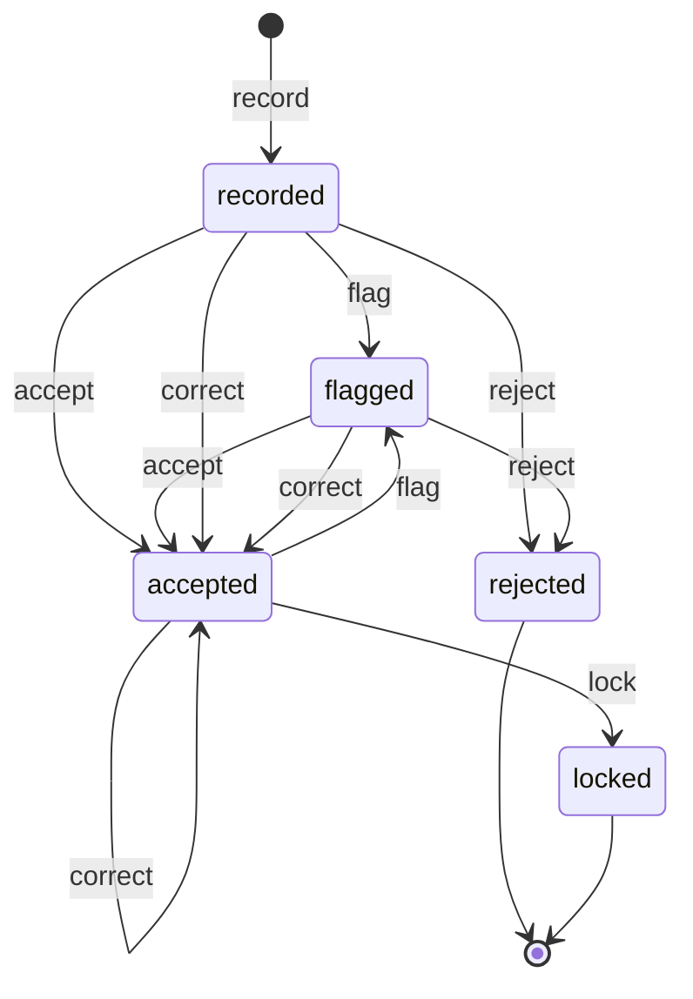
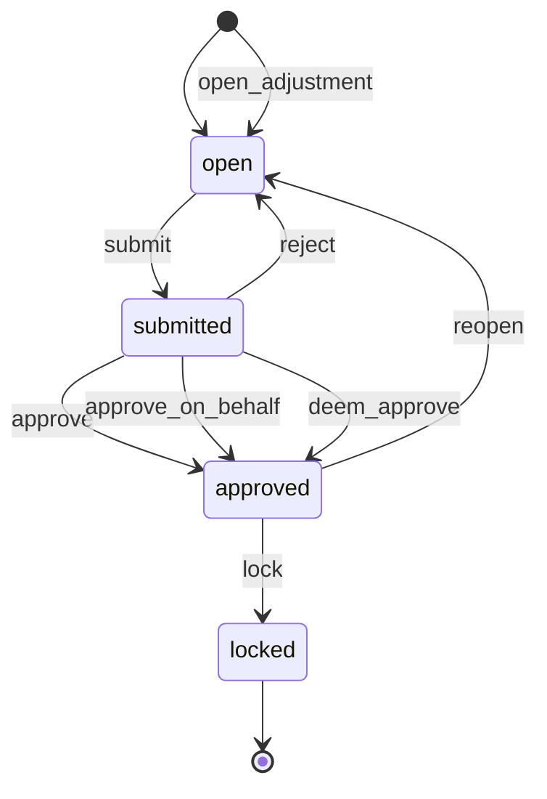
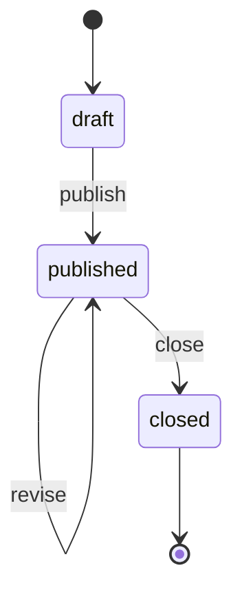

# wl-attendance

> Status: draft · Last updated: 2026-10-15

## 1. Purpose

Records who was at work, where and when, and turns it into approved hours charged to the
right cost object. Construction crews on a site, drivers at a depot, deployed workers at a
client's premises, accountants logging time on an engagement, and tutors teaching sessions
all need the same three things:

- attendance that can be trusted (marked by a supervisor or self check-in inside a
  geofence);
- timesheets that someone accountable approves, an internal manager or the client;
- one locked set of hours that payroll and billing both use.

Rosters plan the work ahead of time. The module does not pay anyone ([wl-hr](wl-hr.md))
and does not price anything ([wl-invoicing](wl-invoicing.md)).

## 2. Capabilities covered

| ID | Capability | Used by verticals | Scope |
|---|---|---|---|
| `HRM.ATT.01` | Attendance: supervisor marking or self check-in within a geofence | 02 MVP, 03 MVP, 09 MVP, 06 Later, 07 Later | MVP |
| `HRM.TMS.01` | Timesheets allocated to cost objects, overtime, approval | 02 MVP, 04 MVP, 09 MVP, 10 MVP, 07 Later, 08 Later | MVP |
| `HRM.ROS.01` | Shift rosters: patterns, assignment, gaps; feed bookable availability (formerly `CLN.ROS.01`) | 05 MVP; 09 Later | MVP |

All ten verticals are accepted (2026-10-15); the table lists only what their §5 tables name.
Platform rule: web and PWA, online only in the MVP. Without a signal, supervisors use the
late-entry window (§5.1); an offline queue is a shared Renox gap (R25, Later).

Related capabilities owned elsewhere:

| ID | Owner | Relation |
|---|---|---|
| `HRM.EMP.01`, `HRM.LEV.01`, `HRM.PAY.01`, `HRM.WPS.01` | wl-hr | Employees are the people attendance is recorded for (every timesheet owner needs at least a minimal employee record). Approved leave blocks rosters. Payroll consumes approved timesheets |
| `FIN.USG.01`, `FIN.RAT.01` | wl-invoicing | Usage billing reads approved timesheets × the client's rate card (09: bill rate per role and shift). Bill rates never enter this module |
| `FIN.CST.01` | wl-invoicing | Approved hours × cost rate are posted as labour cost, where the vertical posts cost from hours (§4, *Labour cost*) |
| `FIN.PAB.01` | wl-invoicing | Freelance tutors' approved timesheets become a monthly supplier bill (10) |
| `SCH.RES.01` | wl-scheduling | Bookable resources can take their availability from published rosters |

## 3. Concepts and entities

| Entity | Description | Important fields |
|---|---|---|
| Work location | A place where attendance can be recorded: a site, depot, client premises, branch, campus | name, scope (project, branch, client site…), `Subject` link, geofence (centre + radius, or polygon), outdoor flag, required check-in method, time zone |
| Crew | A named group of employees marked together | name, foreman (employee), members with dates, current work location |
| Work calendar | Working time rules for a scope; read from the business calendar in [`wl-kernel`](wl-kernel.md) | working days, weekend days (default Sat–Sun), normal hours per day/week, public holidays per year, reduced hours periods (e.g. Ramadan, 2 hours less per day) ✔ [S1]. Kept here: midday break window and dates per scope |
| Attendance record | Presence of one employee on one day at one location | employee, work location, date, check-in time, check-out time, mark (present, absent, late), method (`supervisor`, `self`, `device`, `import`), recorded by, recorded at, check-in/out position (only at those two moments), within geofence (yes/no/unknown), breaks taken (from–to; for crews marked in the midday break season the window is pre-filled), photo (optional), late-entry evidence (photo of the paper list, optional), flags, status |
| Attendance flag | A reason a record needs review | type (`outside_geofence`, `midday_break`, `missing_checkout`, `late`, `late_entry`, `manual_correction`, `duplicate`, `overtime_cap`, `permit_invalid`, `overlap`), note. The last three hold the record for review (`HRM.ACL.09`) |
| Timesheet | Hours of one owner for one period, waiting for approval | owner (employee or crew), period (from/to), context (`Subject`: deployment, project, engagement…), kind (`regular` or `adjustment`), approver kind (`internal` or `external`), approver role or party, approval basis (`approved`, `on_behalf`, `deemed`), consumers (`billed_by`, `paid_by`, `paid_provisionally_by`, `exported_at`), adjusted by (list of links to its adjustment timesheets; adding a link is not an edit of the timesheet), status |
| Adjustment timesheet | A timesheet of kind `adjustment` that corrects a `locked` timesheet. The original is never edited | adjusts (original timesheet), reason, origin (`client_dispute`, `attendance_error`, `payroll_error`, `provisional_reconciliation`), linked ticket or invoice dispute, affects (`billing`, `payroll` or `both`), entries with signed hours (+ or −) per day, cost object and category |
| Timesheet entry | Hours on one day against one cost object | timesheet, employee, date, cost object (`Subject`: cost code, work order, engagement service, job card, session), hours by category (normal, overtime, night, rest day, public holiday), billable flag, source (attendance, manual, generated), cost rate used per category (from `CostRateResolver`, §8), note |
| Approval evidence | Proof of an approval given outside the system | timesheet, document (signed sheet), approver name, date |
| Shift pattern | A reusable shift | name, start/end time, break, days of week, role |
| Roster | Planned shifts for a scope and period | scope, period, status |
| Shift | One planned shift | roster, work location, date, start/end, role, required qualification, assigned employee, status (open/assigned/confirmed/cancelled) |

Field names are generic. Verticals add their own fields through custom fields (`wl-kernel`) or
their own tables linked by `Subject`. Examples: trade on a construction entry, service code
on an accounting entry.

## 4. Lifecycles

### Attendance record

| State | Tone | Terminal | Meaning |
|---|---|---|---|
| `recorded` | neutral | no | Checked in; check-out may be missing |
| `flagged` | warning | no | Needs review (see flags) |
| `accepted` | success | no | Counts towards hours |
| `rejected` | neutral | yes | Does not count (duplicate, not worked) |
| `locked` | success | yes | Used by an approved timesheet; no further change |

| Transition | From | To | By | Guards | Effects |
|---|---|---|---|---|---|
| `record` | — | recorded | `attendance.mark` (supervisor), `attendance.self`, or system (import) | employee active; within the late-entry window (`HRM.ACL.01`); self check-in: the employee has no open check-in at another location (they must check out first) and none at the same location (a duplicate, refused with "already checked in here") | supervisor marking or import that overlaps another record of the same employee (any location or project; `rejected` records do not count) flags both `overlap`, or only the new one when the other is `locked`; `HRM.RUL.13` and `HRM.RUL.14` run; event `AttendanceRecorded` |
| `flag` | recorded, accepted | flagged | system | a flag rule matched (outside geofence, midday break, missing check-out, overtime cap, permit invalid, overlap) | reviewer notified |
| `accept` | recorded, flagged | accepted | `attendance.review`, or system at check-out when no flag | flags `overtime_cap`, `permit_invalid` and `overlap` need a reviewer's reason and are not accepted by the person who marked the record (`HRM.ACL.09`); an `overlap` is accepted only once the hours no longer overlap | hours proposed on the open timesheet; hours from a `permit_invalid` record are proposed non-billable |
| `correct` | recorded, flagged, accepted | accepted | `attendance.correct` | reason given; within the correction window; on a record with a held flag (`overtime_cap`, `permit_invalid`, `overlap`) the `accept` conditions of `HRM.ACL.09` apply: a reviewer's reason, not the person who marked it, and an `overlap` only if the corrected hours no longer overlap | original values kept in history; `manual_correction` flag noted; the overlap check, `HRM.RUL.13` and `HRM.RUL.14` run again on the corrected values, so a correction that creates an overlap flags both records `overlap` |
| `reject` | recorded, flagged | rejected | `attendance.review` | reason given | proposed hours removed |
| `lock` | accepted | locked | system (timesheet `approve`) | — | — |

**Vertical mapping (attendance)**

| Vertical | Default method | Notes |
|---|---|---|
| 02 Construction | supervisor marks crews | Self check-in in the site geofence optional per client; late entry from a paper or photographed list (`HRM.ACL.01`); midday break flag on check-ins (`HRM.RUL.01`) and on marked hours (`HRM.RUL.13`); biometric import Later |
| 03 Logistics | driver self check-in at the depot | Company or personal phones; location only at check-in and check-out; no-show after N = 15 minutes (`HRM.RUL.07`) |
| 09 Manpower | worker self check-in in the client site's geofence, or supervisor marking | Workers sign in to the PWA with mobile number and SMS one-time code; the supervisor checks in workers without a phone |
| 06 F&B, 07 Manufacturing (Later) | shift attendance | — |

### Timesheet (canonical, generalised from [02-construction.md](../verticals/02-construction.md#timesheet-shared--wl-attendance))

| State | Tone | Terminal | Meaning |
|---|---|---|---|
| `open` | neutral | no | Hours being collected or entered for the period |
| `submitted` | info | no | Waiting for the approver, internal or external |
| `approved` | success | no | Approved; attendance locked; cost posted; can still be reopened |
| `locked` | success | yes | Consumed by a payroll run, an invoice or an export; never changes again. Corrected only by an adjustment timesheet (`HRM.ACL.08`) |

| Transition | From | To | By | Guards | Effects |
|---|---|---|---|---|---|
| `open_adjustment` | — | open | `timesheets.adjust`, or system (`provisional_reconciliation`, §5.7) | the original is `locked` and of kind `regular` (an adjustment always points to the original, never to another adjustment); reason and origin given; for `client_dispute`, the linked ticket or invoice dispute, still open | adjustment timesheet created with kind `adjustment`, linked to the original (the link is added to `adjusted_by` on the original); the original's entries, totals, state and consumers are not changed |
| `submit` | open | submitted | `timesheets.submit`, or system (period end) | every accepted attendance day has hours allocated to a cost object; no attendance left `flagged` | approver notified (staff, or external party through the portal or an emailed approval link) |
| `approve` | submitted | approved | `timesheets.approve` (internal), or an external approver role on the context's party (portal or signed emailed link), or system for a `provisional_reconciliation` adjustment (§5.7 step 3) | approver kind matches the timesheet; adjustment: approver kind as the original's and the creator is not the approver (`HRM.ACL.08`) | attendance `lock`; labour cost posted to cost objects when the context posts cost from hours (`FIN.CST.01`, *Labour cost* below); adjustment: the signed delta is posted the same way; if payroll already used provisional hours (§5.7), the timesheet is `lock`ed at once (payroll is its first consumer) and the difference is sent to payroll (`TimesheetReconciliationNeeded`); event `TimesheetApproved` (not for a `provisional_reconciliation` adjustment, whose only event is `TimesheetReconciliationNeeded`) |
| `approve_on_behalf` | submitted | approved | `timesheets.approve_on_behalf` | approver kind is `external`; approval evidence attached (signed sheet) | as `approve`; evidence stored with the timesheet |
| `deem_approve` | submitted | approved | system (`HRM.RUL.15`) | approver kind is `external`; the context's contract has a deemed-approval clause (N days, from `ApproverResolver`); N days since `submit` with no approval or rejection | as `approve`, approval basis `deemed`; the external approver and the account manager are told the hours and that they were deemed approved |
| `reject` | submitted | open | approver | reason given | submitter notified |
| `reopen` | approved | open | `timesheets.reopen` | not consumed (provisional payroll use counts as consumed); for external approval, a new external approval will be needed (`HRM.ACL.02`) | labour cost reversed (if posted); attendance unlocked |
| `lock` | approved | locked | system (first consumer: payroll run, usage invoice, WIP billing, export; or at `approve` of a timesheet that already has `paid_provisionally_by`) | — | consumer recorded (`paid_provisionally_by` stays as the payroll consumer); later consumers still read it |

**Why `locked` replaces construction's `exported`:** in manpower, one approved timesheet is
used twice, once for the client invoice and once for payroll. A single terminal state per
consumer cannot express that. The timesheet locks at its first use and records each consumer
(`billed_by`, `paid_by`, `exported_at`).

**Correcting a locked timesheet (adjustment timesheet).** A `locked` timesheet is never edited
or reopened (`HRM.ACL.08`). A correction is a new timesheet of kind `adjustment` that holds
only the signed difference (+ or − hours per day, cost object and category), with a reason and
an origin. It runs through the same machine and is approved by the same approver kind as the
original: when the client approved the original, the client (or `approve_on_behalf` with the
signed agreed outcome) approves the adjustment. Its `affects` field says where it flows:

| Affects | Payroll (`wl-hr`) | Billing (`wl-invoicing`) |
|---|---|---|
| `billing` | nothing | original not yet invoiced: billed with it. Already invoiced: − hours → credit note against the original invoice (`FIN.ACL.01`); + hours → an extra line on the next usage invoice (or a separate invoice, per client setting) |
| `payroll` | + hours paid in the next run; − hours recovered as a deduction within the Art. 25 limits ([wl-hr](wl-hr.md)); after `paid`, through a supplementary run | nothing |
| `both` | as `payroll` | as `billing` |

A client dispute about billed hours sets `disputed` on the invoice (`wl-invoicing`). When the
business and the client agree to cut hours, a user with `timesheets.adjust` opens an adjustment
timesheet with origin `client_dispute`, linked to the open dispute, while the invoice is still
`disputed`; nothing opens it automatically. Its approval raises the credit note (`wl-invoicing`
§5.2), and the dispute is then resolved `credited`, naming the adjustment; the credit note and
the adjustment link to each other. A dispute resolved `upheld` needs no adjustment. By default it affects `billing` only: the worker's pay is not reduced because
the client disputes an invoice, unless the attendance itself was wrong (then `both`, with the
attendance evidence). Each adjustment records its own consumers; the original keeps its own.
A signed delta may not take the original plus its approved adjustments below 0 h for a day and
category; such an entry is refused on save. When the linked dispute is resolved `upheld`
before its adjustment is approved, the adjustment's `submit` is refused ("dispute resolved
upheld") and its creator is notified; it has no payroll or billing effect.

**Vertical mapping**

| Vertical | Owner and context | Approver | Source of hours | Consumers | Notes |
|---|---|---|---|---|---|
| 02 Construction | crew or employee; project | project manager (internal) | attendance, allocated to BOQ cost codes | payroll export, job costing | `exported` → `locked`. `HRM.ACL.02` (formerly `CON.ACL.09`) = reopen guard. Labour cost on approval at the trade's fully loaded rate (normal and overtime), or the worker's override |
| 04 Accounting | employee; engagement | manager (internal) | manual time entries per service | WIP billing (`ACC.TIM.01`) | No attendance. Entries are billable/non-billable; the engagement's fee basis decides whether time is billed. Write-offs stay in `ACC.TIM.01` |
| 09 Manpower | employee; deployment | client approver (external, portal or emailed link) or account manager with the signed paper sheet | attendance at the client site | usage invoice (`FIN.USG.01` × role rate card) and payroll run | `MPW.TSA.01` = `approve` by an external role + `approve_on_behalf` (`MPW.ACL.09`). `HRM.ACL.02` = reopen guard. No labour cost on approval: payroll posts actual salary cost per deployment |
| 10 EdTech | tutor (employed or `freelance`); period | academic manager (internal) | generated from sessions taught (`EDU.RUL.10`) | payroll (employed, Later) or monthly tutor bill (freelance, `FIN.PAB.01`) | Entries have the session as cost object; rate per tutor (session or hour) |
| 07 Manufacturing (Later) | employee; work order | line supervisor | attendance + manual allocation to work orders | job costing | In the MVP labour cost is the work order's start/stop hours × the line's hourly rate (`MFG.CST.01`), not timesheets |
| 08 Auto (Later) | technician; job card | workshop manager | manual clock on/off per job card | job costing, flat-rate comparison | In the MVP hours are entered on the job card (apps/auto) |

**Labour cost.** Cost is posted on `approve` only where hours are the cost source, so that no
cost is counted twice. The rate comes from `CostRateResolver` (§8), never from a bill rate.

| Vertical | Posted on approval | Rate |
|---|---|---|
| 02 Construction | yes | trade rate (apps/construction: salary, amortised visa, camp, transport, insurance; normal and overtime), overridden per worker in `wl-hr` |
| 09 Manpower | no | salary cost posted by the payroll run per deployment (`wl-hr`); bill rates on the rate card (`FIN.RAT.01`) are for invoices only |
| 10 EdTech | no | employed: payroll (Later); freelance: the tutor bill |
| 04 Accounting | optional per client | employee cost rate (`wl-hr` `CostRates`) |
| 07, 08 (Later) | yes | employee cost rate, or the vertical's rate |

### Roster

| State | Tone | Terminal | Meaning |
|---|---|---|---|
| `draft` | neutral | no | Being planned |
| `published` | success | no | Visible to employees; changes notify them |
| `closed` | neutral | yes | Period over |

| Transition | From | To | By | Guards | Effects |
|---|---|---|---|---|---|
| `publish` | draft | published | `rosters.manage` | no shift assigned to an employee on approved leave or without the required qualification | employees notified; availability published to `wl-scheduling` |
| `revise` | published | published | `rosters.manage` | — | affected employees notified |
| `close` | published | closed | system (period end) | — | open shifts reported as gaps |

## 5. Workflows

### 5.1 Supervisor marks a crew

This is the default method in 02 Construction (decided 2026-10-15).

1. The supervisor opens today's crew list for their work location. Only crews and employees
   assigned there are shown (scope, `HRM.ACL.01`).
2. They mark each member present, absent or late, with times. One action can mark the whole
   crew. Inside the midday break season, the break field of outdoor locations is pre-filled
   with the break window; removing it, or times that cross the window, flag the record
   `midday_break` (`HRM.RUL.13`).
3. The system records the supervisor's position once, at submission, as evidence that the
   marking happened on site.
4. Records are `accepted`, or `flagged` when a rule matches (midday break, overtime above the
   daily cap, expired work permit or visa, overlap with another site; `HRM.RUL.01`,
   `HRM.RUL.13`, `HRM.RUL.14`). A worker already marked at another site or project for the
   same hours is shown to the supervisor before submission.
5. **Late entry.** Without a signal, the supervisor keeps a paper or photographed list and
   enters it later, within the late-entry window (`HRM.ACL.01`, default 1 day back). Such
   records carry a `late_entry` note (like `manual_correction`, it does not hold the record
   for review), the time they were entered, and optionally the photo of the list; the
   position at entry is not used as site evidence.

### 5.2 Self check-in

Optional per client in 02; the usual method for drivers (03) and deployed workers (09).

1. The employee opens the PWA and taps *Check in*. Workers without email sign in with their
   mobile number and an SMS one-time code (09; R15). The PWA runs on company or personal
   phones (03). The browser asks for location once per check-in (R5 `rx-geolocate`). A
   photo can be required (R5 `rx-camera-capture`).
2. The server compares the position with the work location's geofence. Inside → `recorded`.
   Outside → `recorded` + `outside_geofence` flag. Location unavailable → flag `unknown`.
3. *Check out* repeats this. No position is collected between the two moments.
4. A record with no check-out at the end of the day is flagged `missing_checkout`.

### 5.3 Device or import (Later)

1. A biometric or face device exports a CSV per day.
2. The import matches device IDs to employees and work locations and creates records with
   method `device`.

### 5.4 Timesheet to approval

1. At period end, the system collects accepted attendance into each owner's open timesheet,
   or the source module generates entries (sessions taught, time logged).
2. The submitter allocates hours to cost objects and categories (normal, overtime, rest day,
   public holiday), using the work calendar.
3. On `submit`, the approver is notified: a staff role in scope, or the external party's
   approver in the portal.
4. On `approve`, attendance locks and labour cost is posted (`FIN.CST.01`).
5. Payroll and billing read approved timesheets. The first one to use a timesheet locks it.

### 5.5 Checks on hours

1. **Overtime cap.** `HRM.RUL.13` checks each employee's day across all locations and
   timesheets: hours above the daily normal hours plus the overtime cap (default 2 h a day;
   in Ramadan the normal hours are 2 h shorter) and overtime above 144 hours in any three
   weeks ✔ [S1] flag `overtime_cap`. Normal hours come from the business calendar for that
   date (0 on a rest day or public holiday, so the daily cap is then 2 h). Every record of the
   employee on that day that is not `locked` or `rejected` is flagged, so the reviewer sees the
   whole day; when all are `locked`, the supervisor is notified without a flag. The flag does not block; a reviewer accepts with a reason
   (`HRM.ACL.09`). Whether any of the law's exceptions to the cap applies is the employer's
   call, recorded in the reason.
2. **Midday break on marked hours.** `HRM.RUL.01` flags a check-in inside the window.
   `HRM.RUL.13` also checks the worked span (in to out, minus the breaks taken) of supervisor
   marking and manual timesheet entries at outdoor locations, so crews marked as a block are
   caught too. A manual entry is checked only when it has from–to times; an entry with hours
   only has no span to compare and is not checked.
3. **Work permit and visa.** `HRM.RUL.14` checks, at the attendance date,
   `document_valid(employee, kind, on_date)` (`wl-documents`) for the work permit and
   residence visa, and `qualification_valid(employee, kind, on_date[, role, scope])`
   (`wl-hr`; role and scope of the context for role-bound kinds) for qualifications the
   context requires (e.g. a SIRA licence). A failure flags `permit_invalid`: HR and the supervisor are
   told. While the record is `flagged`, no hours are proposed on the timesheet and the
   timesheet cannot be submitted (`submit` guard). HR's review is the `accept` by a reviewer
   (`HRM.ACL.09`); its hours are then proposed non-billable, and they count for payroll. In 09 the
   deployment `suspend` (from `DocumentExpired`) should stop attendance before it happens; this
   flag catches what slips through. Only the document kinds configured for the client and the
   context's required qualifications are checked; a freelancer (no company work permit) is
   checked for the work permit only when the client adds that kind.
4. **Overlap.** One employee cannot be present at two places at once. Self check-in elsewhere
   is refused until the employee checks out. Supervisor marking or import that overlaps
   another record flags both `overlap` (a `locked` record cannot change, so only the new one is
   flagged and its note names the locked record). Timesheet `submit` refuses entries whose
   hours for an employee and day, summed across all timesheets and projects, exceed the
   attended hours. The check applies only to contexts whose hours come from attendance (02,
   09; §4 vertical mapping), not to manual or generated hours (04, 10), and adjustment
   timesheets are left out of the sum (their correction is approved explicitly). When the
   system `submit` at period end (`HRM.RUL.08`) fails this or another guard, the timesheet
   stays `open` and the submitter gets a task listing the days.

### 5.6 Approver does not respond

1. `HRM.RUL.08` submits at period end and reminds the approver after N days; the second
   reminder also notifies the account manager.
2. `HRM.RUL.15` continues the ladder: at E days the client's escalation contact (from the
   contract) and the account manager's manager are notified; the account manager gets a task to
   collect a signed sheet (`approve_on_behalf`). Days are calendar days in Asia/Dubai from the
   latest `submit` date; the rule runs once a day at 08:00. The manager is the account
   manager's line manager in wl-hr; without one, the users with
   `timesheets.approve_on_behalf` in the context's scope are notified and the task says no
   manager was found. Without an escalation contact on the contract, only the manager is
   notified and the task says so.
3. If the contract has a deemed-approval clause, at its N days the system runs `deem_approve`.
   N is read from `ApproverResolver` when the rule runs, so a contract change while waiting
   applies. When N ≤ E, `deem_approve` runs first in the same daily run and the escalation at
   E then finds nothing to send.
   The client is told the hours and the dispute route. A later dispute is handled as an
   adjustment (§4). Without the clause, the timesheet stays `submitted` and the task stays
   open.
4. Billing waits for approval (deemed or not). Payroll does not wait (§5.7).

### 5.7 Payroll cut-off with unapproved timesheets

Salary does not wait for the client. The WPS due date is fixed by law (wl-hr, MR 340/2026)
✔ [S6], and a client's delay is not a reason to pay a worker late.

1. At the payroll cut-off, `Timesheets::hours_for_payroll(period)` returns approved hours,
   and for timesheets still `open` or `submitted` the accepted attendance hours, marked
   *provisional*. Only `accepted` attendance counts: a record still `flagged` at the cut-off
   is left out, and its hours reach payroll later through the reconciliation in step 3 once
   it is accepted. The period is the payroll period from `PayrollCalendar` (wl-hr); hours not
   yet recorded at the cut-off are picked up by the reconciliation. The policy is a setting: `attendance` (default) or `wait` (only for
   internal approvers who are the employer's own staff).
2. The payroll run records `paid_provisionally_by` on those timesheets. They can no longer be
   reopened without an adjustment.
3. When the timesheet is approved (or deemed approved), it is `lock`ed at once (payroll is
   its first consumer) and the approved hours are compared with the provisional hours. A
   difference creates an adjustment timesheet with origin `provisional_reconciliation`,
   affecting `payroll`, and emits `TimesheetReconciliationNeeded`; `wl-hr` puts the difference
   in the next run (− within the Art. 25 limits). The original's approval already covers these
   hours, so the system submits and approves the adjustment in the same step: approver and
   approval basis are copied from the original's approval, it is not sent to the approver
   again, and it emits no `TimesheetApproved` of its own (payroll applies the difference once).
4. If the client cuts billable hours but the attendance stands, the cut is a billing matter
   (`affects` = `billing`); the worker keeps the pay.

### 5.8 Correcting a locked timesheet

1. A user with `timesheets.adjust` opens an adjustment on the locked timesheet: reason,
   origin, `affects`, signed hours; for a client dispute, the invoice dispute or ticket.
2. It is submitted and approved like any timesheet, by the original approver kind; its creator
   cannot approve it (`HRM.ACL.08`). The exception is a system `provisional_reconciliation`
   adjustment, approved in the same step as the original (§5.7 step 3).
3. On approval, `TimesheetApproved` (kind `adjustment`) tells payroll and billing; they act per
   the table in §4. Every step is audited and linked both ways.

### 5.9 Rostering (05 MVP, 09 Later)

1. A planner creates a roster for a scope and period from shift patterns.
2. Shifts are assigned. Employees on approved leave (`wl-hr`) or without a required
   qualification cannot be assigned.
3. Publishing notifies employees and exposes working time to `wl-scheduling`, so bookable
   resources (practitioners, tutors) are available only when rostered.
4. Unfilled shifts are reported as gaps.

## 6. Interfaces to other modules

**Provides**

| Service | Purpose | Used by |
|---|---|---|
| `Timesheets` | Approved hours per employee, period, cost object and category; mark a timesheet consumed; `hours_for_payroll(period)` with provisional hours for unapproved timesheets (§5.7); adjustments with their `affects` | wl-hr (payroll), wl-invoicing (usage billing, job costing, freelance tutor bills), apps/accounting (WIP billing, `ACC.TIM.01`) |
| `Presence` | Who is (or was) checked in at a location on a date | apps (no-show rules such as `HRM.RUL.07`, dispatch readiness in logistics) |
| `WorkingTime` | Rostered working time per employee and location; midday break window per scope | wl-scheduling (availability), wl-hr (overtime), apps (03 `WRK.RUL.15` rider runs in the midday break) |

**Consumes**

| From | What |
|---|---|
| wl-kernel | `Subject` references, business calendar (working days, weekends, public holidays, Ramadan hours), settings, approvals (`PLT.APR.01`), automations, custom fields |
| wl-hr | `Workforce`: is the employee active, on leave; employment type. `Qualifications` (`HRM.QUA.01`, guard `qualification_valid`) for roster guards and `HRM.RUL.14`. `CostRates`. `PayrollCalendar` (payroll cut-off date per entity and period, §5.7) |
| wl-documents | guard `document_valid(employee, kind, on_date)` with `on_date` = the attendance date for the work permit and residence visa (`HRM.RUL.14`) |
| wl-invoicing | invoice `disputed` flag and `resolve_dispute` outcome `credited`, linked to an adjustment timesheet |
| wl-invoicing | `CostPoster`: post and reverse labour cost on cost objects |
| wl-notify | notifications to supervisors, approvers, employees (SMS for workers without email) |
| wl-portal | external approver role for timesheets, approval by signed emailed link; worker PWA login (`POR.SLF.02`, SMS one-time code) |
| apps | trade rates (02, `CostRateResolver`), approver, escalation contact and deemed-approval days per deployment contract (09, `ApproverResolver`), sessions taught (10, `EntrySource`) |

**Events emitted**

| Event | When | Payload |
|---|---|---|
| `AttendanceRecorded` | check-in, check-out or supervisor marking | record, employee, location, date, method, within geofence, flags |
| `AttendanceFlagged` | a flag is added | record, flag type |
| `TimesheetTransitioned` | every timesheet transition | timesheet, from, to, transition |
| `TimesheetApproved` | `approve` / `approve_on_behalf` / `deem_approve` | timesheet, owner, period, context, totals per category, approver kind, approval basis; for an adjustment: kind, adjusts, origin, affects, signed totals |
| `TimesheetReconciliationNeeded` | approval of a timesheet paid provisionally, with different hours | timesheet, payroll run, provisional hours, approved hours, delta per category, adjustment timesheet |
| `TimesheetLocked` | first consumer | timesheet, consumer type and reference |
| `RosterPublished` | `publish`, `revise` | roster, scope, period, changed shifts |
| `ShiftGap` | roster closed or publish with open shifts | roster, shifts |

**Attaches to:** attendance records and timesheets reference a context `Subject` (project,
deployment, engagement, work order, job card) and cost objects (`Subject`). Work locations
link to a `Subject` (site, depot, client site, branch, campus).

**Permissions**

| Permission | Allows |
|---|---|
| `attendance.view` | see attendance in scope |
| `attendance.mark` | mark attendance for crews and employees in scope (supervisor) |
| `attendance.self` | check in and out for oneself |
| `attendance.review` | accept or reject flagged records |
| `attendance.correct` | correct times within the correction window |
| `attendance.location.view` | see recorded positions (`SEN`, audited) |
| `timesheets.view` | see timesheets in scope |
| `timesheets.submit` | submit timesheets |
| `timesheets.approve` | approve or reject (internal approver) |
| `timesheets.approve_on_behalf` | approve for an external approver with evidence |
| `timesheets.reopen` | reopen an approved, unconsumed timesheet |
| `timesheets.adjust` | open an adjustment timesheet on a locked timesheet |
| `rosters.view` / `rosters.manage` | see / plan and publish rosters |
| `work_locations.manage` | create locations and geofences |

**Access rules.** Shared rules owned here ([ACCESS-CONTROL.md](../ACCESS-CONTROL.md) §9,
status *in use*):

| ID | Rule | Generalises | Pattern | Default |
|---|---|---|---|---|
| `HRM.ACL.01` | A supervisor marks attendance only for crews or people assigned to their location, and only for today or within the late-entry window | `CON.ACL.01`, `MPW.ACL.13` | scope, `TIM` | 1 day back |
| `HRM.ACL.02` | An approved timesheet is locked; reopening needs a manager (and a new external approval when the client approved) | `CON.ACL.09`, `MPW.ACL.08` | `STA` | — |
| `HRM.ACL.08` | A `locked` timesheet is never edited or reopened; it is corrected only by an adjustment timesheet with a reason, approved by the original's approver kind, and not by the user who created it | new (X-16) | `STA`, `SOD` | — |
| `HRM.ACL.09` | An attendance record flagged `overtime_cap`, `permit_invalid` or `overlap` is accepted only by `attendance.review` with a reason, and not by the supervisor who marked it | new (X-16) | `STA`, `SOD` | — |

Remaining promotion candidates:

| Rule | Found as | Pattern |
|---|---|---|
| An internal user may approve for an external approver only with signed evidence | `MPW.ACL.09` | `STA` |
| Recorded positions are sensitive: `attendance.location.view` only, every view audited | new (privacy, §10) | `SEN` |

**Automations**

| ID | When | If | Then | Parameters (default) |
|---|---|---|---|---|
| `HRM.RUL.01` | attendance recorded | location is outdoor; time inside the midday break window and period | flag `midday_break`; notify the HSE officer or supervisor | 12:30–15:00, 15 Jun–15 Sep ✔ [S3], [S4]; MoHRE announces it each year |
| `HRM.RUL.07` (from `MPW.RUL.02`, `CON.RUL.01`, `LOG.RUL.08`) | N minutes after shift start, or at time T | no attendance for an assigned or rostered employee | notify supervisor (no-show) | 30 min (03: 15 min) / 10:00 |
| `HRM.RUL.08` (from `MPW.RUL.03`, `MPW.RUL.04`) | period end; N days after submit | open timesheet with entries; not approved | submit to the approver; remind the approver, escalate on the second reminder | N = 3 |
| `HRM.RUL.13` | attendance recorded or corrected; timesheet entry saved | the employee's hours that day (all locations and timesheets) exceed normal hours + the daily overtime cap, or overtime exceeds the 3-week cap; or, at an outdoor location in the season, the worked span minus breaks crosses the midday break window | flag `overtime_cap` or `midday_break`; notify the supervisor (and the HSE officer for the midday break) | cap 2 h/day, 144 h per 3 weeks ✔ [S1]; window as `HRM.RUL.01` |
| `HRM.RUL.14` | attendance recorded | `document_valid(employee, work_permit, date)` or `document_valid(employee, residence_visa, date)` fails at the attendance date, or `qualification_valid(employee, kind, date)` fails for a qualification the context requires | flag `permit_invalid`; notify HR and the supervisor; on `accept` the hours are proposed non-billable | kinds checked: work permit, residence visa (per client) |
| `HRM.RUL.15` | E days after submit; N days after submit | external timesheet still `submitted` | at E: notify the client's escalation contact and the account manager's manager, task to collect a signed sheet; at N, if the contract has a deemed-approval clause: timesheet `deem_approve` and notify the client | E = 6; N = per contract (off when the contract has no clause); calendar days, checked daily at 08:00 Asia/Dubai |
| Candidate (new) | end of day | record without check-out | flag `missing_checkout`; notify employee and supervisor | 23:00 |

`HRM.RUL.15` continues the ladder of `HRM.RUL.08` (reminder at N = 3 days, account manager
on the second reminder). `EDU.RUL.10` (10 EdTech) stays a vertical rule: it generates tutor timesheets from sessions
taught through `EntrySource`; `HRM.RUL.08` then submits them. `WRK.RUL.15` (formerly `LOG.RUL.11`) reads the
midday break window from `WorkingTime`. `MPW.RUL.09` (09) reads `Presence` to detect N days
without attendance.

## 7. Configuration per client

| Setting | Default |
|---|---|
| Check-in methods enabled | supervisor marking on; self check-in off (on for 03 drivers and 09 workers); device import off (Later) |
| Geofence radius when only a centre is set | 150 m |
| Out-of-geofence check-in | allowed with flag (alternative: blocked) |
| Photo at self check-in | off |
| Late-entry and correction window for supervisors (`HRM.ACL.01`) | 1 day back |
| Labour cost posted on timesheet approval | per context type: on for 02; off for 09 and 10 (payroll or bills post the cost); optional for 04 (§4, *Labour cost*) |
| Timesheet period | weekly (alternatives: daily, fortnightly, monthly, per deployment billing cycle) |
| Hour categories in use | normal, overtime, rest day, public holiday (night optional) |
| Work calendar: weekend, daily and weekly normal hours (business calendar, `wl-kernel`) | Sat–Sun (the law requires at least one paid rest day a week, Art. 21; the days are the employer's choice); 8 h/day, 48 h/week maximum (Art. 17) ✔ [S1] |
| Public holidays (business calendar, `wl-kernel`) | loaded per year by the operator. Cabinet Resolution 27 of 2024 sets the same holidays for the public and private sectors: 1 January, Eid Al Fitr, Arafat Day, Eid Al Adha, Hijri New Year, the Prophet's Birthday, 2–3 December. Hijri dates follow moon sighting and the Cabinet may move non-Eid holidays to the start or end of the week ✔ [S2] |
| Reduced hours periods (business calendar, `wl-kernel`) | Ramadan: 2 h less per day (ER Art. 15(2)) ✔ [S1] |
| Midday break window and dates | 12:30–15:00, 15 Jun–15 Sep ✔ [S3], [S4] |
| Retention of check-in positions | 90 days, then only the *within geofence* result is kept |
| Overtime cap checked by `HRM.RUL.13` | 2 h a day, 144 h per 3 weeks ✔ [S1] |
| Work permit and visa check (`HRM.RUL.14`) | on; kinds: work permit, residence visa; plus qualifications required by the context |
| Approval escalation (`HRM.RUL.15`) | escalation at E = 6 days after submit |
| Deemed approval of external timesheets | off; N days set per contract (`ApproverResolver`) |
| Payroll basis for timesheets not approved at the cut-off | `attendance` (accepted attendance hours, provisional; `flagged` records left out until accepted); alternative `wait` only for internal approvers |
| Adjustment of already-invoiced hours (+) | extra line on the next usage invoice (alternative: separate invoice) |
| Approver per context type | internal role in scope; external for contexts whose contract says so (09: portal or emailed link; signed paper sheet uploaded by staff) |

## 8. Extension points

- **`OvertimePolicy`** (strategy): splits a day's hours into categories from the work
  calendar. Default: over the daily normal hours = overtime, rest day and public holiday
  hours as their own categories. Verticals or clients can override, e.g. weekly averaging.
- **`EntrySource`** (strategy): generates timesheet entries from another module. Examples:
  sessions taught (EdTech), job card clock-on (Auto), work order bookings (Manufacturing).
- **`CostRateResolver`** (strategy): the cost rate per hour category for an entry. Default:
  `wl-hr` `CostRates` for the employee. Construction: the trade's fully loaded rate
  (normal and overtime) from apps/construction, unless the worker has an override.
- **`ApproverResolver`** (strategy): who approves a timesheet for a context. Default: the
  role in scope. Manpower resolves the client approver from the deployment's contract.
- **Events** in §6 for vertical automations (no-show handling, replacement deployments).
- **Custom fields** on attendance records, timesheet entries and work locations.
- **Overridable views:** crew marking page, self check-in page (PWA), timesheet grid,
  roster week view.

## 9. Renox fit

| Need | Renox provides | Gap |
|---|---|---|
| Location at check-in | — | R5 `rx-geolocate` |
| Photo at check-in | file uploads | R5 `rx-camera-capture` |
| Installable app for field staff | — | R6 PWA |
| Worker login without email (mobile number + SMS one-time code) | — | R15 (via `wl-portal`) |
| Geofence check on the server (radius and polygon) | — | R20 geo helpers |
| Drawing a geofence on a map | — | R20 map picker (tile provider licence to choose) |
| Recording attendance without a signal | — | offline queue: shared Renox gap (R25), Later; MVP uses the late-entry window |
| Approval by emailed link | ✔ signed, expiring URLs (`state.signed_url`, `ValidSignature`) | — |
| Roster week view | month calendar block | R5 `rx-week-calendar` |
| Timesheet grid editing | grid, repeater | — |
| Scoped permissions (location, project, client site) | `has_permission_in`, `scopes_with` | — |
| Device CSV import (Later) | CSV import with validation | R23 for Excel exports |
| State machines | — | R12 |
| Work calendar and policy settings | `.env` only | R2 settings store |
| Period-end jobs and reminders | scheduler, queue | — |

## 10. Compliance

- **Working time:** normal hours, overtime premiums, rest days and Ramadan hours follow
  the UAE labour law (Federal Decree-Law 33 of 2021 and its executive regulations): at
  most 8 hours a day or 48 a week, at most 2 overtime hours a day and 144 hours per three
  weeks, Ramadan hours 2 hours shorter, at least one paid rest day ✔ [S1]. They are
  defaults, editable per client.
- **Midday break:** outdoor work is prohibited in the yearly window set by MoHRE
  (12:30–15:00, 15 June–15 September in 2024–2026) ✔ [S3], [S4]. `HRM.RUL.01` flags; it
  does not block, because some work is exempt: work that cannot be interrupted for
  technical reasons, and emergency or public-service work ✔ [S3], [S4].
- **Overtime cap:** hours above the daily cap are flagged, not blocked (`HRM.RUL.13`). The law
  has exceptions to the cap; which apply, and the penalty for exceeding it, are
  `⚠ open: lawyer (L-27)`.
- **Work without a valid permit or visa:** `HRM.RUL.14` flags it the same day. The employer's
  exposure, and whether the hours must still be paid in full (the default here: they are paid,
  not billed until HR reviews), are `⚠ open: lawyer (L-28)`.
- **Salary timing:** salary is paid by the WPS due date whether or not the client approved
  the timesheet (§5.7) ✔ [S6]. Later corrections go through the next run; deductions stay
  within Art. 25 (wl-hr).
- **Deemed approval:** valid only where the client contract says so. Whether a deemed-approved
  timesheet is enough evidence in a billing dispute is `⚠ open: lawyer (L-29)`.
- **PDPL:** location is collected only at check-in and check-out, never continuously. It is
  shown only to `attendance.location.view` holders, every view is audited, and raw positions
  are deleted after the retention period. Employees are told in the app why location is
  collected. Photos at check-in are personal data; the PDPL treats data processed with a
  specific technique to identify a person, such as facial images, as biometric (sensitive)
  data ✔ [S5] (secondary translation). Whether a plain photo reviewed by a supervisor falls under that definition
  `⚠ open: lawyer (L-05)`.
- **Records:** attendance and timesheets support payroll and WPS evidence. Keep them for
  at least two years after the end of service (Art. 13(1)) ✔ [S1]; records used as payroll
  evidence follow the longer payroll retention in [wl-hr](wl-hr.md).
- **Audit:** corrections, rejections, approvals on behalf, deemed approvals, adjustments and
  reopenings are audited with reasons.

## 11. Out of scope

| Not here | Where it lives |
|---|---|
| Pay calculation, payslips, WPS files | wl-hr |
| Prices, bill rates, invoices from hours | wl-invoicing (`FIN.USG.01`), apps (rate cards) |
| Leave requests and balances | wl-hr (leave blocks rosters and attendance) |
| Continuous GPS tracking of people or vehicles | not done (PWA limits and privacy). Vehicle telematics: logistics (Later) |
| Biometric device management | the device vendor; we import its export |
| Student attendance (EdTech) | `EDU.ATT.01`: students are not employees |
| Booking of customers into resources | wl-scheduling |

## 12. Open questions

1. ~~Promote `CLN.ROS.01` into `HRM.ROS.01`, making rosters MVP for clinics?~~ Decided
   (2026-10-14): yes; 05 uses `HRM.ROS.01` in the MVP, 09 Later. *(us)*
2. ~~Promote `MPW.TSA.01` into `HRM.TMS.01` (external approver role + approval on
   behalf)?~~ Decided (2026-10-14): yes; 09 lists `HRM.TMS.01` as absorbing `MPW.TSA.01`.
   *(us)*
3. ~~Should the work calendar (public holidays, weekends) move to `wl-kernel`?~~ Decided
   (2026-10-14): yes, the business calendar in `wl-kernel` (see below). *(us)*
4. Is a photo at self check-in acceptable to clients' workers and under PDPL? *(client,
   legal)*
5. Which biometric device brands are common at UAE camps and sites, and what do they
   export? *(client)* Device import is Later in 02 and 09 (decided 2026-10-15).
6. Do clients need overtime pre-approval (request before working) or only approval on the
   timesheet? *(client)*
7. ~~Is an offline attendance mode needed for the MVP?~~ Decided (2026-10-15, 02 §13
   question 1): no. Online only; without a signal the supervisor uses the late-entry window
   (`HRM.ACL.01`). The offline queue is a shared Renox gap (R25, Later). *(client)*
8. ~~Do workers check in themselves?~~ Decided (2026-10-15): in 02 the supervisor marks crews
   by default and self check-in is optional per client; in 09 workers check in through the
   PWA with an SMS one-time code, and the supervisor checks in those without a phone; in 03
   drivers check in on company or personal phones. *(client)*
9. ~~How is the labour cost rate set in construction?~~ Decided (2026-10-15, 02 §13 question
   8): per trade, fully loaded, normal and overtime rates, with an optional override per
   worker (`CostRateResolver`). *(client)*

**Decided during reconciliation (2026-10-14):** working days, hours, public holidays and
Ramadan hours come from the business calendar in [`wl-kernel`](wl-kernel.md).

## Sources

Checked 2026-10-15. *Official* = government or legislation; others are secondary.

| # | Source | Type | Used for |
|---|---|---|---|
| S1 | MoHRE, "Federal Decree-Law 33 of 2021 and its amendments, with the Executive Regulations (consolidated)", https://www.mohre.gov.ae/assets/download/3bde4984/Federal%20Decree-Law%20No.%2033%20of%202021%20Regarding%20the%20Regulation%20of%20Employment%20Relationship%20and%20its%20amendments_638990571068264034.pdf.aspx | Official | Hours (Art. 17), rest day (Art. 21), Ramadan hours (ER Art. 15), records (Art. 13) |
| S2 | Cabinet Resolution 27 of 2024 on official holidays, https://uaelegislation.gov.ae/en/legislations/2595/download | Official | Public holidays, moves of holidays |
| S3 | MoHRE, "Midday break from 15 June to 15 September 2024", https://mohre.gov.ae/en/media-center/news/31/5/2024/mohre-implements-midday-break-from-15-june-to-15-september-2024 | Official | Midday break window and exemptions |
| S4 | What's On, "Midday work ban 2026", https://whatson.ae/2026/06/midday-work-ban-uae-2026/ | Secondary | Midday break 2026 dates |
| S5 | Hunton Andrews Kurth, "Data protection in the UAE – game changing federal UAE data law", https://hunton.com/insights/legal/data-protection-in-the-uae-game-changing-federal-uae-data-law | Secondary | PDPL definition of biometric data |
| S6 | MoHRE, "Ministerial Resolution 340 of 2026 concerning the Wage Protection System", https://www.mohre.gov.ae/assets/download/9e530b2e/Ministerial%20Resolution%20No.%200340%20of%202026.pdf.aspx (see [wl-hr.md](wl-hr.md) S2) | Official | WPS due date |
