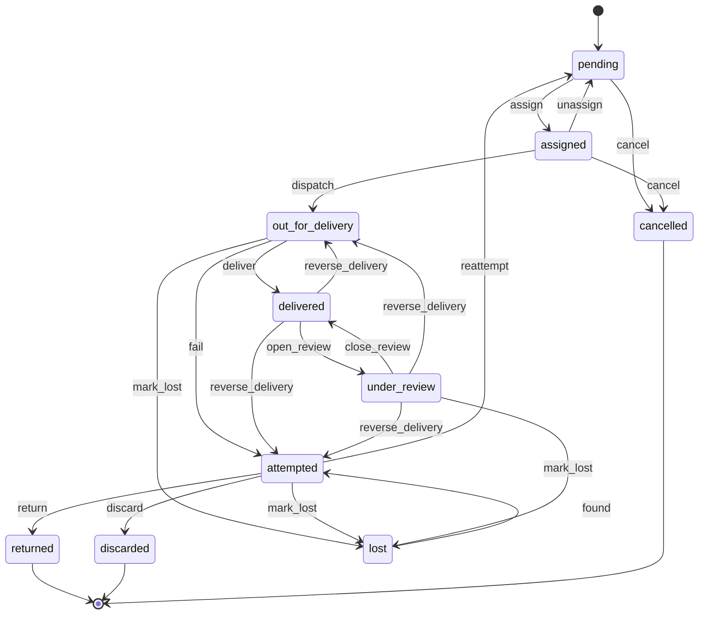
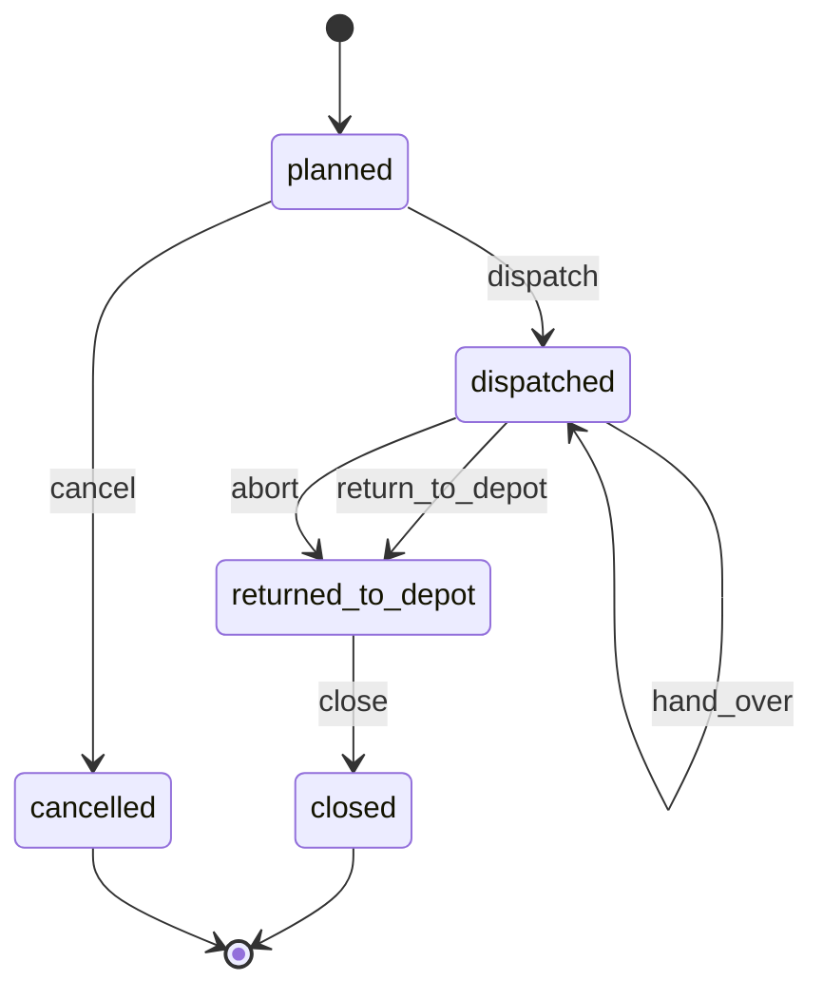

# wl-delivery

> Status: draft · Last updated: 2026-10-15

## 1. Purpose

Getting something from the business to a recipient and proving it happened. The module
groups deliveries into runs, assigns them to a driver and vehicle, gives the driver a day
list on the phone, records the outcome of each stop with proof (photo, signature or OTP, time
and location), and handles failed attempts. It does not know what is being delivered. The
source (a sales order, a dispatch note, a parcel shipment, an F&B order) is a `Subject`, and
the source module reacts to the delivery's events.

## 2. Capabilities covered

| ID | Capability | Used by verticals | Scope |
|---|---|---|---|
| `WRK.DSP.01` | Dispatch: assign deliveries to drivers and runs; driver's day list (formerly `LOG.DSP.01`) | 03 ●, 06 ●, 07 ●, 08 ● | MVP |
| `WRK.POD.01` | Proof of delivery or completion: photo, signature or OTP, location | 03 ●, 06 ●, 07 ●, 08 ● | MVP |

06 F&B uses both capabilities in the MVP for direct orders delivered by the outlet's own
riders (06 §13 question 4). 07 hands its dispatch notes to this module for its own deliveries;
they are confirmed by `DeliveryDelivered`.

Related capabilities owned elsewhere: `STK.DSP.01` pick, pack and delivery notes
(`wl-inventory`), `FIN.CSH.01` cash custody (`wl-payments`), `FIN.CHQ.01` cheques collected
on delivery (`wl-payments`).

## 3. Concepts and entities

| Entity | Description | Important fields |
|---|---|---|
| Delivery | One drop to one recipient | number, source `Subject` (sales order, dispatch note, shipment, F&B order), branch or depot, recipient (party, name, phone), address (text, area, coordinates, building number such as Makani), time window, instructions, lines, perishable flag, amount to collect (cash on delivery; the sum of the line amounts when the source gives them), cheque expected, POD methods required, attempts, max attempts, run, sequence on the run, frozen flag (COD and billing held while under review), liability (when lost or reversed), status |
| Delivery line | One item or parcel on the delivery, copied from the source | delivery, source line reference, description, quantity, amount to collect (when the source gives line amounts), delivered quantity, refused quantity, refusal reason, refused quantity received back or missing (at run close) |
| Run | One driver's trip with ordered stops | number, date, depot, driver (user with the driver role, linked to an employee in `wl-hr`), vehicle type (van, truck, motorbike, on foot), vehicle (asset in `wl-inventory`, `STK.AST.01`; none for on-foot riders), estimated duration, stops (deliveries and pickups) in order, planned start, vehicle check (`WRK.CHK.01`), abort reason, hand-overs (to run, deliveries, cash amount, confirmed by the receiving driver, time, location), status |
| Attempt | The outcome of one visit | delivery, run, outcome (`delivered` or `failed`), failure reason, time, location (captured at that moment), proof of delivery |
| Proof of delivery | Evidence of the outcome | attempt, method(s) used (photo, signature, OTP), recipient name, photos, signature image, OTP verified flag, per-line delivered and refused quantities, cash expected, cash collected, cash difference and its reason, difference absorbed by, cheque reference, notes, reversed flag and reversal reference (never edited) |
| Failure reason | Configurable list | code, label EN/AR, counts as an attempt, allows reattempt |
| Refusal reason | Configurable list for refused lines | code, label EN/AR (damaged, wrong item, not ordered, short-dated, temperature, other) |
| COD difference reason | Configurable list | code, label EN/AR (recipient short of cash, disputes the amount, agreed discount, no change), default absorbed by |

Pickups (collecting from a client, as in Logistics) are deliveries with direction
*pickup*. They use the same machine and proof.

## 4. Lifecycles

### 4.1 Delivery

Generalised from the delivery part of the Logistics *Shipment* ([03-logistics.md](../verticals/03-logistics.md)
§7.1), the auto parts delivery ([08-auto.md](../verticals/08-auto.md)) and the manufacturing
*Dispatch* outcome ([07-manufacturing.md](../verticals/07-manufacturing.md) §7.1).

| State | Tone | Terminal | Meaning |
|---|---|---|---|
| `pending` | neutral | no | Ready to be planned onto a run |
| `assigned` | info | no | On a planned run with a driver |
| `out_for_delivery` | info | no | The run has left |
| `attempted` | warning | no | The last visit failed; waiting for reattempt, return or discard |
| `delivered` | success | no | Handed over with proof, in full or with refused lines; reversible only through review |
| `under_review` | warning | no | The recipient denies the delivery or it was marked by mistake; COD and billing frozen |
| `lost` | error | no | Goods untraced; excluded from billing; can be found again |
| `returned` | neutral | yes | Brought back to the origin after failed attempts or refusal |
| `discarded` | neutral | yes | Perishable goods destroyed after a failed attempt; wastage recorded |
| `cancelled` | neutral | yes | Not needed any more |

| Transition | From | To | By | Guards | Effects |
|---|---|---|---|---|---|
| `assign` | pending | assigned | `deliveries.dispatch` | run is `planned`; the driver is available; the run's driver passes `qualification_valid` (licence, permit) and its vehicle `document_valid` on the run date for the kinds whose `blocks` list `delivery.assign` (wl-documents §5.6) | added to the driver's day list |
| `unassign` | assigned | pending | `deliveries.dispatch` | run not dispatched | — |
| `dispatch` | assigned | out_for_delivery | system (run `dispatch`) | — | recipient notified with the time window; event `DeliveryOutForDelivery` |
| `deliver` | out_for_delivery | delivered | `deliveries.complete` (the assigned driver) | the required POD methods captured; per line, delivered + refused = quantity, and every refused quantity has a refusal reason; at least one unit delivered; partial acceptance allowed for the source type (when it is off, no refused quantity: every line is delivered in full, or the driver uses `fail` with reason *refused*); cash collected not above expected (change is given back) and = expected (the amount to collect less the amounts of refused quantities, when the lines carry amounts) within the tolerance, or the difference has a reason and, above the tolerance, approval (`WRK.ACL.09`) | attempt and proof saved; cash collected added to the driver's cash custody (`FIN.CSH.01`); cheque registered (`FIN.CHQ.01`); refused lines come back on the run like undelivered goods; event `DeliveryDelivered` with per-line delivered and refused quantities and the COD difference |
| `fail` | out_for_delivery | attempted | `deliveries.complete` | failure reason chosen; location captured | attempt saved; recipient and source notified; event `DeliveryAttemptFailed` |
| `reattempt` | attempted | pending | `deliveries.manage` or system | attempts < max attempts; the reason allows a reattempt; not perishable (`WRK.RUL.16`) | queued for the next run |
| `return` | attempted | returned | `deliveries.manage` or system (attempts ≥ max, or perishable policy *return*) | goods back at the origin, scanned or confirmed | event `DeliveryReturned` |
| `discard` | attempted | discarded | `deliveries.manage` or system (perishable policy *discard*, `WRK.RUL.16`) | perishable; reason and photo; wastage above the limit approved (`STK.ACL.02`) | wastage record through `wl-inventory` with the source as reference; source notified; event `DeliveryDiscarded` |
| `open_review` | delivered | under_review | `deliveries.manage`, or system (dispute ticket from the recipient or the client) | reason; linked ticket (`wl-ticketing`) | frozen flag set: COD of this delivery held out of remittances and settlements, billing of the source held (the issued invoice gets the `disputed` flag in `wl-invoicing`); dispatcher and source notified; event `DeliveryDisputed` |
| `close_review` | under_review | delivered | `deliveries.manage` | outcome *upheld* and a note; ticket resolved (resolved in the same action when still open) | frozen flag cleared; billing and COD released; event `DeliveryDisputeClosed` |
| `reverse_delivery` | delivered, under_review | out_for_delivery (run still `dispatched`), attempted (otherwise) | `deliveries.reverse` | reason (marked by mistake, recipient denies, wrong recipient); liability (driver, business, client, none); approval (`WRK.ACL.10`) | original proof kept and marked reversed, never edited; attempt with reason *reversed* that does not count against the maximum; cash recorded as collected: removed from the driver's open custody if not yet handed over, otherwise refunded to the payer or kept for the next attempt (approver's choice, `wl-payments`); driver liability goes to the cash shortage or an HR case; from `under_review`: frozen flag cleared, and the linked ticket resolved with outcome *reversed* (left open for the HR follow-up when liability is *driver*); source reverses its fulfilment; event `DeliveryReversed` |
| `mark_lost` | out_for_delivery, attempted, under_review | lost | system (untraced for N days, `WRK.RUL.17`) or `deliveries.reverse` | manual: reason, liability, approval (`WRK.ACL.10`), and no scan, attempt, depot receipt or delivery outcome recorded after the request (re-checked at final approval; the request fails otherwise) | claim ticket opened (`wl-ticketing`); the source and the sender (03: the client) notified; COD not expected any more; source excludes it from billing and decides any credit note or claim; event `DeliveryLost` |
| `found` | lost | attempted | `deliveries.manage` | goods scanned or confirmed at a depot | attempt with reason *found* that does not count; source notified; the claim ticket gets a comment "goods found at <depot>" and its owner is notified (not closed); event `DeliveryFound` |
| `cancel` | pending, assigned | cancelled | `deliveries.manage` or system (source cancelled) | run not dispatched | event `DeliveryCancelled` |

A delivery not completed when the run returns is set to `attempted` with the reason *not
attempted*, which does not count against the maximum.

**Partial acceptance.** The recipient may accept some lines or part of a line and refuse the
rest, each refused quantity with a refusal reason. The delivery is `delivered` with the
per-line quantities; refusing everything is a `fail` with the reason *refused*. Sources use
the delivered quantities only: the dispatch note and the sales order `fulfil` the accepted
quantity, invoicing bills the accepted quantity only, and the refused goods come back on the
run. At run close each refused quantity is ticked received back or missing, and
`DeliveryRefusedReceived` tells the source, which takes the goods back (a dispatch note:
into quarantine with the refusal reason). Partial acceptance can be turned off per source
type (for example sealed parcels in 03, where the parcel is one line).

**Cash expected after partial acceptance.** When the source gives an amount to collect per
line, the expected cash is the sum of the accepted quantities' amounts (a part of a line pro
rata to its quantity), so refused lines reduce it without a difference. When the source gives
only one amount, the expected cash stays the full amount and a shortfall goes through the
difference flow below.

**Cash on delivery short-paid or refused.** The driver enters the cash actually collected.
When it is less than the expected cash and above the tolerance, the driver either:

1. records the difference with a reason and asks for approval from the phone (`WRK.ACL.09`);
   the approver chooses who absorbs it, defaulting to the reason's setting: *customer* (the
   balance stays open on the source invoice or COD statement), *client* (03: deducted on the
   remittance line with the reason, and the client is told on the statement), *business*
   (posted as a COD loss) or *driver* (the full amount stays expected in the driver's cash
   custody, and a shortage follows `FIN.ACL.06`); or
2. fails the attempt with the reason *refused to pay* or *no cash* (a forced failed attempt):
   the goods stay with the driver and follow the reattempt, return or perishable policy.

The driver may withdraw the request and fail the attempt at any time. When no approver
answers within the approval timeout (§7, 10 minutes), the request lapses and the configured
fallback applies: by default the forced failed attempt, which the driver records with the
reason *refused to pay*. A late approval is then refused. A recipient who refuses to pay
anything is always a failed attempt.

**Perishable deliveries.** A delivery flagged `perishable` (all F&B orders; any source may set
it) has max attempts 1 and no reattempt. After a failed attempt `WRK.RUL.16` applies the
policy for the source type: *return* (the goods go back to the origin and the origin decides
reuse or wastage) or *discard* (destroyed with a photo, wastage recorded). For *discard*, the
rule puts a "discard with photo" task on the driver's stop screen; `discard` runs when the
driver submits the photo and reason, and until then the delivery stays `attempted`. What
happens to the money is the source's decision: a prepaid order is refunded or not per the
failure reason and the vertical's rule; a COD order collects nothing.

**Lost and reversed deliveries.** A delivery whose goods are neither delivered nor received
back is lost. `WRK.RUL.17` marks it after N days untraced, counted from the latest of the
dispatch, the last attempt, `open_review`, the last scan or a note on the delivery (each
restarts the clock); a manager can mark it earlier with approval. A delivery wrongly marked
delivered, or denied by the recipient, first goes to `under_review` with COD and billing
frozen, then either back to `delivered` or through `reverse_delivery`. The proof is never
edited: the reversal is a new, audited record that points to the original proof
(`WRK.ACL.06`).

### 4.2 Run

From the Logistics *Run* ([03-logistics.md](../verticals/03-logistics.md) §7.1).

| State | Tone | Terminal | Meaning |
|---|---|---|---|
| `planned` | neutral | no | Stops grouped; driver and vehicle assigned |
| `dispatched` | info | no | Left the depot |
| `returned_to_depot` | warning | no | Driver back, or the run was aborted; cash and undelivered items to hand over |
| `closed` | success | yes | Every stop has an outcome, cash counted, undelivered goods back in or reported missing |
| `cancelled` | neutral | yes | Not driven |

| Transition | From | To | By | Guards | Effects |
|---|---|---|---|---|---|
| `dispatch` | planned | dispatched | `runs.dispatch` | driver checked in (`HRM.ATT.01`) and vehicle check done (`WRK.CHK.01`) when configured; items scanned out when configured; driver passes `qualification_valid` and vehicle passes `document_valid` today for the kinds whose `blocks` list `run.dispatch` (03: licence, rider permit, Mulkiya, insurance; no override) | deliveries `dispatch` (deliveries handed over to the run while `planned` are already `out_for_delivery` and are skipped); event `RunDispatched` |
| `hand_over` | dispatched | dispatched | `runs.dispatch` | receiving run is `dispatched` or `planned` with another driver; the receiving driver passes `qualification_valid` and the receiving vehicle `document_valid` today (same kinds as `run.dispatch`); perishable stops only when they can still arrive within the hand-over window (§7); the receiving driver confirms each parcel (scan or tick) and counts the cash; reason (breakdown, accident, driver unwell, load balancing) | chosen open deliveries move to the receiving run and stay `out_for_delivery` (`DeliveryAssigned`); the giving driver's cash handover is closed, counted by the receiving driver, and the amount moves to the receiving driver's custody (`FIN.CSH.01`); both drivers and the dispatcher see the custody record; event `RunHandedOver` |
| `return_to_depot` | dispatched | returned_to_depot | `runs.drive` (the driver) | every stop has an outcome or was handed over | open deliveries `fail` with *not attempted*; cash handover opened in `wl-payments` if cash was collected |
| `abort` | dispatched | returned_to_depot | `runs.dispatch`, or `runs.drive` with a reason | reason (breakdown, accident, driver unwell, weather, other; *other* needs a text) | stops not handed over `fail` with *run aborted*, which does not count against the maximum; perishable stops follow `WRK.RUL.16`; recipients told of the delay; cash handover opened; the vehicle's breakdown or accident ticket opened when chosen (`wl-ticketing`); dispatcher and depot manager notified; event `RunAborted` |
| `close` | returned_to_depot | closed | system | cash handover counted (or no cash); undelivered and refused goods received back, or reported missing (task to the dispatcher; an undelivered delivery is traced by `WRK.RUL.17`) | received and missing refused quantities recorded on the delivery lines; event `DeliveryRefusedReceived` per delivery with refused lines; event `RunClosed` |
| `cancel` | planned | cancelled | `runs.dispatch` | the run holds no deliveries handed over to it (`hand_over`) | deliveries back to `pending` |

A driver or vehicle document that expires after `assign` does not unassign the deliveries:
the run's `dispatch` is refused and the dispatcher re-plans; wl-documents `DocumentExpired`
notifies the responsible staff.

When the vehicle cannot move after an abort, the goods are handed over to another run or
collected by the depot; the run closes once each stop is delivered, handed over, received
back or reported missing.

**Vertical mapping**

| Vertical | Source `Subject` | How the source follows the delivery |
|---|---|---|
| 03 Logistics | shipment | Shipment `dispatch`, `deliver`, `fail_attempt` and `return` run on `DeliveryOutForDelivery`, `DeliveryDelivered`, `DeliveryAttemptFailed` and `DeliveryReturned`. `DeliveryLost`, `DeliveryDisputed`, `DeliveryReversed` and the COD difference on `DeliveryDelivered` drive the shipment's lost, claim and COD remittance lines (03 sets partial acceptance off for single parcels). Hub states (`picked_up`, `at_hub`, `on_hold`, `returning`) stay in `apps/logistics`. Run is this module's Run. `WRK.RUL.15` adds the midday-break warning on rider runs (below). 03 differences: run `abort` adds the reason *driver unreachable* (used by `LOG.RUL.13`); `DeliveryFound` (delivery `found` → `attempted`) takes the shipment from `lost` to `at_hub` (`found`), and the shipment is then re-planned on a new delivery; the COD absorber *customer* is not offered (`WRK.ACL.09` in 03: *client*, *business* or *driver*, none preselected) |
| 07 Manufacturing | dispatch note (`wl-inventory`) | Dispatch note `dispatch` creates the delivery; `DeliveryDelivered` runs `confirm_delivery` with the delivered quantities; refused quantities come back to quarantine with their reason on `DeliveryRefusedReceived` at run close; `DeliveryReturned` runs `return` (goods to quarantine, complaint) |
| 08 Auto | sales order (through its dispatch note) | Order fulfilment progress shows *out for delivery*; `DeliveryDelivered` runs the dispatch `confirm_delivery`, and its `DispatchDelivered` runs sales order `fulfil` for the delivered quantities only (the order ignores the `Delivery*` events, wl-sales §4.2); refused lines come back to quarantine at run close; `DeliveryReversed` and `DeliveryLost` reach the order through the dispatch (`reverse_fulfilment`); cheques collected go to the cheque register |
| 06 F&B (MVP) | F&B order | Created when a direct order is `ready` and the delivery method is own rider (`FNB.DTC.03`); `DeliveryOutForDelivery` runs the order's `dispatch`, `DeliveryDelivered` runs `complete` for the accepted lines (partial acceptance on: a refused line raises a sales return of kind *no goods* on a prepaid order; on cash on delivery only the accepted lines are collected), and `DeliveryRefusedReceived` at run close logs the refused food as wastage (reason *refused at delivery*). Deliveries are `perishable` (one attempt, no reattempt): `DeliveryAttemptFailed` runs the order's failed-delivery step, and `DeliveryDiscarded` or `DeliveryReturned` close it with the refund decision and the wastage. A run `abort` or `hand_over` moves the food to another rider or discards it. Riders use the driver PWA. Third-party couriers are Later |

**Midday-break warning for riders (`WRK.RUL.15`, formerly `LOG.RUL.11`).** When a run for a motorbike or
on-foot rider is assigned or dispatched inside the midday break window (12:30–15:00,
15 June–15 September), and it has more than N stops (3) or an estimated duration over
M minutes (60), the dispatcher is warned. The app does not block: an override is recorded
in the audit, and the rider may decline the run. The check runs through the `RunCheck`
extension (§8). 06 riders fall under the same MoHRE rule, so the rule is a promotion
candidate (§6).

## 5. Workflows

### 5.1 Plan and dispatch

1. Source modules create deliveries through `DeliveryRequester` when goods are ready.
2. The dispatcher sees pending deliveries by area and time window, groups them into runs,
   orders the stops, and assigns a driver and a vehicle. Run checks (e.g. the midday-break
   warning) are shown before the run is confirmed.
3. The driver checks in, completes the vehicle check, and scans or confirms the items.
4. The run is dispatched. Recipients get a message with the expected window.

### 5.2 At the stop (driver's phone)

1. The driver opens the next stop: address, map link, contact button, items, amount to
   collect.
2. **Delivered:** captures the required proof (photo, signature, or OTP the recipient reads
   out from their SMS), the recipient's name, and cash or cheque if due. Location and time
   are recorded at that moment.
3. **Partly accepted:** for each refused line or quantity, enters the refused quantity and a
   refusal reason (photo when the reason is damage). The refused goods stay on the vehicle.
4. **Short-paid COD:** enters the cash collected; a difference above the tolerance needs a
   reason and the dispatcher's approval from the phone, or the driver fails the attempt
   (§4.1).
5. **Failed:** chooses a reason (not home, refused, refused to pay, wrong address, no cash,
   access denied), adds a photo if required. The recipient and the source are notified. A
   perishable delivery is returned or discarded at once (`WRK.RUL.16`).

### 5.3 Trouble on the road

1. **Breakdown, accident or driver unwell:** the dispatcher hands the remaining stops over to
   another driver's run (`hand_over`). The receiving driver confirms each parcel and counts
   the cash; custody moves with them. What cannot be handed over comes back with the depot.
2. **Run cannot continue:** the dispatcher or driver aborts the run (`abort`). Open stops
   fail with *run aborted* (not counted), recipients are told of the delay, perishables are
   returned or discarded, and the cash is handed over at the depot as usual. Perishable
   stops are handed over to another run only when they can still reach the recipient within
   the perishable hand-over window (§7; default the source's delivery promise, 06: the
   brand's promise); otherwise they fail with *run aborted* at once. With no route
   optimisation in the MVP, the dispatcher enters the expected arrival of each perishable
   stop at the hand-over, and a stop whose expected arrival is after the window end is
   refused.

### 5.4 End of day

1. The driver returns, marks remaining stops as *not attempted*, and returns to the depot.
2. Undelivered and refused goods are received back; anything missing is reported. Missing
   undelivered goods are traced (`WRK.RUL.17`); refused goods received or missing are passed
   to the source (`DeliveryRefusedReceived`). Cash is handed over and counted by someone else
   (`wl-payments`).
3. Failed deliveries are reattempted, returned or discarded according to the policy.
4. The run closes.

### 5.5 Disputed, mistaken or lost delivery

1. The recipient or the client denies a delivery, or the driver reports a wrong tap. A
   ticket is opened and the delivery goes to `under_review`: its COD is held out of
   remittances and settlements and its billing is held.
2. The dispatcher checks the proof (photo, signature, OTP, location, time) and asks the
   driver.
3. If the delivery stands, the review closes and billing and COD are released. If not, a
   manager requests `reverse_delivery` with the reason and liability; another manager
   approves (`WRK.ACL.10`). The original proof is kept, marked reversed. The goods are
   traced: reattempted, returned, or marked `lost`.
4. A lost delivery opens a claim ticket; the source decides the credit note or claim, and
   the liability (driver, business, carrier) is recorded.

## 6. Interfaces to other modules

**Provides**

| Service | Purpose |
|---|---|
| `DeliveryRequester` | `request(subject, recipient, address, window, items, collect_amount, pod_methods)` → delivery, with an amount to collect per item when the source has line amounts; `cancel(delivery)` |
| `ProofQuery` | Latest proof for a `Subject` (for documents, disputes, portals) |
| `DriverDayList` | The driver's stops for today, used by the PWA |

**Consumes**

- `wl-kernel`: `Subject`, `Sequences`, `Settings`, `Approvals`, `Automations`, `Sensitive`,
  state machines.
- `wl-parties`: recipients. `wl-hr`: drivers as employees and their licences
  (`qualification_valid`). `wl-documents`: vehicle documents (`document_valid`) and the
  `blocks` of each kind (`run.dispatch`, `delivery.assign`).
- `wl-inventory`: vehicles as assets (`STK.AST.01`); dispatch notes as sources; wastage
  records for discarded perishables; quarantine for refused or returned goods.
- `wl-attendance`: driver check-in as a dispatch guard.
- `wl-ticketing`: vehicle check checklist (`WRK.CHK.01`); disputes, lost-delivery claims
  and breakdowns as tickets.
- `wl-invoicing`: the `disputed` flag on an issued invoice while a delivery is under review.
- `wl-payments`: cash custody (`FIN.CSH.01`), including the driver-to-driver handover on
  `hand_over` and shortages from COD differences; cheque register (`FIN.CHQ.01`); refunds on
  `reverse_delivery`.
- `wl-notify`: recipient messages and OTP by SMS or WhatsApp. `wl-documents`: proof of
  delivery PDF, delivery note attachment.

**Events emitted**

| Event | When | Payload |
|---|---|---|
| `DeliveryAssigned` | delivery assigned to a run | delivery, run, driver |
| `DeliveryOutForDelivery` | run dispatched | delivery, source, window |
| `DeliveryDelivered` | delivered | delivery, source, attempt, proof, lines with delivered and refused quantities and refusal reasons, cash expected, cash collected, COD difference with reason and absorbed by, cheque |
| `DeliveryAttemptFailed` | failed visit | delivery, source, reason, attempt number |
| `DeliveryRefusedReceived` | run `close`, for a delivered delivery with refused lines | delivery, source, run, lines with refused quantity received back and missing, refusal reasons |
| `DeliveryReturned` | returned to origin | delivery, source, reason |
| `DeliveryCancelled` | cancelled | delivery, source |
| `DeliveryDiscarded` | perishable goods discarded | delivery, source, reason, wastage record |
| `DeliveryDisputed` | `open_review` | delivery, source, reason, ticket |
| `DeliveryDisputeClosed` | `close_review` | delivery, source, outcome, ticket |
| `DeliveryReversed` | `reverse_delivery` | delivery, source, reason, liability, original proof, cash treatment, approver |
| `DeliveryLost` | `mark_lost` | delivery, source, state before (`under_review`: the source reverses its fulfilment), last known run and location, liability, ticket |
| `DeliveryFound` | `found` | delivery, source, depot |
| `RunDispatched`, `RunClosed` | run lifecycle | run, driver, vehicle, counts, cash collected |
| `RunHandedOver` | `hand_over` | run, receiving run, both drivers, deliveries, cash amount, reason |
| `RunAborted` | `abort` | run, driver, reason, open deliveries |

**Attaches to:** any `Subject` as the source of a delivery.

**Permissions**

`deliveries.view`, `deliveries.dispatch`, `deliveries.complete`, `deliveries.manage` ·
`runs.view`, `runs.dispatch`, `runs.drive` · `pod.view` · `deliveries.reverse` (request a
reversal or a manual `mark_lost`), `deliveries.approve_cod_difference`.

**Shared access rules** (in use, see [ACCESS-CONTROL.md](../ACCESS-CONTROL.md) §9):

| ID | Rule | Pattern | Generalises |
|---|---|---|---|
| `WRK.ACL.05` | A driver sees only deliveries on their own runs for the current day; recipient phone and full address only until the stop is completed | `ASG`, `TIM` | `LOG.ACL.01`, `AUT.ACL.14` |
| `WRK.ACL.06` | A proof of delivery is never edited after the delivery is `delivered`. A correction is only a `reverse_delivery` that keeps the original proof, marks it reversed and is audited (`WRK.ACL.10`); disputes are tickets | `STA` | `LOG.ACL.04` |
| `WRK.ACL.09` | A COD collected below the expected amount by more than the tolerance is accepted only with a difference reason and approval by `deliveries.approve_cod_difference`, who chooses who absorbs it; the driver cannot approve their own difference; without approval the attempt fails | `LIM`, `SOD` | — |
| `WRK.ACL.10` | `reverse_delivery` and a manual `mark_lost` need an operations manager's approval; the requester cannot approve, and the driver of the run can neither request nor approve | `SOD`, `STA` | — |

**Shared automations** (in use, see [WORKFLOW.md](../WORKFLOW.md) §7):

| ID | Rule | Generalises |
|---|---|---|
| `WRK.RUL.07` | On `out_for_delivery`, message the recipient with the window and a tracking link | `LOG.RUL.01` |
| `WRK.RUL.08` | After a failed attempt: reattempt while attempts < N, otherwise return (N = 3); not for perishable deliveries | `LOG.RUL.02`, `LOG.RUL.03` |
| `WRK.RUL.16` | After a failed attempt on a `perishable` delivery, or a run `abort` with perishable stops: no reattempt; run `return` or `discard` per the source type's policy; notify the source and the origin's manager | — |
| `WRK.RUL.17` | A delivery in `out_for_delivery`, `attempted` or `under_review` whose goods are not received back or traced for N days (7), counted from the latest of dispatch, last attempt, `open_review`, last scan or note, is marked `lost`; notify the dispatcher and the source, open a claim ticket | — |

Recipient SMS use the client's own registered sender ID through wl-notify; the provider's
default ID is used until it is approved (03 §13 question 8).

`FNB.ACL.09` (06) is now part of `WRK.ACL.05`. `LOG.RUL.11` (03) is now the shared automation
`WRK.RUL.15`, also used by 06 own riders (see [WORKFLOW.md](../WORKFLOW.md) §7).

## 7. Configuration per client

| Setting | Default |
|---|---|
| Required proof per source type: photo, signature, OTP (any / all) | photo + signature |
| OTP channel | SMS |
| Max attempts, and which failure reasons count | 3; all except *not attempted* |
| Failure reasons list | not home, refused, refused to pay, wrong address, no cash, access denied, not attempted, run aborted (not counted), reversed (not counted), found (not counted) |
| Recipient notification on dispatch | on |
| Guards on run dispatch: driver checked in, vehicle check, scan-out | on, on, off |
| Cash on delivery allowed; difference tolerance | on; AED 0 |
| COD short payment above the tolerance (`WRK.ACL.09`): allowed with approval, or always a failed attempt; default absorbed by per difference reason; approval timeout; fallback when no approver answers | allowed with approval; *customer*; 10 minutes; failed attempt |
| Expected COD after partial acceptance | reduced by the refused lines' amounts when the source gives line amounts; otherwise the full amount |
| Partial acceptance per source type; refusal reasons list | on (03 single parcels: off); damaged, wrong item, not ordered, short-dated, temperature, other |
| Perishable deliveries: source types flagged; policy after a failed attempt (`WRK.RUL.16`) | F&B orders; *discard* for cooked food, *return* otherwise |
| Untraced days before a delivery is marked `lost` (`WRK.RUL.17`); clock start | 7; latest of dispatch, last attempt, `open_review`, last scan or note |
| Hand-over between drivers: receiving driver scans each parcel; counts the cash | on; on |
| Perishable hand-over window after a breakdown or abort: latest arrival a receiving run may promise | the source's delivery promise (06: the brand's delivery promise) |
| Midday-break warning on rider runs (`WRK.RUL.15`): window, max stops, max minutes | on for 03 and 06 riders; 12:30–15:00, 15 Jun–15 Sep; 3; 60 |
| Driver phones | company or personal; the PWA runs on any phone and the session ends at the end of the shift |
| Proof photo retention | 12 months, configurable per client; the PDPL sets no fixed period ✔ [S1] |
| Numbering | `DLV-`, `RUN-` + date + sequence |

## 8. Extension points

- **Strategy traits:** `RunPlanner` (manual ordering by default; route optimisation plugs in
  here, Logistics `LOG.RTE.02`), `AttemptPolicy` (reattempt, return or discard;
  perishable rules), `ProofPolicy`
  (proof required per source, value or recipient), `RunCheck` (warnings or blocks on run
  assign and dispatch, e.g. `WRK.RUL.15` midday break).
- **Events:** §6. Sources react to delivery events instead of being called.
- **Custom fields:** on delivery and run (e.g. temperature on a food delivery, a seal number
  on freight).
- **Overridable views:** driver day list, stop screen, proof of delivery PDF, recipient
  message templates.

## 9. Renox fit

| Need | Renox provides | Gap |
|---|---|---|
| Signature, photo, location at the stop | — | `rx-signature-pad`, `rx-camera-capture`, `rx-geolocate` (R5) |
| Scan items out and at the stop | — | `rx-barcode-scan` (R5) |
| Driver app installable on the phone | — | PWA (R6) |
| Dispatcher board | grid, `kanban` block, live components | A map of stops and runs: map view components (R20), Later; needs a tile provider |
| Driver working through a dead zone | — | Offline queue for stop outcomes: the shared offline-queue Renox gap (R25) (Later; the MVP is online only) |
| Proof of delivery PDF | `Download::bytes` | PDF (R3) |
| Live vehicle location | — | Out of scope for the platform (no background GPS); Logistics `LOG.TRK.02` through one generic telematics adapter, Later |
| State machines, approvals | — | R12, `wl-kernel` |

## 10. Compliance

- **PDPL:** recipient names, phones, addresses, signatures and doorstep photos are personal
  data. Location is captured only at the moment of an outcome, never tracked. Drivers see
  contact details only while the stop is open. Proof photos are retained for a fixed period,
  then deleted. The PDPL sets no fixed period, only that data is kept no longer than needed
  ✔ [S1]; the default is 12 months, as in Logistics, and each client may change it
  (decided at the 03 review).
- **Cash handling:** cash collected is handed over and counted by someone other than the
  driver (`FIN.CSH.01`, `LOG.ACL.05`).
- **Riders and vehicles:** delivery rider permits, vehicle and driver licences are tracked
  as documents with expiry (`DOC.EXP.01`, `HRM.EMP.01`). In Dubai the company registers its
  riders with RTA, which certifies them ✔ [S2], and since November 2025 riders may not use
  the fastest lanes ✔ [S3].
- **Midday break:** outdoor work is banned 12:30–15:00 from 15 June to 15 September, and
  MoHRE applies it to delivery work: riders cannot be forced to work in the window, and a
  trip in it has at most 3 orders and lasts under 60 minutes ✔ [S4]. The app warns
  and does not block (`WRK.RUL.15`).
- **Proof as evidence:** a proof of delivery cannot be edited after completion
  (`WRK.ACL.06`). The only correction is `reverse_delivery`, approved by a second person
  (`WRK.ACL.10`); it adds a reversal record that points to the untouched original, and both
  stay in the audit.
- **Food waste:** discarded perishable food is recorded as wastage with the reason; whether
  returned food may be reused is the vertical's food-safety rule (06), not this module's.

## 11. Out of scope

| Not here | Lives in |
|---|---|
| Parcels, labels, hub scanning, tracking timeline and public tracking page | `apps/logistics` (`LOG.SHP.*`, `LOG.HUB.01`, `LOG.TRK.01`) |
| Route optimisation, live GPS and telematics | `apps/logistics` (`LOG.RTE.02`, `LOG.TRK.02`), Later; telematics behind one generic adapter (position, odometer, ignition) |
| COD remittance to clients, subcontracted carriers | `apps/logistics` (`LOG.COD.01`, `LOG.SUB.01`) |
| Rate cards | `wl-invoicing` (`FIN.RAT.01`, formerly `LOG.RAT.01`) |
| Picking, packing and delivery notes | `wl-inventory` (`STK.DSP.01`) |
| Cash custody and cheques | `wl-payments` |
| Vehicles and fleet records | `wl-inventory` (`STK.AST.01`) and `apps/logistics` (`LOG.FLT.01`) |
| Third-party courier integrations | Later, through `RunPlanner`/webhooks (`FNB.DTC.03`, `PLT.HOK.01`) |

## 12. Open questions

1. Is a customer collection at the counter a delivery (with proof), or only a sales order
   fulfilment with a signature? This document assumes the latter. *(clients 07, 08)*
2. Which proof methods do B2B customers accept in disputes: signature only, or a stamp
   photo on the delivery note? *(clients 07, 08)*
3. ~~Do F&B clients want their own riders in the first year?~~ Answered at the review of
   06 (2026-10-15): yes, own riders for direct orders are in the MVP. *(client 06)*
4. Is a stops map needed for the MVP dispatcher, or is a list by area enough? *(client 03)*
5. ~~How long must proof photos be kept?~~ Decided (2026-10-15, 03 review): the PDPL sets no
   period; the default is 12 months after delivery, configurable per client (03 §9).
   *(clients, legal)*

## Sources

Checked 2026-10-15. *Official* = government or legislation; others are secondary.

| # | Source | Type | Used for |
|---|---|---|---|
| S1 | Business Dubai, "UAE PDPL", https://www.businessdubai.ae/blogs/uae-pdpl-data-protection | Secondary | PDPL storage limitation |
| S2 | RTA, "RTA rolls out programme for certifying delivery motorbike riders", https://rta.ae/wps/portal/rta/ae/home/news-and-media/all-news/NewsDetails/rta-rolls-out-programme-for-certifying-delivery-motorbike-riders | Official | Rider permits and certificates |
| S3 | Dubai Media Office, "RTA and Dubai Police regulate delivery bike use on high-speed lanes", https://mediaoffice.ae/en/news/2025/october/19-10/rta-and-dubai-police-regulate-delivery-bike-use-on-high-speed-lanes-across-dubai | Official | Rider lane rules |
| S4 | Khaleej Times, "Delivery drivers cannot be forced to work during midday break", https://www.khaleejtimes.com/uae/delivery-drivers-cannot-be-forced-work-midday-break | Secondary | Midday break for riders |
