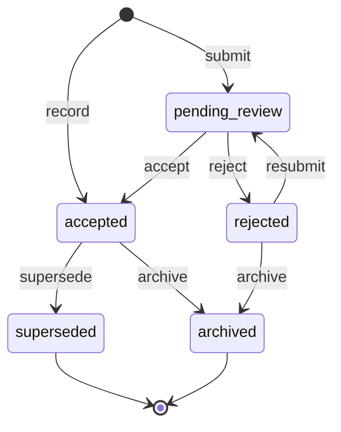
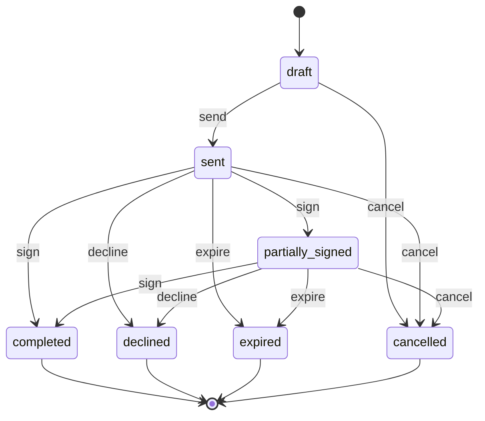
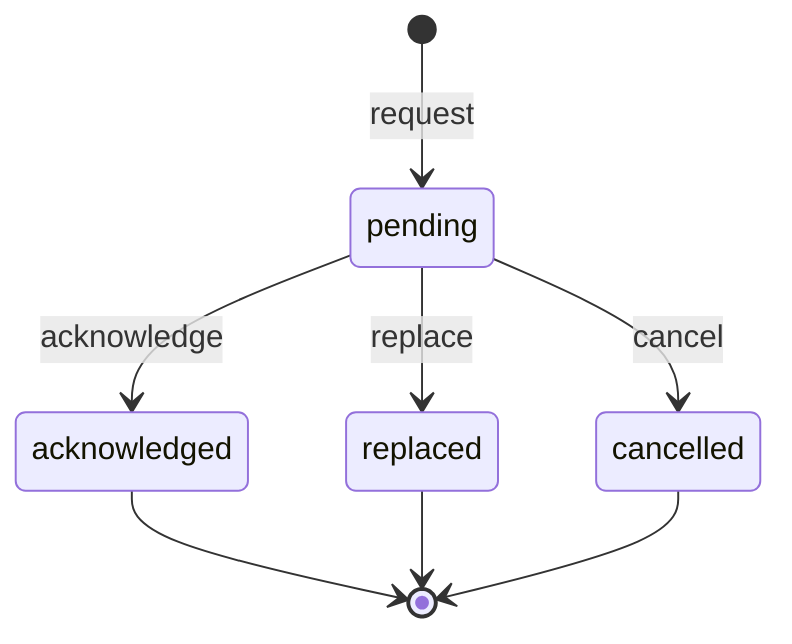

# wl-documents

> Status: draft · Last updated: 2026-10-16

## 1. Purpose

Every vertical keeps files about its records: contracts, identity documents, licences,
certificates, delivery notes, photos. Many of them expire, and an expired visa, trade licence
or guarantee costs the client money or a fine. Every vertical also produces documents (quotations, invoices,
contracts, statements, certificates) that must look branded and read correctly in English and
Arabic, and some of them must be signed or accepted by an external party. `wl-documents`
does all of this once:

- it attaches files to any record;
- it tracks versions and expiry, with tiered reminders;
- it generates branded EN/AR PDFs from templates;
- it captures signatures and acceptances;
- it keeps the company's SOPs, with versions and the staff's acknowledgements;
- it protects sensitive documents and applies retention.

## 2. Capabilities covered

| ID | Capability | Used by verticals | Scope |
|---|---|---|---|
| `DOC.FIL.01` | Attach documents to any record | 01, 02, 03, 04, 05, 06, 07, 08, 09, 10 | MVP everywhere |
| `DOC.EXP.01` | Expiry tracking with tiered reminders; seeded document kinds for registrations and certifications: trademark, Halal, ISO and similar, with expiry and reminders (§3) | 01, 02, 03, 04, 05, 06, 07, 08, 09, 10 (seeded kinds per vertical setting) | MVP everywhere |
| `DOC.GEN.01` | Generate documents from templates in EN/AR (PDF) | 01, 02, 03, 04, 05, 06, 07, 08, 09, 10 | MVP everywhere |
| `DOC.SIG.01` | E-signature and acceptance capture | 04, 05, 08, 09, 10 | MVP |

Related capability owned elsewhere: `HRM.ONB.01` (wl-hr), *staff onboarding checklists per
role and a library of SOP documents with acknowledgement*. The SOP library and the
acknowledgements are kept here (§3 *SOP*, §4.3, §5.7); wl-hr runs the onboarding.

What the verticals use them for:

| Vertical | Typical documents and expiries | Generated | Signed / accepted |
|---|---|---|---|
| 01 Property | tenant KYC (Emirates ID, passport, visa), Ejari certificate, trade licence, building compliance certificates (fire and life safety, lifts) | tenancy contract, receipts, owner statements, settlement statement | — (the signed tenancy contract is uploaded; lease `activate` checks it) |
| 02 Construction | guarantees, permits, insurance, worker passes and visas, drawings, LPOs, the entity's Dubai Municipality contractor registration and subcontractors' registrations (`CON.ACL.13`) | quotation, IPA, variation, daily report | — (the handover certificate is uploaded; project `complete` checks it) |
| 03 Logistics | vehicle documents (Mulkiya, insurance), driver licences, rider permits, AWB/BL, customs declarations and certificates of origin (zero-rating evidence), disbursement receipts | labels, waybills, run sheets | proof of delivery (via `wl-delivery`) |
| 04 Accounting | client trade licences, UBO passports and Emirates IDs, filing evidence | proposals, engagement letters, KPI packs, acceptance certificates | engagement letter, return approval (in-portal acceptance) |
| 05 Clinics | practitioner licences, patient Emirates ID and insurance card | invoices, receipts | registration, data, financial and treatment consent forms on a tablet or in the portal |
| 06 F&B | trade licence, food permits, staff health cards | tax invoices / receipts | — |
| 07 Manufacturing | industrial licence, conformity certificates of regulated items (`MFG.ACL.11`), the ICV certificate (reminder 60 days before expiry; attached to quotations and shown in the portal), calibration certificates | quotations, certificates of analysis or conformity per lot | — |
| 08 Auto | trade licence, vehicle documents, export exit certificates and bills of lading (zero-rating evidence) | estimates, job cards, invoices | estimate approval, sign-off at delivery |
| 09 Manpower | visas, Emirates IDs, passports, insurance, ILOE, site passes, SIRA licences, health cards, client-signed paper timesheets (`MPW.ACL.09`), workers' written consent to accommodation or transport deductions | client invoices, timesheet statements, payslips | client contract, offer letter, settlement acknowledgement |
| 10 EdTech | centre permit, course approvals, tutor documents | certificates, progress reports | terms and refund policy, guardian consent |

## 3. Concepts and entities

| Entity | Description | Important fields |
|---|---|---|
| Document kind | A catalogue entry that says how a type of document behaves. Seeded per vertical, extended per client | key, names EN/AR, allowed subject types, required for (subject type + condition), has expiry, has number, reminder offsets (days), sensitivity class, retention rule, allowed file types, max size, portal upload allowed, needs review (always on for kinds with `blocks`, `DOC.ACL.03`), `blocks` (list of guarded `<entity>.<transition>` entries, each with mode `block` or `flag` and an optional condition on the guarded record; §5.6), override mode (`never` / `with_approval`), legal block (locked by the platform), look-ahead days, compliance-critical, responsible role (the role whose holders are the kind's *responsible staff*, §5.2) |
| Document | One logical document attached to a record | subject (`subject_type`, `subject_id`), kind, title, number (e.g. passport no.), issue date, expiry date, issuing authority, current version, status, uploaded by, source (`upload` / `generated` / `signed`) |
| Document version | One file of a document | document, version no., file (storage key), file name, mime type, size, checksum (SHA-256), uploaded by, uploaded at, note |
| Document template | A layout used to generate a document | key, document kind, language mode (`en`, `ar`, `bilingual`), body, paper size, version, active |
| Generation | The record of one generated document | template + version, subject, data snapshot hash, number assigned, resulting document |
| Signature request | A request for one or more parties to sign or accept a document | document version, signers (party or user, order, method), message, expiry date, status |
| Signature | The evidence of one signer's act | request, signer, method (`drawn`, `typed`, `click-to-accept`, `otp`), signature image (if drawn), name typed, timestamp, IP, user agent, OTP channel, document checksum signed |
| Access log | Each view or download of a sensitive document | document, version, user, action (`view`/`download`), timestamp, reason (optional) |
| Retention hold | Prevents deletion after the retention period | subject or document, reason, placed by, until |
| Block override | A one-off permission to run one guarded transition on one record although a required document is expired or missing (`DOC.ACL.02`) | document kind, subject, guarded entry (`<entity>.<transition>`), record, reason, requested by, approved by, valid until, used at |
| SOP | A standard operating procedure the staff must follow (`HRM.ONB.01`). Its versions are documents of kind *SOP* attached to it; translations are documents of kind *SOP translation* linked to a version | code, title EN/AR, category, legal entity (readers are employees of that entity; empty = every entity), owner role, required readers (job roles or trades with scopes, or *all staff*), review interval (months), acknowledgement due days, current version (the accepted document), status (derived: `draft` before the first accepted version, `active`, `withdrawn` when the current version is archived) |
| Acknowledgement | One reader's confirmation that they read one SOP version | SOP, document version, reader (employee), requested at, due date, acknowledged at, language and checksum of the file the reader opened (the version or a translation), evidence (method `click-to-accept` in the reader's session or `drawn` in person; timestamp, IP, user agent, document checksum, witness for in person; as a Signature), in-person notice sent (to the reader's own channel), reminders sent, status (§4.3) |

Rules that apply to all entities:

- A file is never overwritten. A new file is a new **version**. Generated and signed documents
  are immutable.
- **Expiry status** is computed from the expiry date, not stored as a state: *valid* (success
  tone), *expiring* (warning, inside the first reminder window), *expired* (error), *no expiry*
  (neutral). A document is valid through its expiry date (Asia/Dubai calendar date) and
  expired from the next day.
- **Sensitivity class** is set per document kind: `normal`, `personal` (identity documents,
  under PDPL), `health` (clinics), `financial` (bank statements, salary). Each class except
  `normal` requires a permission ([ACCESS-CONTROL.md](../ACCESS-CONTROL.md) `PLT.ACL.06`).

**SOP versions (decided 2026-10-16).** A new version of an SOP is a new document of kind
*SOP* on the SOP, submitted to `pending_review` and accepted by a holder of `sops.manage`
with the SOP's owner role; accepting it supersedes the previous version as for any kind.
For the kinds *SOP* and *SOP translation*, `accept` and `reject` need `sops.manage` and the
owner role (instead of `documents.review`), and `archive` needs `sops.manage` (instead of
`documents.manage`). Every accepted version needs a new acknowledgement from every required
reader, also when an earlier version was acknowledged (`DOC.RUL.04`). The kind *SOP* uses
the expiry date as the next review date (accepted date + review interval): `DOC.RUL.01`
reminds the owner role 30 days before, the expiry status reads *review due* and then *review
overdue* (not *expired*), and an SOP past its review date stays in force. The kind has no
`blocks`, and `DocumentExpired` of kind *SOP* guards nothing.

A *translation* (kind *SOP translation*: language, linked version) carries the same text in
Arabic or another staff language. It is accepted like a version; a reader may open the
version or any accepted translation of it, and the acknowledgement records which. A
translation accepted later does not ask for new acknowledgements; a new version supersedes
its translations. Archiving the current version withdraws the SOP (`SopWithdrawn`): pending
acknowledgements are cancelled, acknowledged ones stay as history. A withdrawn SOP becomes
`active` again only through a new accepted version, which asks every required reader again.
Changing the required readers emits `SopReadersChanged`: new readers are asked, and pending
acknowledgements of readers no longer required are cancelled.

**Seeded kinds for registrations and certifications (`DOC.EXP.01`, decided 2026-10-16).**
Every client gets these kinds, with names in English and Arabic, enabled per vertical
setting (a kind not enabled is available and off). They have expiry and reminders
(`DOC.RUL.01`) and no `blocks` by default; a vertical may add `blocks` entries (e.g. 07
dispatch of regulated items, `MFG.ACL.11`). Their sensitivity class is `normal`, they are
not *visible in portal* (a client may turn it on, `DOC.ACL.01`), and they follow the
client's retention rule for company documents. The platform does not decide which
registration or certificate the law requires.

| Kind | Subjects | Fields | Reminders (days) | Responsible role (seed) | Enabled in |
|---|---|---|---|---|---|
| Trademark registration | legal entity (`PLT.ENT.01`) | registration number, mark (text or image), classes, registry, filing date, expiry date | 180, 90, 30 | owner | all verticals |
| Halal certificate | legal entity, item (`STK.ITM.01`), supplier party (`wl-parties`) | certificate number, certification body, products or sites covered, expiry date | 90, 30, 7 | quality role, else owner | 06, 07 |
| ISO certificate | legal entity | standard (e.g. ISO 9001, 14001, 22000, 45001), certification body, scope (sites or plants covered), expiry date | 90, 30, 7 | quality role, else owner | 02, 07 |
| Product registration / conformity | item, legal entity | registration or certificate number, authority or body, products covered, expiry date | 90, 30, 7 | quality role, else owner | none by default (07 keeps the conformity kinds of regulated items, §2) |
| Other certification | legal entity, item, supplier party | name, number, issuer, expiry date (optional) | 90, 30, 7 | owner | all verticals |

The *quality role* is the vertical's role for quality or compliance (07: QC inspector);
where the vertical has none, the owner. *Owner* is the business owner role of the
deployment (wl-kernel; e.g. the MD, the company admin or the partners, as each vertical
names it). The column *Responsible role (seed)* is the platform default: a vertical seeds
its own responsible role per kind in its settings (e.g. 06: storekeeper / purchaser for the
*Halal certificate*), and the client may change it later. A trademark's subject is always
the legal entity; the brand is the registered *mark*. For an item or supplier party subject the reminder
scope follows §5.2 step 3. A certificate on a supplier party names the items it covers;
wl-inventory shows an expired one as a warning on the supplier's item supplier rows and
reorder suggestions (wl-inventory §3). Verticals without items use the legal entity subject
only. A wrong number or expiry date on these kinds (no `blocks`) is corrected in place by
`documents.manage`, audited, and the reminders are rescheduled; once a vertical adds
`blocks`, `DOC.ACL.03` applies instead.

## 4. Lifecycles

### 4.1 Document

| State | Tone | Terminal | Meaning |
|---|---|---|---|
| `pending_review` | warning | no | Uploaded by an external user (or a kind that needs review); not yet relied on |
| `accepted` | success | no | Valid record of the document; the current version is used by guards and reminders |
| `rejected` | error | no | Not acceptable (unreadable, wrong document, mismatched data); the uploader is told why |
| `superseded` | neutral | yes | Replaced by a newer document of the same kind for the same subject (e.g. a renewed visa) |
| `archived` | neutral | yes | No longer current (subject closed, document withdrawn); kept for retention |

| Transition | From | To | By | Guards | Effects |
|---|---|---|---|---|---|
| `submit` | — | pending_review | uploader (portal or staff) | kind allows the subject type; file type and size allowed | uploader and reviewers notified; event `DocumentUploaded` |
| `accept` | pending_review | accepted | `documents.review` | number and expiry date filled when the kind has them; for a kind with `blocks`, the reviewer is not the uploader (`DOC.ACL.03`) | expiry reminders scheduled; previous accepted document of the same kind and subject `supersede`; event `DocumentAccepted` |
| `reject` | pending_review | rejected | `documents.review` | reason given | uploader notified; event `DocumentRejected` |
| `resubmit` | rejected | pending_review | uploader | new version attached | reviewers notified |
| `record` | — | accepted | `documents.upload` | kind does not need review and has no `blocks` entry | same as `accept` |
| `supersede` | accepted | superseded | system | a newer document of the same kind and subject was accepted | reminders cancelled |
| `archive` | accepted, rejected | archived | `documents.manage` | `PLT.ACL.07`: not the evidence of an issued invoice, signed contract or filing | reminders cancelled |

**Vertical mapping**

| Vertical | How it uses the machine |
|---|---|
| 01, 04, 05, 09, 10 | KYC and identity documents uploaded by external users go through `pending_review` (kinds marked *needs review*) |
| 02, 03, 06, 07, 08 | Most documents are recorded by staff and go straight to `accepted` (`record`); documents of kinds with `blocks` (licences, permits, vehicle documents) are always submitted and accepted by a second user (`DOC.ACL.03`) |
| 04 | Items of a *document request* list (`POR.DOC.01`, `wl-portal`) create documents in `pending_review`; accepting the document completes the request item |
| All | Generated and signed documents are created directly as `accepted`, with source `generated` or `signed` |

### 4.2 Signature request

| State | Tone | Terminal | Meaning |
|---|---|---|---|
| `draft` | neutral | no | Signers and message being prepared |
| `sent` | info | no | Waiting for signers |
| `partially_signed` | info | no | Some signers have signed (multi-signer, in order or in parallel) |
| `completed` | success | yes | Every signer signed; the signed document exists |
| `declined` | error | yes | A signer declined, with a reason |
| `expired` | neutral | yes | Expiry date passed before completion |
| `cancelled` | neutral | yes | Withdrawn by staff |

| Transition | From | To | By | Guards | Effects |
|---|---|---|---|---|---|
| `send` | draft | sent | `signatures.request` | document version is final (generated or uploaded); each signer has an email or mobile | links sent through `wl-notify` (`NTF.MSG.01`/`02`/`03`); event `SignatureRequested` |
| `sign` | sent, partially_signed | partially_signed, completed | signer (portal user, link holder with OTP, or in-person on a tablet) | document checksum unchanged; signer's turn when the order is sequential | signature evidence stored; on the last signer: signed PDF generated with an evidence page, document created with source `signed`, event `SignatureCompleted` |
| `decline` | sent, partially_signed | declined | signer | reason given | requester notified; event `SignatureDeclined` |
| `remind` | sent, partially_signed | (same) | `signatures.request` or system | — | reminder sent to pending signers |
| `expire` | sent, partially_signed | expired | system | expiry date passed | requester notified |
| `cancel` | draft, sent, partially_signed | cancelled | `signatures.cancel` | — | signers told the link no longer works |

**Vertical mapping**

| Vertical | Use | Method |
|---|---|---|
| 04 Accounting | engagement letter; client approval of a tax return before filing (the Return machine's `approve` transition requires a completed request). The evidence page is issued as an acceptance certificate PDF (name, time, IP address, document hash); UAE PASS signing is Later | portal after sign-in, click-to-accept or drawn |
| 05 Clinics | consent forms before a procedure | in person on a tablet, drawn; or portal |
| 08 Auto | customer approval of an estimate (job card `send_estimate`); sign-off at vehicle delivery | link with OTP; in person |
| 09 Manpower | client contract, offer letter (candidate `offer`), settlement acknowledgement (final settlement `pay`) | link with OTP |
| 10 EdTech | terms, refund policy and guardian consent before enrolment `activate` | portal, click-to-accept |
| Any vertical with quotations | quotation acceptance by the customer (`FIN.QUO.01` `accept`, `wl-invoicing`) | portal, click-to-accept |

Single-signer *click-to-accept* is the same machine with one signer and method
`click-to-accept`.

### 4.3 Acknowledgement

| State | Tone | Terminal | Meaning |
|---|---|---|---|
| `pending` | warning (error when overdue) | no | The reader must read and acknowledge this version |
| `acknowledged` | success | yes | Read and confirmed, with evidence |
| `replaced` | neutral | yes | A newer version was accepted before this one was acknowledged |
| `cancelled` | neutral | yes | The reader is no longer required (role or scope ended, readers changed, employee exited, died or onboarding cancelled, SOP withdrawn) |

| Transition | From | To | By | Guards | Effects |
|---|---|---|---|---|---|
| `request` | — | pending | system (`DOC.RUL.04`) | the reader is a required reader of the SOP; no `pending` or `acknowledged` acknowledgement of this version for the reader | due date = today + the SOP's acknowledgement due days (for a reader `on_leave`: from the return date); reader notified (staff inbox or employee portal, through `wl-notify`); a reader without an account is put on their manager's *to acknowledge in person* list and told by SMS where a number is on record |
| `acknowledge` | pending | acknowledged | the reader (`HRM.ACL.10`) | the version is still the SOP's current one (otherwise refused and the reader is sent to the current version); the reader opened this version or an accepted translation of it; that file's checksum unchanged; in person: drawn signature and the staff user as witness | evidence, language and file stored; event `SopAcknowledged` (wl-hr marks `sop_acknowledgement` steps); in person: the reader told on their own channel (SMS to the number on record, or the portal inbox when it opens) what was recorded and by which witness |
| `replace` | pending | replaced | system (a newer version of the SOP accepted) | — | a new `request` for the new version |
| `cancel` | pending | cancelled | system (`EmployeeAssignmentChanged` removing the role or scope, `SopReadersChanged` removing the reader, `EmployeeExited`, `EmployeeDeceased`, `EmployeeOnboardingCancelled`, `SopWithdrawn`) | — | no further reminders |

An `acknowledged` acknowledgement stays as history when a newer version arrives; the reader
gets a new `pending` one for the new version.

## 5. Workflows

### 5.1 Attach and review

1. A staff user or a portal user opens a record and picks a document kind allowed for that
   subject type.
2. They upload a file or take a photo (`rx-camera-capture`, R5) and fill the kind's fields
   (number, issue and expiry dates).
3. If the kind needs review, the document waits in `pending_review` and reviewers in scope
   are notified. Otherwise it is `accepted` at once.
4. On acceptance, any older accepted document of the same kind for the same subject is
   superseded, and reminders are scheduled from the expiry date.

### 5.2 Expiry reminders (`DOC.RUL.01`)

1. Every night the scheduler finds accepted documents whose expiry date is N days away for
   each offset of their kind (default 90, 30 and 7 days), and those whose expiry date was
   yesterday: a document is valid through its expiry date and expired from the next day.
2. For each one it emits `DocumentExpiring { days_left }` or `DocumentExpired`, at most once
   per document per offset.
3. `wl-notify` sends the reminder to the record's responsible staff and, for kinds marked
   *notify party*, to the party (e.g. a tenant's Emirates ID, a patient's insurance card).
   The responsible staff are the users who hold the kind's responsible role in the scope
   unit of the document's subject; for a subject without a scope (a party, e.g. a vendor),
   in the scope units of the records the document guards or lists as `affected` (e.g. the
   coordinator of the building where the vendor's visits are planned). For a subject
   without a scope and without such records (e.g. an item's certificate), the vertical's
   `ReminderSchedule` for the kind names the scope units (07: each plant that holds stock
   of the item or has an open work order for it, every plant when none does); without one,
   the role's holders in every scope are notified. The vertical seeds the role per kind and
   the client may change it (§7).
4. Other modules react to the events, for example by blocking bookings for an expired
   practitioner licence (`HRM.QUA.01`, formerly `CLN.LIC.01`) or flagging a deployment with
   an expired site pass.
5. The dashboard lists expiring and expired documents per scope.
6. For kinds with `blocks`, the guard and the look-ahead check in §5.6 apply as well.

### 5.3 Generate a document (`DOC.GEN.01`)

1. A transition or a user action asks for a document from a template, a subject and a
   language mode.
2. The module collects the data from the subject through the template's data provider (each
   module registers providers for its entities), and assigns a number through `wl-kernel`
   sequences when the kind has one.
3. The PDF is rendered (R3) with the client's branding (logo, colours from
   [DESIGN-SYSTEM.md](../DESIGN-SYSTEM.md) §4), right-to-left for Arabic, and a footer
   with the number and page count. Bilingual templates place English and Arabic side by side.
4. The PDF is stored as an accepted document with source `generated`, with a hash of the
   data it was built from. Issued documents are never regenerated. A correction is a new
   document (e.g. a credit note), never an edit.
5. Optionally, a verification QR code links to a public page that confirms the document's
   number, date and checksum (EdTech certificates, certificates of analysis).

### 5.4 Request a signature (`DOC.SIG.01`)

1. Staff, or a transition such as `send_estimate`, create a signature request for a final
   document version with one or more signers.
2. Signers receive a link. External signers without a portal account confirm a one-time code
   sent to their mobile or email.
3. Each signer reads the document and signs (draws, types their name or accepts), or
   declines with a reason.
4. When all have signed, a signed PDF is produced with an evidence page: signer names,
   methods, timestamps, IP addresses and the original document's checksum.
5. `SignatureCompleted` lets the waiting transition continue, e.g. enrolment `activate`,
   return `approve`, job card approval.

### 5.5 Sensitive documents and retention

1. Viewing or downloading a document of a sensitive class requires the class permission and
   is written to the access log (`PLT.ACL.06`). Lists show only the kind and the expiry status.
2. Every night, documents past their kind's retention period whose subject is closed, and
   that have no hold, are queued for deletion. An admin approves the deletion batch
   (`PLT.APR.01`). The file and its versions are deleted, and a tombstone row records what
   was deleted, when, and under which rule.

### 5.6 Expired document blocks a transition (`DOC.EXP.01`)

A reminder alone does not stop work. A document kind can therefore name the transitions it
guards in its `blocks` setting. Each entry is `<entity>.<transition>` with a mode:

- `block`: the transition is refused while the document is expired or missing;
- `flag`: the transition runs, but the record is flagged for review (used where the fact
  cannot be refused, e.g. a worker who did turn up and is marked present). The flag is never
  removed: it stays as a historical fact, also after a renewal; a reviewer marks it
  *reviewed* with a note.

An entry may carry an optional **condition** on the guarded record: one field the guarded
module exposes for conditions and a list of values (e.g. `ticket.resolve` when the ticket's
category is one of the fire and life safety categories; `service_contract.activate` when the
contract covers one of those categories). Without a condition the entry applies to every
record. The guarded module's `BlockSubjects` provider receives the condition and returns no
document subject for a record that does not match, so the guard answers *yes* for it.

**The standard guard.** Every module that owns a guarded transition calls
`document_valid(subject, kind, on_date)`. It answers *yes* when the subject has an
`accepted` document of that kind whose expiry date is on or after `on_date` (or that has no
expiry). `on_date` defaults to today and may be any future date (a booking's start, a
contract's start, a run's planned day); a past date is checked against the document that was
accepted and valid on that date (used for late entries and attendance). A missing document,
a `rejected` one, or a renewal still in `pending_review` answers *no*; a pending renewal is
shown in the refusal message and pushed to the top of the review queue. The guarded module
maps its record to the document subjects through a `BlockSubjects` provider (e.g. a run →
its driver and its vehicle; a booking → its practitioner). For employee licences and
permits, `wl-hr` wraps the same check with role and scope as
`qualification_valid(employee, kind, on_date[, role, scope])` (`HRM.QUA.01`).

**When it is checked.**

1. *At the time of the action:* the guard runs with `on_date` = today when the transition
   is attempted. In `block` mode the user sees which document is expired, since when, and
   who can renew it or approve an override.
2. *When future work is planned:* creating or rescheduling a dated item (a booking, a
   session, a run, a deployment) calls the guard with `on_date` = the planned date.
   - A **booking**, or another bookable future slot promised to a party, is **refused** by the
     booking module when its resource will not be eligible on the slot's date: `wl-scheduling`
     refuses `book`, `reschedule` and `reassign` through `ResourceEligibility`
     (`SCH.ACL.04`), and staff choose another resource or date.
   - For **other planned work** (a run, a deployment, a batch's sessions, a planned visit),
     a *no* gives a warning, not a refusal: the document may be renewed in time, and
     `DOC.RUL.02` lists the item again inside the look-ahead window. Bookings made before
     the problem was known are not refused either: step 3 flags them.
3. *Ahead of time (`DOC.RUL.02`):* every night, for documents of blocking kinds that expire
   within the kind's look-ahead window (default 30 days), each guarded module lists, through
   its `FutureWork` provider, the planned items dated after the expiry date. They are
   added to `DocumentExpiring` as `affected`, and the record's responsible staff get one
   message with the list. A later night sends a new message only when new items appear in
   `affected`, listing only the new ones. Modules flag the items (e.g. `wl-scheduling` raises
   `BookingConflict`).
4. *On expiry (`DOC.RUL.03`):* on the first nightly run after the expiry date (the
   document is valid through its expiry date), `DocumentExpired` is emitted with the open
   and planned records the document now blocks. Consumers react as in the table below. When
   the kind is marked *compliance-critical*, the business owner is told as well as the
   responsible staff.

**Lifting the block.** When a renewed document is accepted (`DocumentAccepted`, the old one
`superseded`), the guard answers *yes* again. Consumers that suspended or flagged records on
`DocumentExpired` re-check them on `DocumentAccepted`; nothing resumes without that event.

**Override (`DOC.ACL.02`).** Only for kinds whose override mode is `with_approval`. The user
asks for an override for one record and one transition with a reason. A second user with
`documents.block.override` in the scope approves it (`PLT.APR.01`). The override is valid for
one use, within a time limit (default 72 hours), only by the user who requested it, and is
audited with both users and the reason. Kinds marked *legal block* (the law forbids the act
without the document) have override mode `never`: the platform locks it, and no client
setting or role can change it. Which kinds are legal blocks in each vertical is to be
confirmed `⚠ open: lawyer (L-19)` (§10).

**Example blocks the verticals set** (phase 2 sets the final values in each vertical):

| Vertical | Document kind (subject) | `blocks` (mode) | Override (proposed) |
|---|---|---|---|
| 03 Logistics | driving licence, RTA rider permit (employee); Mulkiya and insurance (vehicle) | `run.dispatch` (block); `delivery.assign` (block) | never (legal block) |
| 10 EdTech | tutor police clearance (employee; courses with minors) | `batch.open`, `batch.change_tutor`, `session.change_tutor`, `session.reschedule`, `booking.book`, `booking.reassign` (block); `session.submit_attendance` (flag) | never by the client's policy, not a legal block (the client may switch it to `with_approval`, owner) |
| 10 EdTech | MoHRE private tutor permit or freelance visa (freelance tutor) | as police clearance (block and flag) | never |
| 10 EdTech | centre permit, course approval (legal entity, course) | `batch.open`, `certificate.issue` (block) | never |
| 05 Clinics | practitioner licence and privileges (employee, through `HRM.QUA.01`) | `booking.book`, `booking.check_in`, `booking.start` (block) | never (legal block) |
| 09 Manpower | residence visa, work permit (employee) | `deployment.activate`, `deployment.resume` (block); `attendance_record.accept` (flag) | never (legal block) |
| 09 Manpower | Emirates ID, health insurance, SIRA licence, health card, site pass (employee) | `deployment.activate`, `deployment.resume` (block); `attendance_record.accept` (flag) | with approval (MD), except SIRA licence (never) |
| 02 Construction | worker visa and work permit (employee) | `attendance_record.accept` (flag) | — (flag only) |
| 01 Property | vendor's Civil Defence approval (vendor party) | `ticket.resolve` with condition category in the fire and life safety categories (block); `service_contract.activate` with condition contract covers one of those categories (block) | never |
| 04 Accounting | client KYC documents: trade licence, UBO passport and Emirates ID (party) | `engagement.activate` (block); `return.file` (flag) | with approval (MLRO) |

**Who reacts to `DocumentExpired`:**

| Consumer | Reaction |
|---|---|
| `wl-hr` | `QualificationExpired` for employee kinds; the employee fails `qualification_valid` for the role and scope (`HRM.RUL.10`) |
| `wl-scheduling` | future bookings of the resource raise `BookingConflict`; new bookings refused (`SCH.ACL.04`) |
| `wl-delivery` | planned runs of the driver or vehicle flagged; `dispatch` refused |
| `wl-attendance` | attendance of the employee flagged (expired work permit) |
| `wl-ticketing` | open visits of the vendor flagged; `resolve` refused for guarded categories |
| apps | 09 suspends active deployments (no attendance, no billing); 10 flags batches and sessions; 04 opens a CDD refresh task; 01 flags the contract and the building |

### 5.7 SOP library and acknowledgement (`HRM.ONB.01`)

1. A holder of `sops.manage` creates an SOP with its owner role, required readers (job roles
   or trades in scopes, or *all staff*), review interval and acknowledgement due days.
2. The author uploads the first version (kind *SOP*). A holder of the owner role accepts it;
   the SOP becomes `active`.
3. `DOC.RUL.04` asks every required reader to acknowledge it: the employees with those roles
   in those scopes (`Workforce::employees_in` from wl-hr), and later every new employee or
   new role holder (`OnboardingStarted`, `EmployeeAssignmentChanged`).
4. The reader opens the version (or an accepted translation) and confirms, in their own
   session or in person with a drawn signature and a staff witness (`HRM.ACL.10`); after an
   in-person record the reader is told on their own channel. Readers without an account
   appear on their manager's *to acknowledge in person* list. wl-hr marks the onboarding
   step.
5. `DOC.RUL.04` reminds readers whose acknowledgement is overdue (paused while on leave or
   absconded; the manager for readers without an account), then tells their manager and
   the owner role.
6. A new version is uploaded and accepted like the first. Pending acknowledgements of the old
   version are `replaced`, and every required reader is asked again.
7. 30 days before the review date `DOC.RUL.01` reminds the owner role; past it the SOP
   shows *review overdue* and stays in force. Archiving the current version (`sops.manage`)
   withdraws the SOP and cancels its pending acknowledgements (`SopWithdrawn`); only a new
   accepted version makes it `active` again. Changing the required readers asks the new
   readers and cancels the pending acknowledgements of those removed (`SopReadersChanged`).
8. The SOP page shows, per version, who acknowledged (with the language and the method),
   who is pending and who is overdue, and lists in-person records per witness.

## 6. Interfaces to other modules

**Provides**

| Service | Purpose |
|---|---|
| `Documents::attach(subject, kind, file, fields)` | Attach a file to any record (used by every module and app) |
| `Documents::current(subject, kind)` / `is_valid(subject, kind, on_date)` (the guard `document_valid`, §5.6; `on_date` optional, default today, future dates allowed) | Guards in other machines: e.g. "signed contract attached" (01 lease `activate`), "practitioner licence valid on the booking date", "KYC documents present", "zero-rating evidence attached" (03, 08 invoices), "conformity certificate valid" (07 `MFG.ACL.11`), "subcontractor registration valid" (02 `CON.ACL.13`) |
| `Documents::required_missing(subject)` | Lists required kinds missing for a subject (e.g. lease `submit`, employee activation) |
| `Documents::generate(template, subject, language)` | Produce a branded PDF document (`DOC.GEN.01`) |
| `Documents::register_data_provider(subject_type, provider)` | Modules expose the data their templates can use |
| `Signatures::request(document_version, signers, options)` | Start a signature request; returns its id |
| `Signatures::completed(subject, purpose)` | Guard: has this subject a completed request for this purpose |
| `Documents::blocks_for(entity, transition)` | Document kinds that guard a transition, with mode and override mode; modules call it before `document_valid` |
| `Documents::request_override(kind, record, transition, reason)` | Ask for a one-use block override (`DOC.ACL.02`) |
| `Sops::required_for(role, scope)` / `Sops::pending_for(employee)` | SOPs a role must acknowledge in a scope; an employee's pending and overdue acknowledgements (wl-hr `sop_acknowledgement` steps) |

**Consumes**

- `wl-kernel`: `Subject` references, document number sequences, settings (branding,
  languages), approvals (deletion batches), automation rules.
- `wl-notify`: delivery of reminders, review requests and signature links.
- `wl-parties`: signers and notified parties; party consents for notifications.
- `wl-hr`: `Workforce` for SOP required readers: `all_staff` and `staff` (the employee's
  role, scopes, account, legal entity, manager and leave; a reader is matched against the
  SOP's readers with `employees_in`'s rule) and `employee_of_user` for the staff inbox
  (employees in
  `onboarding`, `active`, `on_leave` or `notice`; reminders go only to readers it lists
  and not `on_leave`); events `OnboardingStarted`, `EmployeeAssignmentChanged`,
  `EmployeeExited`, `EmployeeDeceased` and `EmployeeOnboardingCancelled` for
  acknowledgements (§4.3); the employee's manager (wl-hr §3) for escalations and the
  in-person list.
- Renox: storage disks, uploads, queue, scheduler, audit, PDF rendering (R3).
- Guarded modules: `BlockSubjects` (record → document subjects) and `FutureWork` (planned
  items of a subject from a date) providers, registered per guarded transition (§5.6).

**Events emitted**

| Event | When | Payload |
|---|---|---|
| `DocumentUploaded` | a file is submitted for review | document id, subject, kind, uploaded by, source |
| `DocumentAccepted` | a document becomes accepted | document id, subject, kind, expiry date |
| `DocumentRejected` | a review rejects a document | document id, subject, kind, reason |
| `DocumentSuperseded` | a newer document replaces it | document id, replaced by |
| `DocumentExpiring` | an expiry offset is reached, or a blocking kind enters its look-ahead window (`DOC.RUL.02`) | document id, subject, kind, expiry date, days left, `affected` (planned records per guarded transition) |
| `DocumentExpired` | the day after the expiry date (`DOC.RUL.03`) | document id, subject, kind, expiry date, `blocks`, blocked records (open and planned) |
| `DocumentBlockOverridden` | an override is approved and used | override id, document kind, subject, record, transition, reason, users |
| `DocumentGenerated` | a PDF is generated | document id, template, subject, number |
| `SignatureRequested` | a request is sent | request id, document id, subject, signers |
| `SignatureCompleted` | the last signer signs | request id, signed document id, subject, purpose |
| `SignatureDeclined` | a signer declines | request id, signer, reason |
| `SensitiveDocumentViewed` | a sensitive document is viewed or downloaded | document id, user, action |
| `SopPublished` | a version of an SOP is accepted | SOP, document id, version, required readers |
| `SopAcknowledged` | acknowledgement `acknowledge` | SOP, version, reader, method, language, at |
| `SopWithdrawn` | the current version of an SOP is archived | SOP, last version, cancelled acknowledgements |
| `SopReadersChanged` | the required readers of an `active` SOP change | SOP, readers added, readers removed |

**Attaches to:** any `Subject`. Typical subjects: party, legal entity, lease, project, IPA, shipment, vehicle,
engagement, return, patient visit, employee, visa case, deployment, enrolment, job card, lot,
sales order, invoice, ticket, item (certificates), SOP.

**Permissions**

| Permission | Allows |
|---|---|
| `documents.view` | See documents of records in scope (non-sensitive classes) |
| `documents.upload` | Attach documents (accepted directly for kinds without review) |
| `documents.review` | Accept or reject documents in `pending_review` |
| `documents.manage` | Archive documents, edit document fields, manage holds |
| `documents.sensitive.view` | View sensitive classes. Verticals may name it per class (see below) |
| `document_kinds.manage` | Edit the client's document kinds and reminder offsets |
| `document_templates.manage` | Edit templates (text, layout) within the branding rules |
| `documents.generate` | Generate documents on demand (transitions generate as system) |
| `signatures.request` | Create, send and remind signature requests |
| `signatures.cancel` | Cancel signature requests |
| `documents.retention.approve` | Approve deletion batches |
| `documents.block.override` | Approve a one-use override of a document block (`DOC.ACL.02`) |
| `sops.manage` | Create SOPs, set owner role and required readers, upload, accept or reject (with the owner role) and withdraw versions and translations, see the acknowledgement report |

**Access rules**

| ID | Rule | Pattern | Parameter (default) |
|---|---|---|---|
| `PLT.ACL.06` (platform) | Sensitive classes need explicit permission; each view is audited | `SEN` | — |
| `PLT.ACL.07` (platform) | Documents that are evidence of money, tax or legal acts are archived, not deleted, until retention ends | `STA` | — |
| `DOC.ACL.01` | External users see only documents of subjects they own, and only kinds marked *visible in portal* | `OWN`, `FLD` | — |
| `DOC.ACL.02` | A transition blocked by an expired or missing document runs only with a one-use override: reason given, approved by another user with `documents.block.override`, within a time limit, audited. Never for kinds marked *legal block* | `SOD`, `TIM`, `STA` | valid 72 hours |
| `HRM.ACL.10` (wl-hr) | An SOP acknowledgement is recorded only by the reader: in their own session, or in person with a drawn signature, a staff user recorded as witness; after an in-person record the reader is told on their own channel | `OWN` | on |
| `DOC.ACL.03` | Documents of a blocking kind (a kind with `blocks`) always go through review: they are submitted (never `record`ed) and accepted by a user other than the uploader. Their expiry date and number are not edited in place: a correction is a new document of the same kind and subject, with the file as its version, submitted to `pending_review` and accepted by a user other than the one who submitted it; accepting it supersedes the old one. Audited | `STA`, `SOD` | — |

**Automations**

| ID | When | If | Then | Parameters (default) |
|---|---|---|---|---|
| `DOC.RUL.01` | N days before `document.expires_on` | document `accepted` | notify the record's responsible staff and, for kinds marked *notify party*, the party | N = 90, 30, 7 (per kind) |
| `DOC.RUL.02` | nightly (01:00 Asia/Dubai) | document of a kind with `blocks` expires within N days, and guarded modules report planned items dated after the expiry date | emit `DocumentExpiring` with `affected`; notify the responsible staff once with the list (again only for new items, listing only those); modules flag the items (e.g. `BookingConflict`) | N = 30 (look-ahead, per kind) |
| `DOC.RUL.03` | nightly (01:00 Asia/Dubai), on the first run after the expiry date (the document is valid through that date) | document of a kind with `blocks` | emit `DocumentExpired` with the blocked records; notify the responsible staff; for *compliance-critical* kinds also the business owner; open a renewal task for the responsible role | — |
| `DOC.RUL.04` | an SOP version is accepted (`SopPublished`); an employee becomes a required reader (`OnboardingStarted`, `EmployeeAssignmentChanged`, `SopReadersChanged`); and daily at 08:00 Asia/Dubai | the reader has no `pending` or `acknowledged` acknowledgement of the current version | `request` an acknowledgement (due in the SOP's due days, counted from the return date for a reader `on_leave`); daily: remind readers whose due date has passed, on the first run after it and then every R days (a reader without an account: remind their manager instead; paused while the reader is `on_leave` or not listed by `Workforce::employees_in`, e.g. `absconded`); after E days overdue notify the reader's manager and the SOP's owner role once | due days = 7 (per SOP); R = 3; E = 7 |

## 7. Configuration per client

| Setting | Default |
|---|---|
| Document kinds: enable, rename, add | the vertical's seeded kinds |
| Reminder offsets per kind | 90, 30, 7 days |
| Who is notified per kind: responsible role in scope, party | the kind's responsible role (seeded per kind by the vertical) in the scope of the document's subject; for a subject without a scope, in the scopes of the guarded or `affected` records, else in the scopes the vertical names for the kind (§5.2 step 3); party for identity and insurance kinds |
| Kinds that need review when uploaded by external users | identity, licence and financial kinds; kinds with `blocks` always, whoever uploads (`DOC.ACL.03`, not editable) |
| Languages of generated documents | EN + AR (bilingual) for documents sent to parties; EN for internal ones |
| Templates: wording, clauses, footer text, signatory block | the vertical's templates |
| Signature methods allowed | click-to-accept and drawn; OTP for signers without a portal account |
| Signature request expiry | 14 days |
| Retention period per kind | per the compliance table in §10, never shorter than legal minimums |
| Storage disk | local disk on the client's VPS, synced to its encrypted bucket on the backup VPS (UAE) |
| Max file size and allowed types | 20 MB; PDF, JPG, PNG, HEIC, DOCX, XLSX |
| `blocks` per kind (guarded transitions, mode and optional condition) | the vertical's seeded values (§5.6); a client may add entries, not remove a legal block |
| Override mode per kind | `never` for legal blocks (locked); otherwise `with_approval` |
| Override validity | one use, within 72 hours |
| Look-ahead window for blocking kinds | 30 days |
| Compliance-critical kinds (owner also told on expiry) | legal blocks |
| Seeded registration and certification kinds enabled (§3) | per vertical (§3 table and the vertical's settings); reminders 180, 90, 30 for trademarks, 90, 30, 7 for the others; no `blocks` |
| SOP acknowledgement due days, reminder and escalation days (`DOC.RUL.04`) | 7 per SOP; every 3 days; manager and owner role after 7 days |
| SOP review interval | 12 months per SOP; review reminder 30 days before (kind *SOP*) |

## 8. Extension points

- **Data providers** per subject type, so templates of any module or app can read its data.
- **Strategy traits:**
  - `ReminderSchedule`: who and when to remind for a kind, e.g. visa reminders aligned with
    renewal lead times, and the scope units of the responsible role for a subject without a
    scope (07: the plants that hold or use the item).
  - `RetentionRule`: the retention period, computed from the kind, the subject and dates
    (e.g. 5 years after the tax period, 25 years for health records).
  - `SignatureMethod`: to add a method later, e.g. UAE PASS.
- **Providers** per guarded transition: `BlockSubjects` and `FutureWork` (§5.6).
- **Events** listed in §6, for guards and follow-ups in verticals.
- **Overridable views:** document list panel on a record, upload dialog, review queue,
  signing page, evidence page, all template layouts.
- **Custom fields** on document kinds, e.g. visa type, licence category, certificate standard.

## 9. Renox fit

| Need | Renox provides | Gap |
|---|---|---|
| File storage in the UAE: local disk plus S3-compatible backup storage | storage disks (local, S3/MinIO) | — |
| Uploads with validation | `Upload`, `rx-file` | — |
| Photos from the phone camera | — | R5 `rx-camera-capture` |
| Drawn signatures | — | R5 `rx-signature-pad` |
| PDF generation with Arabic shaping and RTL | `Download::bytes` only | R3 PDF; R1 Arabic fonts |
| Branding in documents | CSS tokens | R9 brand tokens (shared with PDF templates) |
| Document numbering | — | `wl-kernel` sequences |
| Nightly expiry scan and reminders | scheduler, queue | — |
| Audit of changes | `Audit` | Audit of views → `wl-kernel` (ACCESS-CONTROL §7) |
| Encryption of sensitive fields | `Encrypted<String>` | Encryption at rest of files: bucket-level encryption; per-file envelope encryption → R16 |
| Malware scanning of uploads | — | R16: pluggable scanner hook on uploads |
| Image handling (resize, thumbnails, HEIC to JPG) | — | R16: image processing for uploads |
| Signed links for signers and the public verification page | ✔ signed, expiring URLs (`state.signed_url`, `ValidSignature`) | — (one-time codes for signers come from `wl-notify`) |
| Public verification page | routes, `without_csrf` | — |

## 10. Compliance

- **PDPL:** identity documents are personal data. They are stored encrypted, access is limited by
  class and logged, and they are deleted after retention. Data subjects can ask for a copy (export of their
  documents through the portal). Consent is not needed where processing is required by
  another law or a contract (PDPL Art. 4), and data may not be kept after its purpose ends
  (Art. 5) ✔ [S1]. The executive regulations are not confirmed as published on the official
  legislation portal `⚠ open: lawyer (L-01)`.
- **Health data:** documents of class `health` follow the health data law (Federal Law
  No. 2 of 2019): stored in the UAE and kept at least 25 years from the last health
  procedure ✔ [S2]. Decided (2026-10-15, 05 §13): in clinics this applies to every
  document about a patient (signed consent forms, insurance cards, claims evidence), counted
  from the patient's last visit, and the nightly deletion in §5.5 skips them.
- **Tax records:** generated tax invoices and credit notes are kept for the VAT retention
  period: 5 years after the tax period in general, 15 years for real estate VAT records, plus
  2 years while a refund is pending ✔ [S3].
- **AML (accounting):** CDD documents are kept for at least 5 years from the end of the
  relationship or transaction, or from a later inspection, investigation or judgment
  (Decree-Law 10 of 2025, Art. 25) ✔ [S4].
- **Electronic signatures:** the UAE electronic transactions law (Federal Decree-Law No. 46
  of 2021) recognises electronic signatures. Simple electronic signatures with evidence are
  assumed sufficient for commercial documents. The law lets any transaction use electronic
  signatures unless another law restricts it, and has three tiers (electronic, approved,
  qualified), detailed in Cabinet Decision 28 of 2023 ✔ [S5]. Documents that need a qualified
  signature or UAE PASS are out of scope. Which documents need more than a simple signature
  (e.g. tenancy contracts for Ejari, employment contracts on MoHRE) `⚠ open: lawyer (L-10)`.
- **Expired documents:** the platform does not decide which documents the law requires
  before an act. The verticals mark kinds as *legal blocks* (no override) where the law
  forbids the act without a valid document: driving without a valid licence or permit,
  practising without a valid licence, employing a worker without a valid work permit. Which
  kinds are legal blocks in each vertical, and whether any override is lawful for the
  others, is `⚠ open: lawyer (L-19)`. Until confirmed, the seeded kinds in §5.6 marked *never*
  stay locked.
- **SOP acknowledgements:** an acknowledgement holds personal data (IP address, device,
  drawn signature). It is part of the employee's worker file and kept as long as wl-hr
  keeps it (wl-hr §10: at least two years after the end of service), then deleted or
  anonymised; drawn signatures are class `personal`. Acknowledgement messages are service
  messages to staff, not marketing (`NTF.ACL.01` consent does not apply).
- **Data residency:** files stay on UAE hosts ([ARCHITECTURE.md](../ARCHITECTURE.md) §8).

## 11. Out of scope

| Not here | Where instead |
|---|---|
| Folder trees, collaborative editing, office previews: a general DMS | Clients keep their DMS; we link files to records |
| OCR and data extraction from IDs and invoices | Later, as an optional service behind `Documents::attach` |
| Qualified signatures, UAE PASS signing | Later, through a `SignatureMethod` |
| Document request lists (PBC lists) and their portal flow | `wl-portal` (`POR.DOC.01`); creates documents here |
| Proof of delivery capture | `wl-delivery` (`WRK.POD.01`); stores its photos and signature here |
| Clinical records and consent content in the EMR | the clinic's EMR (05 scope decision) |
| Sending messages | `wl-notify` |
| Training courses, quizzes and test scores on SOPs (an LMS) | not planned; an SOP is read and acknowledged only |
| Filing or renewing trademarks, Halal, ISO or product registrations with the registry or body | the client or its agent; the platform keeps the record and reminds |

## 12. Open questions

1. Which documents in each vertical legally need more than a simple electronic signature?
   04 decided (2026-10-15) that in-portal acceptance with an acceptance certificate is
   enough for the MVP, with UAE PASS Later; its legal weight is still to be confirmed.
   *(lawyer)*
2. Is bucket-level encryption enough for identity and health documents, or is per-file
   encryption with client-held keys expected? *(client security review, DoH/DHA rules)*
3. Should a verification QR code be standard on all generated documents, or only on
   certificates? *(us)*
4. Retention periods per document kind and emirate: one table for all clients, or set per
   client by their adviser? *(accountant, lawyer)*
5. Should expiry reminders to external parties (tenants, patients) be on by default, given
   messaging costs? *(client)*
6. Which document kinds are *legal blocks* (no override) in each vertical, and may any
   expired-document block lawfully be overridden with approval? *(lawyer)*

**Decided during gap analysis (2026-10-14, [decision 0003](../decisions/0003-legal-entities.md)):**
generated documents take the issuing **legal entity**'s legal names, licence number, TRN,
address, logo and footer from a snapshot made when the document is issued. Templates can
differ per entity.

## Sources

Checked 2026-10-15. *Official* = government or legislation; others are secondary.

| # | Source | Type | Used for |
|---|---|---|---|
| S1 | DLA Piper, "Data protection laws in UAE", https://www.dlapiperdataprotection.com/countries/uae-general/law.html | Secondary | PDPL consent exceptions, retention, executive regulations status |
| S2 | Federal Law 2 of 2019 on ICT in health fields and Cabinet Resolution 32 of 2020 (see [05-clinics.md](../verticals/05-clinics.md) S3) | Official | Health data storage and 25-year retention |
| S3 | Cabinet Decision 17 of 2026 and Decree-Law 17 of 2025, via DLA Piper and PwC (see [04-accounting.md](../verticals/04-accounting.md) S9); Khaleej Times, https://www.khaleejtimes.com/business/vat-in-uae/uae-property-firms-must-keep-financial-records-for-15-years | Secondary | Tax record retention |
| S4 | MoET, "Financial crimes legislation", https://www.moet.gov.ae/en/financial-crimes-legislations (Decree-Law 10 of 2025, Cabinet Resolution 134 of 2025) | Official | AML record retention |
| S5 | Mondaq, "Electronic Transactions and Trust Services Law", https://mondaq.com/new-technology/1150208/electronic-transactions-and-trust-services-law; Cabinet Decision 28 of 2023, https://uaelegislation.gov.ae/en/legislations/2585/regulations/921/download | Secondary / official | Electronic signature tiers |
