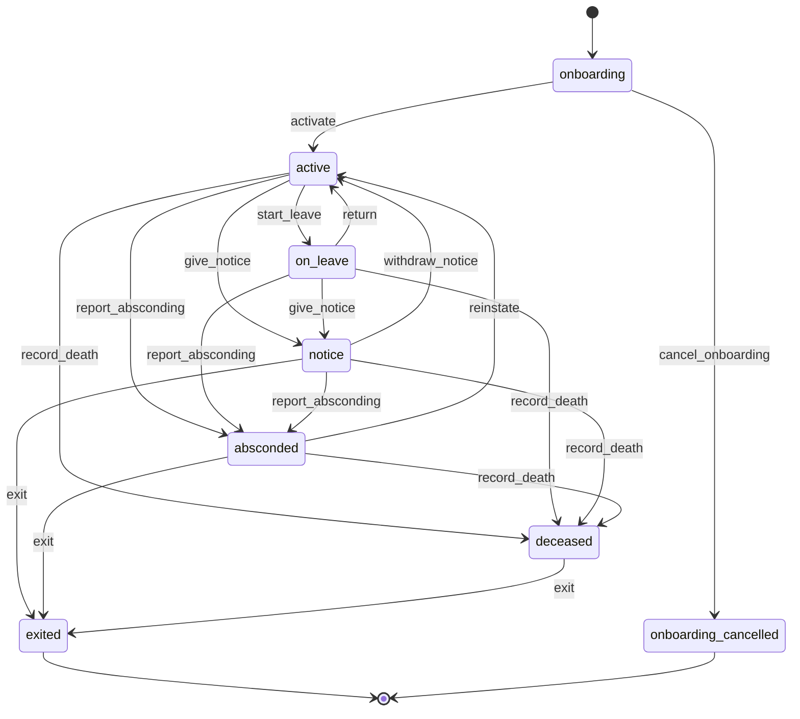
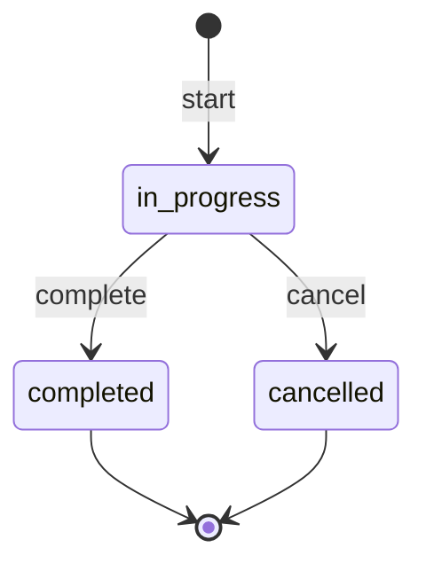
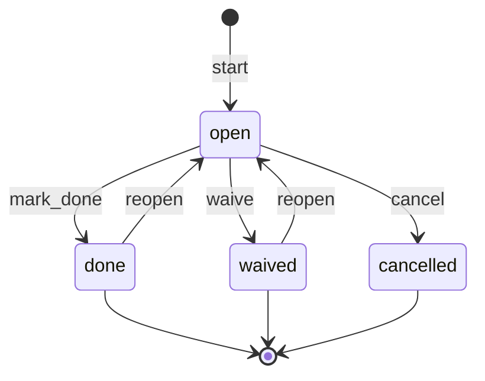
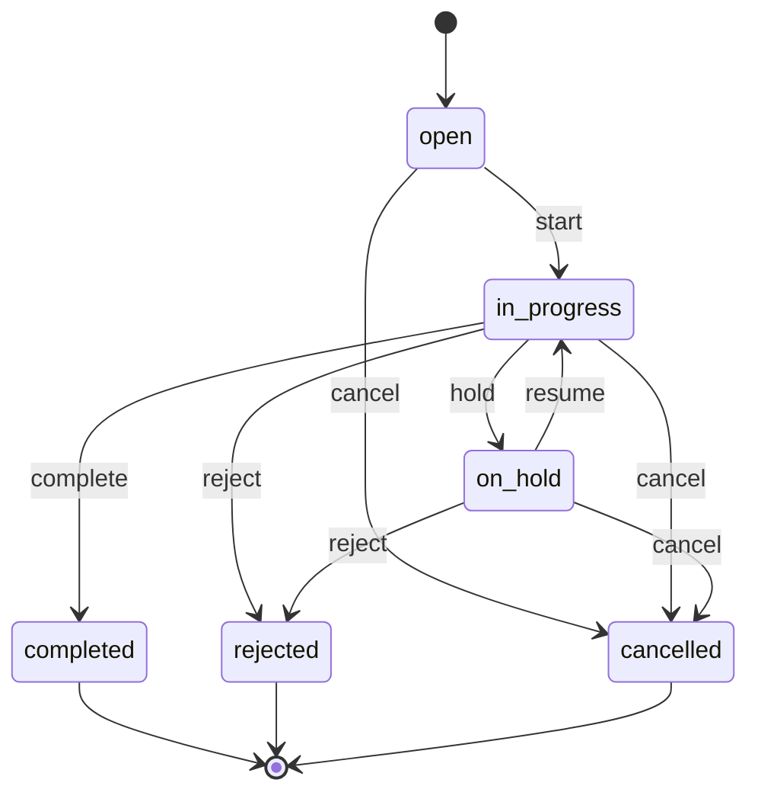
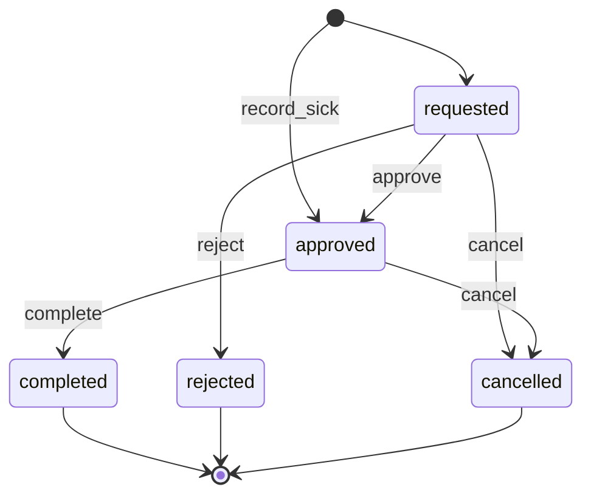
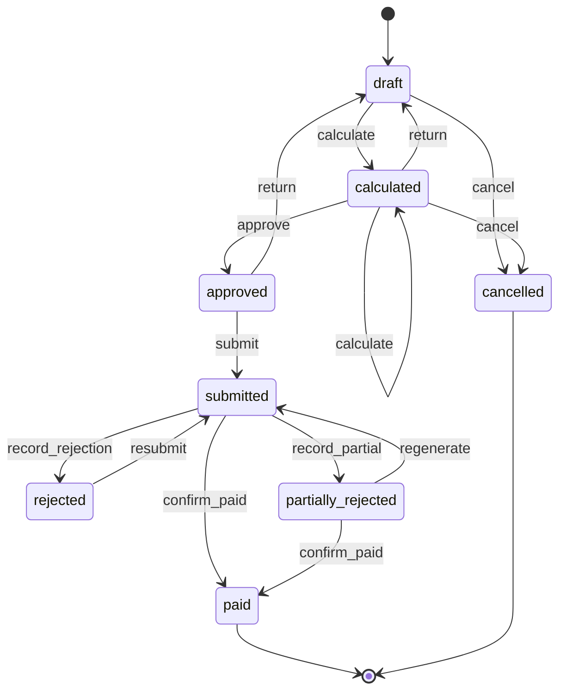
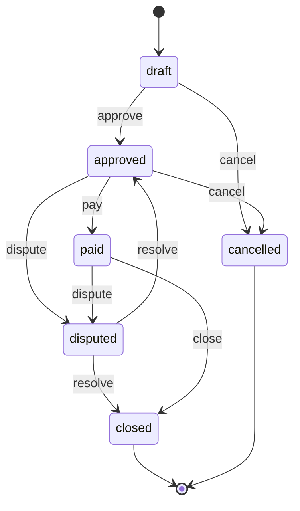
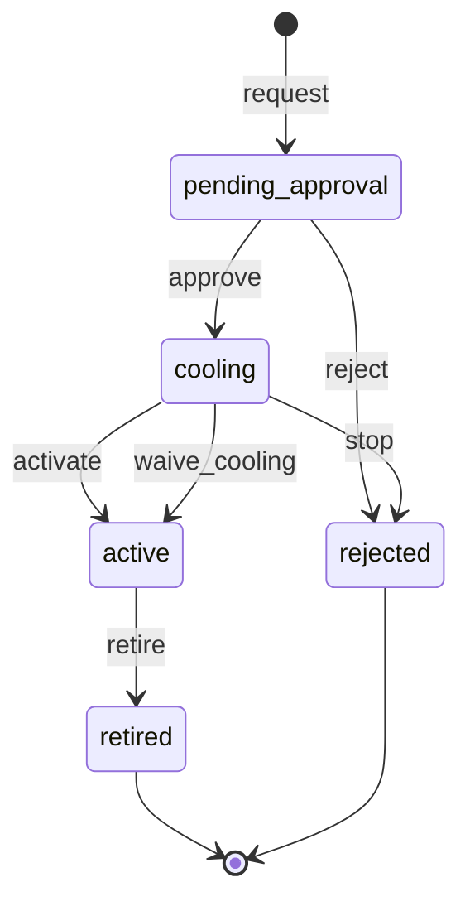

# wl-hr

> Status: draft · Last updated: 2026-10-16

## 1. Purpose

Keeps a UAE employer's obligations to its staff in one place. Almost every SME employs
expatriates on company visas, pays them through WPS, and owes them leave and an
end-of-service gratuity. Those obligations follow the same rules whether the employee is a
construction worker, a driver, a practitioner, a tutor or a deployed cleaner. Freelance
tutors are kept here too, as records without payroll (§3).

The module covers:

- employee records with identity documents and professional licences;
- visa cases (new, renewal, cancellation) as tracked steps;
- leave and absence;
- the monthly payroll run, with the WPS salary file;
- the final settlement when an employee leaves;
- onboarding checklists per role, with the SOPs a new employee must read and acknowledge.

It does not record attendance or hours ([wl-attendance](wl-attendance.md)) and does not
keep the general ledger.

## 2. Capabilities covered

| ID | Capability | Used by verticals | Scope |
|---|---|---|---|
| `HRM.EMP.01` | Employee records with documents and professional licences | 02, 03, 05, 06, 09, 10 MVP; 01, 04, 07, 08 MVP (minimal, needed by `HRM.ONB.01`) | MVP |
| `HRM.VIS.01` | Visa cases (new, renewal, cancellation) as tracked steps | 09 MVP | MVP |
| `HRM.LEV.01` | Leave and absence, blocking calendars | 09 MVP; 05, 10 Later | MVP |
| `HRM.PAY.01` | Payroll calculation: salary structure, overtime, allowances, deductions | 09 MVP; 02, 06, 10 Later | MVP |
| `HRM.WPS.01` | WPS salary file (SIF) export | 09 MVP; 02, 06 Later | MVP |
| `HRM.EOS.01` | Final settlement: gratuity, leave encashment, recoveries | 09 MVP | MVP |
| `HRM.ONB.01` | Staff onboarding checklists per role and a library of SOP documents with acknowledgement | 01, 02, 03, 04, 05, 06, 07, 08, 09, 10 (all MVP); with wl-documents (SOP library) and wl-ticketing (`WRK.CHK.01`) | MVP |
| `HRM.QUA.01` | Qualifications and licences per role and scope, with a validity guard | 03, 04, 05, 09, 10 MVP (05 formerly `CLN.LIC.01`; 03 driving licences and rider permits; 04 FTA tax agent registration; 09 SIRA licences, health cards, site passes; 10 tutor police clearance and permits) | MVP |

All ten verticals are accepted (2026-10-15); the table lists only what their §5 tables name.
A *minimal* employee record (person, scope, cost rate, optional documents; no payroll or
visas) serves verticals that only record staff time (04, decided 2026-10-15) and, since
2026-10-16, the onboarding of 01, 07 and 08 (`HRM.ONB.01`). `wl-attendance` therefore
always records time against an employee. 02 and 06 use payroll and the WPS file Later. A
minimal record is created in `onboarding` when an onboarding template applies to it, else
directly `active`. Its `activate` does not check the statutory items (visa case, labour
contract, mandatory documents), which the client keeps outside the platform: only the
document kinds the client marks as required for it (none by default) and a blocking
onboarding (§3 *Onboarding*).

**Onboarding and SOPs (`HRM.ONB.01`, decided 2026-10-16).** Every vertical uses onboarding
checklists in the MVP. They run on the employee record, including the *minimal* record, so
01 Property (no employee records so far) and 07 and 08 (minimal records Later) need the
minimal record in the MVP for the staff they onboard. The SOP library and the
acknowledgements live in [wl-documents](wl-documents.md) §3 *SOP*; this module creates the
onboarding, assigns its steps and reads the acknowledgements.

09 uses `HRM.QUA.01` in the MVP: `MPW.ACL.07` (SIRA licences and health cards valid before
a deployment) is the same guard.

**Added during reconciliation as `HRM.QUA.01`:** *qualifications and licences with a
validity guard*. A professional licence or qualification is recorded per employee, per role
and per scope, with an expiry date. Other modules ask "may this employee do role R at scope
S on date D?". It absorbs `CLN.LIC.01` (practitioner licences per branch) and backs the
booking guard `SCH.ACL.04` in [wl-scheduling](wl-scheduling.md) (formerly `CLN.ACL.04`).
Drivers' licences and rider permits (03), tax agent registrations (04), SIRA licences and
health cards (09) and tutor police clearance and permits (10) use the guard (their §5
tables list `HRM.QUA.01`). Health cards and PIC certificates (06) are kept as documents
with expiry on the employee record (`HRM.EMP.01`, `DOC.EXP.01`).

**Standard guard (X-13).** Other modules call `qualification_valid(employee, kind, on_date)`
(the `Qualifications` service), or `qualification_valid(employee, kind, on_date, role,
scope)` for a role-bound kind. It answers *yes* when the employee has a valid qualification
or employee document of that kind on `on_date` (through `document_valid` in
[wl-documents](wl-documents.md) §5.6) and, for role-bound kinds, the qualification's roles
and scope include the `role` and `scope` passed (the role and branch of the work being
guarded, e.g. the booking's service role and branch). For a role-bound kind called without
`role` and `scope`, it answers *no*. The document kind's `blocks` setting names the
transitions it guards. Verticals that use it:
05 (bookings, `SCH.ACL.04`), 09 (deployments, `MPW.ACL.07`), 10 (tutor assignment), 03
(run dispatch), 04 (tax agent registration on return filing).

## 3. Concepts and entities

| Entity | Description | Important fields |
|---|---|---|
| Employee | A person who works for the client company | party (person, `wl-parties`), employing legal entity (`PLT.ENT.01`; the visa sponsor and MoHRE establishment), employee number, job title, trade or role, department, scope assignments, employment type (full-time, part-time, temporary, `freelance`), hire date, probation end, contract end, labour contract number, MoHRE person ID / labour card number, residence emirate, sponsor (company or free zone), contact attempts during an absence (date, method, by whom, outcome), MoHRE absence report (number, date, withdrawal reference, date the worker returned; `MPW.RUL.09`), exit route (standard, onboarding cancelled, absconding, death), date of death and the estate's representative (when recorded), status |
| Salary structure | Pay agreed for a period | employee, effective from, basic, housing, transport, other fixed allowances, variable components allowed, currency (AED), cost rate per hour (derived or set; overrides a trade or role rate) |
| Freelance rate | Pay agreed with a freelancer (no salary structure) | employee (`freelance`), effective from, rate per session or per hour, currency; visible per `EDU.ACL.11` |
| Pay account | Where salary is paid | employee, channel (bank account / exchange-house salary card), bank or agent routing code, IBAN or card number (`SEN`), account holder name, name mismatch explanation (text, optional document), requested by, approved by, notice sent to (mobile number on record), notice undelivered (`MessageGaveUp`), worker reached (by, method, date), cooling ends at, status (§4) |
| Qualification | A licence, permit or certificate | employee, type (practitioner licence, SIRA, health card, driving licence, teaching permit…), number, issuer, scope (branches, roles), valid from/to, document (`wl-documents`) |
| Visa case | One visa process | employee (or candidate party), sponsoring legal entity (visa quota per entity), type (`new`, `renewal`, `cancellation`; `transfer` and `status_change` as configured types), emirate/authority, steps, fees, rejection (authority reference, reason, date), cancellation not needed (on a *new* case whose permit was issued: by whom, reason; recorded by `visas.manage`), status |
| Visa case step | One step of a case | case, step type (work permit, entry permit, change of status, medical fitness, Emirates ID biometrics, residence visa, labour contract, health insurance, ILOE, cancellation), mandatory, target days (from the template), due date, date done, reference number, document, fee, amortisation term (default: visa term, 24 months) |
| Leave policy | Rules for a leave type | type (annual, sick, maternity, parental, bereavement, Hajj, study, unpaid), entitlement, accrual, pay rate per band, carry-over, documents required |
| Leave balance | Entitlement per employee and type | employee, type, year, accrued, taken, remaining |
| Leave request | One absence | employee, type, from, to, days (working-calendar aware), paid/unpaid split, document (e.g. sick note), status |
| Payroll run | One pay period for one legal entity | legal entity (one per run; decision 0003), type (`regular`, `off_cycle`, `supplementary`), period, corrects (the paid run a supplementary run corrects), pay group within the entity (all, per scope), cut-off, lines, totals, SIF files (one per submission, versioned), bank result file, return reason, status |
| Payroll line | One employee in a run | employee, fixed components, variable components (overtime by category, allowances), unpaid leave deduction, other deductions (advances, recoveries), expense reimbursements, net, days paid, hold (reason, case; e.g. absence case `MPW.RUL.09`), released into (off-cycle or next run), WPS result (`included`, `paid`, `failed` with the bank's reason), approver comment (on `return`), cost allocation by cost object |
| Adjustment | One-off addition or deduction | employee, type (advance, advance recovery, bonus, fine, loan instalment, cash shortage recovery, overpayment recovery, accommodation or transport deduction), amount, period or instalment plan, source (e.g. the supplementary run), approval, written consent (document; required for accommodation and transport deductions) |
| Final settlement | Amounts due at exit | employee, last working day, reason (resignation, termination, contract end, onboarding cancelled, absconding, death, visa not renewed), payee (employee, or the estate's representative), unpaid salary, leave encashment, gratuity, notice pay, other dues, recoveries, recoveries offset (within the caps), net (dues minus the recoveries offset), amount due from the employee (recoveries above the caps), payments made, dispute (source, MoHRE complaint or court reference, undisputed amount, labour-case ticket, outcome), status |

| Onboarding template | The steps every new employee in a role goes through (`HRM.ONB.01`) | name EN/AR, applies to (job roles or trades, or *all staff*; employment types), steps, blocks activation (off by default), version, active |
| Onboarding template step | One step of a template | title EN/AR, owner (`hr`, `manager`, `employee`, or a named role), due (days after the hire date), required (default yes), kind (`task`, `checklist`, `document`, `sop_acknowledgement`), checklist template (`WRK.CHK.01`, for `checklist`), document kind (for `document`), evidence required (for `task`; default no), help text |
| Onboarding | One employee's onboarding | employee, trigger (`hire` or `manual`, e.g. a role change), templates applied (versions frozen), started at, steps, progress (required steps done or waived of total), blocks activation (from the templates), status (§4) |
| Onboarding step | One step for one employee | onboarding, template step, assignees (resolved at start), due date, status (§4), done by, done at, evidence (checklist run, document, note, file), witness (for an employee step recorded in person), waived by, waive reason |

**Onboarding (`HRM.ONB.01`).** When an employee is created in `onboarding`, `HRM.RUL.16`
starts an onboarding from every active template that applies to the employee's job role (or
trade) and employment type, plus the *all staff* templates. HR may also start a template
manually, e.g. when an active employee moves to a new role; a manual onboarding never blocks
anything. Each step goes to its owner: `hr` = holders of `onboarding.manage` in the
employee's scope, other than users who hold it only through the owner role (the owner role
holds it by default as the second person for `waive` and `reopen`, and gets `hr` steps only
when nobody else holds it); `manager` = the employee's manager (§3 *The employee's
manager*); `employee` = the employee; a named role = its holders in the scope. A step with
several assignees is one step: any one of them marks it done, and all of them are reminded.
A template step is required unless HR marks it optional, and a `task` step needs an
evidence file or note only when its template step says so (seeded steps: all required,
none needs evidence). A step is done:

- `task`: when the assignee marks it done, with the evidence file or note when required;
- `checklist`: when its `WRK.CHK.01` run, started on the onboarding step, completes with
  outcome *passed* (a *failed* run leaves the step open with the failed items shown, and a
  new run can be started);
- `document`: when an accepted document of the kind is on the employee (`DocumentAccepted`);
- `sop_acknowledgement`: when the employee has acknowledged the current version of every SOP
  that lists the employee's role and scope among its required readers (wl-documents §3 *SOP*).

Steps owned by the employee are done in the employee's own session (staff account or
employee portal), or in person with a drawn signature on a staff device, the HR user being
recorded as witness; nobody else marks them done (`HRM.ACL.10`). Before the employee has an
account (workers whose portal account opens at `activate`), the in-person way is the only
one. After an in-person record the employee is told on their own channel (SMS to the
number on record, or the portal inbox when the account opens) what was recorded, when and
with which witness, so a record made without them comes to light. A step that does not
apply is waived by HR with a reason (`HRM.ACL.10`). A step ticked or waived by mistake is
reopened by another `onboarding.manage` holder (`reopen`, §4). Evidence files on steps (an
ID copy, a photo of handed-over PPE) are stored as documents of an employee kind and take
that kind's sensitivity class.

Assignees follow the people, not the start date. Open steps are re-resolved when the
employee's scope assignment or job role changes, when an assignee's own assignment changes
or ends (`EmployeeAssignmentChanged`), and when an assignee's user account is deactivated;
with nobody left the step goes to HR. A corrected hire date recomputes the due dates of open
steps. A role change does not remove steps of the old role's template: HR waives those that
no longer apply and starts a manual onboarding for the new role. While the employee is
`on_leave`, due dates of open steps move by the days of leave and reminders pause; the move
always equals the calendar days of the approved leave as currently recorded, so a leave
shortened, extended or cancelled moves the due dates again. While `absconded`, reminders
and escalations pause and due dates do not move; after `reinstate`, an overdue step is
reminded on the first run and then every R days, and HR and the manager are told on that
run when E days have passed and they were not told before. Death (`EmployeeDeceased`),
exit and a cancelled onboarding cancel the onboarding.

Onboarding blocks nothing by default. A template may set *blocks activation*: Employee
`activate` then also needs every required step that comes from that template `done` or
`waived`; steps of other templates in the same onboarding do not block. This
does not replace the statutory items in the `activate` guard (visa case, labour contract,
mandatory documents), which always apply (a minimal record has none, §2). `HRM.RUL.17`
reminds the assignees of overdue steps and then tells HR and the manager.

**Employed and freelance (decided in 10 EdTech, 2026-10-15).** An employee with employment
type `freelance` (for example a freelance tutor) has a record, documents, qualifications and
timesheets, but no salary structure, visa case, leave balance, payroll line, WPS entry or
final settlement. Their permit or freelance visa is a document with expiry
(`DOC.EXP.01`). They are paid per session or per hour from approved timesheets through a
monthly supplier bill (`FIN.PAB.01`, [wl-invoicing](wl-invoicing.md)); the freelancer is
also a supplier party in `wl-parties`.

**Deductions needing consent (decided in 09 Manpower, 2026-10-15).** Accommodation and
transport deductions are off by default. When a client turns them on, each adjustment needs
the worker's signed written consent attached, the Art. 25 caps still apply, and the setting
shows a warning to take legal advice. No adjustment type exists for visa or recruitment
costs (Art. 6(4)).

**The employee's manager.** The employee record has no manager field. Where this module
says "the manager" or "the line manager" of an employee, it means every user who holds the
*manager* role in one of the employee's scope assignments, resolved through wl-kernel's
`ApproverResolver` ("manager of the employee's branch"). When no such user exists, the
message or right falls to HR (`employees.manage`).

## 4. Lifecycles

The machines below are the canonical form of those first written in
[09-manpower.md §7.1](../verticals/09-manpower.md#71-state-machines). Manpower-specific
guards (deployments, client notifications) are expressed as vertical automations on these
machines' events.

### Employee

| State | Tone | Terminal | Meaning |
|---|---|---|---|
| `onboarding` | neutral | no | Hired; visa, contract and documents in progress |
| `active` | success | no | Can work and be paid |
| `on_leave` | info | no | On approved leave |
| `notice` | warning | no | Resigned or terminated; serving notice |
| `absconded` | error | no | Absent without notice; MoHRE absence report filed; no line is put in a new SIF file while the report is valid (a file already sent is not recalled) |
| `deceased` | neutral | no | Died in service; settlement due to the estate |
| `exited` | neutral | yes | Settled; visa cancelled where the company sponsored it |
| `onboarding_cancelled` | neutral | yes | Never started work (visa refused or cancelled, candidate withdrew, medically unfit) |

| Transition | From | To | By | Guards | Effects |
|---|---|---|---|---|---|
| `activate` | onboarding | active | `employees.manage` | statutory onboarding items complete: when visa cases are enabled, a *new* visa case `completed`; labour contract signed; mandatory documents (Emirates ID, passport, health insurance) attached with expiry; ILOE is not a blocker, the worker has four months from the work permit to subscribe ✔ [S6]. For `freelance`: permit or freelance visa and the freelance agreement attached instead. For a *minimal* record (§2): no statutory items, only the document kinds the client marks required (none by default). For every record: when the employee's onboarding includes a template with *blocks activation* (§3 *Onboarding*), every required step from such a template `done` or `waived` | portal account created (where the vertical has an employee portal); event `EmployeeActivated` |
| `start_leave` | active | on_leave | system (leave start) | approved leave request | event `LeaveStarted` |
| `return` | on_leave | active | system (leave end) or `employees.manage` | — | — |
| `give_notice` | active, on_leave | notice | `employees.manage` | notice date, last working day and reason recorded | final settlement drafted; *cancellation* visa case opened when sponsored; event `EmployeeNoticeGiven` |
| `exit` | notice | exited | `employees.manage` | final settlement `paid` or `closed`; *cancellation* visa case `completed` when sponsored | portal becomes read-only, then closes (TIM rule); event `EmployeeExited` with exit route *standard* |
| `exit` | absconded, deceased | exited | `employees.manage` | *cancellation* visa case `completed`, or the authority's cancellation reference recorded; final settlement `approved`, `paid` or `closed` (absconded; `disputed` blocks the exit) or `paid` or `closed` to the estate (deceased); no signed acknowledgement needed | portal becomes read-only, then closes (TIM rule); event `EmployeeExited` with exit route *absconding* or *death* |
| `cancel_onboarding` | onboarding | onboarding_cancelled | `employees.manage`, approved under `HRM.ACL.07` | reason given; open *new* visa case `cancel`led or `rejected`; when a work permit or entry permit was already issued, a *cancellation* visa case `completed` (or *cancellation not needed* recorded on the *new* case by `visas.manage`, with a reason); when the employee has attendance, wages for those days paid by a final settlement (`paid`) that HR drafted with reason *onboarding cancelled* (§5.4); no settlement needed without attendance | planned deployments and assignments cancelled through event `EmployeeOnboardingCancelled`; visa and onboarding costs stay on the employee cost object and are not recovered from the person (Art. 6(4)); portal account (if any) closed |
| `withdraw_notice` | notice | active | `employees.manage`, approved under `HRM.ACL.07` | the other party's written agreement attached (`⚠ open: lawyer (L-26)`, §10); *cancellation* visa case not `completed`; final settlement `draft` or `approved` with no payment recorded against it (a settlement `paid`, `disputed` or partly paid cannot be cancelled, so the notice stands) | draft or approved final settlement `cancel`led; *cancellation* visa case `cancel`led; last working day cleared; event `EmployeeNoticeWithdrawn` |
| `report_absconding` | active, on_leave, notice | absconded | `employees.manage`, approved under `HRM.ACL.07` | an absence case is open and more than N consecutive calendar days (default 7) have passed since the last day with attendance or approved leave, and the worker cannot be reached: at least two failed contact attempts recorded on different days of the absence (ER Art. 28 ✔ [S1]); MoHRE absence report number and date recorded | payroll lines in runs not yet `submitted` held with reason *absence report* (outside WPS while the report is valid, MR 340/2026 Art. 4 ✔ [S2]; a line in a file already sent stays, and if the bank fails it, it is held); deployments ended; portal and attendance disabled; final settlement drafted (or, from `notice`, the existing one gets reason *absconding* and no second one is drafted); *cancellation* visa case opened from the *absconding* variant of the cancellation step template (§8); event `EmployeeAbsconded` |
| `reinstate` | absconded | active | `employees.manage`, approved under `HRM.ACL.07` | the date the worker returned recorded (not in the future) and the report's withdrawal or cancellation reference recorded (`⚠ open: authority (AU-22)`, §10); *cancellation* visa case not `completed`; final settlement `draft` or `approved` with no payment recorded against it (otherwise refused: the worker is rehired as a new employee) | held lines released through `HRM.RUL.12`; draft or approved final settlement and *cancellation* case `cancel`led; the employee returns to `active` whatever the state before absconding (a notice or leave that was running is not resumed; HR gives notice or records leave again); event `EmployeeReinstated` |
| `record_death` | active, on_leave, notice, absconded | deceased | `employees.manage`, approved under `HRM.ACL.07` | date of death and death certificate (or the authority's notice) attached | payroll lines in runs not yet `submitted` held with reason *death* and never released by `HRM.RUL.12`: the salary they owe up to the date of death is moved into the final settlement as unpaid salary, and the line is marked *settled in the final settlement*; deployments ended; portal disabled and every message to the employee stopped; leave requests `requested` or `approved` that have not started cancelled by the system; final settlement drafted with payee *estate*; *cancellation* visa case opened; HR task list (visa cancellation, insurance claim, repatriation) opened; event `EmployeeDeceased` |

### Onboarding

| State | Tone | Terminal | Meaning |
|---|---|---|---|
| `in_progress` | info | no | Steps open |
| `completed` | success | yes | Every required step `done` or `waived` |
| `cancelled` | neutral | yes | The employee never started or left before the end |

| Transition | From | To | By | Guards | Effects |
|---|---|---|---|---|---|
| `start` | — | in_progress | system (`HRM.RUL.16`, employee created in `onboarding`) or `onboarding.manage` (trigger `manual`) | at least one active template applies (or is chosen); no other `in_progress` onboarding with the same template for the employee | template versions frozen; one step per template step, assignees resolved, due date = hire date (manual: start date) + due days; assignees notified; event `OnboardingStarted` |
| `complete` | in_progress | completed | system (last required step `done` or `waived`) | every required step `done` or `waived` | optional steps still `open` are left open; HR and the manager notified; event `OnboardingCompleted` |
| `cancel` | in_progress | cancelled | system (`EmployeeOnboardingCancelled`, `EmployeeExited`, `EmployeeDeceased`) or `onboarding.manage` (manual onboarding) | reason given (manual) | open steps `cancelled`; checklist runs in progress voided by the system with that reason; no further reminders |

### Onboarding step

| State | Tone | Terminal | Meaning |
|---|---|---|---|
| `open` | neutral (error when overdue) | no | To do; *overdue* is shown from the day after the due date |
| `done` | success | no | Done, with its evidence (reopened only by `reopen`) |
| `waived` | neutral | no | Does not apply to this employee (reopened only by `reopen`) |
| `cancelled` | neutral | yes | The onboarding was cancelled |

| Transition | From | To | By | Guards | Effects |
|---|---|---|---|---|---|
| `mark_done` | open | done | an assignee (kind `task`), or system (`ChecklistCompleted` passed, `DocumentAccepted`, last required SOP acknowledged) | evidence attached when required; for an `employee` step, recorded by the employee (own session, or in person with signature and witness, `HRM.ACL.10`) | done by and at recorded; onboarding progress updated; `complete` when it was the last required step |
| `waive` | open | waived | `onboarding.manage` | reason given; the user is not an assignee of the step (`HRM.ACL.10`) | audited; progress updated |
| `reopen` | done, waived | open | `onboarding.manage` | onboarding `in_progress`; reason given; the user is not the one who marked the step done or waived it (`HRM.ACL.10`); a `done` step only of kind `task` (steps done by the system follow their evidence: a new checklist run, document or acknowledgement); a `waived` step of any kind (a reopened `document` or `sop_acknowledgement` step is re-evaluated at once and is `done` again when its evidence is already there) | done or waive record kept in the history; assignees notified; due date unchanged (overdue shown at once when passed); audited |
| `cancel` | open | cancelled | system (onboarding `cancel`) | — | — |

Steps are created `open` by the onboarding's `start`. `done` and `waived` are final for the
onboarding's progress except through `reopen`; a `completed` onboarding is not reopened (HR
starts a manual one).

### Visa case

A case's steps come from a step template per type and emirate. Steps are checklist items,
not states.

| State | Tone | Terminal | Meaning |
|---|---|---|---|
| `open` | neutral | no | Created; no step done |
| `in_progress` | info | no | At least one step done |
| `on_hold` | warning | no | Waiting (medical re-test, missing document, authority delay) |
| `completed` | success | yes | All mandatory steps done; resulting documents stored with expiry dates |
| `rejected` | error | yes | Refused by the authority (MoHRE, GDRFA or ICP) |
| `cancelled` | neutral | yes | Abandoned (candidate withdrew, no longer needed) |

| Transition | From | To | By | Guards | Effects |
|---|---|---|---|---|---|
| `start` | open | in_progress | `visas.manage` | first step recorded | — |
| `hold` | in_progress | on_hold | `visas.manage` | reason given | HR notified |
| `resume` | on_hold | in_progress | `visas.manage` | — | — |
| `complete` | in_progress | completed | `visas.manage` | all mandatory steps done; resulting documents attached with numbers and expiry dates | *new*: employee may `activate`; *cancellation*: employee may `exit`; fees posted to the employee as cost object (`FIN.CST.01`), amortised evenly over the visa or contract term (default 24 months) for management reporting; event `VisaCaseCompleted` |
| `cancel` | open, in_progress, on_hold | cancelled | `visas.manage` | reason given | fees already paid stay posted |
| `reject` | in_progress, on_hold | rejected | `visas.manage` | authority reference and reason recorded | fees already paid stay posted; event `VisaCaseRejected`. *New*: HR task to `cancel_onboarding` or open another case. *Renewal*: HR task with a deadline N days before the current residence visa expires (default 30; due today when that day has passed) to open a new case by another route, or to `give_notice` and open a *cancellation* case; active deployments told through `VisaCaseRejected`, which carries the current visa's expiry date (the vertical reacts; 09 deployments), and again through `DocumentExpiring` (`affected`) once the visa enters its look-ahead window (`DOC.RUL.02`); MD notified |

### Leave request

| State | Tone | Terminal | Meaning |
|---|---|---|---|
| `requested` | info | no | Waiting for approval |
| `approved` | success | no | Approved; not finished |
| `completed` | success | yes | Leave period over; balance deducted |
| `rejected` | neutral | yes | Not approved |
| `cancelled` | neutral | yes | Withdrawn before it started |

| Transition | From | To | By | Guards | Effects |
|---|---|---|---|---|---|
| `approve` | requested | approved | `leave.approve` | balance sufficient, or the excess marked unpaid; required document attached (e.g. sick note) | calendars blocked (`wl-scheduling`, rosters); event `LeaveApproved` |
| `record_sick` | — | approved | `leave.approve`, or the employee's manager (§3) | type sick; starts today (the employee called in sick); the sick note may follow within N days | same effects as `approve` at once, so today's bookings and rosters are moved (`wl-scheduling` §5.5); event `LeaveApproved`; a task to HR when the sick note is not attached by the end of the Nth working day after the start date (raised at 00:00 Asia/Dubai the next day) |
| `reject` | requested | rejected | `leave.approve` | reason given | employee notified |
| `cancel` | requested, approved | cancelled | the employee or `leave.approve` | start date not reached | balance restored; calendars released |
| `complete` | approved | completed | system (end date) | — | balance deducted; unpaid days passed to payroll |

**Vertical mapping (leave):**

| Vertical | Difference | How it is handled |
|---|---|---|
| 09 Manpower | client informed; cover may be required | `MPW.RUL.06` on `LeaveApproved` |
| 05 Clinics | practitioner's bookable slots blocked | `wl-scheduling` consumes `LeaveApproved`; existing bookings flagged for rescheduling |
| 10 EdTech | substitute tutor for affected sessions | EdTech automation on `LeaveApproved` |

### Payroll run

| State | Tone | Terminal | Meaning |
|---|---|---|---|
| `draft` | neutral | no | Created for the period |
| `calculated` | info | no | Lines calculated; under review |
| `approved` | success | no | Approved by a second user |
| `submitted` | info | no | Salary file generated and sent to the bank or exchange house |
| `rejected` | error | no | The bank or exchange house rejected the whole file |
| `partially_rejected` | warning | no | Some lines paid; others failed with the bank's reason |
| `paid` | success | yes | Payment confirmed for every line not held; payslips published |
| `cancelled` | neutral | yes | Discarded before approval |

| Transition | From | To | By | Guards | Effects |
|---|---|---|---|---|---|
| `calculate` | draft, calculated | calculated | `payroll.prepare` | hours for the period from `Timesheets::hours_for_payroll(period)` (approved hours, and accepted attendance hours marked *provisional* for timesheets not yet approved, per the wl-attendance cut-off policy); an employee with no hours for the period does not block the run: the line is listed as an exception (missing timesheet, §5.3 step 3) | lines recalculated for the run's legal entity only (`freelance` employees excluded) from salary structures, timesheets (`wl-attendance`; provisional hours shown as such on the line), approved adjustment timesheets affecting payroll, reconciliation differences (`TimesheetReconciliationNeeded`), leave, adjustments and expense reimbursements; lines of employees with an open absence case marked *held* |
| `approve` | calculated | approved | `payroll.approve` | segregation of duties: approver ≠ preparer | — |
| `return` | calculated, approved | draft | `payroll.approve` | returner ≠ the preparer; reason given; at least one comment on a line to fix | approval cleared; preparer notified with the reason and comments; event `PayrollRunReturned` |
| `submit` | approved | submitted | `payroll.prepare` | every paid employee has a WPS-eligible pay account (or an approved non-WPS method) | SIF file generated per entity, named with its MoHRE establishment ID (`HRM.WPS.01`); held lines and lines with net ≤ 0 left out (no SIF when no line is left, e.g. a supplementary run with only negative differences); approved timesheets used are `lock`ed; timesheets paid on provisional hours get `paid_provisionally_by` = this run |
| `record_rejection` | submitted | rejected | `payroll.prepare` | the bank's rejection notice attached; reason (file format, establishment ID, funding, other) | every line marked `failed`; preparer and approver notified (`HRM.RUL.11`); the WPS deadline alerts (`HRM.RUL.03`) keep running; event `PayrollLinesFailed` |
| `record_partial` | submitted | partially_rejected | `payroll.prepare` | the bank's result file attached; each failed line has a reason (invalid IBAN or card, routing code, name or labour card mismatch, account closed) | paid lines marked `paid` and their payslips published; failed lines marked `failed`; a task per failed line (`HRM.RUL.11`); event `PayrollLinesFailed` |
| `resubmit` | rejected | submitted | `payroll.prepare` | cause fixed: a note on the fix entered (every reason); for reason *establishment ID*, the legal entity's MoHRE establishment ID differs from the one in the rejected SIF version; amounts unchanged (`return` is not possible once the file was sent: an amount error is corrected after payment by a supplementary run, §5.6) | new SIF version generated for the same lines; lines reset from `failed` to `included`; the previous file kept |
| `regenerate` | partially_rejected | submitted | `payroll.prepare` | each failed line fixed (pay account changed under `HRM.ACL.05`) or moved out of the run (held, or paid by an approved non-WPS method) | SIF generated with only the fixed lines, as a new version linked to the run |
| `confirm_paid` | submitted, partially_rejected | paid | `payroll.approve` | bank or exchange-house confirmation attached for every line not held with net > 0 that is in a SIF version (the result file attached at `record_partial` confirms the lines it shows paid; none needed when no SIF was generated); a line moved out to an approved non-WPS method has its payment recorded (`FIN.PAY.01`) instead; no line left `failed` (fix it or hold it) | payslips generated (`DOC.GEN.01`) and published to the employee portal; salary cost posted to cost objects (`FIN.CST.01`); held lines wait for `HRM.RUL.12`; for a supplementary run, overpayment recovery adjustments created for the negative differences; event `PayrollRunPaid` |
| `cancel` | draft, calculated | cancelled | `payroll.prepare` | — | — |

**Run types.** The same machine runs three types:

- `regular`: the monthly run (`HRM.RUL.02`).
- `off_cycle`: pays held lines released after the regular run (`HRM.RUL.12`), lines that
  failed and were moved out, and positive differences of a supplementary run that were held
  at its `submit`. It has its own SIF file and the same approval.
- `supplementary`: a correction of a `paid` run, which is never edited. Created by
  `payroll.prepare` from the paid run with a reason; it holds only the affected employees
  and the difference per component. A positive difference is paid in this run, through its
  own SIF; only a line held at its `submit` (e.g. no usable pay account) is paid later in an
  off-cycle run (`HRM.RUL.12`). A negative difference becomes an *overpayment recovery* adjustment spread
  over the next regular runs, at most 20% of the wage a month and within the 50% total
  (Art. 25 ✔ [S1]; `HRM.ACL.06`). Corrected payslips are published and the cost difference
  is posted to the same cost objects. Approval is by another user (`HRM.ACL.04`).
  Only positive lines go to the bank: a run with only negative differences generates no SIF
  at `submit` and needs no bank confirmation at `confirm_paid`. The recovery adjustments are
  created at `confirm_paid`, when the correction is final. A paid run may get several
  supplementary runs; each difference is against the paid run plus the earlier corrections,
  and `corrects` always names the original run. For an employee who has left since, a
  negative difference is added to the final settlement's recoveries while it is not yet
  `paid`, otherwise it becomes a receivable from the employee as for a negative net.

### Final settlement

| State | Tone | Terminal | Meaning |
|---|---|---|---|
| `draft` | neutral | no | Calculated from exit data; editable |
| `approved` | success | no | Approved by a second user |
| `disputed` | warning | no | The worker contests the amounts, or a MoHRE complaint or court case is open |
| `paid` | success | no | Paid (or nothing payable); acknowledgement requested |
| `closed` | success | yes | No dispute open; the period to dispute passed or the dispute ended |
| `cancelled` | neutral | yes | Not needed (notice withdrawn, worker reinstated) |

| Transition | From | To | By | Guards | Effects |
|---|---|---|---|---|---|
| `approve` | draft | approved | `settlements.approve` | approver ≠ preparer | settlement statement generated (`DOC.GEN.01`) |
| `pay` | approved | paid | `settlements.pay` | payment of the net still unpaid recorded through WPS or transfer (`FIN.PAY.01`) to the payee (for payee *estate*: the estate's representative and the document giving the right recorded, `⚠ open: lawyer (L-25)`); or nothing payable (net 0) | acknowledgement sent for signature (`DOC.SIG.01`; not for the estate); employee may `exit`; recoveries above the caps create a receivable from the employee (see *Negative net* below); event `SettlementPaid` |
| `dispute` | approved, paid | disputed | `settlements.prepare` | source (worker, MoHRE complaint, court) and reference given; undisputed amount entered | labour-case ticket opened (`wl-ticketing`, category *labour case*) with the hearing or reply dates; HR, accountant and MD notified; the undisputed amount can still be paid on time as a payment against the settlement; event `SettlementDisputed` |
| `resolve` | disputed | approved, closed | `settlements.approve` | outcome (`upheld`, `revised`) and the MoHRE decision, agreement or judgment attached | `revised`: while `disputed`, a `settlements.prepare` user enters the recalculated amounts; `resolve` is then run by a `settlements.approve` user other than the one who entered them (`HRM.ACL.04`); the settlement goes to `approved` with a new statement and the difference is paid with `pay` (a revised net below the amount already paid makes the excess a receivable from the employee, as for a negative net); `upheld`: `closed` when the net is paid in full (or nothing is payable), otherwise `approved` so the rest is paid with `pay`; labour-case ticket closed |
| `close` | paid | closed | system | N days after `pay` with no dispute (default 30), or acknowledgement signed | a later claim (e.g. a MoHRE case) is handled outside the machine on a *labour case* ticket on the employee |
| `cancel` | draft, approved | cancelled | `settlements.prepare` or system (`withdraw_notice`, `reinstate`) | nothing paid against it | — |

**Negative net (recoveries above the caps).** A settlement "goes negative" when its
recoveries are larger than what may be offset; the net itself never falls below 0.
Recoveries (advances, loans, overpayments, damage) are offset against the
dues only within the Art. 25 caps (`HRM.ACL.06`: per type and 50% in total, computed on the
settlement's dues). The settlement counts as one period: each monthly per-type cap applies
once, as a share of the dues (overpayments 20%, fines 5%, court debts 25%), and damage at
most 5 days' wage of the last salary structure (a day's wage per §7). The recoveries above
the caps are the amount due from the employee: `pay`
creates a receivable for it on the employee's party (a non-VAT receivable, not a tax
invoice) with a recovery task for the accountant. The net (dues minus the capped offset) may
therefore still be positive, and is then paid as usual; a net of 0 is settled by `pay` with
no payment. Whether the employer may set off more than the caps against end-of-service dues,
and how to recover the rest, is `⚠ open: lawyer (L-23)` (§10); until confirmed the system
offsets only within the caps and leaves the rest as the receivable.

### Pay account

A change of pay account is the classic payroll fraud. A new account is never used at once.

| State | Tone | Terminal | Meaning |
|---|---|---|---|
| `pending_approval` | warning | no | Requested by HR or by the employee in the portal |
| `cooling` | info | no | Approved; the worker has been told; not yet used by payroll |
| `active` | success | no | Used by the next payroll run submitted |
| `retired` | neutral | yes | Replaced by a newer account |
| `rejected` | neutral | yes | Not approved, or stopped by the worker |

| Transition | From | To | By | Guards | Effects |
|---|---|---|---|---|---|
| `request` | — | pending_approval | `employees.manage`, or the employee (portal) | IBAN or card format and routing code valid; account holder name matches the employee, or the mismatch explained; no other request of the employee `pending_approval` or `cooling` (the same flow applies to a new employee's first account) | approver notified |
| `approve` | pending_approval | cooling | `pay_accounts.approve` (`HRM.ACL.05`) | approver ≠ requester | SMS (and e-mail where known) to the worker's mobile number on record before the request, naming the last 4 digits and the date it takes effect (no mobile number on record: handled as an undelivered notice, below); cooling ends after N days (default 5) |
| `reject` | pending_approval | rejected | `pay_accounts.approve` | reason given | requester notified |
| `stop` | cooling | rejected | the worker (reply link, portal) or `employees.manage` | — | old account stays active; security ticket opened; MD notified |
| `activate` | cooling | active | system (cooling ended, or worker reached recorded after it ended) | the change notice was not given up (`MessageGaveUp`), or HR recorded that the worker was reached (by whom, method, date) | previous active account `retired`; event `PayAccountChanged` |
| `waive_cooling` | cooling | active | `payroll.approve` + MD approval (`HRM.ACL.05`) | reason given (e.g. a failed WPS line, worker verified in person with their Emirates ID); approved through a wl-kernel approval request with one step for the *MD* role; the approver is neither the `payroll.approve` user who asks nor the requester of the change (if the MD is either, another user with the *MD* role approves; with none, the request waits) | as `activate`; audited |
| `retire` | active | retired | system | a newer account activated | — |

A run uses the account that is `active` when it is submitted. If that account is closed and
the new one is still cooling, the line is held and paid in an off-cycle run.

**Undelivered notice and worker reached.** When the change notice gives up (`MessageGaveUp`
from wl-notify), or there is no mobile number on record at `approve`, the account records
*notice undelivered* and HR gets a task to reach the worker. A user with `employees.manage`
then records *worker reached* (by whom, method, date) on the cooling account; this is a field
update, not a transition. `activate` runs at the cooling end, or at once when *worker
reached* is recorded after the cooling end.

**Vertical mapping (employee, payroll, settlement):**

| Vertical | Employees | Payroll | Notes |
|---|---|---|---|
| 09 Manpower | deployed workers and office staff, each in the entity that sponsors the visa | MVP, one run and one WPS file per entity; salary cost posted per deployment | Visa and insurance costs amortised over 24 months to active deployments; `MPW.RUL.09` absence case holds the next salary and leads to `report_absconding`; deployment guard `MPW.ACL.07` uses `qualification_valid`; deployments suspended on `QualificationExpired`, ended on `EmployeeAbsconded`, `EmployeeDeceased`, cancelled on `EmployeeOnboardingCancelled` |
| 03 Logistics | drivers, riders and hub staff | not listed | Driving licence, RTA rider permit and certificate as documents with expiry; `qualification_valid` (`HRM.QUA.01`) guards run dispatch and delivery assignment |
| 05 Clinics | practitioners and staff | not listed | Licences and privileges per branch (`HRM.QUA.01`, formerly `CLN.LIC.01`) guard bookings (`SCH.ACL.04`) |
| 06 F&B | kitchen and outlet staff | not listed (excluded from the MVP) | Health cards and PIC certificate as documents with expiry |
| 10 EdTech | employed and `freelance` tutors | Later, employed tutors only | Freelance tutors paid by monthly bill (`FIN.PAB.01`); permits and police clearance as documents with expiry; `qualification_valid` (`HRM.QUA.01`) guards tutor assignment (`EDU.ACL.14`) |
| 02 Construction | workers and staff (`HRM.EMP.01`, MVP) | payroll and WPS file Later | Approved timesheets exported for payroll in the MVP; trade cost rates in apps/construction |
| 01, 04, 07, 08 | staff, technicians (minimal records, §2) | not listed | For onboarding and SOP acknowledgements (`HRM.ONB.01`, all four) and timesheets in `wl-attendance` (04, 07, 08); 04 also records FTA tax agent registrations (`HRM.QUA.01`) that guard return filing |

## 5. Workflows

### 5.1 Hire to active

1. HR creates the employee from a party (person) with employing entity, job, scope, salary
   structure and pay account (or, for a freelancer, a freelance rate).
2. If the company sponsors the visa, a *new* visa case opens from the step template for the
   emirate. Each step is recorded with date, reference, document and fee.
3. Documents produced (work permit, residence visa, Emirates ID, labour contract, insurance,
   ILOE) are stored with expiry dates (`DOC.EXP.01`).
4. `HRM.RUL.16` starts the onboarding from the role's templates (§5.8). It runs in
   parallel with the visa steps.
5. When the case completes and the statutory items are complete (and, where a template
   *blocks activation*, the required onboarding steps), HR activates the employee.

### 5.2 Leave

1. The employee requests leave in the portal, or HR records it.
2. The system counts working days from the work calendar (`wl-attendance`) and checks the
   balance.
3. The approver approves. Calendars and rosters are blocked. An employee who calls in sick
   on the day is recorded directly as approved sick leave (`record_sick`); `LeaveApproved`
   goes out at once and the sick note follows.
4. When the leave ends, the balance is deducted and unpaid days go to payroll.

### 5.3 Monthly payroll

1. On the cut-off day a draft run is created per legal entity (`HRM.RUL.02`).
2. *Calculate* takes, per employee: salary structure (pro-rated for joiners and leavers),
   timesheet hours by category × overtime rates (approved hours, or accepted attendance
   hours marked provisional where the client has not approved by the cut-off, wl-attendance
   §5.7), unpaid leave, adjustments (advances, recoveries, bonuses).
   Approved adjustment timesheets that affect payroll and reconciliation differences
   (`TimesheetReconciliationNeeded`) enter the next regular run of the employee's entity
   after approval: + hours paid, − hours recovered as a deduction within the Art. 25 limits
   (`HRM.ACL.06`), both at the rates of the salary structure effective on the date of the
   hours (not today's). Each difference is linked to the run that paid or recovered it and
   is used once. A correction to a run already `paid` that cannot wait for the next run goes
   through a supplementary run (§5.6).
3. The preparer reviews exceptions: missing timesheets, negative nets, deductions above
   the legal limit (Art. 25: at most 50% of the wage in total), accommodation or transport
   deductions without consent, lines held by an absence case.
4. A different user approves, or returns the run to draft with a reason and comments on
   the lines to fix.
5. *Submit* generates the entity's SIF file for the bank or exchange house.
6. If the bank rejects the file, the preparer fixes the cause and resubmits. If some lines
   fail, the paid lines are confirmed, each failed line is fixed (usually the pay account,
   under change control) or held, and a SIF with only the fixed lines is generated.
7. When payment is confirmed for every line not held, payslips are published and salary
   cost is posted to cost objects.

### 5.4 Exit

1. HR records notice: date, last working day, reason.
2. The final settlement is drafted: unpaid salary, leave encashment, gratuity, notice pay
   where due, minus recoveries.
3. A *cancellation* visa case opens for sponsored employees.
4. The settlement is approved by another user, paid, and acknowledged by signature. The
   14-day rule (`HRM.RUL.09`) alerts HR before the legal deadline.
5. When the cancellation completes, the employee exits.
6. If the worker disputes the amounts or files a MoHRE complaint, the settlement goes to
   `disputed` and a labour-case ticket tracks the case. The undisputed amount is still paid
   on time.

Other exits:

- **Notice withdrawn** by agreement: the employee returns to `active`; the draft or approved
  settlement and the cancellation case are cancelled (only while the visa is not yet
  cancelled and nothing has been paid on the settlement).
- **Onboarding cancelled** (visa refused or cancelled, candidate withdrew): planned work is
  cancelled, any days worked are paid, a cancellation case runs when a permit was issued,
  and the costs stay with the employer. The employee never enters `notice`, so nothing
  drafts a settlement automatically: when the employee has attendance, HR drafts the final
  settlement (reason *onboarding cancelled*: unpaid salary for the days worked), has it
  approved and paid, and then requests `cancel_onboarding`.
- **Absconding:** after the absence case (09 `MPW.RUL.09`) and the MoHRE absence report,
  `report_absconding` holds pay, ends deployments and opens the cancellation case. Exit does
  not wait for the worker's signature or for payment; the approved settlement stays as a
  liability until it is paid as legal advice says (`⚠ open: lawyer (L-24)`, §10).
- **Death:** `record_death` stops all messages to the employee, holds the open payroll
  lines, moves the salary owed up to the date of death into the settlement and drafts the
  settlement to the estate. Who receives it and which documents are
  needed is `⚠ open: lawyer (L-25)`.
- **Renewal refused:** a rejected *renewal* visa case gives HR a task with a deadline before
  the current visa expires: try another route, or give notice and open a cancellation case.

### 5.5 Document and licence expiry

1. Every identity document and qualification has an expiry date.
2. `DOC.RUL.01` reminds HR and the employee at 90/30/7 days.
3. Residence visas open a *renewal* case automatically (`HRM.RUL.04`, formerly
   `MPW.RUL.01`).
4. An expired qualification makes `qualification_valid` answer *no* for that role and
   scope: no booking in clinics (`SCH.ACL.04`), no deployment start in manpower
   (`MPW.ACL.07`), no tutor assignment in EdTech, no run dispatch in logistics, as the
   document kind's `blocks` setting says ([wl-documents](wl-documents.md) §5.6).
5. Planned work after the expiry date is flagged ahead (`DOC.RUL.02`). On the expiry date
   `HRM.RUL.10` emits `QualificationExpired`; work in progress reacts in the vertical: 09
   suspends active deployments (no attendance, no billing) until the renewed document is
   accepted.

### 5.6 Corrections and held lines

1. An error found after `paid` is corrected by a *supplementary* run linked to the paid
   run. Underpayments are paid; overpayments are recovered over the next runs, at most 20% of
   the wage a month (Art. 25 ✔ [S1]). The paid run is never changed. A run with only
   overpayments sends nothing to the bank; the recoveries start when it is confirmed.
2. A held line (absence case, closed account, failed line moved out) is released when its
   reason clears (`HRM.RUL.12`). The default is an off-cycle run, paid before the WPS due
   date of its period where possible. Carrying it into the next regular run is allowed with
   a reason, and the system warns when that pays after the due date. Lines held because of
   a valid absence report are outside WPS (MR 340/2026 Art. 4 ✔ [S2]) and carry no warning.
   When the reason clears before its run is `paid`, the line is un-held in that run if the
   run is not yet `submitted`; otherwise it waits until the run is `paid` and `HRM.RUL.12`
   applies.

### 5.7 Pay account change

1. HR, or the employee in the portal, enters the new account. A second user approves it.
2. The worker gets an SMS on the mobile number already on record (never only on a number
   entered with the change), naming the last 4 digits and the start date.
3. During the cooling period (default 5 days) payroll keeps using the old account. The
   worker can stop the change from the message link or the portal; a stopped change opens a
   security ticket and tells the MD.
4. After cooling, the new account becomes active for the next run submitted.
5. If the SMS cannot be delivered (`MessageGaveUp`), or there is no mobile number on record,
   the change stays in cooling past its end date and HR gets a task to reach the worker by
   another way. When HR records that the worker was reached (by whom, method, date), the
   account activates at once if the cooling period has ended.

### 5.8 Onboarding and SOP acknowledgement

1. HR sets up onboarding templates per role (seeded: one *all staff* induction template per
   vertical, §7) and the SOPs per role in wl-documents.
2. HR creates the employee in `onboarding`. `HRM.RUL.16` starts the onboarding: steps go to
   HR, the manager and the employee, with due dates from the hire date.
3. wl-documents asks the new employee to acknowledge the SOPs of the role (`DOC.RUL.04`).
   The `sop_acknowledgement` step is done when nothing is pending any more: the last one is
   acknowledged, or the remaining SOPs are withdrawn or no longer list the role.
4. Checklist steps (workplace induction, uniform or PPE handed over with the employee's
   signature) run as `WRK.CHK.01` checklists; document steps are done when the document is
   accepted.
5. `HRM.RUL.17` reminds the assignees of overdue steps, then HR and the manager. A step
   ticked or waived by mistake is reopened by another HR user with a reason; a new manager
   or a departed assignee moves open steps to the new holder (§3).
6. The onboarding completes when every required step is done or waived. When a template
   *blocks activation*, HR can activate the employee only then.
7. When an SOP gets a new version later, every required reader acknowledges it again
   (wl-documents); this is not an onboarding step any more.

## 6. Interfaces to other modules

**Provides**

| Service | Purpose | Used by |
|---|---|---|
| `Workforce` | Is an employee active / on leave / exited on a date; employees in a scope; employing entity and employment type | wl-attendance, wl-scheduling, apps |
| `Qualifications` | May employee E perform role R at scope S on date D (`HRM.QUA.01`); the guard `qualification_valid(employee, kind, on_date[, role, scope])` (role and scope required for role-bound kinds, §2) | wl-scheduling (`SCH.ACL.04`, clinic bookings), wl-delivery (run dispatch), apps (09 deployments, 10 tutor assignment, 04 return filing) |
| `LeaveCalendar` | Approved leave per employee and period | wl-scheduling, wl-attendance (rosters) |
| `CostRates` | Hourly cost rate per employee on a date (set on the salary structure, derived from it, or a freelance rate); answers "none" when the vertical's own rate applies (e.g. 02 trade rate) | wl-attendance (labour cost on approval, via its `CostRateResolver`), wl-invoicing (job costing) |
| `SalaryFile` | Build a SIF file from a list of payments (payroll run or final settlement) | payroll, settlements |
| `PayrollCalendar` | Payroll cut-off date and WPS due date per legal entity and period (cut-off day D of `HRM.RUL.02`) | wl-attendance (provisional hours at the cut-off, `HRM.RUL.15` timing); wl-invoicing (`FIN.CFL.01`: payroll payments on the WPS due date, with the run's net total and employer cost per period, from approved or estimated runs; each run's paid date; failed lines of a partly rejected run; unpaid final settlements with their legal deadline) |
| `Workforce::employees_in(role, scope)` | Employees (`onboarding`, `active`, `on_leave`, `notice`) with a job role or trade in a scope | wl-documents (SOP required readers, `DOC.RUL.04`) |

**Consumes**

| From | What |
|---|---|
| wl-parties | the employee's person record and identity fields (`PTY.KYC.01`); freelancers as supplier parties |
| wl-documents | document storage, expiry reminders, generated payslips and statements, signatures |
| wl-attendance | `Timesheets` (approved hours by category; `hours_for_payroll(period)` with provisional hours; adjustment timesheets with `affects` payroll or both; sessions taught for tutors), `WorkingTime` (rostered time); events `TimesheetApproved` (kind `adjustment`) and `TimesheetReconciliationNeeded` → a difference line in the next regular run |
| wl-invoicing | `CostPoster` for salary and visa costs on cost objects (visa costs amortised over a term); supplier bills for freelancers (`FIN.PAB.01`) |
| wl-payments | settlement payments made outside WPS; cash shortage recoveries and expense reimbursements (`FIN.EXP.01`) passed to payroll |
| wl-kernel | legal entities (`PLT.ENT.01`), business calendar (working days, holidays, Ramadan hours), approvals, automations, settings, custom fields, `Subject` |
| wl-portal | employee self-service (payslips, leave, documents); in 09 the worker portal (`POR.SLF.02`, PWA, mobile number + SMS one-time code) |
| apps (09 absence case, `MPW.RUL.09`) | absence case open or closed → payroll line held or released |
| wl-documents | `DocumentExpiring` (with `affected`), `DocumentExpired`, `DocumentAccepted` for employee kinds → qualification events |
| wl-notify | SMS of a pay account change to the worker's known number; `MessageGaveUp` on that SMS → the change stays in cooling (no `activate`) and HR gets a task to reach the worker; recording the worker reached lets `activate` run |
| wl-ticketing | labour-case tickets (settlement `dispute`); security tickets (pay account `stop`); `Checklists::start` and `ChecklistCompleted` for `checklist` onboarding steps (`WRK.CHK.01`) |
| wl-documents | SOP acknowledgements: `Sops::pending_for(employee)` for `sop_acknowledgement` steps, re-evaluated on `SopPublished`, `SopAcknowledged`, `SopWithdrawn` and `SopReadersChanged` (done when nothing is pending); `DocumentAccepted` for `document` steps |

**Events emitted**

| Event | When | Payload |
|---|---|---|
| `EmployeeActivated` | `activate` | employee, scope, hire date |
| `EmployeeNoticeGiven` | `give_notice` | employee, last working day, reason |
| `EmployeeExited` | `exit` | employee, exit date, exit route (standard, absconding, death) |
| `VisaCaseCompleted` | `complete` | case, type, employee, documents with expiry |
| `LeaveApproved` / `LeaveCancelled` | `approve` / `cancel` | employee, type, from, to |
| `LeaveStarted` / `LeaveEnded` | system dates | employee, request |
| `PayrollRunPaid` | `confirm_paid` | run, period, totals, employees |
| `SettlementPaid` | `pay` | settlement, employee, amount |
| `SalaryChanged` | new salary structure effective | employee, old and new totals, approver |
| `QualificationExpiring` / `QualificationExpired` | from document expiry (`HRM.RUL.10`) | employee, qualification, scope, affected work (`QualificationExpiring`: the `affected` list of `DocumentExpiring`; `QualificationExpired`: the blocked open and planned records of `DocumentExpired`) |
| `EmployeeOnboardingCancelled` | `cancel_onboarding` | employee, reason |
| `EmployeeNoticeWithdrawn` | `withdraw_notice` | employee |
| `EmployeeAbsconded` / `EmployeeReinstated` | `report_absconding` / `reinstate` | employee, report number and date |
| `EmployeeDeceased` | `record_death` | employee, date |
| `VisaCaseRejected` | visa case `reject` | case, type, employee, deadline, current residence visa expiry date (*renewal*) |
| `PayrollRunReturned` | `return` | run, reason |
| `PayrollLinesFailed` | `record_rejection`, `record_partial` | run, failed lines with reasons |
| `SettlementDisputed` | settlement `dispute` | settlement, employee, source, reference |
| `PayAccountChanged` | pay account `activate`, `waive_cooling` | employee, last 4 digits, approver |
| `OnboardingStarted` / `OnboardingCompleted` | onboarding `start` / `complete` | onboarding, employee, job role, scope, trigger |
| `EmployeeAssignmentChanged` | a scope assignment or the job role of an employee is added, changed or ended | employee, job role, scope, from, to |

**Attaches to:** employees are a `Subject` for documents, tickets (grievances) and cost
posting. Visa cases attach to an employee, or to a candidate party before hire.

**Permissions**

| Permission | Allows |
|---|---|
| `employees.view` | see employee records in scope (non-sensitive fields) |
| `employees.manage` | create and edit employees; activate, notice, exit; request the non-standard exits (approved under `HRM.ACL.07`) |
| `employees.exit.approve` | approve `cancel_onboarding`, `withdraw_notice`, `report_absconding`, `reinstate`, `record_death` (default: MD) |
| `pay_accounts.approve` | approve a pay account change (`HRM.ACL.05`) |
| `employees.sensitive.view` | see salary, pay account, passport, visa, medical results (`SEN`, audited) |
| `salary.change` | create a new salary structure (subject to a `LIM` rule) |
| `qualifications.manage` | record licences and permits |
| `visas.view` / `visas.manage` | see / run visa cases |
| `leave.request` | request own leave (also a portal ability for employees) |
| `leave.view` / `leave.approve` | see / approve leave in scope |
| `payroll.view` / `payroll.prepare` / `payroll.approve` | see / prepare and submit / approve and confirm payroll runs |
| `adjustments.manage` | add advances, recoveries, bonuses |
| `settlements.prepare` / `settlements.approve` / `settlements.pay` | final settlements |
| `onboarding.view` / `onboarding.manage` | see onboardings in scope / manage templates, start a manual onboarding, waive and reopen steps; holders are the `hr` owner of steps (default: the HR role and the owner role; a user who holds it only through the owner role is an `hr` owner only when nobody else holds it, §3 *Onboarding*) |

**Access rules.** Shared rules owned here ([ACCESS-CONTROL.md](../ACCESS-CONTROL.md) §9,
status *in use*):

| ID | Rule | Generalises | Pattern | Default |
|---|---|---|---|---|
| `HRM.ACL.03` | Salaries, pay accounts, passports, visas and medical results need `employees.sensitive.view`; each view is audited (applies `PLT.ACL.06`) | `CON.ACL.08`, `MPW.ACL.03` | `SEN` | — |
| `HRM.ACL.04` | A payroll run or a final settlement is prepared by one user and approved by another | `MPW.ACL.05`, `MPW.ACL.12` | `SOD` | on |
| `HRM.ACL.05` | A new pay account is approved by a user other than the requester, the worker is told by SMS on the number on record, and payroll uses it only after the cooling period; waiving the cooling needs MD approval and a reason | new (X-15) | `SOD`, `TIM` | 5 days |
| `HRM.ACL.06` | A salary recovery (overpayment from a supplementary run, advance, damage, settlement offset) stays within the Art. 25 caps per type and 50% in total per payroll line, computed on the line's gross fixed wage for the period (a settlement offset: on the settlement's dues); a line above the caps is refused, not trimmed silently, and no approval can exceed the legal caps | new (X-15) | `LIM` | caps per §7 |
| `HRM.ACL.10` | An onboarding step owned by the employee, and an SOP acknowledgement (wl-documents), is recorded only by the employee: in their own session, or in person with a drawn signature on a staff device, the staff user recorded as witness; no one records it for them otherwise. After an in-person record the employee is told on their own channel (SMS to the number on record, or the portal inbox when it opens). Waiving a step needs `onboarding.manage`, a reason, and a user who is not an assignee of the step; reopening a done or waived step needs `onboarding.manage`, a reason, and a user other than the one who marked it; audited | new (G6) | `OWN`, `SOD` | on |
| `HRM.ACL.07` | A non-standard exit or reversal (`cancel_onboarding`, `withdraw_notice`, `report_absconding`, `reinstate`, `record_death`) is requested by HR and approved by another user with `employees.exit.approve`, with reason and documents; one pending request per employee (a second is refused until the first ends); audited | new (X-15) | `SOD` | approver: MD |

Rules used here but owned elsewhere, and remaining promotion candidates:

| Rule | Found as | Pattern | Default |
|---|---|---|---|
| A salary change above a threshold needs MD approval | `MPW.ACL.06` (candidate) | `LIM` | 10% |
| An employee sees only their own payslips, leave, documents and attendance | `MPW.ACL.10` (candidate) | `OWN` | — |
| After exit, the employee portal is read-only, then closes | `POR.ACL.01` (wl-portal; formerly `MPW.ACL.11`) | `TIM` | 60 days |
| A resource cannot be booked when its licence or privileges fail | `SCH.ACL.04` (wl-scheduling; formerly `CLN.ACL.04`), backed by `Qualifications` | `STA`, `TIM` | — |
| A worker cannot be deployed with documents or site licences expiring within N days | `MPW.ACL.07` (candidate for the same guard) | `STA` | N = 30 |
| An accommodation or transport deduction needs the worker's signed consent; off by default | new (09 §13 question 6) | `STA` | off |

**Automations**

| ID | When | If | Then | Parameters (default) |
|---|---|---|---|---|
| `HRM.RUL.02` | schedule: monthly on cut-off day D | — | create a draft payroll run per legal entity; notify the payroll officer | D = 25 |
| `HRM.RUL.03` | N days before the WPS due date (1st of the following month, MR 340/2026), and on day 2 and day 5 after it | payroll run not `paid` | notify the MD and accountant; from day 5, warn that new work permits are suspended | N = 3 |
| `DOC.RUL.01` (reused) | N days before a document or qualification expires | — | notify HR and the employee | 90, 30, 7 |
| `HRM.RUL.04` (from `MPW.RUL.01`) | N days before a residence visa expires | employee `active` or `on_leave` | open a *renewal* visa case; notify PRO | N = 60 |
| `HRM.RUL.05` (from `MPW.RUL.07`) | employee → `notice` | — | draft the final settlement; open a *cancellation* visa case | — |
| `HRM.RUL.06` (from `MPW.RUL.08`) | N days before probation ends | employee `active` | notify HR | N = 14 |
| `HRM.RUL.09` | N days after the last working day, and on the legal deadline | final settlement `draft` or `approved`, or `disputed` with less than the undisputed amount paid (not `paid`, `closed` or `cancelled`) | notify HR and the accountant at N; on the deadline notify the MD that it is overdue; for `disputed`, remind to pay the undisputed amount | N = 10; deadline 14 days after the end of the contract (Art. 53 ✔ [S1]) |
| `HRM.RUL.10` (from `CLN.RUL.01`) | qualification or employee document of a blocking kind reaches its expiry date (`DocumentExpired`) | — | `qualification_valid` answers *no* for that role and scope; emit `QualificationExpired` with the employee's open and planned work (the blocked records carried by `DocumentExpired`); notify the employee's manager (§3) and HR | — |
| `HRM.RUL.11` | run `rejected` or `partially_rejected` | — | task per failed line for the preparer; notify the approver; if the run is still `rejected` (not resubmitted) or `partially_rejected` (not regenerated or confirmed paid) at 00:00 Asia/Dubai N days before the WPS due date, notify the MD and accountant (at once when the rejection is recorded after that point) | N = 1 |
| `HRM.RUL.16` | an employee is created in `onboarding` | at least one active onboarding template applies to the job role (or trade) and employment type, or an *all staff* template exists | `start` an onboarding (trigger `hire`); notify the assignees of the first steps | — (on) |
| `HRM.RUL.17` | daily at 08:00 Asia/Dubai | onboarding step `open` and its due date has passed; the employee is not `on_leave` or `absconded` (paused; on leave the due date moves by the days of leave) | remind the assignees on the first run after the due date, then every R days; after E days overdue notify HR and the employee's manager once | R = 2; E = 5 |
| `HRM.RUL.12` | hold reason cleared (absence case closed, report withdrawn, line fixed), and at each cut-off for lines still held | payroll line held in a `paid` run | propose an off-cycle run for the released lines; when carried into the next regular run, require a reason and warn if payment falls after the WPS due date of its period | — |

## 7. Configuration per client

| Setting | Default |
|---|---|
| Visa cases enabled | on when the company sponsors visas; off for clients that outsource them |
| Visa step templates per type and emirate | Dubai (GDRFA) and other emirates (ICP) templates shipped. Base sequence: MoHRE work permit, entry permit or change of status, medical fitness test, Emirates ID biometrics, residence visa; health insurance before the residence permit ✔ [S3], [S4], [S5]. Exact step names per emirate and channel (Work Bundle, typing centre) `⚠ open: onboarding (O-03)`. Target days per step: set per template by the client; statutory time limits per step `⚠ open: authority (AU-21)` |
| Statutory onboarding items (documents required before `activate`) | Emirates ID, passport, labour contract, health insurance ✔ [S3], [S5]. ILOE certificate tracked but not required: the worker subscribes within four months of the work permit; exempt are investors who own the business, domestic workers, temporary contracts, under-18s and pensioned retirees in a new job ✔ [S6] |
| Salary components | basic, housing, transport, other allowance |
| Overtime rates by category | 125% normal day; 150% between 10pm and 4am (not for shift workers) and on the rest day (or a substitute day off); max 2 overtime hours a day |
| Leave policies | annual 30 days per year after one year (2 days/month after 6 months) (Art. 29); sick up to 90 days per year after probation (15 full pay, 30 half, the rest unpaid; unpaid during probation) (Art. 31); maternity 60 days (45 full, 15 half), plus up to 45 unpaid days for related illness (Art. 30); parental 5 working days within 6 months of birth; bereavement 5 days (spouse) or 3 days (parent, child, sibling, grandchild, grandparent); study 10 working days a year after 2 years' service (Art. 32) ✔ [S1]. The current law has no Hajj leave; Hajj is unpaid leave by agreement (Art. 33) ✔ [S1] |
| Gratuity formula | 21 days' basic per year for the first 5 years, 30 days per year after, capped at 2 years' wage, after 1 year of service; pro rata for part years; unpaid absence excluded (Art. 51) |
| Leave encashment basis | at end of service: basic wage; cash in lieu during service (up to half the leave may be carried forward instead): the wage at the time of entitlement (ER Art. 19) ✔ [S1] |
| Maximum total deductions | 50% of wage (Art. 25); per type: overpayments 20%, fines 5%, court debts 25%, damage 5 days' wage a month; advances: the 50% total only. Wage = the line's gross fixed wage for the period (basic plus fixed allowances); a day's wage = the monthly gross fixed wage ÷ 30 |
| Payroll cut-off day | 25 |
| Sick note due after same-day sick leave (`record_sick`) | 2 working days after the start date; HR task at 00:00 Asia/Dubai the next day |
| Payroll runs and WPS files | one per legal entity (decision 0003; fixed) |
| Employment types in use | full-time, part-time, temporary; `freelance` on for 10 EdTech |
| Visa and onboarding cost amortisation term | visa or contract term, default 24 months (management reporting only) |
| Accommodation and transport deductions | off; when on, signed written consent per worker required and a legal-advice warning shown |
| Salary file format | per bank or exchange house (SIF variant) |
| WPS deadline alert | 3 days before the 1st of the following month, then day 2 and day 5 (MR 340/2026) |
| Salary change approval threshold | 10% |
| Employee portal after exit | read-only, closes after 60 days |
| Pay account cooling period (`HRM.ACL.05`) | 5 days |
| Known mobile number for change notices | the number on record before the request |
| Absence days before `report_absconding` is allowed | 7 consecutive days (ER Art. 28 ✔ [S1]) |
| Deadline task after a rejected renewal | 30 days before the current residence visa expires |
| Released held lines | off-cycle run; carry-over to the next regular run with a reason |
| WPS rejection escalation (`HRM.RUL.11`) | 1 day before the WPS due date |
| Settlement closes without dispute after | 30 days from `pay` |
| Settlement alert (`HRM.RUL.09`) | 10 days after the last working day; legal deadline 14 days |
| Onboarding templates per role (`HRM.ONB.01`) | one *all staff* induction template per vertical: welcome and introductions (manager, day 1), system account and access (HR, day 1), workplace and safety induction (manager, checklist, day 3), uniform or PPE handed over (HR, checklist with the employee's signature, day 3), SOPs acknowledged (employee, day 7); every step required, none needs evidence; role templates are added by the vertical or the client |
| Onboarding blocks activation | off for every template |
| Onboarding step reminders (`HRM.RUL.17`) | every 2 days after the due date; HR and the manager told after 5 days |

Overtime, gratuity, deduction and WPS defaults were checked on 2026-10-15 against the
consolidated Federal Decree-Law 33 of 2021 published by MoHRE and against Ministerial
Resolution 340 of 2026 (see [09-manpower.md](../verticals/09-manpower.md) Sources). Leave,
settlement and onboarding defaults were checked on 2026-10-15 against the same law and its
Executive Regulations (Cabinet Resolution 1 of 2022) ✔ [S1]. Ordinary free zones follow
the federal labour law; the DIFC (Employment Law No. 2 of 2019) and ADGM (Employment
Regulations 2024) have their own laws, e.g. DIFC replaced gratuity with the DEWS savings
scheme from 1 February 2020 ✔ [S8], [S9], [S10] (secondary sources).

## 8. Extension points

- **`PayComponentRule`** (strategy): adds or computes payroll line components. Examples:
  manpower site allowances per deployment, EdTech pay per session taught, F&B service
  charge distribution.
- **`GratuityPolicy`** (strategy): the gratuity formula. Default: the UAE labour law
  formula. Alternatives: a free-zone formula (DIFC DEWS, ADGM), or the voluntary MoHRE savings
  scheme that replaces gratuity for enrolled workers (Cabinet Resolution 96 of 2023)
  ✔ [S7], [S8], [S9].
- **`LeavePolicy`** (strategy): accrual and day counting per leave type.
- **`VisaStepTemplate`** (configuration): steps per case type and emirate, with variants per
  exit route for *cancellation* cases (*standard*, *absconding*: starts from the MoHRE
  absence report and needs no worker signature; *death*: starts from the death certificate),
  each step with a mandatory flag and a target number of days from the previous step (or the case start);
  the vertical's rule alerts on a late step (09: `MPW.RUL.14`).
- **`SalaryFileFormat`** (strategy): SIF variants per bank or exchange house; a non-WPS
  format for free-zone or exempt employees.
- **Events** in §6 for vertical reactions (cover requests, booking blocks, deployment
  ends).
- **Custom fields** on employees, qualifications, payroll lines and onboarding steps.
- **Onboarding templates** (configuration): seeded per vertical and role; a step may name a
  vertical checklist template (e.g. 05 clinical induction, 06 food hygiene induction).
- **Overridable views:** employee profile, payslip PDF template, settlement statement,
  visa case page.

## 9. Renox fit

| Need | Renox provides | Gap |
|---|---|---|
| Employee and payroll admin pages | admin, grids, forms, wizards | R4 so the module registers its own admin resources |
| Encrypted sensitive fields (pay account, passport number) | `Encrypted<String>` (as in the bike shop's ID check) | — |
| Audit of sensitive views | Audit (changes) | viewing log → `wl-kernel` (ACCESS-CONTROL §7) |
| Payslips, settlement statements (EN/AR) | — | R3 PDF, R1 RTL/Arabic |
| SIF file generation | file download (`Download::bytes`) | — (module logic) |
| State machines | — | R12 |
| Monthly jobs, reminders | scheduler, queue | — |
| Employee self-service | Auth, account sections | portal via `wl-portal`; mobile number + SMS one-time code login for workers → R15 |
| Employee and opening-balance import (leave balances, salaries) | CSV import with validation | R23 Excel, dry run and rollback (`PLT.IMP.01`) |
| Leave calendar view | month calendar block | R5 `rx-week-calendar` for team view |
| Labour-law defaults per client | `.env` | R2 settings store |

No new Renox gap beyond R1–R5, R12, R15 and R23.

## 10. Compliance

- **Labour law:** contracts, working hours, overtime, leave, deductions, notice and
  gratuity follow Federal Decree-Law 33 of 2021 and its executive regulations (Cabinet
  Resolution 1 of 2022); see §7 for which defaults are verified. The DIFC and ADGM have their own employment laws;
  other free zones apply the federal law ✔ [S8], [S9], [S10] (secondary sources).
- **WPS:** salaries of MoHRE-registered employees are paid through WPS by an approved bank
  or exchange house, by the 1st of the following month (Ministerial Resolution 340 of 2026,
  from 1 June 2026). From day 5 new work permits are suspended; fines and a lower
  establishment category follow for repeat cases.
- **Visas and IDs:** visa, Emirates ID, work permit, health insurance (mandatory in all
  emirates since 1 January 2025) and ILOE (the employee's own obligation) are tracked with
  expiry. Employers may not keep employees' official documents (Art. 13(2)). Recruitment
  and employment costs are borne by the employer (Art. 6(4)).
- **Corrections and recoveries:** overpaid salary is recovered within Art. 25 (at most 20%
  of the wage, all deductions together at most 50%) ✔ [S1]. Whether more than the caps may
  be set off against end-of-service dues on a negative final settlement is
  `⚠ open: lawyer (L-23)`.
- **Final settlement:** due within 14 days of the end of the contract (Art. 53) ✔ [S1],
  registered as `HRM.RUL.09`.
- **Absconding:** the employer may report work abandonment after more than 7 consecutive
  days of absence when the worker cannot be reached (ER Art. 28) ✔ [S1]; a reported worker
  is outside WPS while the report is valid (MR 340/2026 Art. 4) ✔ [S2]. What may lawfully
  be withheld from an absconding worker's dues, and the conditions for withdrawing a report
  when the worker returns, are `⚠ open: lawyer (L-24)` and `⚠ open: authority (AU-22)`.
- **Death in service:** to whom the final settlement is paid (heirs, a court, an embassy),
  which documents are needed, and whether the employer bears repatriation costs are
  `⚠ open: lawyer (L-25)`.
- **Withdrawing notice:** the module requires the other party's written agreement. Whether
  either side may withdraw a notice without agreement is `⚠ open: lawyer (L-26)`.
- **Renewal refused:** what the worker's status is after a refused renewal, and how long
  they may stay after the visa expires, is `⚠ open: authority (AU-23)`; the module only sets a task
  deadline before the current visa expires.
- **Emiratisation:** companies with 50 or more employees reach 10% Emiratis in skilled
  roles by the end of 2026 (2% a year); selected companies with 20–49 employees in 14
  sectors have fixed hiring targets.
  Reporting is Later.
- **PDPL:** salaries, pay accounts, identity documents and medical fitness results are
  sensitive (`SEN`). Encrypted at rest, shown only with `employees.sensitive.view`, every
  view audited. Payslips are visible only to the employee and payroll roles.
- **Retention:** employment and payroll records kept for the statutory period after exit
  (worker files at least two years after the end of service, Art. 13(1); payroll and
  accounting records follow the longer tax period), then deleted or anonymised.
  Onboarding records, their evidence and SOP acknowledgements (wl-documents) are part of
  the worker file and follow the same period; drawn signatures and the IP address and
  device of an acknowledgement are personal data (class `personal`).

## 11. Out of scope

| Not here | Where it lives |
|---|---|
| Attendance, timesheets, rosters | wl-attendance |
| Recruitment pipeline (candidates, interviews, offers) | apps/manpower (`MPW.REC.01`); later a shared candidate capability if another vertical needs it |
| Deployments to client sites | apps/manpower |
| Submitting visa transactions to GDRFA/ICP/MoHRE | done by the PRO in government portals or typing centres; no public APIs; the Work Bundle portal (workinuae.ae) combines the steps |
| Bank payment execution | the bank or exchange house receives the SIF file |
| General ledger, payroll journals | the client's accounting software (export Later, `FIN.EXT.01`) |
| Performance reviews, training courses and tests (an LMS), benefits administration | not planned; onboarding covers checklists and SOP acknowledgement only (`HRM.ONB.01`) |
| Domestic workers (Tadbeer) | out of scope |

## 12. Open questions

1. ~~Add the qualifications capability (with the guard service) to the capability map as a
   shared `HRM` capability, absorbing `CLN.LIC.01`?~~ Decided (2026-10-14): yes,
   `HRM.QUA.01` in the capability map; 05 uses it in the MVP. *(us)*
2. Which banks and exchange houses do target clients use, and which SIF variants do they
   accept? *(client)*
3. Do clients with outsourced visa processing still want visa cases, or only document
   expiry? *(client)*
4. ~~Should payroll be offered to verticals other than manpower in their MVP, or stay a
   timesheet export there?~~ Decided (2026-10-15): only 09 runs payroll in the MVP (one run
   and WPS file per entity). 10 has payroll for employed tutors Later; 02 exports approved
   timesheets in the MVP with the WPS file Later; 06 excludes payroll from the MVP. Other
   clients can buy payroll as an extra module ([PRICING.md](../PRICING.md) §3). *(us, client)*
5. Are free-zone employers among early clients, and how different are their leave and
   gratuity rules? *(client, legal)*
6. ~~Which deductions do clients apply in practice (advances, fines, accommodation), and are
   they within legal limits?~~ Decided (2026-10-15, 09 §13 question 6): the Art. 25 types
   and caps apply; accommodation and transport deductions are off by default and need the
   worker's signed consent when on (§3). *(client, legal)*
7. ~~Is the final-settlement payment deadline 14 days after the end of employment?~~
   Decided (2026-10-15): yes, Art. 53 ✔ [S1]. *(authority)*
8. ~~How are employed and freelance tutors handled?~~ Decided (2026-10-15, 10 §13 question
   3): both are employee records; freelancers have employment type `freelance`, a rate per
   session or hour, and are paid by monthly bill (§3). *(client)*
9. ~~Are visa costs expensed or amortised?~~ Decided (2026-10-15, 09 §13 question 5):
   amortised over the visa or contract term (default 24 months) for management reporting.
   *(accountant)*
10. On a negative final settlement, may the employer set off more than the Art. 25 caps
    against end-of-service dues? *(lawyer)*
11. To whom is the settlement of a deceased employee paid, against which documents?
    *(lawyer)*
12. What may be withheld from an absconding worker, and how is a MoHRE absence report
    withdrawn when the worker returns? *(lawyer, authority)*

**Decided during gap analysis (2026-10-14, [decision 0003](../decisions/0003-legal-entities.md)):**
every employee is employed by one **legal entity** (`PLT.ENT.01`), which is the employer on
the visa, the WPS salary file and the payslip. Payroll runs and WPS files are per entity,
because each entity is its own MoHRE establishment: WPS applies per registered
establishment and the SIF file is named with the establishment ID ✔ [S2], [S11].

**Added after the gap analysis (2026-10-14):** a payroll run accepts **expense reimbursement
lines** from approved expense claims (`FIN.EXP.01`, [wl-payments](wl-payments.md)) when the
client reimburses through payroll.

## Sources

Checked 2026-10-15. *Official* = government or legislation; others are secondary.

| # | Source | Type | Used for |
|---|---|---|---|
| S1 | MoHRE, "Federal Decree-Law 33 of 2021 and its amendments, with the Executive Regulations (consolidated)", https://www.mohre.gov.ae/assets/download/3bde4984/Federal%20Decree-Law%20No.%2033%20of%202021%20Regarding%20the%20Regulation%20of%20Employment%20Relationship%20and%20its%20amendments_638990571068264034.pdf.aspx | Official | Leave (Art. 29–33), settlement in 14 days (Art. 53), leave encashment (ER Art. 19), deduction caps (Art. 25), work abandonment report after 7 days (ER Art. 28) |
| S2 | MoHRE, "Ministerial Resolution 340 of 2026 concerning the Wage Protection System", https://www.mohre.gov.ae/assets/download/9e530b2e/Ministerial%20Resolution%20No.%200340%20of%202026.pdf.aspx | Official | WPS per registered establishment, due date, Annex 1 measures, reported workers outside WPS (Art. 4) |
| S3 | u.ae, "Work permits", https://u.ae/en/information-and-services/jobs/employment-in-the-private-sector/job-offers-and-work-permits-and-contracts/work-permits | Official | Work Bundle, hiring steps |
| S4 | WAM, Work Bundle launch (wam.ae, 2024) | Official news agency | Work Bundle steps and visits |
| S5 | MoHRE, "Basic health insurance scheme", https://www.mohre.gov.ae/en/guidance-and-awareness-portal-new/the-basic-health-insurance-scheme | Official | Health insurance before the residence permit |
| S6 | u.ae, "Insurance against job loss", https://u.ae/en/information-and-services/jobs/Workplace-regulations/insurance/unemployment-insurance-scheme; MoHRE news, 13 Dec 2023, https://www.mohre.gov.ae/en/media-centre/news/13/12/2023/fines-to-be-imposed-on-workers-who-fail-to-comply-with-the-unemployment-insurance-scheme.aspx | Official | ILOE exemptions, four-month deadline |
| S7 | MoHRE, "Voluntary alternative end-of-service benefits scheme goes into effect by Cabinet resolution", https://mohre.gov.ae/en/media-center/news/1/11/2023/voluntary-alternative-end-of-service-benefits-scheme-goes-into-effect-by-cabinet-resolution-aiming-t | Official | Savings scheme instead of gratuity |
| S8 | DLA Piper, "DIFC Employment Law amendments: changes to DEWS and end of service gratuity", https://www.dlapiper.com/en/insights/publications/2024/03/difc-employment-law-amendments-changes-to-dews-and-end-of-service-gratuity | Secondary | DIFC Employment Law, DEWS |
| S9 | Clyde & Co, "The new ADGM Employment Regulations – what you need to know", https://www.clydeco.com/en/insights/2025/01/the-new-adgm-employment-regulations | Secondary | ADGM Employment Regulations 2024, gratuity alternative |
| S10 | Kayrouz & Associates, "DIFC, ADGM vs mainland employment law", https://www.kayrouzandassociates.com/insights/difc-adgm-vs-mainland-employment-law-uae | Secondary | Which free zones follow the federal law |
| S11 | Mashreq, "WPS file format", https://netbanking.mashreqbank.com/B001/WPS_File_Format_eng.html | Secondary | SIF named with the MoHRE establishment ID |
