# wl-inventory

> Status: draft · Last updated: 2026-10-15

## 1. Purpose

Keeps track of physical things a business buys, stores, uses, makes, ships and owns:
materials, consumables, spare parts, ingredients, finished goods, and the company's own
equipment and vehicles. It records:

- **what exists:** items, units, lots;
- **where it is:** locations and stock balances;
- **how it moved:** immutable stock movements;
- **how it is bought:** purchase requests, purchase orders, goods received or rejected,
  returns to suppliers, landed cost;
- **what is blocked:** stock holds and recalls, with a forward trace to the affected parties;
- **how it is made and sent:** bills of materials and recipes; pick, pack and dispatch notes;
- **what the company owns:** an asset register with meters and service dates.

Every quantity change is a movement that refers to the record that caused it (a `Subject`).
Stock levels, costs and traceability are therefore always explainable. The module knows
nothing about projects, menus, work orders or job cards. Verticals attach those as subjects
and cost objects.

## 2. Capabilities covered

| ID | Capability | Used by verticals | Scope |
|---|---|---|---|
| `STK.ITM.01` | Item catalogue with units of measure | 02, 05, 06, 07, 08 (all MVP) | MVP |
| `STK.LOC.01` | Stock per location | 02, 05, 06, 07, 08 (all MVP) | MVP |
| `STK.MOV.01` | Stock movements: receive, issue, transfer, adjust | 02, 05, 06, 07, 08 (all MVP) | MVP |
| `STK.CNT.01` | Stock counts with variance and approved adjustment | 02, 06, 08 (MVP) | MVP |
| `STK.PRQ.01` | Purchase requests with approval; internal requisitions (06: outlet to central kitchen) | 02, 06, 07 (MVP) | MVP |
| `STK.PUR.01` | Purchase orders to suppliers | 02, 06, 07, 08 (MVP); 05 (Later) | MVP |
| `STK.GRN.01` | Goods received against a purchase order | 02, 06, 07, 08 (MVP); 05 (Later) | MVP |
| `STK.ROP.01` | Reorder points and suggested purchase lists | 06 (par levels), 08 (MVP) | MVP |
| `STK.LND.01` | Landed cost spread over received items | 02 (MVP), 07 (MVP), 08 (MVP) | MVP |
| `STK.LOT.01` | Batch/lot and expiry tracking, for items flagged lot-tracked | 05, 06, 07 (MVP) | MVP |
| `STK.BOM.01` | Bills of materials and recipes, versioned, with yields | 06, 07 (MVP) | MVP |
| `STK.DSP.01` | Pick, pack and dispatch with delivery notes | 07 (MVP) | MVP |
| `STK.AST.01` | Asset register: equipment, vehicles, tools; location, assignment, service due | 03 (MVP); 02, 06, 07 (Later) | MVP for 03, Later elsewhere |

Candidates not yet listed by the verticals (proposed vertical changes):

- `STK.CNT.01` for 08 Auto: its `STK.MOV.01` row includes counts, and `STK.ACL.02` names
  "the person who counts".
- `STK.ROP.01` for 06 F&B: par levels suggest supplier orders and `STK.RUL.04` drafts POs
  at 22:00, which is this capability.

Related capabilities owned elsewhere and used here:

- `PLT.SCN.01`: scanning barcodes and QR codes with the camera (Renox component). The
  module also accepts keyboard-wedge scanners in any quantity or code field.
- `FIN.PAB.01`: supplier bills and the 3-way match (wl-invoicing).
- `FIN.CST.01`: committed and actual cost per cost object (wl-invoicing).
- `WRK.PPM.01`: planned maintenance of assets (wl-ticketing).
- `WRK.DSP.01` and `WRK.POD.01`: delivery runs and proof of delivery (wl-delivery).

## 3. Concepts and entities

| Entity | Description | Important fields |
|---|---|---|
| Item | Anything stocked or bought | code, name EN/AR, type (`stocked`, `non_stocked`, `consumable`, `finished`, `component`, `service`), category, base unit, purchase unit, stock unit, sales unit, lot-tracked flag, regulated flag, export-only flag, shelf life (days), barcodes, preferred supplier, min / reorder point / max (or par), standard cost (optional), average cost, VAT category, custom fields |
| Unit conversion | How units relate for an item | item (or global), from unit, to unit, fixed factor. E.g. 1 roll = 500 m, 1 carton = 24 pcs. No dimension formulas |
| Location | A place that holds stock | code, name, type (`warehouse`, `central_store`, `store`, `site`, `outlet`, `kitchen`, `branch`, `van`, `in_transit`, `quarantine`, `scrap`), parent, scope link (building / project / outlet / branch), cost object on receipt (optional), negative stock policy (`block` or `allow_consumption`) |
| Stock balance | Derived quantity per item, location and lot | on hand, reserved, on hold, available (on hand − reserved − on hold), value. Never edited directly |
| Stock movement | One immutable quantity change | type (`receive`, `issue`, `consume`, `produce`, `transfer_out`, `transfer_in`, `adjust`, `wastage`, `return_in`, `return_out`, `dispatch`), item, lot, from/to location, quantity in base unit, unit cost, value, cost object (`Subject`), source (`Subject`), reason, user, time |
| Lot | A batch of one item | item, number, supplier lot, source (GRN or production), parent lots (genealogy, from the `produce` movement's source), manufactured / expiry date, actual measure for variable quantities (e.g. roll weight), status, open holds, certificates |
| Stock count | A counting session | locations, scope (full / partial / items list), blind or not, lines (expected, counted, variance qty and value), status |
| Transfer | Movement of stock between locations in two steps | from, to, lines, sent at, received at, discrepancies, status |
| Purchase request | An internal need | requester, location, cost object, needed by, lines, status |
| Purchase order | An order to a supplier | supplier (`Party`), delivery location, lines (item, qty, unit, price, VAT, accepted qty, outstanding qty), currency (`FIN.CUR.01`), expected date, terms, revision number, previous revisions (read-only), status |
| Goods receipt | A delivery recorded against a PO, or a free replacement against a Return to supplier (e.g. a supplier warranty claim) | PO or Return to supplier, supplier delivery note no., lines (received qty, `accepted_qty`, `rejected_qty`, rejection reason, refused at the door or kept for collection, lot, expiry, photo), location, status. Only accepted qty enters stock and the 3-way match |
| Return to supplier | Goods sent back to a supplier for credit or replacement | number, supplier (`Party`), source (goods receipt, stock hold, recall, or a vertical record such as an NCR), lines (item, lot, qty, unit cost, reason, wanted outcome `credit` or `replace`, PO line, from stock or rejected at receipt), collection proof, status |
| Landed cost | Import costs spread over receipts | receipts, cost lines (freight, duty, clearing, insurance), allocation basis (`value`, `quantity`, `weight`, `volume`), adjustments, status |
| Landed cost adjustment | A late or corrected import cost after allocation | landed cost, cost lines (positive or negative) with the supplier bill reference, posting date, split per item into re-valued (on hand) and variance (consumed) amounts |
| Stock hold | A block on stock pending a decision | number, reason (`recall`, `quality`, `temperature`, `complaint`, `other`), reference (`Subject`: recall, ticket, NCR, checklist reading), scope (whole lots, or a location with all or selected items), lines (item, location, lot, held qty, outcome `release` / `discard` / `return_to_supplier`, decided by, decided at), status |
| Recall | Withdrawal of lots that may be unsafe or defective | number, source (`supplier`, `authority`, `internal`, `complaint`), reason, scope (items and lot or supplier lot numbers, or item + supplier + received date range and an optional trace end date), lots in scope (including lots made from them), stock hold, affected lines (subject, party, lot, qty, date, notice status `pending` / `sent` / `waived`), outcomes, status |
| Pending issue | Consumption that could not be posted because stock was short | item, location, qty, source and cost object (`Subject`), recorded at, cleared by (receipt, transfer, count or storekeeper), lot assigned, status (`open`, `posted`, `cleared`) |
| BOM | Components to make one unit, or a recipe | output item, version, output quantity and yield %, lines (component item, quantity, unit, scrap %), sub-BOMs, status, rolled-up cost |
| Dispatch | Picking, packing and shipping goods to a recipient | recipient (`Party`), address, source (`Subject`, e.g. sales order), lines with lots, packages, delivery note no., handover (own delivery run or courier), status |
| Asset | Equipment, vehicle, tool or machine the company owns or leases | code, type, category, serial / plate / VIN, location or assignee, purchase date and cost, meters (km, hours), next service date / meter, documents (registration, insurance), status, custom fields |
| Meter reading | A recorded asset meter value | asset, meter, value, time, source |
| Reorder suggestion | Proposed purchase from stock levels | item, location, supplier, suggested qty, reason, status (`open`, `converted`, `dismissed`) |

**Costing (decision).** Stock is valued at **moving weighted average cost per item**, across
the client's deployment. Manufacturing may also keep a **standard cost**, rolled up from the
BOM, and report variances (`MFG.CST.01`). FIFO and lot-level costing are not offered in the
MVP: they add complexity that SME clients rarely need, and weighted average is accepted
under IFRS (IAS 2). ✔ UAE corporate tax starts from accounting profit under IFRS (or IFRS for
SMEs for revenue up to AED 50m; cash basis up to AED 3m), so the IFRS cost formula carries
into the tax computation (Ministerial Decision 114 of 2023) [S1]. Whether each client's
accountant accepts it is §12 question 1.

**Picking order.** Items with lots are picked **FEFO** (first expiry, first out), then oldest
receipt. Only `released` lots can be picked or issued, and never a held quantity. Every
issue or consumption of a lot-tracked item records its lot (scanned, or the FEFO lot when not
scanned), so a recall can trace every visit, job, order and work order that used the lot.
Consumption that a `ConsumptionSource` derives from a recipe or BOM without a scan (06: an
F&B sale) is *theoretical*: it posts against the FEFO lot to keep lot balances right, but
the lot is not proof of what was used. A recall trace lists the subjects of theoretical
consumption as *possible* (see Recall).

**Negative stock (decided 2026-10-15).** Each location has a negative stock policy, set per
client:

- `block` (default for every location type): a movement that would take the available
  quantity below zero is refused. Manual issues, transfers, dispatches and returns to
  supplier stop there. Consumption that another module posts automatically (an F&B sale, a
  clinic visit, a work order backflush, through `ConsumptionSource`) does not block the
  business event. A material issue to a work order (07) is such consumption: the work order
  posts it through `ConsumptionSource`, not as a manual issue. The short quantity becomes a
  *pending issue* and `STK.RUL.06` tells the storekeeper. The pending issue posts
  automatically, oldest first, when stock arrives at the location (receipt, transfer or
  approved count), or the storekeeper clears it with a reason (the stock was used but never
  on the books): an `adjust` movement adds the pending quantity at the item's current
  average cost (lot entered for lot-tracked items; value within `STK.ACL.02`), and the
  pending consumption then posts against it to its source and cost object, so the balance
  does not change and the pending issue is `cleared`. When the source is cancelled before
  posting (e.g. a voided visit), the pending issue is `cleared` with reason *source
  cancelled* and no movement.
- `allow_consumption`: automatic consumption of items that are **not** lot-tracked may take
  the balance below zero at the current average cost. Every other movement is still blocked.
  The next receipt covers the negative quantity first; the difference between its unit cost
  and the cost already used goes to the purchase price variance. `STK.RUL.06` alerts the
  storekeeper while the balance stays negative. Held quantity is never consumed: while any
  quantity of the item is held at the location, automatic consumption beyond the available
  quantity becomes a pending issue, as under `block`.

A lot balance is never negative. For lot-tracked items, short consumption is always a pending
issue. When it posts, the lot that covers it is recorded as *assigned on arrival*; a recall
trace treats such lines as possibly any lot of that item at that location in the period.
Which locations of a vertical use `allow_consumption` is a vertical setting (candidate: 06
outlet kitchens).

**Holds.** Stock can be blocked without moving it. A stock hold covers whole lots (every
location, lot status `on_hold`) or the stock at one location (e.g. a fridge out of range;
the lot status stays as it is and only that balance is held). Held quantity is not available
for picking, issue, consumption, transfer or dispatch. A person with `lots.release` in the
location's scope decides each line: `release`, `discard` or `return_to_supplier`. A recall
places a stock hold with reason `recall` on every lot in scope at once (mass hold).

**Landed cost after allocation.** A late freight, duty or clearing bill, or a correction,
is posted as a landed cost adjustment. The amount is spread on the original basis. The part
that falls on quantities still on hand re-values that stock (average cost updates); the part
that falls on quantities already consumed goes to the landed cost variance, or to the cost
object that was charged on receipt (site stores, 02). Nothing already posted is changed.

**Item flags (decided at the 07 review).** Each item carries three flags:

- *lot-tracked*: lots, expiry and genealogy only for flagged items. Defaults per item
  category (07: on for food-contact materials, chemicals and certified materials; off for
  consumables).
- *regulated*: a vertical guard may block `pick` and `dispatch` while no valid conformity
  certificate is on file (07 `MFG.ACL.11`; certificates are documents with expiry).
- *export-only*: a vertical guard blocks sale or dispatch for domestic delivery
  (07 `MFG.ACL.11`).

**Units (decided at the 07 review).** Each item has a base unit and fixed conversions to its
purchase, stock and sales units, which may differ. Variable quantities (roll weights) are
recorded per lot. There are no dimension formulas.

**Central store and site stores (decided at the 02 review).** A client may hold stock in
site stores per project and in an optional central store. A receipt into a site store is
charged to the project's cost object on receipt (the location's *cost object on receipt*).
Central stock is charged only when it is issued or transferred to a project. F&B uses the
same pattern with an optional central kitchen (06): outlets raise requisitions, and the
central kitchen fulfils them by transfer.

## 4. Lifecycles

Items, locations and movements have no lifecycle; movements are immutable and corrected by
reversing movements. The following entities have state machines.

### Purchase request

Canonical base: [02-construction.md](../verticals/02-construction.md#purchase-request-shared--wl-inventory).

| State | Tone | Terminal | Meaning |
|---|---|---|---|
| `draft` | neutral | no | Being written |
| `submitted` | info | no | Waiting for approval |
| `approved` | success | no | Can be ordered |
| `ordered` | success | yes | Covered by one or more POs |
| `rejected` | neutral | yes | Not approved |
| `cancelled` | neutral | yes | Withdrawn |

| Transition | From | To | By | Guards | Effects |
|---|---|---|---|---|---|
| `submit` | draft | submitted | `purchase_requests.create` | lines present; cost object set when the location requires one | approvers notified |
| `approve` | submitted | approved | `purchase_requests.approve` | approval limits (vertical `LIM` rules) | procurement notified |
| `reject` | submitted | rejected | `purchase_requests.approve` | reason given | requester notified |
| `order` | approved | ordered | system (PO `issue`, or transfer `send` for an internal requisition) | all lines on issued POs or sent transfers | — |
| `cancel` | draft, submitted, approved | cancelled | requester or `purchase_requests.approve` | no PO issued | — |

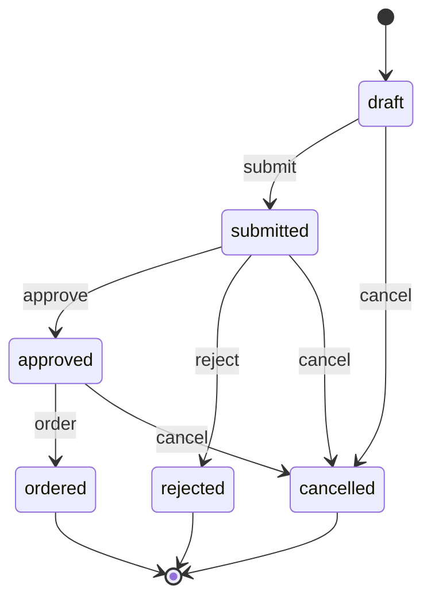

### Purchase order

Canonical base: [02-construction.md](../verticals/02-construction.md#purchase-order-shared--wl-inventory),
generalised and extended with `short_close`, `revise` and `reopen`.

| State | Tone | Terminal | Meaning |
|---|---|---|---|
| `draft` | neutral | no | Being prepared |
| `issued` | info | no | Approved and sent to the supplier |
| `partially_received` | info | no | Some quantities received |
| `received` | success | no | All quantities received (or short-closed) |
| `closed` | success | yes | Received and matched to supplier bills |
| `cancelled` | neutral | yes | Cancelled before any receipt |

| Transition | From | To | By | Guards | Effects |
|---|---|---|---|---|---|
| `issue` | draft | issued | `purchase_orders.issue` | supplier, prices, delivery location set; supplier not blocked: `BlockGuard::check(supplier, start)` passes (`PTY.ACL.03`; refused with the neutral *on hold* reason unless an exception is approved); `STK.ACL.01` (SoD) and vertical value limits → approval request when not met | number assigned; PDF sent to supplier; event `PurchaseOrderIssued` (committed cost) |
| `revise` | issued, partially_received | same state | `purchase_orders.issue` | reason given; currency unchanged (a currency change needs `cancel` and a new PO); no line reduced below its accepted qty; `STK.ACL.01`; a higher total or a later delivery date needs `BlockGuard::check(supplier, extend)` (`PTY.ACL.03`); a higher total re-checks `STK.ACL.03` on the new total: when the new total is above a limit, an approval request for the steps the new total needs, and the current revision stays valid until it is approved; a higher total that stays below the first limit, or a total not higher, applies at once | revision number + 1; previous revision kept read-only; PDF marked "Revision N" re-sent to the supplier; committed cost adjusted; open receipts use the new lines; event `PurchaseOrderRevised` |
| `receive` | issued, partially_received | partially_received, received | system (goods receipt `post`) | over-receipt tolerance on accepted qty | only accepted qty counts; rejected qty stays outstanding; `received` when every line is fully accepted |
| `reopen` | received | partially_received | system (Return to supplier `dispatch` with outcome `replace`) | PO not `closed` | returned qty outstanding again; committed cost restored |
| `short_close` | partially_received | received | `purchase_orders.issue` | reason given | remaining quantities released from committed cost; supplier informed |
| `close` | received | closed | system (`SupplierBillMatched` from wl-invoicing) | all lines billed | — |
| `cancel` | draft, issued | cancelled | `purchase_orders.issue` | nothing received; supplier informed when issued | committed cost released |

A partially received PO that must stop is short-closed, not cancelled. Returns after a PO is
`closed` are credited only (no replacement on that PO).

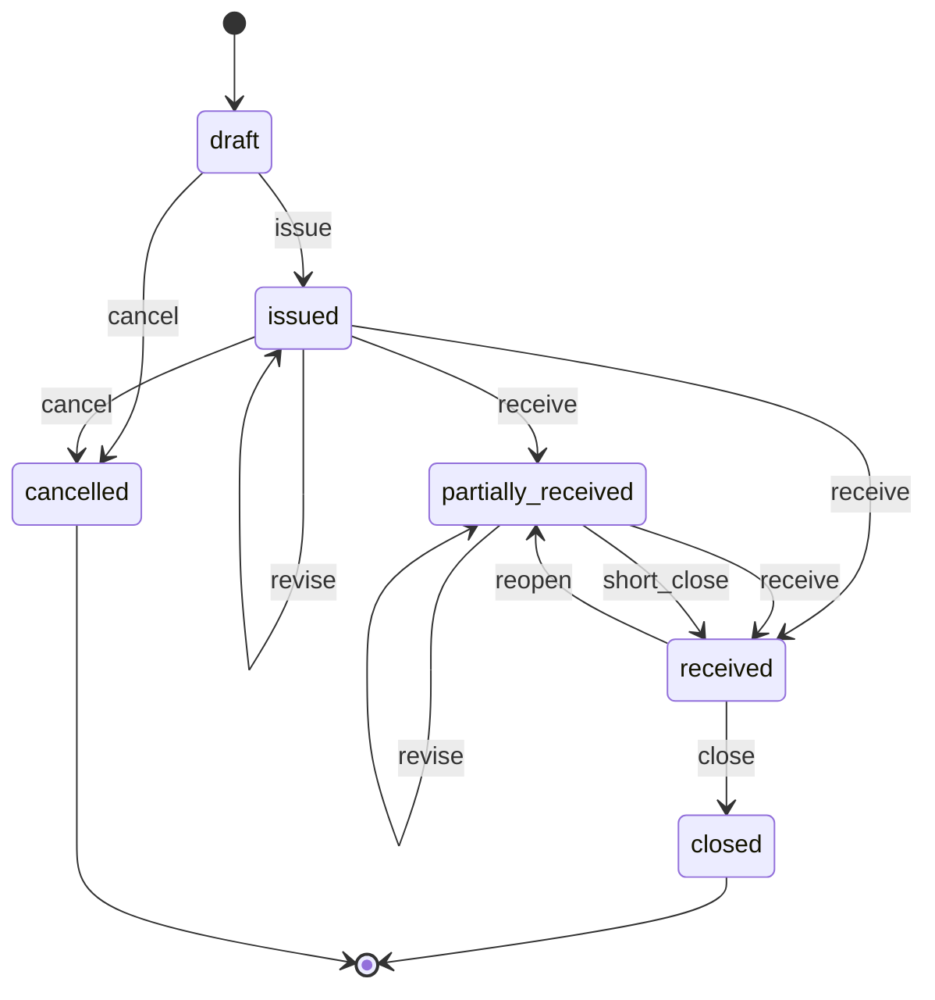

### Goods receipt

| State | Tone | Terminal | Meaning |
|---|---|---|---|
| `draft` | neutral | no | Quantities, lots and expiry being entered (often by scanning) |
| `posted` | success | yes | Stock and cost updated |
| `reversed` | neutral | yes | Cancelled by a reversing movement (wrong entry) |

| Transition | From | To | By | Guards | Effects |
|---|---|---|---|---|---|
| `post` | draft | posted | `goods_receipts.post` | location in the user's scope; source is a PO, or a dispatched Return to supplier (no PO: free replacement, lines and qty not above the returned lines); lot and expiry for lot-tracked items; per line accepted + rejected = received; a reason for every rejected qty; over-receipt within tolerance, otherwise approval | `receive` movements for accepted qty only; against a Return to supplier: received at zero cost (average cost diluted accordingly), no PO update and nothing to match in wl-invoicing, the return line counted as replaced (Return to supplier `credit` when all lines are covered); lots created (`quarantine` or `released` per item); average cost updated; PO `receive`; rejected lines → a Return to supplier (dispatched at once when refused at the door, `draft` when kept for collection; rejected goods never enter stock); event `GoodsReceived` with accepted and rejected qty per line |
| `reverse` | posted | reversed | `goods_receipts.reverse` | stock still available: the full accepted qty of every line (and lot) is still available at the receipt's location, none of it consumed, moved, reserved or held (otherwise correct it by an adjustment or a Return to supplier); not yet billed; no Return to supplier from it dispatched | reversing movements; PO quantities restored; draft returns from it cancelled |

Rejection reasons (configurable list): `temperature`, `quality`, `damaged`, `wrong_item`,
`short_shelf_life`, `excess`, `other`. A vertical may require a reading or photo for a
reason (06: a temperature reading from the receiving checklist). The storekeeper sees the
rejected qty on the receipt; procurement and the supplier contact are notified through the
Return to supplier.

Over-receipt above the tolerance (`STK.ACL.04`) sends the receipt to approval (`PLT.APR.01`)
by a holder of `purchase_orders.issue` in the location's scope who is not the user posting it;
the receipt stays `draft` until approved, and a rejection returns it for correction.

Rejected lines of one receipt make at most two returns: one for the lines refused at the door
(dispatched at once, the goods receipt as collection proof) and one `draft` for the lines kept
for collection. A rejected line's wanted outcome defaults to `replace`, because its qty stays
outstanding on the PO; a user who switches it to `credit` short-closes the PO line when no
replacement is wanted.

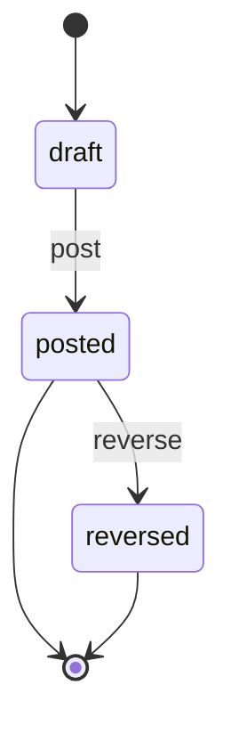

### Return to supplier

| State | Tone | Terminal | Meaning |
|---|---|---|---|
| `draft` | neutral | no | Lines being prepared, or rejected goods waiting for collection |
| `dispatched` | info | no | Goods left with the supplier or their driver; credit or replacement awaited |
| `credited` | success | yes | Supplier debit note issued for `credit` lines and replacements received for `replace` lines, or settled otherwise with a reason |
| `cancelled` | neutral | yes | Not sent; goods kept |

| Transition | From | To | By | Guards | Effects |
|---|---|---|---|---|---|
| `dispatch` | draft | dispatched | `supplier_returns.manage`, or system (goods receipt `post` for goods refused at the door) | supplier and lines set; lines from stock available in the quarantine or source location; collection proof (supplier driver signature `DOC.SIG.01`, courier no., or the goods receipt); `STK.ACL.06` above the value (value = qty × unit cost per line, lines rejected at receipt at the PO price, excl. VAT), except for the system dispatch of goods refused at the door, which never entered stock and already left | `return_out` movements for lines from stock, valued at the source receipt's unit cost when known, else average cost (difference to the price variance); none for lines rejected at receipt; lot `reject` (system) when nothing of a held lot remains; `replace` lines from stock: PO outstanding qty restored (PO `reopen` when `received`); lines rejected at receipt restore nothing (their qty stayed outstanding at `post`); return note PDF; supplier contact notified; event `SupplierReturnDispatched` |
| `credit` | dispatched | credited | system (`SupplierDebitNoteIssued` from wl-invoicing covers every `credit` line and replacement receipts cover every `replace` line), or `supplier_returns.manage` | manual: reason (refund received in wl-payments, supplier refused); a refused credit is a loss within `STK.ACL.02` | event `SupplierReturnCredited`; refused value posted as wastage with reason |
| `cancel` | draft | cancelled | `supplier_returns.manage` | reason given | reserved stock released back to its location; rejected-at-receipt goods kept are then received on a new goods receipt or discarded |

`SupplierReturnDispatched` makes wl-invoicing draft a supplier debit note for the `credit`
lines at the PO price until the supplier bill arrives, then at the bill's prices
(`FIN.RUL.17`; input VAT adjusted there). When the supplier bill is not yet posted,
the 3-way match bills accepted qty only and no debit note is needed. `STK.RUL.08` chases
returns that stay `dispatched`.

A `replace` line with an open PO line is received on the PO. A `replace` line on a `closed` PO,
or kept without a PO line, reopens nothing and is received only as a free replacement against
the return (goods receipt with the return as source). `credited` is terminal: when the supplier
debit note is cancelled afterwards, procurement gets a task and finance handles the bill
(wl-invoicing); the return does not reopen.

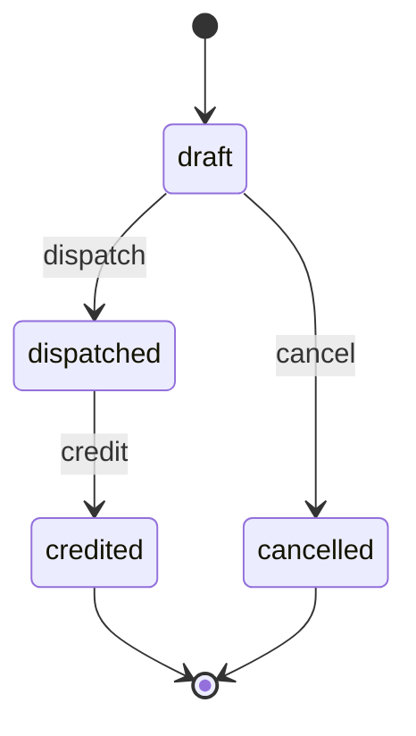

### Transfer

| State | Tone | Terminal | Meaning |
|---|---|---|---|
| `draft` | neutral | no | Lines being prepared |
| `in_transit` | info | no | Left the source; held in the in-transit location |
| `received` | success | yes | Received at the destination, discrepancies recorded |
| `cancelled` | neutral | yes | Not sent |

| Transition | From | To | By | Guards | Effects |
|---|---|---|---|---|---|
| `send` | draft | in_transit | `stock.transfer` at the source | available stock; released lots only; no held quantity | `transfer_out` movements to in-transit |
| `receive` | in_transit | received | `stock.transfer` at the destination | quantities entered | `transfer_in` movements; shortages posted as `adjust` with reason and approval when above the limit |
| `cancel` | draft | cancelled | `stock.transfer` | — | — |

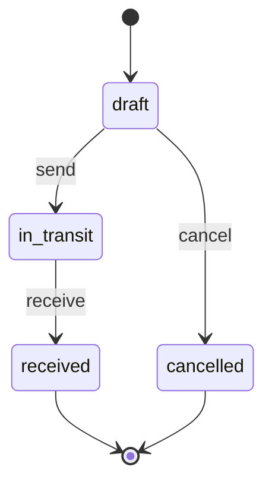

### Stock count

Canonical base: [06-fnb.md](../verticals/06-fnb.md#stock-count-shared--wl-inventory).

| State | Tone | Terminal | Meaning |
|---|---|---|---|
| `open` | neutral | no | Counting; expected quantities hidden when the count is blind |
| `submitted` | info | no | Counts entered; locked |
| `recount` | warning | no | Some lines sent back for recounting |
| `approved` | success | yes | Variances accepted; adjustments posted |
| `cancelled` | neutral | yes | Abandoned; no adjustment |

| Transition | From | To | By | Guards | Effects |
|---|---|---|---|---|---|
| `submit` | open, recount | submitted | `stock.count` | every line counted | variance quantity and value calculated |
| `request_recount` | submitted | recount | `stock.approve` | lines selected | counters notified |
| `approve` | submitted | approved | `stock.approve` | `SOD`: not a counter of this count; variance value above the vertical limit → approval request | `adjust` movements posted; event `StockCountApproved` |
| `cancel` | open | cancelled | `stock.approve` | reason given | — |

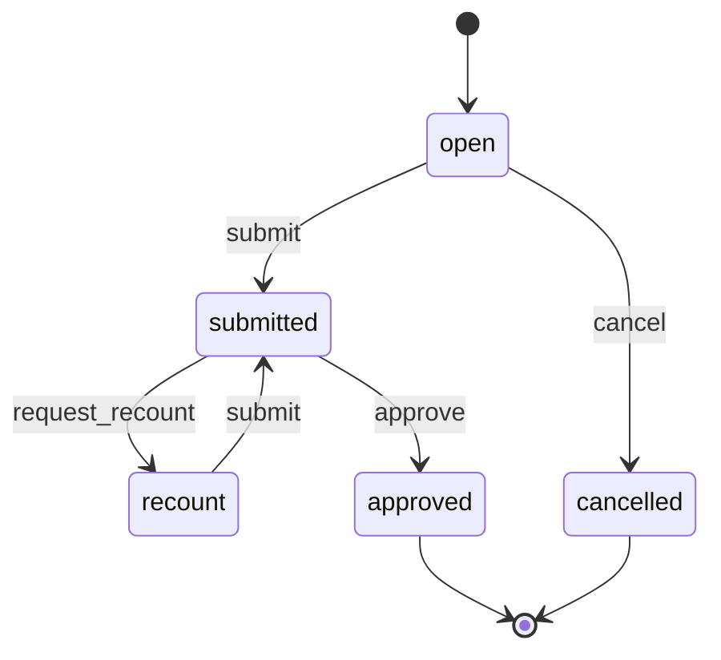

### Lot

Canonical base: [07-manufacturing.md](../verticals/07-manufacturing.md#lot-shared--wl-inventory).

| State | Tone | Terminal | Meaning |
|---|---|---|---|
| `quarantine` | warning | no | Received or produced; not usable until inspected |
| `released` | success | no | Usable, pickable and sellable |
| `on_hold` | warning | no | Whole lot blocked by an open stock hold (recall, quality, temperature, complaint) |
| `expired` | error | no | Past its expiry date; blocked; awaiting disposal |
| `rejected` | error | yes | Failed inspection, discarded or returned to the supplier; nothing usable remains |
| `depleted` | neutral | yes | Quantity reached zero |

| Transition | From | To | By | Guards | Effects |
|---|---|---|---|---|---|
| `release` | quarantine, on_hold | released | `lots.release`, or system (stock hold line decided `release`) | passed inspection when the item requires it; vertical `SOD` rule (e.g. `MFG.ACL.02`); from `on_hold`: no other open hold on the lot, and `STK.ACL.05` for a recall hold | event `LotReleased` |
| `hold` | quarantine, released | on_hold | system (stock hold `place` with whole-lot scope, or recall `open`) | reason given | status before the hold stored on the lot (for `unhold`); lot blocked from picking, issue, consumption, transfer and dispatch; picked dispatches with the lot flagged; event `LotHeld` |
| `expire` | released, on_hold | expired | system | expiry date reached | lot blocked; storekeeper notified; an open hold stays open |
| `reject` | quarantine, on_hold | rejected | `lots.release`, or system (Return to supplier `dispatch` takes the last quantity) | failed inspection or return recorded | remaining quantity moved to scrap or to a Return to supplier; vertical may open an NCR |
| `discard` | on_hold, expired | rejected | `lots.release`, or system (stock hold line decided `discard`) | reason given; `STK.ACL.02` above the value | `wastage` movements to scrap for the remaining quantity, with the hold or expiry reason; event `LotDiscarded` |
| `unhold` | on_hold | quarantine, released | system (stock hold `cancel`) | no other open hold on the lot | back to the status the lot had before `hold` (stored on the lot at `hold`); no inspection or approval, as the hold was placed in error |
| `deplete` | released | depleted | system | quantity = 0 | — |

Lots of items that need no inspection are created directly in `released`. A hold limited to
one location does not change the lot status; it blocks only that balance (see Stock hold).

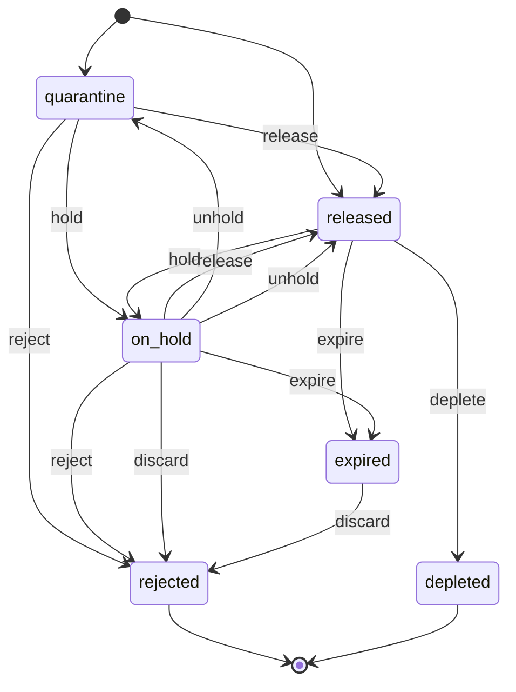

### Stock hold

Used for recalls, quality holds (suspected defect, customer complaint) and temperature
excursions (a fridge or freezer out of range). A vertical automation may place a hold through
`StockHoldService` (06: the out-of-range reading in `FNB.RUL.05`).

| State | Tone | Terminal | Meaning |
|---|---|---|---|
| `open` | warning | no | Stock blocked; lines waiting for a decision |
| `closed` | success | yes | Every line decided and its effect posted |
| `cancelled` | neutral | yes | Placed in error; stock available again |

| Transition | From | To | By | Guards | Effects |
|---|---|---|---|---|---|
| `place` | — | open | `stock.hold`, or system (recall `open`, vertical automation) | reason and reference; scope set; at least one balance with quantity | lines created from the balances in scope (item, location, lot, qty); held qty leaves available; whole-lot scope → lot `hold`; holders of `lots.release` in the location's scope notified (push and in-app); event `StockHoldPlaced` |
| `add_lines` | open | open | system (goods receipt `post` or transfer `receive` into the location of an open location-scoped hold, after the warning), or `stock.hold` | location scope; the item is in the hold's scope; quantity moved in | new lines (item, location, lot, qty) with the hold's reason and reference; the quantity never becomes available; deciders notified |
| `close` | open | closed | system (last line decided) | every line decided, its approval given where needed and its effect posted | event `StockHoldClosed` with per-line outcomes |
| `cancel` | open | cancelled | `lots.release` | no line decided yet; reason `placed in error`; not a recall hold | held qty available again; lots back to their status before the hold (lot `unhold`, when no other hold is open on the lot) |

Each line is decided by a holder of `lots.release` in the location's scope. The effect posts
when the decision is final: at once, or only after its approval when one is needed (`release`
for a listed reason such as `recall`, `STK.ACL.05`; `discard` above the value, `STK.ACL.02`).
The line counts as decided only then; a rejected approval leaves it undecided. When the
last line is decided, the hold closes. The effects:

- `release`: the quantity is available again; the lot runs `release` when no other hold is
  open on it.
- `discard`: a `wastage` movement to scrap with the hold reason; the value goes to wastage
  (or to the recall's cost object); the lot runs `discard` when nothing of it remains.
- `return_to_supplier`: the quantity is moved to the quarantine location and added to a
  draft Return to supplier for the lot's supplier.

Stock moved into a location while a location-scoped hold on it is open joins that hold. The
goods receipt and transfer screens warn first (e.g. "Fridge 2 is on temperature hold"); if the
user goes on, `add_lines` adds the moved quantity as new lines, decided like the others. A
whole-lot hold needs no new lines: it covers the lot wherever it moves.

Reserved quantity in scope stays reserved but cannot be picked; picked dispatches with it are
flagged (the `dispatch` guard). The balance of an `expired` lot is still added as a hold line,
but the lot stays `expired` (no lot `hold`); `release` is not offered for lines of an expired
lot (at placing or when it expires during the hold), only `discard` or `return_to_supplier`.

`STK.RUL.07` reminds the deciders while a hold stays open.

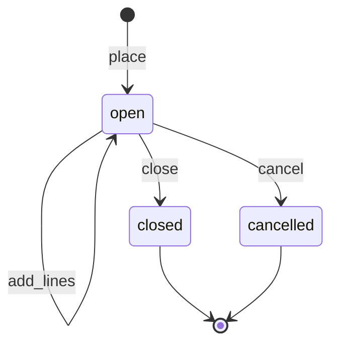

### Recall

| State | Tone | Terminal | Meaning |
|---|---|---|---|
| `open` | error | no | Lots in scope on hold; trace not yet built |
| `traced` | warning | no | Affected subjects and parties listed; notices being sent; outcomes being decided |
| `closed` | success | yes | Every lot has an outcome and every affected party was told or waived |

| Transition | From | To | By | Guards | Effects |
|---|---|---|---|---|---|
| `open` | — | open | `recalls.manage` | source, reason and scope set; at least one lot in scope, or, for items not tracked by lot, the item and a received date range | number assigned; one stock hold (reason `recall`) placed on every lot in scope at every location, including in transit (mass hold); for an item not tracked by lot, the whole on-hand quantity of the item is held (stock cannot be told apart by receipt); picked dispatches with those lots blocked; owner, storekeepers and procurement notified; event `RecallOpened` |
| `trace` | open, traced | traced | system (right after `open`) or `recalls.manage` (re-run) | — | forward trace built (see below); lots made from lots in scope added to the scope and held; affected lines created with notice status `pending`; event `RecallTraced` |
| `send_notices` | traced | traced | `recalls.manage` | notice template chosen; lines selected | notices sent through wl-notify per party (EN/AR); line status `sent`; on `MessageGaveUp` the line returns to `pending` and the recall owner gets a task |
| `close` | traced | closed | `recalls.manage` | the recall's stock hold is `closed` (every line decided and posted, `STK.ACL.05` for `release`); every affected line `sent` or `waived` with a reason | outcomes taken from the closed hold; recall report PDF (scope, trace, notices, outcomes) stored in wl-documents; event `RecallClosed` |

**Forward trace.** For every lot in scope, the module follows the immutable movements:

| Movement | What the trace lists |
|---|---|
| `transfer_out` / `transfer_in` | The lot at the destination (already held) |
| `consume` / `issue` with a `produce` from the same source | The output lots (lot genealogy through production batches and work orders), added to the scope and traced in turn |
| `issue` / `consume` to a cost object | The subject (visit, job card, work order, project, sales order) and its party |
| `dispatch` | The dispatch, its recipient and the delivery status (an undelivered delivery can still be stopped) |
| Pending issues with lots *assigned on arrival* | The subject, marked "lot uncertain" |
| Theoretical `consume` (recipe or BOM consumption without a scan, e.g. 06 sales) of the item of a lot in scope | Every subject that consumed the item at a location while that lot had a balance there (from its first receipt or transfer into the location until its balance there reached zero or was held), with its party, marked *possible* whichever lot the posting used (this row replaces the cost-object row for theoretical consumption); never marked confirmed |
| `issue` / `consume` / `dispatch` of an item not tracked by lot, dated on or after the first receipt in the scope's date range | The subject and its party, marked *possible* (the unit used cannot be proven to come from the recalled receipts); the trace ends on the scope's trace end date when one is given, otherwise today (the received date range only chooses the receipts that start the trace) |

Items not tracked by lot (e.g. 08 parts in the MVP) are recalled by item, supplier and
received date range. The trace finds the receipts in the range and lists every later
movement of the item as *possible*; notices to *possible* lines use a softer template ("may
be affected; please bring it in for a check"), and the recall owner may waive lines with a
reason.

The party behind a subject (patient of a visit, customer of a job card or order) comes from
the vertical through `TracePartyResolver`. Sales without a known party (walk-in POS) are
listed as a count per outlet and day; the owner decides on a public notice. Goods that
customers bring back come in through wl-sales returns into quarantine, linked to the recall,
and are added to its stock hold.

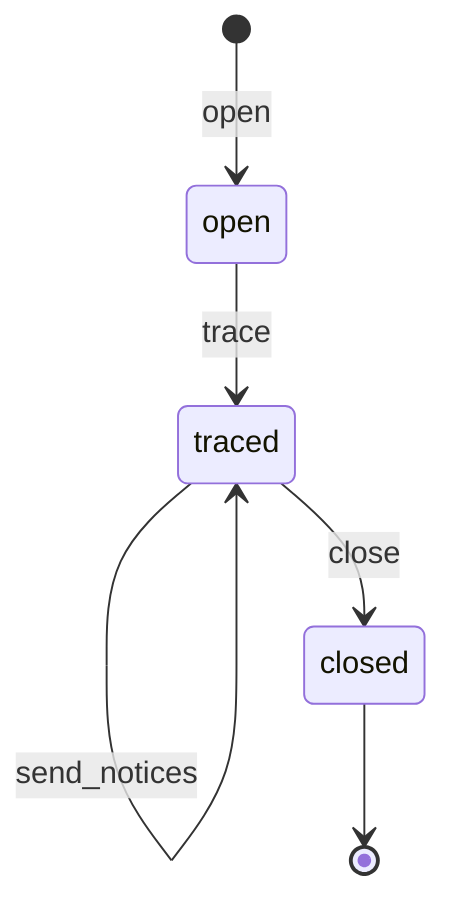

### BOM

Canonical base: [07-manufacturing.md](../verticals/07-manufacturing.md#bom-shared--wl-inventory).
F&B recipes are BOMs.

| State | Tone | Terminal | Meaning |
|---|---|---|---|
| `draft` | neutral | no | Being defined; editable |
| `released` | success | no | Used for production, consumption and costing; locked |
| `obsolete` | neutral | yes | Replaced by a newer version; kept for traceability |

| Transition | From | To | By | Guards | Effects |
|---|---|---|---|---|---|
| `release` | draft | released | `boms.release` | at least one line; quantities > 0; no circular sub-BOMs | cost rolled up; previous released version → `obsolete` |
| `obsolete` | released | obsolete | `boms.release` or system | — | — |

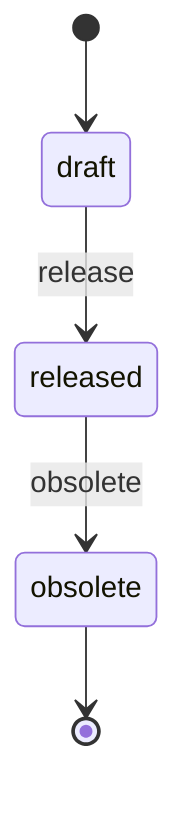

### Landed cost

| State | Tone | Terminal | Meaning |
|---|---|---|---|
| `draft` | neutral | no | Costs and receipts being collected |
| `allocated` | success | no | Costs spread over the received items; average cost updated; late costs can still be adjusted |
| `cancelled` | neutral | yes | Discarded |

| Transition | From | To | By | Guards | Effects |
|---|---|---|---|---|---|
| `allocate` | draft | allocated | `landed_costs.post` | receipts posted; allocation basis chosen | cost added to the received items' value; event `LandedCostAllocated` |
| `adjust` | allocated | allocated | `landed_costs.post` | a landed cost adjustment with cost lines and the supplier bill reference; posting date in an open period; `STK.ACL.06` above the value | amount spread on the original basis; per item, the share on qty still on hand re-values stock (average cost updated), the share on qty already consumed goes to the landed cost variance (or to the cost object charged on receipt); event `LandedCostAdjusted` |
| `cancel` | draft | cancelled | `landed_costs.post` | — | — |

A supplier bill coded to an allocated landed cost (wl-invoicing) creates a draft adjustment and
notifies the purchaser; coded to a `draft` landed cost, it is added as a cost line of that
draft and no adjustment is made. Each bill makes its own draft adjustment, even while an
earlier one is unposted; drafts are never merged, and each is posted, approved (`STK.ACL.06`)
and traced to its own bill. A negative adjustment (duty refund, credit from the forwarder)
works the same way, but re-values on-hand stock at most down to zero value; the rest goes to
the variance. Earlier movements are never changed.

The share on qty still on hand, per item: min(on-hand qty of the item at the receipt's
location now, qty received on the allocated receipts) ÷ qty received (average cost keeps no
receipt layers).

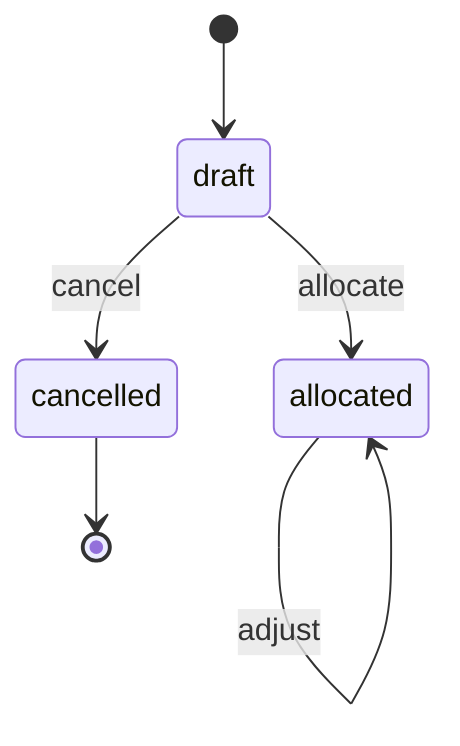

### Dispatch

Canonical base: [07-manufacturing.md](../verticals/07-manufacturing.md#dispatch-shared--wl-inventory).
The move to the customer is handed over to **wl-delivery** ([CAPABILITY-MAP.md](../CAPABILITY-MAP.md) §5, decision 5).

| State | Tone | Terminal | Meaning |
|---|---|---|---|
| `draft` | neutral | no | Lines and lots being chosen |
| `picked` | info | no | Picked and packed; stock reserved |
| `dispatched` | info | no | Left with the delivery note; on a delivery run or with a courier |
| `delivered` | success | no | Proof of delivery received; refused lines *in return* until received back into quarantine. Not terminal: an approved delivery reversal reopens it, and a loss during a review moves it to `lost` |
| `returned` | error | yes | Refused or returned |
| `discarded` | error | yes | Perishable goods destroyed by wl-delivery after a failed attempt; wastage recorded |
| `lost` | error | no | wl-delivery marked the delivery lost (also after delivery, while under review); value held as a loss while the claim runs |
| `cancelled` | neutral | yes | Not shipped |

| Transition | From | To | By | Guards | Effects |
|---|---|---|---|---|---|
| `pick` | draft | picked | `dispatch.manage` | released lots only, no held quantity (FEFO suggested); vertical item-flag guards (e.g. `MFG.ACL.11`) | stock reserved |
| `dispatch` | picked | dispatched | `dispatch.manage` | no picked lot on hold (re-pick otherwise); source is a sales order on account: `credit_recheck(order)` passes (wl-sales `CreditChecker`; a failure puts the order on `credit_hold` and the dispatch stays `picked`, reserved); handover chosen: own delivery (wl-delivery), courier with tracking no., or customer collection with the collector's signature (`DOC.SIG.01`) | `dispatch` movements; delivery note PDF; event `DispatchSent` → wl-delivery creates the delivery |
| `confirm_delivery` | dispatched | delivered | system (`DeliveryDelivered` from wl-delivery) or `dispatch.manage` with courier proof | delivered qty per line taken from the proof (`DeliveryDelivered` lines); manual: delivered and refused qty entered per line | delivered qty recorded per line; refused qty recorded as *in return* with the refusal reason (no movement yet: the goods are still with the driver); event `DispatchDelivered` with delivered and refused qty (e.g. sales order `fulfil` of delivered qty, draft invoice) |
| `return` | dispatched | returned | `dispatch.manage` or system (`DeliveryReturned` from wl-delivery) | reason recorded | `return_in` movements to quarantine |
| `discard` | dispatched | discarded | system (`DeliveryDiscarded` from wl-delivery) | — | the dispatched lines are recorded as wastage with the delivery's reason and photo (no new stock movement: the goods already left); value to wastage through `CostPoster`; source notified; event `DispatchDiscarded` |
| `mark_lost` | dispatched, delivered | lost | system (`DeliveryLost` from wl-delivery; from `delivered` when the delivery was `under_review`) | — | from `delivered`: delivered qty set back to zero, refused qty stays in return or in quarantine; value of the lost lines to a loss pending the claim (`CostPoster`); source notified; event `DispatchLost` (from `delivered`, the source reverses its fulfilment) |
| `found` | lost | dispatched | system (`DeliveryFound` from wl-delivery) | — | loss reversed; the delivery continues and ends in `confirm_delivery` or `return` |
| `reverse` | delivered | dispatched | system (`DeliveryReversed` from wl-delivery, approved there under `WRK.ACL.10`) | — | delivered qty set back to zero; refused qty stays in return or in quarantine; original proof kept, marked reversed; event `DispatchReversed` (source reverses its fulfilment) |
| `cancel` | draft, picked | cancelled | `dispatch.manage` or system (sales order line cancelled with outcome *return to stock*) | — | reservation released; picked goods put back |

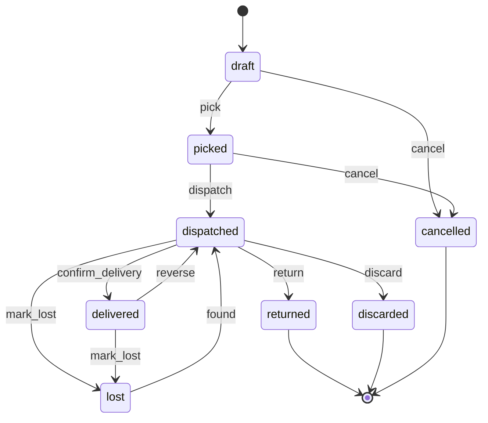

**Refused goods coming back.** Refused quantities stay *in return* on the dispatch line until
the driver brings them back. When the run closes, `DeliveryRefusedReceived` (wl-delivery)
posts `return_in` movements to quarantine for the quantity received back, with the refusal
reason and the picked lot; a quantity reported missing is posted as a loss (`CostPoster`,
reason *missing on return*, `STK.ACL.02` above the value) and the dispatcher gets a task. For a
courier or a manual confirmation, `dispatch.manage` records the refused goods received back.
The dispatch state does not change.

**Cancelled sales order lines.** When only some lines of a dispatch are cancelled with *return
to stock*, the dispatch is not cancelled: those lines are removed from it and their
reservation released. A dispatch already `dispatched` has no `cancel`: the event is logged,
the dispatcher gets a task, and the goods follow the delivery (return or refusal). For *scrap*
of a recipe item (06), the components exploded for the cancelled qty are posted as `wastage`
when the recipe consumption was not yet posted; when it was, no second movement is posted and
the order line is reported as wastage value. A wastage above the `STK.ACL.02` value needs its
own approval by someone other than the recorder, even when the cancellation was approved
(`SAL.ACL.05`).

### Asset

Canonical base: *Vehicle* in [03-logistics.md](../verticals/03-logistics.md#vehicle-shared--wl-inventory-asset),
generalised to every asset type.

| State | Tone | Terminal | Meaning |
|---|---|---|---|
| `active` | success | no | In use or available |
| `in_service` | warning | no | Under maintenance or repair |
| `out_of_service` | error | no | Must not be used: expired documents, accident, breakdown, failed inspection |
| `disposed` | neutral | yes | Sold, scrapped or returned to the lessor |

| Transition | From | To | By | Guards | Effects |
|---|---|---|---|---|---|
| `send_to_service` | active, out_of_service | in_service | `assets.manage` | an open maintenance ticket | removed from planning; downtime starts |
| `return_to_service` | in_service | active | `assets.manage` | ticket resolved; required documents valid | downtime ends |
| `take_out_of_service` | active, in_service | out_of_service | `assets.manage` or system | reason (document expired, accident, breakdown) | removed from planning; responsible staff notified; downtime starts |
| `reinstate` | out_of_service | active | `assets.manage` | required documents valid | downtime ends |
| `dispose` | active, in_service, out_of_service | disposed | `assets.dispose` | reason and disposal value | record archived; event `AssetDisposed` |

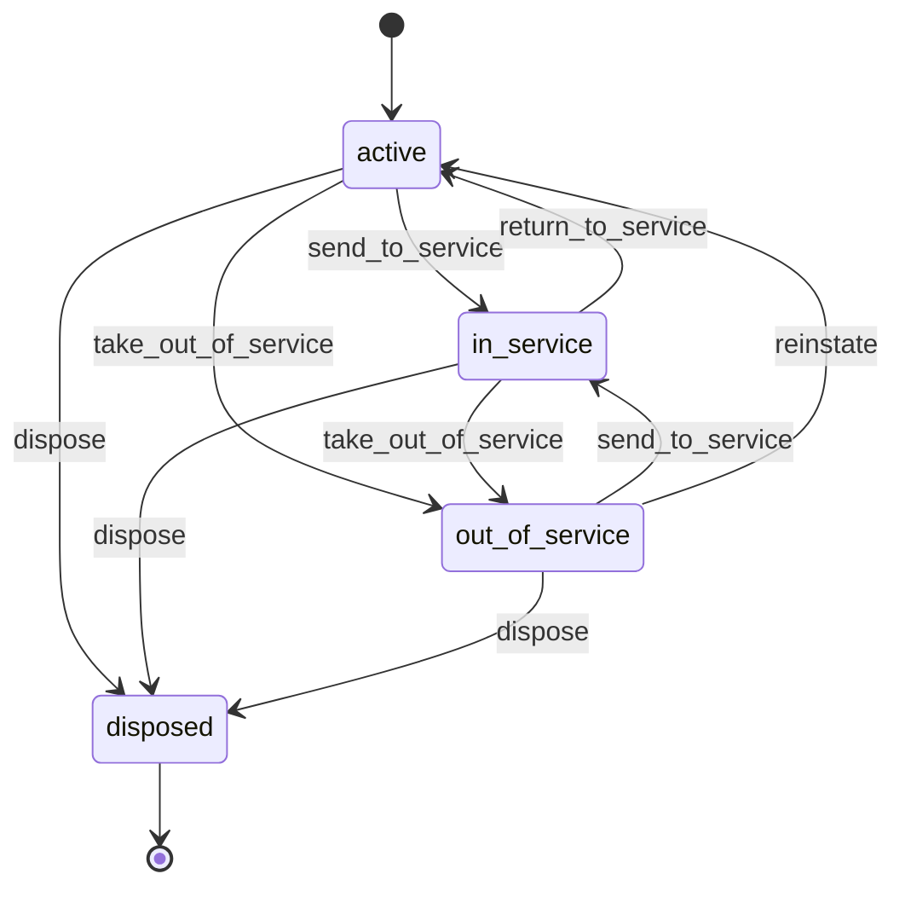

### Vertical mapping

| Vertical | Entity | How the vertical's version maps |
|---|---|---|
| 02 Construction | Purchase request | Cost object = BOQ cost code (required at site locations). Limits `STK.ACL.03` (formerly `CON.ACL.02`; AED 10,000 / 50,000) |
| 02 Construction | Purchase order | Unchanged; `STK.ACL.04` (formerly `CON.ACL.04`) over-receipt tolerance 5% is the module's over-receipt tolerance parameter. Delivery to a site store or the optional central store; multi-currency POs (`FIN.CUR.01`) with landed cost |
| 02 Construction | Location | Site store per project (cost object on receipt = the project) and an optional central store (charged on issue or transfer). A storekeeper's scope is a site store |
| 03 Logistics | Vehicle → Asset | `off_road` → `out_of_service`; `ground` → `take_out_of_service`; `fleet.manage` → `assets.manage`. Fuel logs and driver assignment stay in apps/logistics |
| 05 Clinics | Lot | Consumables with expiry; no inspection, so lots start `released`; `STK.RUL.03` N = 60 |
| 06 F&B | Stock count | Unchanged, plus `cancel`. `FNB.ACL.04` = the `submitted` lock. Partial counts of key items = scope `items list` |
| 06 F&B | Purchase request | Outlet requisitions to the optional central kitchen: the request's `order` runs on the transfer's `send`, not on a PO. PO approval limits `STK.ACL.03` (formerly `FNB.ACL.06`; AED 5,000) |
| 06 F&B | Recipe → BOM | Recipe with sub-recipes and yield. Sales consume ingredients through the `ConsumptionSource` extension (theoretical usage). Wastage is a `wastage` movement with reason (`FNB.ACL.03` limits) |
| 07 Manufacturing | Lot | Adds `expired` (system) so expired stock is blocked automatically; adds `discard`, system `hold` and system `unhold` (stock holds, recalls); NCR creation stays in apps/manufacturing on `reject`. The NCR disposition *return to supplier* creates a Return to supplier (the NCR's "supplier return note") |
| 07 Manufacturing | Item | Lot-tracked, regulated and export-only flags; fixed unit conversions for purchase, stock and sales units. `MFG.ACL.11` guards `pick` / `dispatch` and domestic sales |
| 07 Manufacturing | Dispatch | Delivery confirmation now comes from wl-delivery's proof of delivery; `confirm_delivery` and `return` run on `DeliveryDelivered` and `DeliveryReturned` |
| 07 Manufacturing | BOM | Unchanged; standard cost roll-up feeds `MFG.CST.01` |
| 08 Auto | Location | Stock per branch and bin; staff see every branch but sell, pick or move only from their own (`STK.ACL.04`, formerly `AUT.ACL.11`). Part fitment and cross-references stay in apps/auto, from the client's own parts data |
| 08 Auto | Purchase order + landed cost | Import POs in foreign currency; landed cost allocated by value or weight. Reorder suggestions per supplier (`STK.RUL.04`) |
| 05 Clinics, 06 F&B, 07 Manufacturing, 08 Auto | Recall | Party per subject from the vertical's `TracePartyResolver` (05: visit → patient; 06: order → customer; 07: sales order / dispatch → customer; 08: job card → vehicle owner or fleet, sale → customer). 08 parts are not lot-tracked in the MVP: recall by item and received date range, lines marked *possible* |
| 06 F&B | Stock hold | A temperature excursion places a location-scoped hold (reason `temperature`) on the unit's stock; stock moved into the unit while the hold is open is added to it (`add_lines`); the chef holds `lots.release` and decides discard or release |

## 5. Workflows

### 5.1 Procure to stock

1. A need is raised as a purchase request, or proposed by `STK.RUL.04` from reorder points.
2. The request is approved within the vertical's limits (`PLT.APR.01`).
3. Procurement issues a PO. The creator cannot approve it (`STK.ACL.01`). Committed cost is
   posted to the cost object (`FIN.CST.01`).
4. The storekeeper records the goods receipt by scanning items and entering lots and expiry,
   then posts it. Stock, lots and average cost update. Goods that fail the check are entered
   as rejected qty with a reason and never enter stock (§5.6).
5. For imports, a landed cost is allocated over the receipts. Average cost updates again. A
   late cost bill is posted later as an adjustment (§5.8).
6. wl-invoicing matches the supplier bill against PO and accepted qty (`FIN.PAB.01`). The PO
   closes.
7. When quantities, prices or dates change after issue, procurement runs `revise`. The
   supplier gets the new revision; a higher total goes through the approval limits again.

### 5.2 Use and move stock

1. Materials are issued to a cost object (project, work order, job card) as `issue` or
   `consume` movements.
2. Stock is transferred between locations in two steps: send, then receive.
3. Wastage and adjustments are recorded with a reason, within approval limits. A sales order
   line cancelled after fulfilment started with the outcome *scrap* (wl-sales) posts its
   work in progress or prepared goods as wastage with reason *cancelled order* and the order
   as reference (`STK.ACL.02` above the limit); the outcome *return to stock* puts picked
   goods back and releases the reservation.
4. Periodic counts reconcile the system with reality. Approved variances become adjustments.

### 5.3 Make (BOM / recipe)

1. A released BOM defines the components of an output item.
2. Production (apps/manufacturing work orders) or sales (F&B orders) call the module to
   consume components and, for production, to `produce` the output in a new lot.

### 5.4 Pick, pack, dispatch

1. A source document (sales order, transfer to a customer, spare-parts delivery) creates a
   dispatch.
2. The storekeeper picks FEFO lots and packs. Stock is reserved.
3. On `dispatch`, an order on account is credit-checked again (`credit_recheck`); a failure
   keeps the goods reserved and the dispatch `picked` until wl-sales releases the hold.
   Otherwise stock leaves and the delivery note is printed. wl-delivery takes over (own
   driver) or a courier tracking number is recorded.
4. Proof of delivery from wl-delivery marks the dispatch delivered with the delivered qty per
   line. Refused lines are *in return* until the driver brings them back: at run close they
   are received into quarantine with the reason. A returned delivery puts the goods back in
   quarantine. Discarded perishables are recorded as wastage; a lost delivery is held as a loss
   until it is found or the claim ends; an approved delivery reversal reopens the dispatch.

### 5.5 Assets

1. Assets are registered with documents (registration, insurance) and meters.
2. Meter readings come from staff, drivers or imports. `WRK.RUL.03` creates planned
   maintenance tickets in wl-ticketing when a service is due.
3. Expired documents (via `DOC.EXP.01`) can take an asset out of service automatically.

### 5.6 Rejected goods and returns to the supplier

1. At receiving, each line gets accepted and rejected qty. A rejected qty needs a reason
   (temperature, quality, damage, wrong item, short shelf life, excess).
2. Goods refused at the door go back with the supplier's driver: the posted receipt creates a
   Return to supplier and dispatches it at once. Goods kept for collection wait aside, not in
   stock, on a draft return.
3. Stock that fails later (a quality hold, an NCR, a recall) is returned from the quarantine
   location with the same document.
4. On `dispatch`, wl-invoicing drafts a supplier debit note for the `credit` lines; for
   `replace` lines from stock the PO outstanding qty opens again and the replacement is
   received on the same PO. Rejected-at-receipt lines are counted once: their qty stayed
   outstanding when the receipt was posted, so dispatching them restores nothing.
5. The return is `credited` when the debit note is issued and replacements are received.
   `STK.RUL.08` chases the supplier and finance when it takes too long.
6. A free replacement with no PO (e.g. under a supplier warranty claim, 08 `AUT.WAR.02`, or
   for goods returned long after the PO closed) is received on a goods receipt against the
   Return to supplier, at zero cost; it does not reach the 3-way match.

### 5.7 Holds and recalls

1. Anyone with `stock.hold` can block stock: whole lots (quality, complaint) or one location
   (a fridge out of range). A vertical automation can do the same. Stock moved into a
   location under an open location hold is added to that hold (after a warning).
2. The deciders are notified. Each line is decided: `release`, `discard` (wastage with the
   reason) or `return_to_supplier`. `STK.RUL.07` reminds and escalates while lines wait.
3. A recall is opened from a supplier or authority notice, or an internal finding. Every lot
   in scope is held at once, wherever it is.
4. The forward trace lists every transfer, production batch or work order (and the lots made
   from it), issue, visit, job, sales order and dispatch that used the lots, with the party.
   For items not tracked by lot, the scope is the item and a received date range; later
   issues and sales of the item are listed as *possible*. Sales that consume by recipe
   (theoretical consumption) are listed as *possible* when the lot was on hand at that
   location at the time of the sale.
5. Procurement or the owner sends notices to the affected parties through wl-notify and
   stops undelivered deliveries. Returned goods come back into quarantine under the recall.
6. Each held lot gets an outcome: discard, return to supplier, or release (second person,
   `STK.ACL.05`). The hold closes when its last line is decided; the recall then closes with a
   report kept in wl-documents.

### 5.8 Late landed cost and negative stock

1. A freight, duty or clearing bill that arrives after allocation is coded to the landed
   cost in wl-invoicing. A draft adjustment is created.
2. The purchaser posts it (`adjust`). Stock still on hand is re-valued; the consumed share
   goes to the landed cost variance.
3. Where a location blocks negative stock, short automatic consumption becomes a pending
   issue. It posts when stock arrives or the storekeeper clears it after a count
   (`STK.RUL.06`).

## 6. Interfaces to other modules

**Provides**

| Service | Purpose |
|---|---|
| `StockService` | Reserve, release, issue, consume, produce, transfer and adjust stock, with source and cost object; returns the movements, or a pending issue when automatic consumption is short (§3 negative stock) |
| `StockHoldService` | Place a stock hold on lots or on a location's stock with a reason and reference, or add lines to an open location hold (used by recalls and vertical automations, e.g. 06 temperature excursions and stock moved into the held fridge) |
| `LotTrace` | Forward trace (lot → movements → subjects, output lots and parties) and backward trace (output lot → component lots) |
| `Availability` | Available quantity per item and location (all or in the user's scope) |
| `ItemLookup` | Find an item or lot by code or barcode |
| `ItemCost` | Current average or standard cost of an item |
| `Purchasing` | Create a purchase request or PO from another module (e.g. reorder, work order shortfall) |
| `BomExplosion` | Components and quantities needed for N units of an output item |
| `AssetRegistry` | Asset status and availability for planning (runs, bookings, jobs) |
| `PurchaseMatchSource` (trait implemented for wl-invoicing) | PO and goods-received lines for the supplier bill 3-way match |

**Consumes**

| From | What |
|---|---|
| wl-kernel | `Subject` references, document numbering, approvals, state machines, custom fields, settings, automations |
| wl-parties | Suppliers and recipients (`Party`); `BlockGuard::check` on PO `issue` and `revise` (`PTY.ACL.03`); block effect for open POs (§5.6 of wl-parties) |
| wl-documents | Delivery notes, PO and GRN PDFs, asset documents and their expiry |
| wl-invoicing | `CostPoster` for committed and actual cost per cost object, wastage and the price and landed cost variances; events `SupplierBillMatched`, `SupplierDebitNoteIssued` (credits a Return to supplier), `SupplierDebitNoteCancelled` (the return stays `dispatched`; task to procurement), `SupplierBillApproved` with a landed cost reference per line (drafts a landed cost adjustment when the landed cost is already allocated) |
| wl-sales | `CreditChecker.credit_recheck(order)` as the dispatch guard for orders on account; customer returns of recalled goods into quarantine, linked to the recall; events `SalesOrderCancelled` and `SalesOrderLineCancelled` with outcome per line (*return to stock* cancels the dispatch, *scrap* posts wastage) |
| wl-delivery | `DeliveryRequester` to create a delivery from a dispatch; events `DeliveryDelivered` (per-line delivered and refused qty), `DeliveryRefusedReceived` (refused goods received back or missing at run close), `DeliveryReturned`, `DeliveryDiscarded`, `DeliveryLost`, `DeliveryFound`, `DeliveryReversed` |
| wl-ticketing | Maintenance tickets for assets |
| wl-notify | Notifications from automations; recall notices to affected parties; event `MessageGaveUp` |
| Verticals | `TracePartyResolver`: the party behind a subject in a recall trace |

**Events emitted**

| Event | When | Payload |
|---|---|---|
| `StockMoved` | Any movement posted | movement id, type, item, lot, location(s), quantity, value, source, cost object |
| `StockBelowMinimum` | Available quantity falls below min / reorder point / par | item, location, available, threshold |
| `ItemOutOfStock` | Available quantity reaches zero at a location | item, location |
| `PurchaseOrderIssued` | PO issued | PO id, supplier, lines, total, cost objects |
| `PurchaseOrderRevised` | PO `revise` | PO id, revision number, changed lines, old and new total, reason |
| `GoodsReceived` | Goods receipt posted | receipt id, PO id, lines with accepted qty, rejected qty and reason, values |
| `SupplierReturnDispatched` | Return to supplier `dispatch` | return id, supplier, source, lines (item, lot, qty, PO line, PO price, wanted outcome, reason) |
| `SupplierReturnCredited` | Return to supplier `credit` | return id, debit note or reason |
| `LandedCostAllocated` | Landed cost allocated | receipts, amounts per item |
| `LandedCostAdjusted` | Landed cost `adjust` | landed cost id, amount, per item re-valued amount and variance amount |
| `LotReleased` / `LotExpiring` / `LotExpired` / `LotHeld` / `LotDiscarded` | Lot status or expiry reached | lot, item, quantity, expiry, reason |
| `StockHoldPlaced` / `StockHoldClosed` | Stock hold transitions | hold id, reason, reference, lines with qty and outcome |
| `RecallOpened` / `RecallTraced` / `RecallClosed` | Recall transitions | recall id, scope, lots, affected lines (subject, party, qty), outcomes |
| `StockNegative` | A balance goes below zero or a pending issue is recorded | item, location, qty, source |
| `StockCountApproved` | Count approved | count id, variance value, adjustments |
| `DispatchSent` / `DispatchDelivered` / `DispatchReturned` / `DispatchDiscarded` / `DispatchLost` / `DispatchReversed` | Dispatch transitions | dispatch id, source, lines (delivered and refused qty with reason where known), recipient |
| `AssetStatusChanged` | Asset transition | asset id, from, to, reason |
| `MeterReadingRecorded` | New meter value | asset, meter, value |

**Attaches to:** stock movements, purchase requests and dispatches refer to any `Subject` as
source or cost object (project / cost code, work order, job card, sales order, outlet, ticket).
Documents and tickets attach to items, lots, receipts, dispatches and assets.

**Permissions**

`items.view`, `items.manage`, `locations.manage`, `stock.view`, `stock.cost.view`, `stock.issue`,
`stock.transfer`, `stock.adjust`, `stock.count`, `stock.approve`, `purchase_requests.create`,
`purchase_requests.approve`, `purchase_orders.view`, `purchase_orders.issue`, `goods_receipts.post`,
`goods_receipts.reverse`, `landed_costs.post`, `lots.release`, `stock.hold`,
`supplier_returns.manage`, `recalls.manage`, `boms.view`, `boms.manage`, `boms.release`,
`dispatch.manage`, `assets.view`, `assets.manage`, `assets.dispose`.

`stock.cost.view` controls every cost, value and margin field (`FLD`). Stock permissions are
checked in the scope of the location.

**Shared access rules** (in use, see [ACCESS-CONTROL.md](../ACCESS-CONTROL.md) §9)

| ID | Rule | Pattern | Parameter (default) | Generalises |
|---|---|---|---|---|
| `STK.ACL.01` | The user who creates a purchase order cannot approve it | `SOD` | on | `CON.ACL.03` (merged) |
| `STK.ACL.02` | Stock adjustments, write-offs and wastage above a value need approval; the recorder or counter cannot approve | `LIM`, `SOD` | AED 1,000 (06: 200; 07: 2,000) | `MFG.ACL.09`, `AUT.ACL.10`, `FNB.ACL.03` |
| `STK.ACL.03` | Purchase requests and orders above value limits need approval, in steps | `LIM` | 02: AED 10,000 / 50,000; 06: AED 5,000 | `CON.ACL.02`, `FNB.ACL.06` |
| `STK.ACL.04` | Stock is received and moved only at the user's own locations; stock levels may be visible in all locations; over-receipt beyond a tolerance needs approval | scope, `LIM`, `FLD` | 5% | `CON.ACL.04`, `AUT.ACL.11` |
| `STK.ACL.05` | Releasing held stock for a listed hold reason (a hold line decided `release`, including the lines of a recall's hold) needs approval by a second holder of `lots.release`, not the one who decides; other holds are released by one holder of `lots.release` | `SOD` | on; listed reasons = `recall` | — |
| `STK.ACL.06` | A landed cost adjustment or a Return to supplier above a value needs approval; the creator cannot approve | `LIM`, `SOD` | AED 5,000 | — |

Cost and margin fields are hidden by `FIN.ACL.08` (wl-invoicing, `costs.view`), applied here
through `stock.cost.view`.

**Shared automations**

| ID | When | If | Then | Parameters (default) | Default |
|---|---|---|---|---|---|
| `STK.RUL.01` | PO expected delivery date passed | PO `issued` or `partially_received` | notify procurement | — | on |
| `STK.RUL.02` | available stock below minimum | — | notify storekeeper | — | off |
| `STK.RUL.03` | N days before a lot expires | lot `released`, quantity > 0 | notify storekeeper (and planner) | N = 30 (clinics 60) | on |
| `STK.RUL.04` | daily at time T | items at or below reorder point / par with a preferred supplier | create reorder suggestions per supplier, or draft POs when the client opts in; notify purchaser | T = 07:00; mode = suggestions | on |
| `STK.RUL.05` | schedule: monthly | item had no sale or issue for N days | add to the dead-stock report; notify the owner | N = 180 | on |
| `STK.RUL.06` | a pending issue is recorded, or a balance goes below zero | — | notify the location's storekeeper (at most one notification per item and location per hour); still open or negative after H hours → task to the storekeeper (count or clear) and notify the manager | H = 24 | on |
| `STK.RUL.07` | every H hours | stock hold `open` with undecided lines | remind the deciders (`lots.release` in scope); after 2 × H notify the escalation role, again every further 2 × H while lines stay undecided | H = 24 (a vertical may set fewer hours for food); escalation role = owner (06: kitchen manager, H = 2) | on |
| `STK.RUL.08` | daily | Return to supplier `dispatched` for more than N days | notify procurement and finance on the first run after day N, then every N days from that notice; one task to procurement to chase the supplier, kept while the return stays `dispatched` | N = 30 | on |

Back-ordered sales order quantity (`wl-sales`, setting *Back-orders allowed*) not yet covered
by an open PO is added to the `STK.RUL.04` suggestion for the item: the suggested quantity is
the quantity from the item's `ReorderPolicy` (min/max: up to max; par: up to par; reorder point
+ lead time in 08), plus that back-ordered quantity. When the item is above its reorder point,
the policy suggests nothing and the suggestion is the back-ordered quantity alone. A cancelled
back-order drops out at the next run.

`STK.RUL.04` merges the two vertical versions: F&B drafts POs at 22:00, Auto builds suggestions
at 07:00. Both are a mode and a time of the same rule. `STK.RUL.05` generalises `AUT.RUL.09`.
`STK.RUL.02` is off by default and on for 06 and 07.

**Promotion candidates (vertical rules that are generic)**

| Vertical rules | Proposed shared rule |
|---|---|
| `FNB.ACL.04` | A submitted count is locked. Already enforced by the Stock count machine; no shared rule needed |
| `MFG.ACL.11` | Regulated items dispatched only with a valid certificate; export-only items not sold domestically. Stays in 07 until a second vertical needs the flags |

## 7. Configuration per client

| Setting | Default |
|---|---|
| Location types and hierarchy; scope link per location | per vertical template |
| Units of measure and global conversions | metric set + pcs, box, carton, pack |
| Costing | weighted average; standard cost on for manufacturing |
| Negative stock policy per location (§3) | `block` for every location; `allow_consumption` possible per location for items that are not lot-tracked (candidate: 06 outlet kitchens) |
| Goods receipt rejection reasons; evidence required per reason | `temperature`, `quality`, `damaged`, `wrong_item`, `short_shelf_life`, `excess`, `other`; none required (06: temperature reading for `temperature`) |
| Stock hold reasons | `recall`, `quality`, `temperature`, `complaint`, `other` |
| Hold reasons whose release needs a second person (`STK.ACL.05`) | `recall` |
| Landed cost adjustment and Return to supplier approval value (`STK.ACL.06`) | AED 5,000 |
| Landed cost variance destination | variance account; the cost object charged on receipt for site-store receipts |
| Recall notice templates (EN/AR) per party type | customer, patient, internal |
| Pending issue alert hours (`STK.RUL.06`), hold reminder hours (`STK.RUL.07`), return chase days (`STK.RUL.08`) | 24, 24, 30 |
| Stock hold escalation role (`STK.RUL.07`), per reason or location | owner (06: kitchen manager) |
| Lot tracking and shelf life per item | off; default per item category (07: on for food-contact, chemical and certified materials) |
| Regulated and export-only item flags | off (used by 07, `MFG.ACL.11`) |
| Central store (02) / central kitchen (06) | off; site stores or outlets only |
| New lots start in `quarantine` per item category | off (on for manufacturing finished goods) |
| Blind counts | on |
| Over-receipt tolerance | 5% |
| Approval thresholds for PRs, POs, adjustments | from the vertical's access rules |
| Reorder rule mode and time (`STK.RUL.04`) | suggestions, 07:00 |
| Expiry warning days (`STK.RUL.03`) | 30 |
| Document number prefixes (PR, PO, GRN, TRF, DSP, CNT, return to supplier, hold, recall) | `PR-`, `PO-`, `GRN-`, `TRF-`, `DN-`, `CNT-`, `RTS-`, `HLD-`, `RCL-` |
| Asset types and meters | equipment, vehicle, tool, machine; km, hours |

## 8. Extension points

| Extension | Purpose | Example |
|---|---|---|
| `ReorderPolicy` | How a reorder quantity is computed | min/max (default), par level (F&B), reorder point + lead time (Auto) |
| `PickingStrategy` | Which lots and locations to pick | FEFO (default), oldest receipt, specific bin |
| `LandedCostAllocation` | How import costs are spread | by value (default), quantity, weight, volume |
| `ConsumptionSource` | Turns a business event into ingredient or component consumption | F&B sale explodes a recipe; work order issues components (07: every material issue to a work order, so a short one becomes a pending issue) |
| `AssetMeterPolicy` | When a meter reading means a service is due | every N km (vehicles), every N hours (machines) |
| `TracePartyResolver` | The party behind a subject in a recall trace | 05: visit → patient; 06: order → customer; 08: job card → vehicle owner or fleet |
| Events | §6 | apps/fnb marks menu items unavailable on `ItemOutOfStock` (`FNB.RUL.06`) |
| Overridable views | PO PDF, GRN, delivery note, pick list, labels | client logo and Arabic layout |
| Custom fields | Item, location, lot, asset | Auto: fitment and OEM numbers (in apps/auto); Clinics: storage temperature |

## 9. Renox fit

| Need | Renox provides | Gap (→ ARCHITECTURE §4a ID) |
|---|---|---|
| Item, location and PO screens | grids, tables, forms, repeater (order lines), wizards | — |
| Import items, opening stock, BOMs from Excel | CSV import with row validation | Excel files, dry run, rollback window (R23; `PLT.IMP.01` in wl-kernel) |
| Keyboard-wedge barcode scanners | any input field | — |
| Camera barcode / QR scanning on phones | — | `rx-barcode-scan` component (R5) |
| PO, GRN, delivery note PDFs EN/AR | — | R3 (PDF), R1 (Arabic) |
| State machines and history | — | R12 |
| Reorder and expiry automations | queue, scheduler | — |
| Approvals for limits | — | wl-kernel `PLT.APR.01` |
| Decimal quantities with units and exact money values | typed models | Decimal quantities with unit-of-measure conversion (R18) |
| Stock reports and dashboards | charts, grid export | — |
| Location-scoped permissions | `has_permission_in`, `scopes_with` | — |

## 10. Compliance

- **Valuation:** weighted average cost is permitted under IFRS (IAS 2), and LIFO is not. ✔ UAE
  corporate tax follows the IFRS accounts (Corporate Tax Law Art. 20; Ministerial Decision
  114 of 2023) [S1].
- **Record retention:** stock, purchase and import records are kept at least as long as VAT
  and corporate tax records. ✔ VAT records 5 years after the tax period (15 years for real
  estate, plus 2 while a refund is pending), corporate tax records 7 years, customs records
  5 years [S2]. Default 7 years.
- **Imports:** customs duty (generally 5% of CIF) is part of landed cost. ✔ A VAT-registered
  importer accounts for import VAT by reverse charge in its return and recovers it in the
  same return, so it is not a cost; an unregistered importer pays it at customs and adds it
  to landed cost [S3].
- **Free zones and designated zones:** ✔ a designated zone is outside the UAE for VAT on
  goods. Goods moved between designated zones under customs suspension are not taxed;
  goods without VAT paid in a zone are treated as imported when consumed there or
  unaccounted for; goods moving to the mainland are an import (duty and import VAT)
  (Executive Regulation Art. 51) [S4]. Services in a designated zone are inside the UAE.
- **Food and medical items:** lot traceability and expiry handling support Dubai
  Municipality / ADAFSA food rules and DHA / DoH / MOHAP storage rules for medical
  consumables. The specific traceability and record-keeping periods per authority are
  confirmed with each client's food or health regulator at onboarding `⚠ open: authority (AU-05)`.
- **Recalls:** the module holds, traces, notifies affected parties and keeps a recall report.
  Whether a client must notify the food, health or consumer authority of a recall, by when
  and in which form, is not verified; the recall report is the evidence pack for that
  notice `⚠ open: authority (AU-20)`.
- **Returns and late costs:** a Return to supplier and a landed cost adjustment never change
  posted movements; they add new ones, so the audit trail shows the original and the
  correction. Input VAT on a supplier debit note is adjusted in wl-invoicing.
- **Vehicles:** registration (Mulkiya) and insurance must be valid to operate; expiry is
  tracked through wl-documents.
- **Audit:** every movement, approval and cost change is in the audit trail; movements are
  never edited or deleted.

## 11. Out of scope

| Not in wl-inventory | Where it lives instead |
|---|---|
| Warehouse management: bins optimisation, wave picking, put-away rules | Not planned; a bin field on stock balances is enough for SMEs |
| Third-party warehousing: stock per client SKU, pick and pack for clients (03) | Later (03 §13 question 4); in the MVP, storage is billed per pallet or CBM per day from the rate card (`FIN.RAT.01`) |
| Production planning, MRP and work orders | apps/manufacturing (uses `BomExplosion`, `StockService`) |
| Delivery runs, drivers, proof of delivery | wl-delivery |
| Supplier bills, 3-way match, payments | wl-invoicing, wl-payments |
| Supplier debit notes and the input VAT adjustment for returns | wl-invoicing (from `SupplierReturnDispatched`) |
| Filing a recall with an authority or publishing a public notice | The client, using the recall report |
| Sales orders, POS, customer returns and credit notes | wl-sales (calls `StockService`) |
| Fuel logs and driver assignment to vehicles | apps/logistics |
| Customer-owned vehicles (`AUT.VEH.01`) | apps/auto: they are not company assets |
| Serial-number tracking per unit | Later candidate (equipment). 08 handles customer warranty claims as `warranty` tickets in wl-ticketing, linked to the sale or job |
| Consignment stock, intercompany transfers, demand forecasting, EDI | Not planned |
| FIFO and lot-level costing | Not in MVP (see §3 costing decision) |

## 12. Open questions

1. Is weighted average cost acceptable to the accountants of target clients, or do some
   (e.g. auto parts importers) require FIFO? *(accountant)*
2. ~~Does Renox offer a decimal quantity type, or must the module store quantities as scaled
   integers?~~ Answered (2026-10-15): not yet. Decimal quantities with unit conversion are
   Renox gap R18 ([ARCHITECTURE.md](../ARCHITECTURE.md) §4a). *(us, Renox)*
3. ~~Should negative stock be allowed in F&B outlets, where sales consume recipes before
   deliveries are posted?~~ Decided (2026-10-15): a per-location policy, `block` by default
   with pending issues for automatic consumption; `allow_consumption` for items that are not
   lot-tracked where the client chooses it (§3). Which 06 locations use it is set in 06.
   *(client)*
4. ~~Do auto parts clients need serial numbers for warranty claims in the MVP?~~ Decided
   (2026-10-15): no. A customer claim is a `warranty` ticket in wl-ticketing linked to the
   sale or job; supplier recovery stays in 08 (`AUT.WAR.02`). Serial numbers stay a Later
   candidate. *(client)*
5. Is a single company-wide average cost enough, or do multi-branch clients want cost per
   branch? *(client, accountant)*
6. Which documents make an asset unusable when expired, per asset type (registration,
   insurance, inspection certificate)? *(client)*

## Sources

Checked 2026-10-15. *Official* = government or legislation; others are secondary.

| # | Source | Type | Used for |
|---|---|---|---|
| S1 | PwC, "UAE CT: Ministerial Decisions No. 114 & 115 released", https://pwc.com/m1/en/services/tax/me-tax-legal-news/2023/uae-ct-ministerial-decisions-no-114-115-releases.html | Secondary | Corporate tax follows IFRS accounts |
| S2 | Simmons & Simmons, "UAE updates tax procedures", https://www.simmons-simmons.com/en/publications/cmov938aj00gouxskssk21hjn/uae-updates-tax-procedures; Khaleej Times, "UAE property firms must keep financial records for 15 years", https://www.khaleejtimes.com/business/vat-in-uae/uae-property-firms-must-keep-financial-records-for-15-years; taxo.online, "Article 56 – Record Keeping", https://taxo.online/corporate-tax-law/article-56-record-keeping; PwC, "UAE update on the submission of customs declarations supporting documents", https://pwc.com/m1/en/services/tax/me-tax-legal-news/2023/uae-update-on-the-submission-of-customs-declarations-supporting-documents.html | Secondary | VAT, corporate tax and customs retention |
| S3 | FTA, "Importers" guide, https://u.ae/-/media/Information-and-services/Finance-and-Investment/VAt-guidelines/fta-importers-Eng.pdf | Official | Import VAT by reverse charge |
| S4 | FTA, Cabinet Decision 52 of 2017 on the VAT Executive Regulation (unofficial translation, 2017 text), https://tax.gov.ae/-/media/Files/FTA/links/Legislation/VAT/03-Cabinet-Decision-52-of-2017.pdf | Official | Designated zones (Art. 51) |
