# wl-invoicing

> Status: draft · Last updated: 2026-10-16

## 1. Purpose

Everything that turns business activity into amounts owed, and records amounts the business
owes. The module holds quotations, charge schedules, subscriptions, usage billing and
disbursements. It issues tax invoices and credit notes with UAE VAT per line, tracks
receivables and reminders, records supplier bills with a 3-way match, and keeps the cost of
each cost object (project, job, deployment) against its budget. For the company as a whole it
keeps a budget per entity, month and category with the actual against it, keeps owner drawings
apart from operating cost, and projects the cash position week by week. Collecting money belongs to
[wl-payments](wl-payments.md). Every document is issued by one of the client's legal entities
([decision 0003](../decisions/0003-legal-entities.md)), and for each tax period the module
prepares a VAT summary per entity for the accountant. The general ledger and the filing of
VAT returns stay in the client's accounting software and on EmaraTax; this module exports to
them.

## 2. Capabilities covered

| ID | Capability | Used by verticals | Scope |
|---|---|---|---|
| `FIN.BIL.01` | Charge schedule from an agreement: instalments, recurring fees | 01 MVP, 04 MVP, 08 MVP, 10 MVP | MVP |
| `FIN.INV.01` | Tax invoices and credit notes with per-line VAT category | all ten, MVP | MVP |
| `FIN.QUO.01` | Quotations with validity and revisions; accepted → order or project | 02, 03, 04, 07, 08, 09 MVP; 10 Later | MVP |
| `FIN.SUB.01` | Recurring subscriptions, memberships and retainers | 04 MVP, 10 MVP; 05 Later; 06 Later (meal plans, first release after the MVP) | MVP |
| `FIN.USG.01` | Usage billing: periodic invoice from priced transactions (rate card × usage) | 03 MVP, 08 MVP (formerly `AUT.FLT.02`), 09 MVP | MVP |
| `FIN.RAT.01` | Rate cards per customer or payer contract: each line picks its pricing model (zone × weight, trip or route, hour/day/month, pallet or CBM including storage per day, per unit, price rule), with multipliers, minimums and surcharges | 03 MVP (formerly `LOG.RAT.01`), 08 MVP (fleet contracts and per-insurer cards), 09 MVP (per role) | MVP |
| `FIN.DSB.01` | Disbursements: costs paid on a client's behalf, recharged at cost | 03 MVP | MVP |
| `FIN.CUR.01` | Multi-currency amounts with exchange rates | 02, 03, 07, 08 MVP | MVP |
| `FIN.CST.01` | Job costing: budget vs committed vs actual per cost object | 02, 03, 07, 09 MVP | MVP |
| `FIN.REC.01` | Receivables ageing and payment reminders | all ten, MVP | MVP |
| `FIN.PAB.01` | Supplier bills and expenses with 3-way match, allocated to cost objects | 01, 02, 03, 06, 07, 08, 10 MVP; 05 Later | MVP |
| `FIN.TPP.01` | Third-party payer billing: split a bill between the customer and a payer (insurer), invoice the payer, reconcile remittances per line (paid, denied, partial) and follow up payer receivables | 05 MVP (with the clinic claim and denial management), 08 MVP (formerly `AUT.INS.05`) | MVP |
| `FIN.VAT.01` | VAT summary per period and entity: output and input VAT, for the accountant | all ten, MVP | MVP |
| `FIN.EXT.01` | Export to accounting software (Zoho Books, Xero, QuickBooks) | all ten, Later | Later |
| `FIN.CFL.01` | Cash-flow forecast: expected receipts and payments by week from invoices, supplier bills, scheduled charges, post-dated cheques, payroll and budgets | all ten, MVP | MVP |
| `FIN.BUD.01` | Company budget vs actual by period, category and entity; owner drawings kept apart from operating cost | all ten, MVP | MVP |

Every document here depends on `PLT.ENT.01` (legal entities and per-entity sequences,
[wl-kernel](wl-kernel.md)). `FIN.CFL.01` reads [wl-payments](wl-payments.md) (post-dated
cheques, bank balances, payments) and [wl-hr](wl-hr.md) (payroll); it uses the approved budgets
of `FIN.BUD.01` for what is not yet a document. `FIN.BUD.01` (company budget) is separate from
the budget lines of a cost object in `FIN.CST.01` (job costing).

## 3. Concepts and entities

| Entity | Description | Important fields |
|---|---|---|
| Quotation | A priced offer to a party, with revisions | number, issuing entity, issuer snapshot (when sent), party, source (`Subject`, optional), lines, currency, validity date, terms, revision, status |
| Quotation line | One priced item | description, catalogue item (optional), quantity, unit, unit price, discount, VAT category, cost code (optional) |
| Charge schedule | Amounts to bill over time for an agreement | source (`Subject`: lease, engagement, enrolment, contract), party (one billed party in the MVP; billing shares for split invoicing Later, 01 §13 question 2), currency, start, end |
| Charge | One scheduled amount | schedule, due date, charge type, amount, VAT category, issuing entity (from the source's scope, or the charge type's override), invoice (once billed), status |
| Charge type | An entry in the client's charge catalogue; no charge type is hard-coded (01 §13 question 3). In F1 the lease's charge types and schedule are kept in apps/property (see `ChargeScheduler`, §6) | code, names EN/AR, default VAT category, frequency, basis (fixed or per area), issuing entity override (`PLT.ENT.01`), invoice grouping (own invoice per charge, or combined with the agreement's other charges), account mapping for export, active |
| Subscription | A recurring plan billed every cycle | party, plan (catalogue item or price), quantity, cycle (week, month, quarter, year), anchor day, start, end, notice period, payment mode (manual / automatic charge), source (`Subject`), status |
| Rate card | Prices for usage or estimates, per contract | party (customer, or a payer such as an insurer), purpose (customer contract or payer agreement), source contract (`Subject`), currency, service levels (e.g. same day, next day), valid from/to, lines |
| Rate card line | One price rule | service or role key, pricing model (see below), dimensions (zone, weight band, route, vehicle class, shift…), unit (hour, day, month, item, trip, kg, pallet, CBM, panel), price or price table, price rule (list − %, cost + %), multipliers (overtime, public holiday, rest day, night), minimum quantity or charge (e.g. minimum hours per shift), surcharges (fuel, remote area, COD fee as % of the collected amount with a minimum), default VAT category |
| Usage record | One priced transaction waiting to be billed | party, issuing entity (from the source, e.g. the worker's sponsoring entity in 09), source (`Subject`: shipment, timesheet entry, job card, storage day), date, rate card line, quantity, amount, VAT category, cost object, billed invoice |
| Disbursement | A cost paid for a client and recharged at cost | party, source job (`Subject`), payee, supplier bill or receipt (attached), amount, currency, VATP013 checklist (third-party invoice in the client's name, client's authorisation, exact amount without markup), treatment (`out_of_scope` only when every condition is checked, otherwise a reimbursement with the VAT of the main supply), billed invoice |
| Invoice | A tax invoice, simplified tax invoice or commercial invoice | number, kind, issuing entity, issuer snapshot, party (with TRN), billing address, lines, currency, exchange rate, totals per VAT category, AED VAT total, issue date, due date, source (`Subject`), customer PO reference (required when the contract says so, e.g. 08 fleet PO per job or per month), receivable shares (customer and payers, `FIN.TPP.01`), balance, dispute (`disputed` flag, reason, disputed amount, disputed lines (optional), ticket, raised by and at), write-off (amount, reason code, approval, customer notice date, recovered amount), e-invoice status (from the latest transmission), owner (see below), status |
| Invoice line | One billed amount | description, quantity, unit price, discount, VAT category, VAT amount, zero-rating evidence (documents, when the line's `VatRule` requires it), payer share (`FIN.TPP.01`), cost object, charge type (the key through which the line is mapped to a budget category, `FIN.BUD.01`), origin (charge, usage record, subscription cycle, disbursement, sales order line, payer split line) |
| Credit note | A tax credit note against an invoice | number, invoice, issuing entity (always the invoice's), issuer snapshot, lines, reason, totals, status |
| Cost object | Anything costs and revenue are collected on | `Subject` (project, job, deployment, employee, work order, vehicle, unit), budget lines |
| Budget line | Budget for one cost code of a cost object | cost object, cost code, budget amount, committed, actual |
| Cost entry | A committed or actual cost | cost object, cost code, kind (committed / actual), amount, source (`Subject`: PO, goods received, timesheet, supplier bill, stock issue, stock wastage or adjustment, purchase price variance, landed cost variance, expense claim, cost amortisation) |
| Cost amortisation | A cost spread evenly over a term, for margin reporting only (09 §13 question 5) | source cost (supplier bill line, expense line), holder (`Subject`: employee, vehicle), cost code, term in months (default 24), start, monthly amount, target rule (the holder's active cost objects each month, e.g. the worker's deployments), amount remaining |
| E-invoice transmission | One sending of an invoice or credit note to the accredited service provider (ASP) | document (invoice or credit note), issuing entity, ASP adapter, recipient identifier (Peppol ID, TRN), payload (structured data and hash), attempt count, submitted at, ASP reference, response at, error codes and messages, replaced by (the credit note and new invoice, when corrected), status |
| Supplier bill | A bill from a supplier | supplier, receiving entity (defaults from the PO), number, date, due date, lines (with the service date or period for contract and ticket work), VAT, currency, PO and goods-received references, service contract or ticket (wl-ticketing, for vendor bills without a PO), cost code (per line: the key through which the line is mapped to a budget category, `FIN.BUD.01`), landed cost (per line: a freight, duty or clearing line coded to a wl-inventory landed cost of the bill's receiving entity; a landed cost of another entity is refused at `submit`), match result, allocation basis (area, number of units, asset, manual %; default from the service contract), cost allocations, debit notes applied, status |
| Supplier debit note | The business's claim on a supplier against a supplier bill: goods returned, rejected after billing, short delivery or a price difference | number (receiving entity's own sequence), receiving entity, supplier, supplier bill (empty while the bill has not arrived), source (`Subject`: wl-inventory *Return to supplier*, or manual), lines (bill line, quantity, unit price, VAT category, VAT amount, cost object), reason code, totals, supplier's tax credit note (number, date, file, once received), settlement (set off against the bill, against a later bill, or refund received through wl-payments), status |
| Exchange rate | Rate for a currency on a date | currency, date, rate to AED, source (manual or feed) |
| Reminder log | Reminders sent for an invoice | invoice, rule, step, channel, sent at |
| Export batch | A set of records exported to accounting | target system, period, records, file, status |
| Issuer snapshot | The issuing entity's details copied onto a document when it is issued or sent; never changed afterwards | legal names EN/AR, trade licence number, TRN, address, bank account shown for payment, logo, footer |
| VAT summary | Output and input VAT of one entity for one tax period | entity, period start and end, output VAT by category and emirate, input VAT recoverable and blocked, adjustments, net payable or refundable, prepared by, reviewed by, export file, status |
| VAT adjustment | A correction carried into a period | summary, kind (late document, credit note for an earlier period, bad-debt relief, bad-debt recovery, supplier debit note, manual), source document, amount, reason, status (`pending` until its conditions are met, e.g. bad-debt relief; `proposed`, `included`, `excluded` with reason) |
| Payer agreement | Terms with a third-party payer (`FIN.TPP.01`) | payer (party: insurer, TPA), source contract (`Subject`: clinic payer contract, insurer terms), VAT recipient (customer or payer), rate card (optional, `FIN.RAT.01`), payment terms, resubmission window and limit, write-off limit, invoice wording (approval reference, claim number, excess line), remittance import preset, active |
| Payer split | How one billable source is shared between the customer and a payer | source (`Subject`: visit, job card), payer agreement, payer reference (prior authorisation, approval or LPO, claim number), lines (source line, customer share, payer share, basis: copay %, deductible, excess, non-covered, approved amount) |
| Payer bill | What one payer is asked to pay for one source | number, issuing entity, payer, payer agreement, source (`Subject`: clinic claim, insurance claim), payer split, customer, VAT recipient, tax document (the payer's tax invoice when the payer is the recipient; otherwise the customer's tax invoice that carries the payer share), lines (claimed, paid, denied, recouped, written off, transferred), resubmission count, submission errors (codes, messages, date; kept per attempt), balance, status |
| Remittance advice | A payer's statement of what it paid per line | payer, date, reference (unique per payer; an import with a reference already recorded is refused), total, payment (wl-payments), file (when imported), lines (payer bill line, paid, denied, adjustment, recoupment of an earlier bill's line, overpayment, denial or recoupment code and reason) |
| Payer credit balance | Money a payer has paid beyond what it owes; the amount sits in the payer's party credit balance in wl-payments, and the movements are recorded here | payer, entity, amount, movements (overpayment in, recoupment set off, refund to the payer through wl-payments), approval per movement |
| Budget category | A line of the company budget and of the budget vs actual report (`FIN.BUD.01`) | code, names EN/AR, kind (`income`, `expense`, `owner_drawings`), parent (optional, for subtotals), mapping (charge types and catalogue item groups for income; cost codes, wl-payments expense categories and payroll for expense; ledger export accounts of `FIN.EXT.01`; each mapping key belongs to at most one category, checked on save), owner role (receives `FIN.RUL.24`; none: the finance manager only), owner party (kind `owner_drawings` only, required: the owner or partner whose drawings it records), active. The kind cannot be changed once the category has a budget line or an actual; a new category is created instead |
| Company budget | One version of the budget of one legal entity for one fiscal year (`FIN.BUD.01`) | entity, fiscal year (12 months from the start month in §7), version, name, prepared by, submitted at, approved by and at (`PLT.APR.01`), supersedes (the earlier approved version), revision reason, return or discard reason, lines, status |
| Company budget line | Budgeted amount for one category and month | budget, category, month, amount (AED, without VAT), note, locked (a month that had ended when the version was created) |
| Opening cash balance | A balance entered by hand for a bank account, used by the cash-flow forecast when no newer statement balance exists (`FIN.CFL.01`) | entity, bank account (wl-payments), amount, as of date (today or earlier, never in the future), entered by and at, note, voided (by, at, reason). Never edited: a wrong balance is voided with a reason, or replaced by a newer one; voided balances stay in the history and are never used |
| Cash-flow forecast | A read-only projection, computed when opened and by `FIN.RUL.23`; not stored | entity (or all entities), as of date, weeks (13 weekly buckets), opening balance per bank account with its source and date, lines (source, document, party, category, expected date, amount in or out), projected closing balance per week, memo lines (disputed amounts, bounced or legal-case cheques, receivables of blocked parties, supplier bills held as possible duplicates; shown, not counted), warnings (bank account without a balance, balance older than the stale limit in §7, unpriced currency, no payroll history, months of the horizon without an approved budget) |

**Invoice owner.** The user who ran the invoice's `issue` is its owner and receives the
tasks and notices this module addresses to "the invoice owner" (disputes, e-invoice
rejections, reopened invoices). When the system issued the invoice (a subscription cycle, a
vertical automation) or the owner is no longer active, the owner is the receivables role:
the holders of `invoices.issue` in the invoice's scope (issuing entity and, where the
vertical scopes invoices, branch or site). Only the owner is stored; the fallback is resolved
when a task or notice is sent.

**VAT categories** (per line): `standard` (5%), `zero_rated`, `exempt`, `out_of_scope`
(e.g. disbursements recharged at cost), `reverse_charge`. ✔ Each vertical's §9 states which
supplies it needs and the conditions: residential rent exempt (01), international transport
zero-rated (03), healthcare zero-rated (05), exports zero-rated with exit evidence (07, 08)
[S8].

**Invoice kinds:** `tax_invoice` (full), `simplified_tax_invoice` (counter and consumer
sales), `commercial_invoice` (no VAT, e.g. a supplier that is not VAT-registered or fully
exempt supplies). ✔ A simplified tax invoice is allowed only when the recipient is not
VAT-registered, or is registered and the consideration is at most AED 10,000 (Executive
Regulation Art. 59(5)) [S1]. It is no longer allowed once e-invoicing applies to the entity
(Cabinet Decision 100 of 2025; 1 January or 1 July 2027) [S3].

**Issuing entity** ([decision 0003](../decisions/0003-legal-entities.md)): quotations,
invoices and credit notes carry the entity that issues them; supplier bills carry the entity
that receives them. The entity comes from the scope of the source (building, project, branch)
or from the user's choice when the client has more than one. Numbers come from the entity's
own sequence per document type. When the document is issued, the entity's legal details are
copied into the issuer snapshot, so later changes to the entity never alter an issued
document. A single-entity client never sees the entity field.

**Pricing models** (per rate card line, `FIN.RAT.01`; 03 §13 question 3):

| Model | Prices by | Used by |
|---|---|---|
| `zone_weight` | origin and destination zone × weight band (table), plus extra per kg above the last band | 03 parcels |
| `trip` | trip or route (origin–destination pair, vehicle type) | 03 trucking |
| `time` | hour, day or month, with multipliers (overtime, public holiday, rest day, night) and a minimum per shift | 03 hire, 09 roles, 08 labour |
| `volume` | pallet or CBM, once or per day (storage, billed from a daily stock snapshot) | 03 storage |
| `per_unit` | a fixed price per item, panel, vehicle or period (e.g. per-vehicle fee per month) | 08 fleet fees, 08 paint per panel |
| `price_rule` | a rule on the item's price: list − % or cost + %, per grade (genuine, aftermarket) | 08 fleet and insurer parts |

Each line may add a minimum charge and surcharges. A COD fee is a surcharge as a % of the
collected amount with a minimum. A usage record without a matching line is flagged
(`UsageUnpriced`). A vertical can add a model through `UsagePricer`.

**Owner drawings** (`FIN.BUD.01`): money the owner takes out of the business for personal
use. They are recorded in a budget category of kind `owner_drawings` (seeded as *Owner
drawings*, one per client; more may be added, e.g. one per partner, each with its owner
party): an outgoing payment in wl-payments with purpose *owner drawings* and that category,
paid to the category's owner party (also from an outgoing bank statement line, wl-payments
§5.7); or a supplier bill line coded to that category, or an expense line in the wl-payments
expense category mapped to it (a personal bill paid by the company). Every drawing needs
approval (`FIN.ACL.21`, with the sole-owner case in `FIN.ACL.23`). An incoming payment from
the owner party with purpose *owner drawings* is a repayment: it reduces the drawings of its
month and needs no approval. Drawings are never operating cost: they post no cost to cost
objects (`CostPoster` refuses them), are left out of operating cost and profit in every
report (budget vs actual, job costing, vertical margin reports), and are shown on their own
line below the operating result. Only the totals are shown to users without
`drawings.approve`; the lines, payees and notes are hidden (`FIN.ACL.22`). Goods or services
of the business taken by the owner (stock, a service done for the owner) are not recorded as
drawings in the MVP; the accountant records them in the accounting software (A-16). Their tax
treatment is the accountant's (§10).

**Third-party payer billing** (`FIN.TPP.01`): one billable source (a clinic visit, an
insurance repair) is split between the customer and a payer. The vertical computes the
split: 05 from the payer contract (copay, deductible, non-covered items, `CLN.ENC.02`), 08
from the insurer's approved amount and the policy excess (`AUT.INS.04`). This module bills
both sides, reconciles the payer's remittance per line and follows up payer receivables.
The **VAT recipient** decides which documents are issued:

- *Payer is the recipient* (default for 08 insurance repairs, and for clinic contracts
  where the insurer buys the service): a tax invoice to the payer for its share, and a tax
  invoice to the customer for the excess and private items.
- *Customer is the recipient* (default for 05: the insurer only pays for the patient): one
  tax invoice to the customer for the full supply, with two receivable shares; the payer
  bill is a claim statement, not a tax document.

Coding, claim validation and submission channels (05) and surveys, estimates and
supplementary approvals (08) stay in the verticals.

**E-invoicing** (`FIN.INV.01`): once e-invoicing applies to an issuing entity (its go-live
date is set), every issued invoice and credit note to a recipient in scope (B2B and B2G;
B2C is outside the mandate) gets an e-invoice transmission to the entity's ASP. The
transmission has its own lifecycle (§4) and never changes the issued document: a document
the ASP rejects for its content is corrected by a credit note and a new invoice, each with
its own transmission. Which documents are in scope is decided by `EInvoiceScope` (e.g. the
24-month exclusion of international goods transport with an air waybill, 03 §9).

**Supplier debit notes** (`FIN.PAB.01`): a debit note is the business's own document that
reduces what it owes a supplier on a bill. It is drafted automatically when wl-inventory
dispatches a *Return to supplier* (`SupplierReturnDispatched`), or manually for a price
difference or a short delivery found after billing. It reduces the bill's payable, reverses
the cost on the cost objects and adjusts input VAT (§5.13).

## 4. Lifecycles

### Quotation

Canonical base: [02-construction.md](../verticals/02-construction.md) §7.1, unchanged except
that acceptance creates whatever the source vertical needs (project, sales order, engagement,
contract).

| State | Tone | Terminal | Meaning |
|---|---|---|---|
| `draft` | neutral | no | Being priced |
| `sent` | info | no | Issued to the party |
| `accepted` | success | yes | Accepted; converted |
| `rejected` | neutral | yes | Declined |
| `expired` | neutral | yes | Validity passed without an answer |

| Transition | From | To | By | Guards | Effects |
|---|---|---|---|---|---|
| `send` | draft | sent | `quotations.send` | all lines priced; validity date set; issuing entity set | number assigned from the entity's sequence; issuer snapshot copied; PDF generated; party notified; event `QuotationSent` |
| `revise` | sent | draft | `quotations.create` | — | new revision; the previous one is kept read-only |
| `accept` | sent | accepted | `quotations.accept` | acceptance evidence attached (signed copy, LPO, or in-portal acceptance with an acceptance certificate: name, time, IP address, document hash; `DOC.SIG.01`, 04 §13 question 6) | event `QuotationAccepted` (the vertical converts it) |
| `reject` | sent | rejected | `quotations.create` | reason given | event `QuotationRejected` |
| `expire` | sent | expired | system | validity date passed | — |

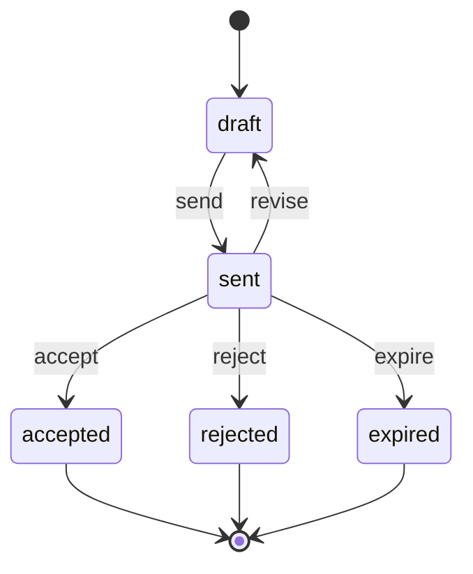

### Charge

| State | Tone | Terminal | Meaning |
|---|---|---|---|
| `scheduled` | neutral | no | Due in the future |
| `invoiced` | success | yes | Billed on an invoice |
| `waived` | neutral | yes | Not billed, with an approved reason |
| `cancelled` | neutral | yes | Removed because the agreement ended or changed |

| Transition | From | To | By | Guards | Effects |
|---|---|---|---|---|---|
| `bill` | scheduled | invoiced | system (billing run) or `invoices.create` | due date within the billing horizon | invoice line created |
| `waive` | scheduled | waived | `charges.waive` | reason given; waiver rule `FIN.ACL.07`, otherwise an approval request | — |
| `cancel` | scheduled | cancelled | system (agreement ended) or `charges.manage` | — | — |

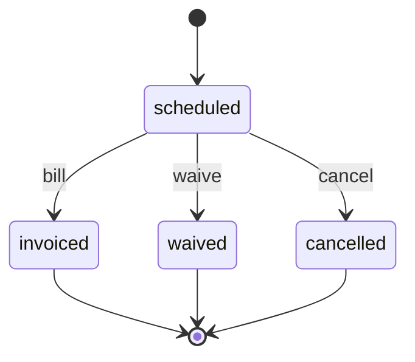

### Invoice

Canonical base: [01-property.md](../verticals/01-property.md) §7.1. A partial credit note
reduces the balance like a payment; `credit` is a full credit. `paid` is not terminal: a
reversed payment reopens the invoice (`unallocate`); when the reversed payment was a recovery
of a written-off invoice, the invoice returns to `written_off`, not to `overdue`.

| State | Tone | Terminal | Meaning |
|---|---|---|---|
| `draft` | neutral | no | Editable, no number yet |
| `issued` | info | no | Numbered and sent; not editable (`FIN.ACL.01`) |
| `partially_paid` | info | no | Part of the balance settled by payments or credit notes |
| `overdue` | error | no | Due date passed with a balance |
| `paid` | success | no | Balance is zero; only `unallocate` leaves it |
| `written_off` | neutral | no | Open balance written off as a bad debt; only `recover` leaves it (a reversed recovery brings it back, `unallocate`) |
| `credited` | neutral | yes | Cancelled in full by a credit note |

| Transition | From | To | By | Guards | Effects |
|---|---|---|---|---|---|
| `issue` | draft | issued | `invoices.issue` | every line has a VAT category; a `zero_rated` line whose `VatRule` needs evidence has it attached (03: bill of lading or air waybill and customs declaration for an international job); issuing entity set and, when VAT applies, VAT-registered with a TRN; customer TRN set for a B2B tax invoice where required; customer PO reference set when the contract requires one; exchange rate set for a foreign currency; date of supply not in a locked VAT period of the entity (`FIN.ACL.09`); kind is not `simplified_tax_invoice` once e-invoicing applies to the entity; when the recipient is in e-invoicing scope, the party has a recipient identifier (wl-parties) | number assigned from the entity's sequence; issuer snapshot copied; PDF generated (`DOC.GEN.01`); party notified; origins marked billed; e-invoice transmission `queued` when in scope; event `InvoiceIssued` |
| `allocate` | issued, partially_paid, overdue | partially_paid, paid | system (payment or credit note allocated) | — | `paid` when the balance reaches zero; event `InvoicePaid` |
| `unallocate` | paid, partially_paid, overdue, written_off | issued, partially_paid, overdue, written_off | system (wl-payments payment `reverse`, consumed as `PaymentReversed`; or an allocation moved to another document) | amount not above what is allocated to this invoice; on a `written_off` invoice, or a `paid` one that left `written_off` through `recover`, only an allocation made through `recover` | balance increased by the amount; new state by balance and due date: `overdue` if the due date has passed, otherwise `issued` when nothing remains allocated, else `partially_paid`; reminders (`FIN.RUL.01`) resume at the step matching the days overdue. A reversed recovery instead reduces the recovered amount and the invoice goes back to, or stays, `written_off` (never `overdue`; reminders stay stopped); the VAT share of the amount is undone on the relief side: a pending or proposed `bad_debt_relief` is increased again, an open `bad_debt_recovery` adjustment is reduced, and one already included gets a `bad_debt_relief` adjustment for that VAT share, created as `proposed` on the entity's `open` VAT summary because its conditions were met when the relief was first claimed (as `pending` while the entity has no `open` summary, so `FIN.RUL.14` proposes it later) `⚠ open: accountant (A-09)`; accountant notified. In every case the invoice owner and the receivables role are notified with the reversal reason; the issued document and its VAT are unchanged; event `InvoiceReopened` |
| `mark_overdue` | issued, partially_paid | overdue | system (`FIN.RUL.02`) | due date passed; balance > 0 | event `InvoiceOverdue` |
| `credit` | issued, overdue | credited | `invoices.credit` | no payments allocated; reason given | full credit note issued; origins released for re-billing if chosen; event `InvoiceCredited` |
| `write_off` | issued, partially_paid, overdue | written_off | `invoices.write_off` | balance > 0; reason code given (insolvent, untraceable, uneconomic to pursue, settlement agreed, other with text); not `disputed`; `FIN.ACL.15`: above the limit an approval request (`PLT.APR.01`), approver ≠ requester; at final approval the balance still equals the amount in the request, otherwise the request `fail`s and the requester submits again for the new balance | open balance recorded as the write-off amount (no credit note: the supply stood and the tax invoice stays valid); reminders stop; customer write-off notice generated (`DOC.GEN.01`) and sent (wl-notify) when configured, its date recorded; a `bad_debt_relief` VAT adjustment is created as pending for the VAT share of the written-off amount, and `FIN.RUL.14` proposes it once the conditions are met (§10); write-off exported to accounting; event `InvoiceWrittenOff` |
| `recover` | written_off | written_off, paid | system (payment allocated to a written-off invoice) | — | recovered amount recorded against the write-off; if bad-debt relief was already claimed (its adjustment `included` in a VAT summary), a `bad_debt_recovery` VAT adjustment adds the VAT share of the recovered amount back in the next open period `⚠ open: accountant (A-09)`; if the relief is still `pending` or `proposed`, it is reduced by that VAT share instead, and set `excluded` with reason *recovered before claim* when the whole write-off is recovered; `paid` when the whole write-off is recovered (event `InvoicePaid`); accountant notified; event `BadDebtRecovered` |
| `discard` | draft | — (deleted) | `invoices.create` | — | origins released |

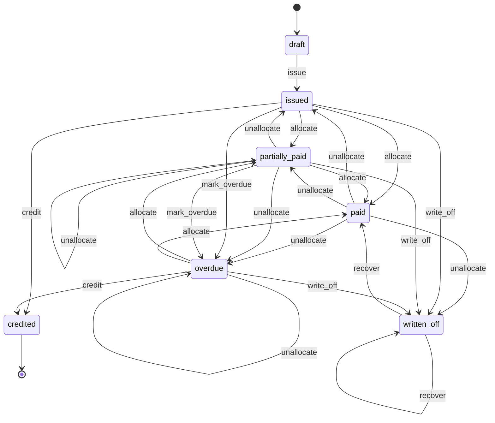

A payment that was allocated to an invoice before it was written off and is later reversed
does not change the write-off: the reversal creates a task for the accountant, who decides
whether to write off more (a second `write_off` approval) or pursue the party. A payment
allocated after the write-off (through `recover`) that is reversed runs `unallocate` and puts
the invoice back to `written_off` with the recovered amount reduced.

**Dispute flag** (not a state). A party may dispute all or part of an invoice in any state
from `issued` to `overdue`. The flag pauses chasing without changing the lifecycle.

| Action | Allowed in | By | Guards | Effects |
|---|---|---|---|---|
| `dispute` | issued, partially_paid, overdue | `invoices.dispute`, the party in the portal when allowed, or system (wl-delivery `DeliveryDisputed`, for each issued invoice that bills lines of the delivery; reason *delivery disputed*, disputed amount = that invoice's amount for the delivery's lines, capped at its balance, the delivery's ticket linked) | reason given; disputed amount ≤ balance; disputed lines optional: when given, lines of this invoice, and the disputed amount defaults to their amount (still editable, ≤ balance); not already `disputed` (for the system, an invoice already `disputed` is not flagged again: the delivery's ticket is linked to the open dispute with a note) | `disputed` set; a ticket is linked or opened (wl-ticketing `WRK.TKT.01`, category billing dispute) and assigned to the invoice owner; `FIN.RUL.01` reminders paused; the invoice is left out of overdue escalation (subscription `mark_past_due` and `suspend`, collection tasks, `write_off`); `FIN.RUL.02` still marks it `overdue` because the due date is a fact; ageing shows disputed amounts in their own column; disputed lines (if any) marked on the invoice and in the ticket; party gets an acknowledgement; event `InvoiceDisputed` |
| `resolve_dispute` | any state while `disputed` | `invoices.dispute` (outcome `credited` also needs `invoices.credit`), or system (`DeliveryDisputeClosed` with outcome *upheld* → `upheld`, only for a dispute the system raised for that delivery) | outcome `upheld` (the invoice stands) or `credited` (a credit note for the agreed amount, through `credit` or a partial credit note; above `FIN.ACL.07` an approval request); for hours billed from timesheets, `credited` names the adjustment timesheet (origin `client_dispute`) that carries the agreed hours; resolution note | `disputed` cleared; linked ticket resolved; party notified of the outcome with the credit note if any; `upheld`: reminders and the overdue escalation (subscription `mark_past_due` and `suspend`, collection tasks, `write_off`) resume after the grace period, the due date is not moved; event `InvoiceDisputeResolved` (outcome, credited amount) |

### Credit note

| State | Tone | Terminal | Meaning |
|---|---|---|---|
| `draft` | neutral | no | Editable |
| `issued` | info | no | Numbered and sent; balance available |
| `applied` | success | no | Fully applied to invoices or refunded; only `reopen` leaves it |

| Transition | From | To | By | Guards | Effects |
|---|---|---|---|---|---|
| `issue` | draft | issued | `invoices.credit` | linked invoice; reason; lines do not exceed the invoice's remaining credit; same issuing entity as the invoice | number assigned from the entity's credit-note sequence; issuer snapshot copied; PDF; e-invoice transmission `queued` when e-invoicing applies to the entity on the credit note's issue date and the recipient is in scope, also for a credit note against an invoice issued before go-live; event `CreditNoteIssued` |
| `apply` | issued | applied | system (allocation or refund via wl-payments) | remaining balance reaches zero | — |
| `reopen` | applied | issued | system (wl-payments `RefundFailed` for a refund whose source is this credit note; or an allocation of it removed) | — | the failed or removed amount returns to the credit note's remaining balance and so to the party's available credit; the refund requester and the accountant are notified with the failure reason; the issued document is unchanged; event `CreditNoteReopened` |

A refund that fails while the credit note is still `issued` (partly applied) restores the
amount the same way without a state change.

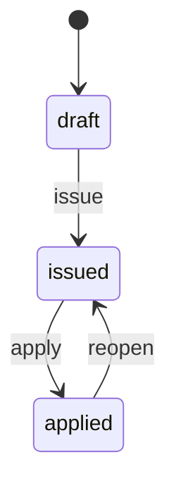

### E-invoice transmission

One per sending of an invoice or credit note to the ASP (`FIN.INV.01`, §10). A rejection
blocks nothing already issued; it raises a task.

| State | Tone | Terminal | Meaning |
|---|---|---|---|
| `queued` | neutral | no | Waiting to be sent, or waiting for a retry while the ASP is unreachable |
| `submitted` | info | no | Received by the ASP; waiting for its validation result |
| `accepted` | success | yes | Validated by the ASP and passed on |
| `rejected` | error | no | Refused by the ASP, with error codes |
| `superseded` | neutral | yes | Not sent again: the document was corrected by a credit note and a new invoice |

| Transition | From | To | By | Guards | Effects |
|---|---|---|---|---|---|
| `queue` | — | queued | system (invoice or credit note `issue`) | e-invoicing applies to the entity on the issue date of the document being queued (a credit note follows its own issue date, not the invoice's); recipient in scope (`EInvoiceScope`) | structured payload built from the issued document (no data typed again), with the recipient identifier read from the party (wl-parties) and stored on the transmission, not on the document |
| `submit` | queued | submitted, queued | system (immediately, then retries) | ASP adapter configured for the entity | sent through the ASP adapter; ASP reference stored. If the ASP cannot be reached, the transmission stays `queued`, retries on the schedule (§7) and then every 6 hours until sent (a queued transmission is never dropped), and a banner shows the queue; `FIN.RUL.16` raises a task when it is still not sent H hours after `issue` (integration-down pattern, wl-kernel) |
| `accept` | submitted | accepted | system (ASP response) | — | invoice's e-invoice status set; event `EInvoiceAccepted` |
| `reject` | submitted | rejected | system (ASP response) | — | error codes and messages stored; `FIN.RUL.16` task for the invoice owner and the accountant; the issued invoice, its balance and its reminders are not changed; event `EInvoiceRejected` |
| `resubmit` | rejected | queued | `einvoices.manage` | the cause is outside the issued document (recipient identifier, party master data, ASP or format setting) and has been fixed | payload rebuilt from the same document, with the recipient identifier and party data read again from wl-parties and the entity's current ASP and format settings, so the fixed cause is sent; attempt count + 1 |
| `supersede` | rejected | superseded | system (credit note issued against the document with reason `e-invoice correction`) | the cause is in the issued document (amounts, VAT, TRN, lines) | linked to the credit note at once and to the new invoice when it is issued (the user names, on the new invoice, the invoice it replaces), each with its own transmission (`FIN.ACL.01`); task closed |

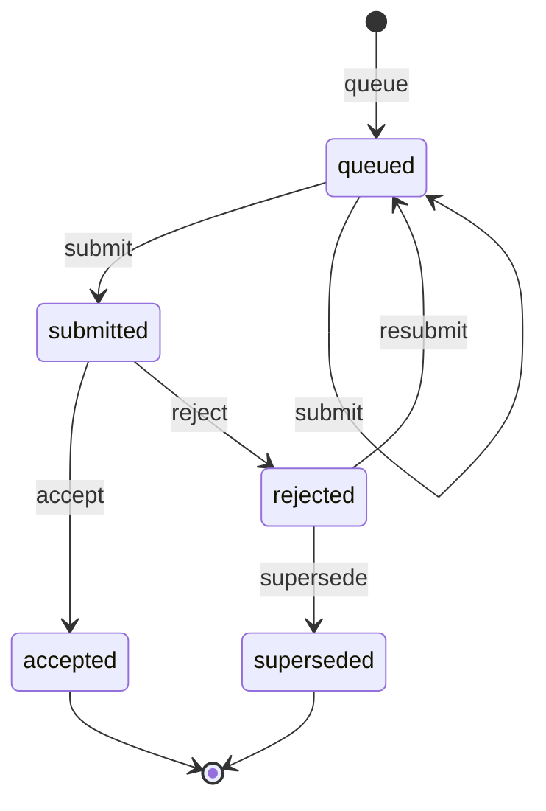

Whether a document counts as issued for VAT before the ASP accepts it, the time allowed to
transmit, and the full data fields are `⚠ open: accountant (A-10)` / `authority` (§12 question 4).
Until answered, the document is issued and its PDF is sent at `issue` as today, and the payload
carries the fields printed on the tax document: issuer snapshot (names, TRN, address), the
recipient's name, TRN and recipient identifier, document kind, number, issue date and date of
supply, currency and exchange rate, each line (description, quantity, unit price, discount, VAT
category, VAT amount), totals per VAT category and AED VAT total, and for a credit note the
invoice it credits. The adapter maps these to the ASP's format; the hash is computed over the
stored payload so a recomputation must match it.

Retry times (§7) are measured from `issue` (the first attempt), not from the previous attempt:
with the default, attempts at issue, +5 min, +30 min, +2 h, +6 h, then +12 h, +18 h, +24 h, …

### Subscription

Merges the retainer of [04-accounting.md](../verticals/04-accounting.md) and the membership
of [10-edtech.md](../verticals/10-edtech.md).

| State | Tone | Terminal | Meaning |
|---|---|---|---|
| `active` | success | no | Billed every cycle |
| `past_due` | warning | no | The latest cycle is unpaid: invoice overdue (manual) or charge failed (automatic) |
| `paused` | neutral | no | Billing stopped for a period |
| `suspended` | error | no | Unpaid after the last reminder or retry; the vertical blocks the service |
| `cancelled` | neutral | yes | Ended |

| Transition | From | To | By | Guards | Effects |
|---|---|---|---|---|---|
| `mark_past_due` | active | past_due | system | cycle invoice `overdue`, not `disputed` and not within the grace period after a dispute resolved `upheld`, or automatic charge failed (event from wl-payments), or a paid cycle invoice reopened by a reversed payment (`InvoiceReopened`, e.g. a chargeback) | party notified; retry schedule starts for automatic payment (`FIN.RUL.06`) |
| `settle` | past_due, suspended | active | system | outstanding cycle invoices paid | event `SubscriptionSettled`; the vertical restores the service |
| `suspend` | past_due | suspended | system (`FIN.RUL.06`) | last retry or reminder done; suspension enabled for the client; not while the only overdue cycle invoices are `disputed` (the subscription stays `past_due`) | event `SubscriptionSuspended` |
| `pause` | active, past_due, paused | paused | `subscriptions.manage`, or system (the vertical's agreement is paused, e.g. 10 enrolment `freeze`, 04 engagement `suspend`; `PartyBlocked` where the block effect is pause, wl-parties §5.6) | reason; pause allowance not exceeded (not counted for a system pause) | billing stops for cycles starting after the pause (no pro rata credit for the current paid cycle); end date extended if configured; each pause cause is stored (user pause with its end date, the agreement's pause, a party block), and a `pause` on an already `paused` subscription only adds its cause (the state stays `paused`, and the allowance guard applies only to a user pause); a block pause records the reason `on_hold` and sends the party nothing (wl-parties §5.6); from `past_due` the overdue cycle invoices stay open and their reminders continue unless the invoice is `disputed` |
| `resume` | paused | active, past_due | `subscriptions.manage` or system (pause end date; the vertical's agreement resumed; `PartyUnblocked`) | after a block: party no longer blocked; each trigger removes only its own pause cause, and the subscription resumes only when no cause remains (a user pause ends on its end date) | next cycle date recalculated from the resume date and the anchor day; back to `past_due` when cycle invoices from before the pause are still overdue |
| `cancel` | active, past_due, paused, suspended | cancelled | `subscriptions.manage`, the party (portal, if allowed), or system (the vertical's agreement ended or withdrawn, e.g. 10 enrolment `withdraw`, 04 engagement `end`) | notice period respected (not for a system cancel) | ends at period end or immediately; a system cancel ends at once with a pro rata credit note for the unused part of a paid cycle (or a final pro rata invoice) unless the vertical's own settlement has already done it; when the cycle invoice is still unpaid, the credit note reduces it (the unused part is not owed) and nothing is refunded; pro rata is by calendar days, the cancel day counted as used; when cancelled while `paused`, the unused part is the paid cycle's days from the pause start day (the first day not used) to the cycle end, whatever the cancel date; a user or party cancel gives a final pro rata invoice or credit only when the setting *pro rata on cancel* is on (default off), otherwise there is no proration; refunds to a blocked party wait (`PTY.ACL.03`); event `SubscriptionCancelled` |

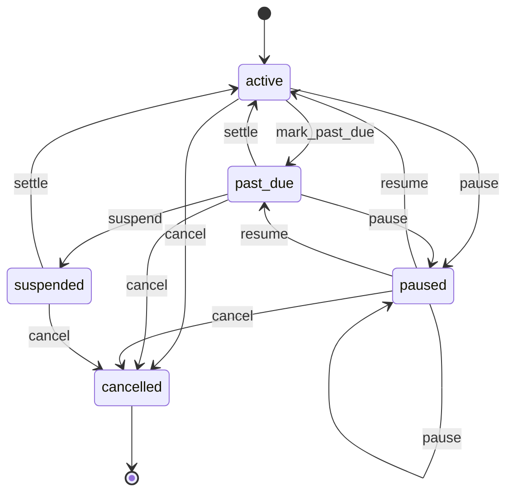

**Vertical mapping**

| Vertical | Its version | Maps to |
|---|---|---|
| 04 Accounting (retainer) | `mark_past_due` on overdue invoice, `settle`, `pause` from active or past due, no suspension; paused and resumed with the engagement (`suspend`/`resume`, also on a party block), cancelled with a pro rata final invoice or credit on engagement `end` | Manual payment mode; `suspend` turned off for the client. System `pause`, `resume` and `cancel` driven by the engagement. Engagement suspension stays an accounting automation (`ACC.RUL.07`) |
| 10 EdTech (membership) | `fail_payment`, `recover`, `suspend` after retries, `pause` with a yearly allowance, `cancel` by the party; paused and resumed with enrolment `freeze`/`unfreeze` and `PartyBlocked`/`PartyUnblocked`; cancelled at once with a pro rata credit on enrolment `withdraw` | Automatic payment mode; `fail_payment` → `mark_past_due`, `recover` → `settle`; pause allowance and party cancellation are configuration; system `pause`, `resume` and `cancel` driven by the enrolment and the party block |
| 05 Clinics, 06 F&B (Later) | memberships, meal plans | Either payment mode; no extra states |

### Supplier bill

| State | Tone | Terminal | Meaning |
|---|---|---|---|
| `draft` | neutral | no | Being entered |
| `matched` | info | no | 3-way match within tolerance |
| `exception` | warning | no | Match failed: price, quantity or missing goods received; or held as a possible duplicate |
| `approved` | success | no | Approved for payment |
| `partially_paid` | info | no | Part paid |
| `paid` | success | no | Fully paid; reopened only if the outgoing payment is reversed or a debit note that reduced it is cancelled |
| `void` | neutral | yes | Entered in error or rejected |

| Transition | From | To | By | Guards | Effects |
|---|---|---|---|---|---|
| `submit` | draft | matched, exception | `supplier_bills.create` | supplier, lines and VAT entered; receiving entity set; a bill against a service contract has a service date on every line | duplicate check (§7): a bill with the same supplier and supplier invoice number (compared without surrounding spaces and ignoring case) as a bill that is not `void`, or a match on any other key set the client turns on (each key set is checked on its own, always within the same supplier; e.g. the same contract, period and amount), goes to `exception` with reason *possible duplicate*, the earlier bill linked and the accountant notified; otherwise the match runs against the PO and goods received (when a PO exists), or against the service contract's billing terms (`ServiceContracts::coverage` in wl-ticketing, checked per line on its service date: a line for work after the contract's end date, or after its termination date when terminated, is not covered and sends the bill to `exception` with reason *work after contract end*); bills without a PO or contract go to `matched` if none is required for the category (e.g. freelance tutor bills built from recorded sessions, 10) |
| `approve` | matched, exception | approved | `supplier_bills.approve` | `FIN.ACL.03`: `matched`, or approval of the exception; bill date not in a locked VAT period (`FIN.ACL.09`), otherwise it is recorded as an adjustment of the next open period | actual cost posted to cost objects, split by the allocation basis; lines coded to a landed cost post no cost here (wl-inventory allocates them to the receipts, or adjusts after allocation); input VAT recorded for the bill's period; event `SupplierBillApproved`; for PO-linked bills, event `SupplierBillMatched` (PO lines and billed quantities; wl-inventory closes the PO when every line is billed) |
| `pay` | approved, partially_paid | partially_paid, paid | system (payment from wl-payments, or a supplier debit note applied) | — | open balance reduced; `paid` when it reaches zero |
| `void` | draft, matched, exception | void | `supplier_bills.approve` | reason given | — |
| `unallocate` | partially_paid, paid | approved, partially_paid | system (wl-payments `PaymentReversed` on an outgoing payment, e.g. a transfer entered in error or returned by the bank; an issued cheque records its payment only at `clear`, so cancelling it or its bounce before that reopens nothing; or `SupplierDebitNoteCancelled` for a debit note that reduced this bill through `pay`) | amount not above what the payment or debit note applied to this bill | open balance restored by the reversed payment or the cancelled debit note's amount; `approved` when nothing remains paid or reduced by a debit note, otherwise `partially_paid`; accountant notified to pay again or fix the supplier's bank details (or, for a cancelled debit note, that the full amount is payable again); event `SupplierBillReopened` |

A debit note issued against a bill that is already `paid` leaves the bill as it is; the
amount becomes the supplier's debit balance, set off against the supplier's next bill or
refunded by the supplier (§5.13). Quantities rejected at goods receipt never reach the match
(only accepted quantity is matched, wl-inventory), so they need no debit note unless the bill
was approved before the rejection.

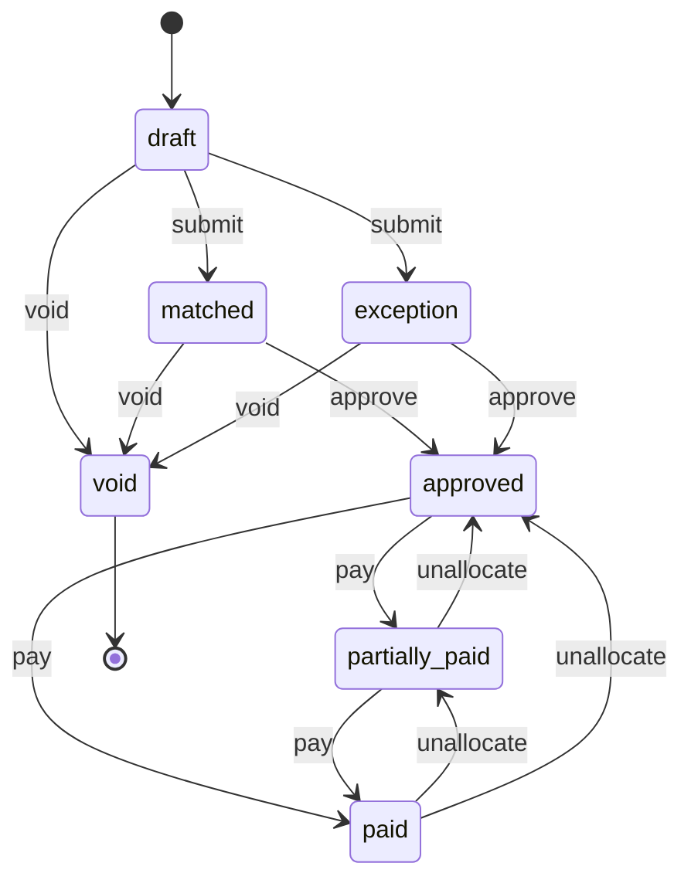

### Supplier debit note

| State | Tone | Terminal | Meaning |
|---|---|---|---|
| `draft` | neutral | no | Drafted from a return to supplier or by hand; may wait for the bill |
| `issued` | info | no | Sent to the supplier; payable reduced; waiting for the supplier's tax credit note |
| `settled` | success | yes | Supplier's tax credit note received and the amount set off or refunded |
| `cancelled` | neutral | yes | Withdrawn; effects reversed |

| Transition | From | To | By | Guards | Effects |
|---|---|---|---|---|---|
| `draft` | — | draft | system (`FIN.RUL.17` on wl-inventory `SupplierReturnDispatched`) or `supplier_bills.create` | supplier set; lines from the return, or entered by hand with a reason code (price difference, short delivery, quality, other) | lines priced at the bill's prices; when the bill for the returned lines has not arrived, the lines take the PO price from the event, the draft waits, and when that bill is approved it is linked and re-priced at the bill's prices |
| `issue` | draft | issued | `supplier_bills.approve` | linked to an `approved`, `partially_paid` or `paid` bill; quantities and amounts not above the bill lines less earlier debit notes; date not in a locked VAT period of the entity (`FIN.ACL.09`); manual debit note (no dispatched return): approval per `FIN.ACL.17` | number from the receiving entity's debit-note sequence; PDF; supplier notified (wl-notify); bill balance reduced through `pay`, or supplier debit balance opened if the bill is paid; actual cost reversed on the cost objects (`CostPoster`); input VAT reduced in the VAT summary per the input VAT timing setting (§7); event `SupplierDebitNoteIssued` |
| `settle` | issued | settled | `supplier_bills.approve` or system (supplier refund received in wl-payments, or set off on the next bill) | supplier's tax credit note recorded (number, date, file), unless the client's setting accepts the debit note alone; amount matches the debit note, otherwise the difference is recorded with a reason | input VAT adjustment confirmed (when timed on the supplier's credit note); event `SupplierDebitNoteSettled` |
| `cancel` | draft, issued | cancelled | `supplier_bills.approve` | reason; issued: the return to supplier was cancelled or the supplier rejected the claim | issued: bill balance restored (supplier bill `unallocate` for the amount it reduced, also when that left the bill `paid`; the supplier debit balance it opened is closed), cost and input VAT effects reversed (in the next open period when the debit note's period is locked, `FIN.ACL.09`); supplier notified; wl-inventory told through the event; event `SupplierDebitNoteCancelled` |

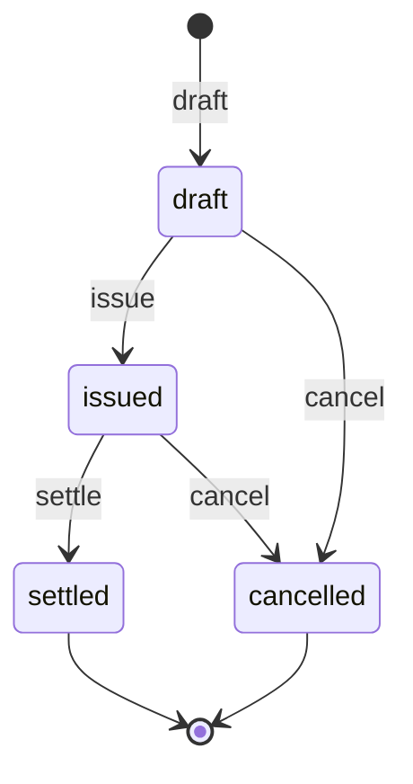

### Payer bill

Generalises the money side of the clinic *Claim* ([05-clinics.md](../verticals/05-clinics.md)
§7.1) and the billing steps of the auto *Insurance claim*
([08-auto.md](../verticals/08-auto.md) §7.1, formerly `AUT.INS.05`).

| State | Tone | Terminal | Meaning |
|---|---|---|---|
| `draft` | neutral | no | Built from the payer split; not yet sent |
| `issued` | info | no | Sent or submitted to the payer; waiting for the remittance |
| `partially_paid` | warning | no | Remittance received: some lines paid, some denied or reduced |
| `denied` | error | no | Remittance received: every line denied |
| `paid` | success | no | Every line paid as billed; only `record_recoupment` leaves it |
| `closed` | neutral | no | Open amount written off or moved to the customer; only `record_recoupment` leaves it |
| `voided` | neutral | yes | Created in error (duplicate, wrong payer or policy) before it reached the payer; number kept, shown as void |

| Transition | From | To | By | Guards | Effects |
|---|---|---|---|---|---|
| `issue` | draft | issued | `payer_bills.issue` or system (vertical: 05 claim `submit`, 08 claim `invoice`) | payer agreement active; payer reference set where the agreement requires it; every line has a claimed amount; when the payer is the VAT recipient, the payer's tax invoice passes the Invoice `issue` guards | number from the entity's sequence (kept when issued again after `submission_rejected`); payer's tax invoice issued (payer is recipient; not again if it already exists) or payer share recorded on the customer's tax invoice (customer is recipient); payer receivable opened; event `PayerBillIssued` |
| `submission_rejected` | issued | draft | system (submission channel response, via the vertical: 05 claim) or `payer_bills.issue` | rejected before adjudication for technical or format reasons; no remittance recorded | error codes and messages stored with the attempt; resubmission count unchanged (this is not a resubmission); payer receivable taken out of ageing until issued again; an existing payer tax invoice stays, and a corrected amount goes through a credit note or an extra invoice (`FIN.ACL.01`); task for the billing coordinator with the errors and the submission deadline; event `PayerBillSubmissionRejected` |
| `record_remittance` | issued | paid, partially_paid, denied | `payer_bills.reconcile` or system (remittance import) | every remittance line matched to a bill line; amounts not above the open line amounts, except an overpayment moved to the payer credit balance with approval (`FIN.ACL.16`) | paid amounts allocated per line through wl-payments; denial codes and reasons stored; an approved overpayment goes to the payer credit balance; recoupment lines on the same advice run `record_recoupment` on the earlier bills; event `PayerRemittanceRecorded` |
| `record_recoupment` | paid, partially_paid, closed | partially_paid, denied | `payer_bills.reconcile` or system (remittance import; wl-payments `PaymentReversed` for a payment allocated to the bill) | recouped amount not above the paid amount of the lines; payer's recoupment code or reason; approval per `FIN.ACL.16` (not needed for a reversal from wl-payments) | paid amounts on the lines reduced and reopened as denied with the payer's code; the money is taken from the payer credit balance first, otherwise deducted from the later remittance that carried it (through wl-payments); payer receivable reopened; billing coordinator notified (the vertical's denial task, e.g. 05 `CLN.RUL.05`, reacts to the event); the reopened amount then follows `resubmit`, `transfer_to_customer` or `write_off`; event `PayerRecoupmentRecorded` |
| `resubmit` | partially_paid, denied | issued | `payer_bills.issue` or system (05 claim `resubmit`) | corrections recorded; within the agreement's resubmission window and limit | resubmission count + 1; a changed amount on a payer tax invoice is corrected by a credit note or an extra invoice (`FIN.ACL.01`) |
| `transfer_to_customer` | draft, partially_paid, denied | closed | `payer_bills.write_off` | the agreement allows billing the customer for the lines; reason given; from `draft`: the payer's first-submission window has passed and the agreement does not accept late submissions | customer is recipient: the open amount moves to the customer's share of the same tax invoice; payer is recipient: credit note to the payer (none for a `draft` whose payer tax invoice was never issued) and a tax invoice to the customer; customer notified; event `PayerBillClosed` |
| `write_off` | draft, partially_paid, denied | closed | `payer_bills.write_off` | reason given; above the agreement's write-off limit, an approval request (`PLT.APR.01`, `FIN.ACL.14`); from `draft`: the payer's first-submission window has passed and the agreement does not accept late submissions | credit note for the written-off amount against the tax document that carries it: when the customer is the VAT recipient, the customer's tax invoice, issued for the full supply when the customer's share was billed (§3, §5.8 step 2), so it carries the payer lines even while the payer bill is a `draft`; when the payer is the recipient, the payer's tax invoice, so none for a `draft` whose payer tax invoice was never issued; the amount is reported as *not submitted in time* when closed from `draft`; event `PayerBillClosed` |
| `void` | draft | voided | `payer_bills.issue` | reason given (duplicate, wrong payer or policy); never once a remittance was recorded (`PLT.ACL.09`); the vertical may allow it only before the first submission (05: `CLN.ACL.14`) | payer split removed from the source, which may be split again to the right payer (a new payer bill); a payer tax invoice already issued is cancelled by a credit note (`FIN.ACL.01`); billing coordinator notified; event `PayerBillClosed` (outcome voided) |

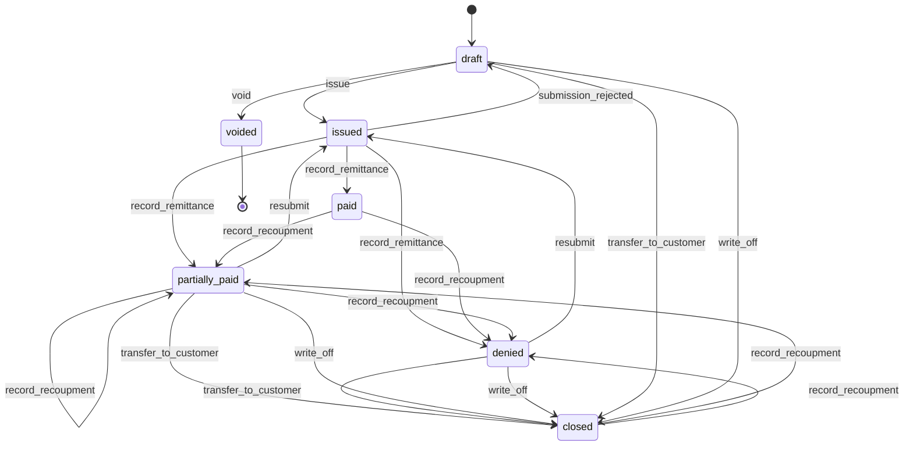

**Vertical mapping**

| Vertical | Its version | Maps to |
|---|---|---|
| 05 Clinics (claim) | `draft`, `ready`, `submitted`, `resubmitted` | Coding, validation and the submission channel stay in apps/clinics (`CLN.CLM.01`–`03`). Claim `submit` runs `issue`; claim `resubmit` runs `resubmit`; claim `record_remittance` is this `record_remittance` |
| 05 | `written_off` ("moved to the patient where the contract allows, otherwise written off") | `transfer_to_customer` or `write_off`; the write-off limit is the clinic's `LIM` above which the owner approves |
| 05 | technical rejection at submission | `submission_rejected`: back to `draft` with the channel's error codes, not counted against the resubmission limit; the claim returns to `draft` in apps/clinics (05 claim `reject_submission`) |
| 05 | `write_off` from `draft` or `ready` after the first-submission window (`CLN.ACL.16`); `void` from `draft` or `ready` (`CLN.ACL.14`) | `write_off` or `transfer_to_customer` from `draft`; `void` → `voided` |
| 05 | overpayment or recoupment in a later remittance | overpayment to the payer credit balance and `record_recoupment`, both with approval (`FIN.ACL.16`) |
| 08 Auto (insurance claim) | `invoice` (insurer invoice and customer excess invoice) | `issue` with the insurer as VAT recipient, plus a customer invoice for the excess and private items |
| 08 | `settle` (both invoices paid) | runs when the payer bill is `paid` and the customer invoice is `paid`; an insurer short payment is `partially_paid`, then `resubmit`, `transfer_to_customer` or `write_off` |

### VAT summary

One per legal entity and tax period. It is a working paper for the accountant, not a filing.

| State | Tone | Terminal | Meaning |
|---|---|---|---|
| `open` | neutral | no | The period is running; figures update as documents are issued and approved |
| `prepared` | info | no | The period ended; figures frozen for review |
| `reviewed` | info | no | Checked by a second person |
| `locked` | success | no | Handed to the accountant or used for the return; nothing dated in the period can be issued or changed |

| Transition | From | To | By | Guards | Effects |
|---|---|---|---|---|---|
| `prepare` | open | prepared | system (`FIN.RUL.08`) or `vat.prepare` | period end date passed | figures frozen; adjustments list built from documents that arrived late; event `VatSummaryPrepared` |
| `refresh` | prepared | prepared | `vat.prepare` | — | figures recalculated after corrections |
| `review` | prepared | reviewed | `vat.review` | reviewer ≠ preparer (`FIN.ACL.10`) | — |
| `send_back` | reviewed | prepared | `vat.review` | reason given | preparer notified |
| `lock` | reviewed | locked | `vat.lock` | — | export generated (Excel and PDF); filing reference recorded if given; event `VatSummaryLocked`; later documents for the period become adjustments of the next open period |
| `reopen` | locked | prepared | `vat.lock` | reason; approval request (`PLT.APR.01`) | event `VatSummaryReopened`; if a return was already filed, an error above AED 10,000 of tax needs a voluntary disclosure; smaller errors go into the next return ✔ [S7] |

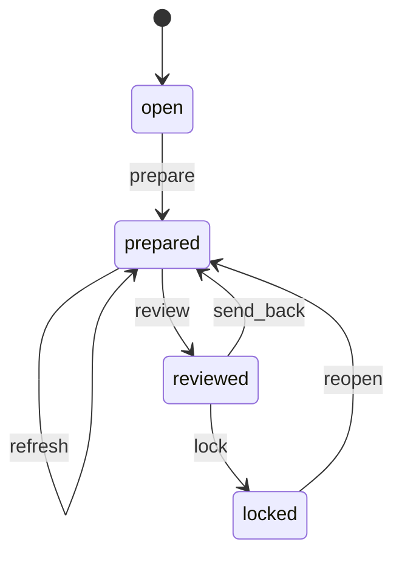

### Company budget

One approved version per entity and fiscal year at a time. A change is a new version; the
approved one stays in force until the new one is approved.

| State | Tone | Terminal | Meaning |
|---|---|---|---|
| `draft` | neutral | no | Being prepared; lines editable |
| `submitted` | info | no | Waiting for approval; not editable |
| `approved` | success | no | The budget in force for the entity and year; used by budget vs actual and the cash-flow forecast |
| `superseded` | neutral | yes | Replaced by a newer approved version; kept for comparison |
| `discarded` | neutral | yes | A draft given up; kept for the history, used by nothing |

| Transition | From | To | By | Guards | Effects |
|---|---|---|---|---|---|
| `create` | — | draft | `budgets.manage` | entity and fiscal year set; for a revision, an `approved` version of the same entity and year exists and no other version is `draft` or `submitted` | a revision copies the approved version's lines, version + 1, and locks the lines of months already ended (editable only when §7 allows revising past months, with a revision reason); a first version starts, as the creating user chooses once at `create`, empty or as a copy of last year's approved budget or of last year's actual per category and month |
| `submit` | draft | submitted | `budgets.manage` | at least one line; every line has an active category and a month in the fiscal year; revision reason given for a revision | approval request (`PLT.APR.01`) to the holders of `budgets.approve` |
| `return` | submitted | draft | `budgets.approve`, or system (the approval request is `rejected`, `returned`, `withdrawn`, `expired` or `failed`, wl-kernel §4.1) | reason given (the approver's comment, or the kernel's fixed reason) | preparer notified with the reason |
| `discard` | draft | discarded | `budgets.manage` | reason given | the entity and year are free for a new version; an `approved` version stays in force |
| `approve` | submitted | approved | `budgets.approve` (final step of the approval request) | approver ≠ the user who submitted the version (`SOD`, wl-kernel approval request) | the earlier `approved` version of the entity and year runs `supersede`; budget vs actual and the cash-flow forecast use this version from now; event `CompanyBudgetApproved` |
| `supersede` | approved | superseded | system (`approve` of a newer version) | — | — |

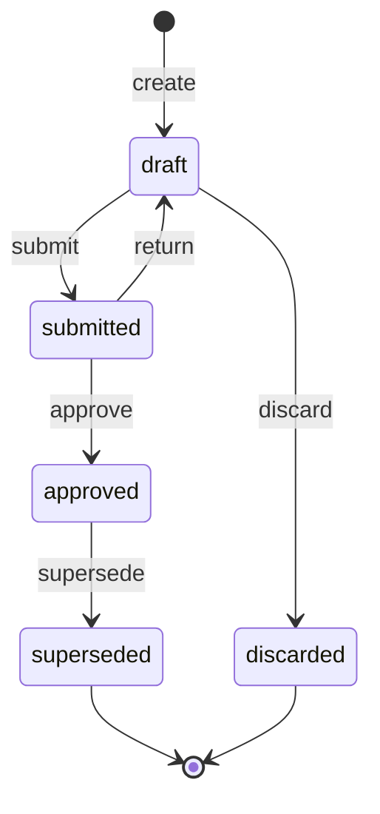

Usage records, disbursements and cost entries have no state machine: they are either unbilled
or linked to an invoice line, and an invoice credit releases them. A cost amortisation is
active until its amount remaining is zero. The cash-flow forecast has no state machine: it is
computed, not stored.

## 5. Workflows

### 5.1 Billing run (charges, subscriptions, usage)

1. Daily, the billing run collects due charges, subscription cycles starting in the billing
   horizon, and unbilled usage records and disbursements whose billing cycle ends.
2. It groups them per issuing entity, party, currency and grouping rule (per agreement, per client per
   cycle, per cost object), and creates draft invoices. A charge type set to its own invoice
   gets one invoice per charge: in 01 each rent instalment is its own tax invoice, dated on
   its due date (its tax point), issued the configured lead time before it.
3. Clients choose per invoice type whether drafts are issued automatically or reviewed first
   (default: reviewed).
4. On `issue`, the invoice is numbered from the issuing entity's sequence, the issuer snapshot is copied, the PDF is generated in
   EN/AR, and the party is notified by its preferred channel.

### 5.2 Usage billing

1. The vertical records usage: a delivered shipment, an approved client timesheet line, a
   job card under a fleet contract. It calls the usage service with the party, the source
   and the rate card dimensions.
2. The rate card prices it with the line's pricing model: base price × quantity ×
   multipliers, then minimums and surcharges. Storage (03) is priced from a daily snapshot
   of pallets or CBM held. A usage record without a matching rate line is flagged for review.
3. At cycle end, the billing run produces one invoice per issuing entity, party and cycle,
   with lines grouped as the contract requires (per role, per vehicle, per service). A 09
   contract served by workers of two sponsoring entities gets one invoice per entity.
4. Goods billed on delivery are billed for the delivered quantity only: the draft takes the
   per-line delivered qty of `DeliveryDelivered` (through the source's fulfilment, e.g.
   wl-sales `fulfil`); refused qty is never billed. A COD difference that the customer
   still owes stays open on the invoice and is chased as usual; one absorbed by the client
   (03) goes to its remittance line; one absorbed by the business or the driver is not billed. A difference that is
   not billed reduces a draft by a negative line *COD difference absorbed* (reason and
   absorber named), or, when the invoice was already issued, gets a credit note for the
   difference with the same reason (`FIN.ACL.01`); the driver's share is recovered in the
   cash handover (wl-payments), never from the customer.
5. Hours corrected after billing arrive as an approved adjustment timesheet (wl-attendance,
   `TimesheetApproved` kind `adjustment`, `affects` billing or both). Not yet invoiced: billed
   with the original. Already invoiced: − hours give a credit note against the original
   invoice (`FIN.ACL.01`); + hours give an extra usage line on the next invoice (or a separate
   invoice, per the client's setting *Adjustment of already-invoiced hours (+)* in wl-attendance
   §7, default: extra line on the next usage invoice). The hours are priced with the rate
   card line, multipliers and rate date of the original usage record, not today's rate; the
   + and − entries of one adjustment are netted per invoice line (a negative net gives the
   credit note, a positive net the extra line). The credit note or line names the
   adjustment, and a dispute resolved `credited` is linked to it (§5.10).

### 5.3 Receivables and reminders

1. Every issued invoice appears in ageing buckets (0–30, 31–60, 61–90, 90+ days) per party,
   filterable by issuing entity.
2. `FIN.RUL.01` sends reminders before and after the due date; `FIN.RUL.02` marks invoices
   overdue. Disputed invoices are not reminded (§5.10). When reminders resume (after the
   grace period of a dispute resolved `upheld`, or on an invoice reopened by `unallocate`),
   the next run sends once the latest step whose day has passed, unless it was already sent,
   then the later steps on their days.
3. Statements of account per party are available on demand and in the portal.
4. An invoice that cannot be collected is written off (§5.9); a reversed payment reopens it
   (§5.11).

### 5.4 Supplier bill with 3-way match

1. The accountant enters the bill or uploads it, linked to one or more POs, or to a vendor
   service contract (01 AMC). Bills built by the app from recorded work, such as a freelance
   tutor's monthly bill from attended sessions × the tutor's rate (10), start as drafts.
2. The match compares quantities with goods received and prices with the PO, within the
   tolerance.
3. A matched bill can be approved. An exception needs an approval request
   (`FIN.ACL.03`). A bill held as a possible duplicate (same supplier and supplier invoice
   number as an earlier bill that is not void, or any other key set the client turns on, each
   checked on its own within the same supplier) stays in `exception` until a user other than
   its creator approves it with a reason, or a user with `supplier_bills.approve` voids it with
   a reason. Nothing voids it automatically. A contract bill is matched only for work done
   up to the contract's end date (or termination date). Each line needs a service date; a
   period line counts by its last day. A line dated after the end sends the bill to
   `exception` with reason *work after contract end*. The accountant approves the exception
   with a reason (`FIN.ACL.03`), e.g. agreed work to finish an open visit, or voids the bill
   and asks the vendor for a corrected one (the later work billed on a ticket or a new
   contract).
4. Approval posts actual cost to the cost objects and makes the bill payable in wl-payments.
   A freight, duty or clearing line is coded to a landed cost instead; its amount goes to
   wl-inventory with `SupplierBillApproved`, which allocates it or, when the landed cost is
   already allocated, drafts a landed cost adjustment. A contract bill is spread over
   buildings, units or assets by the contract's allocation basis (area by default, number of
   units, asset, or manual %), and the shares flow into the owner statements of 01
   (`PRP.OWN.01`).

### 5.5 Job costing

1. A cost object gets budget lines per cost code (from a BOQ, a quotation or manual entry).
2. POs post committed cost; goods received, stock issues, approved timesheets and
   supplier bills post actual cost (releasing the commitment).
3. Revenue comes from invoices whose lines name the cost object.
4. `FIN.RUL.05` warns when committed + actual reaches the threshold of a budget line.
5. A cost that covers a term (visa, Emirates ID, medical and insurance costs in 09; visa
   costs inside a fully loaded trade rate in 02) can be amortised: it is spread evenly over
   the term (default 24 months) and posted each month to the holder's active cost objects,
   such as the worker's deployments. This is management reporting; the books stay in the
   client's accounting software.

### 5.6 Export to accounting (Later)

1. For a period, invoices, credit notes, supplier bills and payments are exported as a
   batch in the target system's import format, with account mapping per VAT category and
   charge type.
2. An exported record is marked and not exported again unless the batch is reversed.

### 5.7 VAT summary

1. Each legal entity has a tax period (monthly or quarterly) and a summary per period, `open`
   while the period runs.
2. Output VAT is collected from issued invoices and credit notes dated in the period, by VAT
   category and by emirate (from the scope of the source). Input VAT is collected from
   approved supplier bills and approved expense claims (via `InputVatSource` in
   [wl-payments](wl-payments.md)), split into recoverable and blocked.
3. After the period ends, `FIN.RUL.08` prepares the summary and notifies the
   accountant. Documents that arrived after a previous period was locked appear as
   adjustments. Bad-debt relief proposed by `FIN.RUL.14`, bad-debt recoveries and supplier
   debit notes appear as adjustments too; the preparer includes or excludes each proposed
   adjustment with a reason.
4. A second person reviews it. Locking produces an Excel and PDF export laid out in the order
   of the FTA return (`VatReturnMapping`), so the accountant can file on EmaraTax.
5. Once locked, nothing dated in the period can be issued or changed
   (`FIN.ACL.09`).

### 5.8 Third-party payer billing (`FIN.TPP.01`)

1. The vertical registers the payer reference (prior authorisation, insurer approval or
   LPO, claim number) and computes the payer split per line through `PayerBilling`.
2. The customer's share is billed at once (05: at the front desk; 08: excess and private
   items before the vehicle is released, `AUT.ACL.17`).
3. The payer bill is issued when the vertical submits the claim (05) or the repair is
   complete (08). When the payer is the VAT recipient, its tax invoice is issued with the
   wording agreed in the payer agreement.
4. The remittance advice is entered or imported (CSV or Excel with a preset per payer) and
   matched per line; the payment arrives by transfer and is matched from the bank statement
   (`FIN.BNK.01`).
5. Denied or reduced lines are resubmitted within the window, moved to the customer where
   the agreement allows, or written off with approval above the limit. A draft that missed
   the payer's first-submission window is closed the same way; a draft created in error is
   voided and the source split again.
6. A submission the channel rejects for technical reasons (format, missing field, wrong
   member ID) returns the bill to `draft` with the error codes. It is fixed and issued again
   with the same number; it does not count against the resubmission limit.
7. A remittance that pays more than is open on a line is held until a second person approves
   moving the excess to the payer credit balance (`FIN.ACL.16`). A remittance that recoups
   money paid earlier (a negative line against an earlier bill) runs `record_recoupment` on
   that bill, also with approval; the earlier bill reopens and is resubmitted, moved to the
   customer or written off. A payer credit balance is set off against later recoupments or
   refunded to the payer through a wl-payments refund.
8. The payer receivables board shows ageing per payer and a statement per bill (claim by
   claim), filterable by issuing entity and branch (`FIN.REC.01`), and the payer credit
   balance per payer.

### 5.9 Bad debt write-off and VAT relief

1. When an invoice is judged uncollectable, the receivables role requests `write_off` with
   a reason code. A disputed invoice must be resolved first.
2. The write-off goes to approval above the limit (`FIN.ACL.15`); the approver is never the
   requester. On approval the balance is written off, reminders stop and the write-off is
   exported to the accounting software. The customer write-off notice is generated and sent
   (default on), and its date is recorded as evidence.
3. A pending bad-debt relief adjustment is created for the VAT share of the written-off
   amount. The VAT share is computed per VAT category in proportion to the invoice's open
   balance: for each category, written-off amount × (category VAT ÷ invoice gross total),
   rounded half-up to fils per category. Zero-rated, exempt and out-of-scope lines carry no
   VAT and give no relief. One adjustment is created per invoice; its amount is the sum of
   the rounded per-category shares. For an invoice in a foreign currency the shares use the
   invoice's AED VAT figures: category AED VAT × (written-off amount ÷ gross total in the
   invoice currency); the write-off amount itself stays in the invoice currency. How relief applies to a partly paid invoice is still
   `⚠ open: accountant (A-09)`; this is the default until answered.
   While the write-off waits for approval, a payment can still be allocated; the request
   then fails at approval (the balance changed) and is submitted again. `FIN.RUL.14` checks it daily and, once the conditions in §10 are met, proposes it
   on the next open VAT summary and tells the accountant. An adjustment the preparer
   excluded from a summary stays `excluded`; `FIN.RUL.14` does not propose it again.
4. If the customer pays later, the payment is allocated to the written-off invoice
   (`recover`). When relief was already claimed, a bad-debt recovery adjustment is proposed
   for the next open period; when it was not yet claimed, the pending or proposed relief is
   reduced instead. If that payment is reversed later, `unallocate` returns the invoice to
   `written_off` and undoes the recovery's VAT effect (§4).

### 5.10 Disputed invoices

1. Staff, or the party in the portal when allowed, flag an invoice as `disputed` with a
   reason and the disputed amount, and may tick the disputed lines (the amount then defaults
   to their amount; a vertical may act on them, e.g. 07 quality NCRs). A ticket is opened or
   linked and assigned to the invoice owner; the party gets an acknowledgement.
2. Reminders stop for that invoice. It still shows as overdue, in its own disputed column of
   the ageing, but it does not drive subscription suspension or collection tasks. That column
   shows the lesser of the disputed amount and the balance; the stored disputed amount is
   not changed when payments bring the balance below it.
3. `FIN.RUL.15` reminds the owner, then escalates to the finance manager, while the dispute
   stays open.
4. The dispute is resolved `upheld` (reminders resume after the grace period) or `credited`
   (a credit note for the agreed amount; above the waiver limit `FIN.ACL.07` an approval
   request). The ticket closes and the party is told the outcome. For disputed hours, the
   credit note is the one raised from the client-dispute adjustment timesheet (§5.2).
5. A delivery put under review in wl-delivery (`DeliveryDisputed`) flags, by the system and
   with the same ticket, each issued invoice that bills lines of the delivery, for that
   invoice's amount of those lines capped at its balance. An invoice already `disputed` is not
   flagged again; the delivery's ticket is linked to its open dispute with a note.
   `DeliveryDisputeClosed` (*upheld*) resolves `upheld` the disputes the system raised for that
   delivery; a dispute it was only linked to stays open. When the delivery is reversed or
   marked lost instead (`DeliveryReversed`, `DeliveryLost`), the flag stays and the invoice
   owner gets a task to resolve it, usually `credited` for the undelivered lines. When the
   delivery's lines are not on an issued invoice yet (draft or not billed), nothing is
   flagged: a draft that bills them is not issued automatically while the delivery is under
   review, and the receivables role gets a task *delivery disputed before issue*.

### 5.11 Payment reversals and failed refunds

1. When wl-payments reverses a payment (recorded in error, bank reversal, chargeback), it
   removes the allocations first. Each removed allocation runs the invoice's `unallocate`
   (or the payer bill's `record_recoupment`), and the documents reopen with their balance
   and due date. The invoice owner and the receivables role are told why.
2. Verticals that acted on `InvoicePaid` react to `InvoiceReopened` (e.g. re-apply a hold);
   a reopened subscription cycle invoice makes the subscription `past_due`.
3. When a refund whose source is a credit note fails (`RefundFailed`), the amount returns to
   the credit note's remaining balance (`reopen` when it was `applied`), so the party's
   credit is available again for another refund attempt or for an invoice.
4. None of this edits an issued tax document or its VAT; only balances move.

### 5.12 E-invoice transmission

1. Each legal entity records its e-invoicing go-live date and its ASP adapter. From that
   date, issuing an invoice or credit note to a recipient in scope queues a transmission;
   simplified tax invoices can no longer be issued for that entity.
2. The transmission is sent at once. If the ASP is unreachable it stays queued, retries on a
   schedule, then every 6 hours until sent, and shows a banner; when it is still not sent 24
   hours after issue, `FIN.RUL.16` raises a task.
3. The ASP accepts or rejects. A rejection raises a task for the invoice owner and the
   accountant with the error codes; it does not change the invoice, its balance or its
   reminders.
4. If the cause is outside the document (recipient identifier, party data, ASP setting), it
   is fixed and the transmission is resubmitted. If the cause is in the document (amount,
   VAT, TRN), the invoice is credited with reason `e-invoice correction` and a new invoice is
   issued; the old transmission becomes `superseded`. On a partly paid invoice the credit
   note may be for the full value; the part above the balance becomes the party's credit and
   is allocated to the new invoice.
5. The e-invoicing board lists transmissions per entity and state; ageing and statements
   show the e-invoice status of each invoice.

### 5.13 Supplier debit note

1. When wl-inventory dispatches a return to supplier (`SupplierReturnDispatched`),
   `FIN.RUL.17` drafts a debit note with the returned lines at the bill's prices and
   notifies the accountant. If the bill has not arrived yet, the lines take the PO price, the
   draft waits, and it links to the bill and is re-priced at the bill's prices when the bill
   is approved.
2. A debit note for a price difference or a short delivery found after billing is drafted by
   hand and needs approval by a second person (`FIN.ACL.17`).
3. On `issue`, the debit note is sent to the supplier, the bill's payable falls by its total
   (or a supplier debit balance opens when the bill is paid; on a partly paid bill `pay`
   reduces the open balance to zero and the rest opens a supplier debit balance), the cost is reversed on the
   cost objects, and input VAT is reduced in the VAT summary per the input VAT timing
   setting.
4. The supplier's tax credit note is recorded when it arrives, and the debit balance is set
   off against the next bill or refunded by the supplier (a received payment in
   wl-payments); the debit note is then `settled`. To set off, a user with
   `supplier_bills.approve` applies the debit balance to an `approved` or `partially_paid` bill
   of the same supplier and receiving entity; that bill runs `pay` for the amount applied. Set
   off and refund move money only, so they may happen before the tax credit note is recorded.
   The debit note runs `settle` once its whole amount is applied (to its own bill at `issue`,
   set off on a later bill, or refunded) and the tax credit note is recorded (or the setting
   accepts the debit note alone): by the system when the last set off or refund completes it,
   or by the user who records the tax credit note when that comes last. Until then it stays
   `issued`; a `cancel` in that time also runs `unallocate` on any later bill it was set off on.
5. If the supplier refuses the claim or the return is cancelled, the debit note is
   cancelled and every effect is reversed: the bill it reduced reopens (`unallocate`, also
   from `paid`), or the supplier debit balance it opened is closed.

### 5.14 Cash-flow forecast (`FIN.CFL.01`)

1. The owner or the accountant opens the forecast for one entity or for all entities. It is
   computed on opening (read-only) for 13 weeks ahead: week 1 is the current week, weeks run
   seven days from the week start day (§7; default Monday, so Monday to Sunday), dates in
   Asia/Dubai, amounts in AED (foreign amounts at the latest rate from `ExchangeRates`).
2. **Opening balance**, per bank account of the entity (wl-payments): the closing balance of
   the latest completed statement import (`FIN.BNK.01`) or the latest opening cash balance
   entered by hand (not voided), whichever has the later date (a balance is as of the end of
   its date); then the payments in that account with a payment date after that date (not on
   it; by payment date, whenever they were recorded) are added (in) and subtracted (out),
   and so are the payroll runs and WPS-paid final settlements confirmed paid after that date
   (wl-hr; WPS salary payments are not wl-payments payments), from the entity's payroll
   account (§7). An account with neither is shown with a warning and counts as zero; a
   balance older than the stale limit (§7) is used but warned, and `FIN.RUL.25` asks the
   accountant for a statement.
3. **Expected receipts:** issued invoices by due date, for their balance less the disputed
   amount (shown on a memo line, not counted); payer bills by due date for their open amount
   (`FIN.TPP.01`); scheduled charges not yet invoiced by due date; active subscription cycles
   not yet invoiced by their cycle date; received post-dated cheques not yet cleared
   (`received`, `due_for_deposit`, `deposited`) by cheque date for their open amount. The
   balance of an invoice or payer bill whose party is blocked (wl-parties §5.6) goes to a
   memo line, not counted.
4. **Expected payments:** approved and partially paid supplier bills by due date for their
   balance; supplier bills `matched` or in `exception` (not yet approved) by due date, marked
   *not yet approved*, except a bill held as a possible duplicate, which goes to a memo line;
   issued cheques not yet cleared by cheque date; approved refunds not yet paid, and failed
   refunds not cancelled, in week 1; payroll per entity and period at the WPS due date
   (`PayrollCalendar`, wl-hr), for the net total of the period's regular run, or of the
   entity's last paid regular run while the period has none, plus approved `off_cycle` and
   `supplementary` runs not yet paid at their WPS due date and the failed lines of a
   `partially_rejected` run in week 1; approved final settlements not yet paid (wl-hr) for
   their unpaid net at their legal deadline (14 days after the end of the contract, wl-hr
   `HRM.RUL.09`), or in week 1 when it has passed; VAT per entity and tax period at the
   return due date (28th day after the period end ✔ [S1], `FIN.RUL.09`): the net payable of the
   period's VAT summary once `prepared`, otherwise an estimate from the documents of the period
   so far (output VAT less recoverable input VAT), marked *estimate*; a net refundable is not
   counted as a receipt. An outgoing payment recorded with the VAT summary as its reference
   removes the line; once the due date has passed without one, the line is dropped with the
   warning *VAT for the period past due: check that it is paid*. **Vertical and module
   sources:** receipts and payments contributed through `CashForecastSource` (§8), each with
   its source, party, category, date, amount and direction, and the documents it stands for so
   they are not counted twice (e.g. 01 owner payouts, 02 retention releases, 03 COD remittances
   to clients, 06 aggregator payouts, 09 visa and insurance costs).
5. **No double counting:** a charge already invoiced counts through its invoice; the part of
   an invoice or supplier bill covered by a linked cheque counts through the cheque, by cheque
   date; a bounced or `legal_case` received cheque is not counted, and the balance of the
   invoices it covered goes to the memo line *bounced cheques* until the cheque is
   re-presented (`deposited` again), replaced or written off; for an issued cheque that
   bounced, the supplier bill's balance counts by due date (week 1 when past).
6. **Past dates:** an item whose expected date has passed (an overdue invoice, a late bill)
   counts in week 1. With *adjust by days late* on (§7), each party's expected receipt date is
   its due date plus the party's average days late: the average, over its invoices (for a
   payer, its payer bills) fully paid in the last 12 months, of the days from due date to full
   payment (at least 3 documents, never below 0, whole days).
7. **Budget fill:** for each line of the approved company budget (`FIN.BUD.01`) in a month of
   the horizon, the part not yet covered is spread evenly over the month's remaining days
   within the horizon and counted in their weeks; never below zero. Covered = actual already
   posted in the month (§5.15 step 2) plus the items above for the same category that are not
   yet in actual and whose actual date falls in the month: the date by which they will count
   in actual once posted (the bill date of a bill not yet approved, the due date of a
   scheduled charge, the cycle date of a subscription, the period of a payroll not yet paid,
   the expected date of a `CashForecastSource` line), never the due date or the days-late
   date of step 6; amounts without recoverable VAT, as actual. A document already in actual
   is not subtracted again. Each fill line names its category, so the owner sees what is
   planned but not yet a document. Fill amounts are without VAT, as budgeted. Without an
   approved budget there is no fill, and the forecast says so; when the horizon runs into a
   fiscal year with no approved budget yet, the months of that year have no fill and a
   warning (`FIN.RUL.26` asks for the budget before the year starts).
8. **Projected balance:** opening balance plus receipts less payments, week after week. Every
   cell opens the documents behind it, as far as the user may see them: payroll and final
   settlements show one total per entity and period (the runs open only with the wl-hr payroll
   permissions), and drawings show their total only (`FIN.ACL.22`). A user sees the entities of
   their scope; *all entities* covers only those. The grid exports to Excel as a report export
   marked sensitive (wl-kernel). `FIN.RUL.23` warns when a week's projected balance falls below
   the entity's threshold; by default it leaves out the income budget fill (budgeted sales with
   no document or contract behind them, §7), so the warning does not rest on hoped-for sales;
   scheduled charges and subscription cycles not yet invoiced are contracted and do count.

### 5.15 Company budget and budget vs actual (`FIN.BUD.01`)

1. The accountant prepares the budget of an entity for the fiscal year: an amount per budget
   category and month (by hand, by Excel import `PLT.IMP.01`, or copied from last year's
   budget or actual), and submits it; a holder of `budgets.approve` approves or returns it
   (§4 Company budget).
2. **Actual** per entity, category and month, without recoverable VAT (blocked VAT stays in
   the cost): income from issued invoices less credit notes by date of supply, mapped through
   the line's charge type or catalogue item group; expense from approved supplier bill lines
   by bill date (cost code or account mapping), approved expense claim lines by expense date
   (expense category, wl-payments) and paid payroll runs by period (employer cost, wl-hr);
   owner drawings as in §3, less repayments by the owner. A line whose mapping finds no
   category goes to *Uncategorised*, so the totals always agree with the documents; a mapping
   key used by two categories is refused on save, so nothing is counted twice.
3. The **budget vs actual** report shows per category and month (or year to date): budget,
   actual, variance in AED and %, marked unfavourable when income is below or expense above
   the budget; with a budget of 0 the variance % shows "—", never 0 or infinity. The
   operating result is income less expense; owner drawings follow on their own line, then
   the result after drawings. The report can be shown for all entities together (sums only;
   no intercompany elimination, §11), and only for the entities of the user's scope. Without
   `drawings.approve` the drawings line shows its total only (`FIN.ACL.22`).
4. `FIN.RUL.24` warns the category's owner role and the finance manager when a month's actual
   expense or drawings reach P% of the budget line. It does not run for an entity and year
   with no approved budget (the report already says so).

### 5.16 Owner drawings (`FIN.BUD.01`)

1. The accountant records the drawing: an outgoing payment with purpose *owner drawings* in
   wl-payments, with the drawings category, to the category's owner party; an outgoing bank
   statement line marked as a drawing (the owner paid with the company card or took cash at
   an ATM, wl-payments §5.7); or a supplier bill line coded to a drawings category, or an
   expense line in the *Owner drawings* expense category.
2. An approval request (`PLT.APR.01`) goes to a holder of `drawings.approve` other than the
   requester (`FIN.ACL.21`). For a payment or a statement line, saving it creates the request
   instead of the payment, and the final approval records it with the details entered; a
   rejection, withdrawal or expiry records nothing (a statement line goes back to
   `unmatched` with the reason, and the accountant is told). A bill or claim with a drawings
   line is approved only after the request. When the request is rejected, the bill or claim
   stays in its state with the rejection shown; it is approved only after the drawings line
   is removed or recoded, and the recoding and the rejection are shown to whoever approves
   the bill or claim; a recoded line that stays a drawing needs a new request.
3. When the requester is the entity's only active holder of `drawings.approve` (a sole owner),
   `FIN.ACL.23` applies: the drawing is recorded without a second approver, flagged
   *self-approved*, and the accountant role is notified.
4. A drawing recorded in error is corrected with the payment's `reverse` (reason *entered in
   error*) or the bill's or claim's own correction; the holders of `drawings.approve` are
   notified. A repayment by the owner is an incoming payment with purpose *owner drawings*.
5. The drawing appears in the owner drawings line of budget vs actual and in the cash-flow
   forecast (as a payment, or as budget fill for planned drawings), never in operating cost
   or in a cost object.

## 6. Interfaces to other modules

**Provides**

| Service | Purpose |
|---|---|
| `Invoicer` | The invoice contract other modules call (crates/wl-kernel/src/invoicing.rs): `draft` from an `InvoiceDraft` (party, source, scope, lines with VAT category, due date), `update_draft`, `discard_draft`, `issue`, `find`, `billing` (the invoices other than drafts with a line that bills a given record, e.g. a lease charge: a cheque linked to the charge pays them); `allocate`, `unallocate`, `unallocate_all`; `dispute`; `credit_in_full`, `credit_partly`, `find_credit_note`, `credit_notes_for`, `open_credit`, `take_credit_for_refund`; `write_off`, `written_off_of`. With invoicing off, `NoInvoicer` drafts nothing and refuses the rest with a 422 |
| `Quotations` | Create, send and accept quotations; read accepted lines for conversion |
| `ChargeScheduler` | Create, change or cancel a charge schedule for an agreement. **Not built in F1:** the lease keeps its own schedule (`LeaseCharge`, apps/property/src/charge.rs) and the charge types it needs (apps/property/src/charge_type.rs), and bills them through `Invoicer`. The boundary stays: the catalogue and schedules belong here, so another vertical does not copy the lease's; they move here when a second vertical needs them |
| `Subscriptions` | Start, pause, resume, cancel a subscription; query its status |
| `UsageRecorder` | Record a priced usage line from a source `Subject` |
| `RateCards` | Find the rate card for a party or payer and price a line (used by usage billing and by 08 estimates with an insurer's card) |
| `PayerBilling` | Record a payer split, issue and resubmit payer bills, record remittances, transfer or write off open amounts; payer statements and ageing (`FIN.TPP.01`) |
| `SupplierBills` | Read a supplier bill line, apply money to an approved bill (`pay`) and give it back (`unallocate`); used by wl-payments and wl-sales (`NoSupplierBills` when invoicing is off) |
| `SupplierDebitNotes` | Draft, issue, settle or cancel a supplier debit note against a supplier bill; supplier debit balance (used by wl-inventory returns and by wl-payments for supplier refunds) |
| `EInvoicing` | E-invoice status of a document; transmission queue per entity; resubmit (adapters per ASP behind `EInvoiceAdapter`) |
| `CostPoster` | Post or reverse committed, actual or amortised cost on a cost object (called by wl-attendance, wl-hr, wl-inventory, wl-payments and verticals); wl-inventory also posts wastage (with its reason: expired, damaged, cancelled order, discarded delivery, lost in delivery), the purchase price variance and the landed cost variance, to the cost object or to the variance account set in §7 |
| `CostLedger` | Read budget vs committed vs actual per cost object and cost code |
| `OwnerDrawings` | The owner drawings category and the approval request of a drawing on another module's record (`FIN.ACL.21`); emits `OwnerDrawingDecided` |
| `CompanyBudgets` | Approved company budget per entity, category and month; actual and variance (`FIN.BUD.01`); whether a budget category is owner drawings (used by wl-payments for the payment purpose and by reports that leave drawings out) |
| `CashForecast` | Projected receipts, payments and balance per week for an entity (`FIN.CFL.01`); used by `FIN.RUL.23` and dashboards; other modules and verticals add lines through `CashForecastSource` (§8) |
| `Receivables` | Balance, ageing and statement per party (used by credit limits in wl-sales) |
| `ExchangeRates` | Rate for a currency and date |
| `VatSummary` | Output and input VAT per entity and period; locked-period check for other modules; export for the accountant |

**Consumes:** `wl-kernel` (legal entities and per-entity sequences `PLT.ENT.01`, settings,
approvals, state machines, automations), `wl-parties` (party, TRN, addresses, e-invoicing
recipient identifier; `PartyBlocked` / `PartyUnblocked` → subscription system `pause` /
`resume` where the block effect for subscriptions is pause, wl-parties §5.6), `wl-documents` (PDF generation, e-signature and portal acceptance
certificates for quotations, write-off notices), `wl-notify` (sending), `wl-payments`
(allocation events; `PaymentReversed` → invoice `unallocate` or payer bill
`record_recoupment`; `RefundFailed` → credit note `reopen`; input VAT from approved expense
claims via an `InputVatSource` trait), `wl-inventory` (PO and goods received for matching,
accepted quantities only, via a `PurchaseMatchSource` trait; `SupplierReturnDispatched` →
supplier debit note draft, `FIN.RUL.17`; wastage and variance postings through
`CostPoster`; the legal entity of a landed cost a bill line is coded to, through `LandedCosts`), `wl-delivery` (`DeliveryDelivered` per-line delivered qty and COD difference
for billing on delivery; `DeliveryDisputed` → system `dispute`; `DeliveryDisputeClosed` →
`resolve_dispute` `upheld`; `DeliveryReversed`, `DeliveryLost` → task on a disputed invoice,
§5.10), `wl-payments` for the cash-flow forecast and budgets (`Cheques`: open cheques by date
and direction; `BankStatements`: latest closing balance per bank account; `PaymentRecorder`:
payments per bank account after a date, payments with purpose owner drawings, approved refunds
not yet paid; `Expenses`: approved claim lines by category; `BankStatements`: outgoing lines
marked as owner drawings), `wl-hr` (`PayrollCalendar`: WPS due date per entity and period;
payroll run totals and employer cost per period, by run type, with the date each run was
confirmed paid and the failed lines of a partly rejected run; approved final settlements not
yet paid, with their deadline, and WPS-paid settlements with their paid date; for
`FIN.CFL.01` and `FIN.BUD.01`),
`wl-attendance` (`Timesheets` and `TimesheetApproved` for adjustment timesheets →
credit note or extra usage line, §5.2), `wl-ticketing` (`ServiceContracts::coverage` for
vendor contract bills and their allocation basis; tickets for invoice disputes,
`WRK.TKT.01`).

**Events emitted**

| Event | When | Payload |
|---|---|---|
| `QuotationSent` / `QuotationAccepted` / `QuotationRejected` | transitions | quotation, party, source, total |
| `InvoiceIssued` | `issue` | invoice, party, source, total, due date |
| `InvoiceOverdue` | `mark_overdue` | invoice, party, balance, days overdue |
| `InvoicePaid` | balance reaches zero | invoice, party, source |
| `InvoiceCredited` / `CreditNoteIssued` | credit | invoice, credit note, amount, reason |
| `InvoiceReopened` | `unallocate` | invoice, party, source, amount reopened, balance, new state, reason (payment reversed, allocation moved, recovery reversed) |
| `InvoiceWrittenOff` | `write_off` | invoice, party, source, amount written off, reason code, approver |
| `BadDebtRecovered` | `recover` | invoice, party, amount recovered, relief claimed (yes/no) |
| `InvoiceDisputed` / `InvoiceDisputeResolved` | `dispute` / `resolve_dispute` | invoice, party, disputed amount, disputed lines, ticket, outcome, credit note |
| `CreditNoteReopened` | credit note `reopen` | credit note, party, amount restored, failed refund |
| `EInvoiceAccepted` / `EInvoiceRejected` | transmission `accept` / `reject` | transmission, document, entity, ASP reference, error codes |
| `SupplierDebitNoteIssued` / `SupplierDebitNoteSettled` / `SupplierDebitNoteCancelled` | debit note transitions | debit note, supplier, bill, return to supplier, amount, VAT |
| `PayerBillSubmissionRejected` | `submission_rejected` | payer bill, payer, source, error codes |
| `PayerRecoupmentRecorded` | `record_recoupment` | payer bill, payer, source, lines and amounts recouped, code |
| `SubscriptionPastDue` / `SubscriptionSuspended` / `SubscriptionSettled` / `SubscriptionCancelled` | transitions | subscription, party, source |
| `UsageUnpriced` | usage without a matching rate line | usage record, source |
| `PayerBillIssued` / `PayerRemittanceRecorded` / `PayerBillClosed` | payer bill transitions (`PayerBillClosed` on `transfer_to_customer`, `write_off`, `void`) | payer bill, payer, source, claimed, paid, denied, open amount; outcome (transferred, written off, voided) for `PayerBillClosed` |
| `SupplierBillApproved` | `approve` | bill, supplier, amount, cost objects, landed cost reference per line (when coded to a landed cost; wl-inventory drafts a landed cost adjustment) |
| `SupplierBillVoided` | supplier bill `void` | bill, reason |
| `OwnerDrawingDecided` | a pending drawing request ended | source record, legal entity, approved (yes/no), approved by, reason when not approved |
| `SupplierBillReopened` | supplier bill `unallocate` | bill, supplier, amount restored, balance, reason (payment reversed, debit note cancelled) |
| `SupplierBillMatched` | `approve` of a PO-linked bill | bill, PO, lines and billed quantities |
| `BudgetThresholdReached` | committed + actual ≥ threshold | cost object, cost code, % used |
| `CompanyBudgetApproved` | company budget `approve` | budget, entity, fiscal year, version, superseded version |
| `CompanyBudgetVarianceReached` | `FIN.RUL.24` | entity, category, month, budget, actual, % used |
| `CashForecastBelowThreshold` | `FIN.RUL.23` | entity, first week below, projected balance, threshold |
| `VatSummaryPrepared` / `VatSummaryLocked` / `VatSummaryReopened` | transitions | summary, entity, period, net VAT |

**Attaches to:** quotations, charge schedules, subscriptions, invoices, usage records,
disbursements, payer splits, payer bills and cost objects reference any `Subject` (lease,
project, engagement, enrolment, shipment, job card, deployment, sales order, visit, clinic
claim, insurance claim).

**Permissions**

`quotations.view`, `quotations.create`, `quotations.send`, `quotations.accept`,
`charges.manage`, `charges.waive`, `subscriptions.view`, `subscriptions.manage`,
`rate_cards.view`, `rate_cards.manage`, `payer_agreements.manage`, `payer_bills.view`,
`payer_bills.issue`, `payer_bills.reconcile`, `payer_bills.write_off`, `invoices.view`,
`invoices.create`,
`invoices.issue`, `invoices.credit`, `invoices.write_off`, `invoices.dispute`,
`einvoices.view`, `einvoices.manage`, `receivables.view`, `supplier_bills.view`,
`supplier_bills.create`, `supplier_bills.approve`, `budgets.view`, `budgets.manage`,
`budgets.approve`, `budget_categories.manage`, `drawings.approve`, `cashflow.view`,
`cashflow.manage` (enter and void opening cash balances; thresholds),
`costs.view` (subject to `FLD` rules such as `CON.ACL.07`), `exchange_rates.manage`,
`vat.view`, `vat.prepare`, `vat.review`, `vat.lock`, `accounting.export`.

**Access rules owned**

| ID | Rule | Pattern | Parameter (default) |
|---|---|---|---|
| `FIN.ACL.01` | An issued invoice cannot be edited; it is corrected with a credit note | `STA` | — |
| `FIN.ACL.03` | A supplier bill is approved for payment only after a 3-way match within tolerance, otherwise it needs approval; a bill held as a *possible duplicate* is approved only by another user than its creator, with a reason (or voided) | `STA`, `LIM`, `SOD` | 2%; duplicate hold on (01: `PRP.ACL.22`) |
| `FIN.ACL.09` | No document dated in a locked VAT period of its entity is issued, changed or approved; late items become adjustments of the next open period | `STA` | — |
| `FIN.ACL.10` | The person who prepares a VAT summary cannot review it | `SOD` | on |
| `FIN.ACL.14` | Writing off a payer bill's open amount above the limit needs approval (generalises the 05 claim `write_off` guard) | `LIM` | per payer agreement; 05: AED 1,000 |
| `FIN.ACL.15` | Writing off an invoice balance as a bad debt above the limit needs approval, and the requester cannot approve it | `LIM`, `SOD` | AED 0 (every write-off approved) |
| `FIN.ACL.16` | Moving a payer overpayment to the payer credit balance, or recording a payer recoupment, needs approval by a second person (a reversal from wl-payments is exempt) | `SOD`, `LIM` | any amount |
| `FIN.ACL.17` | A supplier debit note not drafted from a dispatched return to supplier needs approval, and its creator cannot approve it | `SOD` | on |
| `FIN.ACL.21` | An owner drawing (a wl-payments payment with purpose *owner drawings*, or a supplier bill or expense line coded to a budget category of kind `owner_drawings`) needs approval by a holder of `drawings.approve` other than the requester before the payment is recorded or the bill or claim approved | `SOD`, `LIM` | AED 0 (every drawing approved) |
| `FIN.ACL.22` | The lines, payees and notes of owner drawings (in budget vs actual, the cash-flow forecast, payment and bill lists) are shown only to holders of `drawings.approve`; other users see the drawings totals | `FLD` | on |
| `FIN.ACL.23` | When the requester of a drawing is the entity's only active holder of `drawings.approve`, the drawing is recorded without a second approver, flagged *self-approved* in its history and in budget vs actual, and the accountant role is notified; with the setting off, such a drawing waits until a second holder exists | `SOD` | on (sole-owner companies) |

Shared rules registered from verticals ([ACCESS-CONTROL.md](../ACCESS-CONTROL.md) §9), all
`in use`: `FIN.ACL.01` (also used by 01, 07, 08), `FIN.ACL.03` (generalises `CON.ACL.10`),
`FIN.ACL.07` (a waiver or discount on an invoice or charge needs approval; generalises
`PRP.ACL.07`) and `FIN.ACL.08` (costs, cost rates and margins hidden from operational roles
through `costs.view`; generalises `CON.ACL.07`, `FNB.ACL.02`, `AUT.ACL.07`, `MFG.ACL.07`).
`FIN.ACL.14` (payer write-off limit; generalises the 05 claim `write_off` guard) is `in use`.
`FIN.ACL.09` and `FIN.ACL.10` have status `module`. `FIN.ACL.15`–`17` (added 2026-10-15)
have status `module`. `FIN.ACL.21`–`23` (added 2026-10-16) have status `module`.

**Automations owned**

| ID | When | If | Then | Parameters (default) |
|---|---|---|---|---|
| `FIN.RUL.01` | N days before / M days after `invoice.due_date` | balance > 0; not `disputed`; not `written_off` | notify the party | N = 3; M = 1, 7, 14 |
| `FIN.RUL.02` | `invoice.due_date` passed | balance > 0 | invoice `mark_overdue` | — |
| `FIN.RUL.05` | committed + actual reaches P% of a budget line | — | notify the cost object's manager | P = 90 |
| `FIN.RUL.06` | subscription → `past_due` (automatic payment) | — | retry the charge on a schedule via wl-payments; notify the party each time; `suspend` after the last retry if enabled | retries at 1, 3, 7 days |
| `FIN.RUL.07` (from `CON.RUL.06`) | N days before a sent quotation's validity ends | quotation `sent` | notify the quotation's owner | N = 3 |
| `FIN.RUL.08` | N days after a tax period ends | summary `open` | summary `prepare`; notify the accountant | N = 1 |
| `FIN.RUL.09` | N days before the return due date | summary not `locked` | notify the accountant and the company admin | N = 7; due date = 28th day after the period end, unless the FTA directs another date ✔ [S1] |
| `FIN.RUL.13` (from `CLN.RUL.04`) | N days after a payer bill is `issued` | no remittance recorded | create a follow-up task for the billing or insurance coordinator | N = 45 (05), 30 (08) |
| `FIN.RUL.14` | daily at T | invoice `written_off` with a pending bad-debt relief; more than M months since the date of supply (first eligible the day after the date of supply + M months); customer write-off notice date recorded; the period of the original supply is `locked` | propose the `bad_debt_relief` adjustment on the entity's `open` VAT summary; notify the accountant. When the entity has no `open` summary, nothing is proposed and the next run tries again | T = 02:00; M = 6 (legal minimum, not below 6) ✔ [S2] |
| `FIN.RUL.15` | N days after an invoice is flagged `disputed`, then every N days | still `disputed` | notify the invoice owner; from the second time, also the finance manager | N = 14 |
| `FIN.RUL.16` | e-invoice transmission `rejected`, or still `queued` or `submitted` H hours after `issue` | — | create a task for the invoice owner and the accountant with the error codes or the waiting time; notify the company admin, once per outage, when the ASP has been unreachable for all of the entity's transmissions (every transmission of the entity sent in the last H hours is still `queued`) | H = 24; retries at 5 min, 30 min, 2 h, 6 h after `issue`, then every 6 h until sent |
| `FIN.RUL.17` | wl-inventory `SupplierReturnDispatched` | — | draft a supplier debit note for the returned lines at the bill's prices; when the bill has not arrived, at the PO price from the event, re-priced at the bill's prices when the bill is approved and linked; notify the accountant | on |
| `FIN.RUL.23` | daily at T | the entity's projected closing balance (§5.14; without the income budget fill unless §7 counts it) is below its threshold in a week within the horizon | notify the recipients with the first week below, its balance, the largest payments of that week and the forecast's warnings (e.g. a stale or missing bank balance); event `CashForecastBelowThreshold`. Once per entity: again only when the first week below moves earlier, or after a run with no week below | T = 06:00; threshold per entity AED 0; horizon 13 weeks; recipients: finance manager and company admin (verticals name their roles) |
| `FIN.RUL.24` | an actual is posted to a budget category of kind `expense` or `owner_drawings` (§5.15) | the entity has an approved budget for the year; the month's actual reaches P% of the approved budget line for the entity, category and month (a category with no line counts as budget 0) | notify the category's owner role and the finance manager; event `CompanyBudgetVarianceReached`. Once per entity, category and month | P = 100 |
| `FIN.RUL.25` | daily at T | a bank account of the entity has no statement balance or opening cash balance, or its latest one is older than D days | task for the accountant to import a statement or enter a balance; once per account until a newer balance exists | T = 06:00; D = 7 |
| `FIN.RUL.26` | N days before an entity's fiscal year starts | no version of the company budget for that entity and year is `approved` | notify the accountant and the finance manager; again on the first day of the year if still none | N = 30 |

`FIN.RUL.03`, `FIN.RUL.04` (cheques) and `FIN.RUL.10`–`12` belong to
[wl-payments](wl-payments.md). Registered statuses ([WORKFLOW.md](../WORKFLOW.md) §7):
`FIN.RUL.01`, `02`, `05`, `06`, `07`, `13` are `in use`; `FIN.RUL.08` and `09` are `module`;
`FIN.RUL.14`–`17` (added 2026-10-15) are `module`; `FIN.RUL.23`–`26` (added 2026-10-16)
are `module`.

## 7. Configuration per client

| Setting | Default |
|---|---|
| Number formats per entity and document type (invoice, credit note, quotation, supplier bill) | `INV-{ENTITY}-{YYYY}-{0000}` etc.; `{ENTITY}` omitted for a single-entity client |
| Issuer details on documents (legal names EN/AR, trade licence, TRN, address, bank account, logo) | per legal entity in [wl-kernel](wl-kernel.md) (`PLT.ENT.01`) |
| Default payment terms | 30 days |
| Invoice drafts issued automatically per source type | off (reviewed) |
| Invoice issue lead time before a charge's due date (billing horizon) | 0 days (issue on the due date) |
| Charge types (charge catalogue) | none hard-coded; starter list per vertical (01: rent, chiller, service charge, parking, fines, admin fee; rent as one invoice per instalment) |
| VAT categories enabled and default per charge type and catalogue item | standard |
| Reminder steps (`FIN.RUL.01`) | before 3; after 1, 7, 14 days |
| Subscription: suspension enabled, retry days, pause allowance, party may cancel, pro rata on cancel | on; 1, 3, 7; 0 days; off; off |
| 3-way match tolerance (price and quantity) | 2% |
| Supplier bill duplicate check (`FIN.ACL.03`): keys | on; same supplier and supplier invoice number, trimmed and case-insensitive (01 adds, as a second key set checked on its own: same supplier, contract, period and amount) |
| Budget warning threshold | 90% |
| Cost amortisation default term | 24 months |
| Rate card pricing models enabled | all |
| Customer PO reference required (per contract: none, per month, per job) | none |
| Payer agreements: VAT recipient, resubmission window and limit, write-off limit, invoice wording, remittance preset | per payer; recipient: customer (05) or payer (08); write-off limit AED 0 (always approval) |
| Payer follow-up after issue (`FIN.RUL.13`) | 45 days (05), 30 days (08) |
| Payer overpayment and recoupment approval (`FIN.ACL.16`) | on, any amount |
| Bad-debt write-off limit (`FIN.ACL.15`) and reason codes | AED 0 (every write-off approved); insolvent, untraceable, uneconomic to pursue, settlement agreed, other |
| Customer write-off notice sent on `write_off` | on (needed for VAT bad-debt relief) |
| Bad-debt relief proposal (`FIN.RUL.14`): run time; months after the date of supply | on; daily at 02:00; more than 6 months (not below 6) |
| Disputes: party may dispute in the portal; escalation (`FIN.RUL.15`); grace before reminders resume after `upheld` | off; 14 days; 7 days |
| E-invoicing per entity: go-live date, ASP adapter, recipients in scope | none (off); none; B2B and B2G |
| E-invoice retries and task after (`FIN.RUL.16`) | 5 min, 30 min, 2 h, 6 h after `issue`, then every 6 h until sent; 24 hours |
| Supplier debit note: input VAT timing; supplier's tax credit note required to settle | reduce input VAT on debit note `issue`; required |
| Supplier debit note number format per entity | `DN-{ENTITY}-{YYYY}-{0000}` |
| Base currency and enabled currencies; exchange-rate source | AED; AED only; manual |
| Ageing buckets | 30/60/90 |
| Accounting export target and account mapping | none |
| Tax period per entity (monthly or quarterly) and first period start | quarterly, with the period end dates the FTA assigns at registration (stagger); the FTA may assign monthly periods ✔ [S1] |
| Emirate per scope (building, branch, outlet) for the output VAT split | the entity's emirate |
| Input VAT categories blocked from recovery | entertainment for non-employees (customers, officials, owners); motor vehicles (up to 10 seats) available for personal use; goods and services given free to employees for their personal benefit, unless required by law, contract or documented policy. Fully blocked, no 50% rule ✔ [S1] |
| Input VAT recovery rate for a partially exempt entity | 100% (no apportionment) |
| VAT summary reviewed by a second person (`FIN.ACL.10`) | on |
| Fiscal year start month (company budget) | January; a change applies from the next fiscal year that has no budget version yet |
| Budget categories (`FIN.BUD.01`) and their mapping | seeded: income (sales and services; other income), expense (cost of sales, salaries and staff costs, rent and utilities, marketing, transport and fuel, professional fees, bank charges, other), owner drawings; mapped from the vertical's starter charge types, cost codes and expense categories |
| Revising past months in a new budget version | off (lines of ended months locked) |
| Budget variance warning (`FIN.RUL.24`) | 100% of the month's line |
| Owner drawings approval (`FIN.ACL.21`); sole owner records own drawings (`FIN.ACL.23`) | every drawing (AED 0); on |
| Cash-flow forecast (`FIN.CFL.01`): horizon; week start; adjust receipts by each party's average days late; disputed amounts counted | 13 weeks; Monday; off; off |
| Cash-flow forecast: VAT payable counted; supplier bills not yet approved counted; payroll account per entity | on; on; the entity's default account for outgoing payments (wl-payments) |
| Projected balance threshold, alert time, recipients and income budget fill counted (`FIN.RUL.23`) | AED 0 per entity; daily at 06:00; finance manager and company admin; off |
| Stale bank balance limit (forecast warning and `FIN.RUL.25`) | 7 days |
| Budget reminder before the fiscal year (`FIN.RUL.26`) | 30 days before |

## 8. Extension points

- **Strategy traits:** `VatRule` (VAT category for a line, e.g. residential vs commercial
  rent, and the evidence a zero-rated line needs), `UsagePricer` (a pricing model beyond
  the six built in), `PayerSplitPolicy` (how a vertical splits a source between customer and
  payer), `CostAllocationBasis` (how a contract bill is spread over buildings, units or
  assets), `RemittanceParser` (one per payer format), `InvoiceGrouping` (how
  billable items are grouped into invoices), `DunningPolicy` (reminder steps),
  `CostCodeSource` (where cost codes come from: BOQ, catalogue, manual), `VatReturnMapping`
  (how categories, emirates and adjustments map to the boxes of the FTA return form),
  `InputVatRecovery` (blocked categories and apportionment for partially exempt entities,
  e.g. a property company with exempt residential and taxable commercial leases),
  `InputVatSource` (other modules contributing input VAT, implemented by wl-payments),
  `EInvoiceAdapter` (one per ASP: send, poll or receive the response, map error codes),
  `EInvoiceScope` (which documents and recipients are in the e-invoicing mandate, e.g. the
  03 air waybill exclusion), `CashForecastSource` (expected receipts or payments a module or
  vertical adds to the cash-flow forecast, with the documents each line stands for, so the
  forecast does not count them twice; e.g. 01 owner payouts, 02 retention releases, 03 COD
  remittances to clients, 06 aggregator payouts, 09 visa and insurance costs).
- **Events:** all events in §6. Verticals react to `InvoicePaid` (release a hold),
  `InvoiceReopened` (re-apply it), `SubscriptionSuspended` (block a service),
  `QuotationAccepted` (create a project or order).
- **Overridable views:** invoice, credit note, quotation and statement PDF templates (per
  entity: logo and footer); VAT summary export; portal invoice list.
- **Custom fields:** on quotation, invoice and supplier bill headers (e.g. client PO
  number, project reference).

## 9. Renox fit

| Need | Renox provides | Gap (→ ARCHITECTURE §4a ID) |
|---|---|---|
| Lists, grids, forms, line editors | `rx-grid`, `rx-table`, `rx-form`, `rx-repeater` | — |
| PDF invoices in EN/AR | `Download::bytes` only | R3 (PDF), R1 (Arabic) |
| Number sequences per entity, settings | `.env` config only | R2 (settings store); R13 (gapless sequences); legal entities in `wl-kernel` (`PLT.ENT.01`) |
| Status lifecycles and history | — | R12 |
| Billing runs, reminders | queue, scheduler, mail | — |
| Recurring billing with saved cards | `renox-billing` (subscriptions, Stripe/Xendit, gateway trait) | R17: gateway credentials per deployment owner, so the client's customers are charged while `wl-invoicing` issues the invoices; N-Genius adapter via [wl-payments](wl-payments.md) |
| Amounts in several currencies | Money as integer cents in one `APP_CURRENCY` | R18 (currency per record) |
| Import of rate cards, bills and remittance advices | import (CSV, row validation, templates) | R23 (Excel files, dry run, rollback window) |
| Charts for ageing and budgets | charts | — |
| Weekly cash-flow grid with drill-down; budget entry per category and month | `rx-grid`, charts, import (CSV) | R23 (Excel import of budget lines) |
| Accounting export files | grid export | Target formats per system (in module) |
| VAT summary export (Excel, PDF) | grid export | R3 (PDF), R1 (Arabic) |

## 10. Compliance

- **VAT:** 5% standard rate; per-line categories. ✔ A full tax invoice shows: the words
  "Tax Invoice"; supplier name, address and TRN; recipient name, address and TRN if
  registered; a sequential or unique number that shows its order; issue date; date of
  supply if different; description; per line the unit price, quantity, VAT rate and amount
  in AED; any discount; gross amount and VAT in AED; for reverse-charge supplies, a statement
  that the recipient accounts for the VAT (Executive Regulation Art. 59(1)) [S1]. ✔ A
  simplified tax invoice (title, supplier name, address and TRN, date, description, total
  and VAT) only for non-registered recipients or at most AED 10,000 [S1], and not once
  e-invoicing applies [S3].
- **Credit notes:** ✔ a tax credit note shows the words "Tax Credit Note", supplier and
  (if registered) recipient details and TRNs, issue date, the original and corrected value,
  the difference and its VAT in AED, the reason, and a reference to the supply (original
  invoice) (Executive Regulation Art. 60) [S1].
- **Foreign currency:** ✔ the amounts are converted to AED at the Central Bank rate at the
  date of supply, and the invoice shows the VAT in AED and the rate applied (Decree-Law
  Art. 69; Executive Regulation Art. 59(1)(k)) [S1], [S2].
- **Disbursements:** ✔ outside the scope of VAT only when the cost was incurred as the
  client's agent: third-party invoice in the client's name, payment authorised by the
  client, exact amount shown separately, no markup (FTA clarification VATP013). Otherwise it
  is a reimbursement with the VAT of the main supply. Each disbursement records these
  conditions; see [03-logistics.md](../verticals/03-logistics.md) §9.
- **Tax point:** ✔ the earliest of delivery or completion, payment received or the tax
  invoice (Decree-Law Art. 25). For progress billing, subscriptions and other periodic
  payments, the earliest of the invoice, its due date or payment, at the latest one year
  after the supply (Art. 26). Advances are taxed when received; construction retention when
  invoiced on release (see 02 §9) [S2], [S5].
- **E-invoicing:** ✔ B2B and B2G invoices must be sent as structured e-invoices through an
  accredited service provider (Peppol-based): pilot from 1 July 2026; revenue of AED 50m or
  more from 1 January 2027 (ASP appointed by 30 October 2026); all others from 1 July 2027
  (ASP by 31 March 2027) (Ministerial Decisions 243 and 244 of 2025, amended by 66 of 2026)
  [S4]. The detailed data fields are still open (§12 question 4). The invoice entity keeps structured data (party TRN, line VAT
  categories, codes), so an adapter can be added without changing the model. B2C supplies
  are outside the mandate for now, and international goods transport with an air waybill
  is excluded for 24 months from go-live ✔ [S9], [S4]. Each issued document in scope gets an
  e-invoice transmission (§4); its go-live date and ASP are set per entity. Whether a
  document is valid for VAT before the ASP accepts it, the time allowed to transmit, and how
  an ASP rejection must be corrected are `⚠ open: accountant (A-10)` / `authority`; the default
  corrects document errors with a credit note and a new invoice, never by editing.
- **Retention:** ✔ VAT records at least 5 years after the end of the tax period, 15 years for
  real estate records, plus 2 more years while a refund application is pending (Cabinet
  Decision 17 of 2026); corporate tax records 7 years [S6]. Default: 7 years, 15 for real
  estate. Billing records about patients (invoices, payer bills, remittances in 05) follow
  the health data law: at least 25 years from the patient's last visit, with automatic
  deletion off (05 §13 question 6). Issued documents are never deleted (`PLT.ACL.07`).
- **Zero-rating evidence:** international transport is zero-rated only for a job marked
  international with the client contracted for the whole move, and the invoice is not issued
  until the evidence is attached (03 §9). For exports of goods (07, 08) the exit evidence
  is tracked after issue against the 90-day limit by the vertical (`AUT.EXP.01`,
  `AUT.RUL.15`).
- **Third-party payers:** ✔ on an insurance repair the insurer is the VAT recipient for the
  approved amount and recovers the input VAT; the excess is billed to the owner as part of
  the taxable repair (FTA guide VATGIN1; see 08 §9). ✔ For healthcare, zero-rating needs the
  patient to be the recipient; in a normal payer contract the insurer only pays for the
  patient, but some contracts make the insurer the recipient at 5% (VATP016; see 05 §2).
  The VAT recipient is therefore set per payer agreement `⚠ open: accountant (A-01)`.
- **Issuing entity:** a tax invoice shows the name, address and TRN of the entity that makes
  the supply; the issuer snapshot keeps them as they were at issue (decision 0003).
- **VAT summary:** ✔ the return reports taxable supplies and output VAT, zero-rated and
  exempt supplies, reverse-charge supplies and imports, and expenses with recoverable input
  VAT (Executive Regulation Art. 64(5)). Standard-rated supplies are split by the emirate of
  the supplier's fixed establishment that makes the supply, not where the service is
  delivered (Art. 72(2)) [S1]. ✔ Input VAT is blocked for entertainment, private-use
  vehicles and employee personal benefits (Art. 53); a partially exempt business recovers
  the mixed input VAT by the ratio of recoverable to total input VAT for the period, rounded
  to a whole percent (Art. 55) [S1] (relevant to mixed residential and commercial
  property). ✔ Returns and payment are due by the 28th day after the period (Art. 64) [S1].
  The summary is a working paper; the client or its tax agent files on EmaraTax. ✔ An error
  in a filed return above AED 10,000 of tax needs a voluntary disclosure within 20 business
  days of finding it; smaller errors are corrected in the next return (Tax Procedures
  Executive Regulation Art. 10, amended by Cabinet Decision 17 of 2026) [S7]. ✔ Bad-debt
  relief: output VAT can be reduced when the debt is written off, more than 6 months have
  passed since the supply, and the customer was notified (Decree-Law Art. 64) [S2]. The
  invoice `write_off` records the write-off and sends the notice; `FIN.RUL.14` proposes the
  adjustment only when all three conditions are recorded, and the period of the supply is
  locked (as evidence that the output VAT was declared). Still `⚠ open: accountant (A-09)`: the
  form and content of the customer notice (default until answered: a letter to the party's
  billing contact with the invoice number, issue date, date of supply, gross total, the amount
  written off, the VAT share of it, the write-off date and a statement that the business has
  written the amount off as a bad debt; sent by email, and its sent date is the notice date),
  the period in which the relief is claimed, how
  the relief is computed on a partly paid invoice (default: the VAT share of the written-off
  amount), and the output VAT due when a written-off debt is later paid (default: a
  bad-debt recovery adjustment, `recover`).
- **Supplier debit notes:** a debit note reduces the bill's payable and the input VAT
  recovered on it. Whether input VAT must be reduced when the business issues its debit
  note or when the supplier's tax credit note is received is `⚠ open: accountant (A-11)`; the
  default reduces it at `issue` (the cautious choice) and keeps the supplier's credit note
  as evidence. With the default, a return for which no tax credit note ever arrives still
  reduces input VAT.
- **Corporate tax:** revenue recognition stays in the client's ledger; job costing data
  supports percentage-of-completion where needed.
- **Owner drawings and budgets:** the company budget, budget vs actual and the cash-flow
  forecast are management reports, not accounts; the books stay in the client's accounting
  software. Drawings are exported to accounting with their own account mapping. How drawings
  are treated for VAT (e.g. goods or services of the business taken for private use) and for
  corporate tax is `⚠ open: accountant (A-16)`; the platform only records and approves them and keeps
  them out of operating cost (§12 question 14). Until it is answered, input VAT on a supplier
  bill or expense line coded to owner drawings is not recovered: it is reported as blocked in
  the VAT summary (the cautious default). Drawings records are accounting records and are kept
  as long as the other financial records of the entity (*Retention* above); the owner's
  personal details in them are personal data under PDPL and are shown only as `FIN.ACL.22` allows.
- **VAT in the cash-flow forecast:** the VAT line is a projection for cash planning, not a
  return; the return is still prepared and filed from the VAT summary (`FIN.VAT.01`).

## 11. Out of scope

| Not here | Where it lives |
|---|---|
| General ledger, chart of accounts, financial statements | The client's accounting software (export via `FIN.EXT.01`) |
| Filing the VAT return | The client or its tax agent on EmaraTax, from the VAT summary export (`FIN.VAT.01`) |
| Expense claims and petty cash | [wl-payments](wl-payments.md) (`FIN.EXP.01`); their recoverable VAT flows into `FIN.VAT.01` |
| Bank statement import and matching | [wl-payments](wl-payments.md) (`FIN.BNK.01`) |
| Consolidation and intercompany elimination across entities | The client's accounting software (decision 0003) |
| Receiving money, refunds, cheques, deposits, cash | [wl-payments](wl-payments.md) |
| Catalogue, price lists, sales orders, credit limits | wl-sales |
| Purchase orders and goods received | wl-inventory |
| Clinical coding, claim validation, submission channels and denial codes (clinics) | apps/clinics (`CLN.CLM.01`–`03`), using `PayerBilling` |
| Insurance surveys, estimates and supplementary approvals (auto) | apps/auto (`AUT.INS.01`–`04`), using `PayerBilling` and `RateCards` |
| Billing work in progress from recorded time, with write-offs (accounting) | apps/accounting (`ACC.TIM.01`), through `Invoicer` |
| Owner statements and payouts (property) | apps/property (`PRP.OWN.01`), from receivables and allocated supplier bills here |
| IPAs, retentions, certification (construction) | apps/construction (`CON.IPA.*`, `CON.RET.01`) |
| COD remittance to clients (logistics) | apps/logistics (`LOG.COD.01`) |
| Payroll | wl-hr |
| Live bank feeds, cash pooling, scenario planning in the cash-flow forecast | The client's bank and accounting software; `FIN.CFL.01` projects from recorded data only |

## 12. Open questions

1. **Resolved (2026-10-14):** rate cards became the shared capability `FIN.RAT.01`, used by
   03, 08 and 09.
2. Should the billing run issue invoices automatically for low-risk sources (subscriptions,
   usage) by default? *(clients)*
3. Exchange-rate source: manual entry or a feed (central bank)? *(accountant)*
4. Which e-invoicing data fields beyond the current model will the FTA require?
   *(FTA / accredited service provider)*
5. Do any clients need credit notes without a linked invoice (goodwill credits)?
   *(clients)*
6. ~~Which emirate is used for the output VAT split of services delivered across emirates
   (e.g. logistics, manpower)?~~ Answered by verification: the emirate of the supplier's fixed
   establishment that makes the supply (Executive Regulation Art. 72(2)) ✔ [S1]. The emirate
   per scope unit is therefore the emirate of the branch that supplies, not of the customer.
7. Do accountants want the VAT summary export in the FTA return layout, in their own Excel
   template, or both? *(accountants, 04)*
8. Which target clients are partially exempt (mixed residential and commercial property,
   some clinics) and need input VAT apportionment in the MVP? *(clients, accountant)*
9. For which clinic payer contracts is the insurer the VAT recipient (capitation, services
   bought by the insurer), so that the payer bill becomes a tax invoice? *(accountant, 05)*
10. Do payers send remittance advices in a file format that can be imported, or only as
    PDF? *(clients 05, 08)*
11. Bad-debt relief: what must the customer notice contain and when must it be sent, in
    which period is the relief claimed, and how is output VAT handled when a written-off debt
    is later paid? *(accountant)*
12. E-invoicing: is a document valid for VAT before the ASP accepts it, how long may
    transmission take, and must an ASP rejection of content be corrected by a credit note
    and a new invoice? *(accountant / FTA / ASP)*
13. Supplier debit notes: is input VAT reduced when the debit note is issued or when the
    supplier's tax credit note arrives? *(accountant)*
14. Owner drawings: how are drawings in goods or services of the business treated for VAT, and
    how are drawings and owner's personal bills paid by the company treated for corporate tax?
    *(accountant)*
15. Cash-flow forecast: do clients want deposited cheques shifted by a clearing delay, and petty
    cash and cash held by staff in the opening balance? Default: no clearing delay; cash on
    hand left out. *(clients)*

## Sources

Checked 2026-10-15. *Official* = government or legislation; others are secondary.

| # | Source | Type | Used for |
|---|---|---|---|
| S1 | FTA, Cabinet Decision 52 of 2017 on the VAT Executive Regulation (unofficial translation, 2017 text), https://tax.gov.ae/-/media/Files/FTA/links/Legislation/VAT/03-Cabinet-Decision-52-of-2017.pdf | Official | Arts. 53, 55, 59, 60, 62, 64, 72: blocked input VAT, apportionment, invoice and credit note contents, tax periods, return due date and contents, emirate rule |
| S2 | FTA, Federal Decree-Law 8 of 2017 on VAT (unofficial translation), https://tax.gov.ae/DataFolder/Files/Pdf/VAT-Decree-Law-No-8-of-2017.pdf | Official | Arts. 25, 26 (date of supply), 64 (bad debts), 69 (currency) |
| S3 | Ministerial Decision 244 of 2025 (e-invoicing) on mof.gov.ae; Cabinet Decision 100 of 2025 (simplified invoices under e-invoicing), via Grant Thornton and Crowe, https://www.crowe.com/ae/news/what-is-the-recent-amendment-to-uae-vat | Official / secondary | Simplified invoices end under e-invoicing |
| S4 | Ministerial Decisions 243 and 244 of 2025 as amended by 66 of 2026 (e-invoicing), via Gulf News and BSA; Andersen, e-invoicing alert, https://ae.andersen.com/insights/E-Invoicing%20Alert.pdf; WAM, https://www.wam.ae/en/article/c055277-mof-announces-targeted-amendments-einvoicing | Secondary / official | E-invoicing phases and dates; 24-month exclusion of international goods transport with an air waybill (as in 03 §9) |
| S5 | FTA, "Real Estate VAT Guide VATGRE1", §12, https://tax.gov.ae/DownloadOpenTextFile?fileUrl=en%2FVAT_VAT_Guides%2FReal_Estate_Guide%2FReal_Estate_Guide_VATGRE1_EN_19_04_2021_EN.pdf | Official | Tax point for progress payments, retention, advances |
| S6 | Simmons & Simmons, "UAE updates tax procedures", https://www.simmons-simmons.com/en/publications/cmov938aj00gouxskssk21hjn/uae-updates-tax-procedures; Cabinet Decision 17 of 2026 via DLA Piper and PwC; Khaleej Times, "UAE property firms must keep financial records for 15 years", https://www.khaleejtimes.com/business/vat-in-uae/uae-property-firms-must-keep-financial-records-for-15-years; taxo.online, "Article 56 – Record Keeping", https://taxo.online/corporate-tax-law/article-56-record-keeping | Secondary | Retention: VAT 5 years (+2 pending refund), real estate 15, corporate tax 7 |
| S7 | PwC, "Amendments to the Executive Regulations of the Tax Procedures Law", https://www.pwc.com/m1/en/services/tax/middle-east-tax-news-alerts/2026/uae-tax-procedures-law-executive-regulations-amendments.html; DLA Piper, https://www.dlapiper.com/insights/publications/gulf-tax-insights/2026/gulf-tax-insights-april-2026/amendments-to-the-executive-regulation-of-the-tax-procedures-law-effective-april-2026 | Secondary | Voluntary disclosure threshold and 20 business days (Cabinet Decision 17 of 2026) |
| S8 | Cabinet Decision 52 of 2017 (FTA), https://tax.gov.ae/-/media/Files/FTA/links/Legislation/VAT/03-Cabinet-Decision-52-of-2017.pdf; KPMG, "Public Clarification No. 40", https://kpmg.com/ae/en/home/insights/2025/03/public-clarification-no-40-on-amendments-to-the-vat-executive-regulation.html; VAT Decree-Law Art. 45 and FTA clarification VATP016 via Pinsent Masons; PwC, "UAE VAT Executive Regulation amendments", https://www.pwc.com/m1/en/services/tax/me-tax-legal-news/2024/uae-vat-executive-regulation-amendments.html | Official / secondary | Category conditions per vertical (residential, transport, healthcare, exports) |
| S9 | EY, "UAE publishes Ministerial Decisions on e-invoicing" (Sept 2025), https://taxnews.ey.com/news/2025-1964-uae-ministry-of-finance-publishes-ministerial-decisions-on-e-invoicing | Secondary | B2C outside the e-invoicing mandate for now |
