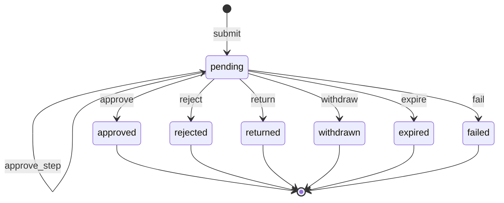
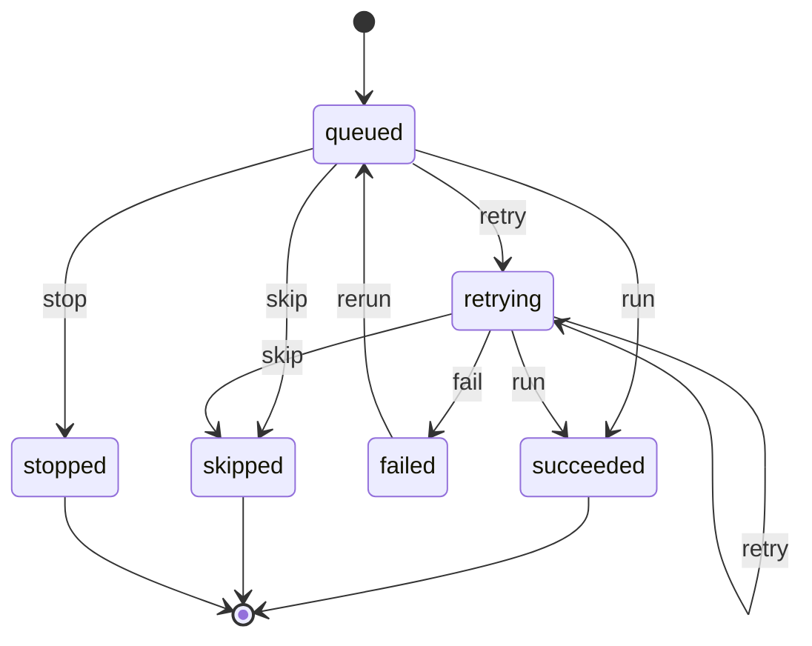
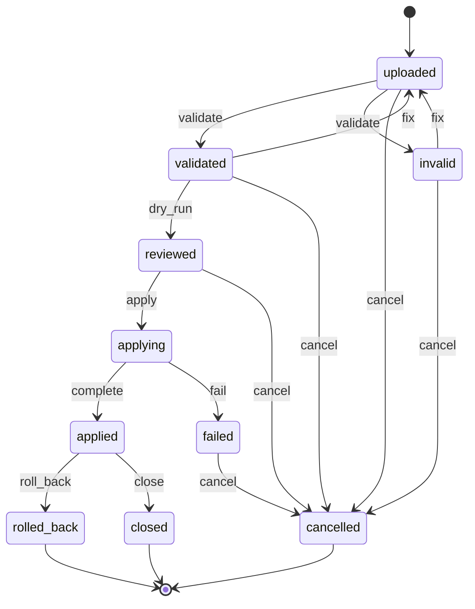
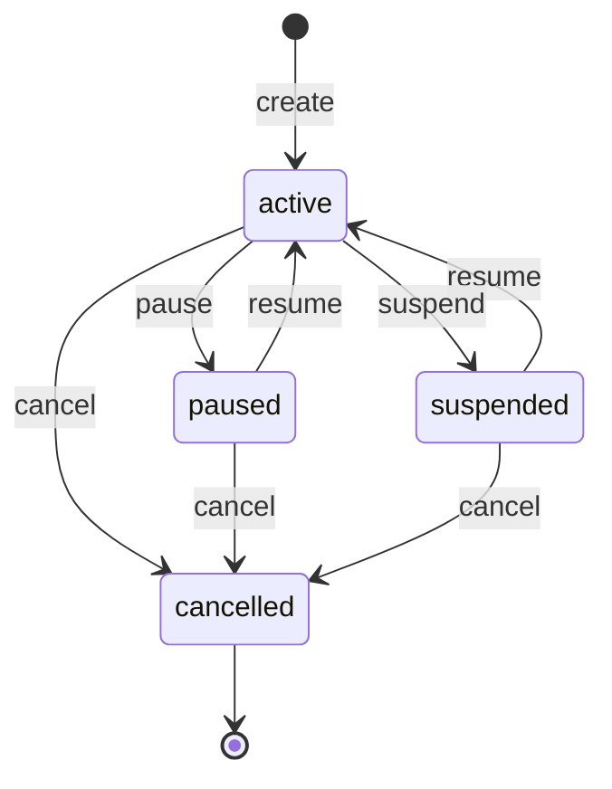
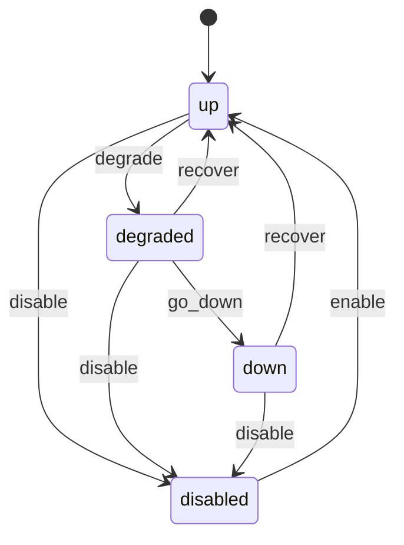

# wl-kernel

> Status: specification, partly built; the build ledger is [crates/wl-kernel/README.md](../../crates/wl-kernel/README.md) · Last updated: 2026-10-24

**Build status (2026-10-24):** Built: `client.toml` and the module manifest, branding on `Theme::from_brand`, `Subject`, legal entities and issuer snapshots (`PLT.ENT.01`), document numbering on Renox `Sequence`, state machines by name, approvals (`PLT.APR.01`), voids (`PLT.ACL.09`), late entries (`PLT.ACL.10`), the automation engine and compliance alerts (`PLT.RUL.04`, §5.15), integrations health (§4.5, §5.14), the daily digest, role tasks, and the contracts between modules (every public trait is indexed in [KERNEL-CONTRACTS.md](KERNEL-CONTRACTS.md)). Not built (later): `CustomFields`, `Sensitive` (masking and reveal log), `Dashboards`, `ApiClients`, `Imports` (§4.3), `Search` (§5.8; only a plan, decision 0006), `Notes` (§5.9), `Reports` (§5.10) and report subscriptions (§4.4), staff SSO (§5.11); the events `ImportApplied`, `NoteAdded`, `ReportExported`, `SettingChanged`, `SensitiveViewed` and `LegalEntityChanged` do not exist in code. Where a section below describes one of these, it is a specification, not behaviour. List screens use the standard Renox grid (`renox::grid::Grid`, see `.claude/skills/standard-grid`). Status of the other modules: [STATUS.md](STATUS.md).

## 1. Purpose

`wl-kernel` is the base that every other `wl-*` module and every vertical app stands on. It
turns one Renox binary into one client's branded product, with:

- the client's modules switched on;
- the client's branding, legal entities, numbering and custom fields;
- the platform's cross-cutting rules: approvals, automations, sensitive-data handling, the
  status and money vocabulary of the UI;
- the contracts that let modules work together without knowing each other: `Subject`
  references, capability traits and events;
- the work surfaces every module shares: data import, global search, notes and mentions on
  any record, and the report library.

It holds no business domain of its own. Renox already provides users, roles, audit, queue,
scheduler and charts. `wl-kernel` wires these together for the platform, and adds what Renox
does not have. Generic gaps were proposed to Renox (all delivered in 1.2.0) and are listed in [§9](#9-renox-fit).

**Ownership.** Each part below is marked as one of:

- **Renox**: exists today;
- **Renox R*n***: delivered by Renox 1.2.0 ([ARCHITECTURE.md](../ARCHITECTURE.md) §4a);
- **kernel**: built in `wl-kernel`.

## 2. Capabilities covered

| ID | Capability | Used by verticals | Scope | Owner |
|---|---|---|---|---|
| `PLT.ORG.01` | Branded deployment: logo, colours, domain, languages (EN/AR) | all ten | MVP | kernel (on Renox R1, R2, R9) |
| `PLT.USR.01` | Staff users and roles, scoped and time-bound | all ten | MVP | Renox Permissions |
| `PLT.AUD.01` | Audit trail of changes and of sensitive-data views | all ten | MVP | Renox Audit + kernel (view logging) |
| `PLT.APR.01` | Approval requests for limit and segregation-of-duties rules | all ten | MVP | kernel |
| `PLT.WFL.01` | State machines with transition history and available actions | all ten | MVP | Renox R12 + kernel (approval hook, tones) |
| `PLT.ATM.01` | Default automation rules per vertical | all ten | MVP | kernel |
| `PLT.ATM.02` | Automation rules the client can toggle and parameterise | none in a vertical §5; platform-wide ([WORKFLOW.md](../WORKFLOW.md) §6) | Later | kernel |
| `PLT.HOK.01` | Outbound webhooks for the client's own integrations | all ten | Later | Renox R11 |
| `PLT.API.01` | API for external parties to push records with their own tokens | 03 (Later) | Later | kernel on Renox tokens |
| `PLT.SCN.01` | Scan barcodes and QR codes with the device camera | 03 (MVP) | MVP | Renox R5 |
| `RPT.DSH.01` | Role-based dashboards with KPI tiles and charts | all ten | MVP | Renox charts + kernel (tile registry) |
| `PLT.ENT.01` | Legal entities: several trade licences and TRNs in one deployment; issuer on every document | all ten | MVP | kernel ([decision 0003](../decisions/0003-legal-entities.md)) |
| `PLT.IMP.01` | Data import and migration: Excel templates per entity, validation, dry run, rollback | all ten | MVP | kernel on Renox import (+ R23) |
| `PLT.SRC.01` | Global search across records, including Arabic names | all ten | MVP | kernel on Renox search (+ R22) |
| `PLT.REL.01` | Related records of any record, in a panel and as a tool ([decision 0006](../decisions/0006-search-and-ai-agents.md)) | all ten | MVP | kernel |
| `PLT.AGT.01` | AI assistant connection (MCP): search, read, summarise, reports | all ten | Later | kernel + Renox R26, R27 |
| `PLT.AGT.02` | AI assistant actions: transitions and drafts, with preview and confirm | all ten | Later | kernel + Renox R28 |
| `PLT.AGT.03` | AI assistant inbox and messages | all ten | Later | kernel + wl-notify |
| `PLT.NOT.01` | Notes, comments and @mentions on any record, with an activity timeline | all ten | MVP | kernel |
| `PLT.SSO.01` | Staff single sign-on with Microsoft 365 or Google Workspace | all ten | Later | renox-oauth (+ R24) |
| `RPT.LIB.01` | Report library: filtered reports with export to Excel, CSV and PDF | all ten | MVP | kernel (on Renox grid export, R3) |
| `RPT.SCH.01` | Scheduled reports sent by email | all ten | Later | kernel |

`PLT.API.01` and `PLT.SCN.01` are listed only by 03. Manufacturing (07) and Auto (08) scan
lots and parts with keyboard-wedge scanners, which type into any field and need no
capability. The platform is responsive web + PWA and online only in the MVP; an offline
queue is delivered by Renox 1.2.0 (R25) and adopted later ([§9](#9-renox-fit)).

Kernel services that are not capabilities of their own, but are used by every module:

| Service | Used for | Owner |
|---|---|---|
| Module manifest | Which modules a deployment runs | kernel |
| Settings | `client.toml` seeding and runtime values | kernel on Renox R2 |
| Branding tokens | Per-client `--rx-*` tokens with contrast guard ([DESIGN-SYSTEM.md](../DESIGN-SYSTEM.md) §4) | kernel on Renox R9 |
| Document numbering | Gapless sequences per legal entity and document type, such as `INV-ACME-2026-0001` | kernel |
| Business calendar | Working days and hours, UAE weekend, public holidays, Ramadan hours, per scope | kernel |
| Custom fields | Client-defined fields on any entity that allows them | kernel |
| `Subject` references | Polymorphic links (`subject_type` + `subject_id`) | kernel |
| Capability traits | `Invoicer`, `Notifier`, `DocumentStore`, … ([ARCHITECTURE.md](../ARCHITECTURE.md) §5) | kernel |
| Sensitive data and field visibility | `SEN` and `FLD` rules ([ACCESS-CONTROL.md](../ACCESS-CONTROL.md) §3) | kernel |
| UI vocabulary | `<wl-status>`, `<wl-money>` ([DESIGN-SYSTEM.md](../DESIGN-SYSTEM.md) §6–7) | kernel |
| Sidebar and admin contributions | Each module adds its own navigation and admin pages | Renox R4, R10 |

## 3. Concepts and entities

| Entity | Description | Important fields |
|---|---|---|
| Module manifest | The modules enabled in this deployment. Read at boot from `client.toml`; never changed at runtime | module name, version, enabled, depends on |
| Setting | One typed configuration value. Seeded from `client.toml`, then optionally editable in the admin | key, type, value, default, editable by client (yes/no), scope (global / scope unit), changed by, changed at |
| Branding | The client's look | logo (file), accent, second accent, display font; generated token sheet (light and dark), contrast check result |
| Legal entity | One company of the client's group that issues documents ([decision 0003](../decisions/0003-legal-entities.md)) | code, legal names EN/AR, trade licence no. and expiry, licensing authority (mainland emirate or free zone), emirate, TRN, VAT registered (yes/no) and date, VAT tax period and stagger, MoHRE establishment ID (WPS files in `wl-hr`), address EN/AR, bank accounts (IBAN, bank, currency), logo, document footer EN/AR, default (yes/no), status. Licences and certificates held by the entity (e.g. Dubai Municipality contractor registration in 02, ICV certificate in 07) are documents with expiry attached to it (`wl-documents`) |
| Scope–entity link | Which entity a scope unit belongs to (a building, project, branch…) | scope type, scope id, legal entity. Exactly one entity per scope |
| Issuer snapshot | The entity's details frozen on a financial or legal document when it is issued | entity, legal names, TRN, address, bank details, footer, taken at. Never updated afterwards |
| Sequence | A numbering series | key (e.g. `invoice`), legal entity (or none for non-legal series such as tickets), pattern (`{prefix}-{entity}-{yyyy}-{seq:4}`), prefix, current value, reset rule (never / yearly / monthly), gapless (yes/no) |
| Custom field definition | A client-defined field on an entity | entity type, key, label EN/AR, type (text, number, date, choice, yes/no, party, file), choices, required, shown in (form, list, PDF, portal), sensitive |
| Custom field value | Stored as a JSON column on the owning record, validated against the definitions | — |
| Subject | A typed reference to any record | `subject_type` (e.g. `property.lease`), `subject_id`. Resolves to a display name, a URL and the record's scope |
| Approval policy | Who must approve an action, when | action key (e.g. `deposits.refund`), condition (always / amount above / percentage above), steps (ordered: role in scope, or one of several roles), SoD on (requester excluded; one person per step), expiry (hours) |
| Approval request | One pending decision | policy, subject, action, payload snapshot (amounts, reason), requester, current step, decisions, status, expires at, state of the subject before the request, resubmission of (an earlier returned or rejected request) |
| Approval decision | One approver's answer | request, step, approver, decision (approve / reject), comment, at |
| Automation rule | One rule from the catalogue ([WORKFLOW.md](../WORKFLOW.md) §4) | ID (`PRP.RUL.01`), owning module, trigger, conditions, actions, parameters with defaults, enabled, client-editable parameters |
| Rule run | One firing of a rule for one record and occurrence | rule, subject, occurrence key (idempotency), chain depth, status, attempts, error, started/finished |
| Compliance-critical flag | A flag on an automation rule whose failure can break a legal duty (e.g. `PTY.RUL.01` re-screening, `HRM.RUL.03` WPS alerts, `FIN.RUL.09` VAT due date). Set by the owning module; the vertical may add rules to the list | rule, critical (yes/no), owner alert recipients (role) |
| Void record | The trace of a record voided as entered in error ([§5.12](#512-void-a-record-entered-in-error)) | subject, state before the void, reason, voided by, approval, reversed effects (postings, stock moves, allocations), at. The record keeps its number |
| Entry timing | Standard fields on records that opt in to the late-entry check ([§5.13](#513-late-entry-after-an-outage)) | occurred at (business time), entered at, late entry (yes/no), late reason, outage reference, late-entry approval, rule runs already fired to review |
| Integration connection | One external system a module talks to (payment gateway, Deliverect, ASP for e-invoicing, regulator portal, WhatsApp provider, bank file) | key, owning module, status, last success, last error, failed since, queued items, manual fallback instructions EN/AR, owner role, screens affected |
| Sensitive view | A logged view of a sensitive field or file | user, subject, field or document, purpose (optional), at |
| API client | An external system or party allowed to call the API | party, name, token abilities (Renox), scope, rate limit, enabled |
| Dashboard tile | A KPI or chart a module offers to dashboards | key, module, title EN/AR, permission, query, roles it is shown to by default |
| Import template | An Excel layout a module registers for one entity type | key (e.g. `property.units`), module, entity type, columns (name EN, required, type, lookup by, example), natural key columns, version, downloadable sample |
| Import job | One upload of one template | template, file, uploaded by, scope, legal entity, mode (create only / create or update), row counts (total, valid, errors, created, updated), error report file, dry-run summary, status, applied at, rollback until |
| Import row result | The outcome of one row | job, row number, natural key, action (create / update / skip), record `Subject`, errors |
| Search document | The searchable view of one record | `Subject`, title, secondary text, keywords, normalised Arabic and Latin forms, scope, legal entity, permission needed, updated at |
| Note | A note or comment on any record | `Subject`, author, body (plain text with mentions), attachments (via `DocumentStore`), visibility (internal / portal), pinned, edited at, deleted at |
| Mention | A user mentioned in a note | note, user, notified at, read at |
| Report definition | A report a module registers | key, module, title EN/AR, permission, filters (date range, scope, entity, status…), columns, default sort, totals, contains sensitive columns (yes/no), formats (Excel, CSV, PDF) |
| Report export | One generated export | report, filters used, format, rows, requested by, file, expires at, sensitive (yes/no) |
| Report subscription | A scheduled report (Later) | report, filters, format, schedule (daily / weekly / monthly, time), recipients (users only), status, last sent |
| SSO connection | A staff identity provider (Later) | provider (Microsoft Entra ID, Google Workspace), tenant/domain, allowed email domains, enforce SSO (yes/no), role mapping (none in MVP) |

## 4. Lifecycles

### 4.1 Approval request

The engine behind `LIM` and `SOD` rules ([ACCESS-CONTROL.md](../ACCESS-CONTROL.md) §5). The
verticals need:

- single-step approvals (most rules);
- two thresholds routed to different approvers (`STK.ACL.03`, formerly `CON.ACL.02`: project
  manager above AED 10,000, MD above AED 50,000);
- two required approvers in sequence (`ACC.ACL.06`: MLRO, then partner).

So a request has **ordered steps**.

| State | Tone | Terminal | Meaning |
|---|---|---|---|
| `pending` | warning | no | Waiting for the approver(s) of the current step |
| `approved` | success | yes | All steps approved; the action has run |
| `rejected` | error | yes | An approver rejected it: the answer is no |
| `returned` | warning | yes | An approver sent it back for changes: the requester may fix and resubmit |
| `withdrawn` | neutral | yes | The requester cancelled it |
| `expired` | neutral | yes | No decision before the expiry time |
| `failed` | error | yes | Approved, but the action could not run because the record changed in the meantime |

| Transition | From | To | By | Guards | Effects |
|---|---|---|---|---|---|
| `submit` | — | pending | system (a transition or action blocked by a `LIM`/`SOD` rule) | a policy matches the action | payload snapshot stored; step-1 approvers notified; event `ApprovalRequested` |
| `approve_step` | pending | pending | approver of the current step | approver holds the step's role in the subject's scope; approver ≠ requester and ≠ earlier-step approvers (SoD) | decision recorded; next step's approvers notified |
| `approve` | pending | approved | approver of the last step | same as `approve_step`; the action's guards still pass | original action runs as the requester, with the approval attached; event `ApprovalDecided` |
| `fail` | pending | failed | system | the action's guards no longer pass at final approval | the subject goes back to the state it had before the request (see below); requester and approver notified with the reason; event `ApprovalDecided` |
| `reject` | pending | rejected | approver of the current step | comment required | the subject goes back to the state it had before the request (see below); requester notified with the reason; event `ApprovalDecided` |
| `return` | pending | returned | approver of the current step | comment required | as `reject`; the requester gets a task "fix and resubmit"; a resubmission creates a new request linked to this one and starts again at step 1 |
| `withdraw` | pending | withdrawn | requester | — | the subject goes back to the state it had before the request (see below); approvers notified; event `ApprovalDecided` |
| `expire` | pending | expired | system | expiry time passed | the subject goes back to the state it had before the request (see below); requester notified; event `ApprovalDecided` |

**What happens to the record when the answer is not yes** (`PLT.WFL.01` guarantee)

- The request stores the subject's state before the request. A module that shows the wait
  as a state of its own (e.g. `submitted`, `pending_approval`) declares a `system` transition
  back to that stored state. The kernel runs it on `reject`, `return`, `withdraw`, `expire`
  and `fail`, with the comment as the history reason. A module that does not use such a state
  only clears the pending-approval badge: the action never ran.
- **On the Renox 1.2 engine** (checked in the source 2026-10-18): a transition has one fixed
  `to`, and the engine has no run-time target, no run by name and no replay of an approved
  request. So a module declares **one back transition per state the wait can start from**,
  named `back_to_<state>` (e.g. `back_to_draft`, `back_to_active`), each guarded by
  "`subject_state_before` is `<state>`"; the kernel keeps a registry of the module's
  transitions by name and runs the one that matches. A request without a waiting state uses
  the engine's `TransitionInterceptor`: `Defer` stores the request and the status does not
  move; on `approve` the kernel runs the deferred transition through the same registry. The
  same rule applies to every "back to the state before the hold" release in the verticals.
- If the subject is no longer in its waiting state when the request ends (it was changed
  by another path, e.g. cancelled), the kernel does not move it: it records "subject
  already moved to `<state>`" on the request, still releases what the module reserved at
  submit, and tells the requester.
- Nothing the action would have done is half-done: no money, stock or document effect runs
  before final approval ([WORKFLOW.md](../WORKFLOW.md) §3.2, atomic). Effects a module ran
  at submit time (a hold on stock, a reserved slot, a reserved number that is not a document
  number) are undone by the
  module's release handler, which the kernel runs on every end that is not `approve`,
  whether or not the module has a waiting state: in the same transaction as the back
  transition when there is one, otherwise in the same transaction as the request's own end.
- The requester is notified with the approver's comment. The record's timeline shows the
  request and the decision.
- `rejected` means the same action with the same payload is not resubmitted silently: a new
  request shows the earlier rejection to the approver. "The same action with the same
  payload" means the same action key (e.g. `deposits.refund`), the same subject and an equal
  payload snapshot (amounts compared at 2 decimals, the reason text ignored); such a request
  is allowed, and the approver's card shows the earlier rejection (date, approver, comment).
  `returned` invites a changed resubmission; an unchanged one is allowed too, and the
  approver sees the return comment the same way. The requester's "fix and resubmit" task
  closes when a linked resubmission is submitted, or when the requester closes it with "not
  resubmitting".
- When a request ends by `withdraw`, `expire` or `fail`, the subject's history shows a fixed
  reason: "approval withdrawn by requester", "approval expired" or "approval failed: <guard
  message>".

**Vertical mapping**

| Vertical rule | Policy shape |
|---|---|
| `PRP.ACL.05` deposit deductions | Condition by amount: ≤ AED 5,000 property manager in the building; above, property manager then finance or the owner (one of several roles) |
| `FIN.ACL.04` (formerly `PRP.ACL.06`, `CLN.ACL.08`, `EDU.ACL.08`) refunds, `PRP.ACL.08` owner payouts | 1 step, any holder of the approve permission except the requester (SoD) |
| `STK.ACL.03` (formerly `CON.ACL.02`, `FNB.ACL.06`) material requests and POs | Condition by amount: 02 ≤ AED 10,000 none, ≤ 50,000 project manager, above project manager then MD; 06 above AED 5,000 area manager |
| `ACC.ACL.06` high-risk client acceptance | 2 steps: MLRO, then partner; SoD across steps |
| `FIN.ACL.06` (formerly `LOG.ACL.06`), `LOG.ACL.08`, `LOG.ACL.10` | 1 step: operations manager (manager for rate card changes) |
| `SAL.ACL.02` discounts (generalises `CLN.ACL.07`, `EDU.ACL.07`, `AUT.ACL.03`, `MFG.ACL.05`) | 1 step: manager, condition by percentage |
| `STK.ACL.02` (formerly `FNB.ACL.03`, `MFG.ACL.09`, `AUT.ACL.10`) wastage and stock adjustments | 1 step with SoD, condition by value |
| `CON.ACL.13` PO to a subcontractor without a valid Dubai Municipality registration | 1 step: project manager; only on Dubai projects |
| `MPW.ACL.06` salary change > 10% | 1 step: MD |
| `AUT.ACL.13` warranty claim > AED 2,000 (a `warranty` ticket in `wl-ticketing`) | 1 step: branch manager |

### 4.2 Rule run

| State | Tone | Terminal | Meaning |
|---|---|---|---|
| `queued` | neutral | no | Trigger fired; waiting in the queue |
| `succeeded` | success | yes | All actions done |
| `skipped` | neutral | yes | Conditions not met at run time, or already ran for this occurrence |
| `retrying` | warning | no | An action failed; will retry with backoff |
| `failed` | error | yes | Retries exhausted; shown on the admin page |
| `stopped` | error | yes | Chain depth above 3; reported, nothing done |

| Transition | From | To | By | Guards | Effects |
|---|---|---|---|---|---|
| `run` | queued, retrying | succeeded | system | conditions hold; occurrence key new | actions executed as the system actor |
| `skip` | queued, retrying | skipped | system | conditions false, or occurrence key already used | — |
| `retry` | queued, retrying | retrying | system | attempts < 5 | backoff scheduled |
| `fail` | retrying | failed | system | attempts = 5 | admin alert; event `AutomationFailed` |
| `stop` | queued | stopped | system | chain depth > 3 | admin alert |
| `rerun` | failed | queued | `automations.retry` | — | attempts reset |

### 4.3 Import job

**Build status (2026-10-24):** Not built (later).

| State | Tone | Terminal | Meaning |
|---|---|---|---|
| `uploaded` | neutral | no | File stored; not yet checked |
| `invalid` | error | no | The file does not match the template (wrong columns, wrong version) |
| `validated` | info | no | Every row checked; error report available; nothing written |
| `reviewed` | info | no | Dry run done: the user has seen how many records will be created and updated |
| `applying` | info | no | Rows being written in batches |
| `applied` | success | no | Written; can still be rolled back until `rollback_until` |
| `failed` | error | no | Writing stopped; rows already written in this job were undone |
| `rolled_back` | neutral | yes | Every record created by the job removed and every update reverted |
| `closed` | success | yes | Rollback window passed, or closed by the user |
| `cancelled` | neutral | yes | Abandoned before applying |

| Transition | From | To | By | Guards | Effects |
|---|---|---|---|---|---|
| `validate` | uploaded | validated, invalid | system | — | each row checked: types, required, lookups, natural-key duplicates in the file and in the database; error report generated |
| `fix` | invalid, validated | uploaded | `imports.run` | a corrected file uploaded | previous results discarded |
| `dry_run` | validated | reviewed | `imports.run` | no blocking errors, or the user chose "skip rows with errors" | summary: to create, to update, to skip |
| `apply` | reviewed | applying | `imports.run` | template's permission held for the target entity type and scope; `LIM` approval if the job is above the row limit | queued in batches as one logical job |
| `complete` | applying | applied | system | all batches done | event `ImportApplied`; search index updated |
| `fail` | applying | failed | system | a batch failed | written rows of the job undone; error shown |
| `roll_back` | applied | rolled_back | `imports.rollback` | within the rollback window; no created record has since been used by a document that cannot be deleted (issued invoice, posted payment) | records removed or reverted; event `ImportRolledBack` |
| `close` | applied | closed | system or `imports.run` | rollback window passed | — |
| `cancel` | uploaded, invalid, validated, reviewed, failed | cancelled | `imports.run` | — | file kept for the retention period |

**Rules every import follows**

- **Idempotent by natural key.** Each template declares a natural key (e.g. unit = building
  code + unit number; party = trade licence no. or Emirates ID). Re-importing the same file
  updates the same records; it never duplicates them.
- **No state shortcuts.** Imported records start in the state the template declares (usually
  the first state, or an "opening balance" state such as an `issued` historical invoice marked
  *imported*). Imports never run transitions that send messages or post money.
- **Opening balances** (open invoices, deposits held, cheques in hand, leave balances) are
  imported through dedicated templates that the owning module registers, so totals reconcile
  with the client's previous system.
- **Sensitive columns** (Emirates ID, passport, salary) are accepted only from users with the
  matching sensitivity permission, and the uploaded file is deleted after the job closes.

### 4.4 Report subscription (Later)

**Build status (2026-10-24):** Not built (later).

| State | Tone | Terminal | Meaning |
|---|---|---|---|
| `active` | success | no | Sent on schedule |
| `paused` | warning | no | Not sent; kept for later |
| `suspended` | error | no | The owner lost the report's permission, or delivery failed repeatedly |
| `cancelled` | neutral | yes | Removed |

| Transition | From | To | By | Guards | Effects |
|---|---|---|---|---|---|
| `create` | — | active | `report_subscriptions.manage` | owner and every recipient hold the report's permission; sensitive reports cannot be scheduled to external addresses | — |
| `pause` | active | paused | owner | — | — |
| `resume` | paused, suspended | active | owner | permissions still hold | — |
| `suspend` | active | suspended | system | a recipient lost the permission, or 3 failed deliveries | owner notified |
| `cancel` | active, paused, suspended | cancelled | owner or `report_subscriptions.manage` | — | — |

### 4.5 Integration connection

The kernel tracks the health of every external system a module calls, so that every module
handles "the other side is down" the same way ([§5.14](#514-integration-down)).

| State | Tone | Terminal | Meaning |
|---|---|---|---|
| `up` | success | no | Calls succeed |
| `degraded` | warning | no | Some calls failed; outbound work is queued and retried |
| `down` | error | no | Calls have failed for longer than the limit; banner shown, manual fallback offered |
| `disabled` | neutral | no | Switched off by the admin (e.g. contract with the provider ended); modules use their manual path |

| Transition | From | To | By | Guards | Effects |
|---|---|---|---|---|---|
| `degrade` | up | degraded | system | a call failed | outbound calls queued; retries with backoff |
| `go_down` | degraded | down | system (`PLT.RUL.05`) | no successful call for N minutes | banner on the screens affected; admin and the connection's owner role alerted; manual fallback enabled; event `IntegrationStatusChanged` |
| `recover` | degraded, down | up | system | a call succeeded | queue drained in order (late sync); items handled manually while down listed for reconciliation; banner removed; event `IntegrationStatusChanged` |
| `disable` | up, degraded, down | disabled | `integrations.manage` | reason given | queue kept; manual path only |
| `enable` | disabled | up | `integrations.manage` | — | queue drained |

**Connection kinds.** A connection is either an *external system* the platform calls (a
gateway, an aggregator hub, an ASP, a regulator portal) or a *device* at a site that calls
the platform (a kitchen display, a till, a scanner). For a device, the health signal is its
heartbeat: each heartbeat counts as a successful call and a missed heartbeat as a failed
one, so `degrade`, `go_down` and `recover` work the same way. A device connection belongs to
a scope (outlet, branch, site) and may have an active window (e.g. opening hours); outside
the window silence is not counted, and a connection that is `down` when its window closes
stays `down` until a heartbeat arrives but sends no new alerts until the window opens again. A heartbeat is missed when none arrives within one
interval plus half an interval of the previous one (or of the window start); that missed
heartbeat is the failed call that runs `degrade`. For a device, `failed since` is the time
of the last heartbeat (or the window start, if the last heartbeat was before it), so "down
after 5 minutes" means 5 minutes of silence. One connection may group the devices of a scope
(down when none of them answers). Consumers react to `IntegrationStatusChanged` (06:
`FNB.RUL.15` pauses the outlet's brands on the website when its kitchen devices go silent
for 5 minutes).

Legal entities have no lifecycle beyond `active` / `archived`. An entity with issued documents
is archived, never deleted.

## 5. Workflows

### 5.1 Boot a client deployment

1. The `host` binary reads `client.toml`: client, app, enabled modules, branding, locales and
   module sections ([ARCHITECTURE.md](../ARCHITECTURE.md) §7).
2. The manifest checks dependencies (e.g. `wl-payments` needs `wl-invoicing`). Boot fails with
   a clear message if one is missing.
3. Each enabled module registers its routes, migrations, views, permissions, sidebar links,
   admin resources, dashboard tiles, state machines and automation rules.
4. On first run, settings are seeded from `client.toml`, and the default roles of the vertical
   are created. The legal entities listed in `client.toml` are created; there is always at
   least one, marked default. Later boots never overwrite values changed in the admin.
5. The branding generator builds the token stylesheet. A colour that fails the contrast guard
   stops onboarding and shows the nearest passing colour.

### 5.2 An action that needs approval

1. A user runs a transition or action, e.g. refund a deposit.
2. The state machine checks permission and scope, then the access rules. A `LIM` or `SOD`
   rule is not met.
3. Instead of refusing, the kernel finds the matching approval policy and creates an approval
   request with a snapshot of the payload.
4. The user sees "Sent for approval", and the record shows a pending-approval badge.
5. Approvers are notified and decide from their approvals inbox. Multi-step policies move
   step by step.
6. On final approval, the kernel re-checks the action's guards and runs it as the requester,
   with the approval attached. The audit trail shows both users.

### 5.3 An automation fires

1. A trigger occurs: a transition event, a date reached (checked by a scheduled scan), a
   record created, a schedule, or an approval decided.
2. For each enabled rule on that trigger, a rule run is queued with an occurrence key, e.g.
   `FIN.RUL.01:invoice:42:overdue+7`.
3. The run re-checks the conditions, then executes the actions as the system actor: notify,
   transition, create task, generate document, request approval, send webhook.
4. If an action emits an event that triggers another rule, the chain depth increases. At
   depth 3, further runs are stopped and reported.

### 5.4 View a sensitive field

1. A page renders a field or file marked sensitive (e.g. an Emirates ID scan, a salary).
2. Without the `*.sensitive.view` permission, it shows a masked value (`784-••••-•••••••-•`).
3. With the permission, the user clicks *Show*. The kernel logs a sensitive view (user, subject,
   field), then reveals the value.

### 5.5 Issue a document number

1. A module asks for the next number of a sequence for the document's issuing entity, inside
   the same transaction as the record.
2. Gapless sequences (tax invoices, credit notes) lock the sequence row, so numbers are never
   skipped or reused. A rolled-back transaction releases the number.
3. Non-gapless sequences (tickets, orders) may skip numbers, which avoids locking.

### 5.6 Choose the issuing entity

1. A financial or legal document (quotation, invoice, credit note, receipt, supplier bill,
   payslip, contract) gets its issuing entity from its scope: the building, project or branch
   belongs to exactly one entity.
2. If the scope has no entity, or the document has no scope, the default entity is used. Users
   with `legal_entities.choose` may pick another entity while the document is a draft.
   Verticals override the scope rule through `EntityResolver` ([§8](#8-extension-points)):
   - 01 Property: a charge type in the catalogue can route to another entity, e.g.
     management fees from the management company while rent comes from the building's
     landlord of record;
   - 09 Manpower: invoices, payroll runs and WPS files are issued by the entity that sponsors
     the worker's visa; a client contract with workers of two entities gives one invoice per
     entity.
3. When the document is issued, the kernel stores an **issuer snapshot** (legal names, TRN,
   address, bank details, footer). Later edits to the entity never change issued documents.
4. A single-entity client never sees an entity field.

### 5.7 Onboard a client's data

**Build status (2026-10-24):** Not built (later).

1. During onboarding, the implementer downloads the templates of the vertical's modules
   (parties, units, items, employees, opening balances…), in dependency order.
2. The client fills them from their old Excel or system export.
3. Each file is uploaded, validated and dry-run. The error report is a copy of the file with
   an error column per row.
4. When the dry run is right, the job is applied. The client checks the result in the app.
5. Mistakes are fixed by re-importing (idempotent) or by rolling the job back within the
   window (default 7 days).
6. The onboarding checklist in `wl-operator` shows which templates were applied.

### 5.8 Search

**Build status (2026-10-24):** Not built (later).

1. Each module registers which entity types are searchable and how a record becomes a search
   document (title, secondary text, keywords). The index is updated on create, change,
   transition and import.
2. The user types in the global search box (staff side) or the portal search (external users,
   only portal-visible types).
3. Results are filtered **before** they are shown: the user's permission for the type, the
   record's scope (layer 3) and record rules such as `OWN`/`ASG` (layer 4). Counts never reveal
   records the user cannot open.
4. Arabic and Latin spellings match each other through normalisation and transliteration
   (Renox R22). Emirates ID, TRN, phone and document numbers match on exact digits.
5. Sensitive fields are never indexed in clear text; they match only on exact value and the
   result shows them masked.

**Built (BL-AGT-01, `crates/wl-kernel/src/search/`).** A module registers a type with
`Searchable::of::<M>("<module>.<entity>").permission(…).document(…)` (or `.document_in(…)`
when it needs other rows) and calls `search::index_in(&mut tx, &subject)` in the transaction
that creates, changes or imports a record, so a rolled back change leaves no document.
Transitions the kernel runs by name (`SubjectMachine::run_in`) and voids re-index the record
themselves; a voided record stays findable by its number, marked void. The documents are in
`wl_search_documents` (full-text index by Renox: FTS5 on SQLite, `tsvector` on PostgreSQL, over
Arabic-normalised text, plus a `forms` column of Arabic–Latin match keys), the exact values in
`wl_search_identifiers` (normalised: upper case without spaces, dashes, slashes and dots; phones
in E.164; personal kinds such as Emirates ID, passport, phone and email only as an HMAC under
`APP_KEY`, and any word equal to such a value is left out of the text). `search:rebuild
[--type <subject_type>]` builds the index again (also after an `APP_KEY` rotation);
`search::undo_import` undoes an import and its documents together. `search::lookup_identifier`
returns every match **unfiltered**: the search page (BL-AGT-02) filters by permission, scope and
record rules before it shows or counts anything.

### 5.9 Notes and mentions

**Build status (2026-10-24):** Not built (later).

1. Any record that opts in shows a notes panel and an activity timeline.
2. A user writes a note, optionally attaching files and mentioning colleagues with `@name`.
   Only users who can open the record can be mentioned.
3. Mentioned users get an in-app notification (and email, per their preference).
4. Notes are internal by default. A user with `notes.portal` may mark a note visible in the
   portal; the external party then sees it on their record.
5. The timeline merges notes, state-machine transitions (with actor and approval), approvals,
   automation runs, documents attached and messages sent, newest first.
6. Authors can edit a note within 15 minutes; later changes are new notes. Deleting a note
   keeps an audit entry.

### 5.10 Run and export a report

**Build status (2026-10-24):** Not built (later).

1. Modules register report definitions; each vertical's §10 KPIs map to reports and tiles.
2. A user opens the report library and sees only reports they have the permission for.
3. Filters always include scope and legal entity; the data is limited to the user's scopes.
4. Export to Excel, CSV or PDF is generated in the queue for large reports, and the file
   expires after 7 days.
5. A report with sensitive columns needs `reports.export_sensitive` to export; each such export
   is logged like a sensitive view.
6. Later (`RPT.SCH.01`): the user subscribes to a report with fixed filters and a schedule; it
   is emailed to staff recipients who hold the permission.

### 5.11 Staff single sign-on (Later)

1. The company admin connects Microsoft Entra ID or Google Workspace and lists allowed email
   domains.
2. Staff sign in with the provider. The account must already exist (invited); SSO never
   creates users or grants roles.
3. With "enforce SSO" on, password login is disabled for those domains; two-factor login is
   then the provider's responsibility.
4. Portal users never use staff SSO.

### 5.12 Void a record entered in error

`void` is the platform's answer to "this record should never have existed" (a duplicate
receipt, a wrong-party booking, a goods receipt on the wrong PO). It is different from
cancelling (the business changed its mind) and from correcting (a credit note, an
adjustment).

1. A module opts in by declaring a `void` transition from the states where it is allowed, to
   a terminal state `voided` (tone neutral), and a reverse handler for each effect the record
   had (ledger posting, payment allocation, stock move, reserved slot, sent task).
2. The user runs `void` with a reason. `PLT.ACL.09` decides whether it is allowed and whether
   it needs approval. The approver is any user holding the void permission for that entity in
   the record's scope, except the requester (one step, SoD).
3. In one transaction the kernel runs the module's reverse handlers, moves the record to
   `voided` and writes a Void record. If a reverse handler reports that its posting falls in a
   locked period, the void is refused with that message, and the module's own correction
   document is used instead. The record **keeps its number**; a gapless series shows
   the number as void and never reuses it.
4. Voided records stay visible (struck through), are excluded from totals and reports, and
   cannot be edited or reopened. Event `RecordVoided`.
5. Not voidable: anything already given to a third party or an authority as a legal or tax
   document (an issued tax invoice, a filed return, a submitted claim, a sent WPS file). Those
   are corrected with the module's own document (credit note, amended return, resubmission).

### 5.13 Late entry after an outage

The MVP is online only. When a site loses internet or power, staff keep working on paper
(tickets, POS slips, attendance sheets, delivery notes) and enter the records later.

1. A module opts in to the late-entry check for an entity and names its business-time field
   (e.g. order time, check-in time, POD time) and, optionally, one parent-subject field: the
   `Subject` reference of the record the entry belongs to (e.g. `booking` on a check-in,
   `order` on a POD).
2. When the business time is more than M minutes before the entry time, the record is
   flagged **late entry**. The user gives a reason and may link an outage reference (an
   integration `down` period, or a manual "outage at branch X from–to" note). Changing the
   business-time field of an existing record is checked the same way, against the time of the
   edit.
3. Up to N hours late, the flag and reason are enough. Beyond N hours, or for a business time
   in a closed period (locked timesheet, locked VAT period, closed payroll), the entry needs
   approval (`PLT.ACL.10`) or is refused when the module's period lock forbids it.
4. Late entries keep the business time for reports, deadlines and SLA calculations, and the
   entry time for the audit. Automations triggered by a late record run at entry time but use
   the business time in their conditions, so a late check-in does not produce a false
   "no-show".
5. Automations that already ran before the late record was entered (e.g. a no-show marked at
   09:15 for a check-in entered at 10:30 with business time 09:05) are not undone by the
   kernel. The kernel lists on the late entry the rule runs whose subject is the late record
   itself or the record named in its parent-subject field (point 1) and whose trigger time falls
   between the business time and the entry time, as "already fired, review"; the module that
   owns the affected record corrects its own state, by its own transitions, and the entry
   appears with these runs in the `PLT.RUL.06` digest.
6. `PLT.RUL.06` sends managers a digest of late entries and voids in their scope. A manager
   here is a user who holds `late_entries.approve` in a scope unit of the records (the
   approvers of `PLT.ACL.10`); the digest also lists, under each late entry, the rule runs it
   lists as "already fired, review". It covers 07:00 the previous day to 07:00 today
   (Asia/Dubai), by the Void record time and the entry time; a manager with nothing in the
   period gets no digest.

### 5.14 Integration down

1. Each module registers its integration connections (external systems and site devices,
   §4.5 connection kinds) with the screens they affect and a manual fallback (e.g. take card
   payments on the standalone terminal and record them later; accept aggregator orders on
   the aggregator tablet; file on the regulator portal by hand).
2. Outbound work is never lost: calls go through the queue and are retried with backoff
   (waits of 1, 2, 4 and 8 minutes between attempts, then 15 minutes) with no attempt limit: a
   queued item is only removed when it is sent or reported obsolete by its module. "The
   limit" is time, not attempts: after N minutes without a successful call the connection
   goes `down` (`PLT.RUL.05`); retries continue while it is `down`.
3. While down, affected screens show a banner with the fallback instructions; users record
   work done by hand with the late-entry flag ([§5.13](#513-late-entry-after-an-outage)).
4. On `recover`, the queue is drained in order (late sync). `recover` commits the move to
   `up` first; the drain then runs as queued work. A call that fails during the drain is a
   failed call of an `up` connection: `degrade` runs and the rest of the queue waits.
   Before each queued item is sent, its module's send handler is asked whether it is still
   due; an item whose record changed while queued (voided, cancelled) is reported obsolete,
   is not sent and is listed on the reconciliation task.
   Items done manually while down are matched to the late sync results; mismatches open a
   reconciliation task for the owner role. Duplicates are prevented by the module's natural
   key (e.g. external order number, the gateway's transaction reference for a card
   payment), which the module declares when it registers the connection.
5. Inbound data that arrives late (a gateway callback, an aggregator order) is processed with
   its own business time, under the same late-entry rules.

### 5.15 Owner alert for compliance-critical failures

1. Rules whose failure can break a legal duty carry the compliance-critical flag.
2. If such a rule run `fail`s or is `stop`ped, or does not run on its schedule, `PLT.RUL.04`
   alerts the business owner role and the company admin at once (in-app and email), not only
   in the daily digest (`PLT.RUL.03`), and opens a task for the owner role.
3. The task closes when the rule has run successfully for the missed occurrence, or when the
   owner records how the duty was met by hand.
4. A run is missed when a scheduler check (every 15 minutes, at :00, :15, :30 and :45
   Asia/Dubai) finds an occurrence of a compliance-critical *Schedule* or *Date reached* rule
   whose planned time is 60 minutes or more in the past with no rule run. "At once" means at
   that check, and each occurrence counts as missed once.

## 6. Interfaces to other modules

**Provides**

| Service | Purpose |
|---|---|
| `Subject` | Typed reference: resolve name, URL and scope; list a record's attachments from every module |
| `Settings` | Typed read/write of settings, with change events. Partly built: settings are read through the Renox `Settings` module; there is no `SettingChanged` event. |
| `Sequences` | `next(key)` within a transaction; gapless option. Built as `numbering` on the Renox `Sequence`. |
| `CustomFields` | Definitions per entity; validation; form, list, PDF and portal rendering. **Not built (2026-10-24).** |
| `Approvals` | `require(action, subject, payload)` → `Allowed` or `Pending(request)` |
| `Automations` | Rule registration by modules; trigger hooks; run log |
| `Sensitive` | Masking, reveal with logging, field-visibility checks for `FLD` rules. **Not built (2026-10-24).** |
| `Capabilities` | Registry of capability traits (`Invoicer`, `PaymentRecorder`, `Notifier`, `DocumentGuard`, `TaskCreator`, …) and their no-op fallbacks when a module is disabled |
| `Dashboards` | Tile registration and per-role default dashboards. **Not built (2026-10-24).** |
| `ApiClients` | Party-bound API tokens, scope and rate limit. **Not built (2026-10-24).** |
| `LegalEntities` | Entity for a scope; issuer snapshot at issue time; entity filter for reports |
| `Imports` | Template registration by modules (columns, natural key, opening-balance templates); validate, dry run, apply, roll back. **Not built (2026-10-24).** |
| `Search` | Searchable-type registration; index updates; permission-filtered queries. **Not built (2026-10-24).** |
| `Notes` | Notes panel and activity timeline on any opted-in record; mention notifications. **Not built (2026-10-24).** |
| `Reports` | Report registration (filters, columns, permission, sensitivity); export; subscriptions (Later). **Not built (2026-10-24).** |
| `BusinessCalendar` | Working time, holidays and Ramadan hours per scope; due-date and SLA arithmetic |
| `Voids` | Opt-in `void` transition with reverse handlers, number kept, Void record ([§5.12](#512-void-a-record-entered-in-error)) |
| `LateEntry` | Opt-in late-entry flag, reason and approval on a business-time field ([§5.13](#513-late-entry-after-an-outage)) |
| `Integrations` | Connection registration, health state, queue and retry, banner, manual fallback text, late sync and reconciliation tasks ([§5.14](#514-integration-down)) |

**Contracts between modules (F1 to F8).** The kernel also defines the traits one module
provides and others call, each with a no-op fallback when the providing module is off. The
complete list (every public trait, its file and its providers) is
[KERNEL-CONTRACTS.md](KERNEL-CONTRACTS.md); the main contracts with their module path are in
[crates/wl-kernel/README.md](../../crates/wl-kernel/README.md). The table below groups the
main ones by provider:

| Contract | Provided by | Purpose |
|---|---|---|
| `PartyDirectory`, `BlockGuard`, `ScreeningGuard` | wl-parties | Parties, refusing agreements and money out to a blocked party, the stale-list screening warning |
| `Invoicer`, `SupplierBills`, `CompanyBudgets`, `OwnerDrawings` | wl-invoicing | Invoices and credit notes, supplier bills, company budgets, owner drawings |
| `PaymentRecorder`, `Cheques`, `Deposits`, `DepositDeductions`, `BankStatements` | wl-payments | Receipts and refunds, cheques, deposits and their deductions, bank balances |
| `Workforce` | wl-hr | Employees of a role in a scope, staff profiles |
| `TaskCreator`, `ServiceContractCoverage` | wl-ticketing | Tickets and tasks (also `role_tasks`), service-contract cover |
| `DocumentGuard`, `SopAcknowledgements`, `BlockSubjects` | wl-documents | Document blocks per transition, SOP acknowledgements |
| `Notifier` | wl-notify | Notices and broadcasts |
| `CampaignAttribution`, `LeadConversion` | wl-sales | Campaign attribution and lead conversion |
| `DepositTopUps` | apps/property (the owner of the charges) | The top-up charge of a deposit that grew |
| `CashForecastSource`, `ActualCostSource`, `DrawingPaymentSource`, `ChaseHolds`, `HeldFundsSource` | registries any module adds to | Cash-flow forecast lines, budget vs actual, drawings payments, chase holds during a legal case, funds held for a party |
| `SubjectMachine` registry, `digest`, `role_tasks` | kernel | Transitions by name ([§4.1](#41-approval-request), WORKFLOW §3.4), the daily digest of voids and late entries, tasks for a role |
| `SupplierDebitNotes`, `RecipientLookup` | wl-invoicing | Debit notes to a supplier; the e-invoicing recipient ID (ASP adapter) |
| `Segments`, `BroadcastRequesters` | wl-sales | Broadcast audiences; the broadcast a sales rule asks for |
| `LandedCosts` | wl-inventory | Landed cost on received goods |
| `StockService`, `StockReservations`, `StockHoldService`, `LotTrace`, `ProductionStock`, `BillsOfMaterials`, `ScopeStock`, `LotDisposal`, `BatchStock` | wl-inventory | Stock movements and choices, reservations for order lines, holds, lot tracing, production output, bills of materials, stock of a stopped scope, disposal of lots |
| `BackOrderDemand`, `TillDesk`, `SalesOrderDesk`, `OrderFulfilment` | wl-sales | Back-ordered demand for reorder suggestions, the till, the sales order desk |
| `BookingActions` | wl-scheduling | Link, complete and cancel a booking from a vertical |
| `BookingGate`, `CheckInGuard`, `CompleteGuard`, `WorkDoneStatus`, `ResourceEligibility` | the vertical (for example apps/auto, apps/clinics, apps/edtech) | Strategy traits scheduling asks before a booking, a check-in or a completion |
| `DispatchGuard` | apps/manufacturing | Guard asked by wl-inventory before a dispatch moves |
| `TimesheetClosing`, `Timesheets`, `AttendanceHistory`, `AttendanceReview` | wl-attendance | Closing timesheets, attendance days and review |
| `DeliveryRequester` | wl-delivery | Ask for a delivery of a source record |
| `BounceFees`, `ChargeInvoicer` | apps/property | Bounce fees and invoicing a charge before a cheque write-off |
| `Checklists`, `Consents`, `CostPoster` | defined; no production provider yet (providers exist only in tests; the no-op fallback applies) | Checklist runs, consent reads and withdrawals, cost posting on cost objects |

**Consumes:** Renox auth, permissions, audit, queue, scheduler, events, charts, tokens,
import, search, grid export and renox-oauth; Renox R2 (settings store), R3 (PDF export),
R9 (brand tokens), R11 (webhooks), R12 (state machines), R13 (sequences), R14 (custom fields),
R22 (Arabic search), R23 (Excel import, dry run, rollback) and R24 (Entra ID and Workspace
sign-in). wl-documents (through the kernel `documents` contract) for note attachments and export files;
`Notifier` (wl-notify) for mentions and scheduled reports.

**Events emitted**

| Event | When | Payload |
|---|---|---|
| `ApprovalRequested` | request created | request, policy, subject, requester, step approvers |
| `ApprovalDecided` | every end of a request: approved, rejected, returned, withdrawn, expired or failed | request, decision, approver(s), subject, state the subject went back to |
| `AutomationFailed` | rule run failed or stopped | rule, subject, error, compliance-critical (yes/no) |
| `RecordVoided` | a record voided | subject, state before, reason, user, approval |
| `LateEntryRecorded` | a record entered with the late-entry flag | subject, business time, entry time, reason, approval, rule runs already fired to review |
| `IntegrationStatusChanged` | a connection changes state | connection, from, to, failed since |
| `SettingChanged` | a setting changed in the admin | key, old, new, user |
| `SensitiveViewed` | a sensitive value revealed | user, subject, field |
| `<Entity>Transitioned` | every state machine transition (Renox R12, relayed) | subject, from, to, transition, actor, approval |
| `LegalEntityChanged` | an entity's details changed | entity, fields changed, user |
| `ImportApplied` | an import job applied | job, template, counts, user |
| `ImportRolledBack` | an import job rolled back | job, template, counts, user |
| `NoteAdded` | a note added to a record | note, subject, author, visibility, mentioned users |
| `ReportExported` | a report exported | report, filters, format, rows, user, sensitive |

**Attaches to:** approval requests, rule runs, sensitive views, notes, search documents and
import row results reference any `Subject`.

**Permissions**

| Permission | Purpose |
|---|---|
| `settings.view`, `settings.manage` | Read and change client-editable settings |
| `branding.manage` | Change logo and colours (re-runs the contrast guard) |
| `custom_fields.manage` | Define custom fields |
| `sequences.manage` | Change prefixes and reset rules (not current values of gapless series) |
| `approvals.view` | See all approval requests (approvers always see their own) |
| `approval_policies.manage` | Change thresholds and approving roles within the allowed patterns |
| `automations.view`, `automations.manage` (Later, `PLT.ATM.02`), `automations.retry` | Rule list, toggles and parameters, retry failed runs |
| `api_clients.manage` | Create and revoke API clients |
| `dashboards.view` | Open dashboards (tiles check their own permissions) |
| `audit.view`, `sensitive_views.view` | Read the audit trail and the sensitive-view log |
| `operator.enable` | Enable the platform operator account (`PLT.ACL.04`) |
| `legal_entities.view`, `legal_entities.manage` | See and maintain legal entities and scope–entity links |
| `legal_entities.choose` | Pick a non-default issuing entity on a draft document |
| `imports.run`, `imports.rollback` | Upload, validate and apply imports; roll back within the window. Each template also requires the create/update permission of its entity type |
| `notes.create`, `notes.portal` | Add notes; make a note visible in the portal |
| `reports.view` | Open the report library (each report checks its own permission) |
| `reports.export`, `reports.export_sensitive` | Export reports; export reports with sensitive columns (logged) |
| `report_subscriptions.manage` | Manage other users' report subscriptions (Later) |
| `sso.manage` | Configure staff single sign-on (Later) |
| `records.void` | Void a record of an entity the user may edit (each module may name its own alias, e.g. `receipts.void`); approval per `PLT.ACL.09` |
| `late_entries.approve` | Approve a late entry beyond N hours (`PLT.ACL.10`) |
| `integrations.view`, `integrations.manage` | See connection health and queues; disable, enable, edit fallback instructions |
| `integrations.heartbeat` | A device sends its own heartbeat (`POST /devices/{key}/heartbeat`) |

**Shared access rules owned:** `PLT.ACL.01`–`PLT.ACL.10`
([ACCESS-CONTROL.md](../ACCESS-CONTROL.md) §8). The two added for negative flows:

| ID | Rule | Pattern | Parameter (default) |
|---|---|---|---|
| `PLT.ACL.09` | A record can be voided only with a reason, only from the states its module allows, and never after it was given to a third party or an authority as a legal or tax document; when it had posted money or moved stock, the void needs approval by another user | `STA`, `SOD` | approval when money or stock was posted: on |
| `PLT.ACL.10` | An entry whose business time is more than N hours before the time it is entered, or falls in a closed period the module allows to reopen, needs a manager's approval; shorter delays above M minutes are flagged with a reason | `TIM`, `LIM` | M = 30 minutes, N = 24 hours |

**Automations owned** (the capabilities were renamed `PLT.ATM.01`–`02`, so automation IDs use
`PLT.RUL.NN`):

| ID | Rule | When | Then | Parameter (default) |
|---|---|---|---|---|
| `PLT.RUL.01` | Approval reminder | approval `pending` for N hours | remind the current step's approvers | N = 24 |
| `PLT.RUL.02` | Approval escalation | approval `pending` for M hours | notify the approvers' manager role; or `expire` | M = 72 |
| `PLT.RUL.03` | Failed-run alert digest | daily | email the company admin a list of failed rule runs | 07:00 |
| `PLT.RUL.04` | Compliance-critical failure alert | a compliance-critical rule run fails or is stopped, or a scheduled run is missed | alert the business owner role and the company admin at once; open a task for the owner role | on |
| `PLT.RUL.05` | Integration down | a connection has had no successful call for N minutes | `go_down`: banner, manual fallback, alert the admin and the connection's owner role; on recovery, drain the queue and open reconciliation tasks | N = 15 |
| `PLT.RUL.06` | Voids and late entries digest | daily | send each manager the voids and late entries in their scope, with user and reason, and the rule runs already fired that each late entry lists for review | 07:00 |

## 7. Configuration per client

| Setting | Default | Editable by client |
|---|---|---|
| Enabled modules | per vertical starter | no (deployment change) |
| Languages | `en`, `ar` | no |
| Branding: logo, accent, second accent, display font | teal `#0b6e66`, terracotta `#b8532e`, Poppins | yes (`branding.manage`) |
| Legal entities: names EN/AR, trade licence, TRN, address, bank accounts, footer | from `client.toml`; at least one | yes (`legal_entities.manage`); adding an entity may change the price (`wl-operator`) |
| Scope–entity links | all scopes → default entity | yes |
| Import rollback window | 7 days | yes, 1–30 days |
| Import row limit without approval | 5,000 rows | yes |
| Searchable types shown in the portal | per module default | yes, within the module's allowed list |
| Note edit window | 15 minutes | no |
| Report export retention | 7 days | no |
| Staff SSO and "enforce SSO" (Later) | off | yes (`sso.manage`) |
| Sequence prefixes and reset rules | per module | yes, except gapless current values |
| Custom fields | none | yes |
| Approval thresholds and approving roles | defaults in each vertical's §3.3 | yes, within the allowed patterns ([ACCESS-CONTROL.md](../ACCESS-CONTROL.md) §6) |
| SoD enforcement | on | yes, per policy |
| Staff 2FA | on | yes |
| Automation rules on/off and parameters | defaults in each vertical's §7.2 | MVP: no (set by us); Later: yes (`PLT.ATM.02`) |
| Compliance-critical rules | set by each module and vertical | no (set by us) |
| Owner alert recipients (`PLT.RUL.04`) | the vertical's owner role (e.g. MD, partner) + company admin | yes |
| Late-entry flag after M minutes / approval after N hours (`PLT.ACL.10`) | 30 minutes / 24 hours | yes, per entity |
| Void approval when money or stock was posted (`PLT.ACL.09`) | on | no |
| Integration down after N minutes (`PLT.RUL.05`) | 15 minutes | yes, per connection |
| Device connections: heartbeat interval, active window, grouping per scope | 1 minute; always; one connection per device | yes, per connection (06: kitchen devices per outlet, opening hours, down after 5 minutes) |
| Timezone, week start, weekend | Asia/Dubai, Monday, Saturday–Sunday | no |
| Base currency and number format | AED, 2 decimals, Western digits | no. Foreign-currency purchases and export sales use `FIN.CUR.01` (`wl-invoicing`) |

## 8. Extension points

- **Strategy traits** in the capability registry, with no-op fallbacks: `Invoicer`,
  `PaymentRecorder`, `Notifier`, `DocumentStore`, `TaskCreator`, `ApproverResolver` (how a
  step's role maps to people, e.g. "manager of the requester's branch").
- **Stopping a context** (02 `terminate`, `CON.ACL.15`): `ContextClosure` (the vertical says the
  last working day of a project; `wl-attendance` refuses a later day), `AttendanceReview`
  (`wl-attendance` flags attendance recorded after that day for the reviewer and says whether a
  context has any attendance), `ScopeStock` (`wl-inventory` lists the open purchase orders of a
  scope, cancels its purchase requests with no order, opens the count of its stores and says
  whether a goods receipt exists) and `TaskCreator::cancel_from_source` (`wl-ticketing` cancels the
  snags and defects of a record with a reason). Each has a no-op fallback.
- **Rule catalogue extension:** a module registers new triggers, conditions or actions. A
  client cannot.
- **Events:** every kernel event above. Client extension crates listen to them.
- **Overridable views:** approvals inbox, approval card on a record, masked-field component,
  dashboard layout, `<wl-status>` and `<wl-money>`.
- **Custom fields** on entities that opt in. Each module states which entities allow them.
- **Dashboard tiles:** verticals and extension crates register tiles.
- **Import templates, searchable types and report definitions:** every module and vertical
  registers its own; a client extension crate can add more.
- **`EntityResolver`** strategy: how a document finds its issuing entity when the default rule
  (scope → entity) does not fit, e.g. a property charge type routed to the management company
  (01), or a manpower deployment invoiced by the entity that sponsors the worker's visa (09).

## 9. Renox fit

List screens use the standard Renox grid (`renox::grid::Grid`): see `.claude/skills/standard-grid`. Where the table below says `rx-grid`/`rx-table`, read the standard grid.

| Need | Renox provides | Gap |
|---|---|---|
| Module registration (routes, migrations, views, jobs, components) | `Module` trait, `Registry` | — |
| Admin pages from a module | `Registry::contribute`, `renox_admin::contribute` (1.2.0) | R4, delivered |
| Sidebar links from a module | `NavLink`, `App::nav` / `Registry::nav` (1.2.0) | R10, delivered |
| Settings editable at runtime | opt-in `Settings` module, `SettingsGroup` (1.2.0) | R2, delivered; the enabled-module manifest stays in the kernel |
| Per-client brand tokens with contrast guard | `Theme::from_brand`, `App::theme_for` (1.2.0) | R9, delivered |
| Arabic and RTL | `app.dir`, `rtl_locales`, Noto Sans Arabic (1.2.0) | R1, delivered |
| Users, roles, scoped and dated assignments | `Permissions`, `assign_role_in`, `scopes_with` | — |
| Audit of changes | `Audit` module | Logging views of sensitive fields → kernel |
| State machines, history, available actions | `StateMachine`, `state_transitions`, `TransitionInterceptor` (1.2.0) | R12, delivered. Kernel adds the approval requests, the by-name registry and the `back_to_<state>` convention (§4.1), and status tones |
| Approvals | — | kernel |
| Automation engine | queue, scheduler, events | Rule catalogue, idempotency and chain limit → kernel |
| Outbound webhooks | `Endpoint`, `emit_in`, `SignedRequest` (1.2.0) | R11, delivered |
| API for external parties | API tokens with abilities, device tokens | Party-bound API clients → kernel. ✔ Renox has rate limits per route keyed by user, device token or IP (`rate_limit.rs`), so API tokens need no gap; R19 covers only outbound limits per provider |
| Camera barcode/QR scanning | `barcode_scan` block (1.2.0) | R5, delivered; camera allowed per app with `App::permissions_policy` |
| Gapless document numbering | `Sequence` | R13 (Renox #40, delivered in 1.2.0: `Sequence`); the kernel uses it, no interim copy |
| Custom fields | `CustomField` | R14 (Renox #41, delivered in 1.2.0: `CustomField`, plus `sensitive()` from #71); the kernel uses it, no interim copy |
| Dashboards and KPI tiles | charts, grid | Tile registry and per-role layouts → kernel |
| Masked display of sensitive values | `Encrypted<String>` (bike shop) | Masking component and reveal flow → kernel |
| Legal entities and issuer snapshots | — | kernel (business concept, not generic) |
| Data import | Import: CSV and Excel (`Import::xlsx`, `from_upload`), `.dry_run()`, `.undoable(window)`, `template_xlsx` (1.2.0) | R23, delivered. Templates with natural keys and the error report file → kernel |
| Global search | Full-text search, `normalize = "arabic"`, `renox::text` (1.2.0) | Cross-type index with permission filtering → kernel; R22 delivered |
| Notes, mentions, activity timeline | `history` block (renox-blocks), notification bell | Notes panel, mentions and merged timeline → kernel |
| Report export | Grid export (CSV) | Excel and PDF formats → kernel on R3; report registry → kernel |
| Scheduled reports | scheduler, mail | Subscriptions → kernel |
| Staff SSO | renox-oauth: Google, GitHub, `Microsoft`, `Google::hosted_domain`, `allow_domains` (1.2.0) | R24, delivered |
| Offline work (attendance, POD, POS, line tablets) | — | Later. MVP is online only ([UX.md](../UX.md)); the shared offline queue is R25, delivered in Renox 1.2.0 ([ARCHITECTURE.md](../ARCHITECTURE.md) §4a); conflict rules stay per module |

## 10. Compliance

- **PDPL:** sensitive-data reveal is logged (`PLT.ACL.06`). The sensitive-view log is kept for
  the same period as the audit trail. Custom fields can be marked sensitive, which encrypts and
  masks them.
- **Tax invoice numbering:** tax invoices and credit notes need unique sequential numbers.
  Gapless sequences are the default for them. ✔ The FTA rule asks for a sequential number or
  a unique number that identifies the invoice and its order in the sequence (Executive
  Regulation Art. 59(1)(d)), so a strictly gapless series is not required by law [S1].
- **Audit retention:** audit and approval records are kept at least as long as the financial
  records they relate to. ✔ VAT records 5 years after the tax period, 15 years for real
  estate, plus 2 more years while a refund application is pending (Cabinet Decision 17 of
  2026); corporate tax records 7 years [S2].
- **Data residency:** settings, logs and backups stay in the client's UAE-region deployment.
- **Operator access** is break-glass only, audited and notified (`PLT.ACL.04`).
- **Issuer details on tax documents:** the supplier's name, address and TRN on a tax invoice
  are those of the issuing entity at the time of issue; the issuer snapshot makes them
  immutable ([decision 0003](../decisions/0003-legal-entities.md)).
- **Imports of personal data:** importing parties or employees is processing under PDPL; the
  client confirms the lawful basis at onboarding. Uploaded files with personal data are
  deleted when the job closes; the import log keeps counts and keys, not the file.
- **Exports:** exports of reports with sensitive columns are logged like sensitive views and
  expire after 7 days. Scheduled reports go only to staff users, never to external addresses.
- **Search:** sensitive fields are not indexed in clear text.
- **Voids and late entries:** a void keeps the number, the reason, the user and the reversed
  effects in the audit trail, and issued tax documents are never voided, only corrected with
  a credit note (`PLT.ACL.09`). Late entries keep both the business time and the entry time.

## 11. Out of scope

| Not here | Where instead |
|---|---|
| Business entities (parties, documents, invoices, …) | their `wl-*` modules |
| Notification delivery (email, WhatsApp, SMS) | `wl-notify`; the kernel only calls `Notifier` |
| PDF generation | `wl-documents` on Renox R3 |
| A visual workflow or rule designer, client-written rules | not planned ([WORKFLOW.md](../WORKFLOW.md) §1) |
| Multi-tenant isolation inside one deployment | not needed: one client per deployment ([ARCHITECTURE.md](../ARCHITECTURE.md) §1) |
| Fleet operations (provisioning, rollout, backups, upgrades, entitlements, billing our clients) | `wl-operator` and `deploy/` ([ARCHITECTURE.md](../ARCHITECTURE.md) §8) |
| BI and ad-hoc report building (pivot, custom queries) | not planned; the report library has fixed definitions; data leaves through exports, API and webhooks |
| Consolidation and intercompany elimination between legal entities | the client's accounting software ([decision 0003](../decisions/0003-legal-entities.md)) |
| Migration of historical transactions in full (all past invoices, all past attendance) | not planned; imports cover master data and opening balances |
| Portal user single sign-on | `wl-portal` (Later) |

## 12. Open questions

1. **Resolved (2026-10-14):** the automation capabilities used the area `RUL`, which is
   reserved for automation-rule IDs. They were renamed `PLT.ATM.01`–`02`; kernel automations
   are `PLT.RUL.01`–`03`.
2. ~~Should gapless sequences and custom fields be proposed to Renox as R13/R14, or stay in the
   kernel until a second Renox app needs them?~~ Answered by
   [ARCHITECTURE.md](../ARCHITECTURE.md) §4a: both are proposed as R13 and R14. Decided
   2026-10-16: the kernel waits for Renox #40 and #41 instead of building interim copies,
   so the work is not done twice. Both shipped in Renox 1.2.0 on 2026-10-18. *(us, Renox maintainers)*
3. Can approval thresholds be set per scope (per building, per branch), or only globally per
   client? *(client)*
4. Is a delegate approver needed when an approver is on leave (links to `HRM.LEV.01`)?
   *(client)*
5. Which dashboard tiles does each vertical's owner role need on day one? Each vertical's §10
   lists KPIs, but not the default layout. *(us, per vertical)*
6. Rate limits and logging for `PLT.API.01` clients: per client, per token, or both? *(us)*
7. Which opening balances must every vertical's onboarding support on day one (open
   invoices, deposits, cheques in hand, leave balances, stock)? *(us, per vertical)*
8. Is the default rollback window of 7 days long enough for clients who check data after
   go-live? *(client)*
9. Do group clients need entity-level access control (a user who works only for one entity),
   or is the vertical's scope enough? *(client)*
10. Should staff SSO map identity-provider groups to roles, or only authenticate? *(client)*
11. Which reports with sensitive columns (payroll, identity) may be scheduled at all? *(us)*

**Decided during reconciliation (2026-10-14):** the **business calendar** (working days and
hours, UAE weekend, public holidays, Ramadan hours, per scope) lives in `wl-kernel`.
`wl-scheduling` (availability), `wl-ticketing` (SLA timers, due dates), `wl-attendance`
(shifts, overtime) and `wl-hr` (leave, payroll) consume it.

**Added after the gap analysis (2026-10-14):**

- **Signed admin API** for [`wl-operator`](wl-operator.md): health, usage counts, entitlement
  update (`PUT entitlement`), support session start/end, read-only mode and full data export.
  Every call is signed by the operator and audited in the deployment.
- **Entitlements:** the kernel refuses to enable a module or a module switch (e.g. freight
  forwarding in 03), or to exceed a limit (users, entities, scope units, custom fields,
  storage, message quota), that the current entitlement does not allow.
- **Legal entity details** needed by other modules: bank accounts (IBAN, currency) for
  `wl-payments`, VAT tax period and stagger for `FIN.VAT.01`, and an emirate per entity and
  per scope unit for the output VAT split by emirate. ✔ The split follows the emirate of the
  supplier's fixed establishment that makes the supply (Executive Regulation Art. 72(2)) [S1],
  so the scope unit's emirate is that of the supplying branch.

## Sources

Checked 2026-10-15. *Official* = government or legislation; others are secondary.

| # | Source | Type | Used for |
|---|---|---|---|
| S1 | FTA, Cabinet Decision 52 of 2017 on the VAT Executive Regulation (unofficial translation, 2017 text), https://tax.gov.ae/-/media/Files/FTA/links/Legislation/VAT/03-Cabinet-Decision-52-of-2017.pdf | Official | Invoice numbering (Art. 59), emirate rule (Art. 72) |
| S2 | Simmons & Simmons, "UAE updates tax procedures", https://www.simmons-simmons.com/en/publications/cmov938aj00gouxskssk21hjn/uae-updates-tax-procedures; Khaleej Times, "UAE property firms must keep financial records for 15 years", https://www.khaleejtimes.com/business/vat-in-uae/uae-property-firms-must-keep-financial-records-for-15-years; taxo.online, "Article 56 – Record Keeping", https://taxo.online/corporate-tax-law/article-56-record-keeping | Secondary | Retention periods |
