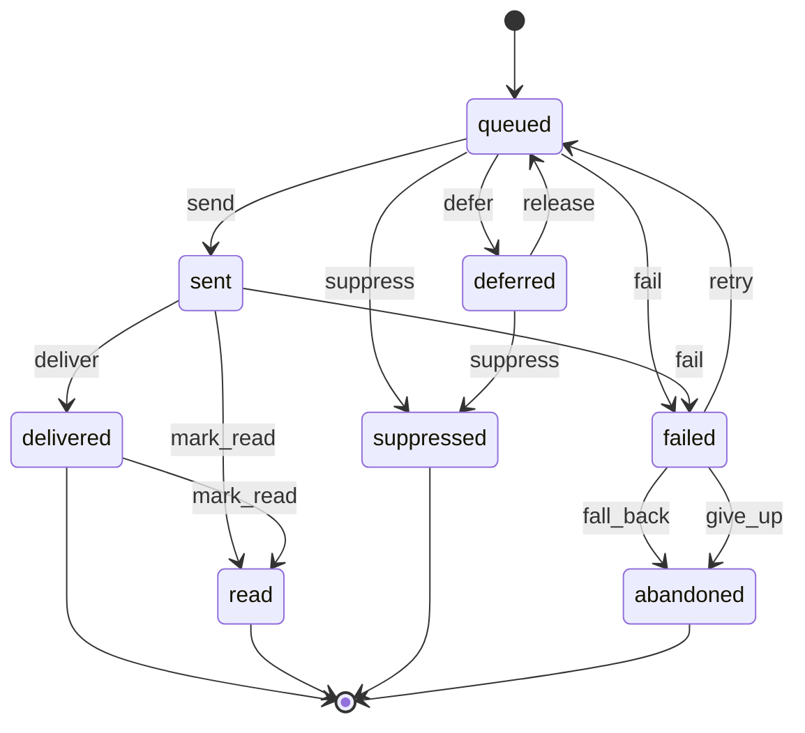
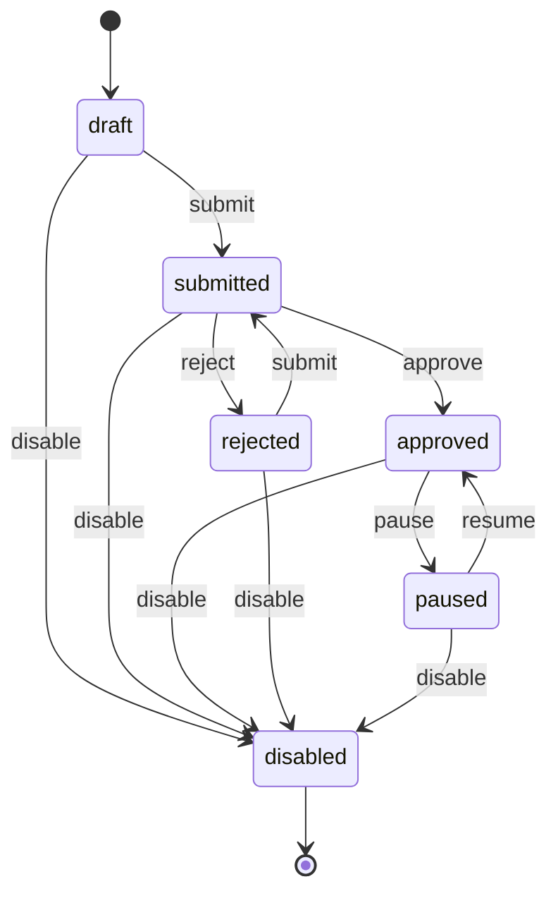
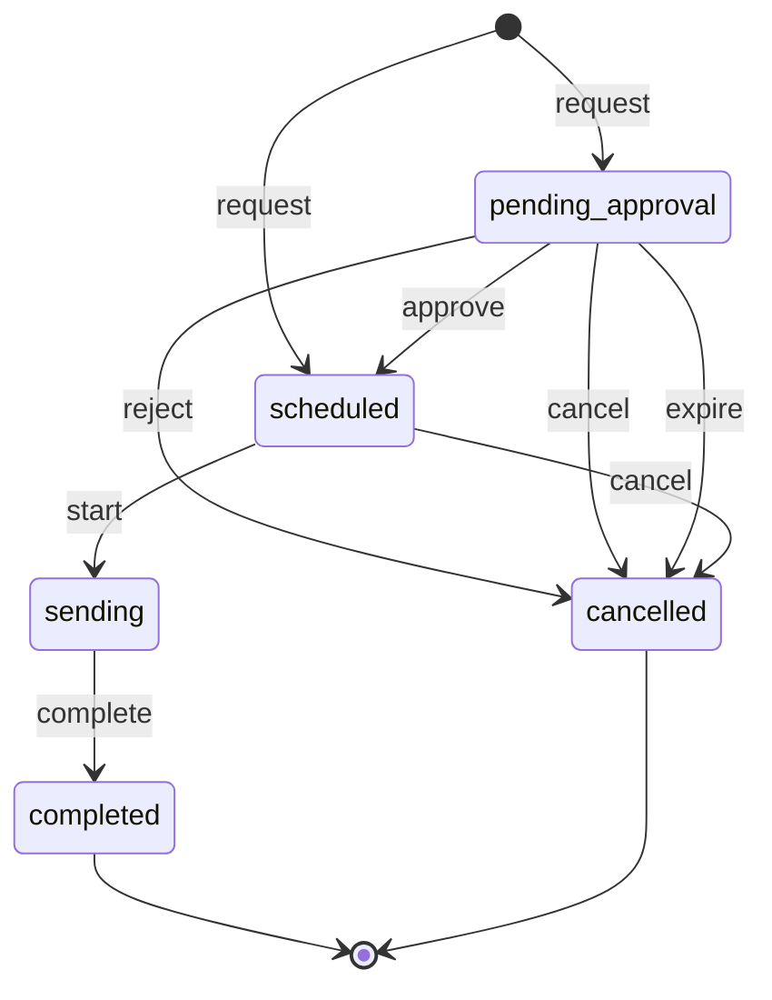

# wl-notify

> Status: draft · Last updated: 2026-10-16

## 1. Purpose

Every module needs to tell someone that something happened or is due: an invoice is overdue,
a visa expires, a booking is tomorrow, a shipment is out for delivery. In the UAE a message
only works if it reaches people on the channel they read. That is often WhatsApp or SMS, not
only email, and it must arrive in English or Arabic, at a sensible hour, from the client's
brand, and respect consent.

`wl-notify` turns events and automation actions into messages:

- it resolves who should receive them;
- it chooses the channel and language;
- it renders the client's templates;
- it sends through the configured providers;
- it logs every delivery.

Modules never call an email or SMS provider directly.

## 2. Capabilities covered

| ID | Capability | Used by verticals | Scope |
|---|---|---|---|
| `NTF.MSG.01` | Email notifications from templates | 01–10 | MVP everywhere |
| `NTF.MSG.02` | WhatsApp notifications | 05, 10 (MVP); 01, 02, 03, 04, 06, 07, 08, 09 (Later) | MVP for clinics and EdTech, Later elsewhere |
| `NTF.MSG.03` | SMS notifications | 03, 05, 06, 08, 09 (MVP); 10 (Later) | MVP |

The in-app notification bell (Renox `rx-notification-bell`, database notifications) is part of
every message flow for staff users and is not a separate capability.

**Marketing broadcasts** (§5.3) are the sending side of retention campaigns (`SAL.LOY.01`,
[wl-sales](wl-sales.md) §5.10) and are MVP where that capability is: 05, 06, 08 and 10. In the
MVP a marketing broadcast is requested only by a campaign (`NTF.ACL.04`); broadcasts started
by staff from a segment and other manual bulk messages stay Later.

What the verticals send:

| Vertical | Main messages | Channels |
|---|---|---|
| 01 Property | invoice reminders, overdue notices, cheque due/bounced, renewal notices, ticket updates, document expiry | email; WhatsApp Later |
| 02 Construction | approvals, missing attendance/daily report, IPA follow-ups, guarantee/permit expiry | email, in-app |
| 03 Logistics | tracking link and delivery updates to recipients, COD remittance to clients, driver documents | SMS (recipients, from the client's own sender ID), email (clients) |
| 04 Accounting | document requests, deadlines, approvals, invoices | email; WhatsApp Later |
| 05 Clinics | booking confirmations and reminders, no-show follow-up, balances, recalls | WhatsApp and SMS (MVP), email |
| 06 F&B | order OTP login, order status, receipts; marketing to opted-in customers | SMS (`AD-` sender ID for promotions), email; WhatsApp Later |
| 07 Manufacturing | order confirmations, dispatch notes, approvals, certificates expiry | email |
| 08 Auto | booking reminders, estimate approval links, vehicle ready, credit hold | SMS, email |
| 09 Manpower | timesheet approval links to clients, visa steps, payroll, document expiry; worker PWA login codes, shift, payslip and expiry notices | email (clients), SMS (workers); WhatsApp Later |
| 10 EdTech | enrolment, class reminders, absence alerts, schedules, invoices and package reminders to guardians | WhatsApp (main channel), email fallback; SMS Later |

## 3. Concepts and entities

| Entity | Description | Important fields |
|---|---|---|
| Notification type | A kind of message a module can send | key (e.g. `invoice.overdue`), module, group (the row of the [§5.4](#54-when-a-message-gives-up) default table), category (`transactional`, `reminder`, `security`, `marketing`), urgency (`normal`, `urgent`), statutory (yes/no: the message is a notice with legal or contractual effect, e.g. a deadline notice or a notice of changed terms), give-up reaction ([§5.4](#54-when-a-message-gives-up)), staff role told on give-up, default channels in order, default recipients, template per channel |
| Template | The text of one notification type for one channel and language | type, channel, language (`en`/`ar`), subject (email), body with placeholders, provider template name and category (WhatsApp), approval status (WhatsApp), version, active |
| Contact point | A way to reach a person | owner (user or party contact), channel, address (email or E.164 mobile), verified, primary, last bounce, status (`valid` / `invalid`), invalid since, invalid reason |
| Preference | What a person wants to receive | owner, category or type, channels allowed, language, quiet-hours opt-in |
| Suppression | A block on an address | address, channel, reason (`opt_out`, `hard_bounce`, `complaint`, `invalid`), source, date |
| Message | One message to one recipient on one channel | type, subject (`Subject` it is about), recipient, channel, language, rendered content, provider, provider message id, cost (if reported), status, scheduled for, attempts |
| Delivery event | A status update from a provider | message, status, provider code, timestamp, raw payload reference |
| Broadcast | One message of one marketing or manual type to a list of recipients | requester `Subject` (a wl-sales campaign in the MVP), notification type, template, channel, recipient source (a wl-sales segment; a filtered party list, Later), send at, recipients resolved, excluded counts by reason (no consent, opted out, suppressed, no contact point, frequency cap, blocked party, expired, broadcast stopped), requested by (a user, never the system: for a campaign, the user who last set its retention fields), approved by, cancel reason (rejected, cancelled, approval expired, requester guard failed), stopped by and at, results (sent, delivered, failed, opted out), status |
| In-app notification | A bell entry for a staff or portal user | user, type, title, link, read at (Renox database notifications) |

Rules that apply to all entities:

- **Consent:** marketing messages need a recorded consent for the purpose and channel
  (`PTY.CNS.01`, `wl-parties`). Transactional, reminder and security messages need no
  marketing consent, but they still respect an opt-out where the law allows it.
- **Content:** a message contains no sensitive data beyond what the channel's risk allows.
  Health details, identity numbers and amounts above a threshold go into the portal behind a
  login, and the message carries only a link.

## 4. Lifecycles

### 4.1 Message

| State | Tone | Terminal | Meaning |
|---|---|---|---|
| `queued` | neutral | no | Rendered and waiting to be sent |
| `deferred` | neutral | no | Held until quiet hours end or a scheduled time |
| `sent` | info | no | Accepted by the provider |
| `delivered` | success | no | Delivered to the device or mailbox |
| `read` | success | yes | Read receipt (WhatsApp) or open tracked (email, if enabled) |
| `failed` | error | no | Provider rejected it or delivery failed; may be retried or fall back |
| `suppressed` | neutral | yes | Not sent: no consent, opted out, suppressed address, or no contact point |
| `abandoned` | error | yes | Failed after all retries and fallbacks |

| Transition | From | To | By | Guards | Effects |
|---|---|---|---|---|---|
| `defer` | queued | deferred | system | normal urgency, external recipient, inside quiet hours; or category `marketing` outside the marketing send window (`NTF.RUL.02`) | scheduled for the end of quiet hours or the next opening of the window |
| `release` | deferred | queued | system | scheduled time reached | — |
| `send` | queued | sent | system | contact point valid; not suppressed; consent present when required; provider rate limit allows | provider message id stored |
| `suppress` | queued, deferred | suppressed | system | a send guard fails permanently; the recipient is over the marketing frequency cap (`NTF.RUL.02`); a marketing message of a broadcast not sent within the stale limit, or of a stopped broadcast (`NTF.RUL.03`, §4.3) | reason recorded; event `MessageSuppressed` |
| `deliver` | sent | delivered | system (provider receipt) | — | event `MessageDelivered` |
| `mark_read` | sent, delivered | read | system (provider receipt) | — | — |
| `fail` | sent, queued | failed | system | provider error or failed receipt | event `MessageFailed`; hard bounce or invalid number → suppression |
| `retry` | failed | queued | system | transient error; attempts < max | backoff |
| `fall_back` | failed | (new message on next channel) → abandoned | system | next channel in the type's order is allowed for the recipient | a new message is queued on the next channel; this one ends `abandoned` |
| `give_up` | failed | abandoned | system | no retries or fallbacks left | event `MessageGaveUp`; the type's give-up reaction runs (`NTF.RUL.01`, [§5.4](#54-when-a-message-gives-up)) |

`delivered` is the normal end for channels without read receipts. It is not marked terminal
only because a later read receipt can still arrive.

### 4.2 WhatsApp template

Business-initiated WhatsApp messages need templates approved by Meta through the BSP.

| State | Tone | Terminal | Meaning |
|---|---|---|---|
| `draft` | neutral | no | Being written |
| `submitted` | info | no | Sent to the BSP for approval |
| `approved` | success | no | Usable |
| `rejected` | error | no | Rejected, with the reason |
| `paused` | warning | no | Paused by the provider (quality) |
| `disabled` | neutral | yes | Retired |

| Transition | From | To | By | Guards | Effects |
|---|---|---|---|---|---|
| `submit` | draft, rejected | submitted | `notifications.templates.manage` | placeholders match the type's variables; category chosen | submitted through the BSP API |
| `approve` | submitted | approved | system (BSP callback) | — | event `TemplateApproved` |
| `reject` | submitted | rejected | system (BSP callback) | — | reason stored; event `TemplateRejected` |
| `pause` | approved | paused | system (BSP callback) | — | messages of this type fall back to SMS or email |
| `resume` | paused | approved | system (BSP callback) | — | — |
| `disable` | any except disabled | disabled | `notifications.templates.manage` | — | — |

### 4.3 Broadcast

| State | Tone | Terminal | Meaning |
|---|---|---|---|
| `pending_approval` | warning | no | Waiting for a second person (`NTF.ACL.03`); expires 24 h after send at (`NTF.RUL.03`) |
| `scheduled` | info | no | Approved or below the limit; waits for its send time |
| `sending` | info | no | Recipients resolved; messages being queued |
| `completed` | success | yes | Every message queued; results keep updating from delivery events |
| `cancelled` | neutral | yes | Rejected, cancelled or expired before sending, or its requester's guards failed at start |

| Transition | From | To | By | Guards | Effects |
|---|---|---|---|---|---|
| `request` | — | pending_approval, scheduled | the requester module on behalf of a user (marketing types: an `active` wl-sales campaign, `NTF.ACL.04`); `notifications.broadcast.send` (other types, Later) | type of category `marketing` or a manual type; template active (WhatsApp: `approved`) in every language used; SMS: an `AD-` sender ID configured; the requesting user named | estimated recipients shown (the members of the recipient source now who would pass consent, opt-out, suppression, contact point and blocked-party checks for the channel; the frequency cap is not estimated); `pending_approval` when the estimate is above the limit of `NTF.ACL.03`, otherwise `scheduled` |
| `approve` | pending_approval | scheduled | `notifications.marketing.send` | approver ≠ requester (`NTF.ACL.03`) | — |
| `reject` | pending_approval | cancelled | `notifications.marketing.send` | reason; rejecter ≠ requester | requester told; event `BroadcastCancelled` |
| `start` | scheduled | sending | system (send at reached) | the requester `Subject` still allows the send (`NTF.ACL.04`: campaign `active`, the vertical's guards pass), otherwise `cancel` with reason *requester guard failed* | recipients resolved now; blocked, archived and merged parties left out; consent, opt-out, suppression and `NTF.RUL.02` applied per recipient; excluded counts recorded |
| `complete` | sending | completed | system | every recipient has a message or an exclusion | event `BroadcastCompleted` |
| `cancel` | pending_approval, scheduled | cancelled | requester, `notifications.marketing.send`, or system (the requester `Subject` ended, e.g. the campaign `end`) | — | event `BroadcastCancelled` |
| `expire` | pending_approval | cancelled | system (`NTF.RUL.03`) | not approved N hours after send at | reason *approval expired*; requester told; event `BroadcastCancelled` |

Messages already sent by a broadcast are not recalled; a message deferred by the send window
is still sent when the window opens, unless the broadcast was stopped or the message went
stale (`NTF.RUL.03`). A broadcast is sent once: running it again is a new broadcast, and a
recipient gets at most one message per broadcast.

**Stop:** a holder of `notifications.marketing.send` may stop a broadcast that is `sending`, or
`completed` with messages still `queued` or `deferred` (wrong segment, wrong text). It is an
action, not a transition: those messages are suppressed with reason *broadcast stopped*, the
state stays, stopped by and at are recorded, and `BroadcastStopped` tells the requester.

**Vertical mapping:** no vertical defines its own message or template machine. Verticals add
notification types and templates (e.g. `booking.reminder` in 05/08/10, `shipment.out_for_delivery`
in 03, `job_card.ready` in 08) and choose default channels per type.

## 5. Workflows

### 5.1 From event to message

1. A transition effect or an automation action (`Notify`, [WORKFLOW.md](../WORKFLOW.md) §4.2)
   calls `Notifier::notify(type, subject, recipients, data)`.
2. **Recipients are resolved:**
   - *role in scope*: users who hold a role in the subject's scope, e.g. property manager of
     the lease's building;
   - *party*: the subject's party contacts, optionally by portal role, e.g. the tenant's
     finance contact or a student's guardian (`PTY.REL.01`);
   - *assignee*, *requester*, or *explicit users*.
3. **Channel and language are chosen per recipient:**
   - channel: the type's channel order, filtered by the recipient's preferences, consent,
     suppressions and available contact points;
   - language: the recipient's preference, then the party's language, then the client
     default.
4. Staff users always also get an in-app notification.
5. The template is rendered. Emails use the client's branded mail layout, in RTL for Arabic.
   Links point to the portal or back office, never contain sensitive data, and expire when
   they grant access.
6. Messages are queued. Quiet hours defer non-urgent messages to external recipients.
7. The queue sends through the provider, retries transient failures, and falls back to the
   next channel when one fails permanently.
8. Delivery receipts arrive through Renox inbound webhooks and update the message.

### 5.2 Opt-out

1. A recipient clicks the unsubscribe link (email) or replies `STOP` in any letter case
   (SMS/WhatsApp).
2. The provider webhook or the link creates a suppression, or a preference change, for that
   category and channel.
3. Marketing consent in `wl-parties` is withdrawn when the opt-out concerns marketing.

### 5.3 Marketing broadcasts (MVP for 05, 06, 08, 10) and manual bulk messages (Later)

1. A retention campaign in wl-sales is activated (`SAL.LOY.01`) and requests the broadcast
   for the user who set its retention fields (`NTF.ACL.04`). The broadcast names a marketing
   template, the channel and the send time. Staff cannot start a marketing broadcast directly
   from a segment in the MVP.
2. Above the recipient limit, a second holder of `notifications.marketing.send` approves it
   (`NTF.ACL.03`). Not approved within 24 hours after the send time, it expires
   (`NTF.RUL.03`) and the campaign shows *not sent*.
3. At the send time the segment is evaluated again. Only recipients with marketing consent
   for that channel (`PTY.CNS.01`, `NTF.ACL.01`), no opt-out or suppression and a valid
   contact point get a message; `NTF.RUL.02` defers messages outside the marketing send
   window and skips recipients over the frequency cap. Blocked, archived and merged parties
   are left out. For a minor (`PTY.REL.01`), the message goes to the guardian, with the
   guardian's consent. The excluded counts are kept by reason; the names of excluded
   recipients are not listed to the requester. A marketing message not sent within 48 hours
   of the start (provider down, long deferral) is suppressed as *expired* (`NTF.RUL.03`), so no
   stale promotion goes out.
4. Every marketing message identifies the client's brand and carries an opt-out: an
   unsubscribe link in email, the reply keyword `STOP` in SMS and WhatsApp (the same keyword
   in Arabic messages; any letter case is accepted). An opt-out withdraws the marketing
   consent for that channel (§5.2).
5. Results (sent, delivered, failed, opted out) are kept on the broadcast and returned to
   the requester through `BroadcastCompleted` and the delivery log. A broadcast can be
   stopped while messages remain unsent (§4.3 *Stop*).

Manual bulk messages of other types (e.g. all tenants of a building, all guardians of a
batch) use the same broadcast with `notifications.broadcast.send` and stay Later. The same
consent, suppression and quiet-hour rules apply.

### 5.4 When a message gives up

A message that ends `abandoned` through `give_up` was not delivered on any allowed channel.
The requester must not assume it was. `wl-notify` emits `MessageGaveUp` and runs the
notification type's **give-up reaction** (`NTF.RUL.01`). A requester module can listen to the
event for its own follow-up (e.g. pause a reminder sequence), but the default reaction always
runs, so no module is left without one. `NTF.RUL.01` is not compliance-critical, even for
statutory types (their `statutory_notice` task is the safeguard): a failed run is retried
with backoff like any automation and shows as `AutomationFailed`.

| Reaction | What happens |
|---|---|
| `staff_task` | A task (`wl-ticketing`) for the type's staff role in the subject's scope: "Could not reach {recipient} about {subject}", with the channels tried and the errors. Due in 1 working day. With no holder of the role in the scope, the task goes to the company admin. When a give-up task for the same subject and recipient is still open, the new give-up is added to it as a comment, not as a second task |
| `alternative_recipient` | The same message is queued to another contact of the same party with the same purpose (e.g. the second guardian, the company's other finance contact), then `staff_task` if there is none. One alternative only: the recipient rule is re-run without the contacts already tried, `invalid` or suppressed, and the primary of the rest is chosen; if the alternative also gives up, `staff_task` runs once for the chain |
| `mark_contact_invalid` | On a hard bounce, invalid number or unknown WhatsApp account, the contact point is marked `invalid` and the party's record shows "contact needs updating"; staff who open the party are asked to fix it. Editing or verifying the address sets it `valid` again and clears invalid since and reason. Always combined with another reaction for non-marketing types |
| `statutory_notice` | For statutory types: `staff_task` to the responsible staff, due in 1 working day, to deliver the notice by another means (courier, registered mail, hand delivery, a call with a note) and record the proof on the subject. Until proof is recorded, the subject shows "notice not delivered", and any deadline that depends on the notice being given is not treated as started |
| `none` | Only the delivery log records it (marketing, tracking links) |

**The `statutory_notice` reaction.** When a statutory notice gives up, `wl-notify` keeps one
statutory-notice record for the chain (a retried run adds no second one) and opens one task
through the task creator: "Deliver {subject} notice to {recipient} by another means", due 1
working day after the give-up, assigned like `staff_task`, with an urgent alert for an urgent
type. The task lists the channels tried with masked addresses, never the message, the proof
methods the type accepts and the link to the proof form. It takes over the type's `staff_task`,
so the staff get one task (that step is recorded `deferred`). The run records one outcome:
`task_created`, `task_open` (a retry found the open task), `no_task_creator` (ticketing is off;
the record is kept and the run succeeds) or `not_statutory` (the type is not statutory:
nothing is kept).

**Proof of delivery.** Staff with `notifications.notices.record_proof` (company admin by
default) record the proof on the notice's page: method (`courier`, `registered_mail`,
`hand_delivery` or `call`, narrowed per type by its proof methods), delivery date, note and
attachment. The delivery date must not be in the future nor before the day the notice gave up
(the same day is allowed). The attachment is required for every method except `call`, which
needs a note instead; it is a PDF, image or plain-text file, stored privately and served only
to holders of the permission. An invalid proof answers 422 and stores nothing; a second proof
on a notice, or one on a notice already delivered, answers 409; an unknown notice answers 404.
Recording the proof resolves the task ("Proof recorded") and emits
`StatutoryNoticeProofRecorded` once, after commit, with the notice, subject, type, method and
delivery date. `Notifier::notice_status(subject, type)` then answers `proof_recorded` with that
date. It answers `delivered` with the provider's delivery time for a notice that was delivered,
and `not_delivered` for one only sent, queued, retrying or given up without proof, and for every
type when `notify` is off. Each type has its own status; the newest message chain of the
subject and type decides. `undelivered_notices(subject)` lists the notices that gave up without
proof, for the "notice not delivered" banner (`wl-notify/_notice_banner.html`) a vertical page
includes on the subject.

**Default reaction per type group.** A type registered without a give-up reaction gets one from
the table below, chosen in this order: statutory, then OTP, then the group, then urgency. The
group is the key the module gives in `register_type` (constants in the kernel); any other
group, including the key prefix filled in when none is given, counts as "no group".

| Group key | Default | Staff role |
|---|---|---|
| `invoices`, `statements`, `payments`, `reminders` | `mark_contact_invalid`, `alternative_recipient`, `staff_task` | `receivables` |
| `bookings` | `mark_contact_invalid` | (none) |
| `portal`, `documents`, `signatures` | `mark_contact_invalid`, `staff_task` | module's own, else company admin |
| `guardian` | `alternative_recipient`, `staff_task` | module's own |
| `employee_security` | `mark_contact_invalid`, `staff_task`; never `alternative_recipient` | `hr` |
| `otp` | `none` (urgency adds nothing) | (none) |
| `marketing` | `mark_contact_invalid` | (none) |
| `tracking` | `none` | (none) |
| no known group | `staff_task` | module's own |

A statutory type gets `mark_contact_invalid`, `statutory_notice` whatever its group or urgency.
An `urgent` type gets `staff_task` added unless the row ends with it or is `none`; the in-app
alert follows from every urgent `staff_task`.

**Override rule.** A type whose module or vertical gives its own reactions, even `none`, keeps
them unchanged, and its own staff role beats the group's. The combination rule of the
type-edit page runs on those explicit lists and on edits, not on the seeded defaults (the
`bookings` row is `mark_contact_invalid` alone). On install, a stored type with no reactions
that the client never edited gets the default; an edited type is kept.

The `alternative_recipient` step ends with one outcome, recorded in the run: `queued` (the new
message and person; the later `staff_task` step is recorded `deferred` and opens nothing),
`none_left` (every other contact was tried or has no usable address), `no_rule` (the recipient
is not a recipient rule, e.g. a plain party) or `alternative_already_tried` (the message is
itself an alternative). The reaction only applies to a recipient rule. A contact with no address
on an open channel of the type, with every address on the suppression list, or on hold, is
skipped. A retried run finds the alternative it already queued and queues nothing new. In every
outcome except `queued`, `staff_task` runs once for the chain: through the type's own
`staff_task` step when it comes later, otherwise by the reaction itself. Its task lists the
channels and errors of both recipients, with masked addresses and no message body, and names
the last recipient tried.

The `mark_contact_invalid` step looks at every message of the chain, not only the last. Only
the hard kinds count: `hard_bounce`, `invalid_number` and `unknown_account`. For each message
with such an error and a party contact point, the point is marked `invalid` with the error kind
as reason and the give-up time (`gave_up_at`) as since, through the party directory; a point
that is invalid already keeps its first since and reason. So an email that hard-bounced before
an SMS that timed out marks only the email point. Timeouts and other permanent errors (for
example `550 mailbox unknown` stored as `permanent`) mark nothing, and a hard error followed by
a sent fallback is no give-up. The step ends with one outcome: `marked` (the points and
reasons are in the detail), `already_invalid` (no point changed, including when parties are
off), `no_contact_point` (the hard errors went to a user or a bare address, which have no
status) or `no_hard_failure`. `ContactPointInvalidated` is emitted once per marked point after
the step is stored; a repeated run is skipped by its occurrence key. The point is never
deleted and stays primary, but `point_for` never chooses it: a channel with only invalid
points is skipped as if it had none. The address stays on the suppression list; editing or
verifying the contact point makes it `valid` again but does not remove the suppression.

The `send` job checks the contact point once more: a queued party message whose point became
invalid before it was sent is `suppressed` with reason `invalid_contact_point` and the provider
is not called.

| Type group (requester) | Default reaction |
|---|---|
| Statutory notices (04 deadline and document-request notices to clients; 01 notices of changed terms, a landlord's notice to end a lease, formal payment demands, the formal notice on a bounced cheque; other final demands) | `mark_contact_invalid` + `statutory_notice` |
| Invoices, statements, payment reminders (`wl-invoicing`, `wl-payments`) | `mark_contact_invalid` + `alternative_recipient`; then `staff_task` to the collector role |
| Booking confirmations and reminders (`wl-scheduling`) | `mark_contact_invalid`; the booking shows "reminder not delivered" to the front desk; `staff_task` only for urgent types |
| Portal invitations, document requests, signature requests (`wl-portal`, `wl-documents`) | `mark_contact_invalid` + `staff_task` to the request's owner |
| Guardian messages (10, 05 dependants) | `alternative_recipient` (other guardian), then `staff_task` |
| Urgent types of any module | `staff_task` + in-app alert to the role |
| Security notices to an employee (`wl-hr` pay account change SMS, §5.7 there) | `mark_contact_invalid` + `staff_task` to HR (`employees.manage` in the employee's scope) to reach the worker by another way; no `alternative_recipient` (only the number on record before the change may be used). wl-hr keeps the change in cooling until HR records the worker reached ([wl-hr](wl-hr.md) §4 *Pay account*) |
| OTP and one-time security codes | `none` to staff; the user sees the error on screen at once and may choose another channel |
| Marketing, delivery tracking | `mark_contact_invalid` (marketing) or `none` |

Each type gets its default from exactly one row, chosen in this order: (1) a type marked
statutory takes the *Statutory notices* row, whatever its group or urgency; (2) OTP and
one-time security codes take their row, and urgency adds nothing (no staff task ever); (3)
otherwise the row of the group the module names in `register_type`. Urgency is not a group:
for a type with urgency `urgent`, the *Urgent types* row adds `staff_task` (last, if the group's
reaction does not already end with it) and an in-app alert to the type's staff role to the
group's reaction. A type with urgency `urgent` and no group takes the *Urgent types* row alone; a type with
neither a group nor urgency takes `staff_task`.
For example, an urgent guardian message runs `alternative_recipient`, then `staff_task` with
the in-app alert; an urgent booking reminder runs `mark_contact_invalid`, the "reminder not
delivered" note, then `staff_task` with the in-app alert.

The verticals mark their statutory types and may change a type's reaction. Which notices are
statutory, and what proof of delivery counts for them, is set by the vertical.

## 6. Interfaces to other modules

**Provides**

| Service | Purpose |
|---|---|
| `Notifier::notify(type, subject, recipients, data)` | Send a notification of a registered type |
| `Notifier::register_type(definition)` | Modules register their notification types, variables and default templates |
| `Notifier::send_otp(contact_point, purpose)` / `verify_otp` | One-time codes for portal login (06 F&B customers, 09 workers), signature confirmation (`wl-documents`), proof of delivery (`wl-delivery`), contact verification, loyalty redemption (`wl-sales`); a code is valid for the OTP validity and voided after the wrong tries (§7); `verify_otp` returns `valid`, `wrong` (tries left), `expired` or `locked` |
| `Notifier::broadcast(type, requester subject, recipient source, channel, send at)` | Request a broadcast (§4.3); returns the broadcast with its estimate |
| `Recipients` resolvers | Role in scope, party contacts by portal role, assignee; extensible |
| Delivery log queries | "Was the overdue notice delivered?" for disputes and reports; `Notifier::notice_status(subject, type)` returns `delivered` (with the provider delivery time), `proof_recorded` (with the delivery date entered in the proof) or `not_delivered`. Requesters start a deadline from the delivery time or the proof's delivery date, never from the time the proof was typed |

**Consumes**

- `wl-kernel`: settings (providers, sender identity, quiet hours), branding, automation rules.
- `wl-parties`: party contacts, languages, relationships (`PTY.REL.01`), consents
  (`PTY.CNS.01`).
- `wl-sales`: `Segments` for broadcast recipients (retention campaigns, `SAL.LOY.01`).
- Renox: mail, notifications (mail, database, custom channels via `App::channel`),
  notification bell, queue, scheduler, inbound webhooks, i18n.

**Events emitted**

| Event | When | Payload |
|---|---|---|
| `MessageDelivered` | provider confirms delivery | message id, type, subject, recipient, channel |
| `MessageFailed` | a send or delivery fails | message id, type, subject, channel, reason, final (yes/no) |
| `MessageSuppressed` | a message is not sent by rule | message id, type, recipient, reason |
| `MessageGaveUp` | a message ends `abandoned` after all retries and fallbacks | message id, type, subject, recipient, channels tried, last error per channel, statutory (yes/no), reaction applied |
| `ContactPointInvalidated` | a contact point is marked `invalid` | contact point, party, channel, reason |
| `OptOutReceived` | a recipient opts out | address, channel, category |
| `TemplateApproved` / `TemplateRejected` | WhatsApp template decision | template id, type, language, reason |
| `BroadcastCompleted` / `BroadcastCancelled` | a broadcast has queued all messages, or is cancelled, rejected or expired | broadcast id, requester subject, recipients, excluded counts by reason, reason (cancelled: rejected, cancelled, approval expired, requester guard failed) |
| `BroadcastStopped` | a broadcast is stopped (§4.3) | broadcast id, requester subject, stopped by, messages suppressed |

**Attaches to:** every message references the `Subject` it is about, so a record's page can
show its communication history (e.g. reminders sent for an invoice).

**Permissions**

| Permission | Allows |
|---|---|
| `notifications.log.view` | See the delivery log for records in scope |
| `notifications.resend` | Resend a message (same or another channel) |
| `notifications.templates.manage` | Edit templates and submit WhatsApp templates |
| `notifications.channels.manage` | Configure providers, sender identity, quiet hours |
| `notifications.preferences.manage` | Change a party's preferences on their request |
| `notifications.broadcast.send` | Send a manual or bulk message (Later) |
| `notifications.marketing.send` | Approve, cancel and stop marketing broadcasts; in the MVP they are requested only by campaigns (`NTF.ACL.04`) (MVP for 05, 06, 08, 10; Later elsewhere) |

**Access rules**

| ID | Rule | Pattern | Parameter (default) |
|---|---|---|---|
| `NTF.ACL.01` | Marketing messages go only to recipients with marketing consent for that channel; exporting recipient lists needs a sensitive-export permission and is audited. Generalises `FNB.ACL.10` and `CLN.ACL.11` | `SEN` | — |
| `NTF.ACL.02` | No health or identity data in message bodies; message content shown in the delivery log follows the subject's access rules | `FLD` | — |
| `NTF.ACL.03` | A marketing broadcast to more than N recipients needs approval by a second holder of `notifications.marketing.send`; the requester cannot approve it | `LIM`, `SOD` | N = 200 |
| `NTF.ACL.04` | A marketing broadcast is requested only by an `active` wl-sales campaign, on behalf of the user who last set its segment, template, channel or send time (that user is the requester for `NTF.ACL.03`, also when the campaign activates on its start date); the campaign's guards, including the vertical's (05: `CLN.ACL.13`), are checked at `request` and again at `start` | `STA`, `SOD` | — |

**Automations:** `wl-notify` is the target of every rule's *Notify* action. It owns these rules:

| ID | Rule | When | Then | Parameter (default) |
|---|---|---|---|---|
| `NTF.RUL.01` | Give-up reaction | a message ends `abandoned` through `give_up` | run the notification type's give-up reaction ([§5.4](#54-when-a-message-gives-up)): staff task, alternative recipient, mark the contact point invalid, or the statutory-notice task | task due 1 working day; on |
| `NTF.RUL.02` | Marketing send window and frequency cap | a message of category `marketing` is queued | outside the send window (Asia/Dubai) → `defer` to the next opening; when the recipient already got the cap of marketing messages in the last 7 days (across all broadcasts of the client) → `suppress` with reason *frequency cap*. The cap is checked at `send` under a lock per recipient party, and the message is `sent` under the same lock, so two broadcasts cannot both pass it. Only messages to a party are capped; a message counts once it has a `sent_at` (never a `suppressed`, `abandoned`, `deferred` or `queued` one, and never one suppressed for the cap itself), and a failed attempt releases the lock without counting. The lock is a keyed mutex per party id in the process and is held through the provider call (the provider timeout bounds it) | window 07:00–21:00, every channel; cap 2 per 7 days; on |
| `NTF.RUL.03` | Stale broadcasts | a broadcast is `pending_approval` N hours after its send at; or a marketing message of a broadcast is still `queued` or `deferred` M hours after the broadcast's `start` | `expire` the broadcast (reason *approval expired*; requester told); `suppress` the message with reason *expired* (counted in the broadcast's excluded counts) | N = 24 h; M = 48 h; on |

## 7. Configuration per client

| Setting | Default |
|---|---|
| Email provider and sender (`From`, reply-to) | client SMTP/SES; sender on the client's domain (SPF/DKIM set up at onboarding) |
| WhatsApp BSP, business number, display name | none (Later for most verticals); clinics and EdTech at onboarding |
| SMS provider and sender ID | none; logistics, clinics, F&B, auto, manpower at onboarding. One alphanumeric sender ID per client brand, registered by the client through the provider; the provider's default ID until it is approved; a separate `AD-` sender ID for promotions |
| Channel order per notification type | the vertical's defaults (e.g. booking reminder: WhatsApp → SMS → email) |
| Templates per type and language | the vertical's EN/AR templates |
| Quiet hours for external recipients | 21:00–08:00 Asia/Dubai, normal urgency only |
| Default language | EN; AR for parties whose language is Arabic |
| Retry policy | 3 attempts per channel, the next one 1 minute, then 5 minutes after a transient error (a permanent or hard error is not retried); then fall back to the next allowed channel of the type, else give up |
| Delivery log retention | 24 months |
| Read and open tracking | off for email, provider default for WhatsApp |
| Give-up reaction per type, statutory flag | the module's and vertical's defaults ([§5.4](#54-when-a-message-gives-up)) |
| Give-up task due (`NTF.RUL.01`) | 1 working day |
| Give-up rule run (`NTF.RUL.01`) | one run per message (occurrence key: the message id; a second run is recorded as skipped); 5 attempts, 1, 5, 15 and 60 minutes apart; then the run is failed and `AutomationFailed` is raised (not compliance-critical) |
| Marketing send window; frequency cap (`NTF.RUL.02`) | 07:00–21:00 on every channel, set per channel: SMS may be narrowed but not widened (§10); email and WhatsApp may be narrowed or widened; 2 messages per 7 days (7 x 24 hours back from the send, any channel, any broadcast; set with `WlNotify::marketing_frequency_cap(n)`). The window is stored per channel in `wl_notify_send_windows`; no row means 07:00–21:00. The quiet hours are a constant in code. A broadcast's page adds the messages suppressed for the cap to its excluded counts as *frequency cap* |
| One-time code (`send_otp`): validity; wrong tries before the code is voided | 5 minutes; 3 |
| Broadcast approval above (`NTF.ACL.03`) | 200 recipients |
| Broadcast approval expiry; stale marketing messages (`NTF.RUL.03`) | 24 hours after send at; 48 hours after start |

## 8. Extension points

- **Notification types** registered by modules and apps, with variables and default
  templates.
- **Strategy traits:**
  - `ChannelProvider`: add a provider (another SMS gateway, push notifications later).
  - `RecipientResolver`: add a resolution rule, e.g. "the client's site supervisor of this
    deployment".
  - `ChannelPolicy`: change the per-recipient channel choice, e.g. "workers without
    smartphones: SMS only".
- **Events** in §6, e.g. a vertical raises a task when an urgent notice could not be delivered.
- **Overridable views:** email layout, unsubscribe page, preference centre in the portal,
  delivery log panel on a record.

## 9. Renox fit

| Need | Renox provides | Gap |
|---|---|---|
| Email with templates and attachments | mail, `rx-mail-*` tags | Arabic RTL email layout → R1 |
| In-app notifications and bell | database notifications, `rx-notification-bell` | — |
| WhatsApp and SMS channels | `App::channel` custom channels | Provider adapters live in `wl-notify` |
| Queued sending with retries | queue with attempts and backoff | Per-provider rate limiting (throughput caps) in the queue → R19 |
| Delivery receipts and opt-out replies | inbound webhooks with verification | — |
| Deferred sending (quiet hours) | scheduler, delayed jobs | — |
| Templates per language | i18n | Editable templates stored in the database (not files) → `wl-notify`, using R2 settings for defaults |
| Phone numbers in E.164 | — | Phone normalisation and validation → `wl-parties` (**new gap** if it belongs in Renox validation rules) |
| OTP generation and verification | 2FA codes in `renox-2fa` (for staff) | OTP for external contacts → `wl-notify` |

## 10. Compliance

- **PDPL:** messages are processing of personal data. Purpose limitation applies, marketing
  needs consent (Art. 4), and a data subject may object to direct marketing at any time
  (Art. 17) ✔ [S1]. The executive regulations are not confirmed as published on the
  official legislation portal `⚠ open: lawyer (L-01)`.
- **TDRA SMS rules:** sender IDs must be registered through a licensed provider. Promotional
  SMS carry the `AD-` prefix in the sender ID, may only be sent 07:00–21:00, need consent
  and must offer an opt-out. Transactional SMS (OTP, reminders, receipts) need no prefix.
  `NTF.RUL.02` applies the 07:00–21:00 window to every marketing channel; for SMS it may not
  be widened.
  Registration with e& and du takes about 5–25 working days ✔ [S2] (vendor sources).
- **WhatsApp:** business-initiated messages outside the 24-hour service window must use
  approved templates. Meta's categories (utility, authentication, marketing) affect pricing
  and approval. Since 1 July 2025 Meta charges per delivered template message by category
  and recipient country; replies and utility templates inside an open 24-hour service window
  are free; AED billing exists since 1 April 2026 ✔ [S3]. Current UAE rates are taken from
  the BSP's rate card at contract time.
- **Health data:** clinic messages carry no diagnosis or treatment details, only time, place
  and a portal link (05 scope decision, `CLN.ACL.01`).
- **Consumer protection:** Federal Law 15 of 2020 (Art. 4(5)) bars suppliers from using
  consumer data for promotion or marketing; market practice reads this as requiring consent
  before direct marketing ✔ [S4]. Marketing messages identify the sender and include an
  opt-out. Any further message rules in Cabinet Resolution 66 of 2023 `⚠ open: lawyer (L-06)`.

## 11. Out of scope

| Not here | Where instead |
|---|---|
| Two-way chat inbox (WhatsApp or SMS conversations with staff) | Client's own WhatsApp Business tools or a helpdesk; Later as a separate module if several clients ask |
| Marketing campaign builder (A/B tests, journeys, drip sequences) | Client's marketing tool; segments and retention campaigns are in wl-sales (`SAL.LOY.01`) and broadcasts here are simple and consent-checked |
| Voice calls and IVR | — |
| Native push notifications | Not applicable (web + PWA); web push Later through a `ChannelProvider` |
| Deciding *when* to notify | Automation rules and transition effects (`wl-kernel`, modules) |
| Consent records | `wl-parties` (`PTY.CNS.01`) |

## 12. Open questions

1. Are messaging costs (WhatsApp, SMS) included in the subscription or re-billed to the client
   per message? This decides whether cost tracking per message is MVP. *(us)*
2. One shared BSP and SMS provider account for all clients (sub-accounts), or the client's own
   accounts? *(us, provider)*
3. ~~Are sender IDs registered per client brand, and how long does registration take?~~
   Answered (2026-10-15, review of 03): yes, one per brand, registered with e& and du by the
   client through the SMS provider during onboarding, in about 5–25 working days. The
   provider's default ID is used until approval. Merchants' names are not used as sender
   IDs. *(TDRA / SMS provider)*
4. Should quiet hours apply to reminders with a near deadline (e.g. booking in two hours)?
   *(client)*
5. Do workers need SMS in Hindi, Urdu or other languages, beyond EN/AR? 09 decided
   (2026-10-15) that most workers have a smartphone but no email, so worker notices go by
   SMS; the language question stays open. *(client)*

## Sources

Checked 2026-10-15. *Official* = government or legislation; others are secondary.

| # | Source | Type | Used for |
|---|---|---|---|
| S1 | DLA Piper, "Data protection laws in UAE", https://www.dlapiperdataprotection.com/countries/uae-general/law.html | Secondary | PDPL consent, objection to direct marketing, executive regulations status |
| S2 | Telerivet, "UAE SMS compliance: TDRA and the AD- prefix", https://www.telerivet.com/blog/uae-sms-compliance-tdra-ad-prefix; D7 Networks, https://d7networks.com/sms/uae/sms-regulations/ | Secondary | SMS sender ID, `AD-` prefix, 07:00–21:00 hours, opt-out |
| S3 | Meta, "Pricing on the WhatsApp Business Platform", https://developers.facebook.com/docs/whatsapp/pricing | Secondary (vendor) | WhatsApp categories, per-message pricing, free service window, AED billing |
| S4 | Norton Rose Fulbright, "Enhanced UAE consumer protection", https://www.nortonrosefulbright.com/en/knowledge/publications/21255b99/enhanced-uae-consumer-protection-in-a-time-of-accelerated-digital-transformation; Mondaq, "Communications with customers", https://www.mondaq.com/compliance/1229090/compliance-%7c%7c-communications-with-customers | Secondary | Consumer data and marketing (Art. 4(5)) |
