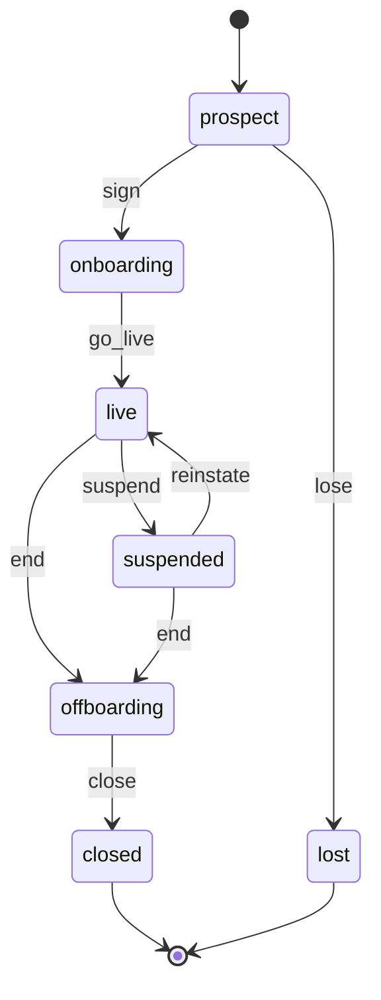
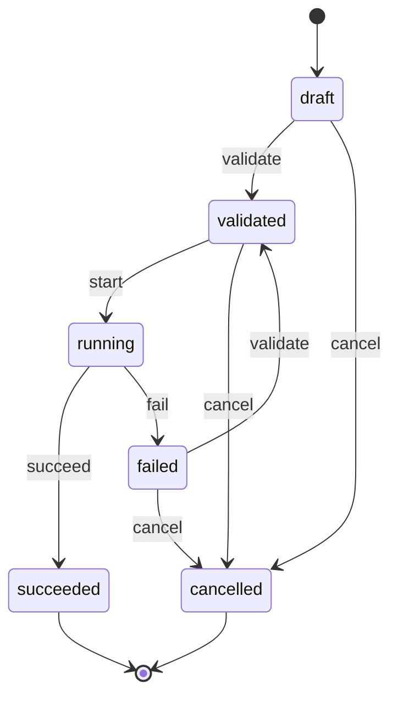
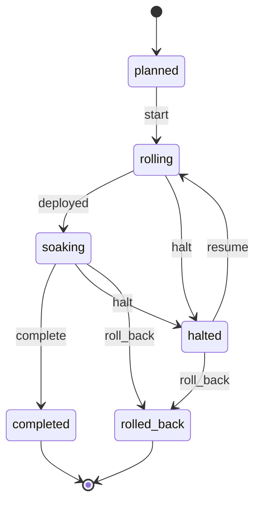
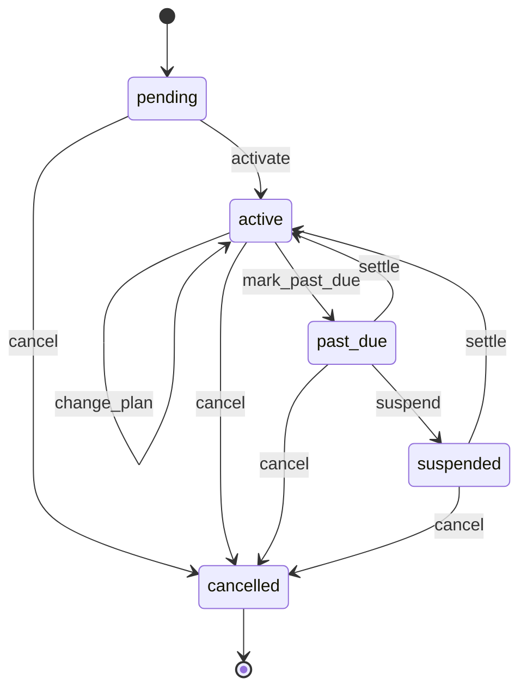

# wl-operator

> Status: draft · Last updated: 2026-10-16

## 1. Purpose

`wl-operator` is the **control plane for us, the platform seller**. Clients never use it,
and it is never part of a client's binary. With it we:

- keep the register of clients and what each one bought;
- provision a new client from its `client.toml` (domain, legal entity, vertical app, modules);
- enforce plans and module entitlements, including module switches within a vertical app
  and limits on users, entities and volume;
- bill our clients (setup fee and monthly subscription);
- roll out new versions in waves, with a canary first, and roll back when a wave fails;
- watch health and backups per client, and rehearse restores;
- open audited support access when a client needs help;
- collect usage metrics that pricing is based on;
- run one demo instance per vertical for sales;
- offboard a client: export, retention, deletion.

**Where it runs.** `wl-operator` is a **separate Renox app** (`operator/` in the repository),
deployed once on our own server with its own SQLite database. It is not a module inside
client deployments, for three reasons:

- client binaries carry no operator code or credentials;
- a fault in the operator cannot take down a client;
- client data never sits in the operator database. Only metadata does: names, plans, usage
  counters, health.

**How it talks to deployments.** Each client deployment exposes a small **signed admin
API** (provided by `wl-kernel`, see [§6](#6-interfaces-to-other-modules)):

- requests are signed with a per-client key pair; the client side verifies and rejects
  replays (timestamp + nonce);
- it accepts only HTTPS from the operator's address;
- it answers a fixed set of calls: health, version, usage counters, apply entitlements,
  open/close support session, start export.

Deployment itself (copying binaries, restarting systemd units, Litestream) stays in
`deploy/` scripts ([ARCHITECTURE.md](../ARCHITECTURE.md) §8). The operator drives those
scripts and records their results; it does not replace them.

## 2. Capabilities covered

| ID | Capability | Used by | Scope |
|---|---|---|---|
| `OPS.CLI.01` | Client register: company, contacts, legal entities, vertical, domain, deployment, plan, status | us | MVP |
| `OPS.PRV.01` | Provisioning a new client from `client.toml`: domain, TLS, first entity, first admin, modules, branding, demo or empty data | us | MVP |
| `OPS.ENT.01` | Plans and entitlements: modules and module switches a client may enable, limits (staff users, entities, scopes, custom fields, storage, message quota, pricing metric band), features (single sign-on, scheduled reports), add-ons | us | MVP |
| `OPS.BIL.01` | Billing our clients: setup and migration fees, monthly or yearly subscription, add-ons, VAT invoices with our TRN, through our own gateway account (renox-billing) | us | MVP |
| `OPS.FLT.01` | Fleet: version per client, rollout waves with a canary, migration status, rollback | us | MVP |
| `OPS.MON.01` | Health, uptime, error rate, queue backlog, disk; backup freshness and monthly restore drills; status page per client | us | MVP |
| `OPS.SUP.01` | Support access: break-glass sessions (`PLT.ACL.04`), client approval, audit, support tickets in our own `wl-ticketing` instance ([OPERATIONS.md](../OPERATIONS.md) §8) | us | MVP |
| `OPS.USG.01` | Usage metrics per client and month (users, entities, pricing metric, messages sent) | us | MVP |
| `OPS.DMO.01` | Demo instances per vertical, seeded from [DEMO-DATA.md](../DEMO-DATA.md), reset nightly | us (sales) | MVP |
| `OPS.OFF.01` | Offboarding: full data export, deletion within 30 days (unless an archive is required), certificate | us | MVP |

`OPS` capabilities do not appear in vertical documents: no vertical uses them. They serve
our business across all ten verticals.

## 3. Concepts and entities

| Entity | Description | Important fields |
|---|---|---|
| Client | A customer company that runs one deployment | legal name, trading name, vertical, primary contact, billing contact, account manager, status |
| Client entity | A legal entity of the client, mirrored for pricing and invoicing | client, legal name, TRN, licence authority |
| Deployment | One running instance | client, domain(s), server, binary version, database path, Litestream replica, admin API key id |
| Plan | A package we sell ([PRICING.md](../PRICING.md)) | code, name, included modules, limits, price ids, billing interval |
| Add-on | Something sold on top of a plan | code, module or limit it unlocks, price id |
| Entitlement | What one client may use, derived from plan + add-ons + overrides | client, module set, module switches per vertical app, limits, features, valid from/to |
| Module switch | A part of a vertical app that is sold and switched on per client, without a separate edition | vertical, code, modules it needs, default (on/off), add-on code. Examples: freight forwarding in 03 (MVP, off by default; last-mile and trucking on); central kitchen in 06 (optional); dine-in extension in 06 (Later) |
| Client subscription | Our recurring billing of the client | client, plan, add-ons, interval, gateway reference, status, current period |
| Provisioning run | One attempt to create or reconfigure a deployment | client, `client.toml` snapshot, steps, status, log |
| Release | A built version of the client binary | version, changelog, migrations included, build date |
| Rollout wave | One step of a release rollout | release, wave number, clients, status, started/finished |
| Health check | A point-in-time reading | deployment, time, status, response time, queue backlog, disk, backup age |
| Restore drill | A test restore of a backup | deployment, time, backup point, result, duration |
| Support session | A break-glass access window | client, operator user, reason, approved by, opened/closed, actions audited |
| Usage record | Monthly counters | client, month, users, entities, pricing metric value, messages by channel |
| Offboarding case | Ending a client | client, export delivered, retention until, deleted at, certificate |

## 4. Lifecycles

### 4.1 Client

| State | Tone | Terminal | Meaning |
|---|---|---|---|
| `prospect` | neutral | no | Talking; may have a demo login |
| `onboarding` | info | no | Contract signed; deployment being provisioned and data migrated |
| `live` | success | no | In production and billed |
| `suspended` | warning | no | Access limited for non-payment or on request |
| `offboarding` | warning | no | Contract ended; export and retention running |
| `closed` | neutral | yes | Data deleted; record kept for our own accounts |
| `lost` | neutral | yes | Prospect that did not sign |

| Transition | From | To | By | Guards | Effects |
|---|---|---|---|---|---|
| `sign` | prospect | onboarding | `clients.manage` | plan chosen; contract and setup invoice issued | provisioning run created |
| `go_live` | onboarding | live | `clients.manage` | provisioning run `succeeded`; client admin accepted the handover checklist | subscription `activate` |
| `suspend` | live | suspended | `clients.manage` or system (subscription `suspend`) | reason given | admin API: deployment set to read-only with a banner |
| `reinstate` | suspended | live | `clients.manage` or system (subscription `recover`) | — | admin API: full access restored |
| `end` | live, suspended | offboarding | `clients.manage` | notice recorded | offboarding case opened; subscription `cancel` at period end |
| `close` | offboarding | closed | `clients.close` (second person, `OPS.ACL.03`) | export delivered; 30 days passed or an archive arranged | deployment deleted; certificate issued |
| `lose` | prospect | lost | `clients.manage` | reason given | demo login removed |

### 4.2 Provisioning run

| State | Tone | Terminal | Meaning |
|---|---|---|---|
| `draft` | neutral | no | `client.toml` being prepared |
| `validated` | info | no | `client.toml` passes checks against the entitlement |
| `running` | info | no | Steps executing |
| `succeeded` | success | yes | Deployment reachable and healthy |
| `failed` | error | no | A step failed; log kept |
| `cancelled` | neutral | yes | Abandoned |

Steps, in order: reserve domain and DNS → create server unit and database → issue TLS →
boot binary (migrations) → apply settings from `client.toml` → apply entitlement → create the
first legal entity and admin user → import data or seed demo data → health check.

| Transition | From | To | By | Guards | Effects |
|---|---|---|---|---|---|
| `validate` | draft, failed | validated | `provisioning.run` | `client.toml` schema valid; requested modules ⊆ entitlement; domain free; brand colours pass the contrast guard | — |
| `start` | validated | running | `provisioning.run` | — | steps run in the queue |
| `succeed` | running | succeeded | system | last step and health check pass | event `ClientProvisioned` |
| `fail` | running | failed | system | a step failed | completed steps are kept; operator notified |
| `cancel` | draft, validated, failed | cancelled | `provisioning.run` | — | partial resources removed |

A reconfiguration (new module, new entity, new domain) is a new provisioning run on the same
deployment.

### 4.3 Rollout wave

A release rolls out in waves ([OPERATIONS.md](../OPERATIONS.md) §4): wave 0 is the canary
(internal demo client) and the demo instances, soak 24 hours; wave 1 the clients who opted
into early updates, soak 48 hours; wave 2 all other clients, outside their business hours. A
hotfix wave covers only the affected clients, after 1 hour on the canary.

| State | Tone | Terminal | Meaning |
|---|---|---|---|
| `planned` | neutral | no | Clients assigned to the wave |
| `rolling` | info | no | Deploying client by client |
| `soaking` | warning | no | Deployed; watching errors for the soak period |
| `completed` | success | yes | Soak passed |
| `halted` | error | no | A client failed its health check; rest of the wave paused |
| `rolled_back` | neutral | yes | Clients returned to the previous version |

| Transition | From | To | By | Guards | Effects |
|---|---|---|---|---|---|
| `start` | planned | rolling | `releases.rollout` | previous wave `completed` (except wave 0); wave 2 and hotfix waves approved by a second operator (`OPS.ACL.05`) | `deploy/rollout` per client: snapshot, migrations on boot, health check, switch over; a client failing its health check is rolled back automatically (previous binary + snapshot) |
| `deployed` | rolling | soaking | system | every client in the wave healthy after deploy | soak timer starts (24 h wave 0, 48 h wave 1, 1 h canary for a hotfix) |
| `complete` | soaking | completed | system | soak period passed; error rate within threshold | next wave may start |
| `halt` | rolling, soaking | halted | system or `releases.rollout` | a health check or error threshold failed | remaining clients skipped; operator alerted |
| `resume` | halted | rolling | `releases.rollout` | cause recorded and fixed | — |
| `roll_back` | halted, soaking | rolled_back | `releases.rollout` | — | previous binary restored on the wave's clients; migrations must be backward-compatible (expand/contract) |

### 4.4 Client subscription

| State | Tone | Terminal | Meaning |
|---|---|---|---|
| `pending` | neutral | no | Created at signing; not billed yet |
| `active` | success | no | Billed each period |
| `past_due` | warning | no | A payment failed or an invoice is overdue |
| `suspended` | error | no | Unpaid beyond the grace period; client suspended |
| `cancelled` | neutral | yes | Ends at period end or immediately |

| Transition | From | To | By | Guards | Effects |
|---|---|---|---|---|---|
| `activate` | pending | active | system (client `go_live`) | — | first period invoice |
| `change_plan` | active | active | `billing.manage` | new entitlement ⊇ modules in use, or the client agreed to disable them | prorated invoice or credit note; entitlement pushed |
| `mark_past_due` | active | past_due | system | payment failed or invoice overdue | client billing contact notified |
| `settle` | past_due, suspended | active | system | balance paid | client `reinstate` if suspended |
| `suspend` | past_due | suspended | system (`OPS.RUL.02`) | grace period passed | client `suspend` |
| `cancel` | pending, active, past_due, suspended | cancelled | `billing.manage` | — | no further invoices |

## 5. Workflows

### 5.1 Onboard a new client

1. Sales records the prospect and gives them the vertical's demo login (`OPS.DMO.01`).
2. The client signs; plan and add-ons are chosen; the setup invoice is issued (`OPS.BIL.01`).
3. `client.toml` is prepared: vertical app, domain, first legal entity (decision 0003),
   modules and module switches within the entitlement (e.g. freight forwarding for a 03
   client), branding, locales.
4. The provisioning run validates and runs (§4.2).
5. Data is migrated with the client's Excel files (`PLT.IMP.01`), with a dry run reviewed by
   the client first.
6. The client's own integrations are set in its admin, not in the operator: its payment
   gateway account (Stripe or N-Genius in the MVP; `wl-payments`) and its own SMS sender ID,
   registered through the SMS provider under TDRA rules (about 5–25 working days, so it is
   started at signing). The onboarding checklist tracks both.
7. The client admin completes the handover checklist; the client goes `live` and the
   subscription starts.

### 5.2 Change a plan or add a module

1. The client asks for a module, a module switch (for example freight forwarding in 03) or
   a higher limit.
2. `change_plan` updates the entitlement; a prorated invoice is issued.
3. The operator pushes the entitlement through the admin API; the client admin can now
   enable the module in its settings.
4. A downgrade that would disable a module in use is blocked until the client agrees.

### 5.3 Roll out a release

1. A release is built once and attached to wave 0 (canary and demo instances).
2. Waves run as in §4.3. A second operator approves wave 2 and hotfixes (`OPS.ACL.05`).
   Any failed health check rolls that client back and halts the wave.
3. Rollback restores the previous binary. Because migrations are expand-only within a
   release, the previous binary still runs on the migrated database.

### 5.4 Support session

1. The client raises a support request, or we detect an incident.
2. An operator requests a session with a reason. If the client requires approval, their
   admin approves it in their own admin.
3. The session opens for at most 24 hours (`PLT.ACL.04`). Every action is audited on both
   sides and the client admin is notified when it opens and closes.

### 5.5 Restore drill

1. Monthly, one client picked at random (each client at least once a year) is fully restored
   from its latest backup to a scratch host ([OPERATIONS.md](../OPERATIONS.md) §5).
2. The restored database is checked: it opens, migrations match, row counts and the last
   transaction time are plausible, and a smoke test passes. Every other deployment gets an
   automatic monthly check that its latest replica can be read.
3. The result is recorded; a failure alerts the operator and the client's account manager.

### 5.6 Offboard a client

1. Notice recorded; the subscription ends at period end.
2. A full export is produced: data as CSV/Excel per entity, documents as files, invoices as
   PDF, and a manifest.
3. The deployment is read-only from the end date. After the export is delivered, data,
   replicas and backups are deleted within 30 days, unless the contract or a legal duty
   requires an encrypted archive ([OPERATIONS.md](../OPERATIONS.md) §10).
4. After the hold, the deployment, database, replicas and backups are deleted. Deletion is
   verified and a deletion certificate is issued.
5. Records we must keep for our own tax and contracts (our invoices to the client) stay in
   the operator.

## 6. Interfaces to other modules

**Signed admin API (served by every client deployment, implemented in `wl-kernel`):**

| Call | Purpose |
|---|---|
| `GET health` | status, version, queue backlog, disk, last backup time |
| `GET usage?month=` | users, entities, scopes, storage, the vertical's pricing metric, messages per channel |
| `PUT entitlement` | modules and module switches allowed, limits and features; the kernel refuses to enable anything outside it |
| `POST support-session` / `DELETE support-session` | open and close a break-glass session |
| `POST read-only` / `DELETE read-only` | suspend and reinstate |
| `POST export` | start a full export; returns a download reference |

**Consumes:** renox-billing (subscriptions on our own gateway account), `wl-invoicing`
(our own VAT invoices to clients, issued by our legal entity), `wl-ticketing` (our support
portal), `wl-notify` (billing and incident emails), `deploy/` scripts.

**Events emitted:** `ClientProvisioned`, `ClientWentLive`, `ClientSuspended`,
`EntitlementChanged`, `RolloutWaveHalted`, `RestoreDrillFailed`, `SupportSessionOpened`,
`ClientClosed`.

**Permissions (operator users only):** `clients.manage`, `clients.close`,
`provisioning.run`, `billing.manage`, `releases.rollout`, `support.session.open`,
`usage.view`, `demo.manage`.

**Access rules:**

| ID | Rule | Pattern | Parameter (default) |
|---|---|---|---|
| `OPS.ACL.01` | Operator users need two-factor login and are few by design | — | — |
| `OPS.ACL.02` | A support session needs a reason; the client may require their own approval | `SEN`, `TIM` | session ≤ 24 h |
| `OPS.ACL.03` | Deleting a client's data needs a second operator to confirm | `SOD` | on |
| `OPS.ACL.04` | The operator never stores client business data; only metadata and counters | — | — |
| `OPS.ACL.05` | Wave 2 and every hotfix wave need a second operator's approval ([OPERATIONS.md](../OPERATIONS.md) §4) | `SOD` | on |

**Automations:**

| ID | When | Then | Parameter (default) |
|---|---|---|---|
| `OPS.RUL.01` | every N minutes | health check every deployment; alert on failure | N = 5 |
| `OPS.RUL.02` | subscription `past_due` for N days | suspend (read-only) after a final notice | N = 21 |
| `OPS.RUL.03` | monthly | full restore drill of one random client (each at least yearly); replica readability check for all | day 1 |
| `OPS.RUL.04` | monthly | collect usage; flag clients over their limits | day 1 |
| `OPS.RUL.05` | nightly | reset demo instances from their seed | 03:00 |
| `OPS.RUL.06` | Litestream replication lag over N minutes, or a nightly snapshot missed | alert | N = 5 ([OPERATIONS.md](../OPERATIONS.md) §6) |

## 7. Configuration per client

| Setting | Default | Notes |
|---|---|---|
| Plan and add-ons | — | [PRICING.md](../PRICING.md) |
| Limit overrides | none | negotiated exceptions, with an end date |
| Rollout wave | latest wave | key accounts can be placed in a later wave |
| Support approval required | off | on: client admin approves every session |
| Retention hold after exit | deletion within 30 days of the end date, decided 2026-10-15; longer only when the contract or a legal duty requires an encrypted archive `⚠ open: lawyer (L-11)` for sector duties | No statutory period found; PDPL only limits keeping data longer than needed [S1]. The contract sets it (§12 question 3). [OPERATIONS.md](../OPERATIONS.md) §10 says deletion within 30 days unless the contract requires an archive: to align |
| Module switches | per vertical default (03: last-mile and trucking on, freight forwarding off) | changed with `change_plan` or an add-on |
| Billing interval | monthly | yearly with discount |

## 8. Extension points

- **Pricing metric per vertical:** each vertical app reports its metric through the usage
  call (units, employees, outlets, practitioners…; see [PRICING.md](../PRICING.md)).
- **Provisioning steps:** a vertical can add a step (for example seeding its catalogue).
- **Health probes:** a module can add a probe (for example a payment gateway reachable).

## 9. Renox fit

| Need | Renox provides | Gap |
|---|---|---|
| A separate admin app | a normal Renox app with admin, grids, queue, scheduler | — |
| Billing our clients | renox-billing subscriptions (Stripe, Xendit, custom gateway trait) | Stripe works today. ✔ No N-Genius adapter: renox-billing ships only Stripe and Xendit behind its gateway trait (checked in the Renox source, 2026-10-15); N-Genius offers a recurring-payments API [S2]. The N-Genius adapter planned for client deployments (`wl-payments`, MVP) should be written against the same trait so we can reuse it; VAT invoices via `wl-invoicing` |
| Signed requests between apps | webhook verification helpers (inbound) | R11 (signed server-to-server requests for the admin API) |
| Client data migration from Excel | CSV import, validation, savepoints | R23 (Excel, dry run, rollback window) |
| Operator two-factor login (`OPS.ACL.01`) | renox-2fa | — |
| Single sign-on as a plan feature (Group) | renox-oauth (Google and GitHub today) | R24 (Microsoft Entra ID provider, Google Workspace domain restriction); the entitlement only switches it on |
| Deployment | `rnx make:deploy`, systemd, Litestream | Fleet rollout scripts in `deploy/` |
| Health endpoint | health checks | Extended payload (version, backlog, backup age) → kernel |

## 10. Compliance

- **E-invoicing:** our invoices to clients are B2B, so they fall under the e-invoicing
  mandate for our own entity (from 1 July 2027 while our revenue is below AED 50m),
  through the same adapter as `wl-invoicing`.
- **Our own VAT:** our invoices to clients carry our TRN and 5% VAT. ✔ This also applies to
  clients in free zones: services supplied in a designated zone are treated as supplied
  inside the UAE (Executive Regulation Art. 51(6)), and other free zones are inside the UAE
  for VAT anyway [S3].
- **PDPL:** we are the clients' data processor. A data processing agreement is part of the
  contract; the operator keeps no client business data (`OPS.ACL.04`).
- **Health data (clinics):** ✔ Federal Law 2 of 2019 (Art. 13) bars storing or processing UAE
  health data outside the UAE, with listed exceptions approved by the health authority
  (Ministerial Decision 51 of 2021) [S4]; ADHICS v2.0 applies to SaaS used by Abu Dhabi
  facilities [S5]. Whether a support session from outside the UAE counts as processing
  outside the UAE is not settled `⚠ open: lawyer (L-12)`.
- **Deletion:** verified deletion with a certificate at offboarding.

## 11. Out of scope

| Not here | Where instead |
|---|---|
| Client business data | each client's deployment |
| Server provisioning (VPS, DNS provider accounts) | manual or infrastructure scripts in `deploy/` |
| Our own accounting ledger | our accounting software |
| A self-service sign-up for clients | not planned; every client is onboarded by us |

## 12. Open questions

1. Monthly price, setup and migration fees per plan ([PRICING.md](../PRICING.md)). *(owner)*
2. Which gateway for our own billing: Stripe UAE or N-Genius? *(owner)* Partly answered
   (2026-10-15): clients' own payments use Stripe and N-Genius in the MVP, Telr and
   Checkout.com on demand ([ARCHITECTURE.md](../ARCHITECTURE.md) §11). For our own billing,
   Stripe works with renox-billing today; N-Genius needs the adapter (§9). Still open: which
   one we start with.
3. ~~Retention hold length after exit?~~ Decided (2026-10-15): deletion within 30 days, as in
   [OPERATIONS.md](../OPERATIONS.md) §10. Still open: whether exports are in Arabic as well.
   *(owner)*
4. Do key clients get a contractual uptime SLA, and with what credit? *(owner)*
5. Is a second operator server needed as standby for the operator itself? *(us)*
6. ~~Restore drills: every deployment monthly or one random client a month?~~ Decided
   (2026-10-15): one random client a month in full (each at least yearly), plus a monthly
   replica readability check for every deployment.

## Sources

Checked 2026-10-15. *Official* = government or legislation; others are secondary.

| # | Source | Type | Used for |
|---|---|---|---|
| S1 | Business Dubai, "UAE PDPL", https://www.businessdubai.ae/blogs/uae-pdpl-data-protection | Secondary | PDPL storage limitation |
| S2 | N-Genius, "Recurring payments", https://docs.ngenius-payments.com/reference/recurring-payments | Secondary (vendor) | N-Genius recurring API |
| S3 | FTA, Cabinet Decision 52 of 2017 on the VAT Executive Regulation (unofficial translation, 2017 text), https://tax.gov.ae/-/media/Files/FTA/links/Legislation/VAT/03-Cabinet-Decision-52-of-2017.pdf | Official | Services in designated zones (Art. 51) |
| S4 | Federal Law 2 of 2019 on ICT in health fields and Cabinet Resolution 32 of 2020 (u.ae page on ICT in health); Ministerial Decision 51 of 2021 (exceptions to health data localisation), via Al Tamimi and Baker McKenzie | Official / secondary | Health data localisation |
| S5 | DoH, "ADHICS v2.0", https://www.doh.gov.ae/-/media/78A323607B4C4ACAA58D0C9ACCFB3D59.ashx | Official | ADHICS scope |
