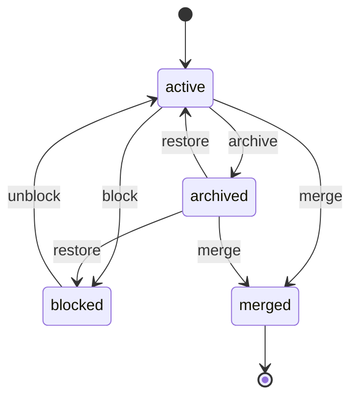
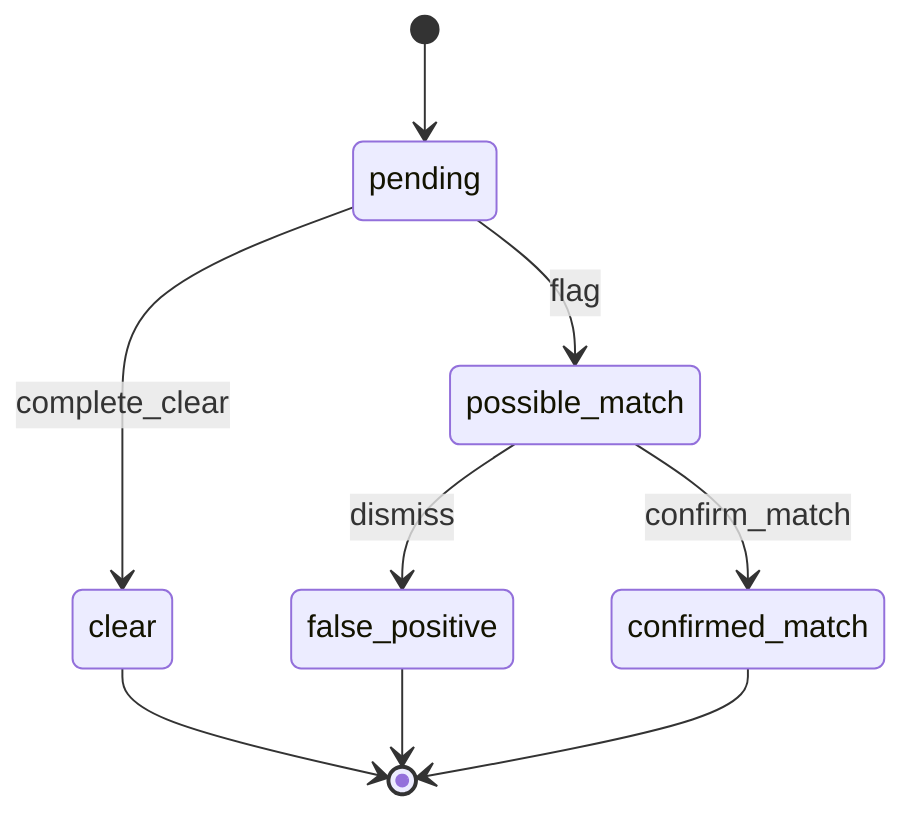
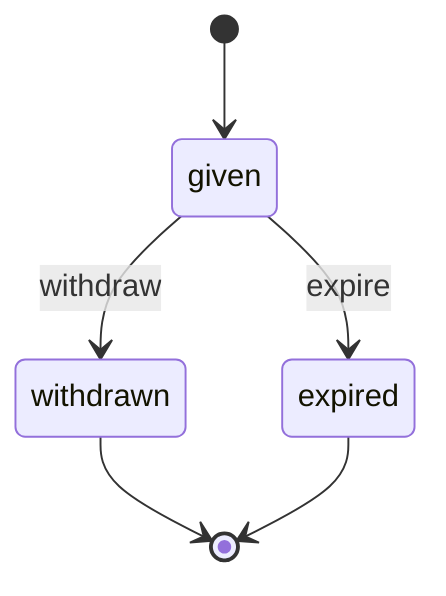

# wl-parties

> Status: draft · Last updated: 2026-10-16

## 1. Purpose

Every vertical deals with outside companies and people: tenants, owners, clients, suppliers,
patients, students, guardians, carriers, workers. `wl-parties` keeps **one register of parties**
for the whole deployment. It holds identity data, the links between parties, consents,
beneficial ownership and sanctions screening. Each other module refers to a party instead
of keeping its own copy of names, IDs and contacts. A party can have several roles at once,
for example a company that is both a client and a supplier, or a person who is a patient and
the guardian of two children.

## 2. Capabilities covered

| ID | Capability | Used by verticals | Scope |
|---|---|---|---|
| `PTY.PTY.01` | Register of parties: companies and individuals in any role | 01–10 (all MVP) | MVP |
| `PTY.KYC.01` | Identity fields: Emirates ID, passport, visa, trade licence, TRN | 01, 02, 03, 04, 05, 07, 08, 09, 10 (MVP) | MVP |
| `PTY.REL.01` | Links between parties: guardian and dependant, family, contact of a company, group | 04 (client groups), 05, 08 (credit groups), 10 (MVP); used implicitly by every vertical with company contacts | MVP |
| `PTY.CNS.01` | Recorded consents per party and purpose, with withdrawal | 05, 06 (customer marketing consent), 10 (guardian consent for minors' data and photos) (MVP) | MVP |
| `PTY.UBO.01` | Ownership structure and ultimate beneficial owners | 04 (MVP) | MVP |
| `PTY.SCR.01` | Sanctions and watch-list screening with re-screening log | 04 (MVP) | MVP |

`PTY.UBO.01` and `PTY.SCR.01` are switched off by default and enabled per vertical
([§7](#7-configuration-per-client)). Only 04 enables them; 01 manages property and has no
broker activity, so it does not.

06 and 10 do not list `PTY.CNS.01`, but their documents need recorded consent: 06 keeps a
marketing consent per direct-order customer (`NTF.ACL.01`), and 10 captures guardian consent
for minors' data and photos with the enrolment terms (`DOC.SIG.01`). Both would use the same
Consent record, so withdrawal reaches `wl-notify` at once.

## 3. Concepts and entities

| Entity | Description | Important fields |
|---|---|---|
| **Party** | A company or a natural person known to the business | kind (`person` / `company`), display name, legal name EN, legal name AR, status, roles, default language, preferred channel, custom fields |
| **Party role** | What the party is to this business; a party can have several | party, role key (from the vertical's role list, e.g. `tenant`, `supplier`, `patient`), since, until, external reference (e.g. MRN, customer code) |
| **Contact point** | A way to reach the party | party, type (email / mobile / landline / address), value, label, primary flag, verified at; addresses carry emirate, area, building, Makani number |
| **Identity record** | Structured identity fields (`PTY.KYC.01`) | party, type (Emirates ID / passport / residence visa / trade licence / TRN / driving licence / other), number, issuing country or authority, issue date, expiry date, linked document (`wl-documents`), sensitivity flag |
| **Person details** | Fields that only a person has | date of birth, gender, nationality, profession |
| **Company details** | Fields that only a company has | legal form, licence authority (e.g. DED, free zone), licence activities, registration date, VAT registered flag, e-invoicing recipient identifier (Peppol participant ID; stored as entered, scheme + identifier, trimmed, with no format check until the ASP's format is confirmed, entered by hand or looked up by the company's TRN through the ASP adapter of the legal entity linked to the user's scope: a found ID is filled in for the user to confirm before saving; "not found", an error, or an ASP connection that is not `up` leaves the field empty for entry by hand; required by `wl-invoicing` before an invoice to a recipient in e-invoicing scope is issued; a change emits `PartyUpdated`, so rejected transmissions can be resubmitted) |
| **Relationship** | A directed link between two parties (`PTY.REL.01`) | from party, to party, type (`guardian_of`, `contact_of`, `employee_of`, `shareholder_of`, `family_member_of`, `member_of_group`), position (for contacts), primary flag (at most one per to party, type and position; `wl-notify` picks it first when a message goes to a contact of the party), valid from, valid until, end reason |
| **Ownership** | Beneficial ownership of a company (`PTY.UBO.01`) | company, owner party, ownership %, control type (shares / votes / other control / senior managing official), is UBO, effective from, effective until, source document |
| **Consent** | A recorded consent (`PTY.CNS.01`) | party, purpose (from the configured list), channel (email / SMS / WhatsApp / all), status, given at, given by (party or guardian), source (portal, form, staff), notice version, evidence document, withdrawn at |
| **Screening** | One check of a party against sanctions lists (`PTY.SCR.01`) | party, lists and list versions used, run at, trigger (onboarding / list update / review / manual), method (*automatic*, or *manual*: checked by a person against a PDF-only list, [§5.4](#54-beneficial-owners-and-screening-when-enabled) step 8), status, match candidates (name, list, score), reviewer, review note, stale list flag (a list used was older than the freshness limit, `PTY.RUL.02`) |
| **Merge record** | Trace of a duplicate merged into a surviving party | survivor, merged party, merged at, by, moved references |
| **Block record** | Why and when a party was blocked; one per `block`, and one per confirmed screening match on a party that is already `blocked` or `archived` (added without a transition, [§5.6](#56-block-a-party)) | party, reason code, restricted (from the reason code), note, blocked by, blocked at, unblocked by, unblocked at, unblock note. Restricted records are readable only under `PTY.ACL.02` |
| **Sanctions list** | One list source used by screening (`PTY.SCR.01`) | name (e.g. UN Consolidated List, UAE Local Terrorist List), source, format, last download attempt, last successful update, list version or date, update source (download / manual upload, uploaded by), status (`current` / `stale`), last error |

**Parties, staff users and portal users** (see [ACCESS-CONTROL.md](../ACCESS-CONTROL.md) §2):

- A **staff user** is a Renox user. It is not required to be a party. When the staff member is
  also managed as an employee (`wl-hr`), the employee record links the user to a person party.
- A **portal user** is a Renox user of the external kind, linked to **exactly one person party**:
  the person who logs in (`PLT.ACL.05`). What else they may see comes from **relationships**:
  - a person who is `contact_of` a company acts for that company;
  - a person who is `guardian_of` a dependant acts for the dependant.

  `wl-portal` turns those relationships into portal access grants with portal roles.
- A company never logs in. Its contacts do, each with their own login.
- **Devices and API clients** are not parties. Their tokens are issued to a party
  (e.g. a logistics client's integration) and inherit that party's `OWN` scope.

**Company groups.** A group (holding and subsidiaries, or companies under one owner) is a
company party; each member is linked to it with `member_of_group`. 04 uses groups so that
one portal user, such as a group CFO, holds a grant per member company and switches between
them (`wl-portal`). 08 uses them for a combined credit limit (`SAL.CRD.01`, `wl-sales`).
Rights and limits stay per company; the group only links them.

Verticals add their own data in their own tables keyed by party, for example a patient's
MRN and insurance cards, or a worker's trade. They do not add columns to Party.

## 4. Lifecycles

### Party

| State | Tone | Terminal | Meaning |
|---|---|---|---|
| `active` | success | no | Usable in every module |
| `blocked` | error | no | New business is not allowed (confirmed sanctions match, fraud, compliance hold). Existing records stay visible. Shown as **On hold** with the neutral reason to users without `PTY.ACL.02`; never shown in the portal |
| `archived` | neutral | no | No longer used; hidden from pickers; kept because records depend on it (`PLT.ACL.07`) |
| `merged` | neutral | yes | Was a duplicate; all references moved to the survivor |

| Transition | From | To | By | Guards | Effects |
|---|---|---|---|---|---|
| `block` | active | blocked | `parties.block`, or system (screening `confirm_match`) | reason code and note given; a restricted reason code needs `parties.block_reason.view` (`PTY.ACL.02`) | Block record kept; event `PartyBlocked` with the display reason (the neutral code `on_hold` when the real code is restricted); modules refuse new orders, leases, bookings and invoices for the party and apply the block effect per active agreement ([§5.6](#56-block-a-party)); money out to the party stopped (`PTY.ACL.03`); no automatic message to the party |
| `unblock` | blocked | active | `parties.block`; for a restricted reason code also `parties.block_reason.view` | reason given; approver ≠ the user who blocked each open Block record (`SOD`; for a block made by `confirm_match`, the reviewer who ran `confirm_match`); for a sanctions block, the party is no longer listed or the match was found false (note and evidence recorded) | every open Block record closed; event `PartyUnblocked`; agreements paused by the block resume and agreements under review are returned to their deciders ([§5.6](#56-block-a-party)) |
| `archive` | active | archived | `parties.archive` | no open records in any module (modules answer through the `PartyUsage` service) | portal access grants closed; event `PartyArchived` |
| `restore` | archived | active, or blocked when the party has an open Block record | `parties.archive` | — | event `PartyRestored`; when it lands in `blocked`, also `PartyBlocked` with the display reason, and only `unblock` (with its guards) makes the party `active` |
| `merge` | active, archived | merged | `parties.merge` | survivor chosen; survivor is not `merged`; same kind | references in every module moved to the survivor; event `PartiesMerged` |

### Screening

| State | Tone | Terminal | Meaning |
|---|---|---|---|
| `pending` | neutral | no | Queued or running |
| `clear` | success | yes | No candidate above the match threshold |
| `possible_match` | warning | no | At least one candidate needs a human decision |
| `false_positive` | success | yes | Reviewed: not the same person or entity |
| `confirmed_match` | error | yes | Reviewed: a true match |

| Transition | From | To | By | Guards | Effects |
|---|---|---|---|---|---|
| `complete_clear` | pending | clear | system; for a manual check, the result recorded by `screening.review` | no candidate ≥ threshold (manual: the reviewer records "no match") | event `ScreeningCompleted` |
| `flag` | pending | possible_match | system; for a manual check, the result recorded by `screening.review` | candidate ≥ threshold (manual: the reviewer records a candidate with the list entry) | task for the compliance role, visible only under `PTY.ACL.02`, due 24 hours after the flag (`PTY.RUL.01`); when a task for the party is already open, no second task: the new run is linked to it; event `ScreeningCompleted`, delivered only to compliance listeners for `possible_match` (other listeners get nothing until the decision) |
| `dismiss` | possible_match | false_positive | `screening.review` | review note given | — |
| `confirm_match` | possible_match | confirmed_match | `screening.review` | review note given; second reviewer approves (`SOD`, `PLT.APR.01`) | party `block` with reason code `sanctions` (restricted); when the screened party is a UBO, director or signatory of a company party (ownership or relationship records), that company is blocked too with the same restricted reason (setting, on); a party or company already `blocked` or `archived` gets a new restricted Block record `sanctions` without a transition ([§5.6](#56-block-a-party) step 4);  **freeze task** and **report task** for the compliance role ([§5.4](#54-beneficial-owners-and-screening-when-enabled)); event `ScreeningMatchConfirmed`; never shown to portal users or client-facing staff |

A new screening run creates a new Screening record. The history of runs is the screening log.

### Consent

| State | Tone | Terminal | Meaning |
|---|---|---|---|
| `given` | success | no | Valid for its purpose and channel |
| `withdrawn` | neutral | yes | Withdrawn by the party or their guardian |
| `expired` | neutral | yes | The purpose has a validity period and it passed |

| Transition | From | To | By | Guards | Effects |
|---|---|---|---|---|---|
| `withdraw` | given | withdrawn | the party or guardian (portal), or `consents.record` on their instruction | — | event `ConsentWithdrawn`; `wl-notify` stops that purpose and channel at once |
| `expire` | given | expired | system | validity end reached | event `ConsentWithdrawn` (reason `expired`) |

Giving consent again creates a new Consent record. Old records are kept as evidence.

### Relationship

A relationship is either current (`valid until` empty or in the future) or ended. It ends:

- by `relationships.manage`, with a reason;
- by the system, when the configured age threshold is reached for `guardian_of` (from
  `PTY.ACL.01`, formerly `CLN.ACL.06` and `EDU.ACL.02`);
- by an owning record ending, e.g. a contact leaving a company.

Ending emits `RelationshipEnded`. `wl-portal` reacts by closing the related access grants.

Ownership records carry effective dates and are never edited in place. A change ends the old
record and starts a new one, so the UBO register keeps its history.

## 5. Workflows

### 5.1 Create or find a party

1. Staff, an import, or a portal self-registration submits a party.
2. The **duplicate check** runs on the configured keys: Emirates ID, passport number +
   nationality, trade licence number + authority, TRN, mobile, email. It also does a fuzzy
   name match in English and Arabic.
3. If candidates are found, the user picks an existing party or confirms "new". Confirming
   "new" despite a strong match needs `parties.merge` or is recorded for review.
4. The vertical's **KYC requirements** for the role and kind are checked, e.g. a company
   tenant needs a trade licence and a TRN when VAT-registered. Missing items are listed on the
   party and block the guarded transitions in other modules (e.g. lease `submit`).
5. Identity documents are uploaded through `wl-documents`. Their expiry dates feed
   `DOC.EXP.01`.

### 5.2 Company with contacts

1. A company party is created.
2. Each person who deals with the business is created as a person party and linked with
   `contact_of`, with a position (e.g. finance manager).
3. In `wl-portal`, a contact can be invited with portal roles for the company.

### 5.3 Guardian and dependant

1. The guardian and the dependant are created as person parties. The dependant's date of
   birth is required.
2. A `guardian_of` relationship is recorded with the basis (parent, legal guardian, other)
   and an evidence document if the vertical requires one.
3. The guardian can act for the dependant in the portal, give consents on their behalf, and
   receive their invoices if billing is delegated.
4. At the configured age the relationship ends, unless it is renewed with the dependant's
   own consent.

### 5.4 Beneficial owners and screening (when enabled)

1. For a company party, shareholders and controllers are recorded as ownership records
   until the natural persons at the top are reached. Persons at or above the threshold, or
   with control, are marked UBO.
2. The party and its UBOs, directors and signatories are screened against the configured
   lists.
3. A possible match creates a review task. A confirmed match blocks the party, and the
   compliance role continues in the vertical's own process (e.g. the accounting AML case).
4. Parties are screened again when a list is updated (`PTY.RUL.01`) and at the review date
   set by the vertical (e.g. `ACC.RUL.05`).
5. **Possible match.** The compliance role gets a task visible only under `PTY.ACL.02`, due 24
   hours after the flag. Until it is decided, nothing visible changes for other staff.
6. **Confirmed match.** `confirm_match` (with the second reviewer) blocks the party with the
   restricted reason code `sanctions` and opens two tasks for the compliance role, both visible
   only under `PTY.ACL.02`:
   - **Freeze task**, due 24 hours after the possible match was flagged: confirm that the
     block took effect, list the funds and assets the business holds for the party and its
     agreements (client money, deposits, retainers, prepaid packages, open refunds; pre-filled
     from the modules' open balances, confirmed by hand by the compliance role), and
     record the freeze time. Money out is already refused (`PTY.ACL.03`). The 24-hour duty is
     verified ✔ [S6]; whether the 24 hours run from the list update or from the match is
     `⚠ open: lawyer (L-30)`, so the task uses the earlier start (the flag) by default.
   - **Report task**: notify the supervisor of the freeze and record the reference and date.
     The duty to notify after freezing is verified ✔ [S6]; suspicious transaction reports go
     through goAML ✔ [S5], [S10]. The exact report form and its deadline are
     `⚠ open: lawyer (L-30)`, so the task's due date is a parameter (default: same 24 hours).
   The vertical's own process continues from there (e.g. the 04 AML case).
7. **List freshness.** Each Sanctions list shows its last successful update and version on
   the screening page and on every Screening record. If a download fails, or a list has not
   been updated for N hours, `PTY.RUL.02` alerts the compliance officer. Screenings run while
   a list is stale are marked with the stale list flag and run again after the next
   successful update. A download that returns the version already held counts as a
   successful update (it refreshes the last successful update and clears the stale status) but
   emits no `SanctionsListUpdated`, so nothing is re-screened. A stale list warns at
   onboarding by default; a vertical can make it
   block the guarded transition (e.g. engagement `activate`).
8. **Manual list upload (fallback).** Only while the list is stale (a download fails or the
   freshness limit has passed), the compliance role may upload
   the official file downloaded by hand from the issuing authority's site (the format the
   list uses: XML, Excel; a PDF-only list is checked by hand and the check recorded on the
   Screening as *manual*: a holder of `screening.review` uses *Record manual check* on the
   party, names the list and its date, and records "no match" (`complete_clear`) or a
   candidate with the list entry (`flag`); the Screening has method *manual* and the
   reviewer as the person who ran it). The upload records who uploaded it, the source URL and the list
   date; a file whose list date is older than the current version is refused. It becomes the
   current version with source *manual upload*, clears the stale
   status and triggers the re-screening of `PTY.RUL.01` like a download.
9. **Related persons.** A confirmed match on a UBO, director or signatory blocks the company
   they belong to as well (step 6 applies to it: freeze and report tasks name both). The
   vertical continues from there (04: `ACC.RUL.12` opens the AML case).

### 5.5 Consent

1. Consents are captured at registration, on a form, or in the portal, per purpose and
   channel, with the version of the notice shown.
2. `wl-notify` checks consent before sending anything with a consent-based purpose
   (marketing, surveys). Service messages, such as invoices and appointment reminders, rely on
   the contract, not on consent. Each template declares its purpose.
3. Withdrawal is possible at any time from the portal or through staff, and takes effect
   immediately.

### 5.6 Block a party

1. A user with `parties.block` (or the system on `confirm_match`) blocks the party with a
   reason code and a note. Reason codes are configured; each has a **restricted** flag
   (defaults in [§7](#7-configuration-per-client)). The neutral code `on_hold` is always
   available and is what everyone without `PTY.ACL.02` sees, whatever the real code.
2. Every module that holds agreements with the party reacts to `PartyBlocked` with the
   **block effect** configured for that kind of agreement:
   - **pause**: the agreement stays, service and billing stop, and it resumes on `unblock`;
   - **continue**: the agreement runs to its normal end; renewal and extension are refused;
   - **review**: nothing changes on its own; the decider gets a task to pause, continue or end.
     wl-parties opens one task per agreement kind per party for the decider role in the
     agreement's scope, listing the open agreements with the actions pause, continue or end;
     for a restricted reason the task shows only *On hold*.

   An agreement kind that no module registered gets the effect *review* (the safest).

   No agreement is ended automatically. **Stopping** (ending) an agreement is always a
   decision of the decider listed below, through the agreement's own `end`, `cancel` or
   `withdraw` transition, with its normal money effects (final invoice, refund or credit),
   except that money out to the party waits for unblock or an approved exception
   (`PTY.ACL.03`).
3. The pause or hold reason recorded on each agreement is the neutral `on_hold`, never the
   real reason. For a restricted code the party's own state history of the `block` stores
   `on_hold` too; the real code and the note live only in the Block record. Automatic messages to the party that would announce the pause are suppressed;
   the decider chooses what to tell the party, with a neutral template.
4. `block` runs only from `active`. When `confirm_match` hits a party (or a related company)
   that is already `blocked`, the system adds a new restricted Block record `sanctions`
   without a transition; the party stays `blocked`, and the freeze and report tasks name it.
   When the party is `archived`, it stays `archived`; a restricted Block record is still
   created and named in the freeze task, and a later `restore` brings the party back as
   `blocked`, never `active`. `unblock` closes every open Block record of the party, so its
   guards apply to each of them (restricted reason, sanctions evidence, SoD).

| Agreement kind | Owner | Default effect | Stop (end) decided by | Verticals |
|---|---|---|---|---|
| Engagement | 04 vertical | pause (engagement `suspend`; tasks frozen) | compliance role (MLRO), then the engagement's normal `end` approver | 04 |
| Subscription, retainer | `wl-invoicing` | pause (system `pause`, pause allowance ignored; no cycle invoices, no automatic charge) | `subscriptions.manage` holder named by the vertical | 04, 06, 10, others |
| Enrolment | 10 vertical | pause (`freeze` without the freeze-day limit; seat kept) | centre manager | 10 |
| Lease | 01 vertical | continue (the tenant's rights under the lease do not end because of a block); renewal and new leases refused | property manager; ending a lease follows the tenancy law and the 01 process | 01 |
| Deployment | 09 vertical | continue for `active`; `planned` ones are not activated | the vertical's decider (09: MD), per the client contract | 09 |
| Project | 02 vertical | continue: work, IPAs and variations go on; no new project is started for the party; money out stops (`PTY.ACL.03`) | the vertical's decider (02: MD), through the project's `terminate` | 02 |
| Sales orders | `wl-sales` | pause: orders not yet dispatched are held (no dispatch, no new invoice); dispatched orders complete | sales manager (`cancel` or release after unblock) | 03, 06, 07, 08 |
| Bookings | `wl-scheduling` | review: future bookings listed for the decider; no new bookings | branch or clinic manager | 05, 10 |
| Purchase orders (party as supplier) | `wl-inventory` | continue: issued POs may still be received; no new PO and no revision that raises the total or extends the delivery date; supplier payments stop (`PTY.ACL.03`) | procurement (`cancel` or `short_close`) | 02, 06, 07, 08 |
| Service contracts (party as vendor) | `wl-ticketing` | review: no new visits assigned; planned visits listed for reassignment | facility manager | 01, 02 |
| Money out (refunds, payouts, deposit returns, supplier payments) | `wl-payments` | stop until unblock (`PTY.ACL.03`) | compliance role, through an approved exception | all |
| Money in | `wl-payments` | continue: receipts are recorded; for a restricted reason they are not refunded or paid on, and the compliance role decides | compliance role | all |

The verticals set the effect and the decider for their own agreement kinds; the defaults
above apply when they do not.

## 6. Interfaces to other modules

**Provides**

| Service | Purpose |
|---|---|
| `PartyDirectory` | Find, create, de-duplicate parties; resolve a party's display name in the user's language; billing identity for `wl-invoicing` (legal names, TRN, address, e-invoicing recipient identifier) |
| `PartyRoles` | Add or end a role; list parties by role |
| `Relationships` | `acting_for(person)` → parties this person may act for, with relationship type; used by `wl-portal` and `wl-notify` (guardians receive dependants' messages) |
| `Consents` | `has_consent(party, purpose, channel)`; record and withdraw |
| `KycStatus` | Missing KYC items for a party in a role; used as a guard by other modules |
| `Screening` | Screen a party now; latest result; used as a guard (e.g. engagement activation) |
| `PartyUsage` | Asks every module whether a party has open records (archive guard) and moves references on merge |
| `BlockGuard` | `check(party, action_kind)` with action kind `start`, `renew`, `extend` or `money_out`: allowed, or blocked with the display reason (neutral *on hold* without `PTY.ACL.02`) and the way to request an exception; every module calls it in the transitions `PTY.ACL.03` guards (e.g. PO `issue` in wl-inventory, vendor `assign` in wl-ticketing) |
| `BlockEffects` | Owning modules register each agreement kind with its default block effect and decider role; `effect_for(kind, scope)` returns the effect (pause / continue / review) and the decider role after the vertical's override ([§5.6](#56-block-a-party)); a kind nobody registered returns *review*; modules call it when they handle `PartyBlocked` |

**Consumes:** `wl-kernel` (Subject references, custom fields, settings, approvals, sequences
for party codes), `wl-documents` (identity documents and expiry), `wl-ticketing` (review
tasks for possible matches).

**Events emitted**

| Event | When | Payload |
|---|---|---|
| `PartyCreated` | a party is created | party, kind, roles, source |
| `PartyUpdated` | identity or contact fields change | party, changed fields (names only, never values of sensitive fields) |
| `PartyRoleAdded` / `PartyRoleEnded` | a role starts or ends | party, role |
| `PartyBlocked` / `PartyUnblocked` | status change | party, display reason code (`on_hold` when the real code is restricted; the real code stays in the Block record) |
| `PartyArchived` / `PartyRestored` | status change | party |
| `PartiesMerged` | merge completes | survivor, merged party |
| `RelationshipStarted` / `RelationshipEnded` | link starts or ends | from, to, type, reason |
| `ConsentGiven` / `ConsentWithdrawn` | consent changes | party, purpose, channel, given by |
| `OwnershipChanged` | ownership records change | company, UBO list changed flag |
| `ScreeningCompleted` | a run finishes | party, screening, status (emitted for `clear` and for the decisions; a `possible_match` run emits `ScreeningFlagged` instead, so other listeners get nothing until the decision) |
| `ScreeningFlagged` | a run ends `possible_match` | party, screening, status (no candidate names). Kernel event for compliance listeners only: Renox events are not delivered per listener, so a listener acts on it only after checking `parties.block_reason.view` |
| `ScreeningMatchConfirmed` | a match is confirmed | party, screening (delivered only to compliance listeners) |
| `SanctionsListStale` | a list download failed, or a list is older than the freshness limit (`PTY.RUL.02`) | list, last successful update, last error (delivered only to compliance listeners) |
| `SanctionsListUpdated` | a list downloaded successfully, or uploaded by hand, with a new version | list, version; triggers `PTY.RUL.01` |

**Attaches to:** parties are referenced by every module. Documents, tickets and notes attach
to a party as a `Subject` (`party`).

**Permissions**

| Permission | Allows |
|---|---|
| `parties.view` | See parties and their non-sensitive fields |
| `parties.create` / `parties.update` | Create and edit parties, contact points, roles |
| `parties.archive` | Archive and restore |
| `parties.merge` | Merge duplicates; override a duplicate warning |
| `parties.block` | Block and unblock |
| `parties.block_reason.view` | See and use restricted block reason codes and Block records; see compliance-only tasks (MLRO and deputy by default; `PTY.ACL.02`) |
| `parties.block_exception` | Approve an exception to `PTY.ACL.03` (compliance role) |
| `parties.export` | Export party lists (audited) |
| `kyc.sensitive.view` | See identity numbers and documents (each view audited) |
| `relationships.manage` | Create and end relationships |
| `consents.view` / `consents.record` | See consents; record consent or withdrawal on a party's instruction |
| `ubo.manage` | Maintain ownership records |
| `screening.run` / `screening.review` | Run screening; decide possible matches |

**Compliance role.** "Compliance role" and "compliance officer" in this document mean the same
role: the MLRO and the deputy by default (the vertical may name it otherwise). It holds
`parties.block_reason.view`, `parties.block_exception` and `screening.review`, and each action
checks its own permission: seeing restricted reasons, Block records and compliance-only tasks
needs `parties.block_reason.view`; approving an exception to `PTY.ACL.03` needs
`parties.block_exception`; deciding a possible match, recording a manual check and uploading a
list file need `screening.review`. Compliance tasks and alerts go to every user holding
`parties.block_reason.view`; an alert "at once" is an in-app alert and an email sent when the
event happens.

**Access rules** that apply to this module:

| Rule | Source | Notes |
|---|---|---|
| `PLT.ACL.05` | platform | external users link to exactly one person party |
| `PLT.ACL.06` | platform | identity data is sensitive: `kyc.sensitive.view`, audited views |
| `PRP.ACL.10`, `CLN.ACL.01`, `EDU.ACL.09`, `HRM.ACL.03` (formerly `CON.ACL.08`, `MPW.ACL.03`) | verticals, wl-hr | applications of `PLT.ACL.06` to identity, health and minors' data |
| `PRP.ACL.11` | property | owners do not see tenants' contact or identity data (`FLD`) |
| `ACC.ACL.05` | accounting | screening matches and AML data never reach client-facing staff or the portal |
| `PTY.ACL.01` (generalises `CLN.ACL.06`, `EDU.ACL.02`) | wl-parties | guardian access ends at the age of majority: 18 under Decree-Law 25 of 2025 |
| `NTF.ACL.01` (generalises `CLN.ACL.11`, `FNB.ACL.10`) | wl-notify | marketing lists only from consenting parties; export needs a permission |
| `PTY.ACL.02` | wl-parties | restricted block reasons (sanctions, AML) are visible only with `parties.block_reason.view`; everyone else sees **On hold** and the neutral code, and the portal sees no block at all (`SEN`, `FLD`; no tipping off) |
| `PTY.ACL.03` | wl-parties | while a party is blocked, no module starts, renews or extends an agreement with it or pays money out to it (refund, payout, deposit return, supplier payment) unless the compliance role approves an exception (`STA`, `LIM`) |

**Automations** that apply to this module:

| Rule | Source | Notes |
|---|---|---|
| `DOC.RUL.01` | shared (`wl-documents`) | identity document expiry reminders |
| `PTY.RUL.01` (generalises `ACC.RUL.08`) | wl-parties | re-screen active parties when a list is updated and at review dates; possible hits alert the compliance officer at once (24-hour freeze duty under Cabinet Decision 74 of 2020). Enabled when screening is on |
| `ACC.RUL.05` | accounting | periodic review triggers re-screening; stays in the vertical |
| `PTY.RUL.02` | wl-parties | a sanctions list download fails, or a list has had no successful update for N hours (default 24): alert the compliance officer at once (in-app and email), retry hourly, mark screenings run on the stale list and re-run them after the next update. Compliance-critical, like `PTY.RUL.01` (a failed run alerts the owner, wl-kernel §5.15). Enabled when screening is on |

## 7. Configuration per client

| Setting | Default |
|---|---|
| Party roles available | from the vertical (e.g. property: tenant, owner, vendor) |
| Required KYC items per role and kind | from the vertical |
| Arabic legal name required | off (on for verticals that issue Arabic contracts) |
| Duplicate keys | Emirates ID, passport + nationality, trade licence + authority, TRN, mobile, email |
| Party code format | `P-{00000}` |
| Consent purposes | `marketing`, `surveys`, `data_sharing_with_payer` (clinics) — from the vertical |
| Guardian age threshold | 18, the age of majority under Federal Decree-Law 25 of 2025 (from 1 June 2026) |
| Beneficial ownership | off (on in accounting) |
| UBO threshold | 25% (Decree-Law 10 of 2025 Art. 10; Cabinet Resolution 109 of 2023) ✔ [S5], [S7] |
| Screening | off (on in accounting); lists: UN consolidated list, UAE Local Terrorist List |
| Screening match threshold | 0.85 similarity; a candidate scoring at or above it flags (`WlParties::match_threshold`) |
| Second reviewer for confirmed match | on |
| Block reason codes (restricted flag) | `on_hold` (neutral, always present), `non_payment`, `legal_dispute`, `fraud_suspected`, `other`; restricted: `sanctions`, `aml_concern`. A vertical can add codes and mark them restricted |
| Block effect and decider per agreement kind | as in [§5.6](#56-block-a-party); set by each vertical |
| Agreement kind keys, default effect and default decider role (`wl_kernel::block_effects`) | `engagement` pause, `compliance`; `subscription` pause, `subscriptions_manager`; `enrolment` pause, `centre_manager`; `lease` continue, `property_manager`; `deployment` continue, `managing_director`; `project` continue, `managing_director`; `sales_order` pause, `sales_manager`; `booking` review, `branch_manager`; `purchase_order` continue, `procurement`; `service_contract` review, `facility_manager`; `money_out` pause, `compliance`; `money_in` continue, `compliance`. A decider is a role key; the host or the vertical defines the role. A module registers a kind with `AgreementKind`, the vertical overrides it with `BlockEffectOverride`; an unregistered kind is `review` with no decider |
| Money out to a blocked party in the effect registry | stored as `pause`: "stop until unblock" (`PTY.ACL.03`) stops and resumes on unblock; only an approved exception releases it earlier |
| Exception approver for money out to a blocked party (`PTY.ACL.03`) | compliance role; finance manager when screening is off |
| Sanctions list freshness limit (`PTY.RUL.02`) | 24 hours |
| Manual upload of an official list file when the download fails | allowed, compliance role (`screening.review`) |
| Confirmed match on a UBO, director or signatory also blocks the company party | on |
| Stale list at onboarding | warn (option: block the guarded transition) |
| Freeze task due | 24 hours after the possible match was flagged. A `WlParties` builder, `freeze_task_due_hours(i64)`; a change affects only tasks created afterwards |
| Report task due | 24 hours after the possible match was flagged (`⚠ open: lawyer (L-30)` on the real deadline). A `WlParties` builder, `report_task_due_hours(i64)`; the L-30 default is the earlier start (the flag), and nothing about the form or deadline is hard-coded |
| Confirmed-match settings in code | three parameters on `WlParties`: `related_company_block(bool)` (default on), `freeze_task_due_hours(i64)` (default 24) and `report_task_due_hours(i64)` (default 24), read together as `ConfirmedMatchSettings` |
| Held funds for the freeze task (`wl_kernel::held_funds`) | A module that holds a party's money registers a `HeldFundsSource` with a `FundsSource` in its `register()`, as agreement kinds are registered. `held_for(state, party)` is read only and returns `HeldFund` lines (label, kind, amount in fils, currency); wl-parties calls every source for each party named and writes the lines as unconfirmed, and the compliance role confirms or edits them. No source registered: an empty list. A source error is returned, not swallowed |

## 8. Extension points

- **`PartyRoleDefinition`**: a vertical registers its roles, their labels, required KYC
  items and the views that show role-specific data on the party page.
- **`DuplicateMatcher`**: replace or extend duplicate detection (e.g. a clinic matching on
  MRN).
- **`KycRequirement`**: rules that decide which items are mandatory for a role, kind and
  context (e.g. VAT-registered companies need a TRN).
- **`ScreeningProvider`**: source of lists and matching. The default downloads official lists.
  A commercial provider can be plugged in later.
- **`ConsentPurpose`**: verticals register purposes, their channels and validity.
- **Events** listed in §6.
- **Overridable views**: `wl-party-card`, party page sections, the duplicate dialog.
- **Custom fields** on Party, per role (through `wl-kernel`).

## 9. Renox fit

| Need | Renox provides | Gap (→ ARCHITECTURE §4a) |
|---|---|---|
| Models, validation, forms, import from Excel | Models, `#[model(form)]`, import | — |
| Encrypted identity numbers | `Encrypted<String>` (used in the bike shop's ID check) | — |
| Audit of changes | `Audit` | Audit of **views** of sensitive fields → `wl-kernel` |
| Per-record access (`OWN`) | Policies, `scopes_with` | — |
| Full-text search on names | Search | R22: Arabic text normalisation (diacritics, alef/ya forms) and Latin–Arabic transliteration for name search and duplicate matching |
| Arabic names and RTL forms | — | R1 |
| Data subject rights (download, delete) | Account privacy (download, delete) as in the bike shop | Extending it from users to parties without logins → `wl-parties` |
| Settings for thresholds and lists | — | R2 |
| Review tasks, approvals | — | `wl-ticketing`, `PLT.APR.01` |

## 10. Compliance

- **PDPL (Federal Decree-Law 45 of 2021):**
  - every field kept must have a purpose;
  - consent where it is the legal basis;
  - access and correction requests are answered from the party page;
  - erasure is limited by retention duties (tax, AML, health).

  The PDPL executive regulations are not confirmed as published on the official legislation
  portal, so detailed rules (deadlines, formats) may still change `⚠ open: lawyer (L-01)`. The PDPL
  does not apply in the DIFC and ADGM, which have their own laws (DIFC Data Protection Law 5
  of 2020, ADGM Data Protection Regulations 2021) ✔ [S1]. Which clients fall under them is
  checked per client.
- **Emirates ID and passport copies:** keep only when the vertical has a legal or
  contractual need. Store them encrypted and audit every view. ICP forbids private entities
  to hold the card itself or take it as collateral; keeping a copy or its data is processing
  under PDPL and needs a lawful, defined purpose ✔ [S2]. No ICP rule banning all copies was
  found.
- **Health data (clinics):** identity is linked to health data, so the health data law
  applies (UAE storage, at least 25 years from the last procedure) ✔ [S3], and in Abu Dhabi
  ADHICS v2.0, which covers SaaS systems used by facilities ✔ [S4]. Decided (2026-10-15,
  05 §13): the 25 years apply to all patient data, including bookings, claims, payments and
  consents, counted from the patient's last visit; automatic deletion is off for patients.
- **AML/CFT (DNFBPs):** customer due diligence, beneficial ownership (Cabinet Decision on
  beneficial owner procedures), targeted financial sanctions screening against the UN list
  and the UAE Local Terrorist List, with no tipping off. The law is Decree-Law 10 of 2025
  with Cabinet Resolution 134 of 2025; beneficial owners hold 25% or more; CDD is reviewed by
  risk (the cycle is firm policy) ✔ [S5]. Sanctions matches are frozen within 24 hours
  (Cabinet Decision 74 of 2020) ✔ [S6]. UBO registers follow Cabinet Resolution 109 of 2023
  ✔ [S7].
- **No tipping off:** a block for sanctions or AML reasons must not reveal the suspicion to
  the party ✔ [S5]. The real reason is kept in a restricted Block record (`PTY.ACL.02`);
  staff, events, agreement reasons, documents and the portal show only the neutral "On hold";
  automatic messages that would announce the pause are suppressed ([§5.6](#56-block-a-party)).
- **Freeze and report:** a confirmed match opens a freeze task and a report task
  ([§5.4](#54-beneficial-owners-and-screening-when-enabled)). Freezing within 24 hours and
  notifying the supervisor are verified ✔ [S6]. Open: whether the 24 hours count from the
  list update or the match, and the report form and deadline `⚠ open: lawyer (L-30)`.
- **List freshness:** screening must follow list changes at once ✔ [S6], so a failed or late
  list download alerts the compliance officer and stale results are re-run (`PTY.RUL.02`).
- **Minors:** consent by a guardian below the age threshold. The PDPL sets no age of its own;
  the age of majority is 18 under Decree-Law 25 of 2025 (from 1 June 2026) ✔ [S8], and the
  same age is used for health. Any separate health-regulator age for consent
  `⚠ open: lawyer (L-04)`.
- **Retention:** parties referenced by tax, AML or health records are archived, never
  deleted, for the longest applicable period: tax 5 years (7 for corporate tax, 15 for real
  estate VAT) ✔ [S9], AML at least 5 years after the relationship ends ✔ [S5], health at
  least 25 years ✔ [S3].

## 11. Out of scope

- **Leads and sales pipeline:** `wl-sales` (`SAL.CRM.01`). A lead becomes a party when it
  converts.
- **Employee HR data:** salary, visa cases, leave. These live in `wl-hr`, which links an
  employee to a person party.
- **Clinical data:** the clinic's EMR.
- **Credit limits and payment terms:** `wl-sales` (`SAL.CRD.01`) and `wl-invoicing`.
- **Bank account details for refunds and payouts:** `wl-payments`, as sensitive data.
- **Identity verification services** (UAE PASS, Emirates ID card readers, liveness checks):
  Later, as an extension through `KycRequirement`.
- **The vertical's own due-diligence process** (CDD risk rating, AML cases): accounting app.

## 12. Open questions

1. Should portal self-registration create a party immediately, or a pending one until staff
   confirm it (clinics, EdTech, F&B)? *(us)*
2. Is a commercial screening provider needed at launch for accounting firms, or are the
   official lists enough? *(client, MLRO)*
3. Which free zones (DIFC, ADGM) apply their own data protection law to our clients, and
   what changes? *(lawyer)*
4. ~~Should brokers in the property vertical enable UBO and screening as DNFBPs?~~ Decided
   (2026-10-15, review of 01): no. 01 covers property management without brokerage and was
   accepted without `PTY.UBO.01` and `PTY.SCR.01`. *(client)*
5. Do any clients need party data shared across several deployments (a group of
   companies)? Today each deployment has its own register. *(client)*

## Sources

Checked 2026-10-15. *Official* = government or legislation; others are secondary.

| # | Source | Type | Used for |
|---|---|---|---|
| S1 | DLA Piper, "Data protection laws in UAE", https://www.dlapiperdataprotection.com/countries/uae-general/law.html; CMS, "ADGM Data Protection Regulations", https://cms.law/en/are/legal-updates/ADGM-Data-Protection-Regulations-what-businesses-need-to-know | Secondary | PDPL executive regulations status; DIFC and ADGM regimes |
| S2 | Khaleej Times, "UAE Emirates ID is not just a card" (2 July 2026, quoting ICP), https://www.khaleejtimes.com/uae/uae-emirates-id-fraud-risks-data-protection-guide | Secondary | Holding Emirates ID cards and copies |
| S3 | Federal Law 2 of 2019 on ICT in health fields and Cabinet Resolution 32 of 2020 (see [05-clinics.md](../verticals/05-clinics.md) S3) | Official | Health data storage in the UAE, 25-year retention |
| S4 | DoH, "ADHICS v2.0", https://www.doh.gov.ae/-/media/78A323607B4C4ACAA58D0C9ACCFB3D59.ashx | Official | ADHICS covers SaaS systems |
| S5 | MoET, "Financial crimes legislation", https://www.moet.gov.ae/en/financial-crimes-legislations (Decree-Law 10 of 2025, Cabinet Resolution 134 of 2025) | Official | AML law, UBO 25%, CDD, record retention |
| S6 | Cabinet Decision 74 of 2020; Executive Office, "UN and local lists", https://www.uaeiec.gov.ae/en-us/un-page | Official | Sanctions screening and 24-hour freeze |
| S7 | Cabinet Resolutions 109 of 2023 (beneficial owners) and 132 of 2023 (penalties), on the MoET page above | Official | UBO register |
| S8 | Federal Decree-Law 25 of 2025 (Civil Transactions Law), Art. 84, via Khaleej Times and BSA (see [05-clinics.md](../verticals/05-clinics.md) S8) | Secondary | Age of majority 18 |
| S9 | Cabinet Decision 17 of 2026 and Decree-Law 17 of 2025, via DLA Piper and PwC (see [04-accounting.md](../verticals/04-accounting.md) S9) | Secondary | Tax record retention |
| S10 | MoET news — 50 DNFBPs suspended for not registering on goAML (see [04-accounting.md](../verticals/04-accounting.md) S11) | Official | goAML registration and reporting channel |
