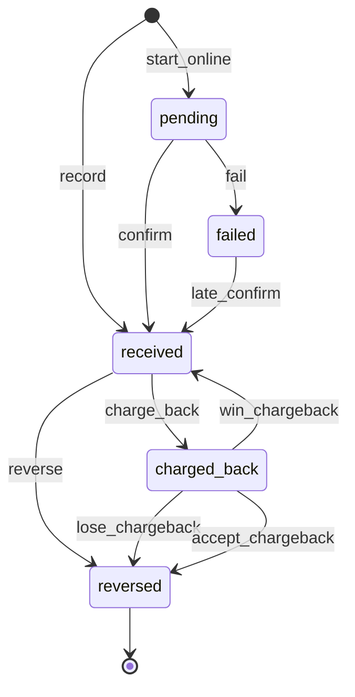
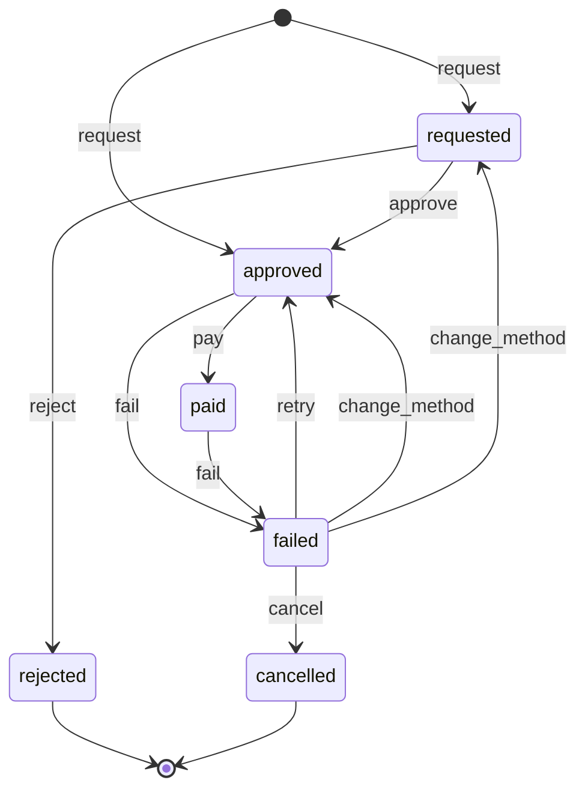
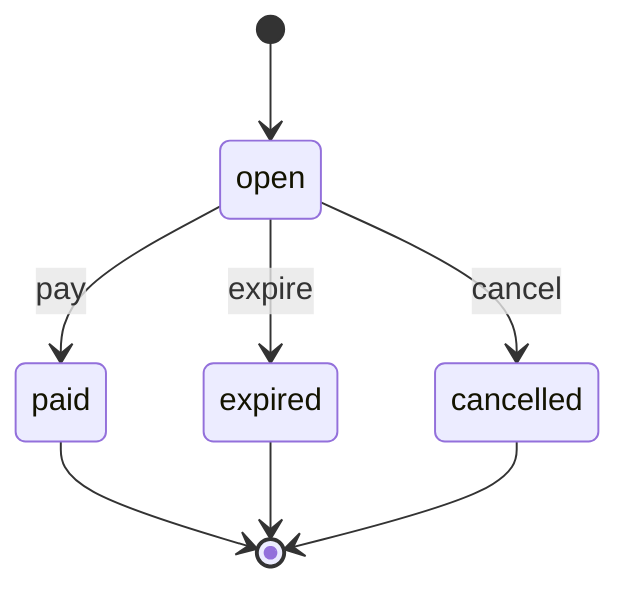
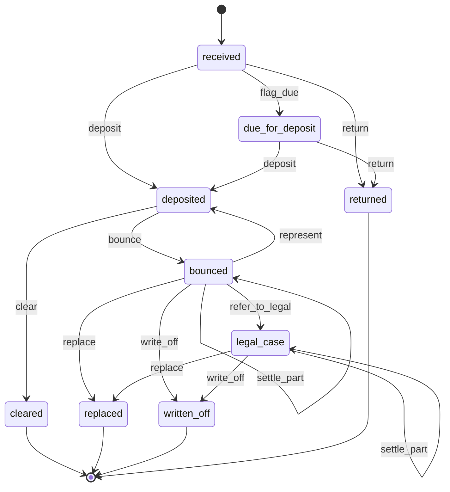
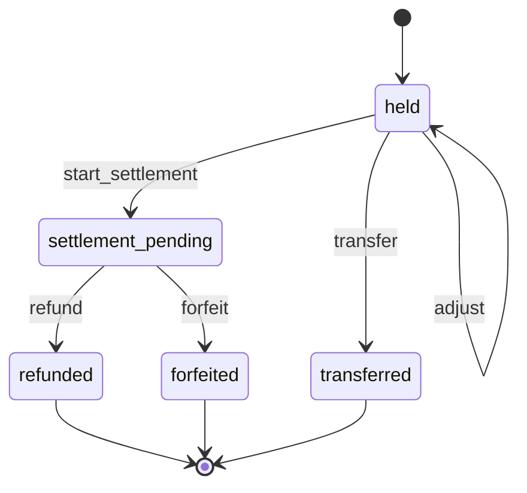
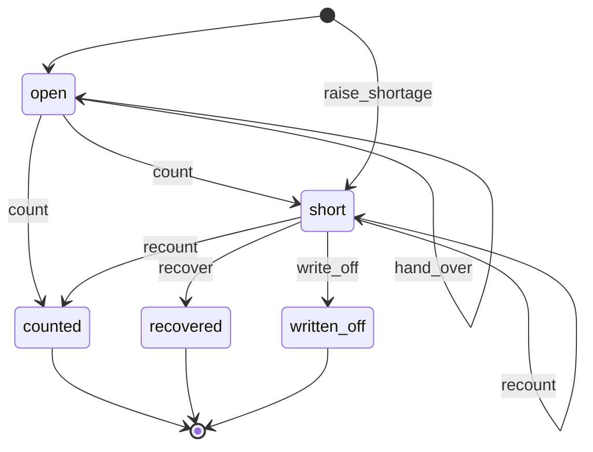
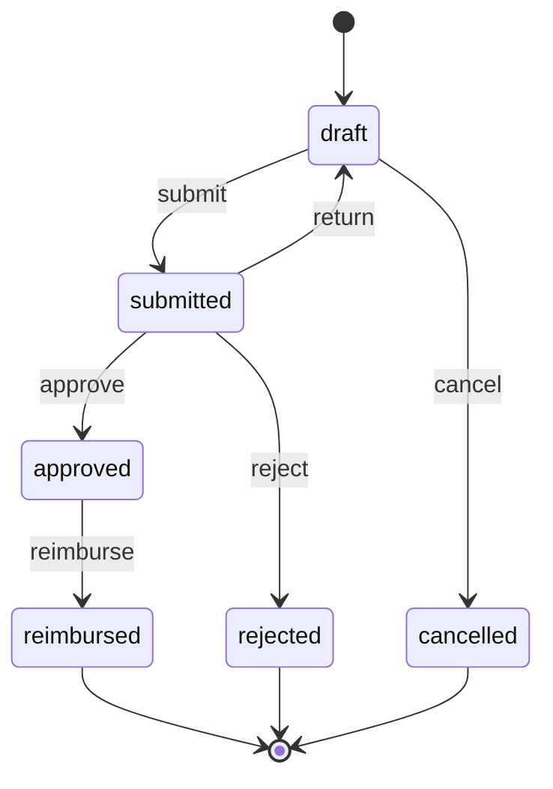
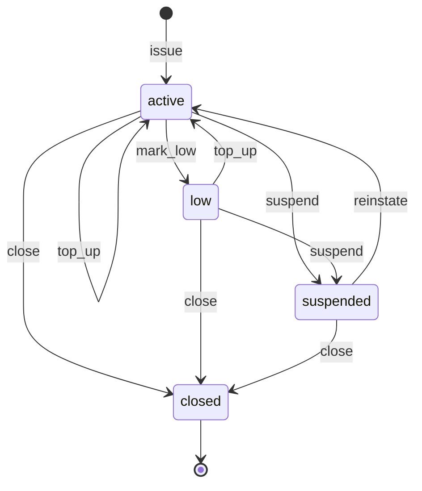
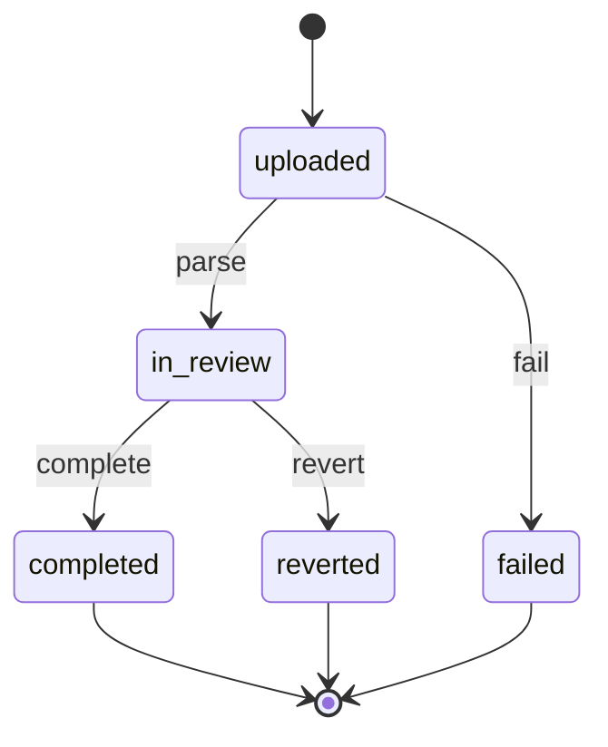

# wl-payments

> Status: draft · Last updated: 2026-10-16

## 1. Purpose

Everything about money actually moving: recording payments by any method and allocating them
to invoices, taking online payments through a gateway, keeping the register of post-dated
cheques received and issued, holding deposits until they are settled, refunding, and tracking
cash held by staff until it is handed over. Amounts owed come from
[wl-invoicing](wl-invoicing.md). The module also handles staff expense claims and petty cash,
and imports bank statement files to match receipts and payments to open documents. Money is
received into and paid from the bank accounts of the client's legal entities
([decision 0003](../decisions/0003-legal-entities.md)). Automatic bank feeds and the ledger
stay in the client's bank and accounting software.

## 2. Capabilities covered

| ID | Capability | Used by verticals | Scope |
|---|---|---|---|
| `FIN.PAY.01` | Record payments by any method and allocate them to invoices | all ten, MVP | MVP |
| `FIN.PAY.02` | Online payment by link or card | 05, 06, 10 MVP; 01, 03, 04, 08 Later | MVP |
| `FIN.CHQ.01` | Post-dated cheque register, received and issued | 01, 02, 03, 04, 07, 08, 09 MVP | MVP |
| `FIN.DEP.01` | Deposits held, deductions and refunds | 01 MVP | MVP |
| `FIN.CSH.01` | Cash custody: cash and cheques held by staff or tills, end-of-period handover, shortages | 03, 05, 06, 08, 10 MVP (03 drivers; 05 receptionists; 06 rider cash on direct orders and till shortages; 08 counter tills and cheques collected in the field; 10 front-desk counsellors) | MVP |
| `FIN.EXP.01` | Expense claims and petty cash: submit with receipt, approve, reimburse, top up | 02, 03, 06 MVP; 01, 04, 05, 07, 08, 09, 10 Later | MVP |
| `FIN.BNK.01` | Bank statement import and matching of receipts to open invoices | 01, 04, 09 MVP; 02, 03, 05, 06, 07, 08, 10 Later | MVP |

**Gateways** (decided 2026-10-15 for all verticals, 06 §13 question 8): Stripe and Network
International N-Genius in the MVP, through the `GatewayAdapter` trait; Telr and Checkout.com
when a client asks. Each client uses its own merchant account.

`FIN.CSH.01` is used by 06 for cash on delivery collected by the outlet's own riders
(06 §4.2). Till cash at a counter (06, 08) is counted in the till session of
[wl-sales](wl-sales.md) (`SAL.POS.01`), which hands its cash over here; a till shortage is
recovered or written off here (§4 Cash handover, till session mode).

## 3. Concepts and entities

| Entity | Description | Important fields |
|---|---|---|
| Payment | Money received from or paid to a party | direction (in / out), entity, bank account (for transfers, cards and cheques), party, method (cash, card, transfer, cheque, gateway, direct debit, wallet, set-off), amount, currency, date, reference, gateway transaction, collected by (staff), prepayment for (`Subject`: booking, reservation, order; optional), purpose (outgoing only: none or *owner drawings*, `FIN.BUD.01`; a drawing is paid to the owner's party and allocated to no document), chargeback (gateway dispute reference, reason, evidence due date, evidence submitted), status |
| Allocation | Part of a payment applied to a document | payment, target (invoice, supplier bill, credit note, deposit, supplier debit note for a supplier debit balance, payer credit balance), amount |
| Refund | Money returned to a party | party, source (payment, credit note, deposit, party credit balance, payer credit balance, `Subject`: order, booking), amount, method, reason, requested by, approved by, attempts (method, date, failure reason), status |
| Payment link | A request to pay online | party, target invoice(s) or amount, currency, expiry, gateway, URL token, status |
| Gateway account | The client's own merchant account, one or more per legal entity | entity, provider (Stripe, Network International N-Genius in the MVP; Telr, Checkout.com on demand), mode (test/live), credentials (encrypted), webhook secret, enabled methods, settlement bank account |
| Saved payment method | A tokenised card or mandate held by the gateway | party, gateway, token reference, brand, last four digits, expiry, consent date |
| Cheque | A post-dated cheque | direction (received / issued), entity, bank account (issued cheques and deposit account), party, bank, number, date, amount, currency, linked charge, invoice or supplier bill, collected by, custody confirmed (handover), presentations, honoured amount, open amount, return reasons and certificates, bounce fee charge, legal case (type, reference, case owner, task), status |
| Deposit | Money held as security | party, entity, source (`Subject`: lease), amount (required by the source), held amount (received less part refunds paid), adjustments (old and new amount, source version, top-up charge or part refund), received payment, deductions (lines with reason, evidence and billable flag), published to the party (date), refund method (transfer or cheque), refund, status |
| Cash holder | A person or till that holds cash or collected cheques | staff user or till (outlet, desk), location, mode (per person, till session), handover period (run, shift, day, till session) |
| Cash handover | Cash and cheques a holder hands over at the end of a period | kind (period, or *later shortage* with its source `Subject`), holder, responsible person (the holder, or the cashier of a till session), period (run, shift, day, till session), till session (till mode), expected amount (from collected payments or the till session), counted amount, counted by, difference, expected cheques (ticked present or missing), recovery (cash or wl-hr adjustment), status |
| Expense claim | A staff request to be reimbursed for business spending, or a record of petty cash spent | claimant, entity, cost object (`Subject`, optional), lines, total, VAT total, reimbursement method (payment, payroll, petty cash float), status |
| Expense line | One receipt | date, merchant, merchant TRN (if shown), category, amount, VAT amount, VAT recoverable (from the category and a valid tax invoice), receipt photo (wl-documents), cost code |
| Expense category | A kind of spending | name, default VAT treatment (recoverable / blocked / none), receipt required above, account mapping for export |
| Petty cash float | Cash advanced to a holder for small expenses (imprest) | holder (cash holder), entity, float amount, current balance, low threshold, status |
| Bank statement import | One uploaded statement file for one bank account | entity, bank account, file, format (CSV, Excel, MT940), period, closing balance (from the file when it carries one, otherwise entered at upload; optional), number of lines, imported by, status |
| Statement line | One bank transaction | import, date, amount (in / out), description, reference, counterparty, match (payment, cheque, invoice, supplier bill, expense claim, refund), line status (unmatched, suggested, matched, ignored) |
| Match rule | A saved rule that suggests matches | text pattern, amount tolerance, party, target type, created by |

**Bank accounts** belong to the legal entity in [wl-kernel](wl-kernel.md) (`PLT.ENT.01`).
This module adds per account: the statement format, the methods it receives (transfer, card
settlement, cheque deposits) and the default for outgoing payments.

**Prepayments are not deposits.** A booking deposit (05, optional per service type, 05 §13
question 8) or a reservation deposit on a unit (01, `PRP.LEA.02`) is a payment received in
advance, linked to the booking or reservation, and held as the party's credit. It is
allocated to the visit's or the lease's first invoice. On a no-show or a late cancellation
the vertical forfeits it according to the policy accepted at booking; no fee invoice is
issued and nothing is billed to an insurer. `FIN.DEP.01` is only for security deposits
that are returned at the end of an agreement.

## 4. Lifecycles

### Payment

| State | Tone | Terminal | Meaning |
|---|---|---|---|
| `pending` | info | no | Online payment started; waiting for the gateway |
| `received` | success | no | Money received (or paid out); can be allocated |
| `failed` | error | no | Gateway declined, the payer abandoned, or no answer before the timeout; only a late confirmation from the gateway moves it on |
| `charged_back` | error | no | The card holder disputed the payment and the gateway took the funds back; the dispute is still open |
| `reversed` | neutral | yes | Recorded in error, returned by the bank, or a chargeback lost or accepted |

| Transition | From | To | By | Guards | Effects |
|---|---|---|---|---|---|
| `record` | — | received | `payments.record` | method details complete (cheque payments are created by the cheque `clear` and `settle_part` transitions); purpose *owner drawings*: an approved request (`FIN.ACL.21`, wl-invoicing) | event `PaymentReceived` |
| `start_online` | — | pending | party (portal, payment link) or system (automatic charge) | gateway account enabled | redirect to the gateway's hosted page |
| `confirm` | pending | received | system (verified gateway webhook, or the gateway's status query in `FIN.RUL.19`) | webhook signature and amount match | allocation to the link's targets; receipt sent; event `PaymentReceived` |
| `fail` | pending | failed | system (gateway webhook: declined, reason from the gateway; or the hosted session cancelled or expired by the payer, reason *abandoned*; or `FIN.RUL.19` when the gateway gives no final answer before the timeout, reason timeout, which also covers a payer who leaves without the gateway telling the platform) | — | payment link stays `open` until its expiry; the party sees the reason and a retry button; event `PaymentFailed` (consumers below) |
| `late_confirm` | failed | received | system (verified gateway webhook after `fail`) | webhook signature and amount match | if the targets are still open and the prepaid `Subject` is still active: allocated as in `confirm` (targets only partly open: allocated up to their open balances, the rest kept as credit with a refund requested for it, `requested` because it does not equal the payment); otherwise the amount stays as the party's credit and a refund is requested automatically with reason "late confirmation" (approved without a second person when the `request` guard below holds: it equals the payment, goes back to the same card or account, and the subject is no longer active, i.e. cancelled, rejected, already paid by another payment, or its slot gone; setting); accountant notified; event `PaymentReceived` |
| `reverse` | received | reversed | `payments.reverse` | reason (entered in error, bank return); the payment is not a gateway payment with an open dispute | every allocation removed; event `PaymentReversed` with the allocations, so wl-invoicing runs `unallocate` on each target (the invoice goes back to `partially_paid`, `issued` or `overdue` by balance and due date); party notified for a bank return |
| `charge_back` | received | charged_back | system (verified gateway dispute webhook) | — | every allocation removed; event `PaymentReversed` with reason `chargeback` and the allocations (wl-invoicing `unallocate`); gateway dispute fee recorded as an outgoing payment to the gateway provider (a supplier party; category bank charges; allocated to no document); evidence task created (`FIN.RUL.20`); the staff who took the payment and the accountant notified |
| `win_chargeback` | charged_back | received | system (gateway dispute won) | — | funds back; the same allocations re-applied where the targets are still open (a target written off meanwhile counts as not open), the rest kept as the party's credit, and the accountant notified (allocating it to a written-off invoice runs its `recover`); event `PaymentReceived` |
| `lose_chargeback` | charged_back | reversed | system (gateway dispute lost, or evidence deadline passed without a submission) | — | the reopened invoices stay open: collect from the party again, or write off through invoice `write_off` (wl-invoicing); accountant notified; event `ChargebackClosed` (outcome lost) |
| `accept_chargeback` | charged_back | reversed | `payments.chargeback` | reason; approval (`FIN.ACL.18`); accepting is sent to the gateway, and when the gateway rejects the call the approval request `fail`s, the payment stays `charged_back` and the accountant is notified | as `lose_chargeback`; event `ChargebackClosed` (outcome accepted) |

Allocation is not a transition: allocating or unallocating changes the target document
(invoice `allocate` and `unallocate`), never the payment's state. Unallocated amounts show
as the party's credit balance. A reversed payment whose credit balance was already refunded
leaves the party owing that amount; the platform gives the accountant a task "raise a charge
for AED X" with the payment and the refund linked, and the accountant raises the charge (the
platform does not create the charge itself).

**Set-off.** When a party is both customer and supplier and the two sides agree to settle
against each other (02: the client's back- and contra-charges recorded as a supplier bill from
the client against our IPA invoice), the accountant records a payment of method `set_off`. It
moves no money and has no bank account: one record with the amount, allocated at once to the
party's open invoice (receivable) and to its `approved` supplier bill (payable) of the same
entity and currency, for the same amount, not above either open balance. The invoice runs
`allocate` and the supplier bill `pay` as for any payment. Because it settles a payable, a
set-off is money out to the party and needs `BlockGuard::check(party, money_out)`
(`PTY.ACL.03`). It is corrected only with `reverse` (reason *entered in error*), which removes
both allocations (`PaymentReversed`: the invoice and the supplier bill run `unallocate`).

**Who reacts to `PaymentFailed`, pending payments and `PaymentReversed`**

| Situation | Reaction |
|---|---|
| Subscription automatic charge failed | wl-invoicing retries (`FIN.RUL.06`) |
| Invoice or payment link paid online failed | invoice unchanged; the link stays `open`; no task (the party retries) |
| Prepayment for a booking (wl-scheduling) or a direct order (wl-sales) failed or timed out | the subject is not confirmed or placed: wl-scheduling keeps the slot on hold until the link expiry, then releases it; wl-sales does not place a prepaid direct order (06: the order is only sent to the kitchen after `confirm`) |
| Late confirmation after the subject is no longer active (cancelled, rejected, already paid, or its hold released) | `late_confirm` effects: credit and automatic refund |
| Payment still `pending` after the timeout | `FIN.RUL.19` asks the gateway, then runs `confirm` or `fail` |
| `PaymentReversed` (bank return or entered in error) | wl-invoicing `unallocate`; the subject that the payment unblocked (prepaid booking, order, enrolment) gets the event and the vertical decides (notify staff by default) |
| `PaymentReversed` (chargeback) | as above, plus the evidence task; a completed service or order is not undone, the loss is decided through `accept_chargeback` or `lose_chargeback` |

### Refund

| State | Tone | Terminal | Meaning |
|---|---|---|---|
| `requested` | warning | no | Waiting for approval |
| `approved` | info | no | Approved; to be paid |
| `paid` | success | no | Paid out (outgoing payment recorded or gateway refund confirmed); leaves only if the bank returns the transfer |
| `failed` | error | no | The gateway refused the refund, the card can no longer receive it, or the bank returned the transfer |
| `rejected` | neutral | yes | Not approved |
| `cancelled` | neutral | yes | Given up after a failure; the amount is back on the party's credit balance |

| Transition | From | To | By | Guards | Effects |
|---|---|---|---|---|---|
| `request` | — | requested, approved | `refunds.request` or system (`late_confirm`; wl-sales `SAL.RUL.06`; wl-scheduling payment for an expired hold) | source with refundable balance; reason; target `approved` only for a system request of a late payment whose amount equals that payment, back to the same card or account, while the subject is cancelled, rejected, already paid by another payment, or its slot gone (the booking hold was released, e.g. on `PaymentLinkExpired`) (setting, on) | approvers notified; a system request that goes straight to `approved` is not subject to `FIN.ACL.04` (no person requested it), the accountant is notified, and it is paid by the original method |
| `approve` | requested | approved | `refunds.approve` | approver ≠ requester (`FIN.ACL.04`); limit rules of the vertical | — |
| `reject` | requested | rejected | `refunds.approve` | reason | requester notified |
| `pay` | approved | paid | `refunds.pay` or system (gateway refund confirmed) | method and reference | outgoing payment recorded; source balance reduced; event `RefundPaid` |
| `fail` | approved, paid | failed | system (gateway refund declined) or `refunds.pay` (transfer returned by the bank) | failure reason | from `paid`: the outgoing payment is reversed; source balance restored; requester and accountant notified; the party told the refund is delayed; event `RefundFailed`; `FIN.RUL.21` |
| `retry` | failed | approved | `refunds.pay` or system (`FIN.RUL.21`) | same method and details; retries below the maximum | — |
| `change_method` | failed | approved, requested | `refunds.pay` | new method set: original card through the gateway, transfer, cheque or cash; target `approved` when paid to the same party by cash, cheque in the party's name or the original card, otherwise `requested` (new bank details need a new approval, `FIN.ACL.04`) | party notified of the new method |
| `cancel` | failed | cancelled | `refunds.approve` | reason (party unreachable, party asks to keep the credit) | amount stays on the party's credit balance; party notified where reachable |

### Payment link

| State | Tone | Terminal | Meaning |
|---|---|---|---|
| `open` | info | no | Sent; can be paid |
| `paid` | success | yes | Paid in full |
| `expired` | neutral | yes | Expiry passed |
| `cancelled` | neutral | yes | Withdrawn by staff |

| Transition | From | To | By | Guards | Effects |
|---|---|---|---|---|---|
| `pay` | open | paid | system (payment `confirm`) | — | — |
| `expire` | open | expired | system | expiry passed | event `PaymentLinkExpired` (wl-scheduling releases an unpaid booking hold) |
| `cancel` | open | cancelled | `payments.links` | — | — |

### Cheque

Canonical base: [01-property.md](../verticals/01-property.md) §7.1, generalised with a
direction. Received cheques use the full machine; issued cheques skip `flag_due` and the
bounce follow-up (`represent`, `settle_part`, `refer_to_legal`, `write_off`), and use `return`
only for an issued cheque cancelled and recovered before it is presented; an issued cheque
that bounces is replaced. Its path is `deposited` → `bounce` → `bounced` → `replace` →
`replaced`: `bounce` records the bank return reason and any honoured part (an outgoing payment
allocated to the linked supplier bill), with no certificate, no bounce fee and no
`ChequeBounced` (so no `FIN.RUL.04`, `FIN.RUL.18` or credit hold); the accountant gets a task
to replace it. `replace` needs a new issued cheque or an outgoing payment linked for the open
amount. The linked supplier bill keeps that amount open meanwhile, since an issued cheque
records its payment only at `clear`.

A received cheque carries, besides the fields in §3: collected by (staff) and custody
confirmed (the cash handover that confirmed it, for cheques collected in the field), the
honoured amount and the open amount, the number of presentations, each bank return reason
with the bank's return certificate (wl-documents), the bounce fee charge, and the legal case
(type, reference, follow-up task).

| State | Tone | Terminal | Meaning |
|---|---|---|---|
| `received` | neutral | no | Received cheque held, or issued cheque handed to the payee |
| `due_for_deposit` | warning | no | Received cheque date is close; on the deposit list |
| `deposited` | info | no | Received cheque sent to the bank, or issued cheque presented by the payee |
| `cleared` | success | yes | Funds moved; payment recorded |
| `bounced` | error | no | Returned unpaid, in full or in part; the open amount is still owed |
| `legal_case` | error | no | Open amount handed to a legal case (civil execution or criminal complaint) |
| `replaced` | neutral | yes | Open amount settled by other cheques or payments (`FIN.ACL.02`) |
| `written_off` | neutral | yes | Open amount written off as bad debt on the linked invoices |
| `returned` | neutral | yes | Handed back undeposited, or an issued cheque cancelled and recovered |

| Transition | From | To | By | Guards | Effects |
|---|---|---|---|---|---|
| `flag_due` | received | due_for_deposit | system (`FIN.RUL.03`) | received direction; date within N days | added to the deposit list |
| `deposit` | received, due_for_deposit | deposited | `cheques.deposit` | cheque date reached; a cheque collected in the field is confirmed in a cash handover (`FIN.ACL.20`) | presentations + 1 |
| `clear` | deposited | cleared | `cheques.deposit` | — | payment recorded (direction in or out) for the open amount and allocated to the linked document; after a re-presentation: event `ChequeBounceResolved` (outcome cleared) |
| `bounce` | deposited | bounced | `cheques.deposit` | bank return reason recorded; bank return certificate attached (received direction); honoured amount entered when the bank paid part from the available balance (default 0) | honoured part recorded as a payment and allocated; open amount = amount − honoured; received direction: bounce fee charge added to the party when a fee charge type is set (§7), due on the bounce date on the agreement linked to the cheque, or as a standalone charge for the party when none is linked, and event `ChequeBounced` (`FIN.RUL.04`, `FIN.RUL.18`; wl-sales puts the customer account on credit hold); issued direction: none of these, the accountant gets a task to replace the cheque |
| `represent` | bounced | deposited | `cheques.deposit` | received direction; nothing honoured by the bank on an earlier presentation; presentations below the maximum (default 2), checked before the count goes up; new deposit date and the party's confirmation of funds, or a note; a part settled meanwhile (`settle_part`) does not prevent it (`clear` then records the open amount only) | presentations + 1 (with the first `deposit`, a maximum of 2 allows one re-presentation); party notified of the new presentation date |
| `settle_part` | bounced, legal_case | bounced, legal_case (unchanged) | `cheques.manage` | received direction; payment (cash, transfer, card) below the open amount | payment recorded and allocated to the cheque's linked documents; open amount reduced |
| `replace` | bounced, legal_case | replaced | `cheques.manage` | replacement cheques or payments linked and covering the open amount (`FIN.ACL.02`) | legal case task closed; original cheque kept until the replacement clears, then handed back with a receipt (if a replacement cheque bounces, the original stays `replaced` and is kept with a note; the new cheque follows its own bounce flow); event `ChequeBounceResolved` (outcome replaced) |
| `refer_to_legal` | bounced | legal_case | `cheques.legal` | received direction; bank return certificate attached; case type set: `civil_execution` (default) or `criminal_complaint`, which is allowed only when the bank return reason is in the criminal-grounds list (§7, §10); open amount above the minimum for legal action; case owner named (default: the user who refers) | `FIN.RUL.18` reminders stop; follow-up task for the case owner with the evidence pack (cheque image, return certificate, linked agreement and invoices, notices sent); formal notice to the party (template); manager notified |
| `write_off` | bounced, legal_case | written_off | `cheques.manage` | reason; a linked charge not yet invoiced is invoiced first; the open balances of the linked invoices together equal the cheque's open amount (invoice `write_off` always takes an invoice's whole open balance; otherwise staff write off the invoices directly and settle the cheque another way); the open amount written off on the linked invoices through invoice `write_off` in wl-invoicing, one request per invoice (its approval limit applies) | the cheque moves to `written_off` when `InvoiceWrittenOff` has arrived for every linked invoice; a request rejected or failed leaves the cheque in its state (write-offs already approved stay) and the accountant is notified; cheque, certificate and case records kept as evidence; credit hold stays until released in wl-sales; event `ChequeBounceResolved` (outcome written off) |
| `return` | received, due_for_deposit | returned | `cheques.manage` or system (agreement ended) | not deposited | handover receipt generated; a cheque lost in custody is returned with reason "lost" and the party asked for a replacement |

### Deposit

Canonical base: [01-property.md](../verticals/01-property.md) §7.1, with a generic trigger.

| State | Tone | Terminal | Meaning |
|---|---|---|---|
| `held` | info | no | Received and held for the source agreement |
| `settlement_pending` | warning | no | Agreement ended; deductions being decided |
| `refunded` | success | yes | Balance paid back (possibly after deductions) |
| `forfeited` | neutral | yes | Kept in full, with a reason |
| `transferred` | neutral | yes | Handed over with the source agreement to another holder (new manager or owner) |

| Transition | From | To | By | Guards | Effects |
|---|---|---|---|---|---|
| `adjust` | held | held | system (the source agreement changes the deposit amount, e.g. 01 lease amendment or renewal version `activate`) or `deposits.manage` | new amount and the source version given; no adjustment of the deposit still open (top-up unpaid or part refund not paid, cancelled or rejected) | adjustment recorded; increase: a top-up charge for the difference on the effective date (requested like the original deposit), and the held amount rises when its payment is allocated; decrease: a refund `request` for the difference with the deposit as source (Refund flow, approval `FIN.ACL.04`), and the held amount falls when the refund is `paid` (back up if it `fail`s; on refund `cancel` the amount moves to the party's credit balance and the held amount stays reduced; a `rejected` refund leaves the held amount, and the difference is paid back at settlement); the deposit stays `held`; event `DepositAdjusted` |
| `start_settlement` | held | settlement_pending | system (source agreement ended) or `deposits.manage` | — | — |
| `refund` | settlement_pending | refunded | `deposits.refund` | deductions itemised with evidence; deductions published to the party in the portal before payment (01 §13 question 5); when the deductions dispute is on for the vertical: the dispute window of the latest published version has passed and no deductions dispute is open (every disputed line revised or upheld); the vertical's limit and SoD rules pass (e.g. `PRP.ACL.05`, `FIN.ACL.04`), otherwise an approval request | refund paid by transfer or issued cheque; deductions invoiced if billable; settlement statement generated |
| `forfeit` | settlement_pending | forfeited | `deposits.refund` | reason; approval; no deductions dispute open; when the deductions dispute is on for the vertical: the forfeiture published to the party as the deductions (the itemised deductions it is applied to, e.g. 01 *applied to deductions*, or one line for the whole deposit with the reason) and the dispute window of the latest published version passed, as for `refund` | settlement statement generated |
| `transfer` | held | transferred | `deposits.manage` | the source agreement is handed to another holder (e.g. 01 management agreement `end` or `transfer_unit`); receipt from the new holder attached | deposit liability leaves the client; the money passed to the new holder is recorded as an outgoing payment to the new holder with the receipt as reference (not a refund); the party told who now holds the deposit; event `DepositSettled` (outcome transferred) |

**Deductions dispute flag** (not a state, setting per vertical, off by default). After the
deductions are published, the party may dispute one or more lines in the portal within the
dispute window. While the flag is set, `refund` and `forfeit` wait. The staff member
responsible answers within the response window with evidence, revises the deductions (a new
published version; the window starts again) or upholds them, which clears the flag without
restarting the window. `refund` and `forfeit` run only after the window has passed, even when
no line was disputed, so the party always has the whole window. A legal
case opened on the source agreement keeps the flag until the decision. The vertical's rule
escalates an unanswered dispute (01: `PRP.RUL.11`).

### Cash handover

Canonical base: [03-logistics.md](../verticals/03-logistics.md) §7.1, generalised from a
driver's run to any cash holder and period.

A holder works in one of two **modes** (setting per holder):

- **Per person:** a staff member (driver, rider, receptionist, front-desk counsellor, sales
  rep) collects cash and cheques; the expected amount is the sum of the cash payments they
  recorded in the period, and the expected cheques are the received cheques they collected.
  Another user counts them at the end of the run, shift or day.
- **Till session:** a till counted in the wl-sales till session (`SAL.POS.01`). The session
  `close` already records expected and counted cash and approves the variance there; the
  handover is created by the system from `TillSessionClosed` with those amounts and the
  session's cashier as the responsible person. The shortage is then treated here.

| State | Tone | Terminal | Meaning |
|---|---|---|---|
| `open` | warning | no | The holder has cash or cheques collected in the period |
| `counted` | success | yes | Counted amount equals or exceeds expected (an overage is recorded as a separate line) and every expected cheque is present |
| `short` | error | no | Counted less than expected, or an expected cheque is missing |
| `recovered` | success | yes | Shortage recovered from the holder |
| `written_off` | neutral | yes | Shortage written off with approval |

| Transition | From | To | By | Guards | Effects |
|---|---|---|---|---|---|
| `count` | open | counted, short | `cash.count`, or system (`TillSessionClosed`, till session mode) | counter ≠ holder (`FIN.ACL.05`; for a till, the session's close and review in wl-sales); each expected cheque ticked present or missing | cash moved to the safe or bank deposit list; overages recorded as a separate line and held as a liability, not income, until the accountant decides (§12 question 4); cheques ticked present get custody confirmed and can be deposited; on `short`: event `CashShortage`, holder and their manager notified |
| `hand_over` | open | open | system (`RunHandedOver` from wl-delivery) | the receiving holder (≠ the giving holder) confirmed in the driver app the cash counted and each cheque received | counted cash and cheques leave the giver's expected amount and join the receiving holder's open handover (one is opened for the receiver's current period when none is open), each payment keeping its collector; any difference between what the giver should hand over and what was counted stays on the giver's handover and shows at its `count` as a shortage; when the receiver confirms more than the giver's expected amount, the giver's whole expected amount moves and the excess is recorded on the receiver's handover as an overage line from the hand-over (added to its expected cash, held as a liability like a counting overage, §12 question 4), so the giver's handover keeps nothing for it; both drivers and the dispatcher notified |
| `raise_shortage` | — | short | `cash.count` (e.g. from the 03 operations manager's task after shipment `reverse_delivery` with liability *driver*) | holder, amount, reason and source (`Subject`) given; raiser ≠ holder (`FIN.ACL.05`); the holder's handover for that cash is no longer `open`; no other later shortage open for the same source | new handover of kind *later shortage* with expected = amount and counted = 0, linked to the source; holder and their manager notified; event `CashShortage` with the source |
| `recount` | short | counted, short | `cash.count` | counter ≠ holder and ≠ the first counter; the holder present or notified | difference updated; a cheque found is confirmed |
| `recover` | short | recovered | `cash.count` | missing cheques found (confirmed) or returned as lost; recoveries recorded on the handover cover the whole difference: cash from the responsible person (the holder, or a till session's cashier), or a deduction passed to wl-hr as an adjustment of type cash shortage recovery (`FIN.ACL.19`) | — |
| `write_off` | short | written_off | `cash.write_off` | missing cheques found or returned as lost; the rest (difference − recoveries recorded) below the write-off limit (`FIN.ACL.06`, from `LOG.ACL.06`), otherwise approval | the rest posted as a loss of the holder's outlet or branch; recoveries recorded stay shown on the handover |

**Part recoveries.** While a handover is `short`, each part recovered (cash from the
responsible person, or a wl-hr deduction under `FIN.ACL.19`) is recorded on the handover
without a state change. `recover` runs when the recoveries cover the whole difference;
`write_off` writes off only what is left after them.

A missing cheque is not a cash shortage: it is never written off as cash. The accountant
asks the party whether the cheque was handed over; if it is lost, it is `return`ed with
reason "lost" and the party is asked for a replacement (a stop-payment on the lost cheque is
the party's decision).

**Vertical mapping**

| Vertical | Holder and period |
|---|---|
| 03 Logistics | driver, per person, per run; closing the handover closes the run (wl-delivery run `close`) |
| 05 Clinics | receptionist, per person, per shift or day at each front desk (MVP) |
| 06 F&B | own rider, per person, per shift, for cash on delivery of direct orders (`FIN.CSH.01`, MVP). Till cash: till session mode, one handover per wl-sales till session (`SAL.POS.01`, absorbs `FNB.CSH.01`); a cashier's till shortage is recovered or written off here |
| 08 Auto | counter till: till session mode from the wl-sales session. Cheques collected by delivery drivers and sales reps: per person, per day, cheques only (MVP) |
| 10 EdTech | admissions counsellor at the front desk, per person, per day, cash and cheques (MVP) |

### Expense claim

Petty cash spending is an expense claim whose reimbursement method is the holder's float: it
is approved like any claim and reduces the float instead of producing a payment.

| State | Tone | Terminal | Meaning |
|---|---|---|---|
| `draft` | neutral | no | Being filled in, receipts being added |
| `submitted` | info | no | Waiting for approval |
| `approved` | info | no | Approved; cost and input VAT posted; waiting for reimbursement |
| `reimbursed` | success | yes | Paid, added to payroll, or settled from the float |
| `rejected` | neutral | yes | Not approved |
| `cancelled` | neutral | yes | Withdrawn by the claimant before submission |

| Transition | From | To | By | Guards | Effects |
|---|---|---|---|---|---|
| `submit` | draft | submitted | `expenses.submit` (claimant) | every line has a category and, above the category's threshold, a receipt photo; dates within the claim window; cost object set where the category requires it | approvers notified (line manager or the cost object's manager) |
| `return` | submitted | draft | `expenses.approve` | reason given | claimant notified |
| `approve` | submitted | approved | `expenses.approve` | approver ≠ claimant (`FIN.ACL.11`); total within the approver's limit, otherwise an approval request in steps (`FIN.ACL.12`); a line in the *owner drawings* category also needs `FIN.ACL.21` (approver holds `drawings.approve`, ≠ requester) | actual cost posted to cost objects (`FIN.CST.01`); recoverable VAT lines become input VAT of the entity's period (`FIN.VAT.01`); event `ExpenseClaimApproved` |
| `reject` | submitted | rejected | `expenses.approve` | reason given | claimant notified |
| `reimburse` | approved | reimbursed | `expenses.reimburse` or system | method set | outgoing payment recorded; or a line added to the claimant's next payroll run (wl-hr); or the holder's float balance reduced; event `ExpenseClaimReimbursed` |
| `cancel` | draft | cancelled | claimant | — | — |

### Petty cash float

| State | Tone | Terminal | Meaning |
|---|---|---|---|
| `active` | success | no | Holder has cash available |
| `low` | warning | no | Balance below the low threshold |
| `suspended` | neutral | no | Spending blocked, e.g. after an unexplained difference |
| `closed` | neutral | yes | Cash returned and counted; float ended |

| Transition | From | To | By | Guards | Effects |
|---|---|---|---|---|---|
| `issue` | — | active | `petty_cash.manage` | holder and amount set | outgoing payment (cash or transfer) recorded |
| `mark_low` | active | low | system | balance below the threshold after a reimbursed petty-cash claim | holder and accountant notified (`FIN.RUL.10`) |
| `top_up` | active, low | active | `petty_cash.top_up` | approver ≠ holder (`FIN.ACL.11`); top-up equals the approved spending since the last top-up, unless the float amount changes | outgoing payment recorded; balance restored |
| `suspend` | active, low | suspended | `petty_cash.manage` | reason given | holder cannot record new petty-cash claims |
| `reinstate` | suspended | active | `petty_cash.manage` | difference resolved | — |
| `close` | active, low, suspended | closed | `petty_cash.manage` | remaining cash counted through a cash handover (`FIN.CSH.01`); shortage recovered or written off (`FIN.ACL.06`) | — |

### Bank statement import

Statement lines carry a simple line status (unmatched, suggested, matched, ignored); the
import as a whole has a state machine.

| State | Tone | Terminal | Meaning |
|---|---|---|---|
| `uploaded` | neutral | no | File received |
| `in_review` | info | no | Lines parsed; matches suggested and being confirmed |
| `completed` | success | yes | Every line matched, ignored with a reason, or turned into a task |
| `failed` | error | yes | File not recognised |
| `reverted` | neutral | yes | Import undone |

| Transition | From | To | By | Guards | Effects |
|---|---|---|---|---|---|
| `parse` | uploaded | in_review | system | format recognised; bank account and period match the file; lines already imported are skipped | lines created; match suggestions computed; event `BankStatementImported` |
| `fail` | uploaded | failed | system | format not recognised or account mismatch | uploader notified with the reason |
| `complete` | in_review | completed | `bank.reconcile` | no line left `unmatched` or `suggested` | payments recorded for confirmed incoming lines that had none, and allocated; event `BankStatementCompleted` |
| `revert` | in_review | reverted | `bank.reconcile` | payments created by this import have not been changed since | those payments reversed; lines removed |

## 5. Workflows

### 5.1 Record and allocate a payment

1. Staff record a payment (method, amount, reference, receiving entity and bank account)
   against a party, or it arrives from the gateway, a cleared cheque or a matched bank
   statement line.
2. Open invoices of the party are proposed, oldest first; staff confirm or change the
   allocation.
3. Each allocation runs the invoice's `allocate` transition. Any remainder stays as the
   party's credit balance, available for later invoices or a refund.

### 5.2 Online payment

1. The party opens an invoice in the portal, or a payment link sent by SMS, email or
   WhatsApp, and pays on the gateway's hosted page. Card data never touches the platform.
2. The gateway's webhook is verified (Renox inbound webhooks) and the payment is
   confirmed and allocated.
3. For subscriptions with automatic payment, the gateway charges the saved payment method
   on the cycle date; a failure triggers `FIN.RUL.06`.
4. A payment still `pending` after the timeout is checked with the gateway (`FIN.RUL.19`)
   and confirmed or failed. A failed payment leaves the invoice and link open; a prepaid
   booking or order is not confirmed. If the gateway confirms after the failure, the money
   is allocated when the target is still open, otherwise kept as credit and refunded
   automatically (§4 Payment, `late_confirm`).

### 5.2a Chargeback

1. The gateway reports a dispute. The payment goes to `charged_back`, its allocations are
   removed (`PaymentReversed`, wl-invoicing `unallocate`) and the dispute fee is recorded.
2. `FIN.RUL.20` creates an evidence task for the accountant with the gateway's deadline and
   the evidence the platform holds: receipt, invoice, proof of delivery or attendance, signed
   documents, messages sent.
3. The accountant submits the evidence in the gateway, or asks to accept the chargeback; the
   acceptance needs approval (`FIN.ACL.18`).
4. A won dispute re-applies the allocations. A lost or accepted one leaves the invoices open:
   the amount is collected from the party again or written off through invoice `write_off`
   (wl-invoicing).

### 5.3 Cheque register

1. Cheques received with an agreement are entered with their dates and linked to the
   charges they cover.
2. `FIN.RUL.03` puts cheques on the deposit list N days before their date.
3. The accountant marks them deposited, then cleared (payment recorded) or bounced
   (`FIN.RUL.04`: notify and create a follow-up task). On a bounce the accountant records the
   bank's return reason and certificate and any amount the bank paid from the available
   balance. The bounce fee charge is added (when configured) and wl-sales puts the customer
   (and its credit group) on credit hold.
4. The bounce is followed up until one outcome:
   - **Re-presentation:** the party confirms funds; the cheque is deposited again (at most
     the configured number of presentations, only if nothing was honoured).
   - **Replacement:** a new cheque or a payment covers the open amount; part payments in cash
     or by transfer reduce it first (`settle_part`).
   - **Legal case:** after the reminders of `FIN.RUL.18`, the accountant refers it to a civil
     execution claim, or to a criminal complaint only for the grounds that remain criminal
     (§10); the case owner gets a task with the evidence pack. The reminders come first by
     practice, not by a guard: the accountant may refer a bounced cheque at any time. The case
     owner is the user named at referral (default: the user who refers), usually the person
     who briefs the lawyer.
   - **Write-off:** the open amount is written off on the linked invoices through invoice
     `write_off`, with its approval. This is offered only when the linked invoices' open
     balances equal the cheque's open amount; otherwise the invoices are written off directly.
   Each outcome emits `ChequeBounceResolved`, which lets wl-sales lift the credit hold.
5. Issued cheques to suppliers are recorded when handed over and cleared from the bank
   statement.
6. Cheques collected in the field (drivers, sales reps) are recorded with the collector and
   can be deposited only after a cash handover confirms them (`FIN.ACL.20`).

### 5.4 Deposit settlement

1. The deposit is received with the agreement and held.
   When the agreement changes the required amount while the deposit is held (01: a lease
   amendment or renewal), `adjust` raises a top-up charge for an increase or a part refund
   through the Refund flow for a decrease; the deposit stays `held`, and settlement uses the
   held amount.
2. When the agreement ends, settlement starts; deductions are itemised with evidence
   (inspection photos).
3. Where the vertical allows it, the party may dispute deduction lines within the window;
   the refund waits until the window has passed and any disputed deductions are revised or
   upheld (§4 Deposit).
4. The refund is approved under the vertical's limits and segregation of duties, paid, and a
   settlement statement is generated.
5. When the source agreement passes to another holder before it ends, the deposit is
   `transfer`red against a receipt and the party is told who holds it.

### 5.5 Cash custody

1. Every cash payment and every cheque collected records who collected it. The holder's
   open handover accumulates the expected amount and the expected cheques. A till's
   handover is created from its closed wl-sales till session instead.
2. At the end of the run, shift or day, another user counts the cash and ticks the cheques.
   The holder may ask for a recount by a third user.
3. A shortage is recovered from the holder (cash, or a salary deduction through wl-hr with
   approval, `FIN.ACL.19`) or written off with approval (`FIN.ACL.06`). A missing cheque is
   searched for, or returned as lost and the party asked for a replacement.
4. A holder who does not hand over (does not come back at the end of the run, shift or day):
   `FIN.RUL.22` gives the holder's manager a task to reach the holder after N hours. After M
   hours the company admin is notified, and the manager counts the handover at what was
   actually received (often nothing; the holder's presence is not needed). The full
   difference is a shortage: missing cheques are returned as lost and replacements asked
   for, the rest is recovered (`FIN.ACL.19`, including from final dues through wl-hr) or
   written off (`FIN.ACL.06`). HR may follow the absconding path (`report_absconding` in
   wl-hr). Money owed to third parties (e.g. a 03 client's COD remittance) is not reduced.
   In 03, `LOG.RUL.13` replaces `FIN.RUL.22` for drivers (its own start, task and values);
   `FIN.RUL.22` still runs for other holders.
5. A shortage found later (03: a delivery reversed with liability *driver* after the COD was
   counted) is raised against the holder with `raise_shortage`: a new handover of kind
   *later shortage*, `short` from the start, linked to its source, and recovered or written
   off like any other. While the holder's handover for that cash is still `open`, the amount
   is added to its expected total instead and shows at its `count`.

### 5.5a Refund failure

1. A gateway refund is declined, or the bank returns a refund transfer: the refund goes to
   `failed`, the source balance is restored and the party is told the refund is delayed.
2. `FIN.RUL.21` retries a gateway refund once; otherwise the accountant gets a task to pay by
   another method: transfer (new bank details need a new approval), cheque in the party's
   name, or cash at the counter.
3. If the party cannot be reached or prefers to keep the credit, the refund is cancelled and
   the amount stays on the party's credit balance.
4. `RefundFailed` names the source, so the owner restores it: a credit note reopens
   (wl-invoicing `reopen`), a payer credit balance gets the amount back, an order or booking
   refund is shown on that record as not yet refunded. A deposit stays `refunded` (terminal)
   and is marked *refund failed* with a link to the refund; the amount goes to the party's
   credit balance until the refund is retried, paid by another method or cancelled.

**Balances owed between the business and a supplier or payer.** A *payer credit balance*
(wl-invoicing `PayerBilling`, money an insurer or payer paid in excess) not set off against
recoupments is paid back with a refund whose source is the payer credit balance; the
refund's approval is the movement's approval (`FIN.ACL.16`), and `FIN.ACL.04` applies. A
*supplier debit balance* (wl-invoicing `SupplierDebitNotes`, a supplier owes the business
after a debit note on a paid bill) is not a refund: the supplier's payment is recorded as an
incoming payment allocated to the debit note, which then runs `settle`.

### 5.6 Expense claims and petty cash

1. A staff member photographs receipts in the PWA (`rx-camera-capture`, R5), picks a
   category and the cost object (project, vehicle, outlet), and submits the claim.
2. The approver sees the receipts and the total against their limit; above it, the claim
   goes to the next approval step.
3. On approval, cost is posted to the cost object and recoverable VAT becomes input VAT of
   the entity's tax period.
4. Reimbursement is paid by transfer, added to the next payroll run, or, for a petty cash
   holder, deducted from the float.
5. When the float runs low, the holder asks for a top-up equal to the approved spending; a
   different user approves it.

### 5.7 Bank statement import and matching

1. The accountant uploads a statement file (CSV, Excel or MT940) for one bank account and
   period.
2. Each incoming line is compared with open invoices (amount and reference), deposited
   cheques (amount and date), expected gateway settlements and payments already recorded;
   outgoing lines with supplier bills, refunds, issued cheques and reimbursements. Match
   rules and the party's past payments improve suggestions.
3. The accountant confirms suggestions, matches manually (including one line to several
   invoices), or ignores a line with a reason (bank charges, internal transfers).
4. Confirmed incoming lines without a payment create the payment and allocate it; matched
   cheques are cleared.
5. Lines still unmatched after N days become a task for the accountant
   (`FIN.RUL.12`).

## 6. Interfaces to other modules

**Provides**

| Service | Purpose |
|---|---|
| `PaymentRecorder` | Record, allocate, reverse payments; party credit balance (the capability trait named in wl-kernel); payments per bank account after a date, payments with purpose owner drawings, and approved refunds not yet paid (wl-invoicing cash-flow forecast `FIN.CFL.01` and budget vs actual `FIN.BUD.01`) |
| `PaymentLinks` | Create a link for invoices or an amount; return its URL |
| `Gateway` | Charge a saved method, refund through the gateway, verify webhooks; adapters per provider |
| `Cheques` | Register, deposit, clear, bounce, re-present, settle and refer cheques; open bounced amount per party (for the credit check in wl-sales); cheques not yet cleared (`received`, `due_for_deposit`, `deposited`) by direction, entity and cheque date, with open amount and linked documents (`FIN.CFL.01`) |
| `Deposits` | Hold, settle, refund deposits for a source `Subject` |
| `Refunds` | Request and pay refunds with approval |
| `CashCustody` | Open, count and close handovers per holder; create a handover from a closed till session |
| `Expenses` | Create, approve and reimburse expense claims; claims per cost object |
| `PettyCash` | Issue, top up and close floats; current balance per holder |
| `BankStatements` | Import a statement file, suggest and confirm matches; latest closing balance per bank account with its date, from the latest completed import (`FIN.CFL.01`) |
| `InputVatSource` (implementation) | Recoverable VAT from approved expense claims, for the VAT summary in wl-invoicing |

**Consumes:** `wl-invoicing` (targets and allocation transitions), `wl-parties`,
`wl-kernel` (legal entities and their bank accounts `PLT.ENT.01`, approvals, state machines,
automations, settings), `wl-documents` (receipts, receipt photos, settlement statements),
`wl-notify`, `wl-hr` (salary deduction for recovered shortages; reimbursement through payroll,
optional), `wl-invoicing` (`CostPoster` for expense cost, `VatSummary` locked-period check,
`PayerBilling` for per-line allocation of payer remittances), `wl-portal` (payment pages,
deposit deductions shown to the party), Renox inbound webhooks and `renox-billing`
gateways.

**Events consumed**

| Event | From | Reaction |
|---|---|---|
| `TillSessionClosed` | wl-sales | create the till's cash handover (till session mode) and run `count` with the session's expected and counted cash |
| `InvoiceWrittenOff` | wl-invoicing | completes a cheque `write_off` waiting for the invoice write-off approvals, once every linked invoice is written off |
| `RunHandedOver` | wl-delivery | cash handover `hand_over`: the counted cash and cheques move from the giving driver's open handover to the receiving driver's |
| gateway webhooks (payment, refund, dispute) | Renox inbound webhooks | `confirm`, `fail`, `late_confirm`, `charge_back`, `win_chargeback`, `lose_chargeback`; refund `pay` or `fail` |

**Events emitted**

| Event | When | Payload |
|---|---|---|
| `PaymentReceived` | payment `received` | payment, party, amount, method, allocations |
| `PaymentLinkExpired` | payment link `expire` | payment link, party, amount, prepaid `Subject` (if any) |
| `PaymentFailed` | online payment `failed` | payment, party, gateway reason (or timeout), subscription (if any), payment link and prepaid `Subject` (if any) |
| `PaymentReversed` | payment `reverse` or `charge_back` | payment, party, reason (entered in error, bank return, chargeback), allocations removed (target, amount), prepaid `Subject` (if any); wl-invoicing runs `unallocate` on each target |
| `ChargebackClosed` | payment `lose_chargeback` or `accept_chargeback` (a won dispute emits `PaymentReceived`) | payment, party, amount, outcome (lost, accepted), reopened targets |
| `RefundPaid` | refund `pay` | refund, party, amount, source |
| `RefundFailed` | refund `fail` | refund, party, amount, source (type and id: payment, credit note, deposit, party or payer credit balance, order, booking), method, failure reason, attempt |
| `ChequeBounced` | cheque `bounce` | cheque, party, credit group, amount, honoured amount, open amount, bank return reason, presentation number, linked documents; wl-sales puts the customer account on credit hold (`SAL.CRD.01`) |
| `ChequeBounceResolved` | cheque `clear` after a re-presentation, `replace`, `write_off` | cheque, party, outcome (cleared, replaced, written off), other bounced cheques of the party still open; wl-sales lifts the hold for cleared or replaced when none is left |
| `DepositAdjusted` | deposit `adjust` | deposit, source version, old and new amount, top-up charge or part refund |
| `DepositSettled` | deposit `refund`, `forfeit` or `transfer` | deposit, source, outcome (refunded, forfeited, transferred), deductions, refund amount, new holder (transfer) |
| `CashShortage` | handover `short` | holder, responsible person, period, till session (if any), difference, missing cheques, source (later shortage) |
| `ExpenseClaimApproved` / `ExpenseClaimReimbursed` | transitions | claim, claimant, entity, total, cost objects, method |
| `PettyCashLow` | float `low` | float, holder, balance |
| `BankStatementImported` / `BankStatementCompleted` | transitions | import, bank account, period, matched and unmatched counts |

**Attaches to:** payments, refunds, deposits and cheques reference any `Subject` through
their linked documents (lease, enrolment, rental, job).

**Permissions**

`payments.view`, `payments.record`, `payments.reverse`, `payments.links`,
`gateways.manage`, `refunds.request`, `refunds.approve`, `refunds.pay`, `cheques.view`,
`cheques.deposit`, `cheques.manage`, `deposits.view`, `deposits.manage`,
`deposits.refund`, `cash.count`, `cash.write_off`, `payments.chargeback`, `cheques.legal`,
`expenses.submit`, `expenses.view`
(own claims; all claims with `expenses.view_all`), `expenses.approve`, `expenses.reimburse`,
`expense_categories.manage`, `petty_cash.manage`, `petty_cash.top_up`, `bank.import`,
`bank.reconcile`.

**Access rules owned**

| ID | Rule | Pattern | Parameter (default) |
|---|---|---|---|
| `FIN.ACL.02` | A bounced cheque can be marked replaced only by linking the replacement cheque or payment | `STA` | — |
| `FIN.ACL.18` | Accepting a chargeback (not contesting it) needs approval by a role with `payments.chargeback` other than the requester | `LIM`, `SOD` | AED 0 (always approval) |
| `FIN.ACL.19` | Recovering a cash shortage through a salary deduction needs approval by someone other than the counter and the holder's acknowledgement, and stays within the wl-hr deduction caps | `SOD`, `LIM` | off: salary deduction is not offered until the client turns it on (§7, `⚠ open: lawyer (L-20)`); when on, the approval and acknowledgement always apply |
| `FIN.ACL.20` | A cheque collected in the field (its collector is a cash holder in per-person mode; cheques entered at the office are not) is deposited only after a cash handover, counted by someone other than the collector, confirms it | `STA`, `SOD` | on |

Shared rules registered in [ACCESS-CONTROL.md](../ACCESS-CONTROL.md) §9:

| ID | Rule | Pattern | Parameter (default) | Generalises | Status |
|---|---|---|---|---|---|
| `FIN.ACL.04` | Whoever requests or records a refund cannot approve it | `SOD` | on | `PRP.ACL.06`, `CLN.ACL.08`, `EDU.ACL.08` | in use |
| `FIN.ACL.05` | Cash is counted by someone other than its holder | `SOD` | on | `LOG.ACL.05` | in use |
| `FIN.ACL.06` | A cash shortage above a limit is written off only with approval | `LIM` | AED 0 (03: AED 50) | `LOG.ACL.06` | in use |
| `FIN.ACL.11` | A claimant cannot approve their own expense claim; a float holder cannot approve their own top-up | `SOD` | on | — | module |
| `FIN.ACL.12` | An expense claim above an approver's limit needs the next approval step | `LIM` | line manager AED 2,000 | — | module |
| `FIN.ACL.13` | A claimant sees only their own claims; approvers see claims in their scope | `OWN` | — | — | module |

**Automations owned**

| ID | When | If | Then | Parameters (default) |
|---|---|---|---|---|
| `FIN.RUL.03` | N days before `cheque.date` | received cheque, state `received` | cheque `flag_due` | N = 1 |
| `FIN.RUL.04` | cheque → `bounced` | — | notify the party and the responsible staff; create a follow-up task for the accountant | — |
| `FIN.RUL.10` | float → `low` | — | notify the holder and the accountant | threshold 20% of the float |
| `FIN.RUL.11` | N days after a claim is `submitted` | not decided | remind the approver | N = 3 |
| `FIN.RUL.12` (absorbs the follow-up of `PRP.RUL.08`) | N days after a statement is imported | lines still unmatched | create a task for the accountant | N = 5 |
| `FIN.RUL.18` | N and M days after cheque → `bounced` | still `bounced` | at N: remind the party (notice with the open amount and the bounce fee; not sent while the party is blocked, wl-parties §5.6) and the responsible staff; at M: task to the accountant and manager to re-present, refer to legal or write off | N = 3, M = 14 |
| `FIN.RUL.19` | M minutes after payment → `pending` | still `pending` | ask the gateway for the status; run `confirm` or `fail` (reason timeout); a status query that fails, or an answer that is not final (still processing), also gives `fail` (reason timeout), and a later webhook can still `late_confirm` | M = 30 |
| `FIN.RUL.20` | payment → `charged_back` | — | create an evidence task for the accountant with the gateway's deadline and the linked evidence; remind K days before the deadline | K = 2 |
| `FIN.RUL.21` | refund → `failed` | gateway refund, retries below the maximum | retry after N hours; otherwise create a task for the accountant to change the method | N = 24, maximum 1 retry |
| `FIN.RUL.22` | N hours after the end of a holder's period (run: the earlier of its `return_to_depot` or `abort` time and its planned end, i.e. planned start + estimated duration in wl-delivery; shift: its planned end; day: 23:59 Asia/Dubai) | cash handover still `open` with cash or cheques expected | task for the holder's manager to reach the holder; after M hours notify the company admin and ask the manager to `count` at what was received (§5.5 step 4) | N = 12, M = 48; does not run for a vertical rule that replaces it (03: `LOG.RUL.13` replaces it for driver handovers, so a driver gets one escalation, not two) |

Registered statuses ([WORKFLOW.md](../WORKFLOW.md) §7): `FIN.RUL.03`, `04` and `12` are
`in use`; `FIN.RUL.10` and `11` are `module`. `FIN.RUL.18`–`22` and `FIN.ACL.18`–`20` are
`module` (to be registered). `FIN.RUL.06` (subscription payment retries)
belongs to wl-invoicing and calls `Gateway`.

## 7. Configuration per client

| Setting | Default |
|---|---|
| Payment methods enabled | cash, transfer, cheque, card at counter (set-off: off; 02: on) |
| Gateway account per entity (provider: Stripe or N-Genius; credentials, mode) | none (online payment off) |
| Booking or reservation prepayment: forfeit on no-show or late cancellation | per vertical policy (05: off by default, per service type) |
| Deposit deductions published to the party before refund | on |
| Deductions dispute by the party in the portal: on/off; dispute window; response window | off; 14 days; 7 days (01: on) |
| Online payment from the portal; payment link expiry | off; 7 days |
| Who may pay surcharges or fees for card payments | none |
| Allocation proposal | oldest invoice first |
| Cheque deposit lead time (`FIN.RUL.03`) | 1 day |
| Bounce fee: charge type from the charge catalogue (wl-invoicing) and amount | none (off); the vertical sets it (e.g. 01) |
| Bounced cheque reminders (`FIN.RUL.18`) | party and staff at 3 days; decision task at 14 days |
| Maximum presentations of one cheque | 2 |
| Bank return reasons that allow a criminal complaint (`refer_to_legal`) | account closed, payment stopped by the drawer, signature or alteration irregular `⚠ open: lawyer (L-21)` (§10) |
| Minimum open amount for a legal case | AED 0 (any) |
| Bounced cheque puts the customer account on credit hold (wl-sales) | on, including the credit group |
| Online payment pending timeout (`FIN.RUL.19`) | 30 minutes |
| Late payment refunds requested by the system (`late_confirm`, wl-sales `SAL.RUL.06`, wl-scheduling payment for an expired hold) approved automatically when equal to the payment and returned to the same card or account | on |
| Chargeback acceptance approval (`FIN.ACL.18`) and evidence reminder (`FIN.RUL.20`) | always; 2 days before the deadline |
| Refund retry after a gateway failure (`FIN.RUL.21`) | 1 retry after 24 hours |
| Deposit settlement statement template | default |
| Refund approval required above | 0 (always) |
| Cash holders (staff, tills), mode and handover period | staff: per person, per day; tills: till session |
| Cheques collected in the field must be confirmed in a handover before deposit (`FIN.ACL.20`) | on |
| Escalation of a handover left open (`FIN.RUL.22`): manager task, admin notice and count at what was received | after 12 hours; after 48 hours |
| Shortage recovery by salary deduction (`FIN.ACL.19`) | off (recovery in cash only) `⚠ open: lawyer (L-20)` |
| Write-off limit for cash shortages | AED 0 (always approval) |
| Receiving bank account per entity and method | the entity's first account |
| Expense categories and their VAT treatment | travel, fuel, meals, tools and materials, parking and tolls, other; recoverable unless blocked: entertainment of non-employees (e.g. customer meals), vehicles available for personal use, employee personal benefits ✔ [S1] |
| Receipt photo required above | AED 0 (always) |
| Claim window (days after the expense date) | 30 |
| Expense approval limits per role | line manager: AED 2,000; above: finance manager |
| Default reimbursement method | transfer |
| Petty cash floats (holder, amount) and low threshold | none; 20% |
| Statement formats per bank account | CSV with column mapping |
| Match tolerance (amount, date window); auto-confirm exact single matches | exact amount, ±3 days; off |

## 8. Extension points

- **Strategy traits:** `GatewayAdapter` (one per provider: create hosted payment, charge a
  saved method, refund, verify webhook), `AllocationPolicy`, `DeductionPolicy` (which
  deposit deductions are billable and their VAT), `CashExpectation` (how the expected cash
  is computed for a holder and period), `StatementParser` (one per format or bank),
  `MatchSuggester` (how lines are matched to documents), `ExpensePolicy` (limits, receipt
  rules; per diem and mileage later).
- **Events:** §6; verticals close runs on handover `count`, unblock services on
  `PaymentReceived`, open tasks on `ChequeBounced`, decide on prepaid subjects on
  `PaymentFailed` and `PaymentReversed`; wl-sales sets and lifts credit holds on
  `ChequeBounced` and `ChequeBounceResolved`.
- **Overridable views:** receipt, settlement statement, payment page, cheque deposit list,
  expense claim form (PWA) and claim PDF, reconciliation screen.
- **Custom fields:** on payments and cheques (e.g. bank branch, PDC batch number).

## 9. Renox fit

| Need | Renox provides | Gap (→ ARCHITECTURE §4a ID) |
|---|---|---|
| Gateway integration | `renox-billing`: Stripe, Xendit, custom gateway trait; subscriptions | R17 (one-off payments, payment links and refunds outside subscriptions). ✔ No N-Genius adapter: renox-billing ships only Stripe and Xendit (checked in the Renox source, 2026-10-15, see [wl-operator](wl-operator.md) §9), so the **N-Genius adapter is a gap** for the MVP: built behind the gateway trait here, or contributed to renox-billing with R17. Telr and Checkout.com adapters on demand |
| Per-client merchant accounts | `.env` keys per app | R17 (gateway credentials per deployment owner), stored encrypted in the settings store (R2) |
| Calls to gateways within provider limits | HTTP rate limits for incoming requests | R19 (outbound limits per provider in the queue) |
| Payment link URLs | ✔ signed, expiring URLs (`state.signed_url`, `ValidSignature`) | — |
| Gateway webhooks | `impl Webhook`, verification helpers, idempotent `webhook_calls`, queued processing | — |
| Encrypted secrets and tokens | `Encrypted<String>` | — |
| Lifecycles | — | R12 |
| Receipts and statements | — | R3 (PDF), R1 (Arabic) |
| Amounts in other currencies | one `APP_CURRENCY` | R18 (currency per record) |
| Deposit lists, counts | grids, forms, queue, scheduler | — |
| Receipt photos from the phone | file upload | R5 (`rx-camera-capture`), R16 (image processing, HEIC → JPG) |
| Statement files | import (CSV, row validation, templates) | R23 (Excel files, dry run, rollback window); MT940 parser (in module) |
| Reading amounts and TRNs from receipt photos (OCR) | — | Not planned for the MVP |

## 10. Compliance

- **Card data:** hosted payment pages and gateway tokens only, so card data never reaches
  the platform. ✔ A merchant whose card entry is fully outsourced to a PCI DSS compliant
  gateway (redirect or iframe) can validate with SAQ A; since January 2025, a page that
  embeds the gateway's iframe must also be protected against script attacks (the former
  requirements 6.4.3 and 11.6.1 became an eligibility criterion), while a full redirect is
  not affected [S2]. Redirect is therefore preferred.
- **Cheques:** ✔ a cheque bounced for insufficient funds is no longer a crime since 2
  January 2022 (crimes remain for fraud, forgery, closing the account or a stop-payment
  order in bad faith); the bank's return certificate makes the cheque an executive
  instrument for civil enforcement, and banks must pay partially from the available balance
  (Commercial Transactions Law, now Federal Decree-Law 50 of 2022) [S3]. The register keeps
  the bank's return reason, return certificate and dates as evidence. Therefore the default
  bounce follow-up is civil: `refer_to_legal` with type `civil_execution`, using the return
  certificate. A `criminal_complaint` is allowed only when the bank's return reason is in
  the configured criminal-grounds list. `⚠ open: lawyer (L-21)`: the exact list of return reasons that still support a criminal
  complaint, the deadline to start execution on a returned cheque, whether a partly honoured
  cheque may be presented again for the rest or only enforced, and the content of the formal
  notice to the drawer. Until answered, the platform only records the case and its evidence;
  it does not file anything. Until L-21 is answered, the default criminal-grounds list is the
  §7 default (account closed, payment stopped by the drawer, signature or alteration
  irregular), and the default formal notice carries: the drawer's name, the cheque number,
  bank, date and amount, the bank return reason and date, the honoured and open amounts, the
  bounce fee if any, a demand to pay the open amount within 7 days, and the business's
  contact; the client may edit the template.
- **Bounce fee:** the fee is a charge from the client's charge catalogue with the VAT
  category of its charge type. Whether a bounce fee is consideration for a supply (standard
  rated) or compensation outside the scope of VAT (VATP001, see Deposits) is
  `⚠ open: accountant (A-05)` [S4]; the default charge type uses the standard rate until answered.
- **Chargebacks:** the platform stores the gateway's dispute record and the evidence
  submitted; the evidence pack draws on records the client already holds (receipts, proof
  of delivery, signed documents) and follows the same access rules.
- **Cash shortages from wages:** wl-hr applies the Art. 25 deduction caps to a cash shortage
  recovery adjustment. Whether a cash shortage may be deducted at all without a finding that
  the worker caused it, and under which Art. 25 category, is `⚠ open: lawyer (L-20)`; the
  deduction is therefore off by default.
- **Deposits:** ✔ a refundable security deposit is not consideration, so no VAT is due when
  it is received. VAT applies when it is applied as payment for a supply (e.g. unpaid rent
  or services, at the rate of that supply). Amounts kept as compensation for damage or
  breach are generally outside the scope of VAT (FTA clarification VATP001), but each case
  depends on the contract [S4].
- **Cash:** ✔ real estate agents and brokers must report (goAML REAR) cash payments above
  AED 55,000, and dealers in precious metals and stones (DPMSR) cash transactions of AED
  55,000 or more, single or linked (Cabinet Resolution 134 of 2025) [S5]. Cash payments are recorded with the
  collecting user.
- **Payment services:** the platform only connects the client's own merchant account; it
  never holds client funds. Under the CBUAE Retail Payment Services and Card Schemes
  Regulation (Circular 15/2021), technical service providers that never take possession of
  funds are excluded [S6]; whether that exclusion covers the platform is a lawyer question
  (03 §13 question 11) `⚠ open: lawyer (L-13)`.
- **Expenses:** input VAT is recoverable only with a valid tax invoice in the entity's name,
  or a simplified tax invoice where allowed, and not for blocked categories (Executive
  Regulation Arts. 53 and 59) ✔ [S1].
  Receipts are kept as evidence with the claim.
- **Bank data:** statements, IBANs and bank details belong to the `financial` sensitivity
  class (`PLT.ACL.06`); access is limited to `bank.import` / `bank.reconcile` and audited.
- **Retention:** payment, cheque, expense and statement records kept with the invoices they
  settle: ✔ VAT records 5 years after the tax period (15 years for real estate, plus 2 while
  a refund is pending), corporate tax records 7 years [S7]. Default 7 years, 15 for real
  estate. Payments by or for patients (05) follow the health data law: at least 25 years
  from the patient's last visit, automatic deletion off (05 §13 question 6). Never deleted
  (`PLT.ACL.07`).

## 11. Out of scope

| Not here | Where it lives |
|---|---|
| Automatic bank feeds (bank APIs, open banking) and reconciliation of the general ledger | The client's accounting software. Statement **files** are imported and matched here (`FIN.BNK.01`) |
| Receipt OCR, corporate cards and card-feed expense import | Not planned (Later candidate) |
| Per diem and mileage policies | Later, through `ExpensePolicy` |
| Invoices, credit notes, subscriptions and dunning | [wl-invoicing](wl-invoicing.md) |
| COD collected for third parties and remitted to them | apps/logistics (`LOG.COD.01`), using cash custody here |
| Payer remittances matched per line (clinic claims, insurance repairs) | [wl-invoicing](wl-invoicing.md) (`FIN.TPP.01`); the payment is recorded and allocated here |
| Aggregator payout statements and their reconciliation (F&B) | apps/fnb (`FNB.REC.01`); the payout is recorded and allocated here |
| Wallets, stored value, loyalty balances | not planned (a loyalty capability would live in wl-sales) |
| Salary payments | wl-hr (WPS) |

## 12. Open questions

1. ~~Which gateway first for UAE clients?~~ Decided (2026-10-15, review of 06): Stripe and
   Network International N-Genius in the MVP; Telr and Checkout.com on demand. *(us, clients)*
2. ~~Should `renox-billing` gain one-off payments, links and refunds (Renox contribution), or
   should wl-payments call gateways directly?~~ Decided (2026-10-15): extend renox-billing
   ([ARCHITECTURE.md](../ARCHITECTURE.md) §4a R17). Still open: whether the N-Genius adapter
   is contributed to renox-billing or kept in wl-payments. *(us)*
3. Do clients need direct debit (UAE DDS) for rent and memberships? *(clients)* ✔ Provider
   access: the client itself becomes a UAEDDS originator with a Central Bank originator code
   and a sponsoring bank, and payers sign a direct debit authority; the platform could only
   prepare mandates and collection files for the client's bank [S8].
4. How are overages in cash counts treated: kept as income or held as a liability?
   *(accountant)* Default until answered: held as a liability.
5. Are issued cheques to suppliers common enough in the MVP verticals to need the deposit
   list for payables? *(clients)*
6. Which banks and statement formats come first (Emirates NBD, ADCB, FAB, Mashreq: CSV
   layouts, MT940 availability)? *(clients, accountants)* ✔ UAE banks offer MT940/MT942 on
   corporate channels (e.g. Commercial Bank of Dubai) [S9]; the formats each client's bank
   gives are collected at onboarding `⚠ open: onboarding (O-02)`.
7. Are expenses usually reimbursed through payroll (WPS) or by separate transfer? *(clients)*
8. Is petty cash run as an imprest float (topped up to a fixed amount) in all target
   verticals? *(clients 02, 03, 06)*
9. Is a forfeited booking deposit (05) an advance payment already taxed when received, or
   compensation outside the scope of VAT (VATP001)? *(accountant)*
10. Bounced cheques: which return reasons still support a criminal complaint, the deadline
    to start execution, re-presentation after a partial honour, and the formal notice
    (§10)? *(lawyer)*
11. Is a bounced cheque fee standard rated or outside the scope of VAT? *(accountant)*
12. May a cash or till shortage be deducted from wages, under which Art. 25 category, and
    with what proof? *(lawyer)*

## Sources

Checked 2026-10-15. *Official* = government or legislation; others are secondary.

| # | Source | Type | Used for |
|---|---|---|---|
| S1 | FTA, Cabinet Decision 52 of 2017 on the VAT Executive Regulation (unofficial translation, 2017 text), https://tax.gov.ae/-/media/Files/FTA/links/Legislation/VAT/03-Cabinet-Decision-52-of-2017.pdf | Official | Blocked input VAT (Art. 53), simplified invoices (Art. 59) |
| S2 | Compass IT Compliance, "SAQ A, Requirements 6.4.3 & 11.6.1: What the eligibility change means", https://www.compassitc.com/blog/saq-a-requirements-6.4.3-11.6.1-what-the-eligibility-change-means; Hyperproof, https://hyperproof.io/resource/pci-dss-4-0-update-new-saq-a-eligibility-criteria/ | Secondary | PCI DSS SAQ A eligibility (January 2025 update) |
| S3 | Gulf News, "UAE: Bounced cheque cases decriminalised", https://gulfnews.com/living-in-uae/banking/uae-bounced-cheque-cases-decriminalised--what-happens-to-old-cases-1.1641465578551; Khaleej Times, "UAE redefines crimes involving cheques", https://www.khaleejtimes.com/uae/government/uae-redefines-crimes-involving-cheques; Federal Decree-Law 50/2022, https://uaelegislation.gov.ae/en/legislations/1610/download | Secondary / official | Bounced cheques, executive instrument, partial payment |
| S4 | Khaleej Times, "FTA clarifies VAT on compensation payments", https://khaleejtimes.com/business/fta-clarifies-vat-on-compensation-payments; Stratrich, "Output VAT, input VAT and related rules", https://stratrich.com/ae/insights/output-vat-input-vat-rules-uae/ | Secondary | Deposits and compensation (VATP001) |
| S5 | MoET, "Financial crimes legislation" (Decree-Law 10 of 2025, Cabinet Resolution 134 of 2025), https://www.moet.gov.ae/en/financial-crimes-legislations; AML UAE, "AML regulations for real estate agents", https://amluae.com/aml-regulations-for-real-estate-agents-in-uae/ | Official / secondary | AED 55,000 cash reporting (REAR, DPMSR) |
| S6 | Al Tamimi, "Retail Payment Services and Card Schemes Regulation", https://www.tamimi.com/law-update/september-2021/articles/retail-payment-services-and-card-schemes-regulation/ | Secondary | Technical service provider exclusion |
| S7 | Simmons & Simmons, "UAE updates tax procedures", https://www.simmons-simmons.com/en/publications/cmov938aj00gouxskssk21hjn/uae-updates-tax-procedures; Khaleej Times, "UAE property firms must keep financial records for 15 years", https://www.khaleejtimes.com/business/vat-in-uae/uae-property-firms-must-keep-financial-records-for-15-years; taxo.online, "Article 56 – Record Keeping", https://taxo.online/corporate-tax-law/article-56-record-keeping | Secondary | Retention periods |
| S8 | Afridi & Angell, "The UAE Direct Debit System", https://afridi-angell.com/the-uae-direct-debit-system/; Commercial Bank of Dubai, "UAEDDS rule book", https://cbd.ae/docs/librariesprovider2/payments_downloads/uaedds-rule-book | Secondary | UAEDDS originator, sponsoring bank, mandates |
| S9 | Commercial Bank of Dubai, "MT940/942 format specifications", https://cbd.ae/docs/librariesprovider2/payments_downloads/mt940-942-format-specifications | Secondary (bank) | MT940 availability |
