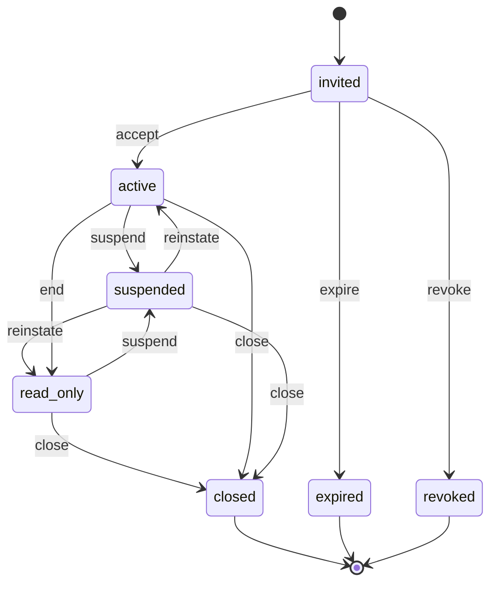
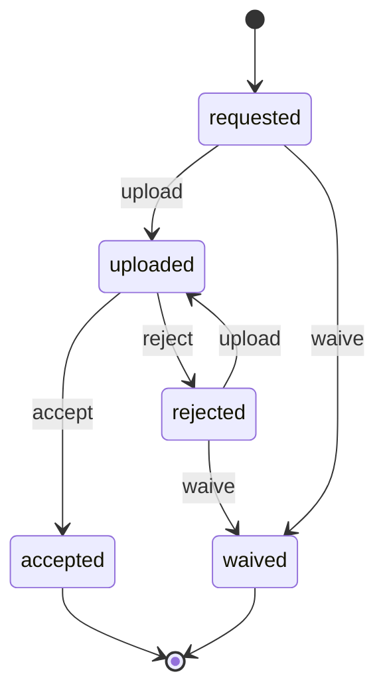
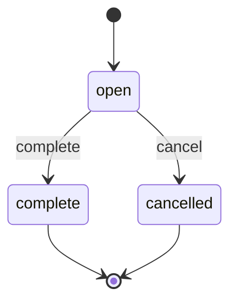

# wl-portal

> Status: specification, partly built; the build ledger is [crates/wl-portal/README.md](../../crates/wl-portal/README.md) · Last updated: 2026-10-24

**Build status (2026-10-24):** Built: the access grant and its lifecycle (with self-registration), the neutral refusal of new business and money out for a blocked party and its log, read-only sections (`register_section`), `PortalUsers` (who acts for a party), signed links (`SignedLinks`). Not built (later): invitations (tokens, mail; §5.1), portal roles with their permissions, login methods (§5.3), Document request and Request list (§4, §5.5), the other signed-link actions (tracking, confirmation, approval), the module-specific sections (leases, invoices, statements, refund requests) and the close-after timer. Where a section below describes one of these, it is a specification, not behaviour. The crate has two tables: access grants and the refusal log.

## 1. Purpose

Outside parties want to serve themselves instead of phoning or messaging staff: see their
contract, pay an invoice, raise a request, upload a document, approve a timesheet, book a
session. `wl-portal` is the **branded self-service front door for external users**. It
handles invitations and logins, decides whom each external user may act for and with which
portal role, closes access when the relationship ends, and runs the secure document exchange.
Other modules supply the portal pages. The portal decides who gets in and what frame they see.

## 2. Capabilities covered

| ID | Capability | Used by verticals | Scope |
|---|---|---|---|
| `POR.SLF.01` | Self-service portal for the main external party | 01, 03, 04, 05, 06, 07, 08, 09, 10 (MVP); 02 (Later) | MVP |
| `POR.SLF.02` | Portal for a second external audience | 03, 09 (MVP); 01, 08, 10 (Later) | MVP |
| `POR.DOC.01` | Secure document exchange through the portal: request lists, uploads | 04 (MVP); 05, 09 (Later) | MVP |

Audiences per vertical:

| Vertical | Main audience (`POR.SLF.01`) | Second audience (`POR.SLF.02`) |
|---|---|---|
| 01 Property | tenants | owners (Later) |
| 02 Construction | client / main contractor contacts (Later) | — |
| 03 Logistics | client companies | recipients: tracking page by signed link, no login |
| 04 Accounting | client companies; a group contact switches between the group's companies | — |
| 05 Clinics | patients and guardians | — |
| 06 F&B | direct-order customers (phone OTP) | — |
| 07 Manufacturing | customer buyers: order status, documents, reorder or PO upload (no catalogue cart in the MVP) | — |
| 08 Auto | B2B buyers (workshops) | fleet customers (Later); insurers and surveyors are a further Later audience (`AUT.ACL.19`) |
| 09 Manpower | client companies (timesheet approval in the portal or from an emailed link) | workers (PWA, SMS one-time code) |
| 10 EdTech | students and guardians | corporate clients (Later) |

## 3. Concepts and entities

| Entity | Description | Important fields |
|---|---|---|
| **Audience** | A kind of external user, configured per vertical | key (e.g. `tenant`, `owner`, `client`, `worker`), label, login methods, available portal roles, home page, close-after period, self-registration allowed |
| **Portal user** | An external login: a Renox user of the external kind, linked to exactly one person party (`PLT.ACL.05`) | user, person party, preferred language, last login, 2FA on |
| **Access grant** | What a portal user may do for one party | portal user, acting-for party (self, their company, a dependant), audience, portal roles, source (invitation, self-registration, relationship), valid from, valid until, status |
| **Portal role** (not built) | A named set of portal permissions inside an audience | key (e.g. `primary_contact`, `finance_contact`, `approver`, `viewer`, `guardian`), permissions |
| **Invitation** (not built) | An offer to create or extend access | email or mobile, person party, acting-for party, audience, roles, token, expires at, invited by |
| **Signed link** | Access to one record without a login | record (`Subject`), allowed actions declared by the issuing module (e.g. view, pay, confirm, approve a timesheet, answer feedback), expires at, single use flag, issued for (party or contact point) |
| **Request list** (not built) | A set of documents asked from a party for a period (`POR.DOC.01`) | party, period, template, due date, assignee (staff), status |
| **Document request** (not built) | One item on a request list | list, description, required flag, due date, files (`wl-documents`), reviewer, reject reason, status |
| **Portal section** | A page or menu entry contributed by a module | module, audience, required portal permission, order, label |

An access grant is a **scoped role assignment**: the portal role is assigned in the scope of the
acting-for party, with dates. That gives the `OWN` and `TIM` rules for free, through Renox's
`assign_role_in`, `has_permission_in` and `scopes_with`. Every portal page filters by the
parties of the user's active grants.

## 4. Lifecycles

### Access grant (portal user lifecycle)

| State | Tone | Terminal | Meaning |
|---|---|---|---|
| `invited` | info | no | Invitation sent, not yet accepted |
| `active` | success | no | Full access for the grant's roles |
| `suspended` | warning | no | Temporarily blocked by staff (e.g. dispute, security concern) |
| `read_only` | warning | no | The relationship ended; the user can still see and download history |
| `closed` | neutral | yes | No access |
| `expired` | neutral | yes | Invitation not accepted in time |
| `revoked` | neutral | yes | Invitation withdrawn before acceptance |

| Transition | From | To | By | Guards | Effects |
|---|---|---|---|---|---|
| `accept` | invited | active | the invitee | token valid; login method set up (password, or verified email/mobile for passwordless) | portal user created if new; welcome message; event `PortalAccessActivated` |
| `expire` | invited | expired | system | invitation expiry passed | inviter notified |
| `revoke` | invited | revoked | `portal_users.invite`, or a primary contact with `portal.users.manage` | — | token invalidated |
| `suspend` | active, read_only | suspended | `portal_users.manage` | reason given | sessions ended; event `PortalAccessSuspended` |
| `reinstate` | suspended | active, read_only | `portal_users.manage` | — | back to the state before suspension |
| `end` | active | read_only | system (relationship or contract ended), or `portal_users.manage` | — | write actions removed; event `PortalAccessReadOnly` |
| `close` | read_only, active, suspended | closed | system (close-after period), or `portal_users.manage`, or a primary contact for their company's users | — | sessions ended; event `PortalAccessClosed` |

Self-registration (F&B customers, EdTech students, clinic patients where enabled) creates a
grant directly in `active`, for the user's own party, with the audience's default role.

**Vertical mapping**

| Vertical | What ends the grant (`end`) | Close-after period |
|---|---|---|
| 01 Property | lease `terminated` (`POR.ACL.01`) | 90 days |
| 02 Construction (Later) | project final account closed (`POR.ACL.01`) | 90 days |
| 03 Logistics | client contract ended (`POR.ACL.01`) | 90 days |
| 04 Accounting | engagement `ended` (`POR.ACL.01`) | 90 days |
| 05 Clinics | guardian relationship reaches the age of majority (`PTY.ACL.01`) | 0 (closes at once; the dependant can get their own access) |
| 07 Manufacturing | customer account closed (`POR.ACL.01`) | 90 days |
| 09 Manpower | worker `exited` (`POR.ACL.01`) | 60 days |
| 10 EdTech | guardian relationship reaches the age of majority (`PTY.ACL.01`) | 0 |
| others | party archived or relationship ended | audience default (90 days) |

### Document request (from [04-accounting.md](../verticals/04-accounting.md), generalised)

**Build status (2026-10-24):** Not built (later).

| State | Tone | Terminal | Meaning |
|---|---|---|---|
| `requested` | neutral | no | Asked from the party, with a due date |
| `uploaded` | info | no | Files uploaded; waiting for review |
| `accepted` | success | yes | Files are usable |
| `rejected` | warning | no | Not usable; reason sent to the party |
| `waived` | neutral | yes | Not needed |

| Transition | From | To | By | Guards | Effects |
|---|---|---|---|---|---|
| `upload` | requested, rejected | uploaded | portal user with `portal.documents.upload` for the party (`OWN`) | at least one file; file type and size allowed | assignee notified; files stored in `wl-documents` attached to the request and the party |
| `accept` | uploaded | accepted | `requests.review` | — | event `DocumentRequestAccepted` (e.g. an accounting task may `unblock`) |
| `reject` | uploaded | rejected | `requests.review` | reason given | party notified with the reason |
| `waive` | requested, rejected | waived | `requests.review` | reason given | — |

### Request list

**Build status (2026-10-24):** Not built (later).

| State | Tone | Terminal | Meaning |
|---|---|---|---|
| `open` | info | no | At least one required item is `requested`, `uploaded` or `rejected` |
| `complete` | success | yes | Every required item is `accepted` or `waived` |
| `cancelled` | neutral | yes | Withdrawn by staff |

| Transition | From | To | By | Guards | Effects |
|---|---|---|---|---|---|
| `complete` | open | complete | system | all required items terminal | event `RequestListCompleted` |
| `cancel` | open | cancelled | `requests.manage` | reason given | open items `waive` |

## 5. Workflows

### 5.1 Invite a company contact

**Build status (2026-10-24):** Not built (later): no invitation table or token exists.

1. Staff open a company party and choose a contact (`contact_of` relationship in
   `wl-parties`), or create one.
2. They pick the audience and portal roles, e.g. tenant `primary_contact`, and send the
   invitation by email or SMS/WhatsApp (`wl-notify`).
3. The contact accepts, sets a password or confirms their email or mobile, and lands on the
   audience's home page.
4. A primary contact can invite colleagues of the same company, with roles up to their own
   (`PLT.ACL.03` applied to portal roles).

### 5.2 Guardian access

1. A `guardian_of` relationship exists in `wl-parties`.
2. The guardian's portal user gets an access grant for each dependant, with the `guardian`
   role. The portal shows a switcher between "me" and each dependant.
3. When the relationship ends, the dependant's grant closes. The dependant can be invited in
   their own name.

### 5.3 Login

1. Methods are configured per audience:
   - email + password, with optional 2FA;
   - **magic link** by email;
   - **one-time code** by SMS or WhatsApp (F&B customers, manpower workers on the PWA).
   The portal is online only in the MVP, like the rest of the platform.
2. Failed attempts are rate-limited and locked out. Every login is logged for security.
3. A user with several grants sees one portal per audience, with a party switcher.

### 5.4 Signed links

1. A module issues a signed link for one record and its allowed actions. Examples: a
   logistics tracking page for a recipient, a "pay this invoice" link, a booking
   confirmation link, a timesheet approval link emailed to a manpower client approver
   (09), or a feedback link (`wl-ticketing`).
2. The link works without a login until it expires or is used, if single-use. It never
   reveals other records.

### 5.5 Document exchange

**Build status (2026-10-24):** Not built (later).

1. A request list is created from a template, by staff or by an automation (`ACC.RUL.02`
   creates one per tax period).
2. The party is notified. Contacts with `portal.documents.upload` see the open items.
3. They upload files per item. Staff review them and accept or reject each one.
4. Reminders go out for overdue items (`POR.RUL.01`). When every required item is done, the
   list completes.

### 5.6 Branding

The portal uses the client's brand tokens (`PLT.ORG.01`,
[DESIGN-SYSTEM.md](../DESIGN-SYSTEM.md) §4) and the editorial portal surface (§3), on the
client's domain. A deployment with several brands, such as F&B virtual brands, serves one
portal per brand, each with its own logo, colours and domain, from the same party register.

## 6. Interfaces to other modules

**Provides**

| Service | Purpose |
|---|---|
| `PortalAccess` | `grants_for(user)`; `current_party(request)`; check a portal permission for a party; invite, end and close grants |
| `PortalSections` | Modules register portal pages and menu entries per audience, guarded by portal permissions |
| `SignedLinks` | Issue and verify signed links for a `Subject` with allowed actions |
| `DocumentRequests` | Create request lists from templates; query status per party and period |

**Consumes:** `wl-parties` (persons, relationships, `acting_for`), `wl-documents` (file
storage, document kinds), `wl-notify` (invitations, OTP, reminders), `wl-kernel` (branding,
settings, Subject, automations), Renox Auth (users, sessions, password, 2FA).

**Events emitted**

| Event | When | Payload |
|---|---|---|
| `PortalUserInvited` | invitation sent | grant, party, audience, roles, channel |
| `PortalAccessActivated` | grant becomes `active` | grant, portal user, party |
| `PortalAccessSuspended` / `PortalAccessReadOnly` / `PortalAccessClosed` | status changes | grant, reason |
| `PortalLogin` | successful or failed login | portal user, method, result (security log, not an automation trigger) |
| `SignedLinkUsed` | a signed link is opened or acted on | subject, action |
| `DocumentRequested` | a request item is created | request, party, due date |
| `DocumentUploaded` | `upload` | request, files |
| `DocumentRequestAccepted` / `DocumentRequestRejected` / `DocumentRequestWaived` | review decisions | request, reason |
| `RequestListCompleted` | list completes | list, party, period |

**Reacts to:** `RelationshipEnded`, `PartyArchived`, `PartyBlocked` / `PartyUnblocked` (from
`wl-parties`). Vertical contract-end events (lease terminated, engagement ended, worker
exited) are mapped in configuration to `end`.

On `PartyBlocked` the portal never shows a block, a block status or a block reason (ordinary
request statuses are shown as usual) (`PTY.ACL.02`, no tipping off). The grants of the
party's users stay as they are: no `suspend`, no message. History, documents and statements
stay visible, and paying an open invoice still works (money in continues). Actions that
start new business or move money out (new booking, order, request for a refund or a deposit
release, signing a new agreement) are refused with one neutral text, the same whatever the
reason: *"This request cannot be completed online. Please contact us."* (Arabic: *"هذا الطلب
لا يمكن إتمامه عبر الإنترنت. يرجى التواصل معنا."*). The list of refused actions is closed:
every other portal action (a maintenance request, a complaint, a message, a document upload,
a profile change, cancelling without a refund) works as usual; a cancellation that would produce
a refund is money out and refused with the same text. Refused actions stay visible and are
refused on submit, because hiding them would reveal a change. The refusal is logged for
staff with `parties.block_reason.view`. On `PartyUnblocked` the actions are available again.

**Attaches to:** request lists and document requests attach to a party and, optionally, to
another `Subject` (e.g. an engagement period). Signed links point to any `Subject`.

**Permissions**

Staff:

| Permission | Allows |
|---|---|
| `portal_users.invite` | Send and revoke invitations |
| `portal_users.manage` | Suspend, reinstate, end, close grants; change portal roles |
| `portal_users.view_as` | Preview the portal as a user, read-only; every session audited and notified to the user's primary contact (`SEN`) |
| `requests.manage` | Create and cancel request lists, edit templates |
| `requests.review` | Accept, reject, waive document requests |
| `signed_links.issue` | Issue signed links manually |

Portal (granted through portal roles, always limited to the grant's party):

| Permission | Allows |
|---|---|
| `portal.users.manage` | Invite and close colleagues' access for the same company |
| `portal.documents.view` / `portal.documents.upload` | See documents; upload to requests |
| `portal.invoices.view` / `portal.invoices.pay` | See and pay invoices (pages from `wl-invoicing` and `wl-payments`) |
| `portal.requests.create` | Raise tickets (`wl-ticketing`) |
| `portal.bookings.manage` | Book and cancel (`wl-scheduling`) |
| `portal.orders.create` | Place orders (`wl-sales`) |
| `portal.approvals.approve` | Approve items the vertical routes to the party (timesheets in 09, returns in 04) |

Verticals add portal permissions for their own pages, e.g. `portal.shipments.create` in
logistics.

**Access rules** that apply to this module:

| Rule | Source | Notes |
|---|---|---|
| `PLT.ACL.05` | platform | external users hold only portal roles, linked to one person party |
| `PRP.ACL.01`, `PRP.ACL.02`, `CON.ACL.12`, `LOG.ACL.02`, `ACC.ACL.01`, `CLN.ACL.05`, `FNB.ACL.08`, `MFG.ACL.08`, `AUT.ACL.01`, `AUT.ACL.02`, `AUT.ACL.19`, `MPW.ACL.01`, `EDU.ACL.01`, `EDU.ACL.02` | verticals | `OWN` scoping, implemented by grants |
| `POR.ACL.01` (generalises `PRP.ACL.09`, `ACC.ACL.12`, `MPW.ACL.11`) | wl-portal | read-only then closed after N days; the period is a parameter per audience (§4 vertical mapping) |
| `PTY.ACL.01` (generalises `CLN.ACL.06`, `EDU.ACL.02`) | wl-parties | guardian access ends at the age of majority (18) |
| `ACC.ACL.11` | accounting | only the `approver` portal role approves returns |
| `ACC.ACL.05`, `FIN.ACL.08` (from `MFG.ACL.07`), `PRP.ACL.11` | verticals | data that must never appear in the portal (`FLD`) |

**Automations** that apply to this module:

| Rule | Source | Notes |
|---|---|---|
| `ACC.RUL.02` | accounting | create the period's request list from the service's template. Stays in the vertical (register). 05 and 09 list `POR.DOC.01` only as Later uploads, not periodic request lists, so it is no longer a promotion candidate |
| `POR.RUL.01` (generalises `ACC.RUL.03`) | wl-portal | remind the party N days after a request's due date; escalate to staff after the last reminder |
| — | new, proposed | Invitation reminder N days before it expires, and the close-after timer. Both are system behaviour of the access grant machine, so they need no rule IDs |

## 7. Configuration per client

| Setting | Default |
|---|---|
| Audiences and their roles | from the vertical (§2 table) |
| Login methods per audience | email + password; magic link on; SMS OTP for F&B customers and manpower workers |
| 2FA for portal users | optional (on for accounting approvers) |
| Self-registration per audience | off, except F&B customers and EdTech students |
| Invitation validity | 7 days |
| Close-after period per audience | 90 days (vertical overrides, §4) |
| Signed link validity | 30 days; tracking links until delivery + 14 days |
| Upload limits | PDF, JPG, PNG, XLSX, DOCX; 20 MB per file |
| Request list templates | from the vertical (e.g. accounting VAT period list) |
| Portal domain and brand | from `PLT.ORG.01`; several brands per deployment where the vertical allows (F&B) |
| Lockout after failed logins | 5 attempts, 15 minutes |
| Neutral text for actions refused while the party is blocked (EN/AR) | EN "This request cannot be completed online. Please contact us."; AR "هذا الطلب لا يمكن إتمامه عبر الإنترنت. يرجى التواصل معنا." |

## 8. Extension points

- **`PortalSections`** registration: every module and vertical adds pages and home-page
  widgets per audience.
- **`AudienceDefinition`**: a vertical declares its audiences, roles, login methods, and
  which contract-end events end a grant.
- **`AccessEndPolicy`**: strategy that maps events to `end`/`close`, with periods.
- **`RequestTemplate`**: verticals supply request list templates.
- **Events** in §6.
- **Overridable views**: portal layout, home page, login and invitation pages, request list
  page.
- **Custom fields** on request items (through `wl-kernel`).

## 9. Renox fit

| Need | Renox provides | Gap (→ ARCHITECTURE §4a) |
|---|---|---|
| Users, sessions, password login, reset, verification | `Auth` | — |
| Two-factor login | `renox-2fa` | — |
| Social login (optional for consumers) | `renox-oauth` | — |
| Portal roles scoped to a party, with dates | Permissions: `assign_role_in`, `has_permission_in`, `scopes_with` | — |
| Account page sections | `Registry::account_section` | — |
| Custom domains and subdomains | Host-based routing (`Routes::domain`) | — |
| File uploads | Storage (local, S3/R2) | — |
| Magic-link and SMS/WhatsApp one-time-code login | — | R15 (passwordless login) |
| Signed links to one record | ✔ Renox signed URLs (`state.signed_url`, `ValidSignature` extractor; HMAC, expiring, `signed.rs`) | No gap. The allowed actions come from the signed route itself; one-time use and revocation are kept in the portal's own link table |
| Portal navigation contributed by modules | — | R10 (covers the portal menu) |
| Brand per request (several brands in one deployment) | Tokens per stylesheet | R9 (brand chosen per request domain) |
| Arabic and RTL | — | R1 |
| Install on phone | — | R6 (PWA) |
| Audit of "view as" sessions | `Audit` | Audit of views → `wl-kernel` |

## 10. Compliance

- **PDPL:**
  - portal users can see, download and correct their data (Renox privacy download);
  - consents are captured at registration (`wl-parties`);
  - login logs are kept only as long as security needs. The PDPL sets no fixed period, only
    that data is not kept longer than its purpose needs ✔ [S1]; the period to use
    `⚠ open: lawyer (L-03)` (open question 5).
- **Minors:** guardians act for dependants under the age threshold: 18, the age of majority
  under Decree-Law 25 of 2025 ✔ [S2]. The PDPL sets no age of its own. Any separate
  health-regulator age for consent `⚠ open: lawyer (L-04)`.
- **Health data (clinics):** portal pages that show health-related data follow DHA / DoH
  information security standards. In Abu Dhabi, ADHICS v2.0 covers third-party and SaaS
  systems used by the facility, so the portal must meet the facility's control tier ✔ [S3].
  Whether a patient portal needs its own certification (DoH or DHA) `⚠ open: authority (AU-03)`.
- **AML (accounting):** nothing about screening matches, AML cases or suspicious reports may
  reach the portal (`ACC.ACL.05`, no tipping off).
- **SMS and WhatsApp OTP:** the client's alphanumeric sender ID is registered with e& and du
  through the SMS provider under TDRA policy (about 5–25 working days); OTPs are transactional,
  so no `AD-` prefix ✔ [S4]. WhatsApp OTPs use Meta-approved **authentication** templates,
  charged per delivered message ✔ [S5].
- **Security:**
  - rate limits and lockouts;
  - 2FA for portal roles that approve money or filings;
  - every "view as" session audited.

## 11. Out of scope

- **Public marketing website and CMS:** not part of the platform. The portal has a landing
  page and login only. F&B ordering pages come from `wl-sales` inside the portal frame.
- **Native mobile apps:** the portal is responsive web plus PWA.
- **Live chat and support inbox:** Later. Requests go through tickets (`wl-ticketing`).
- **Single sign-on with clients' identity providers** (Azure AD, Google Workspace): Later,
  through `renox-oauth` if a B2B client asks.
- **UAE PASS login:** Later. Private organisations request credentials, sign a service
  provider agreement with Smart Dubai (now Digital Dubai) and are guided by an onboarding
  engineer; integration was free of charge at the last published review ✔ [S6].
- **Storing the documents themselves:** `wl-documents`. The portal only manages requests and
  access.

## 12. Open questions

1. Can one person hold grants in two audiences of the same deployment (e.g. a worker who is
   also a client contact)? The model allows it; does the UI need a switch between audiences?
   *(us)*
2. Should companies be able to have a shared mailbox login (e.g. `accounts@client.ae`), or
   is personal login mandatory? Personal login is assumed for audit. *(client)*
3. Is UAE PASS login expected by B2B clients or patients at launch? *(client)*
4. Are signed "pay this invoice" links acceptable to payment providers and to clients'
   auditors, or must payment always require a login? *(accountant, payment provider)*
5. How long should portal login logs be kept? *(lawyer)*

## Sources

Checked 2026-10-15. *Official* = government or legislation; others are secondary.

| # | Source | Type | Used for |
|---|---|---|---|
| S1 | Business Dubai, "UAE PDPL", https://www.businessdubai.ae/blogs/uae-pdpl-data-protection | Secondary | PDPL storage limitation |
| S2 | Federal Decree-Law 25 of 2025 (Civil Transactions Law), Art. 84, via Khaleej Times and BSA (see [05-clinics.md](../verticals/05-clinics.md) S8) | Secondary | Age of majority 18 |
| S3 | DoH, "ADHICS v2.0", https://www.doh.gov.ae/-/media/78A323607B4C4ACAA58D0C9ACCFB3D59.ashx | Official | ADHICS covers SaaS systems |
| S4 | Telerivet, "UAE SMS compliance: TDRA and the AD- prefix", https://www.telerivet.com/blog/uae-sms-compliance-tdra-ad-prefix; D7 Networks, https://d7networks.com/sms/uae/sms-regulations/ | Secondary | SMS sender ID registration |
| S5 | Meta, "Pricing on the WhatsApp Business Platform", https://developers.facebook.com/docs/whatsapp/pricing | Secondary (vendor) | Template categories and per-message pricing |
| S6 | UAE PASS, "FAQ for service providers", https://docs.uaepass.ae/faq | Official | UAE PASS onboarding |
