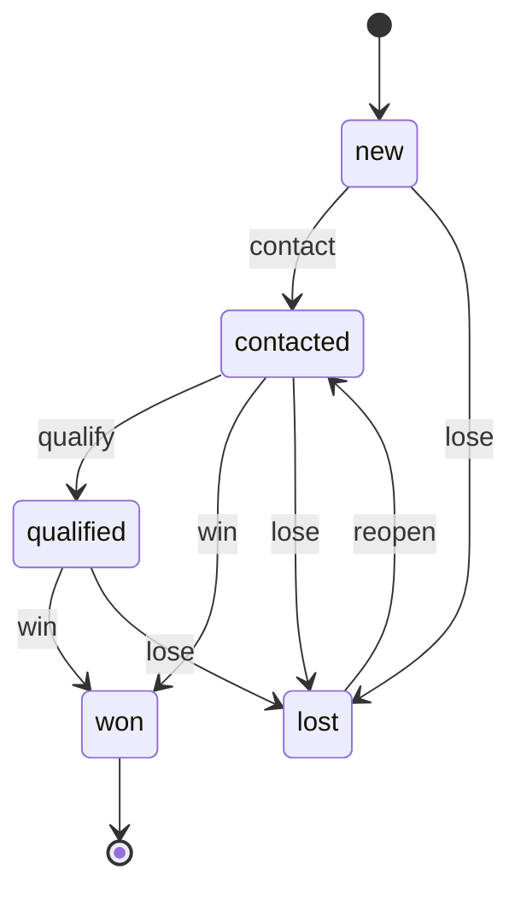
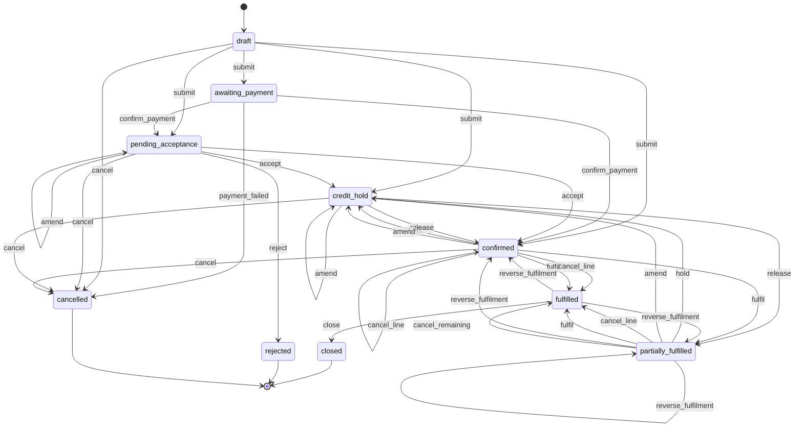
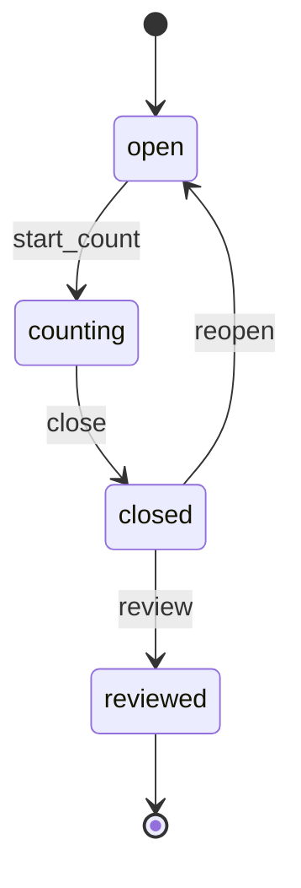
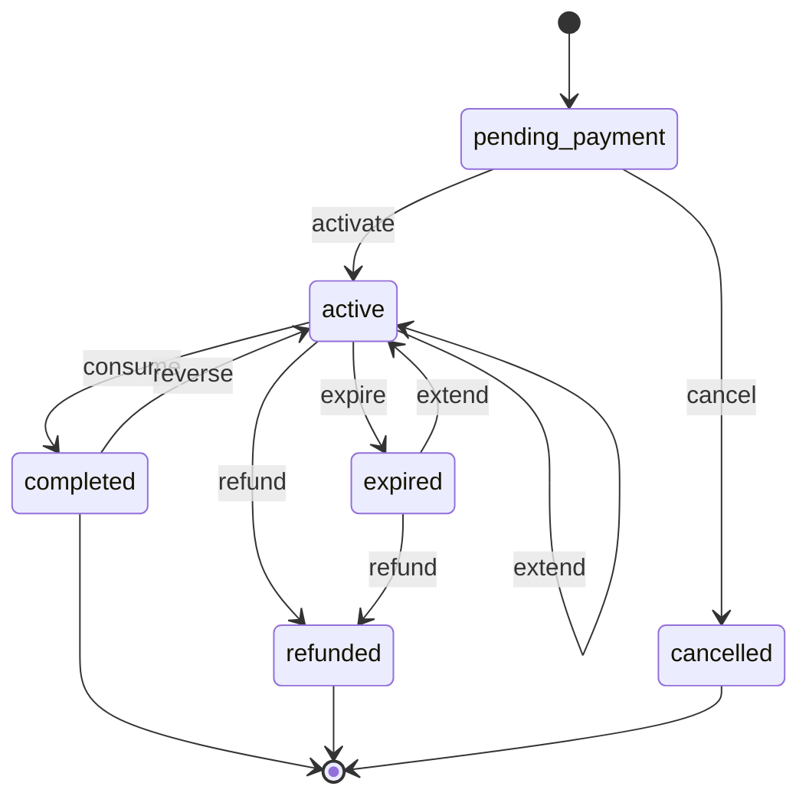
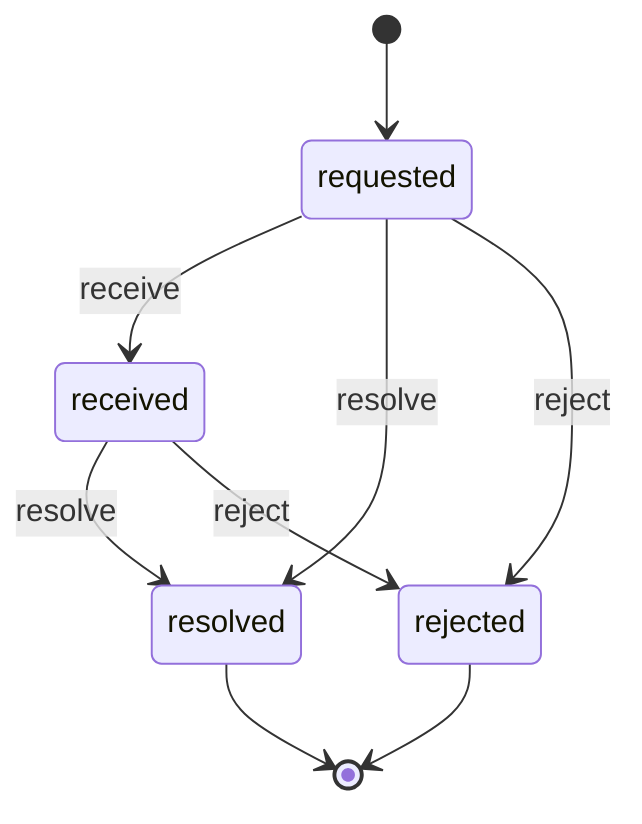

# wl-sales

> Status: draft · Last updated: 2026-10-15

## 1. Purpose

Everything between "someone is interested" and "goods or services are handed over and
billable": leads, what the business sells and at what price, orders from every channel,
counter sales, prepaid packages, discounts, returns and credit control. The module owns the
commercial side of a sale. Stock (`wl-inventory`), delivery (`wl-delivery`), invoices
(`wl-invoicing`) and payments (`wl-payments`) do the rest, and each vertical adds its own
fulfilment, for example the F&B kitchen or the workshop job card.

## 2. Capabilities covered

● MVP · ○ Later, per [CAPABILITY-MAP.md](../CAPABILITY-MAP.md) §3.

| ID | Capability | Used by verticals | Scope |
|---|---|---|---|
| `SAL.CRM.01` | Leads and enquiries pipeline | 03 ○, 04 ○, 05 ○, 07 ○, 08 ○, 09 ○, 10 ● | MVP (10), Later elsewhere |
| `SAL.CAT.01` | Sellable catalogue and price lists | 05 ●, 06 ●, 07 ●, 08 ●, 10 ● | MVP |
| `SAL.ORD.01` | Sales orders from every channel | 06 ●, 07 ●, 08 ● | MVP |
| `SAL.POS.01` | Counter sale / point of sale with receipt and day closing (absorbs `FNB.CSH.01`) | 06 ● (counter takeaway and daily closing; dine-in Later), 08 ● | MVP |
| `SAL.PKG.01` | Prepaid packages of sessions or units: sell, consume, expire, refund (formerly `EDU.PKG.01`) | 05 ●, 10 ● | MVP |
| `SAL.DSC.01` | Discounts and promo codes (formerly `FNB.PRM.01`) | 06 ●, 10 ● | MVP |
| `SAL.RET.01` | Sales returns with inspection, credit note or refund, restocking (formerly `MFG.RTN.01`) | 07 ○, 08 ● | MVP (08) |
| `SAL.CRD.01` | Customer credit limits, credit check and credit hold | 07 ●, 08 ● | MVP |

`SAL.CRM.01` is a candidate for 01: enquiries and viewings (`PRP.LEA.01`, Later) are marked
there as a candidate for a shared CRM. Manual discounts in 05 and 08 use `SAL.ACL.02` without
the `SAL.DSC.01` rule engine.

## 3. Concepts and entities

The customer is always a `Party` from `wl-parties`. This module adds a **customer account**
to the parties that buy on terms.

| Entity | Description | Important fields |
|---|---|---|
| Lead | An enquiry not yet converted | party (may be a new, unverified party), source, interest (catalogue items or free text), owner (staff), next action date, lost reason, converted subject, status |
| Catalogue item | Something that can be sold | code, external code (e.g. CPT for a clinic service, OEM number for a part), names EN/AR, type (`product` linked to a stock item, `service`, `bundle`, `package`, `membership`, `course`), brands (multi-brand clients), photo, unit and sales units with fixed conversions (from the wl-inventory item), VAT category, default price, single-unit price (values unused package credits), payment options (upfront, instalment plan through `FIN.BIL.01`), refund policy (per item, applied by the vertical, e.g. EdTech's tiered default), duration and resources (bookable services, wl-scheduling), trial or placement test offered (EdTech), sale restrictions (e.g. *export only*, *regulated*; enforced by the vertical, `MFG.ACL.11`), sellable channels, option groups, active |
| Option group | Choices on an item (F&B modifiers, sizes, add-ons) | item, name, min/max choices, options with price deltas and recipe effect (stock item and quantity, wl-inventory) |
| Price list | A set of prices | name, currency, VAT-inclusive flag, applies to (customer, customer group or tier, channel, branch), validity, lines (item, unit price, minimum quantity) |
| Price tier | A customer price level computed from a rule (08) | name, rule (list − %, cost + %, per item category or grade), special prices per customer, minimum selling price |
| Customer account | Commercial terms of a buying party | party, price list or tier, payment terms (days), credit limit, credit group (optional), grace days, sales rep, customer PO required (none, per month, per order), on-hold flag with reason (e.g. *bounced cheque*) and its open sources (cleared by *Clear account hold*, §4.2), status |
| Credit group | Companies under one owner sharing a combined limit (08 §13 question 4) | the `wl-parties` company group (`member_of_group`, `PTY.REL.01`), combined limit, member accounts |
| Channel | Where orders come from | code (counter, phone, portal, website, aggregator, sales rep; dine-in Later), brand, integration (manual quick entry, or Deliverect middleware for aggregators), commission rate (for margin reports), requires acceptance, credit check on/off, default price list |
| Sales order | A customer's order | number, revision (starts at 1; earlier revisions kept read-only), issuing entity, party, channel, branch, lines (item, options, quantity, unit price, discount, VAT category, quantity fulfilled, quantity invoiced, quantity cancelled, cancellation reason and outcome), delivery method (collect, deliver, none), payment (prepaid online, cash on delivery, on account), payment status (not required, pending, received, failed), amount refunded, requested date, external order number (e.g. aggregator order number; unique per channel), customer PO reference and file, source (quotation, reorder of a previous order, uploaded PO), state before credit hold, status |
| Till session | One cash drawer for one shift or day | branch or outlet, register, opened by, opening float, expected totals by payment method, counted totals, variance, status |
| Counter sale | A POS ticket paid on the spot, or charged to a customer account | till session, lines, payments, on account (customer account; credit check runs), receipt number (simplified or full tax invoice), party (optional; required on account), status |
| Package | Prepaid credits bought by a party | party (holder) and payer, catalogue item, credits total and used, unit (session, hour, item), price paid, valid from/to, extension history, status |
| Package movement | A change to the credit balance | package, kind (consume, reverse, extend, adjust, refund), quantity, source `Subject` (booking, attendance, job card), user, time |
| Discount rule | A reusable discount | name, kind (percentage, amount, fixed price), applies to (items, categories, whole order), eligibility (party group, related parties, date window, minimum spend, promo code), stacking allowed, usage limit per code and per party, validity |
| Promo code | A code that activates a discount rule | code, rule, uses, max uses, valid to |
| Sales return | Goods coming back, or a refund after completion with nothing to return | number, kind (*goods*, or *no goods* for food and services), original sale (order or counter sale) and lines, reason, complaint category, responsible party, linked ticket, recall (when the goods are under a `wl-inventory` recall), quantity, condition, lot, resolution (credit note, refund, replacement), restocking fee, status |
| Credit check | Result of checking an order | order, exposure (open invoices + uncleared post-dated cheques + confirmed orders not yet invoiced), overdue beyond grace, order value, customer limit, group exposure and combined limit, result, time |

Vertical fields (for example a vehicle on an auto parts order, or a recipient's Makani number)
are custom fields or vertical tables that reference the sales order as a `Subject`.

## 4. Lifecycles

The machines below are canonical. They replace the definitions in the vertical documents
listed in each *Vertical mapping* table.

### 4.1 Lead

| State | Tone | Terminal | Meaning |
|---|---|---|---|
| `new` | neutral | no | Recorded, not yet contacted |
| `contacted` | info | no | First contact made |
| `qualified` | info | no | Need, budget or level and timing known |
| `won` | success | yes | Converted to the vertical's conversion record |
| `lost` | neutral | no | Not converting, with a reason; can be reopened |

| Transition | From | To | By | Guards | Effects |
|---|---|---|---|---|---|
| `contact` | new | contacted | `leads.manage` | contact note recorded | — |
| `qualify` | contacted | qualified | `leads.manage` | qualification fields set (configurable per vertical) | — |
| `win` | contacted, qualified | won | system (conversion event) | — | converted `Subject` and source recorded; event `LeadWon` |
| `lose` | new, contacted, qualified | lost | `leads.manage` | reason from the configured list | event `LeadLost` |
| `reopen` | lost | contacted | `leads.manage` | — | — |

**Vertical mapping**

| Vertical | Conversion event that runs `win` | Notes |
|---|---|---|
| 10 EdTech | enrolment activated | Source of the machine ([10-edtech.md](../verticals/10-edtech.md) §7.1). Trial booking is a `qualified` lead with a booking |
| 05 Clinics | first booking completed | Campaign source required |
| 04 Accounting | engagement letter signed | — |
| 03, 07, 08, 09 | quotation accepted (`FIN.QUO.01`) | — |
| 01 Property (candidate, Later) | lease activated | Stays `PRP.LEA.01` in apps/property until 01 adopts `SAL.CRM.01`; viewings would be bookings on the lead (`SCH.BKG.01`) |

### 4.2 Sales order

Merges the machines in [07-manufacturing.md](../verticals/07-manufacturing.md) §7.1 and
[08-auto.md](../verticals/08-auto.md) §7.1. Picking, packing and delivery are **not** order
states: they belong to the dispatch note (`wl-inventory`) and the delivery (`wl-delivery`).
The order shows them as a derived *fulfilment progress*, so there is one source of truth per
fact.

| State | Tone | Terminal | Meaning |
|---|---|---|---|
| `draft` | neutral | no | Being entered; editable |
| `awaiting_payment` | neutral | no | Placed with online prepayment; waiting for the gateway; not visible to fulfilment |
| `pending_acceptance` | neutral | no | Placed through a channel that needs the seller to accept (website, portal) |
| `credit_hold` | warning | no | Blocked by the credit check at submit, by the re-check at dispatch, or by a bounced cheque (`SAL.CRD.01`) |
| `confirmed` | info | no | Accepted; stock reserved; fulfilment can start |
| `partially_fulfilled` | info | no | Some quantities delivered or collected |
| `fulfilled` | success | no | All quantities delivered or collected, or the rest cancelled |
| `closed` | success | yes | Everything fulfilled is invoiced or receipted |
| `rejected` | neutral | yes | Not accepted by the seller; any prepayment refunded |
| `cancelled` | neutral | yes | Cancelled before anything was fulfilled, or the online payment failed |

| Transition | From | To | By | Guards | Effects |
|---|---|---|---|---|---|
| `submit` | draft | awaiting_payment, pending_acceptance, credit_hold, confirmed | `sales_orders.create`, or the external party through the portal | lines priced; manual prices and discounts within limits (`SAL.ACL.02`) or approved; the external order number is not already used on this channel (a duplicate import is refused and points to the existing order) | target: `awaiting_payment` if paid online and not yet confirmed; else `pending_acceptance` if the channel needs acceptance; otherwise credit check → `credit_hold` or `confirmed`; on `confirmed`: stock reserved, confirmation sent, event `SalesOrderConfirmed` |
| `confirm_payment` | awaiting_payment | pending_acceptance, confirmed | system (`PaymentReceived` from `wl-payments` for the order's payment) | amount equals the order total | as `submit` from acceptance on; prepaid orders skip the credit check |
| `payment_failed` | awaiting_payment | cancelled | system (`PaymentFailed`, including the gateway timeout) | — | reason *payment failed*; promo code use released; the customer is told and may place a new order; nothing reaches fulfilment; event `SalesOrderCancelled` |
| `accept` | pending_acceptance | credit_hold, confirmed | `sales_orders.accept` | channel open; items available | as `submit` from the credit check on |
| `reject` | pending_acceptance | rejected | `sales_orders.accept` or system (acceptance timeout) | reason given | prepayment refunded; party notified; a payment confirmed later is refunded too (`SAL.RUL.06`) |
| `hold` | confirmed, partially_fulfilled | credit_hold | system (re-check at dispatch fails, or `SAL.RUL.05` on a bounced cheque) | order on account | state before the hold kept; dispatch blocked, reservations kept; event `SalesOrderCreditHeld` |
| `release` | credit_hold | confirmed, partially_fulfilled | `credit.release` | approval (`PLT.APR.01`); releaser ≠ creator (`SAL.ACL.03`) | back to the state before the hold (`confirmed` from submit); event `SalesOrderConfirmed` when first confirmed |
| `amend` | pending_acceptance, credit_hold, confirmed, partially_fulfilled | same state, or credit_hold | `sales_orders.amend` | reason; no line below its fulfilled quantity; prices and discounts within `SAL.ACL.02`; channel allows amendments (aggregator orders are changed on the aggregator); approval when fulfilment started (`SAL.ACL.05`) | revision + 1 and the previous revision kept; reservations and vertical fulfilment adjusted; credit check re-run when the value rises (fails → `credit_hold`); prepaid: payment link for an increase, refund of a decrease (`wl-payments`); a draft invoice is updated, an issued one is corrected by credit note or an extra invoice (`wl-invoicing`); revised confirmation sent; event `SalesOrderAmended` |
| `cancel_line` | confirmed, partially_fulfilled | same state, fulfilled | `sales_orders.cancel` | reason; open quantity only; at least one line stays open or fulfilled (otherwise `cancel`); outcome per line and approval when fulfilment of the line started (`SAL.ACL.05`) | quantity cancelled; outcome applied (below); prepaid share refunded less any fee; `fulfilled` when nothing is open; event `SalesOrderLineCancelled` |
| `fulfil` | confirmed, partially_fulfilled | partially_fulfilled, fulfilled | system (`DispatchDelivered` for an order shipped on a dispatch note; `DeliveryDelivered` only for an order delivered without a dispatch note; collection recorded; or vertical fulfilment completed) | dispatch of an order on account passes `credit_recheck`; not yet fulfilled from the same dispatch or delivery (idempotent per source) | accepted quantities fulfilled (refused delivery lines are not); `fulfilled` when nothing is open; invoice drafted when the client invoices on delivery |
| `reverse_fulfilment` | partially_fulfilled, fulfilled | confirmed, partially_fulfilled | system (`DispatchReversed`, or `DispatchLost` of a `delivered` dispatch; for an order delivered without a dispatch note, `DeliveryReversed`, or `DeliveryLost` from `under_review`) | the quantities were fulfilled from that dispatch or delivery | quantity fulfilled reduced by them; `confirmed` when nothing stays fulfilled, otherwise `partially_fulfilled`; a draft invoice is updated, an issued one is left as it is and the accountant gets a task (credit note or keep for re-delivery, `wl-invoicing`); sales rep told; event `SalesOrderFulfilmentReversed` |
| `cancel_remaining` | partially_fulfilled | fulfilled | `sales_orders.cancel` | reason given; outcome per line and approval when fulfilment of a line started (`SAL.ACL.05`) | open lines cancelled with their outcomes; reservations released |
| `close` | fulfilled | closed | system | all fulfilled quantities invoiced or receipted | event `SalesOrderClosed` |
| `cancel` | draft, pending_acceptance, credit_hold, confirmed | cancelled | `sales_orders.cancel` | nothing fulfilled; paid order above a value, or after vertical fulfilment started, needs approval (`SAL.ACL.01`); outcome per line when fulfilment started | reservations released; outcomes applied; refund if paid, less any cancellation fee; vertical fulfilment cancelled (event `SalesOrderCancelled` with the outcome per line) |

**Cancelling after fulfilment started.** Fulfilment of a line has started when its goods are
picked, a work order or production batch for it has started (07), or the kitchen has started
it (06). `cancel`, `cancel_line` and `cancel_remaining` then need an outcome per line and an
approval. The event carries the outcome and the owning module acts on it:

| Outcome | Stock | Money |
|---|---|---|
| *Return to stock* | picked goods put back and the reservation released (`wl-inventory`) | prepaid share refunded |
| *Finish to stock* | the work order runs to the end and its output goes to free stock (vertical) | prepaid share refunded, less any fee |
| *Scrap* | work in progress or prepared goods written off as scrap or wastage (`wl-inventory`, `STK.ACL.02`) | cost recorded as a loss; prepaid share refunded, less any fee |
| *Cancellation fee* (with any of the above) | — | a fee line invoiced, or kept from the prepayment with a tax document (`wl-invoicing`); the manager may waive it |

**Credit re-check at dispatch.** For orders on account, the dispatch note `dispatch` in
`wl-inventory` (and any vertical step that hands goods over) calls the guard
`credit_recheck(order)` through `CreditChecker`. It recomputes the exposure, overdue balance
and the account's on-hold flag as at submit. A failure runs `hold`: the goods stay reserved,
the accountant and sales rep are told (`SAL.RUL.01`), and only `release` lets the dispatch go.

**Account hold.** `SAL.RUL.05` sets the account's on-hold flag with its source (the bounced
cheque). Each further bounced cheque adds a source, and the flag stays while any source is
open. While it is set, `credit_recheck` and the credit check fail. The flag is removed only by
the action *Clear account hold* on the customer account: requested by a holder of
`credit.release` with a reason (cheque replaced, balance paid, other) and approved
(`PLT.APR.01`) by another holder of `credit.release`; the requester cannot approve
(`SAL.ACL.03`). It clears that source on every account that got it (the whole credit group
when configured) and is audited. Clearing does not release held orders: each goes through
`release`, whose screen warns while the account is on hold and offers to request the
clearing in the same action.

**Fulfilment from deliveries.** An order shipped on a dispatch note (`wl-inventory`) follows
the dispatch only: `DispatchDelivered` runs `fulfil`, and the `Delivery*` events of the same
delivery are ignored, so one hand-over is never counted twice. Only an order handed to
`wl-delivery` without a dispatch note follows the `Delivery*` events. Then:

- *Returned* (`DispatchReturned`, or `DeliveryReturned` without a dispatch note): no order
  transition. Fulfilment progress of the returned lines goes back to *not dispatched*; the
  goods go to quarantine (`wl-inventory`); the lines keep their reservation request, and a new
  dispatch reserves again from available stock; sales rep and customer told; the lines are
  re-delivered or cancelled (`cancel_line`).
- *Reversed* (`DispatchReversed`, or `DeliveryReversed`): `reverse_fulfilment`; the goods
  follow the delivery again until its next outcome.
- *Lost* (`DispatchLost`, or `DeliveryLost`): the lost quantities are not fulfilled (a delivery
  lost while under review runs `reverse_fulfilment` first) and show as *lost* in the fulfilment
  progress. The sales rep gets a task: a replacement (new dispatch for the open lines) or
  `cancel_line` with a credit or refund. Goods found before that continue on their delivery.
- *After `closed`*: no transition (terminal). The accountant and the sales rep get a task to
  correct the invoice (credit note through a sales return, or re-delivery at zero price).
- *On `credit_hold`*: the quantity fulfilled is reduced and the state kept before the hold is
  set to `confirmed` or `partially_fulfilled` to match.

**Online payment.** An order paid online is placed (visible to the outlet or fulfilment) only
after the gateway confirms the payment. A failed or timed-out payment cancels it. A payment
that is confirmed after the order was cancelled or rejected is refunded in full without
staff action (`SAL.RUL.06`).

**Vertical mapping**

| Vertical | Their state or step | Canonical equivalent |
|---|---|---|
| 07 Manufacturing | `on_credit_hold` | `credit_hold` |
| 07 | `partially_delivered`, `delivered` | `partially_fulfilled`, `fulfilled` (dispatch `confirm_delivery` runs `fulfil`) |
| 07 | `MFG.RUL.01` (work order for shortfall on confirm) | listens to `SalesOrderConfirmed`; unchanged |
| 07 | portal reorder or PO upload, confirmed by sales (`POR.SLF.01`) | `submit` on the portal channel → `pending_acceptance`; sales `accept`. Catalogue cart ordering in the portal is Later |
| 08 Auto | `confirm` | `submit` (channel without acceptance) |
| 08 | `picking`, `ready` | fulfilment progress from the dispatch (`wl-inventory`, `STK.DSP.01`): `ready` is the dispatch `picked`; `SAL.RUL.04` reminds the customer when a *collect* order stays there |
| 08 | `out_for_delivery` | fulfilment progress from the delivery (`wl-delivery`) |
| 08 | `return_delivery` (out for delivery → `confirmed` or `partially_delivered` on `DeliveryReturned`) | no order transition, on `DispatchReturned` (the dispatch `return` runs on `DeliveryReturned`): the order stays `confirmed` or `partially_fulfilled` and its fulfilment progress goes back to *not dispatched* for the returned lines; goods back to quarantine through the dispatch (`wl-inventory`); the lines keep their reservation request and the new dispatch reserves again; sales rep and customer told; the lines are re-delivered (new dispatch) or cancelled (`cancel_line`) |
| 08 | `deliver` with proof of delivery | `fulfil` on `DispatchDelivered` (the dispatch `confirm_delivery` runs on `DeliveryDelivered`); a delivery reversal or loss runs `reverse_fulfilment` |
| 08 | `delivered` → `invoice` → `closed` | `fulfilled` (invoice drafted on fulfil) → `close` |
| 08 | counter collection (`deliver` by counter staff) | `fulfil` from a collection record with signature (`DOC.SIG.01`) |
| 06 F&B | direct order `placed` | `pending_acceptance` (website channel) |
| 06 | aggregator order starts at `accepted` | `submit` on the aggregator channel, no acceptance, no credit check → `confirmed` |
| 06 | kitchen fulfilment (`accepted → preparing → ready → dispatched → completed`) | stays vertical-specific; starts on `SalesOrderConfirmed`; its `complete` runs `fulfil` |
| 06 | `rejected` | `rejected` |
| 06 | direct order with cash on delivery | `submit` with payment *cash on delivery*; the rider's cash goes to cash custody in `wl-payments` |
| 06 | dine-in order starting in `accepted` (Later) | `submit` on the dine-in channel → `confirmed`; completes when the table session is settled |

### 4.3 Till session and counter sale

Generalises the F&B daily closing (`FNB.CSH.01`) into the POS. Any business with a cash
drawer needs it, auto parts counters included.

| State | Tone | Terminal | Meaning |
|---|---|---|---|
| `open` | info | no | Drawer in use; counter sales recorded against it |
| `counting` | warning | no | Sales stopped; cash and card totals being counted |
| `closed` | success | no | Counted and submitted; locked |
| `reviewed` | success | yes | Checked by a manager or accountant |

| Transition | From | To | By | Guards | Effects |
|---|---|---|---|---|---|
| `start_count` | open | counting | `pos.close_till` | — | no new sales on this till |
| `close` | counting | closed | `pos.close_till` | counted totals per payment method entered | variance calculated; Z report PDF (`DOC.GEN.01`); event `TillSessionClosed`; variance above the threshold needs approval (`PLT.APR.01`) |
| `reopen` | closed | open | `pos.reopen_till` | — | reason logged (as `FNB.ACL.05`) |
| `review` | closed | reviewed | `pos.review` | — | — |

**Vertical mapping**

| Vertical | Their state or step | Canonical equivalent |
|---|---|---|
| 06 F&B (daily closing, formerly `FNB.CSH.01`) | `open` (trading day) | `open`; one till session per outlet and day, or per register |
| 06 | `submit` (closing checklist completed, cash counted) → `submitted` | `start_count` + `close` → `closed`; the closing checklist (`WRK.CHK.01`) is a guard added by the vertical; locked (`FNB.ACL.05`) |
| 06 | `approve` → `approved` | `review` → `reviewed` |
| 06 | `reopen` → `reopened` (area manager) → `submit` again | `reopen` → `open`, then `start_count` and `close` again |
| 08 Auto | counter till per branch and shift | unchanged |

A **counter sale** has two states: `open` (cart) and `completed` (paid or charged to the
customer account, receipt or tax invoice issued). An abandoned cart is deleted. A completed
sale is never edited or voided; it is reversed by a sales return with a credit note
(`SAL.ACL.04`).

### 4.4 Package

Merges the clinics *Package* ([05-clinics.md](../verticals/05-clinics.md) §7.1) with EdTech's
session package balance ([10-edtech.md](../verticals/10-edtech.md)).

| State | Tone | Terminal | Meaning |
|---|---|---|---|
| `pending_payment` | neutral | no | Sold, not yet paid |
| `active` | info | no | Paid (or first instalment paid); credits usable |
| `completed` | success | yes | All credits used |
| `expired` | warning | no | Validity ended with credits left; can be extended |
| `refunded` | neutral | yes | Unused balance refunded |
| `cancelled` | neutral | yes | Never paid |

| Transition | From | To | By | Guards | Effects |
|---|---|---|---|---|---|
| `activate` | pending_payment | active | system (payment recorded) | paid in full, or first instalment paid if allowed | validity dates set; event `PackageActivated` |
| `consume` | active | active, completed | system (source event: booking completed, attendance submitted, job card closed) | credits remaining ≥ quantity; not expired (`CLN.ACL.10`); when *suspend consumption while unpaid* is on (§7), no unpaid balance reopened on the package's invoice | movement recorded with its source; `completed` at zero; event `PackageConsumed` |
| `reverse` | active, completed | active | `packages.adjust` or system (source cancelled) | — | credit returned with reason |
| `extend` | active, expired | active | `packages.extend` | new end date; limits per configuration | event `PackageExtended` |
| `expire` | active | expired | system | end date passed | unused value reported (deferred revenue) |
| `refund` | active, expired | refunded | `packages.refund` | refunder ≠ recorder (`FIN.ACL.04`); refund from `expired` only if enabled | unused credits valued by the item's refund policy (default: price paid pro rata; 10: single-unit price without the package discount, minus fees); refund via `wl-payments`; credit note via `wl-invoicing` |
| `cancel` | pending_payment | cancelled | `packages.sell` | nothing paid | — |

**Payment reversed after activation.** When the payment for a package is reversed or charged
back, wl-invoicing reopens its invoice (`InvoiceReopened`). The package does not change
state: credits already used stay used and the package stays `active`. The staff who sold it
(05: front desk; 10: counsellor) get a task to collect before the next use, and the holder is
told the balance is due. A setting can suspend further `consume` until the reopened balance
is paid (off by default); the vertical then decides whether a booked session goes ahead.

**Vertical mapping**

| Vertical | Consumed by | Notes |
|---|---|---|
| 05 Clinics | booking `completed` | Expired packages could not be refunded in the clinic machine. Refund from `expired` is now allowed, but off by default (configuration) |
| 10 EdTech | session attendance submitted | EdTech's *Package balance* entity becomes this Package. An enrolment freeze runs `extend` |

### 4.5 Sales return

From [08-auto.md](../verticals/08-auto.md) §7.1, with manufacturing's lot link and complaint.

| State | Tone | Terminal | Meaning |
|---|---|---|---|
| `requested` | neutral | no | Customer asked to return goods |
| `received` | info | no | Goods back in a quarantine location; being inspected |
| `resolved` | success | yes | Credited, refunded or replaced; stock restored or written off |
| `rejected` | neutral | yes | Not accepted; goods handed back |

| Transition | From | To | By | Guards | Effects |
|---|---|---|---|---|---|
| `receive` | requested | received | `returns.handle` | original sale linked; within the return window or approved (a return of recalled goods is always accepted) | stock received into quarantine (`wl-inventory`); a lot under an open recall links the return to the recall and adds the qty to its stock hold |
| `resolve` | received; requested (kind *no goods*) | resolved | `returns.handle` | inspection recorded (kind *goods*); resolution chosen; restocking fee set; value above threshold approved; kind *no goods*: complaint category, responsible party and approval (`SAL.ACL.06`) | credit note (`wl-invoicing`) or refund (`wl-payments`) or replacement order at zero price; stock restored or written off (kind *goods*); order's amount refunded updated; event `ReturnResolved` |
| `reject` | requested, received | rejected | `returns.handle` | reason given | goods released back to the customer |

**Refund after completion (kind *no goods*).** Food that arrived cold or wrong, a missing
item, or a service not delivered as sold cannot come back as goods. The return is raised from
the completed order or from a complaint ticket and resolved directly from `requested` with a
complaint category (cold, late, missing item, wrong item, quality, service not delivered,
other) and a responsible party (business, driver or rider, aggregator, supplier, customer).
The responsible party drives reports and recovery: a supplier fault can open a supplier
claim, a rider fault goes to the rider's record. The refund is full or partial per line.

**Vertical mapping:** 08's `credited` is `resolved` with resolution *credit note* or
*refund*. In 07, a return that comes from a quality complaint links to an NCR
(`MFG.QCL.02`) through `ReturnResolved`.

## 5. Workflows

### 5.1 Lead to customer

1. A lead is captured from a web form, the portal, an import or by staff. Source and
   consent are recorded (`PTY.CNS.01`).
2. The owner contacts and qualifies it. Next-action dates drive the follow-up list.
3. The vertical's conversion event runs `win`, and the lead's party becomes a customer.

### 5.2 Order to cash (B2B, on account)

1. An order is entered by a sales rep, placed in the portal, or created from an accepted
   quotation. Prices come from the party's price list.
2. On submit, the credit check runs. Exposure counts open invoices, uncleared post-dated
   cheques (`wl-payments`) and confirmed orders not yet invoiced; it is checked against the
   customer's limit and, for a credit group, the combined limit. An overdue balance beyond
   the grace days also fails. A failure puts the order on `credit_hold`, and the accountant
   and sales rep are notified (`SAL.RUL.01`). Release needs an approver who did not create
   the order (`SAL.ACL.03`).
3. `confirmed` reserves stock. `wl-inventory` creates the dispatch note, or the vertical starts
   its own fulfilment.
4. At dispatch the credit is checked again (`credit_recheck`); a failure puts the order on
   `credit_hold` before the goods leave. Each delivery or collection runs `fulfil` for the
   quantities the customer accepted (once per hand-over: from the dispatch note when there
   is one); refused lines come back and stay open or are cancelled with `cancel_line`. A
   delivery reversed or lost after it was delivered runs `reverse_fulfilment`. A *collect*
   order whose goods are picked but not collected after N days triggers a reminder
   (`SAL.RUL.04`). The invoice is drafted on delivery or periodically, depending on
   configuration.
5. When everything fulfilled is invoiced, the order closes.

### 5.3 Direct order (website or portal, prepaid)

1. The customer builds a cart from the channel's catalogue, applies a promo code and pays
   online (`FIN.PAY.02`, Stripe or N-Genius) or chooses cash on delivery where the channel
   allows it.
2. An online-paid order waits in `awaiting_payment` until the gateway confirms. If the
   payment fails or times out, the order is cancelled and the customer may try again.
3. The order arrives as `pending_acceptance`. The outlet accepts it, or rejects it and the
   payment is refunded. A payment confirmed after a rejection or cancellation is refunded
   automatically (`SAL.RUL.06`).
4. The vertical fulfils it (the F&B kitchen); when delivered, its fulfilment completes and
   runs `fulfil`.
5. A complaint after delivery (cold, missing, wrong) is refunded through a sales return of
   kind *no goods* with the category and the responsible party (`SAL.ACL.06`).

### 5.4 Counter sale and day closing

1. Staff open a till with a float.
2. Each sale: scan or search items, apply allowed discounts, take payment in one or more
   methods or charge it to a customer account (credit check runs), and print or send the
   receipt (simplified or full tax invoice).
3. At the end of the shift: count, enter totals, submit. A variance above the threshold goes
   to approval. The Z report is generated and the session is locked.
4. A manager reviews the session. Cash goes to the cash custody of `wl-payments`.

### 5.5 Prepaid package

1. A package is sold as a catalogue item of type `package` and paid in full or by instalment.
2. Each qualifying event consumes credits. Cancelling the event reverses the consumption.
3. When credits run low, the holder is offered a renewal (`SAL.RUL.03`). Before expiry, the
   holder is reminded (`SAL.RUL.02`). On expiry the unused value is reported. An extension
   or refund follows the approval rules.

### 5.6 Return

1. A return is requested at the counter, through the portal, or from a complaint.
2. The goods are received into quarantine and inspected. Goods from a lot under an open
   recall are accepted outside the return window, linked to the recall and held with it;
   the recall decides their outcome.
3. The return is resolved: credit note, refund or replacement. Stock is restored or written
   off.
4. With nothing to return (food, services), the return is resolved directly with a complaint
   category and the responsible party.

### 5.7 Changing or cancelling an order

1. Before fulfilment starts, staff amend the order (new revision) or cancel lines; the
   customer gets the revised confirmation. Prepaid differences are charged or refunded.
2. After fulfilment started, the change or cancellation needs a manager (`SAL.ACL.01`,
   `SAL.ACL.05`) and an outcome per line: return to stock, finish to stock, scrap, with or
   without a cancellation fee.
3. At dispatch, an order on account is credit-checked again; a failure puts it on hold.
4. A bounced cheque from the customer puts the customer account and its open orders on hold
   (`SAL.RUL.05`) until the cheque is replaced or the balance paid. A holder of
   `credit.release` then requests *Clear account hold* and another approves (§4.2); the held
   orders are released one by one.

## 6. Interfaces to other modules

**Provides**

| Service | Purpose |
|---|---|
| `Pricer` | Price for a party, item, options, quantity, channel and date, with the applied price list and discounts |
| `CreditChecker` | Check an amount against a party's limit, overdue balance and on-hold flag; used by sales orders and by verticals (e.g. a fleet job card); `credit_recheck(order)` is the dispatch guard for orders on account |
| `OrderFulfilment` | `fulfil(order, lines, quantities, source)` and `reverse(order, lines, quantities, source)`, called from `wl-inventory` and `wl-delivery` events and by vertical fulfilment; idempotent per source |
| `PackageLedger` | `consume`, `reverse` and `balance` for a party and item, called by `wl-scheduling` and verticals |
| `LeadConversion` | Mark a lead won from any vertical event |
| `DiscountEngine` | Evaluate discount rules and promo codes for a cart; record usage |

**Consumes**

- `wl-kernel`: `Subject`, `Sequences` (order, receipt and return numbers), `Settings`,
  `Approvals`, `CustomFields`, `Automations`, state machines.
- `wl-parties`: parties, relationships (`PTY.REL.01` for sibling discounts and payer vs
  holder), consents.
- `wl-invoicing`: `Invoicer` (invoices, simplified tax invoices, credit notes), receivables
  balance for the credit check, quotations as order source.
- `wl-payments`: `PaymentRecorder`, `PaymentLinks`, `Refunds`, `CashCustody` for till
  cash, `Cheques` (uncleared post-dated cheques in the credit exposure). Events consumed:
  `PaymentReceived` (`confirm_payment`, `SAL.RUL.06`), `PaymentFailed` (`payment_failed`),
  `ChequeBounced` (`SAL.RUL.05`). From `wl-invoicing`: `InvoiceReopened` for a package's
  invoice (task to collect, holder told; consumption suspended only when the setting is on,
  §4.4).
- `wl-inventory`: availability, reservations, dispatch notes (which call `credit_recheck`).
  Events consumed for orders shipped on a dispatch note: `DispatchDelivered` (`fulfil` for
  delivered quantities), `DispatchReturned` (as `DeliveryReturned` below), `DispatchReversed`
  and `DispatchLost` (`reverse_fulfilment` when fulfilled; lost lines to the sales rep's
  task). Receipt of returned goods (recalled lots linked to the recall and its stock hold),
  scrap and wastage for cancelled lines; `LotTrace` to find whether a returned lot is
  recalled.
- `wl-ticketing`: complaint tickets linked to a refund after completion.
- `wl-delivery`: delivery requests for orders with delivery method *deliver*. Events
  consumed only for orders delivered without a dispatch note (§4.2 *Fulfilment from
  deliveries*): `DeliveryDelivered` (`fulfil` for accepted quantities), `DeliveryReturned`
  (fulfilment progress of the returned lines back to *not dispatched*; reservation request
  kept; sales rep and customer told), `DeliveryReversed` (`reverse_fulfilment`),
  `DeliveryLost` (`reverse_fulfilment` when it was under review; lost lines to the sales
  rep's task).
- `wl-notify`: confirmations, receipts, reminders. `wl-documents`: order confirmations,
  receipts, Z reports.

**Events emitted**

| Event | When | Payload |
|---|---|---|
| `LeadCreated`, `LeadWon`, `LeadLost` | lead created or closed | lead, party, source, owner, converted subject or reason |
| `SalesOrderConfirmed` | order reaches `confirmed` | order, party, channel, lines, delivery method |
| `SalesOrderCreditHeld` | order goes to `credit_hold` | order, party, open balance, overdue, limit |
| `SalesOrderFulfilled` | quantities fulfilled | order, lines and quantities, source |
| `SalesOrderFulfilmentReversed` | `reverse_fulfilment` | order, lines and quantities, source (dispatch or delivery), cause (reversed, lost) |
| `SalesOrderCancelled`, `SalesOrderRejected` | order cancelled or rejected | order, reason, responsible party, outcome and fee per line |
| `SalesOrderAmended` | `amend` | order, revision, changed lines, value before and after, reason |
| `SalesOrderLineCancelled` | `cancel_line` | order, line, quantity, reason, outcome, fee |
| `SalesOrderClosed` | order closed | order |
| `CounterSaleCompleted` | POS sale paid | sale, till session, totals by payment method |
| `TillSessionClosed` | till counted and submitted | session, expected, counted, variance |
| `PackageActivated`, `PackageConsumed`, `PackageExtended`, `PackageExpired`, `PackageRefunded` | package changes | package, party, credits, source |
| `ReturnResolved` | return resolved | return, kind, original sale, resolution, value, lot, complaint category, responsible party |
| `CreditLimitChanged` | limit or terms approved | party, old and new values, approver |

**Attaches to:** a sales order and a lead may reference any `Subject` as their source
(quotation, booking, campaign). Package movements reference the `Subject` that consumed
them.

**Permissions**

`leads.view`, `leads.manage`, `leads.assign` · `catalogue.view`, `catalogue.manage`,
`price_lists.manage` · `sales_orders.view`, `sales_orders.create`, `sales_orders.accept`,
`sales_orders.amend`, `sales_orders.cancel`, `prices.override` · `credit.view`, `credit.release`,
`credit.limits.propose`, `credit.limits.approve` · `pos.sell`, `pos.open_till`,
`pos.close_till`, `pos.reopen_till`, `pos.review` · `packages.view`, `packages.sell`,
`packages.extend`, `packages.adjust`, `packages.refund` · `discounts.manage`,
`discounts.apply_manual` · `returns.request`, `returns.handle`.

**Shared access rules** (registered in [ACCESS-CONTROL.md](../ACCESS-CONTROL.md) §9, all
`in use`)

| ID | Rule | Pattern | Parameter (default) | Generalises |
|---|---|---|---|---|
| `SAL.ACL.01` | Cancelling or refunding a paid order above a value, or after fulfilment started, needs a manager | `LIM`, `STA` | AED 50 (F&B default) | `FNB.ACL.11` (void after fire, proposed, Later) |
| `SAL.ACL.02` | A manual discount or a price below list beyond a limit needs a manager | `LIM` | 10% (07, 08: 5%) | `CLN.ACL.07`, `EDU.ACL.07`, `AUT.ACL.03`, `MFG.ACL.05` |
| `SAL.ACL.03` | An order over the customer's or group's credit limit, or with invoices overdue beyond the grace days, goes on credit hold; the hold is released only by a role with `credit.release`, not by the order's creator; an account hold (`SAL.RUL.05`) is cleared by a holder of `credit.release` with another holder's approval, never the requester | `LIM`, `SOD` | grace 30 days past terms | `MFG.ACL.04`, `AUT.ACL.04`, `AUT.ACL.05` |
| `SAL.ACL.04` | A completed counter sale is never edited or voided; it is reversed by a sales return with a credit note | `STA` | — | `AUT.ACL.06` |
| `SAL.ACL.05` | Amending an order or cancelling a line after its fulfilment started needs a manager, as does choosing *finish to stock* or *scrap* or waiving the cancellation fee; the requester cannot approve | `STA`, `SOD` | any value | — |
| `SAL.ACL.06` | A refund or credit after completion with nothing returned needs a complaint category and a responsible party; above a value it needs a manager, and whoever records it cannot approve it | `LIM`, `SOD` | AED 50 | — |

**Shared automations** (registered in [WORKFLOW.md](../WORKFLOW.md) §7, all `in use`)

| ID | When | If | Then | Parameters (default) | Generalises |
|---|---|---|---|---|---|
| `SAL.RUL.01` | sales order → `credit_hold` | — | notify accountant and the sales rep | — | — |
| `SAL.RUL.02` | N days before a package's end date | credits remaining > 0 | notify the holder (and the payer, e.g. a guardian) | N = 14 | `CLN.RUL.06`, `EDU.RUL.04` |
| `SAL.RUL.03` | package credit consumed | credits remaining ≤ N | notify the holder or payer with a renewal link | N = 2 | `EDU.RUL.03` |
| `SAL.RUL.04` | N days after the dispatch of a *collect* order reaches `picked` (ready for collection) | not collected | notify the customer and the sales rep | N = 3 | `AUT.RUL.06` |
| `SAL.RUL.05` | `ChequeBounced` (`wl-payments`) | the drawer has a customer account | set the account on hold (and the credit group when configured); run `hold` on its orders on account not yet dispatched; refuse new orders and counter sales on account until the account hold is cleared (*Clear account hold*, §4.2); notify the accountant and the sales rep | whole group: on | — |
| `SAL.RUL.06` | `PaymentReceived` for an order | order is `cancelled` or `rejected`, or already fully paid | request a full refund of that payment (`wl-payments` `Refunds`, reason *late payment*); notify the customer and the outlet or sales manager; the order stays as it is | — | — |

## 7. Configuration per client

| Setting | Default |
|---|---|
| Channels and, per channel: acceptance required, acceptance timeout, credit check, default price list | counter and phone: no acceptance, credit check on; website and portal: acceptance on, 10 min timeout |
| Prices entered VAT-inclusive | on for consumer channels, off for B2B |
| Credit: grace days past terms; hold on overdue; hold on limit | 30 days; on; on |
| Invoice timing for orders | on fulfilment (alternatives: on confirmation, periodic) |
| Manual discount limit (`SAL.ACL.02`) | 10% |
| Paid-order cancellation limit (`SAL.ACL.01`) | AED 50 |
| Till variance needing approval | AED 20 |
| Return window and restocking fee | 14 days; 0% |
| Online payment window before `payment_failed` (gateway timeout) | 15 min |
| Unique external order number per channel | on |
| Amendments allowed per channel | on, except aggregator channels |
| Cancellation after fulfilment started: outcomes offered; fee (% of the line or amount) | return to stock, finish to stock, scrap; 0 |
| Credit re-check at dispatch for orders on account | on |
| Bounced cheque hold (`SAL.RUL.05`): hold the whole credit group | on |
| Refund after completion: approval above (`SAL.ACL.06`); complaint categories; responsible parties | AED 50; cold, late, missing item, wrong item, quality, service not delivered, other; business, driver or rider, aggregator, supplier, customer |
| Package defaults: validity, refund from expired, extension limit | 6 months; off; one extension |
| Package: suspend consumption while a reopened invoice balance is unpaid (§4.4) | off (05, 10: task to collect only) |
| Package reminders: days before expiry (`SAL.RUL.02`); low-credit threshold (`SAL.RUL.03`) | 14 days; 2 credits |
| Uncollected order reminder (`SAL.RUL.04`) | 3 days |
| Credit groups with a combined limit | off |
| Counter sales on account | off (08: on) |
| Discount stacking | off |
| Lead sources, lost reasons, qualification fields | per vertical starter list |
| Numbering | `SO-`, `RCPT-`, `RET-` + year + sequence |

## 8. Extension points

- **Strategy traits:** `PriceRule` (e.g. auto parts tier pricing, F&B channel prices),
  `CreditPolicy` (e.g. a fleet customer checked per contract), `ConversionRule` (which
  event wins a lead), `PackageConsumptionRule` (what consumes how many credits),
  `ReturnPolicy`.
- **Events:** every event in §6. Vertical fulfilment (F&B kitchen, workshop) starts from
  `SalesOrderConfirmed` and reports back through `OrderFulfilment`.
- **Custom fields:** on lead, catalogue item, customer account, sales order and order line.
- **Overridable views:** order confirmation, receipt (80 mm and A4), Z report, return note,
  portal order pages, catalogue cards.

## 9. Renox fit

| Need | Renox provides | Gap |
|---|---|---|
| Catalogue, price lists, orders in the back office | grid, forms, repeater, search, import | — |
| POS screen: fast item entry, cart updates without reloads | live components, `keypad` and `quantity` blocks | Barcode scanning with the camera or a keyboard-wedge scanner: R5 (`rx-barcode-scan`) |
| Receipts and Z reports | `Download::bytes` | PDF (R3), Arabic (R1); 80 mm thermal receipt layout (R21) |
| Catalogue and price import (08 part master with cross-references from Excel) | import (CSV, row validation, templates) | R23 (Excel files, dry run, rollback window) |
| Lead pipeline board | `kanban` block | — |
| Approvals, settings, state machines | — | wl-kernel; R2; R12 |
| Online payment for direct orders | renox-billing gateways (Stripe, Xendit) | Stripe and N-Genius through `wl-payments` (R17; N-Genius adapter is a gap) |
| POS during a network outage | — | Offline queue: one shared Renox gap (R25), Later. The MVP is online only ([ARCHITECTURE.md](../ARCHITECTURE.md) §1 decision 4) |

## 10. Compliance

- **Tax invoices:** a full tax invoice is required for B2B sales to VAT-registered buyers. ✔ A
  simplified tax invoice may be issued to buyers that are not VAT-registered, or to
  registered buyers when the consideration is at most AED 10,000 (Executive Regulation
  Art. 59(5)) [S1]; once e-invoicing applies to the client (1 January or 1 July 2027), B2B
  sales need full e-invoices (Cabinet Decision 100 of 2025) [S2]. Credit notes for returns
  are tax credit notes.
- **VAT-inclusive prices:** ✔ consumer prices must be displayed VAT-inclusive (fine AED
  5,000) [S3].
- **Advance payments and packages:** VAT on prepaid packages is due when payment is
  received, because the date of supply is the earliest of payment, invoice or delivery
  (Decree-Law Art. 25) ✔ [S4]. Unused balances are deferred revenue until consumed or
  expired.
- **Consumer protection** (Federal Law No. 15 of 2020): return, refund and warranty terms
  shown before purchase. No federal rule on the expiry of prepaid services or gift vouchers
  was found in Cabinet Resolution 66 of 2023 [S5]; whether an expiry term is enforceable is
  `⚠ open: lawyer (L-08)`.
- **Marketing:** leads and promo campaigns need a recorded consent (`PTY.CNS.01`, PDPL).
  ✔ The client registers its alphanumeric SMS sender ID (one per brand) with e& and du
  through its SMS provider under TDRA rules; promotional SMS use the `AD-` prefix [S6].
- **Amended and cancelled orders:** an amendment after an invoice was issued is corrected by
  a tax credit note or an additional invoice, never by editing the invoice. Whether a
  cancellation fee kept from a prepayment is consideration for a supply (5% VAT) or
  compensation outside the scope of VAT is `⚠ open: accountant (A-04)`; the fee line takes a
  configurable VAT category until this is answered.
- **Audit:** price overrides, discounts above the limit, credit releases, order amendments
  and revisions, cancellation outcomes, till variances and refunds are audited and visible in
  reports.

## 11. Out of scope

| Not here | Lives in |
|---|---|
| Quotations | `wl-invoicing` (`FIN.QUO.01`) |
| Invoices, credit notes, receivables | `wl-invoicing` |
| Payments, refunds, cash custody | `wl-payments` |
| Stock levels, reservations, picking and dispatch notes | `wl-inventory` |
| Delivery to the customer and proof of delivery | `wl-delivery` |
| F&B kitchen fulfilment, aggregator integration, branded ordering sites | `apps/fnb` (`FNB.KDS.*`, `FNB.AGG.*`, `FNB.DTC.*`) |
| Workshop job cards and supplier warranty recovery | `apps/auto` (`AUT.WAR.02`) |
| Customer warranty claims | `wl-ticketing`, category *warranty* (formerly `AUT.WAR.01`) |
| Third-party payer split (insurer and customer) | `wl-invoicing` (`FIN.TPP.01`) |
| Loyalty points | `apps/fnb` (`FNB.LOY.01`); shared once a second vertical asks |
| Sales commissions, marketing campaigns, CPQ, EDI | not planned |

## 12. Open questions

1. ~~Is a separate *customer account* needed, or are terms and limits enough as party fields?~~
   Decided (2026-10-15): a customer account in wl-sales (08 §6), with an optional credit
   group and a combined limit (08 §13 question 4). *(us)*
2. Do B2B clients invoice per delivery, or once a month per customer? Both are supported;
   which is the default? *(clients 07, 08)*
3. Can a package be shared within a family? *(client 05)* Instalments are allowed: a
   package activates on the first instalment (05 §7.1).
4. ~~Should POS work offline for short outages, or is a mobile-data fallback enough?~~ Decided
   (2026-10-15): online only in the MVP, as on the rest of the platform; the offline queue is
   a shared Renox gap (R25, Later). *(clients 06, 08)*
5. Are sales rep commissions needed in any vertical? *(clients 07, 08)*
6. Thermal receipt printers: browser printing only, or a local print bridge? *(us)*

**Added after the gap analysis (2026-10-14):** a **dine-in** channel (06 F&B, Later; decided
2026-10-15 to stay Later, built when a client asks, 06 §13 question 9): a sales
order opened from a table session, several payments per bill and split bills on the till
session, service charge and fee lines ([06-fnb.md](../verticals/06-fnb.md) §4.7). ✔ A service
charge (up to 10%) is allowed only for hotel- or tourism-licensed outlets, and Dubai adds a
7% municipality fee for them [S7]; a mandatory service charge carries 5% VAT, voluntary tips
passed to staff do not [S8].

## Sources

Checked 2026-10-15. *Official* = government or legislation; others are secondary.

| # | Source | Type | Used for |
|---|---|---|---|
| S1 | FTA, Cabinet Decision 52 of 2017 on the VAT Executive Regulation (unofficial translation, 2017 text), https://tax.gov.ae/-/media/Files/FTA/links/Legislation/VAT/03-Cabinet-Decision-52-of-2017.pdf | Official | Simplified tax invoice conditions (Art. 59) |
| S2 | Ministerial Decision 244 of 2025 (e-invoicing) on mof.gov.ae; Cabinet Decision 100 of 2025 (simplified invoices under e-invoicing), via Grant Thornton and Crowe, https://www.crowe.com/ae/news/what-is-the-recent-amendment-to-uae-vat | Official / secondary | Simplified invoices end under e-invoicing |
| S3 | WAM, "FTA: businesses must display VAT-inclusive prices", https://wam.ae/en/article/hszr6ptm-fta-businesses-must-display-vat-inclusive-prices | Official | VAT-inclusive prices |
| S4 | FTA, Federal Decree-Law 8 of 2017 on VAT (unofficial translation), https://tax.gov.ae/DataFolder/Files/Pdf/VAT-Decree-Law-No-8-of-2017.pdf | Official | Date of supply for advance payments (Art. 25) |
| S5 | Baker McKenzie, "Exploring the UAE's latest Consumer Protection Regulations", https://insightplus.bakermckenzie.com/bm/consumer-goods-retail_1/uae-enhancing-consumer-rights-exploring-the-uaes-latest-consumer-protection-regulations; Cabinet Resolution 66 of 2023 on moet.gov.ae | Secondary / official | No prepaid expiry rule found |
| S6 | Telerivet, "UAE SMS compliance: TDRA and the AD- prefix", https://www.telerivet.com/blog/uae-sms-compliance-tdra-ad-prefix; D7 Networks, https://d7networks.com/sms/uae/sms-regulations/ | Secondary | SMS sender ID registration |
| S7 | Service charge and Dubai municipality fee (Gulf News, Khaleej Times, Arabian Business); Abu Dhabi fees removed in 2023 (Gulf News) | Secondary | Service charge and fees |
| S8 | VAT on service charges and tips, via Ripple and Tally | Secondary | VAT on service charge and tips |
