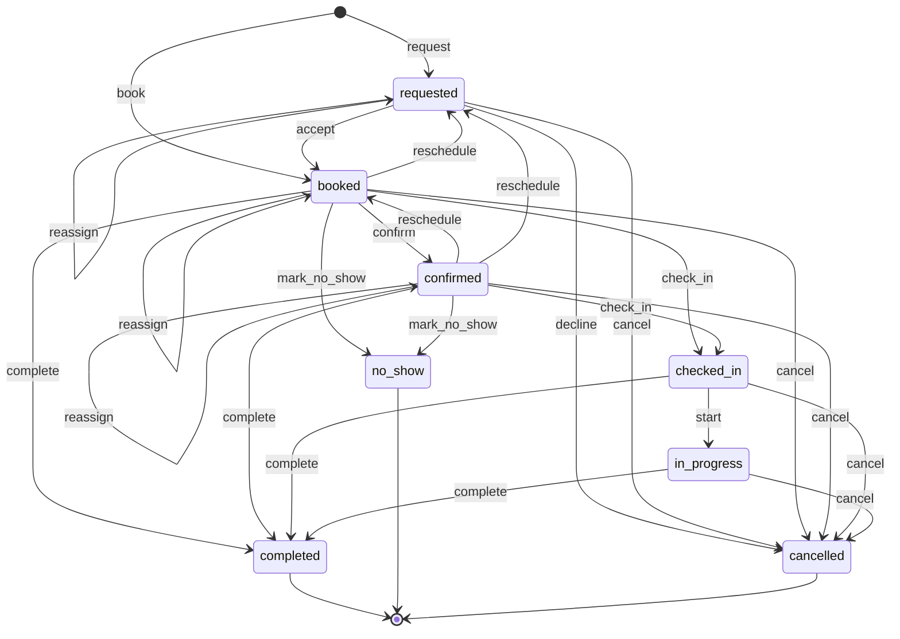
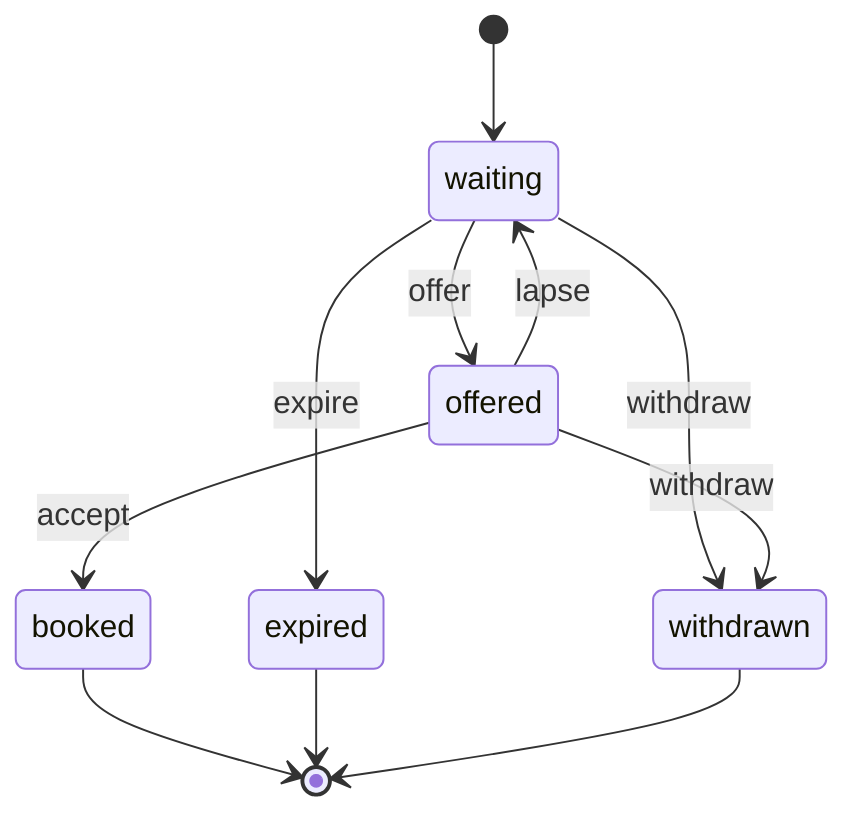

# wl-scheduling

> Status: draft · Last updated: 2026-10-16

## 1. Purpose

Many businesses sell time: a doctor's 20 minutes, a workshop bay for two hours, a tutor for
a trial lesson. To do that they need to know who and what is free, take bookings without
double-booking anyone, remind people so they turn up, and recover the slot when they do not.
`wl-scheduling` provides:

- **bookable resources** and their availability;
- **bookings** made by staff or by the customer;
- **waiting lists**;
- **reminders and no-show handling**.

It knows nothing about patients, vehicles, students or diners. Those are the `Subject` of a
booking.

## 2. Capabilities covered

| ID | Capability | Used by verticals | Scope |
|---|---|---|---|
| `SCH.RES.01` | Resources and availability: people, rooms, bays, equipment, tables | 05 practitioners, rooms, equipment · 08 bays, technicians · 10 tutors, rooms (all MVP) · 06 tables (Later) | MVP |
| `SCH.BKG.01` | Bookings by staff, with waiting list | 05 appointments · 08 workshop slots · 10 trials, placement tests, 1:1 slots (all MVP) · 06 table reservations (Later) | MVP |
| `SCH.SLF.01` | Online self-booking from the website and portal | 05 (MVP); 06 (online table reservation), 08, 10 (Later) | MVP |
| `SCH.RMD.01` | Booking reminders, confirmations and no-show handling | 05, 08, 10 (MVP); 06 (Later) | MVP |

## 3. Concepts and entities

| Entity | Description | Important fields |
|---|---|---|
| Resource | Something or someone that can be booked | type (person, room, bay, equipment, online), name, scope (branch/workshop/campus), linked employee (`wl-hr`) or asset (`wl-inventory`), capacity (1, or N for group slots), service types it can deliver, active |
| Service type | What is booked | name (EN/AR), duration, buffer before/after, required resources (e.g. one practitioner + one room), capacity per slot, catalogue item (`SAL.CAT.01`), requires staff acceptance, self-bookable, online allowed, check-in required, track in-progress, cancellation cut-off, reschedule cut-off, booking deposit (amount, forfeit window N hours), required qualifications and documents of the resource (kinds checked with `qualification_valid` / `document_valid`) |
| Availability rule | Recurring working pattern | resource, location, weekdays, from–to times, service types, valid from/to |
| Availability block | Time a resource is not bookable | resource, start, end, reason, source (manual, leave, roster, session, public holiday), source reference |
| Booking | One reserved slot | number, party (who booked), subject (patient, vehicle, student…), service type, resources, location or online meeting link, start, end, source (staff, portal, website, phone), notes, prepayment reference, conflict (flag with cause `block` or `eligibility`, set by `BookingConflict`, cleared on reassign, reschedule or cancel), cancellation (initiated by `party` or `business`, reason code, stage, work done), status |
| Waiting list entry | A request for an earlier or unavailable slot | party, subject, service type, preferred resources, preferred windows, expires at, status |

**Availability** of a resource at a time = its availability rules − its blocks − its existing
bookings, intersected for every resource the service type needs. Other modules contribute
blocks through `AvailabilitySource` (§8): leave from `wl-hr`, rosters from `wl-attendance`,
class sessions from `apps/edtech`.

**No double-booking:** the module guarantees that two bookings never hold the same resource
at overlapping times beyond its capacity, even when two people book at once. The check and
the insert happen in one transaction that locks the resource's slot, so for the last seat
of a group slot exactly one booker wins. Holds count towards capacity while they last: a
`requested` hold, an unpaid self-booking hold and a waiting-list offer. The loser is told
the slot was just taken and shown the nearest free slots (up to 3, same service type and
location, from the requested time up to the booking horizon: first the same resource, then
the earliest of other eligible resources, by start), or offered the waiting list. If a
payment arrives for a hold that already expired (the booking was cancelled as *unpaid*), the
payment is always refunded in full automatically (`wl-payments` refund with reason *slot not
available*), whether or not the slot is still free. The cancelled booking is not revived;
the party is told to book again.

## 4. Lifecycles

### 4.1 Booking

One machine merges *Appointment* (05), *Booking* (08) and *Booking* (10)
([CAPABILITY-MAP.md](../CAPABILITY-MAP.md) §5, decision 1). Three steps are switched on or
off per service type, so every vertical keeps its flow without new states:

- **staff acceptance:** a booking starts as `requested`;
- **party confirmation:** `booked` → `confirmed`;
- **check-in and in-progress tracking:** `checked_in`, `in_progress`.

| State | Tone | Terminal | Meaning |
|---|---|---|---|
| `requested` | neutral | no | Asked for online; waiting for staff to accept (service type requires acceptance) |
| `booked` | info | no | Slot and resources reserved |
| `confirmed` | info | no | The party confirmed they will come |
| `checked_in` | info | no | The party arrived (service type requires check-in) |
| `in_progress` | info | no | Service started (service type tracks in-progress) |
| `completed` | success | yes | Took place |
| `no_show` | error | yes | The party did not come |
| `cancelled` | neutral | yes | Cancelled or declined |

| Transition | From | To | By | Guards | Effects |
|---|---|---|---|---|---|
| `request` | — | requested | party (self-booking) or `bookings.manage` | service type requires acceptance; slot free | slot held for the request hold time (§7; counts towards capacity until then, §3); staff notified |
| `book` | — | booked | `bookings.manage`, or party (self-booking without acceptance) | slot free for all required resources; resource eligible at the booking's start (`ResourceEligibility`; refused, not warned, `SCH.ACL.04`) | confirmation sent; reminders scheduled; event `BookingBooked` |
| `accept` | requested | booked | `bookings.manage` | slot still free; resource eligible at the booking's start | party notified; reminders scheduled |
| `decline` | requested | cancelled | `bookings.manage` | reason given | slot released; party notified |
| `confirm` | booked | confirmed | party or `bookings.manage` | — | — |
| `reschedule` | requested, booked, confirmed | requested, booked | party (before the reschedule cut-off) or `bookings.manage` | new slot free; resource eligible at the new start | old slot released (`SlotReleased`); returns to `booked`, or to `requested` if staff acceptance is required; a held booking deposit is carried to the new booking (`SCH.ACL.05`); reminders rescheduled; event `BookingRescheduled` |
| `check_in` | booked, confirmed | checked_in | `bookings.checkin` | service type requires check-in; resource eligible now (`ResourceEligibility`), otherwise reassign first | event `BookingCheckedIn` (verticals open their record: a visit, a job card) |
| `start` | checked_in | in_progress | the resource (e.g. practitioner) or `bookings.checkin` | service type tracks in-progress; resource eligible now (`ResourceEligibility`) | — |
| `complete` | booked, confirmed, checked_in, in_progress | completed | the resource, `bookings.manage`, or system (a vertical record completes) | start time passed; from `booked`/`confirmed` only if the service type does not require check-in | event `BookingCompleted` (packages consume a credit; charges are captured) |
| `mark_no_show` | booked, confirmed | no_show | system (`SCH.RUL.02`), the resource, or `bookings.manage` | start time + grace period passed; no open conflict on the booking (a conflicted booking is resolved by staff, not marked no-show) | slot released; booking deposit forfeited if the service type requires one; event `BookingNoShow` |
| `reassign` | requested, booked, confirmed | same state | `bookings.manage` | reason code given (not shown to the party); same time; new resources free and eligible (`ResourceEligibility` at the booking time) | old resources' slot released; party notified of the new resource with *accept*, *pick another time* and *cancel* links (the reason, e.g. illness, is not disclosed); a party who cancels from that message cancels as business-initiated (§4.1 reason codes); conflict cleared; event `BookingReassigned` |
| `cancel` | requested, booked, confirmed, checked_in, in_progress | cancelled | party (before the cancellation cut-off; never after check-in), `bookings.manage`, or system | reason code given; initiated by `party` or `business` recorded; from `checked_in`/`in_progress`: `bookings.manage` only, and the vertical record opened at check-in (visit, job card) has its work done captured or marked *none* (`SCH.ACL.06`) | slot released (`SlotReleased`) for the remaining time; deposit per `SCH.ACL.05`: business-initiated → refunded in full; party-initiated inside the forfeit window → forfeited, after first settling any work done; walk-out → applied to work done, the remainder forfeited or refunded per the walk-out setting (§7); work done is billed by the vertical (charges from the visit or job card); event `BookingCancelled` |

**Vertical mapping**

| Vertical | Their machine | Service type settings | Mapping |
|---|---|---|---|
| 05 Clinics | *Appointment*: requested, booked, confirmed, checked_in, in_progress, completed, no_show, cancelled | acceptance per service; party confirmation on; check-in required; in-progress tracked | Identical states. `CLN.ACL.04` (licence) is the `ResourceEligibility` guard. `complete` opens charge capture through `BookingCompleted` |
| 08 Auto | *Booking*: requested, confirmed, checked_in, completed, no_show, cancelled | acceptance on for online bookings; party confirmation off; check-in required; in-progress not tracked | Their `confirmed` = canonical `booked`. `check_in` opens the job card (`AUT.JOB.01`). `complete` is run by the system when the job card is delivered |
| 10 EdTech | *Booking*: requested, confirmed, completed, no_show, cancelled | acceptance per type (auto-confirm setting); party confirmation off; check-in not required | Their `confirmed` = canonical `booked`. The tutor (resource) runs `complete` or `mark_no_show`. `BookingCompleted`/`BookingNoShow` keep their names. `reassign` from `requested` and `confirmed` (new tutor at the same time). `EDU.ACL.14` (`qualification_valid` for the course's tutor kinds) is the `ResourceEligibility` guard on `confirm`, `book` and `reassign`; `SCH.RUL.05` look-ahead conflicts feed `EDU.RUL.12` |
| 06 F&B (Later) | *Reservation* (dine-in extension) | acceptance off; party confirmation optional; check-in required (seating); in-progress not tracked | Tables are resources: seats as capacity, area, combinable tables, a turn-time hold after each booking (`SlotPolicy`; `FNB.DIN.06`). Table `seat` runs the booking's `check_in` and opens the table session. Walk-ins are seated without a booking and wait on the walk-in list |

The label of `booked` can be set per client: 08 and 10 show it as *Confirmed*.

**Cancellation reason codes.** `party_request`, `walked_out` (party left after check-in),
`unpaid` (prepayment link expired or payment failed; system), `resource_unavailable`
(illness, emergency), `resource_ineligible` (licence or document expired), `site_closed`,
`equipment_failure`, `service_not_suitable` (decided after check-in), `other`. Codes are
mapped to *initiated by*: `party_request`, `walked_out` and `unpaid` are party-initiated;
`walked_out` is offered only from `checked_in` or `in_progress`; `decline` records `other`
with the staff's reason text, initiated by `business`;
the others are business-initiated unless staff record otherwise with a note. Verticals may
add codes. A party who cancels from an ordinary link or the portal gets `party_request`
(initiated by `party`). A party who cancels from a *change message* the business sent
(reassign, §5.5 step 3, `SCH.RUL.06`) cancels as initiated by `business`, with the reason
code of the change (e.g. `resource_unavailable`), and the cancellation cut-off does not apply
to that link. A cancellation is *late* (`BookingCancelled`) when it is made less than the
deposit forfeit window before the start; for a service type without a deposit, less than
the cancellation cut-off. Only a late party-initiated cancellation forfeits a deposit.

**Cancel after check-in.** From `checked_in` or `in_progress`, only staff cancel. The
vertical record opened at check-in decides what was done: nothing (deposit rules apply as
above), or work done (consumables used, a part of the service delivered). Work done is
charged through the vertical's own record at its normal price or a set *partial* price.
A party who leaves is cancelled by staff with `walked_out`; a party who asks staff to stop
is cancelled by staff with `party_request`. For both (party-initiated) the held deposit is
applied to work done first; the remainder is forfeited or refunded per the walk-out setting
(§7; default forfeited, 05: refunded). For a business-initiated cancel the deposit is never
applied: it is refunded in full, and nothing is charged unless the party accepts the work
done, which the vertical then bills separately.

### 4.2 Waiting list entry

| State | Tone | Terminal | Meaning |
|---|---|---|---|
| `waiting` | neutral | no | Looking for a matching slot |
| `offered` | warning | no | A slot was offered; held until the offer expires |
| `booked` | success | yes | The party took the slot; a booking was created |
| `expired` | neutral | yes | The entry's expiry date passed |
| `withdrawn` | neutral | yes | Removed by the party or staff |

| Transition | From | To | By | Guards | Effects |
|---|---|---|---|---|---|
| `offer` | waiting | offered | system (on `SlotReleased`) or `bookings.manage` | released slot matches service, resources and window | slot held for H minutes; party notified with accept link |
| `accept` | offered | booked | party or `bookings.manage` | offer not expired | booking `book` |
| `lapse` | offered | waiting | system | offer hold time passed | slot offered to the next entry |
| `expire` | waiting | expired | system | expiry date passed | — |
| `withdraw` | waiting, offered | withdrawn | party or `bookings.manage` | — | held slot released |

Offers go to entries in the order they joined the list (first in, first offered).

Resources have no lifecycle: they are active or inactive. Deactivating a resource with
future bookings is refused until those bookings are moved or cancelled.

## 5. Workflows

### 5.1 Staff booking

1. Staff choose the service type, subject and party, then see free slots across the
   eligible resources in a week view (R5 `rx-week-calendar`).
2. They pick a slot (`book`). Confirmation goes out by email/SMS/WhatsApp, with an `.ics`
   calendar file.
3. If nothing suitable is free, the party is added to the waiting list.

### 5.2 Self-booking

1. On the client's website or portal, the party picks a service, a branch, optionally a
   resource, and a free slot (`SCH.SLF.01`).
2. If the service type requires acceptance, the booking is `requested` and the slot is held
   for the request hold time (§7) while staff accept or decline; after that the booking
   stays `requested` without a hold, and `accept` checks the slot again. Otherwise it is
   booked immediately.
3. Where configured, a prepayment or deposit is requested through a payment link
   (`FIN.PAY.02`). The booking (`requested` or `booked`) holds the slot until the payment
   link expires; the link is created with expiry = the prepayment hold time (§7), so there
   is one timer. A `PaymentFailed` does not end the hold: the party may retry on the same
   link until it expires ([wl-payments](wl-payments.md) §4). On `PaymentLinkExpired` for
   the booking's prepayment, or when `SCH.RUL.04` finds the hold time passed and the booking
   still unpaid (whichever comes first; the second finds it `cancelled` and does nothing),
   the system runs `cancel` with reason code *unpaid* (initiated by `party`; nothing to
   forfeit or refund); the slot is released (`SlotReleased`, offered to the waiting list)
   and the party is told. A payment confirmed
   after that is always refunded in full automatically, even if the slot is still free; the
   party books again (§3).
4. The party can reschedule or cancel from the link in their confirmation, until the
   cut-off.

**Booking deposit instead of a no-show fee (decided at the 05 review).** A service type may
require a deposit, paid through a payment link at booking. The policy is shown and accepted
at booking. The deposit is forfeited on a no-show or on a cancellation less than N hours
before the start. No fee is invoiced after the event, and it is never billed to an insurer.

### 5.3 Reminders and no-shows

1. `SCH.RUL.01` sends reminders N hours before, with *confirm*, *reschedule* and *cancel*
   links.
2. On arrival, staff check the party in where required.
3. If the party has not arrived (or the booking is not completed) M minutes after the start,
   `SCH.RUL.02` marks a no-show and releases the slot.
4. Every released slot (`SlotReleased`) is offered to the waiting list.

### 5.4 Availability upkeep

1. Each resource has weekly availability rules per location and service type. In clinics,
   these are the practitioner rosters (`CLN.ROS.01`).
2. Leave approved in `wl-hr`, rosters in `wl-attendance`, class sessions in
   `apps/edtech` and public holidays from the `wl-kernel` business calendar arrive as
   blocks.
3. A new block that overlaps existing bookings does not cancel them. It lists them for
   staff to move (event `BookingConflict`, cause `block`). When the block is removed (e.g.
   the leave is cancelled), the conflicts it caused are cleared. A booking keeps each cause
   (`block`, `eligibility`) separately; clearing one leaves the other.

### 5.5 Resource unavailable on the day (bulk move)

1. A practitioner, tutor or technician calls in sick. Same-day sick leave from `wl-hr`
   (`LeaveApproved`) or a manual block with reason *sick* blocks the rest of their day and
   raises `BookingConflict` for every affected booking.
2. Staff open the conflict list and act in bulk: **reassign** each booking to another
   eligible resource at the same time (`reassign`), **reschedule** to the resource's next
   free slots (offered to the party as a choice), or **cancel** as business-initiated.
   A bulk reschedule does not move the bookings: it sends each party up to 3 next free
   slots of the same resource (not held). The booking stays conflicted until the party picks
   one (the party's `reschedule` then runs, re-checking the slot, and clears the conflict)
   or staff act; `SCH.RUL.06` escalates if it is still open.
3. Each party gets one message with the change and *accept*, *pick another time* and
   *cancel* links (one message per party and day, listing all their affected bookings). The reason is not disclosed. A party who cancels from this message
   cancels as business-initiated (§4.1 reason codes) and gets the deposit back in full.
4. Reminders (`SCH.RUL.01`) are not sent for conflicted bookings. If a conflict is still open
   H hours before the start, `SCH.RUL.06` escalates to the branch manager (§6 *Automations*)
   and asks the party
   to choose from the link.

### 5.6 Resource will not be eligible at the booking time

1. `SCH.RUL.05` checks future bookings daily (02:00), and at once on `DocumentExpiring`,
   `DocumentExpired`, `QualificationExpiring` or `QualificationExpired`. For each booking up
   to D days ahead it asks `qualification_valid(employee, kind, on_date, role, scope)`
   (`wl-hr`, `HRM.QUA.01`; role and scope = the booking's resource role and branch, needed
   for role-bound kinds such as practitioner licences) and `document_valid(subject, kind,
   on_date)` (`wl-documents`) with `on_date` = **the booking's start**. On
   `DocumentExpiring` it does not search again: it takes the event's `affected` list, which
   wl-documents built from this module's `FutureWork` provider (bookings of the resource
   dated after the expiry date), and applies the same D-day window, so the nightly check and
   the event flag the same bookings once.
2. A booking that will fail raises `BookingConflict` with cause `eligibility`. Staff reassign
   or reschedule (§5.5 steps 2–3); the party is told only that the booking changed.
3. When the licence or document is renewed before the start, the conflict clears and the
   booking stays as it is.
4. `check_in` and `start` check eligibility again, so a booking that slipped through cannot
   be served by an ineligible resource.
5. A new booking is never made against a known expiry: `book`, `accept`, `reschedule` and
   `reassign` ask `ResourceEligibility` for the booking's start and are refused when it
   fails (`SCH.ACL.04`). The conflict and warning path above is for bookings made before the
   expiry was known or before the item lapsed, i.e. work already planned
   ([wl-documents](wl-documents.md) §5.6).

## 6. Interfaces to other modules

**Provides**

| Service / trait | Purpose | Called by |
|---|---|---|
| `Availability::free_slots(service_type, resources?, period, location?)` | Free slots, honouring rules, blocks, bookings, capacity and eligibility | portal self-booking; `apps/edtech` batch planning (`EDU.BAT.01`) |
| `Availability::is_free(resources, start, end)` | Check a time without booking | `apps/edtech` sessions, verticals |
| `Bookings::book / cancel / complete` | Create or end bookings from code | verticals (auto job card completes the booking). In `wl-kernel` the part a vertical needs so far is `BookingActions`: `link_work_done` (the record opened at check-in, which `WorkDoneStatus` is asked about), `complete` (as the system), `book_service` (the first free slot from a day for a party, as the system: a fleet service that falls due) `cancel_booking` (as the system, with a reason code) and `cancel_booking_by_staff` (for a staff user, with a reason code, also after the check-in: `SCH.ACL.06`, 08 cancels the booking of a job card that was cancelled, declined or voided) and `starts_at` (when a booking starts: 08 cancels the bookings of a fleet contract that ended after its last day of service). The kernel's `BookingGate` is asked by `book` and `request` before a **new** booking is made (after the eligibility check): a vertical answers *refused* with a text safe to show (08 refuses a new booking for a vehicle of a suspended fleet contract); the bookings already made are not asked again |
| `Bookings::conflicts(resource?, period?) / bulk_resolve(bookings, action)` | List conflicted bookings; reassign or cancel them in one action, or send their parties a reschedule offer in one action (§5.5 step 2) | front desk, verticals |
| `AvailabilitySource` (trait implemented by others) | Supply blocks | `wl-hr` (leave), `wl-attendance` (rosters), `apps/edtech` (sessions) |

**Consumes:** `Subject`, numbering, settings and the business calendar from `wl-kernel`.
Parties from `wl-parties`. Portal pages and portal users from `wl-portal`. Notifications
from `wl-notify`. Catalogue items and packages from `wl-sales` (price, and credit consumed
on `BookingCompleted`). Payment links and deposit refunds (`Refund` `request`) from
`wl-payments`, with events `PaymentReceived`, `PaymentFailed` and `PaymentLinkExpired` for a
booking's prepayment (an unpaid hold is cancelled on `PaymentLinkExpired` and its slot
released; `PaymentFailed` keeps the hold, §5.2). Employees
from `wl-hr` and assets from `wl-inventory` (linked resources). Guard
`qualification_valid(employee, kind, on_date[, role, scope])` and events `LeaveApproved`,
`QualificationExpiring`/`QualificationExpired` from `wl-hr`; guard
`document_valid(subject, kind, on_date)` and events `DocumentExpiring` (with `affected`
bookings) / `DocumentExpired` from `wl-documents`; this module registers the `BlockSubjects`
(booking → its resources' employees and assets) and `FutureWork` (bookings of a resource
from a date) providers for `booking.book` and `booking.check_in`.

**Events emitted**

| Event | When | Payload |
|---|---|---|
| `BookingTransitioned` | any transition (engine) | booking, from, to, transition, actor |
| `BookingBooked` | `book`, `accept` | booking, party, subject, service type, resources, start, end, source |
| `BookingRescheduled` | `reschedule` | booking, old start/end/resources, new start/end/resources |
| `BookingCheckedIn` | `check_in` | booking, subject, time |
| `BookingCompleted` | `complete` | booking, subject, service type, resources, actual start/end |
| `BookingNoShow` | `mark_no_show` | booking, party, subject, fee applicable |
| `BookingCancelled` | `cancel`, `decline` | booking, by (party/staff/system), initiated by (party/business), reason code, stage (before start, checked in, in progress), work done (none or vertical record reference), late (yes/no), deposit outcome (refunded, forfeited, applied to work done) |
| `BookingReassigned` | `reassign` | booking, old resources, new resources, reason code |
| `SlotReleased` | any transition that frees a slot | resource(s), start, end, service type |
| `BookingConflict` | a new block overlaps bookings; a resource will not be eligible at a booking's start (`SCH.RUL.05`) | resource, cause (`block` or `eligibility`), block or the expiring qualification/document, affected bookings, earliest start |
| `AvailabilityBlockAdded` | a new availability block is added to a resource, whether or not it overlaps a booking (a block already there is not announced again) | resource, employee behind it, block, source (`manual`, `leave`, `roster`, `holiday`), reason, start, end; a vertical with work of its own on the resource (10: a tutor's class sessions, `EDU.RUL.12`) reads it |
| `WaitingListOffered` | `offer` | entry, slot, hold until |

**Attaches to:** a booking's `Subject` is any record: patient, vehicle, student, unit.

**Permissions**

| Permission | Allows |
|---|---|
| `bookings.view` | See bookings in scope; other resources' calendars show busy/free only unless `bookings.view_details` |
| `bookings.view_details` | See booking details on all resources in scope |
| `bookings.manage` | Book, accept, decline, reschedule, cancel, mark no-show, manage the waiting list |
| `bookings.checkin` | Check parties in, start services |
| `bookings.waive_deposit` | Waive a deposit forfeiture for a party-initiated late cancellation, walk-out or no-show |
| `resources.manage` | Manage resources, service types, availability rules and manual blocks |

Portal roles get self-booking rights on their own party.

**Access rules.** Shared rules owned by this module (see [ACCESS-CONTROL.md](../ACCESS-CONTROL.md)
§9; status as in the register):

| ID | Rule | Pattern | Source | Status |
|---|---|---|---|---|
| `SCH.ACL.01` | A portal user sees, reschedules and cancels only bookings of their own party or dependants (`PTY.REL.01`) | `OWN` | 05, 08, 10 | module |
| `SCH.ACL.02` | A party may reschedule or cancel only until the service type's cut-off; later changes need staff | `TIM` | 05, 10 | module |
| `SCH.ACL.03` | A resource sees their own bookings; other resources' bookings show as busy/free unless `bookings.view_details` | `ASG`, `FLD` | `CLN.ACL.03` | in use |
| `SCH.ACL.04` | A resource cannot be booked for a service type when `ResourceEligibility` refuses at the booking's start (expired licence, missing skill): `book`, `accept`, `reschedule` and `reassign` are refused; bookings made earlier get a conflict instead (`SCH.RUL.05`) | `STA`, `TIM` | `CLN.ACL.04` | in use |
| `SCH.ACL.05` | A booking deposit is forfeited only on a party-initiated late cancellation, a no-show, or a walk-out where the walk-out setting forfeits the remainder; a business-initiated cancel or reschedule always refunds it in full (or carries it to the new booking); waiving a forfeiture needs `bookings.waive_deposit` | `STA` | X-17 (05, 08, 10) | new |
| `SCH.ACL.06` | A booking in `checked_in` or `in_progress` is cancelled only by `bookings.manage`, with a reason code, and only after the vertical record has its work done captured or marked none; the party cannot cancel after check-in | `STA` | X-17 (05, 08) | new |

**Automations**

| ID | When | If | Then | Parameters (default) |
|---|---|---|---|---|
| `SCH.RUL.01` | N hours before a booking | booking `booked` or `confirmed` | send a reminder with confirm/reschedule/cancel links | N = 24 and 2 (05, 10); 24 (08) |
| `SCH.RUL.02` | M minutes after the start time | booking `booked` or `confirmed` (not checked in or completed) | booking `mark_no_show`; notify the front desk; offer the slot to the waiting list | M = 15 |
| `SCH.RUL.03` | `SlotReleased` | a waiting entry matches | waiting entry `offer` | hold H = 30 min |
| `SCH.RUL.04` | prepayment hold time passed (same moment as the payment link's expiry, §5.2) | booking `requested` or `booked`, prepayment required and unpaid, not yet cancelled by `PaymentLinkExpired` | booking `cancel` (system, reason `unpaid`) | 15 min |
| `SCH.RUL.05` | daily at T; `DocumentExpiring`, `DocumentExpired`, `QualificationExpiring`, `QualificationExpired` | a future booking within D days whose resource fails `qualification_valid` or `document_valid` for the service type's required kinds at the booking's start (on `DocumentExpiring`: the bookings in its `affected` list within D days); not already flagged with the same cause | raise `BookingConflict` (cause `eligibility`); task for the front desk to reassign or reschedule; clear the conflict when the item is renewed | D = 30 days; T = 02:00 Asia/Dubai |
| `SCH.RUL.06` | H hours before the start | booking has an open conflict | notify the branch manager; send the party the change message with *accept*, *pick another time* and *cancel* links; suppress the normal reminder | H = 2 h (at once when the conflict is raised inside H) |

*Branch manager* (`SCH.RUL.06`): the users who hold the vertical's manager role in the
booking's location scope (branch, workshop, campus), resolved by the kernel
`ApproverResolver`; if nobody holds it, the users with `bookings.manage` in that scope.

`SCH.RUL.01` is in use by 05, 08 and 10 and `SCH.RUL.02` by 05 (both for 06 reservations,
Later). `SCH.RUL.03`–`06` are module defaults: generic and on for every vertical that uses bookings.

## 7. Configuration per client

| Setting | Default |
|---|---|
| Service types (duration, buffers, required resources, capacity, catalogue item) | Seeded per vertical |
| Staff acceptance / party confirmation / check-in / in-progress per service type | Per vertical mapping (§4.1) |
| Reminder times (`SCH.RUL.01`) and channels | 24 h and 2 h (08: 24 h); SMS, email, WhatsApp (MVP for 05 and 10) |
| No-show grace period (`SCH.RUL.02`) | 15 min |
| Booking deposit per service type (forfeited on no-show or late cancellation) | Off |
| Cancellation and reschedule cut-off | 24 h before |
| Cancellation reason codes and their *initiated by* | §4.1 list |
| Walk-out after check-in: deposit remainder after work done | forfeited or refunded (setting per service type); default forfeited (05: refunded) |
| Partial price for work done when cancelled after check-in | the vertical record's prices |
| Eligibility look-ahead (`SCH.RUL.05`) | 30 days, checked daily at 02:00 |
| Conflict escalation before start (`SCH.RUL.06`) | 2 h |
| Booking horizon (how far ahead parties can book) | 60 days |
| Minimum notice for self-booking | 2 h |
| Slot step in the calendar | 15 min |
| Waiting list offer hold | 30 min |
| Request hold time (`request`) | 15 min |
| Prepayment hold for self-booking (payment link expiry; `SCH.RUL.04`) | 15 min |
| Prepayment for self-booking | Off |
| Label of `booked` | *Booked* (08 and 10: *Confirmed*) |
| Booking number format | `BKG-{YYYY}-{seq}` |

## 8. Extension points

- **Strategy traits:**
  - `ResourceEligibility`: may this resource deliver this service at this time (the
    booking's start, or now at check-in and start)? The default
    checks the resource's service types. 05 adds a check for a valid licence and privileges
    at the branch.
  - `AvailabilitySource`: supplies blocks or rules from other modules.
  - `SlotPolicy`: how slots are cut and offered, e.g. fixed grid, back-to-back, or group
    capacity.
  - `MeetingProvider`: creates an online meeting link for a booking. The default is a link
    typed by staff; integrations (Zoom, Teams, a licensed telehealth platform) come Later.
  - `BookingDeposit`: computes the deposit for a service type and whether it is forfeited
    after a no-show or late cancellation.
  - `WorkDoneStatus`: the vertical's `work_done_status(booking)` returning `captured`, `none`
    or `pending` for the record opened at check-in; `cancel` from `checked_in` or
    `in_progress` is refused while it is `pending` (`SCH.ACL.06`).
- **Events:** all events in §6. Verticals open their own records on `BookingCheckedIn` (a
  visit, a job card), consume package credits on `BookingCompleted`, and count no-shows on
  `BookingNoShow`.
- **Custom fields:** on bookings per service type, e.g. vehicle mileage at booking or the
  reason for a visit.
- **Overridable views:** the self-booking pages, confirmation and reminder templates, the
  front-desk day view.

## 9. Renox fit

| Need | Renox provides | Gap |
|---|---|---|
| State machines with history | — | R12 |
| Free-slot picker | `availability` and `datetime-range` blocks | — |
| Month overview | `month-calendar` block | — |
| Week and resource calendar (front desk, tutors, bays) | — | R5 `rx-week-calendar` |
| Reminders, holds, no-show timers | queue, scheduler | — |
| Confirmations with calendar files | mail with attachments | iCalendar (`.ics`) generation (R21) |
| Public holidays and working days | — | Business calendar in `wl-kernel`, shared with `wl-ticketing` (SLA) and `wl-hr` (decided 2026-10-14) |
| SMS and WhatsApp reminders | custom notification channels | Through `wl-notify` |
| Time zone | One zone (Asia/Dubai, no daylight saving); Renox `clock` for tests | — |
| No double-booking under concurrency | transactions | Must be specified and tested explicitly; not a Renox gap |

## 10. Compliance

- **Health data:** in clinics, an appointment's service type or practitioner specialty can
  reveal a health condition. Appointment details are sensitive (`SEN`). Reminders by SMS or
  WhatsApp mention only the clinic, the time and a link, never the service. Health data must
  stay in the UAE (Federal Law 2 of 2019) ✔ [S1], so it is kept out of messages that pass
  through foreign providers. No DHA or DoH rule on reminder content was found
  `⚠ open: authority (AU-18)`.
- **Minors:** bookings for children (05, 10) are made and managed by a guardian
  (`PTY.REL.01`). Messages go to the guardian.
- **SMS sender ID:** sending SMS from the client's name requires a registered sender ID with
  e& and du through the SMS provider under TDRA policy (about 5–25 working days). Reminders
  are transactional, so no `AD-` prefix ✔ [S2].
- **Booking deposits** and their forfeit rule must be disclosed before booking and accepted
  by the party. Federal Law 15 of 2020 and its executive regulations (Cabinet Resolution 66 of 2023,
  in force 14 October 2023) apply to services; terms that let the supplier change or end the
  contract alone are void ✔ [S3]. No specific rule on no-show fees was found
  `⚠ open: lawyer (L-09)`. When the business cancels or cannot deliver, the deposit is
  refunded in full (`SCH.ACL.05`); whether the party is owed more than the deposit is
  `⚠ open: lawyer (L-32)`.
- **Licences at the time of service:** a resource whose licence or required document will be
  expired at the booking's start cannot be booked for that time (`SCH.ACL.04`); bookings made
  earlier are flagged ahead (`SCH.RUL.05`), and all are checked again at check-in and start. In clinics this is the practitioner licence (`CLN.ACL.04`). Messages to patients
  about a change of practitioner do not give the reason (staff privacy).
- **Retention:** in clinics, bookings are patient data and are kept at least 25 years from
  the patient's last visit, with automatic deletion off (05 §13 question 6).
- **Consents:** marketing messages are not sent from booking data unless the party consented
  (`PTY.CNS.01`).

## 11. Out of scope

| Not here | Where instead |
|---|---|
| Class timetables and batch planning (recurring group classes with enrolments) | `apps/edtech` (`EDU.BAT.01`). It reads availability and adds blocks |
| Shift rostering of staff | `wl-attendance` (`HRM.ROS.01`). It feeds availability as blocks or rules |
| Delivery and route scheduling | `wl-delivery` |
| Hosting video calls; telehealth clinical rules | External providers through `MeetingProvider`; telehealth specifics stay in `apps/clinics` (`CLN.TEL.01`) |
| Two-way sync with Google or Outlook calendars | Later; `.ics` files only in the MVP |
| Resource optimisation (auto-assigning the best practitioner or bay) | Out of scope; `SlotPolicy` allows a simple preference order |

## 12. Open questions

1. Do clinics need **group bookings**, such as a family booked back-to-back, or group
   physiotherapy sessions with capacity greater than 1? *(client 05)*
2. ~~Should self-booking require **prepayment** for some services (aesthetics, trials)?~~
   Decided (2026-10-15, 05 review): an optional booking deposit per service type, forfeited
   on a no-show or late cancellation; no no-show fee is invoiced after the event (§5.2).
   *(clients 05, 10)*
3. ~~Should 01 Property viewings use this module in its Later phase? This decides whether
   `SCH.BKG.01` lists 01.~~ Decided (2026-10-15, 01 review): no. Viewings stay in
   `PRP.LEA.01` (apps/property, Later, a candidate for a shared CRM); 01 does not list
   `SCH.BKG.01`. *(us)*
4. ~~Which roster source is authoritative for practitioners?~~ Decided (2026-10-15): the
   published roster in `wl-attendance` (`HRM.ROS.01`, MVP for 05) when the client uses
   rosters; otherwise the resource's availability rules here. A resource uses one source.
5. Do workshops (08) book **bays and technicians together**, or bays only, with technicians
   assigned on the job card? *(client 08)*

**Decided during reconciliation (2026-10-14):** working days, hours, public holidays and
Ramadan hours come from the business calendar in [`wl-kernel`](wl-kernel.md).

**Added after the gap analysis (2026-10-14):** vertical 06 F&B (Later) books **tables** as
resources: party size as capacity, combinable tables, a turn-time hold after each booking,
and walk-ins seated without a booking ([06-fnb.md](../verticals/06-fnb.md) §4.8). Dine-in
stays Later (06 §13 question 9); see the 06 row in §4.1.

## Sources

Checked 2026-10-15. *Official* = government or legislation; others are secondary.

| # | Source | Type | Used for |
|---|---|---|---|
| S1 | Federal Law 2 of 2019 on ICT in health fields and Cabinet Resolution 32 of 2020 (see [05-clinics.md](../verticals/05-clinics.md) S3) | Official | Health data kept in the UAE |
| S2 | Telerivet, "UAE SMS compliance: TDRA and the AD- prefix", https://www.telerivet.com/blog/uae-sms-compliance-tdra-ad-prefix; D7 Networks, https://d7networks.com/sms/uae/sms-regulations/ | Secondary | SMS sender ID registration |
| S3 | Cabinet Resolution 66 of 2023, https://uaelegislation.gov.ae/en/legislations/2157/regulations/730/download; Afridi & Angell, "Executive Regulations concerning the UAE Consumer Protection Law", https://afridi-angell.com/executive-regulations-concerning-the-uae-consumer-protection-law/ | Official / secondary | Consumer protection regulations, void terms |
