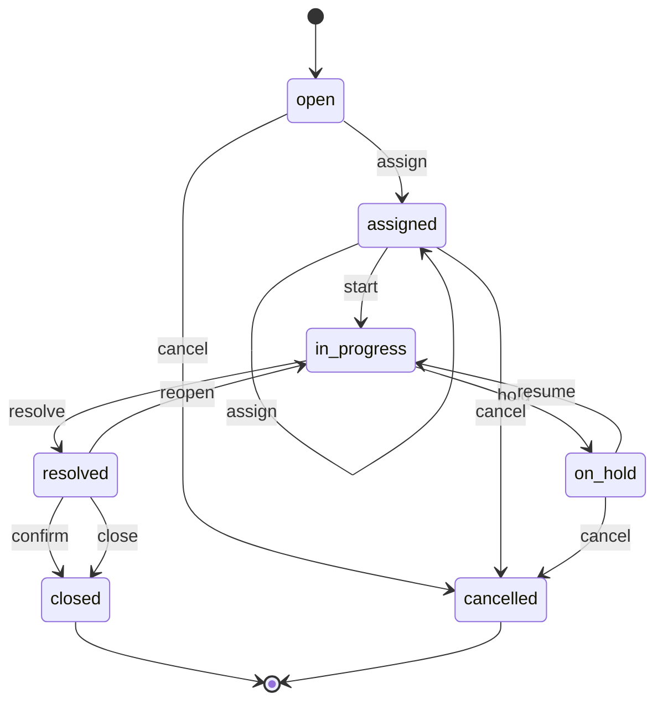
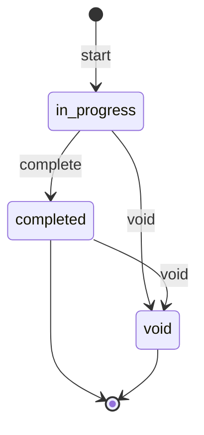
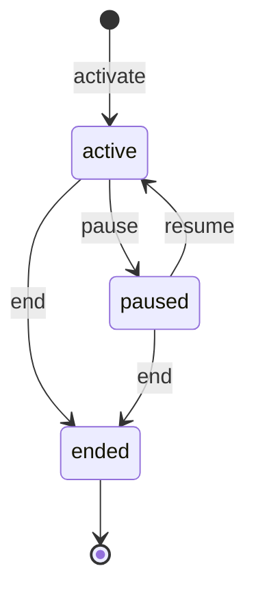
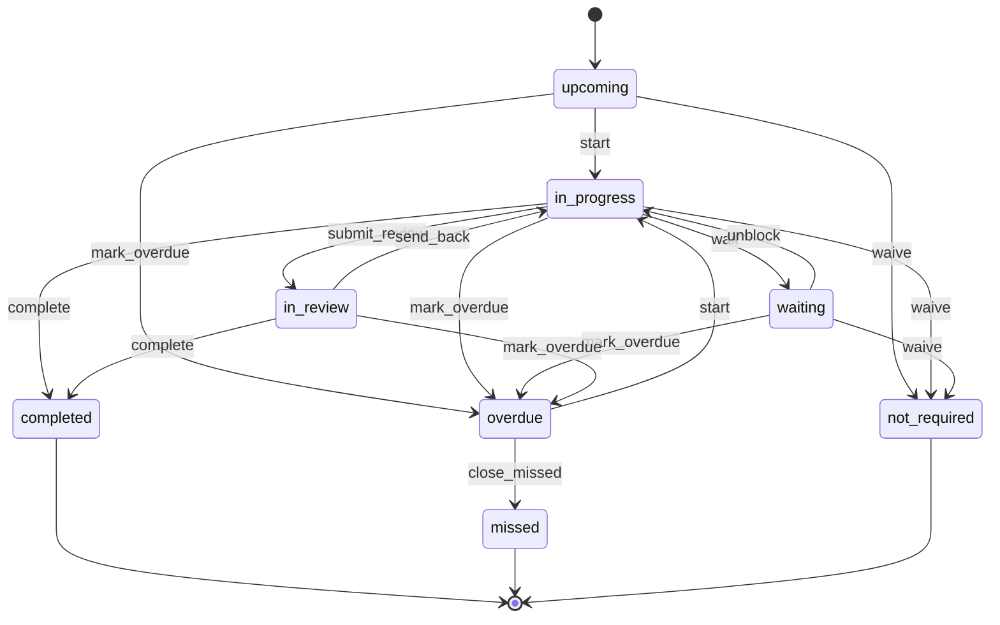
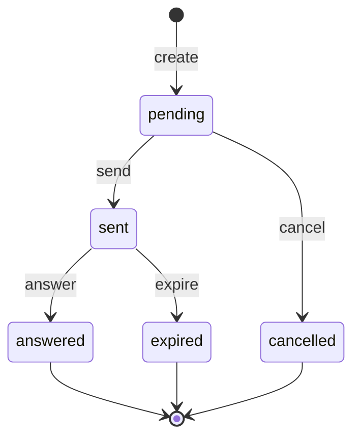
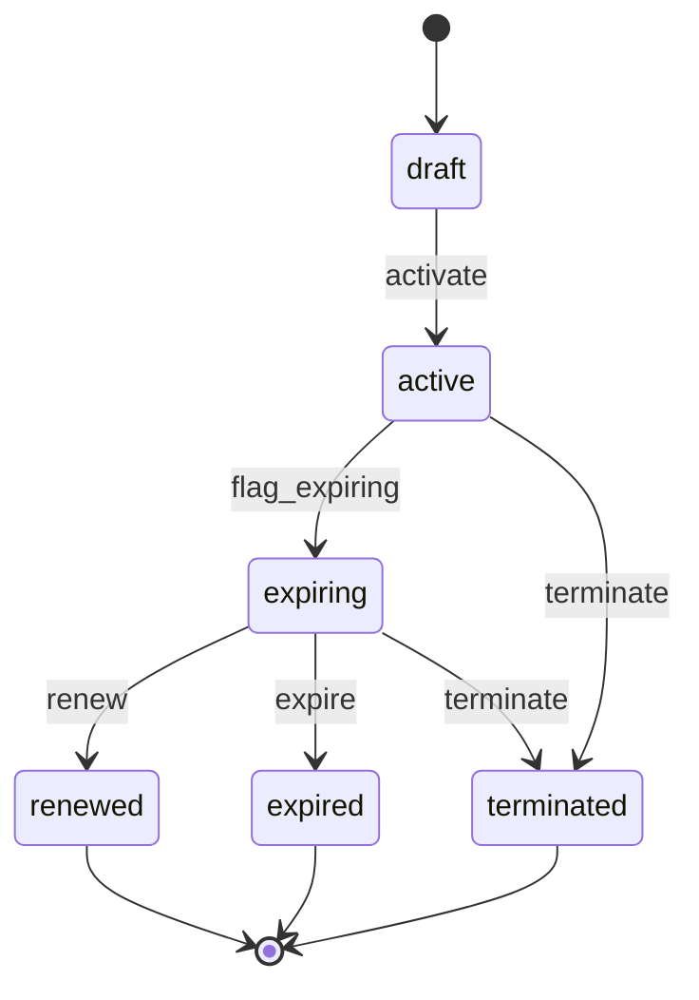

# wl-ticketing

> Status: draft · Last updated: 2026-10-16

## 1. Purpose

Businesses need a dependable way to record work that has to be done, give it an owner and a
deadline, and prove it was done. That work might be a broken air conditioner, a snag on
site, a patient complaint, a client query, a quality inspection, a vehicle service due at
10,000 km, or a VAT return due on the 28th. Once the work is done, they want to know whether
the customer was satisfied, and work done by outside contractors under a maintenance contract
has to follow that contract. `wl-ticketing` provides six building blocks for this, and none
of them knows anything about a particular vertical:

- **tickets**: requests and work orders, with priority, SLA, assignment and sign-off;
- **checklists**: structured inspections with readings, photos and signatures;
- **maintenance plans**: work that recurs by date or by meter reading;
- **recurring tasks**: deadline-driven work generated from a calendar;
- **feedback**: a rating and comment requested after a completed service, with low ratings
  turned into tickets;
- **service contracts**: annual maintenance contracts (AMC) with vendors, which cover assets
  or subjects, generate planned visits and set the SLA for tickets on what they cover.

## 2. Capabilities covered

| ID | Capability | Used by verticals | Scope |
|---|---|---|---|
| `WRK.TKT.01` | Raise a ticket from the portal or by staff, with category and photos | 01 maintenance, 02 snags and defects, 03 breakdowns and claims, 04 client queries, 05 complaints, 06 equipment faults, 07 breakdowns and complaints, 08 customer warranty claims (formerly `AUT.WAR.01`), 09 complaints, grievances and absence cases; 10 low ratings and complaints (Later) | MVP |
| `WRK.TKT.02` | Triage: priority, SLA, assignment to staff or vendor | 01, 02, 03, 04, 05, 06, 07, 09 | MVP |
| `WRK.TKT.03` | Field updates, before/after photos, requester sign-off | 01, 02, 03, 06, 07 | MVP |
| `WRK.CHK.01` | Checklists with photos and signature | 01 inspections, 02 snag walks/QC/HSE, 03 daily vehicle check, 04 month-end and onboarding, 06 opening/closing/temperature, 07 incoming/in-process/final QC, 08 check-in/QC; staff onboarding steps in all ten (wl-hr `HRM.ONB.01`) | MVP |
| `WRK.PPM.01` | Planned preventive maintenance by date or meter | 01 (MVP for compliance-critical AMCs: fire and life safety, lifts), 03 (MVP), 08 (MVP); 06, 07 (Later) | MVP |
| `WRK.TSK.01` | Recurring tasks and deadline calendar | 04 (MVP) | MVP |
| `WRK.FBK.01` | Customer feedback and ratings after a completed service; low ratings open a ticket | 05 (after visits), 08 (after job cards) MVP; 06 (direct orders, absorbs `FNB.FDB.01`), 01 (after maintenance), 03 (after delivery), 10 (after sessions) Later | MVP |
| `WRK.SVC.01` | Vendor service contracts (AMC): scope, assets, planned visits, SLA, cost | 01 (building systems) MVP: register for all categories, planned visits for fire and life safety and lifts; 05 (medical equipment), 06 (kitchen equipment), 07 (machines) Later | MVP for 01, Later elsewhere |

08 Auto uses `WRK.TKT.01` for customer warranty claims, category *warranty* (decided at the
08 review; `AUT.WAR.01` removed). Supplier warranty recovery stays in apps/auto
(`AUT.WAR.02`). 10 EdTech uses `WRK.TKT.01` (Later) for tickets opened by low ratings (`WRK.FBK.01`) and
complaints.

## 3. Concepts and entities

| Entity | Description | Important fields |
|---|---|---|
| Ticket | One request or work order | number, subject (`Subject`), category, priority, requester (user, portal user or party), channel (portal, staff, email, phone, system), title, description, assignee (staff user or vendor party), visit scheduled at (optional appointment with the requester or a vendor), reassignment history with reason (e.g. `vendor_no_show`), SLA policy, response due, resolution due, hold reason, chargeable flag, billed party (the party an invoice for a chargeable ticket is addressed to: the one named when it is opened, for a requester who is a user, else the requester's party), invoice draft (one per ticket), charge lines (chargeable tickets: description, quantity, unit price, VAT category; the amount the requester is shown and the lines the invoice draft carries), planned due date (planned visits only: the due date of the maintenance plan occurrence that created the ticket, from `MaintenanceDue`; not the visit scheduled at and not an SLA due time), confidential flag, status |
| Ticket category | A kind of ticket | name (EN/AR), default priority, SLA policy, default assignee role, requires after-photo, requires requester sign-off, confidential, chargeable by default, custom fields schema |
| SLA policy | Time targets | per priority: response time, resolution time; business-hours calendar; pause on hold (yes/no per hold reason) |
| Hold reason | Why work is paused | name, pauses SLA (yes/no) |
| Ticket comment | Conversation and updates | author, visibility (internal / visible to requester), text, attachments |
| Checklist template | A versioned list of items | name, version, items (see below), pass rule (all required items pass / score ≥ threshold), signatures required (performer, counter-signer, party), on-failure action (none, open ticket of category X, emit event) |
| Checklist item | One line of a template | label (EN/AR), type (yes/no, pass/fail, number with unit and min/max, choice, text, photo, signature, condition rating), required, help text, failure condition |
| Checklist run | One filled checklist | template + version, subject, performer, started at, completed at, results per item, photos, signatures, outcome (passed / failed), status |
| Maintenance plan | Work that recurs | subject (unit, asset, vehicle, machine), task template (category, checklist template, description), trigger (every N days/weeks/months; every N meter units; whichever comes first), lead time, last done (date, meter value), next due (date, meter value), status |
| Task template | A recurring deadline | name, subject type (e.g. client company, employee), recurrence (monthly, quarterly, yearly, per tax period, custom), due-date rule (e.g. 28 days after period end), lead time, owner role, reviewer role, evidence required, checklist template |
| Task | One occurrence of a task template, or a one-off task | template, subject, period, due date, start date (due − lead time), owner, reviewer, evidence, status |
| Feedback setting | When and how feedback is asked for one kind of completed work | subject type and completing event (ticket closed, booking completed, sales order fulfilled, delivery delivered), delay, rating scale, question text (EN/AR), optional tags, low-rating threshold, low-rating ticket category, channels, active |
| Feedback request | One request for feedback, and its answer | setting, subject, party, contact, channel, sent at, expires at, rating, comment, tags, low (yes/no), follow-up ticket, status |
| Service contract | An agreement with a vendor to maintain covered assets or subjects | number, vendor (party), issuing entity (`PLT.ENT.01`), title, start date, end date, renewal notice days, value and billing terms (fixed per period, per visit, or included), SLA policy, visit schedule (every N days/weeks/months, or a list of dates), checklist template, cost allocation basis for recharges (area, units, asset or manual %; set by the vertical), contract document, previous version, compliance contract (yes/no; yes when a covered category is compliance-critical), vendor document flag (set while a vendor document the contract's categories need is expired or missing), status |
| Contract coverage | One asset or subject covered by a contract | contract, subject (unit, building system, asset, machine, outlet equipment), covered categories, exclusions, visit schedule override |
| Compliance flag | A covered subject that is not compliant for a compliance-critical category | subject (building, building system, asset), category, reason (`no_contract`: a compliance contract ended with no replacement; `visit_missed`: `WRK.RUL.14`; `vendor_document_expired`: the vendor's required approval expired), contract, raised at, cleared at, cleared by (replacement contract `active`, visit resolved, document renewed; a `visit_missed` flag is cleared only by resolving that visit, not by cancelling it) |

Tickets, checklist runs, tasks, feedback requests and contract coverage attach to any record through `Subject`
([ARCHITECTURE.md](../ARCHITECTURE.md) §5). Verticals add fields through custom fields
(`wl-kernel`). Field names here stay generic.

## 4. Lifecycles

### 4.1 Ticket

The base is the Ticket state machine in [01-property.md](../verticals/01-property.md#ticket-shared--wl-ticketing),
generalised. Two settings per category let one machine serve every vertical:
*requires requester sign-off* and *requires after-photo*.

| State | Tone | Terminal | Meaning |
|---|---|---|---|
| `open` | neutral | no | Raised, not yet triaged |
| `assigned` | info | no | Has an assignee, a priority and an SLA |
| `in_progress` | info | no | Work started |
| `on_hold` | warning | no | Paused for a configured reason (parts, access, waiting on requester, approval) |
| `resolved` | success | no | Work done; waiting for the requester's sign-off when the category requires it |
| `closed` | success | yes | Confirmed by the requester, auto-closed, or closed by staff |
| `cancelled` | neutral | yes | Not needed, duplicate or invalid |

| Transition | From | To | By | Guards | Effects |
|---|---|---|---|---|---|
| `assign` | open, assigned | assigned | `tickets.assign` | priority and category set; a reassignment records a reason (e.g. `vendor_no_show`, `contract_ended`); when the assignee is a vendor party, `BlockGuard::check(vendor, start)` passes: assigning work to a vendor counts as starting new business with it (`PTY.ACL.03`) | SLA clocks start (first time; a reassignment does not restart them); assignee notified, and the previous assignee told the job was withdrawn; event `TicketAssigned` |
| `start` | assigned | in_progress | `tickets.work` (assignee) | — | response SLA met |
| `hold` | in_progress | on_hold | `tickets.work` | hold reason chosen | SLA clock pauses if the reason pauses SLA |
| `resume` | on_hold | in_progress | `tickets.work` or system | — | SLA clock resumes |
| `resolve` | in_progress | resolved | `tickets.work` | after-photo attached when the category requires it; required custom fields filled; for a category guarded by a document kind, `document_valid(assignee, kind, today)` for the assigned vendor (`WRK.ACL.11`); a chargeable ticket has at least one charge line | requester asked to confirm; chargeable and the category invoices on *resolve* → invoice draft through `Invoicer` with the ticket's charge lines (one draft per ticket: after `reopen` the draft stays a draft, is not issued while the ticket is `in_progress`, and the next `resolve` updates it instead of creating a second); when it invoices on *close*, the requester sees the amount (the charge lines' total including VAT at each line's VAT category), no invoice yet |
| `confirm` | resolved | closed | requester, or system (`WRK.RUL.02`) | — | chargeable and the category invoices on *close* → invoice drafted through `Invoicer` with the ticket's charge lines; event `TicketClosed` |
| `close` | resolved | closed | `tickets.assign` | category does not require requester sign-off, or no requester (internal ticket) | as `confirm`; event `TicketClosed` |
| `reopen` | resolved | in_progress | requester or `tickets.assign` | within the reopen window | assignee notified; resolution SLA resumes |
| `cancel` | open, assigned, on_hold | cancelled | `tickets.assign`, or system (`WRK.RUL.18`, contract ended) | reason given | requester and assignee notified |

**Vertical mapping**

| Vertical | Used for | Mapping |
|---|---|---|
| 01 Property | Maintenance requests, move-out damages | As defined; categories require after-photo and tenant sign-off; chargeable jobs invoice the tenant on *close* (`confirm` or `close`), not on `resolve` |
| 02 Construction | Snags, defects during the defects liability period | Snag walk failures open tickets (checklist on-failure action); "blocking" is a custom field that the project `complete` guard reads |
| 03 Logistics | Vehicle breakdowns, customer complaints, damage claims | Disputes on delivered shipments open a ticket (`LOG.ACL.04`); claims keep their own entity in the app |
| 04 Accounting | Queries between staff and client | Hold reason *waiting on client* (pauses SLA); sign-off by the client contact in the portal |
| 05 Clinics | Patient complaints and feedback | Category *complaint* is **confidential**; no field work, `close` by staff |
| 06 F&B | Equipment faults | As 01, with vendor assignment |
| 07 Manufacturing | Machine breakdowns, customer complaints | Breakdown categories set the asset's downtime (promotion candidate `MFG.MNT.01`) |
| 08 Auto | Customer warranty claims | Category *warranty*, linked to the original sale or job card; required custom field *warranty decision* (accepted or rejected) on `resolve`; accepting applies `AUT.ACL.13`. Supplier recovery stays in the vertical (`AUT.WAR.02`). Category *vehicle incident* (damage in the workshop's care or on a test drive) is a vertical category seeded by 08, not a platform category: linked to the job card, check-in photos compared, required custom field *liability decision* on `resolve`, decided by the branch manager, not the technician or advisor involved (`AUT.ACL.22`) |
| 09 Manpower | Client complaints, worker grievances, absence cases | Category *grievance* is **confidential**; requester is the worker. Category *absence* is opened by `MPW.RUL.09` after N consecutive calendar days without attendance or approved leave (default 7) |

`on_hold` in 01 already had configurable reasons. The extra 04 state *waiting on client* is
a hold reason, not a new state.

**Service contract coverage.** When a ticket's subject is covered by an `active` or
`expiring` service contract for the ticket's category (§4.6), or by a `terminated` one
whose termination date has not yet been reached, `assign` proposes the contract's vendor and
the contract's SLA policy replaces the category's SLA policy. The ticket records the
contract it was handled under. While the contract's vendor is blocked (`PTY.ACL.03`), new
planned visits of its plans are created unassigned and `assign` does not propose it.

**Vendor no-show.** When a vendor does not start a ticket M hours after its visit scheduled
time (elapsed clock hours, not working hours; or, without an appointment, by its response
due time, with no extra M), `WRK.RUL.19` records a no-show
against the vendor and the contract, tells the coordinator and offers reassignment: `assign`
to another vendor or to staff with reason `vendor_no_show`, or a new visit time with the same
vendor. The requester is told the new time. For compliance-critical categories the manager in
scope is told as well. No-shows per vendor and contract appear on the contract page.

### 4.2 Checklist run

| State | Tone | Terminal | Meaning |
|---|---|---|---|
| `in_progress` | info | no | Being filled |
| `completed` | success / error (by outcome) | yes | All required items answered and signatures captured; outcome is *passed* or *failed* |
| `void` | neutral | yes | Started in error |

| Transition | From | To | By | Guards | Effects |
|---|---|---|---|---|---|
| `start` | — | in_progress | `checklists.perform` | template active | template version frozen on the run |
| `complete` | in_progress | completed | `checklists.perform` | required items answered; required signatures captured | outcome computed; event `ChecklistCompleted`; failed items → on-failure action |
| `void` | in_progress, completed | void | `checklists.void` | reason given; for completed runs, no record depends on it (e.g. a released lot) | — |

Completed results cannot be edited. A wrong run is voided and a new run is started.

### 4.3 Maintenance plan

| State | Tone | Terminal | Meaning |
|---|---|---|---|
| `active` | success | no | Generating work when due |
| `paused` | warning | no | Temporarily not generating (asset off hire, unit vacant) |
| `ended` | neutral | yes | No longer needed (asset sold, contract ended) |

| Transition | From | To | By | Guards | Effects |
|---|---|---|---|---|---|
| `activate` | — | active | `maintenance_plans.manage` or system (e.g. a fleet contract `activate`) | trigger and task template set | next due computed |
| `pause` | active | paused | `maintenance_plans.manage` | reason given | — |
| `resume` | paused | active | `maintenance_plans.manage` | — | next due recomputed |
| `end` | active, paused | ended | `maintenance_plans.manage` or system | — | open generated tickets stay open |

Each time a plan becomes due, it creates a ticket in its task category, with the checklist
template attached. Closing that ticket records *last done* and computes the next due.

### 4.4 Task

The base is the Task (deadline) machine in [04-accounting.md](../verticals/04-accounting.md#task-deadline-shared--wl-ticketing).
One change: in 04, `missed` was terminal, so a late filing could not be completed. Here a
past-due task becomes `overdue` and can still be completed. `missed` is set only when someone
closes the task as not done.

| State | Tone | Terminal | Meaning |
|---|---|---|---|
| `upcoming` | neutral | no | Generated; start date not reached or not started |
| `in_progress` | info | no | Being worked on |
| `waiting` | warning | no | Blocked on someone else (client, authority, approval) |
| `in_review` | info | no | Prepared; with the reviewer |
| `overdue` | error | no | Due date passed, not completed |
| `completed` | success | yes | Done, with evidence; flagged *late* if it passed through `overdue` |
| `missed` | error | yes | Closed as not done |
| `not_required` | neutral | yes | Not applicable this period |

| Transition | From | To | By | Guards | Effects |
|---|---|---|---|---|---|
| `start` | upcoming, overdue | in_progress | `tasks.work` | — | — |
| `wait` | in_progress | waiting | `tasks.work` | reason or linked open item (query ticket, document request) | counterpart notified |
| `unblock` | waiting | in_progress | `tasks.work` or system (linked items answered) | — | owner notified |
| `submit_review` | in_progress | in_review | `tasks.work` | template has a reviewer role | reviewer notified |
| `send_back` | in_review | in_progress | `tasks.review` | comment given | — |
| `complete` | in_progress, in_review | completed | `tasks.work` (no reviewer) / `tasks.review` | evidence attached when required; checklist completed when attached | next occurrence generated; event `TaskCompleted` |
| `mark_overdue` | upcoming, in_progress, waiting, in_review | overdue | system | due date passed | owner and manager notified; event `TaskOverdue` |
| `close_missed` | overdue | missed | `tasks.manage` | reason given | next occurrence generated |
| `waive` | upcoming, in_progress, waiting | not_required | `tasks.manage` or system (the source agreement ended, e.g. engagement `end`) | reason given; from `in_progress` or `waiting` only when *waive a started task* is on (§7) | next occurrence generated, unless the source agreement ended; from a started task: work recorded so far kept, assignee and counterpart told |

`overdue` keeps where the work stood (started, waiting, in review) as a field, so `start`
from `overdue` returns the task to work without losing that information.

**Held tasks.** While the source agreement is paused (e.g. a 04 engagement `suspend`,
including a party block with effect pause), its tasks carry the *held* flag (not a state).
A held task keeps its state and due date; client reminders and new request lists stop;
`mark_overdue` still runs because the due date is a fact. The flag clears when the
agreement resumes, and anything that went overdue meanwhile is listed for the manager.

**Vertical mapping:** 04 Accounting renames `waiting` to *waiting on client* with a label
setting. Its tasks are held while the engagement is suspended; it keeps *waive a started
task* off (a started task that no longer applies is listed for the manager, who completes
it or closes it as missed once overdue). Its `miss` becomes `mark_overdue`, followed by `close_missed` if the task is
abandoned. No other vertical lists `WRK.TSK.01`; licence and visa expiries use `DOC.EXP.01`.

### 4.5 Feedback request

| State | Tone | Terminal | Meaning |
|---|---|---|---|
| `pending` | neutral | no | Created when the work completed; waiting for the configured delay |
| `sent` | info | no | Sent to the party; waiting for an answer |
| `answered` | success (rating above the threshold) / warning (low rating) | yes | Rating and comment received |
| `expired` | neutral | yes | No answer within the expiry period |
| `cancelled` | neutral | yes | Not sent: the work was reopened or cancelled, the party opted out, or the frequency cap applied |

| Transition | From | To | By | Guards | Effects |
|---|---|---|---|---|---|
| `create` | — | pending | system (`WRK.RUL.09`) | an active feedback setting matches the completing event; the party has a contact channel | — |
| `send` | pending | sent | system | delay passed; party has not opted out of feedback requests; no other request to the party within the frequency cap | message with a signed link sent through `wl-notify` (Renox signed, expiring URLs) |
| `answer` | sent | answered | the party (signed link) or staff on their behalf (`feedback.record`) | rating given; link not expired | low rating → follow-up ticket through `Tickets::open` (`WRK.RUL.10`); event `FeedbackReceived` |
| `expire` | sent | expired | system (`WRK.RUL.11`) | expiry period passed | — |
| `cancel` | pending | cancelled | system or `feedback.manage` | the work was reopened or cancelled, or a guard of `send` fails | — |

**Vertical mapping**

| Vertical | Completing event | Notes |
|---|---|---|
| 05 Clinics | booking completed (`wl-scheduling`) | Comments may contain health information: stored in the `health` sensitivity class; low ratings open a *complaint* ticket (confidential) |
| 08 Auto | job card delivered (vertical event) | Low ratings go to the service adviser's manager |
| 06 F&B | sales order fulfilled for direct orders (`wl-sales`) | Replaces `FNB.FDB.01`; aggregator orders are excluded (the aggregator owns the rating) |
| 01 Property | ticket closed | Asked of the tenant who raised the request |
| 03 Logistics | delivery delivered (`wl-delivery`) | Asked of the consignee or the shipper, per client setting |
| 10 EdTech | session or batch completed | Asked of the student, or the guardian for minors (`PTY.REL.01`) |

### 4.6 Service contract

| State | Tone | Terminal | Meaning |
|---|---|---|---|
| `draft` | neutral | no | Being prepared; coverage and schedule editable |
| `active` | success | no | In force: generates planned visits and sets the SLA for covered tickets |
| `expiring` | warning | no | Inside the renewal notice window; still in force |
| `renewed` | success | yes | Replaced by a new contract version, which is `active` |
| `expired` | neutral | yes | End date passed without renewal |
| `terminated` | neutral | yes | Ended early |

| Transition | From | To | By | Guards | Effects |
|---|---|---|---|---|---|
| `activate` | draft | active | `service_contracts.manage` | vendor, dates, at least one covered subject, SLA policy and visit schedule set; contract document attached; `document_valid(vendor, kind, start date)` for every vendor document kind whose `blocks` include `service_contract.activate` (e.g. 01: Civil Defence approval for fire and life safety) | one maintenance plan per covered subject through `MaintenancePlans::create` (`WRK.PPM.01`); contract document registered for expiry (`DOC.EXP.01`); compliance flags `no_contract` on the covered subjects and categories cleared; event `ServiceContractActivated` |
| `flag_expiring` | active | expiring | system (`WRK.RUL.12`) | end date − notice days reached | contract owner notified; event `ServiceContractExpiring` |
| `renew` | expiring | renewed | `service_contracts.manage` | a new version of this contract is `active` | maintenance plans move to the new version; event `ServiceContractEnded` |
| `expire` | expiring | expired | system (`WRK.RUL.13`) | end date passed | maintenance plans `end`; open planned visits handled per [§5.6](#56-service-contract-amc) step 6 (`WRK.RUL.18`); for a compliance contract with no replacement, compliance flag `no_contract` on each covered subject; covered tickets fall back to the category SLA; event `ServiceContractEnded` |
| `terminate` | active, expiring | terminated | `service_contracts.manage` | reason and termination date given | the contract is `terminated` at once, but until the termination date it still covers its subjects (coverage, SLA, planned visits); on the termination date (`WRK.RUL.18`, date reached; at once when the date is today) maintenance plans `end`, and open planned visits and compliance flags are handled as for `expire`; event `ServiceContractEnded` when `WRK.RUL.18` runs |
| `discard` | draft | — (deleted) | `service_contracts.manage` | — | — |

**Vertical mapping:** 01 Property (lifts, chillers, fire and life-safety systems, cleaning;
MVP), 05 Clinics (medical equipment), 06 F&B (kitchen equipment, pest control) and
07 Manufacturing (machines) (all Later) use the machine as defined. In 01, a planned visit
not resolved N days after its due date is flagged by `WRK.RUL.14`; for fire and life safety
or lifts the building gets a compliance flag. 01's `end` is the canonical `expire` or
`terminate`; its "open planned visits cancelled or reassigned" and "building flagged until a
replacement contract is active" are the module's `WRK.RUL.18` and compliance flag. Covered
subjects are units or building systems in 01 and assets (`STK.AST.01`) in 05, 06 and 07.

**Vendor document expired.** While a vendor document of a kind that guards the contract's
categories (01: Civil Defence approval for fire and life safety) is expired or missing
(`DocumentExpired` from `wl-documents`), the contract carries the vendor document flag, its
open planned visits are flagged, `resolve` is refused on them (`WRK.ACL.11`), the covered
subjects get a compliance flag `vendor_document_expired`, and the coordinator and the
manager in scope are told. The vendor may still attend, but a visit completed by an
unapproved vendor does not count. All flags clear on `DocumentAccepted` for a renewed
document; otherwise the coordinator reassigns the visits (`assign`, reason
`vendor_document_expired`), which clears that visit's flag, or terminates the contract. A
subject's `vendor_document_expired` flag also clears when a replacement contract covering
that subject and category becomes `active`; when the contract ends without one, `WRK.RUL.18`
clears it and raises `no_contract` instead.

## 5. Workflows

### 5.1 Request to resolution

1. A requester raises a ticket from the portal, or staff raise one for them. The ticket
   gets a subject, a category, a description and photos (`WRK.TKT.01`). System sources
   (a failed checklist, a due maintenance plan, an automation's *create task* action) raise
   tickets the same way.
2. The category sets the default priority, SLA policy and assignee role. A coordinator
   confirms the priority and assigns staff or a vendor (`WRK.TKT.02`). SLA clocks start.
3. The assignee starts work, puts it on hold with a reason when blocked, and posts updates
   and photos from the PWA (`WRK.TKT.03`).
4. On `resolve`, the requester is asked to confirm. They confirm, or reopen within the
   window. If they do neither, `WRK.RUL.02` closes the ticket.
5. A chargeable ticket creates an invoice draft for the requester's party through
   `Invoicer`. A vendor's bill for the job is matched in `wl-invoicing` (`FIN.PAB.01`).

### 5.2 Checklist

1. A run starts from a template on a subject: a lease move-in, a lot, a vehicle check-in, an
   outlet's opening.
2. The performer answers the items, takes photos and enters readings. Readings out of range
   are marked failed as they are entered.
3. Required signatures are captured (R5 `rx-signature-pad`).
4. On `complete`, the outcome is computed and the template's on-failure action runs: open a
   ticket, or emit `ChecklistCompleted { outcome: failed }` for the vertical to act on
   (e.g. a manufacturing NCR, or a construction snag).
5. Other modules read the outcome as a guard. Examples: a job card is delivered only after
   QC passed (`AUT.ACL.09`); a lot is released only after final inspection passed
   (`MFG.ACL.02`).

### 5.3 Planned maintenance

1. A plan is created for a subject, manually or by another module (an auto fleet contract
   activation creates one plan per vehicle).
2. **By date:** daily, the scheduler finds plans whose next due minus lead time has arrived
   and creates the ticket.
3. **By meter:** when a meter reading is recorded on the subject (event
   `MeterReadingRecorded`, from `wl-inventory` assets), `WRK.RUL.03` compares it with the
   next due value and creates the ticket.
4. Closing the ticket updates *last done* and the next due.

### 5.4 Recurring tasks

1. A task template is attached to subjects. For example, a VAT return task is attached to
   every client company with a quarterly tax period.
2. The scheduler generates the next occurrence with its due date and start date.
3. Owners see their tasks in a calendar and a list. Reviewers see what is waiting for them.
4. Completing or waiving an occurrence generates the next one. Overdue tasks are escalated.

### 5.5 Feedback

1. A completing event arrives: a ticket closed, a booking completed, a sales order fulfilled,
   a delivery delivered, or a vertical event such as a job card delivered.
2. If an active feedback setting matches, a feedback request is created (`WRK.RUL.09`) and
   sent after the configured delay through the party's preferred channel, with a signed link
   (no login needed).
3. The party gives a rating and an optional comment and tags. Staff can record an answer
   received by phone.
4. A rating at or below the threshold opens a follow-up ticket in the configured category and
   notifies the manager in scope (`WRK.RUL.10`). The ticket links back to the feedback and to
   the original work.
5. Ratings roll up into a satisfaction score (CSAT: share of ratings above the threshold) per
   scope, category, assignee and period, shown on dashboards (`RPT.DSH.01`) and in the report
   library (`RPT.LIB.01`).

### 5.6 Service contract (AMC)

1. Staff record a vendor contract: vendor, dates, value and billing terms, SLA, visit
   schedule, checklist template, and the assets or subjects it covers. The signed contract is
   attached.
2. On `activate`, one maintenance plan per covered subject is created, so planned visits
   appear as tickets assigned to the vendor (`WRK.PPM.01`, §5.3).
3. Reactive tickets on covered subjects are routed to the vendor with the contract's SLA
   (§4.1).
4. Vendor bills reference the contract. `wl-invoicing` matches them against the contract's
   billing terms (`FIN.PAB.01`), and the contract page shows billed vs contract value.
5. Before the end date, the contract becomes `expiring` and its owner is reminded to renew
   (`WRK.RUL.12`). A renewal is a new version; plans move to it. Otherwise it expires and
   its plans end (`WRK.RUL.13`).
6. **When a contract ends without renewal** (`expire`, or the termination date of a
   `terminate` is reached; a contract terminated with a future date keeps covering its
   subjects until then), `WRK.RUL.18`:
   - cancels the open planned visits due after the end date (`open`, `assigned` or
     `on_hold`; system `cancel`, reason `contract_ended`; the vendor is told);
   - leaves visits already `in_progress` to finish, under the contract's terms;
   - gives the coordinator one task listing the other open visits (due on or before the end
     date, not started), to reassign each to another vendor or to staff (`assign`, reason
     `contract_ended`) or cancel it with a reason; a vertical may limit the task to reassign
     for some categories (§7; 01: compliance-critical visits cannot be cancelled);
   - for a compliance contract, unless another `active` contract covers the same subject and
     category, raises the compliance flag `no_contract` on each covered subject and tells the
     manager in scope. The flag shows on the subject, on the dashboard and in the compliance
     report, and clears when a replacement contract is activated.

   Reactive tickets already assigned to the vendor stay with it unless reassigned; they fall
   back to the category SLA. Money: the vendor's bills after the end date are matched only
   for work done before it (`FIN.PAB.01`).
7. **Vendor no-show and vendor documents** follow §4.1 (vendor no-show, `WRK.RUL.19`) and
   §4.6 (vendor document expired, `WRK.ACL.11`).

## 6. Interfaces to other modules

**Provides**

| Service / trait | Purpose | Called by |
|---|---|---|
| `Tickets::open(subject, category, …)` | Raise a ticket from code | automations (*create task* action), `wl-delivery` (failed delivery disputes), verticals |
| `Checklists::start(template, subject)` and `Checklists::outcome(subject, template)` | Start a run; read the latest outcome as a guard | verticals (auto job cards, manufacturing lots, construction handover); wl-hr (`checklist` onboarding steps, subject = the onboarding step; `ChecklistCompleted` passed marks the step done) |
| `MaintenancePlans::create(subject, trigger, task_template)` | Create plans from other flows | verticals (auto fleet contracts, logistics vehicles) |
| `Tasks::schedule(template, subject)` | Attach a recurring task template to a subject | verticals (accounting engagements) |
| `Tasks::hold(source)` / `Tasks::release(source)` | Set or clear the *held* flag on every task of a source agreement (§4.4 "Held tasks") | the owning module on pause and resume (04 engagement, `wl-invoicing` subscription) |
| `Feedback::request(subject, party)` | Ask for feedback on completed work outside the standard completing events | verticals (auto job cards, EdTech batches) |
| `Feedback::score(scope, period)` | Satisfaction score and counts | dashboards, report library, verticals |
| `ServiceContracts::coverage(subject, category, date)` | The contract, vendor and SLA covering a subject, if any | `TicketRouter`, `wl-invoicing` (vendor bill matching), verticals |

**Consumes:** `Subject`, numbering, custom fields, settings, approvals, legal entities and
the business calendar from `wl-kernel`. Attachments, photos and contract documents (with
expiry, `DOC.EXP.01`) from `wl-documents`. Parties, vendors, consents and relationships from
`wl-parties`. Portal pages and signed links from `wl-portal`. Notifications from `wl-notify`.
`Invoicer` for chargeable tickets; vendor bill matching from `wl-invoicing` (`FIN.PAB.01`).
Meter readings and assets from `wl-inventory`. Completing events for feedback from
`wl-scheduling` (booking completed), `wl-sales` (sales order fulfilled) and `wl-delivery`
(delivery delivered).

**Events emitted**

| Event | When | Payload |
|---|---|---|
| `TicketTransitioned` | any ticket transition (engine) | ticket, from, to, transition, actor |
| `TicketAssigned` | `assign` | ticket, assignee, priority, due times |
| `TicketSlaWarning` | SLA reaches the warning threshold | ticket, which clock (response/resolution), due at |
| `TicketSlaBreached` | SLA passed | ticket, which clock, due at |
| `TicketClosed` | `confirm` or `close` | ticket, resolution time, within SLA (yes/no) |
| `ChecklistCompleted` | `complete` | run, template, subject, outcome, failed items |
| `MaintenanceDue` | a plan creates its ticket | plan, subject, due date or meter value, ticket |
| `TaskOverdue` | `mark_overdue` | task, subject, owner, due date |
| `TaskCompleted` | `complete` | task, subject, period, late (yes/no) |
| `FeedbackReceived` | feedback `answer` | request, subject, party, rating, comment, low (yes/no), follow-up ticket |
| `ServiceContractActivated` | contract `activate` | contract, vendor, covered subjects, start, end |
| `ServiceContractExpiring` | contract `flag_expiring` | contract, vendor, end date |
| `ServiceContractEnded` | `renew`, `expire`, or the termination date of a `terminate` reached (`WRK.RUL.18`) | contract, outcome, new version (if renewed), visits cancelled, visits left for reassignment |
| `ComplianceFlagRaised` / `ComplianceFlagCleared` | a compliance flag is raised or cleared | subject, category, reason, contract |
| `VendorNoShow` | `WRK.RUL.19` records a no-show | ticket, vendor, contract, scheduled at |

**Attaches to:** any `Subject`. Examples: unit, lease, project, site, shipment, vehicle,
client company, patient, outlet, machine, lot, job card, employee, deployment, booking,
sales order, delivery.

**Permissions**

| Permission | Allows |
|---|---|
| `tickets.view` | See tickets in scope |
| `tickets.create` | Raise tickets (portal roles get it for their own subjects) |
| `tickets.assign` | Triage, assign, close, cancel |
| `tickets.work` | Work assigned tickets: start, hold, resume, resolve, comment |
| `tickets.confidential.view` | See confidential categories (complaints, grievances); each view is audited |
| `tickets.manage` | Configure categories, SLA policies, hold reasons |
| `checklists.view` / `checklists.perform` / `checklists.void` / `checklists.manage` | See, fill, void runs; manage templates |
| `maintenance_plans.view` / `maintenance_plans.manage` | See and manage plans |
| `tasks.view` / `tasks.work` / `tasks.review` / `tasks.manage` | See, work, review, configure and waive tasks |
| `feedback.view` | See feedback answers and scores in scope, including the party's identity |
| `feedback.record` | Record an answer received by phone or in person |
| `feedback.manage` | Configure feedback settings; cancel pending requests |
| `service_contracts.view` / `service_contracts.manage` | See contracts and coverage; create, activate, renew, terminate |

**Access rules.** The module applies the vertical rules that reference it, for example
`PRP.ACL.13` (vendor contracts), `CLN.*` (confidential complaints) and `AUT.ACL.09` (QC guard).
Shared rules owned by this module (see [ACCESS-CONTROL.md](../ACCESS-CONTROL.md) §9; status as in
the register):

| ID | Rule | Pattern | Source | Status |
|---|---|---|---|---|
| `WRK.ACL.01` | An external requester sees only tickets they raised, or tickets on subjects they own, and only comments marked visible | `OWN`, `FLD` | `PRP.ACL.01` and the portal parts of 04, 05 | module |
| `WRK.ACL.02` | A field user or vendor sees only tickets assigned to them; the requester's contact details are visible only while the ticket is open | `ASG`, `TIM` | `PRP.ACL.03` | in use |
| `WRK.ACL.03` | Tickets in confidential categories are visible only with `tickets.confidential.view` and to the requester | `SEN` | 05 complaints, 09 grievances | module |
| `WRK.ACL.04` | Completed checklist results cannot be edited; only voided with a reason | `STA` | 07, 08 | module |
| `WRK.ACL.07` | Without `feedback.view`, staff see ratings and comments only in aggregate, without the party's identity; a person never sees identified feedback about their own work unless they also hold `feedback.view` in that scope | `FLD` | 05, 08 | module |
| `WRK.ACL.08` | Contract value and billing terms are visible only with `costs.view` (`FIN.ACL.08`, wl-invoicing) | `FLD` | 01, 07 | module |
| `WRK.ACL.11` | A ticket or planned visit in a category guarded by a vendor document kind (01: Civil Defence approval for fire and life safety) cannot be resolved while that document of the assigned vendor is expired or missing (`document_valid`); override only where the kind allows it (`DOC.ACL.02`), never for a legal block | `STA` | 01 | module |

**Automations**

| ID | When | If | Then | Parameters (default) |
|---|---|---|---|---|
| `WRK.RUL.01` | ticket SLA reaches P% / 100% | ticket not `resolved` | notify the coordinator / the manager in scope | P = 80 |
| `WRK.RUL.02` | N days after ticket → `resolved` | not confirmed | ticket `confirm` (system) | N = 3 |
| `WRK.RUL.03` | meter reading recorded on a subject with an active plan | reading ≥ next due value − lead | create the planned maintenance ticket | lead = 0 |
| `WRK.RUL.04` | daily | maintenance plan due date − lead time reached | create the planned maintenance ticket | lead = 7 days |
| `WRK.RUL.05` | due date passed | task not completed | task `mark_overdue` | — |
| `WRK.RUL.06` | start date reached | task `upcoming` | notify owner | — |
| `WRK.RUL.09` | a completing event (ticket closed, booking completed, sales order fulfilled, delivery delivered, or a vertical event) | an active feedback setting matches; party has a contact channel | create a feedback request; it is sent after the setting's delay | delay per setting (default 2 hours) |
| `WRK.RUL.10` | feedback `answered` | rating ≤ threshold | open a follow-up ticket in the setting's category; notify the manager in scope | threshold = 2 of 5 |
| `WRK.RUL.11` | N days after feedback → `sent` | not answered | feedback `expire` | N = 7 |
| `WRK.RUL.12` | N days before a service contract's end date | contract `active` | contract `flag_expiring`; notify the contract owner | N = the contract's renewal notice days (default 60) |
| `WRK.RUL.13` | service contract end date passed | contract `expiring` | contract `expire`; notify the contract owner and the coordinators of covered subjects | — |
| `WRK.RUL.14` | N days after a planned visit's planned due date (the Ticket field) | visit ticket not `resolved` | notify the coordinator; for compliance-critical categories (01: fire and life safety, lifts) also notify the manager in scope and raise the compliance flag `visit_missed` on the subject | N = 3 |
| `WRK.RUL.18` | service contract → `expired`; or the termination date of a `terminated` contract reached (at once when it is today) | — | cancel open planned visits due after the end date; task for the coordinator to reassign or cancel the other open visits; for a compliance contract with no replacement covering the subject and category, raise the compliance flag `no_contract` on each covered subject and notify the manager in scope | task due 1 working day |
| `WRK.RUL.19` | M hours after a ticket's visit scheduled time (elapsed clock hours, not working hours), or at its response due time when it has no appointment | assigned to a vendor; not started | record a vendor no-show (event `VendorNoShow`); notify the coordinator with a reassign action; for compliance-critical categories also the manager in scope | M = 2 clock hours |

`WRK.RUL.01`–`03`, `WRK.RUL.12` and `WRK.RUL.14` are in use by verticals ([WORKFLOW.md](../WORKFLOW.md)
§7); `WRK.RUL.12` generalises `PRP.RUL.06` and `WRK.RUL.14` generalises `PRP.RUL.07`.
`WRK.RUL.04`–`06`, `WRK.RUL.11`, `WRK.RUL.13`, `WRK.RUL.18` and `WRK.RUL.19` are module
defaults: generic and fixed. `WRK.RUL.14` and `WRK.RUL.18` are compliance-critical: a failed
run alerts the business owner (`PLT.RUL.04`). `WRK.RUL.09`
and `WRK.RUL.10` are on when the client enables feedback. `WRK.RUL.07`–`08` belong to
`wl-delivery` ([WORKFLOW.md](../WORKFLOW.md) §7).

## 7. Configuration per client

| Setting | Default |
|---|---|
| Ticket categories (name, default priority, SLA, assignee role, after-photo, sign-off, confidential, chargeable, invoice on *resolve* or *close*) | Seeded per vertical; invoice on *resolve* (01: *close*) |
| Tasks: *waive a started task* allowed (§4.4) | on (04: off) |
| Platform categories opened by other modules (seeded when the opening module is on; the vertical may rename them, not remove them; priority and SLA are the category defaults, Normal, until the vertical sets them) | *billing dispute* (`wl-invoicing` `dispute`; assignee: invoice owner, i.e. the user who ran the invoice's `issue`, or, when the system issued it or that user is no longer active, the holders of the receivables role in the invoice's scope); *labour case* (`wl-hr` settlement `dispute`; confidential, assignee role HR, visible to HR, the accountant and MD only; custom fields: forum (MoHRE, court), reference, hearing or reply dates; no requester sign-off); *delivery claim* (`wl-delivery` `open_review` and lost deliveries) |
| Priorities and SLA matrix (response / resolution) | Urgent 2 h / 24 h · High 8 h / 3 days · Normal 1 day / 7 days · Low 3 days / 14 days, in business hours |
| Reassignment reasons (`assign` on an assigned ticket) | `vendor_no_show`, `contract_ended`, `vendor_document_expired` (also used by the system), `workload`, `other` (with text) |
| Hold reasons and whether each pauses the SLA | Parts (pauses), Access (pauses), Waiting on requester (pauses), Approval (does not pause) |
| SLA warning threshold (`WRK.RUL.01`) | 80% |
| Auto-close after resolve (`WRK.RUL.02`) | 3 days |
| Reopen window | 7 days |
| Ticket number format | `TKT-{YYYY}-{seq}` |
| Checklist templates | Seeded per vertical |
| Maintenance plan lead time | 7 days or 500 meter units |
| Task templates and calendars | Seeded per vertical (e.g. VAT quarterly for 04) |
| Labels of states (e.g. *waiting* → *waiting on client*) | Module labels |
| Feedback enabled, and settings per completing event (delay, question text EN/AR, tags, channels) | Off; seeded per vertical when enabled |
| Rating scale and low-rating threshold (`WRK.RUL.10`) | 1–5 stars; low = 2 or less |
| Feedback request expiry (`WRK.RUL.11`) | 7 days |
| Feedback frequency cap per party | One request per 7 days |
| Low-rating ticket category | *Feedback follow-up* (confidential in 05) |
| Service contract number format | `AMC-{YYYY}-{seq}` |
| Renewal notice days (`WRK.RUL.12`) | 60 days |
| Contract SLA overrides category SLA on covered tickets | Yes |
| Compliance-critical categories (compliance contracts, compliance flags) | from the vertical (01: fire and life safety, lifts) |
| Vendor document kinds that guard categories | from the vertical, through the document kind's `blocks` in `wl-documents` (01: Civil Defence approval → `ticket.resolve` and `service_contract.activate` for fire and life safety) |
| Open visits on contract end (`WRK.RUL.18`) | cancel those due after the end date (for `terminate`: the termination date, when it is reached); task for the rest |
| Coordinator options in the `WRK.RUL.18` task, per category | reassign or cancel (01: reassign only for compliance-critical categories, `PRP.ACL.15`) |
| Vendor no-show after (`WRK.RUL.19`) | 2 clock hours after the visit scheduled time; at the response due time without an appointment |

## 8. Extension points

- **Strategy traits:**
  - `TicketRouter`: chooses the assignee from category, subject and scope; the default is
    the category's role in the subject's scope.
  - `SlaCalendar`: business hours and holidays; the default comes from the `wl-kernel`
    business calendar.
  - `ChecklistOutcome`: computes pass/fail; the default is "all required items pass", the
    alternative is a score threshold.
  - `RecurrenceRule`: computes due dates, e.g. the tax period rules in 04.
  - `FeedbackPolicy`: decides whether to ask for feedback on a completed item (e.g. skip
    internal tickets, skip aggregator orders, ask the guardian for a minor); the default
    follows the feedback settings.
  - `ContractCoverage`: decides whether a subject and category are covered by a contract;
    the default reads contract coverage lines. `TicketRouter` uses it to propose the vendor.
- **Events:** all events in §6. Verticals react to `ChecklistCompleted` (NCR, snag),
  `TicketClosed` (asset downtime ends), `TaskCompleted` (engagement progress) and
  `FeedbackReceived` (e.g. a clinic's practitioner scorecard).
- **Custom fields:** on tickets per category, on checklist runs, on tasks, and on service
  contracts.
- **Overridable views:** the ticket page, the portal request form, the checklist runner
  (tablet layout), the task calendar, the feedback page opened from the signed link, and the
  contract page.

## 9. Renox fit

| Need | Renox provides | Gap |
|---|---|---|
| State machines, history, available actions | — | R12 |
| Ticket board | `kanban` block | — |
| Ticket timeline | `history` block | — |
| Photos and attachments | `file` input, storage | — |
| Capture photos on the device | — | R5 `rx-camera-capture` |
| Signatures on checklists and sign-off | — | R5 `rx-signature-pad` |
| Status stepper on the ticket page | — | R5 `rx-status-stepper` |
| Task calendar | `month-calendar` block | — |
| SLA timers, daily plan and task generation | queue, scheduler | — |
| Business hours and public holidays for SLA | — | Business calendar (working days, hours, UAE public holidays, Ramadan hours) in `wl-kernel`, shared with scheduling and payroll (decided 2026-10-14) |
| Field use on phones and tablets | — | R6 PWA. Online only in the MVP; a checklist needs a connection to complete. The offline queue exists since Renox 1.2.0 (R25, `Routes::offline()`); adopting it is Later |
| Raising tickets by email | Inbound mail is not in Renox | **New gap (Later):** email-to-ticket |
| Feedback page opened without a login | signed, expiring URLs (`state.signed_url`, `ValidSignature`) | — |
| Star rating input | `radio` input | `rx-rating` component (R5) |
| Satisfaction score charts | charts | — |
| Contract expiry reminders | — (through `wl-documents`) | — |

## 10. Compliance

- **Confidential tickets:** patient complaints (05) and worker grievances (09) contain
  sensitive personal data under PDPL. Access is limited by `tickets.confidential.view`, and
  every view is audited (`PLT.ACL.06`).
- **Photos** may show people, documents or number plates. They follow the retention and
  access rules of the subject they are attached to.
- **Inspection records** (food safety logs, HSE, quality inspections) may have statutory
  retention periods set by Dubai Municipality, ADAFSA or MoIAT. For food records 4 years is
  reported but not confirmed in an official text [S1]; the binding periods
  `⚠ open: authority (AU-06)`. Completed runs are never edited and are kept for at least that
  period.
- **Clinic complaint handling** may have regulator-set acknowledgement and response times
  (DHA/DoH); none was found in public sources `⚠ open: authority (AU-07)` (open question 3). These
  can be configured as an SLA policy.
- **Feedback requests** are service messages about work the party received, so the marketing
  consent rule (`NTF.ACL.01`) is assumed not to apply. The PDPL lets a person object to
  direct marketing (Art. 17) ✔ [S2], but whether feedback requests count as marketing
  `⚠ open: lawyer (L-07)` (open question 6). Every request still offers an opt-out of future
  feedback requests, which is recorded on the party (`PTY.CNS.01`). Publishing a rating or comment outside the platform (for example as a
  testimonial) needs the party's explicit consent.
- **Feedback in clinics** may contain health information. Comments are stored in the
  `health` sensitivity class (`PLT.ACL.06`).
- **Fire and life-safety systems** in buildings are commonly required to be under a
  maintenance contract with a Civil Defence-approved contractor, with records of
  inspections. Abu Dhabi Civil Defence calls on owners to hold maintenance contracts with
  companies it licenses, using registered technicians ✔ [S3]. Rules in other emirates and
  the records to keep `⚠ open: authority (AU-08)` (open question 9). Service contracts and their
  completed visit checklists are kept as evidence for the contract's retention period.
  Because the duty is to have the system maintained by an approved contractor, the module
  flags a subject when its compliance contract ends without a replacement or the vendor's
  approval lapses, and refuses to record a visit as done by an unapproved vendor
  (`WRK.RUL.18`, `WRK.ACL.11`).

## 11. Out of scope

| Not here | Where instead |
|---|---|
| Spare-parts stock and their cost on a job | `wl-inventory` (issue to the ticket as a cost object) and `FIN.CST.01` |
| Full CMMS: asset hierarchy, reliability analytics | Asset register in `wl-inventory` (`STK.AST.01`); analytics out of scope |
| Delivery jobs and proof of delivery | `wl-delivery` |
| Project planning, Gantt charts | Out of scope (clients keep MS Project or Primavera) |
| Chat or live messaging | Ticket comments only; WhatsApp through `wl-notify` |
| Claims with money (logistics damage claims, supplier warranty recovery) | Vertical apps (`LOG.CLM.01`, `AUT.WAR.02`). Customer warranty claims in 08 are tickets of category *warranty* |
| Multi-question surveys, NPS campaigns, marketing surveys | Out of scope; feedback is one rating, a comment and tags |
| Posting or importing public reviews (Google, aggregator ratings) | Out of scope |
| Vendor selection, tenders and contract negotiation | Out of scope; contracts are recorded once agreed |
| Paying vendors and the contract's accounting | `wl-invoicing` (supplier bills, `FIN.PAB.01`) and `wl-payments` |

## 12. Open questions

1. Do any clients need **multiple assignees** or crews on one ticket, or is one assignee
   plus comments enough? *(clients 01, 02)*
2. ~~Should a vendor work tickets through the portal (external role) in the MVP, or should
   staff update on their behalf?~~ Decided (2026-10-15, 01 review): both. The vendor's
   technician logs in to the field PWA and sees only the visits and tickets of its own
   contracts (`PRP.ACL.13`); where a vendor will not log in, the coordinator uploads the
   report on its behalf. *(client 01)*
3. Which regulator response times apply to clinic complaints? *(authority: DHA/DoH)*
4. ~~Should auto warranty issues (`AUT.WAR.*`) and customer complaints use tickets?~~
   Decided (2026-10-15): yes. A customer claim is a *warranty* ticket linked to the sale or
   job card; supplier recovery stays in apps/auto (`AUT.WAR.02`). *(review of 08)*
5. Is a counter-signature required on food-safety and HSE checklists, and by which role?
   *(clients 02, 06)*
6. Does service feedback need marketing consent under PDPL, or is an opt-out enough?
   *(us, legal)*
7. Should auto (08) and clinics (05) see feedback per practitioner or technician, and who
   may see it? *(clients 05, 08)*
8. Are AMC vendors billed per period, per visit, or both, and do call-outs outside the
   contract need approval before the vendor starts? *(clients 01, 07)*
9. Which building systems must by regulation be under a maintenance contract (fire and
   life safety, lifts), and what inspection records must be kept? *(authority: Civil
   Defence, municipality)*

**Decided during reconciliation (2026-10-14):** working days, hours, public holidays and
Ramadan hours come from the business calendar in [`wl-kernel`](wl-kernel.md).

## Sources

Checked 2026-10-15. *Official* = government or legislation; others are secondary.

| # | Source | Type | Used for |
|---|---|---|---|
| S1 | Person in Charge and record retention, via SGS and Rentokil Boecker training pages (see [06-fnb.md](../verticals/06-fnb.md) S4) | Secondary | Food record retention (4 years reported) |
| S2 | DLA Piper, "Data protection laws in UAE", https://www.dlapiperdataprotection.com/countries/uae-general/law.html | Secondary | PDPL objection to direct marketing |
| S3 | Abu Dhabi Police, "Civil Defense Abu Dhabi urges building owners to adopt maintenance contracts", https://www.adpolice.gov.ae/en/Media-Center/News/2021/07/01/-Civil-Defense-Abu-Dhabi--urges-building-owners-to-adopt-maintenance-contracts-for-prevention-and-sa | Official | Fire and life-safety maintenance contracts |
