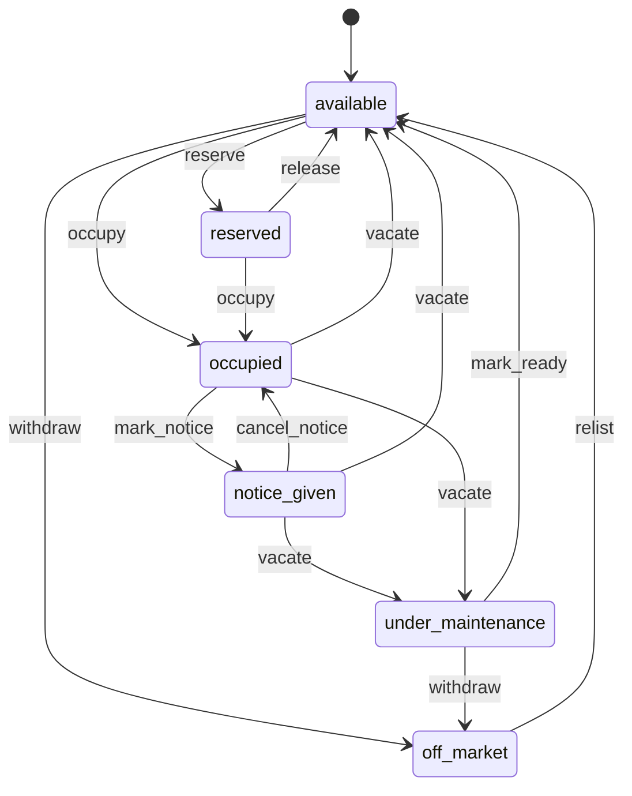
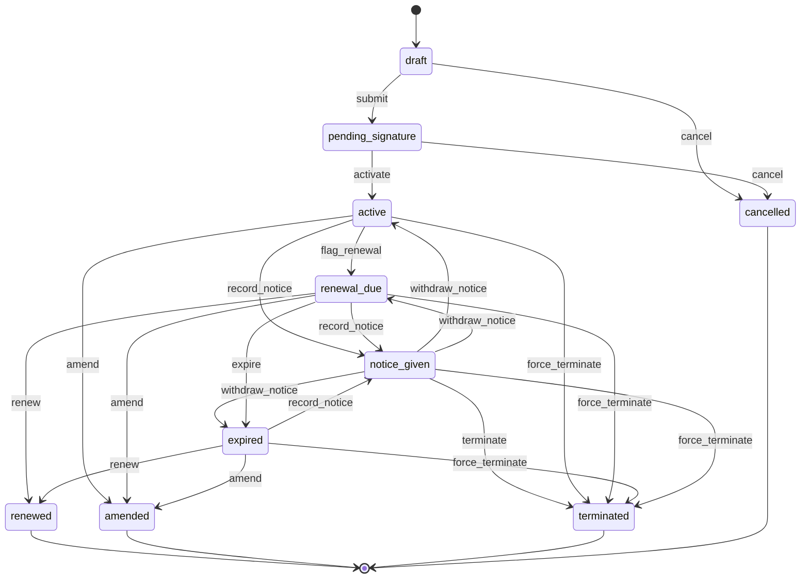
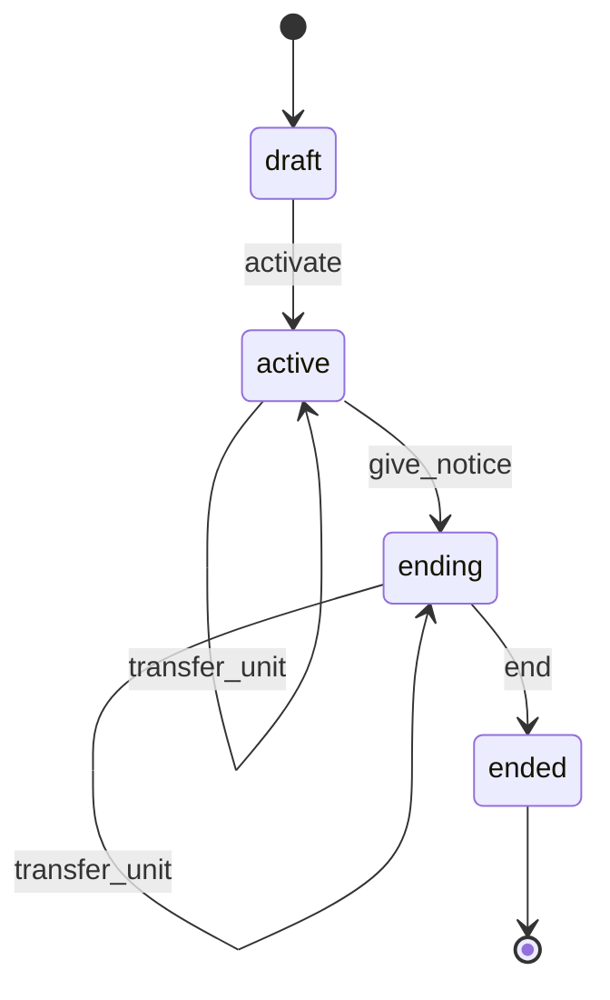
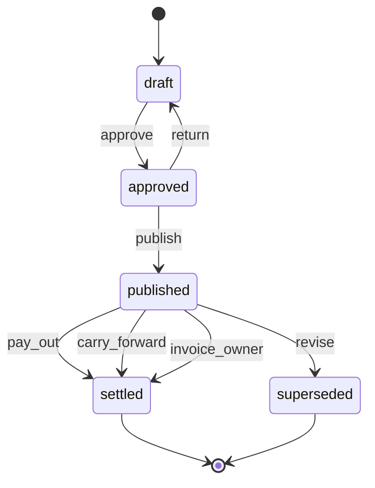
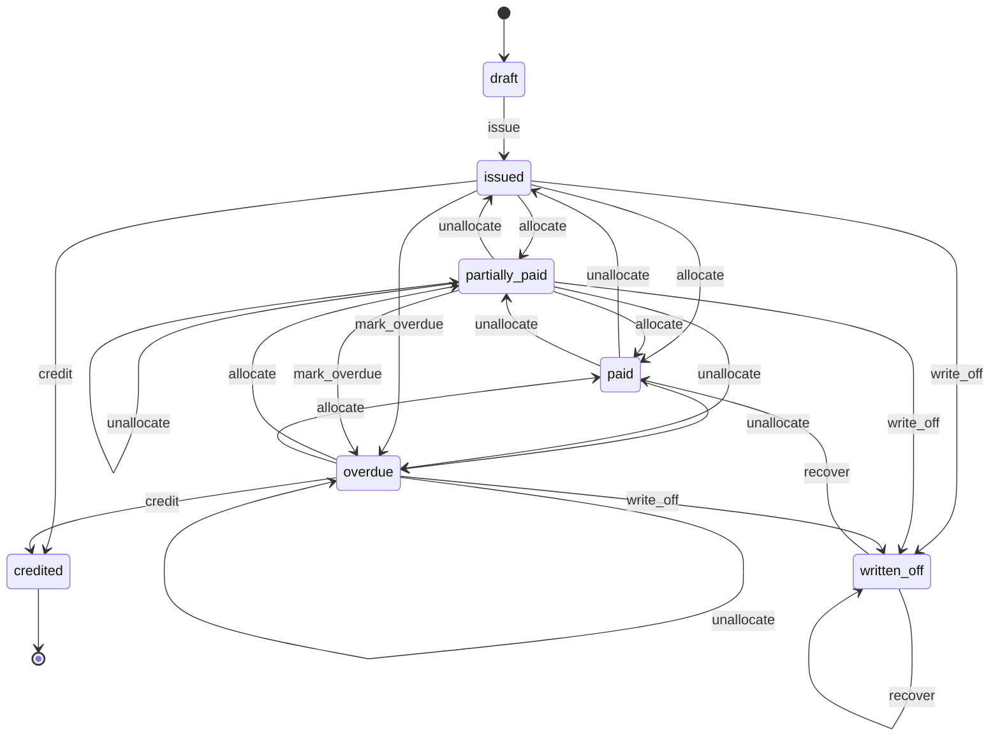
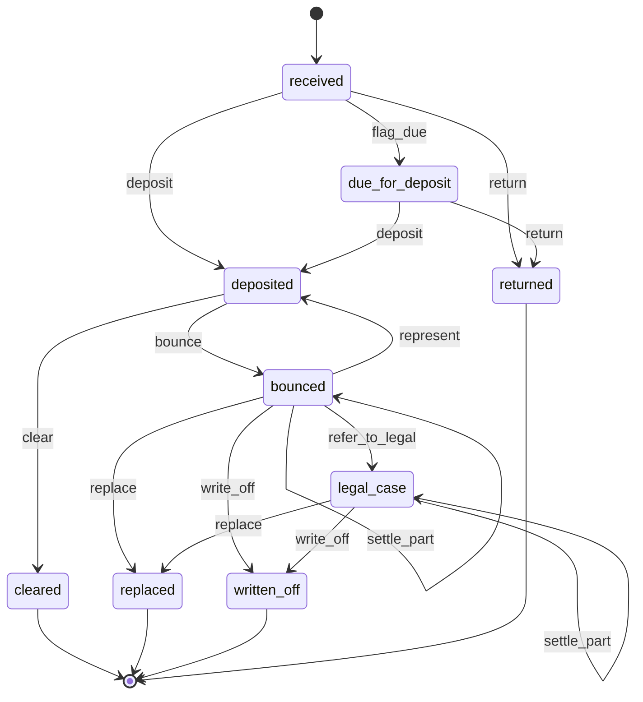
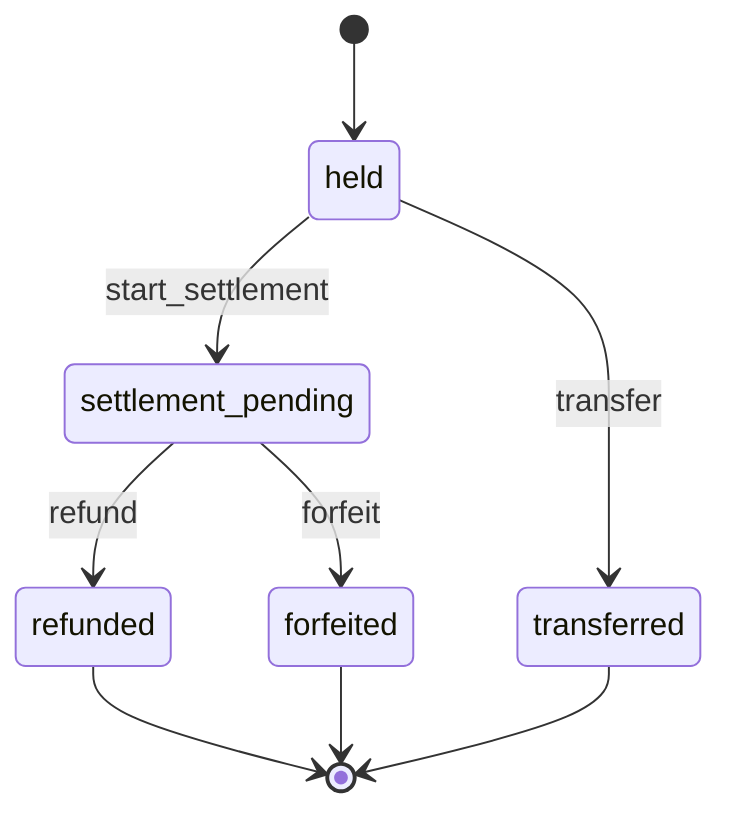
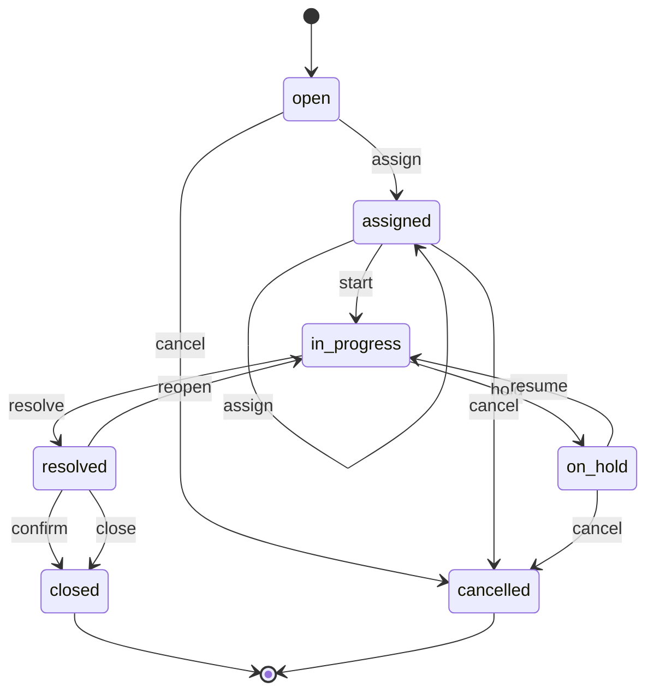
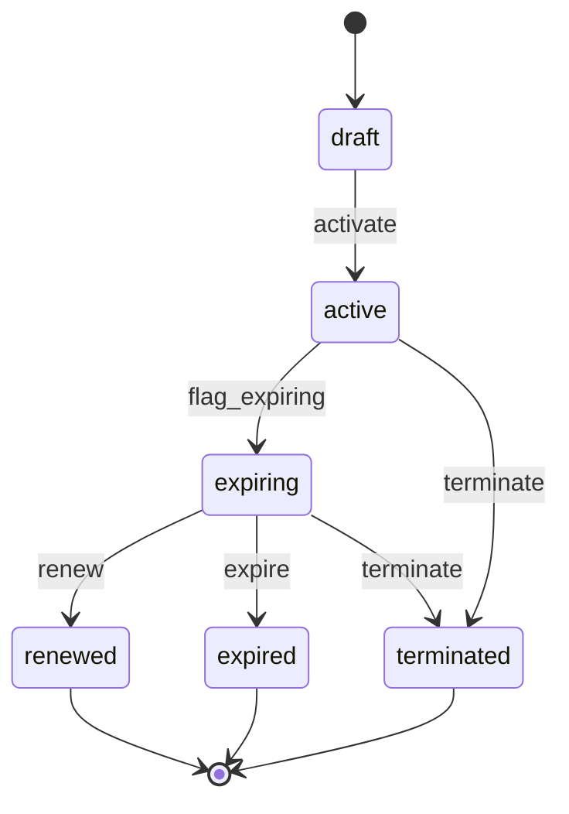

# 01 — Property & Building Management

> Status: accepted · Reviewed: 2026-10-15 · Last updated: 2026-10-15

## 1. Summary

Mid-sized property management companies in Dubai and Abu Dhabi manage from a few hundred to a
few thousand residential and commercial units, either their own or on behalf of landlords
(both are in scope). Today they
track leases, post-dated cheques and maintenance in Excel and WhatsApp. The app gives them a
single place for the lease-to-cash cycle, maintenance, and owner reporting. Tenants and
owners get a branded self-service portal.

## 2. Business context (UAE)

- **Customer size:** 5–50 staff, 200–5,000 units, one or several buildings. Some own the
  buildings; most manage them for individual or institutional landlords for a management fee.
- **How they work today:** spreadsheets for the rent roll and cheque register, WhatsApp for
  tenant requests, paper inspection forms, accounting in Zoho Books/QuickBooks/Tally, and
  Ejari registration through typing centres.
- **Rules and practice that shape the work:**
  - Tenancy contracts in Dubai must be registered in **Ejari** (Dubai Land Department). A
    DEWA connection, residence visa sponsorship and school registration depend on it
    ✔ [S1]. Registration is online (Dubai REST) or at a typing centre ✔ [S1].
  - Abu Dhabi's equivalent is **Tawtheeq**. The landlord is responsible for registering, and
    a property manager may do it on the landlord's behalf, through **DARI** or **TAMM**. ADDC
    water and electricity need a registered contract ✔ [S2] [S3]. Current fees on TAMM, paid
    by the landlord: AED 900 plus AED 5 per unit to enrol a building, AED 50 to register a
    new lease (plus 1% for contracts over 4 years) and AED 50 to renew ✔ [S19].
  - Rent is commonly paid with **1 to 12 post-dated cheques (PDCs)** per year. Bank transfers,
    direct debit and cards are growing.
  - A **security deposit** is usual. The law does not fix the amount; around 5% of annual
    rent for unfurnished and 10% for furnished units is market convention, not a legal cap
    ✔ [S4]. The platform treats these as configurable defaults.
  - Changes to lease terms at renewal (including rent) require written notice **at least 90
    days before expiry**, unless the contract says otherwise (Law No. 26 of 2007, Art. 13–14,
    as amended by Law No. 33 of 2008). If the tenant stays and the landlord does not object,
    the lease renews on the same terms for the same period or one year, whichever is shorter
    (Art. 6) ✔ [S5] [S6].
  - Rent increases at renewal in Dubai are capped by **Decree No. 43 of 2013**, according to
    how far the current rent is below the average rent of similar units in the RERA rental
    index ✔ [S7] [S8]:

    | Current rent below the index average by | Maximum increase |
    |---|---|
    | up to 10% | 0% |
    | 11–20% | 5% |
    | 21–30% | 10% |
    | 31–40% | 15% |
    | more than 40% | 20% |

    Since January 2025 the index is the **Smart Rental Index**, which adds a building star
    rating ✔ [S9]. The index is binding when the parties disagree on a renewal increase
    ✔ [S8]. This table is the rule for `PRP.LSE.03`.
  - **VAT:** residential leases are exempt; commercial leases are standard-rated at 5%. The
    first supply of a new residential building within three years of completion is
    zero-rated, and later supplies are exempt. A serviced apartment that comes with services
    beyond accommodation is not a "residential building", so it is standard-rated
    ✔ [S10] [S11]. Mixed portfolios need all three categories per line. A residential lease
    is exempt only when the contract is for more than six months (renewal options not
    counted) or the tenant holds an Emirates ID; shorter stays by tenants without an Emirates
    ID are standard-rated (Cabinet Decision 52 of 2017, Art. 43) ✔ [S11].
  - Property management in Dubai requires a **RERA-licensed** company.
  - **Annual maintenance contracts (AMCs)** with specialist vendors cover each building's
    systems: MEP, HVAC and chillers, lifts and escalators, fire and life safety, pest control,
    cleaning, security and landscaping. Fire and life safety systems must be maintained by a
    Civil Defence-approved contractor, with periodic inspections and a maintenance
    certificate. In Dubai the maintenance contract is attested by Dubai Civil Defence (DCD),
    the contractor and its technicians hold DCD approval, preventive maintenance is at least
    quarterly, and DCD issues the building safety certificate ✔ [S12] (from DEWA tender
    specifications, i.e. practice). The Civil Defence safety certificate is reported to be
    valid one year and renewed yearly, with a maintenance contract with a licensed company as
    a condition (Cabinet Resolution 24 of 2012) ✔ [S20]; the rules in other emirates are
    `⚠ open: authority (AU-08)`. Lifts and other lifting equipment in workplaces are tested and
    certified **every 12 months** by an EIAC-accredited third party, which issues a safety
    certificate per unit ✔ [S13]. The guideline names factories, construction sites, hotels
    and other workplaces; whether the same interval applies to passenger lifts in
    residential buildings is `⚠ open: authority (AU-09)` (Dubai Municipality). Missing a certificate can block a building's compliance
    and insurance.
  - Many management companies operate through **more than one legal entity** (for example a
    RERA-licensed management company and a separate facilities company), and some landlords
    are themselves companies with their own TRN (`PLT.ENT.01`, [decision 0003](../decisions/0003-legal-entities.md)).
  - Tenants increasingly pay by **bank transfer**, which arrives on the bank statement without
    a reliable reference and must be matched to the right tenant and instalment.

## 3. Users and access

Follows [ACCESS-CONTROL.md](../ACCESS-CONTROL.md). Platform-wide rules (`PLT.ACL.*`) are not
repeated here.

### 3.1 Roles

| Role | Actor type | What they do | Permissions (summary) | Typical scope |
|---|---|---|---|---|
| Company admin | staff | Configures the company, users, roles, branding | all, including `roles.manage` | global |
| Property manager | staff | Owns a set of buildings: leases, renewals, owners, escalations, approvals | units, leases, tickets, deposits, owner statements; approves deposits, waivers, payouts | building |
| Leasing agent | staff | Enquiries, viewings, reservations, new leases | `units.view`, leads, `leases.create` (draft only) | global (read) or building |
| Accountant | staff | Invoices, cheques, receipts, deposits, owner statements | invoices, payments, cheques, deposits, statements (prepare) | global |
| Maintenance coordinator | staff | Triage, assigns technicians or vendors, follows SLAs; manages AMCs and their planned visits | tickets, vendors, inspections, service contracts, planned maintenance | building |
| Technician | field | Works assigned jobs, updates status, uploads photos | `tickets.work` on assigned tickets | building |
| Vendor | external | An outside contractor doing assigned jobs and the planned visits of its AMCs | `tickets.work` on assigned tickets and on its contracts' planned visits, uploads service reports and certificates, submits bills | — (assignment and contract only) |
| Tenant — primary contact | external | Sees the lease, invoices, cheques, documents; pays; raises requests; manages the company's other portal users | portal: lease, finance, requests, users | own leases |
| Tenant — finance contact | external | Sees and pays invoices only | portal: finance | own leases |
| Owner | external | Sees units, occupancy, statements, payouts | portal: owner | own units |

### 3.2 Scope

The scope unit is the **building**. Property managers, maintenance coordinators and
technicians are assigned per building, and a manager can cover another building for a set
period. Company admins and accountants are usually global. External users have no scope.
Their access comes from party ownership (`OWN`) or assignment (`ASG`).

### 3.3 Access rules

| ID | Rule | Pattern | Applies to | Parameter (default) |
|---|---|---|---|---|
| `PRP.ACL.01` | A tenant user sees only leases where their party is a tenant, and the invoices, cheques, documents and tickets of those leases | `OWN` | tenant | — |
| `PRP.ACL.02` | An owner sees only units under their management agreements, and the statements for them | `OWN` | owner | — |
| `WRK.ACL.02` *(shared, formerly `PRP.ACL.03`)* | A technician or vendor sees only tickets assigned to them; the unit's tenant contact is visible only while the ticket is open | `ASG`, `TIM` | technician, vendor | — |
| `PRP.ACL.04` | A lease can be edited only in *draft*. An active lease changes only through a new version (amendment or renewal) | `STA` | all staff | — |
| `PRP.ACL.05` | Deposit deductions are approved by the property manager; above a threshold, finance or the owner also approves | `LIM` | accountant, coordinator, property manager | AED 5,000 |
| `FIN.ACL.04` *(shared, formerly `PRP.ACL.06`)* | The user who records a deposit refund cannot approve it | `SOD` | all staff | on |
| `FIN.ACL.07` *(shared, formerly `PRP.ACL.07`)* | Any rent waiver or discount needs a property manager's approval | `LIM` | accountant, leasing agent | above 0% |
| `PRP.ACL.08` | Owner payouts are prepared by one user and approved by another | `SOD` | accountant, property manager | on |
| `POR.ACL.01` *(shared, formerly `PRP.ACL.09`)* | After move-out, the tenant portal is read-only, then closes | `TIM` | tenant | closes after 90 days |
| `PRP.ACL.10` | Tenant identity documents (Emirates ID, passport, visa) need `kyc.sensitive.view`; each view is audited | `SEN` | all staff | — |
| `PRP.ACL.11` | Owners see a tenant's name and lease terms, but not their contact details or identity documents | `FLD` | owner | — |
| `PRP.ACL.12` | A leasing agent sees availability and asking rent in all buildings, but tenant and financial data only in their own buildings | `FLD`, scope | leasing agent | — |
| `PRP.ACL.13` | A vendor sees only the planned visits and tickets of its own service contracts, and only for the buildings those contracts cover | `OWN`, `ASG` | vendor | — |
| `PRP.ACL.14` | A new or renewed service contract above an annual value needs property manager approval; above a second value, the owner's approval is recorded | `LIM` | maintenance coordinator | AED 50,000 / AED 200,000 |
| `PRP.ACL.15` | A planned visit of a compliance-critical contract (fire and life safety, lifts) can be completed only with the vendor's service report attached; it cannot be skipped, only rescheduled with a reason | `STA` | maintenance coordinator, vendor | — |
| `PRP.ACL.16` | A bank statement line is matched to a tenant's invoices by one user; reversing a confirmed match needs a property manager | `SOD`, `STA` | accountant | — |
| `FIN.ACL.01` *(shared)* | An issued invoice cannot be edited; it is corrected with a credit note | `STA` | all staff | — |
| `FIN.ACL.02` *(shared)* | A bounced cheque can be marked replaced only by linking the replacement cheque or payment | `STA` | accountant | — |
| `FIN.ACL.15` *(shared)* | Writing off a tenant's or owner's unpaid balance always needs approval by a property manager who did not request it; for a managed building the owner's consent is recorded, because the loss is the owner's | `LIM`, `SOD` | accountant | AED 0 (always) |
| `WRK.ACL.11` *(shared)* | A fire and life safety ticket or planned visit cannot be resolved while the assigned vendor's Civil Defence approval is expired or missing; no override (legal block) | `STA` | vendor, technician, maintenance coordinator | — |
| `PTY.ACL.03` *(shared)* | While a party is blocked, no new lease, renewal or amendment is activated for it, and no money goes out to it (deposit refund, owner payout, vendor payment) unless the compliance role approves an exception. Active leases continue (block effect `continue`) | `STA` | all staff | — |
| `PRP.ACL.17` | A renewal or amendment version that raises the rent or changes other terms against the tenant is submitted only when a notice of changed terms was delivered, with proof recorded, at least the notice period before the current end date; otherwise only with the tenant's signed acceptance attached | `STA` | leasing agent, property manager | 90 days, or the contract's period |
| `PRP.ACL.18` | Cancelling a lease after money or cheques were received, and forfeiting any of it, is requested by the leasing agent or accountant and approved by a property manager | `SOD` | leasing agent, accountant | on |
| `PRP.ACL.19` | A forced termination (unit abandoned, or eviction executed) is requested by the property manager with evidence and approved by another user with `leases.force_terminate` | `SOD` | property manager | approver: company admin |
| `PRP.ACL.20` | Withdrawing a tenant's notice needs the landlord side's written agreement; it is refused once a lease for another tenant on the unit has been submitted | `STA` | property manager | — |
| `PRP.ACL.21` | An owner payout is refused while the owner's statement balance is negative, the statement is disputed, or the owner is blocked; a published statement is corrected only by a revision before payout, or by adjustment lines on the next statement | `STA` | accountant, property manager | — |
| `PRP.ACL.22` | A vendor bill with the same vendor and vendor invoice number as an existing bill that is not void, or the same contract, period and amount, is held as a possible duplicate; it is approved only by another user with a reason | `STA`, `SOD` | accountant | on |

## 4. Value streams

### 4.1 Lease to cash

1. A unit is marked available, with asking rent and attributes (`PRP.PRT.01`, `PRP.PRT.02`).
2. An enquiry is recorded and a viewing booked (`PRP.LEA.01`).
3. The prospect reserves the unit with a booking deposit (`PRP.LEA.02`, `FIN.PAY.01`).
4. KYC documents are collected: Emirates ID, passport, visa, or trade licence and TRN for a
   company (`PTY.PTY.01`, `PTY.KYC.01`, `DOC.FIL.01`).
5. The lease is drafted: term, rent, payment plan, deposit, clauses (`PRP.LSE.01`).
6. The tenancy contract is generated in English and Arabic and signed (`DOC.GEN.01`).
7. The Ejari/Tawtheeq registration number and certificate are recorded (`PRP.LSE.02`).
8. The charge schedule is created from the payment plan (`FIN.BIL.01`). The deposit and PDCs
   are received and logged (`FIN.DEP.01`, `FIN.CHQ.01`).
9. A move-in inspection with photos is completed and keys are handed over (`WRK.CHK.01`).
10. Each instalment produces its own tax invoice on its due date, which is also its tax
    point. Other charges come from the client's charge catalogue (chiller, service charge,
    parking, fines, admin fees), each with its VAT treatment. Exempt or 5% VAT is applied per
    line. The issuing entity is the building's owner or landlord of record; a charge type can
    route to another entity, such as the management company for its fees. That entity's TRN
    is printed on the invoice (`FIN.INV.01`, `PLT.ENT.01`).
11. Cheques are deposited on their dates and marked cleared or bounced. Payments are matched
    to invoices (`FIN.CHQ.01`, `FIN.PAY.01`).
12. Bank transfers are found by importing the bank statement. Each credit line is matched to
    a tenant's open invoices, using the amount, the payer name and any reference; the
    accountant confirms or corrects the suggestion (`FIN.BNK.01`, `PRP.ACL.16`).
13. Overdue amounts trigger reminders. Arrears are visible in ageing (`FIN.REC.01`,
    `NTF.MSG.01`).

**When it goes wrong**

| Situation | What happens |
|---|---|
| The contract is generated but not signed, or the deposit not paid | `PRP.RUL.12` reminds the leasing agent and property manager after 14 days in `pending_signature`, and after 30 days gives the property manager a task to extend the date or cancel the lease |
| The prospect backs out after paying the deposit or handing over PDCs | Lease `cancel` with a reason, approved by a property manager (`PRP.ACL.18`). Cheques not yet deposited are returned against a handover receipt. Rent already paid is refunded (`FIN.ACL.04`). The security deposit is refunded, or part of it forfeited only where the signed reservation or contract terms allow it, with the property manager's approval. Issued invoices are credited. The unit is released |
| A cheque bounces | Cheque `bounce` with the bank's return reason and certificate. The bounce fee charge is added when the client has set one. The tenant and property manager are told (`FIN.RUL.04`). The cheque is then re-presented (at most 2 presentations), replaced, part settled, referred to a civil legal case, or written off (`FIN.RUL.18` reminders at 3 days, decision task at 14 days) |
| Arrears grow after the last reminder | `PRP.RUL.10`: 30 days overdue, the property manager gets a task to send a formal payment demand (statutory notice; proof of delivery recorded). When the demand period lapses unpaid, a task to open a legal case (Rental Dispute Centre claim for arrears or eviction) on the lease, or to agree a payment plan. The demand period and the grounds for eviction are `⚠ open: lawyer (L-22)` (§13 question 12) |
| The tenant disputes an invoice | Invoice `dispute` from the portal or by staff: reminders pause, a billing-dispute ticket is opened, and the dispute ends `upheld` or `credited` (`FIN.RUL.15` escalates after 14 days) |
| A debt is uncollectable | Invoice `write_off` with approval (`FIN.ACL.15`, always), owner's consent recorded for a managed building; the written-off rent is shown on the owner statement; bad-debt VAT relief is proposed by `FIN.RUL.14` on commercial leases |
| A bank match was wrong, or a payment is reversed | Reversing a confirmed match needs a property manager (`PRP.ACL.16`); the payment's allocations are removed and the invoices reopen (`unallocate`), with reminders resuming |
| A payment was entered twice or on the wrong lease | Payment `void` with a reason, approved by another user (`PLT.ACL.09`); the allocations are reversed. Issued tax invoices are never voided; they are credited |
| The tenant abandons the unit | Lease `force_terminate` with evidence (`PRP.ACL.19`), see §4.3 |

### 4.2 Maintenance request to resolution

1. A tenant raises a request in the portal, with category, description and photos
   (`POR.SLF.01`, `WRK.TKT.01`).
2. The coordinator triages it: priority, SLA, and whether it is chargeable to the tenant
   (`WRK.TKT.02`).
3. It is assigned to an in-house technician or an external vendor (`WRK.TKT.02`).
4. The technician updates the status from the field and uploads before/after photos
   (`WRK.TKT.03`).
5. The tenant confirms that the job is done, or the ticket is confirmed automatically after 3
   days (`WRK.RUL.02`). The ticket closes (`WRK.TKT.03`). For a chargeable job the tenant
   sees the amount with the confirmation request.
6. A chargeable job produces an invoice to the tenant only once the ticket is confirmed
   (`FIN.INV.01`); nothing is invoiced while the tenant can still reopen it. A vendor job
   produces a vendor bill, allocated to the unit's owner (`FIN.PAB.01`).

**When it goes wrong**

| Situation | What happens |
|---|---|
| The vendor does not turn up | `WRK.RUL.19`: 2 hours after the scheduled time, a no-show is recorded against the vendor and the coordinator is offered reassignment to another vendor or a technician (reason `vendor_no_show`); the tenant is told the new time |
| The tenant says the job is not done | The tenant reopens the ticket within the reopen window; no invoice has been issued, so nothing is credited |
| The tenant disputes the charge after confirming | Invoice `dispute`; the coordinator answers with the photos and the triage decision; outcome `upheld` or `credited` |
| The job is cancelled after work started | Ticket `cancel` from `on_hold` with a reason; work already done by a vendor is billed by the vendor and allocated to the owner; nothing is charged to the tenant unless the coordinator marks it chargeable with a reason |
| The vendor bills the same job twice | The second bill is held as a possible duplicate (`PRP.ACL.22`) and voided |

Planned maintenance under a vendor's AMC follows §4.5.

### 4.3 Renewal or move-out

1. Leases expiring in 120 days enter the renewal window (`PRP.RUL.01`) and appear on the
   dashboard, with further notices at 90/60/30 days (`DOC.EXP.01`, `PRP.LSE.04`). The
   property manager decides early whether the rent or other terms will change, because the
   notice of changed terms must reach the tenant at least 90 days before expiry (§2).
2. If rent or terms change, the new rent is checked against the rental index (`PRP.LSE.03`)
   and the notice of changed terms is sent as a statutory notice; its proof of delivery is
   recorded on the lease (`PRP.RUL.09`). Without timely proof, the renewal keeps the current
   terms unless the tenant signs the new ones (`PRP.ACL.17`).
3. **Renewal:** a new lease version is created with new dates, rent and cheques, and Ejari is
   renewed (`PRP.LSE.04`, `PRP.LSE.02`).
4. **Move-out:** the notice is recorded, a move-out inspection is done, damages are costed,
   the deposit is settled (refund minus deductions), and the unit returns to available
   (`PRP.LSE.05`, `WRK.CHK.01`, `FIN.DEP.01`). The property manager approves the itemised
   deductions; above a threshold, finance or the owner also approves (`PRP.ACL.05`). The
   tenant sees the deductions in the portal before the refund is paid by transfer or
   cheque, and has 14 days to dispute them (`PRP.RUL.11`). The Ejari contract is cancelled
   after move-out (`PRP.RUL.13`).

**When it goes wrong**

| Situation | What happens |
|---|---|
| The tenant stays after the end date (holding over) | `PRP.RUL.03` moves the lease to `expired`, which is not an end: in Dubai the lease renews on the same terms for the same period or one year, whichever is shorter, when the landlord does not object (Art. 6, §2). Charges continue on the same terms and the property manager gets a task to issue the renewal version and renew Ejari, or record a notice (`PRP.RUL.14`). The rule in Abu Dhabi is `⚠ open: lawyer (L-22)` (§13 question 12) |
| The notice of changed terms was late or not delivered | The renewal version is refused with changed terms (`PRP.ACL.17`); the property manager renews on the current terms or gets the tenant's signed acceptance. A notice whose delivery failed is not counted until proof is recorded (`statutory_notice`, wl-notify) |
| Mid-term change (rent, payment plan, added tenant, parking) | Lease `amend`: a new version with an effective date is drafted, signed and activated. Charges after the effective date are reissued from the new plan; invoices already issued for those periods are corrected by credit note and a new invoice; cheques are relinked to the new charges, or returned and replaced where the amounts change; a deposit change becomes a top-up charge or a part refund; an Ejari update task is created (`PRP.RUL.02`) |
| The tenant withdraws the notice | Lease `withdraw_notice` with the landlord side's written agreement (`PRP.ACL.20`); the move-out inspection is cancelled and the unit returns to `occupied` |
| Early termination by the tenant | Notice reason *early termination*. The penalty set by the contract is added as a charge from the catalogue (charge type *early termination fee*; its VAT treatment `⚠ open: accountant (A-06)`). On `terminate`, scheduled charges after the move-out date are cancelled; invoices for periods after it are credited pro rata, unless the contract keeps rent due until a fixed date; paid amounts not used are refunded or kept as credit; later cheques are returned |
| Deductions exceed the deposit | The deposit is applied in full (`forfeit`, reason *applied to deductions*) and the excess is invoiced to the tenant as a damages charge, which then follows the arrears flow (§4.1). VAT on damages kept as compensation is `⚠ open: accountant (A-06)` (wl-payments §10) |
| The tenant disputes the deductions | The tenant disputes one or more deduction lines in the portal within 14 days. The deposit stays `settlement_pending` with a dispute flag; the property manager answers within 7 days with evidence (inspection photos, quotes), revises the deductions (a new published version) or upholds them. Unresolved after 14 days, `PRP.RUL.11` escalates to the property manager's manager; if the tenant files a Rental Dispute Centre case, a legal case is opened on the lease and the settlement waits for the decision |
| The tenant abandons the unit or is evicted | Lease `force_terminate` (`PRP.ACL.19`) with evidence: an abandonment inspection with photos and the legal basis for repossession (`⚠ open: lawyer (L-22)`, §13 question 12), or the judgment and execution record. The unit is vacated; the deposit settlement applies the deposit to arrears and damages; later cheques are kept as evidence or returned; remaining arrears follow the arrears flow or write-off |
| The tenant does not pay after the formal demand | The lease carries a legal case flag (arrears or eviction), which pauses reminders on its invoices and blocks renewal; the case ends with payment, a settlement, or eviction (`force_terminate`) |

### 4.4 Owner reporting and payout

1. Rent collected, expenses (vendor bills, including each building's share of AMC costs) and
   the management fee are collected per owner for the period (`PRP.OWN.01`, `FIN.PAB.01`,
   `WRK.SVC.01`).
2. The accountant reviews the draft statement and a property manager approves it
   (`PRP.ACL.08`). The owner statement is generated as a PDF and published to the owner by
   email, and in the owner portal once it exists (`DOC.GEN.01`, `POR.SLF.02`).
3. The payout is recorded (`PRP.OWN.01`), or a negative balance is carried forward or
   invoiced to the owner (`PRP.ACL.21`).
4. At the end of each VAT period, the accountant takes the VAT summary per legal entity:
   output VAT on commercial rent and fees, exempt residential rent, and input VAT on vendor
   bills. It goes to the company's accountant or tax agent for the return (`FIN.VAT.01`,
   `PLT.ENT.01`).

**When it goes wrong**

| Situation | What happens |
|---|---|
| The owner's balance is negative (vacancy, AMC costs, repairs) | No payout (`PRP.ACL.21`). By default the negative balance is carried forward to the next statement; when the agreement allows, or the balance stays negative for 3 statements, the property manager may invoice it to the owner from the management company's entity (VAT on recharged costs `⚠ open: accountant (A-08)`) |
| The owner disputes a statement line | The statement is flagged disputed and a ticket opened; the payout waits. The line is corrected by a revision before payout, or by an adjustment line on the next statement after payout; the owner is told the outcome |
| A cost was allocated to the wrong owner | Corrected on the next statements of both owners by adjustment lines; a published statement is never edited |
| The management agreement ends, or a unit is sold mid-lease | Management agreement `end` or `transfer_unit` (§7.1): from the handover date, charges are issued by the new landlord of record or stop being managed here; a handover pack lists the deposits held, cheques not yet deposited, open charges and arrears, and the Ejari details; deposits and cheques are handed over against a receipt; the tenant is told the new payee; a final owner statement is prepared. Whether a sale requires a new Ejari registration or only a landlord update is `⚠ open: authority (AU-24)` (§13 question 13) |
| The owner is blocked | Payouts stop (`PTY.ACL.03`); the owner's leases continue; statements are still prepared |

### 4.5 AMC to planned visit to vendor bill

1. The coordinator records a service contract per vendor: category (MEP, HVAC, lifts, fire
   and life safety, pest control, cleaning, security), buildings and assets covered, term,
   annual value and billing frequency, visit frequency, response SLA for call-outs, and the
   vendor's licences (for fire and life safety, the Civil Defence approval) (`WRK.SVC.01`,
   `DOC.FIL.01`, `DOC.EXP.01`).
2. Contracts above the approval limits are approved before they start (`PRP.ACL.14`,
   `PLT.APR.01`).
3. The contract's visit frequency generates planned visits as tickets on the covered
   buildings, assigned to the vendor (`WRK.PPM.01`, `WRK.TKT.02`).
4. The vendor's technician works the visit from the field PWA with a vendor login that shows
   only assigned visits and tickets, completes the checklist and uploads the service report;
   for fire and life safety and lifts, the report is mandatory (`WRK.CHK.01`, `WRK.TKT.03`,
   `PRP.ACL.13`, `PRP.ACL.15`). Where the vendor will not log in, the coordinator uploads the
   report on its behalf.
5. Faults found during a visit become call-out tickets under the same contract, with its SLA;
   parts outside the contract scope need approval (`WRK.TKT.01`, `PLT.APR.01`).
6. Certificates issued by the vendor or the authority (fire and life safety maintenance
   certificate, lift inspection certificate) are stored on the building with their expiry
   date (`DOC.FIL.01`, `DOC.EXP.01`).
7. The vendor's periodic invoice is recorded as a vendor bill against the contract and
   allocated to buildings, by share of area or units, or by asset (`FIN.PAB.01`).
8. Allocated AMC costs flow into the owner statements (§4.4) and into the AMC cost reports
   (`PRP.OWN.01`, `RPT.LIB.01`).
9. Before the contract ends, the coordinator renews, re-tenders or ends it (`WRK.RUL.12`).

**When it goes wrong**

| Situation | What happens |
|---|---|
| The vendor's Civil Defence approval expires mid-contract | The approval is a document of kind *Civil Defence approval* on the vendor, which blocks `service_contract.activate` and `ticket.resolve` for fire and life safety categories, with no override (legal block). On expiry (`DOC.RUL.03`), the contract gets the vendor document flag, its open visits are flagged, the buildings get the compliance flag `vendor_document_expired`, and the coordinator, the property manager and the company admin are told. A visit done by the vendor while unapproved cannot be resolved and does not count; the coordinator reassigns it or terminates the contract. 30 days before expiry, `DOC.RUL.02` lists the visits that will be blocked |
| A planned visit is missed | `WRK.RUL.14` after 3 days; for fire and life safety and lifts the building gets the compliance flag `visit_missed`, which clears when the visit is resolved |
| The vendor does not turn up | `WRK.RUL.19` (§4.2); repeated no-shows show on the contract page |
| The contract expires or is terminated without a replacement | `WRK.RUL.18`: visits due after the end date are cancelled; the coordinator gets one task to reassign or cancel the other open visits; for fire and life safety and lifts the buildings get the compliance flag `no_contract` until a replacement contract is active, and the property manager and company admin are told |
| A compliance certificate (building safety certificate, lift certificate) expires | `DOC.RUL.01` warns at 90, 30 and 7 days; on expiry the building is flagged non-compliant on the dashboard and the company admin is told (the kind is compliance-critical). The platform does not block leasing because of it |
| The vendor bills twice, or for work after the end date | Held as a possible duplicate (`PRP.ACL.22`), or matched only for work done before the end date (`FIN.PAB.01`) |

### 4.6 Portfolio migration (new client)

1. The client's existing data is loaded from Excel templates: buildings and units, owners and
   management agreements, tenants, active leases with their payment plans, the cheque
   register, open balances and deposits held, vendors and AMCs (`PLT.IMP.01`).
2. Each file is validated and loaded as a dry run first: missing units, duplicate tenants,
   payment plans that do not add up to the rent, cheques without a lease. Errors are fixed in
   the file and reloaded (`PLT.IMP.01`).
3. Once accepted, the import is committed. Opening balances become charges and invoices dated
   before go-live, marked as migrated, so ageing and owner statements are correct from the
   first day (`FIN.REC.01`). A committed import can be rolled back until the first new
   transaction is posted.

## 5. Capabilities

| ID | Capability | Shared or specific | Proposed module | Scope |
|---|---|---|---|---|
| `PLT.ORG.01` | Branded deployment: logo, colours, domain, languages (EN/AR) | shared | wl-kernel | MVP |
| `PLT.USR.01` | Staff users, roles, permissions scoped per building | shared | Renox Permissions | MVP |
| `PLT.AUD.01` | Audit trail of changes to leases, money and documents | shared | Renox Audit | MVP |
| `PLT.APR.01` | Approval requests for limit and segregation-of-duties rules (deposits, waivers, payouts) | shared | wl-kernel | MVP |
| `PLT.WFL.01` | State machines with transition history (leases, invoices, cheques, deposits, tickets) | shared | Renox (R12) + wl-kernel | MVP |
| `PLT.ATM.01` | Default automation rules: reminders, renewals, overdue, cheque deposits | shared | wl-kernel | MVP |
| `PLT.HOK.01` | Outbound webhooks for the client's own integrations | shared | Renox (R11) | Later |
| `PTY.PTY.01` | Register of parties: tenants, owners, vendors (companies and individuals) | shared | wl-parties | MVP |
| `PTY.KYC.01` | Identity fields: Emirates ID, passport, visa, trade licence, TRN | shared | wl-parties | MVP |
| `DOC.FIL.01` | Attach documents to any record | shared | wl-documents | MVP |
| `DOC.EXP.01` | Expiry tracking with tiered reminders (lease, Ejari, Emirates ID, trade licence) | shared | wl-documents | MVP |
| `DOC.GEN.01` | Generate documents from templates in EN/AR (contract, receipt, statement) | shared | wl-documents | MVP |
| `FIN.BIL.01` | Charge schedule from an agreement (instalments, recurring fees) | shared | wl-invoicing | MVP |
| `FIN.INV.01` | Tax invoice with per-line VAT category (standard 5%, zero, exempt) | shared | wl-invoicing | MVP |
| `FIN.PAY.01` | Record payments (cheque, transfer, cash, card) and match to invoices | shared | wl-payments | MVP |
| `FIN.PAY.02` | Online payment by link or card from the portal | shared | wl-payments | Later |
| `FIN.CHQ.01` | Post-dated cheque register: received, deposit date, cleared, bounced, replaced | shared | wl-payments | MVP |
| `FIN.REC.01` | Receivables ageing and payment reminders | shared | wl-invoicing | MVP |
| `FIN.DEP.01` | Security deposits held, deductions, refunds | shared | wl-payments | MVP |
| `FIN.PAB.01` | Vendor bills and expenses allocated to a cost object (unit, owner) | shared | wl-invoicing | MVP |
| `FIN.EXT.01` | Export to accounting software (Zoho Books, Xero, QuickBooks) | shared | wl-invoicing | Later |
| `WRK.TKT.01` | Raise a request or ticket (portal or staff), with category and photos | shared | wl-ticketing | MVP |
| `WRK.TKT.02` | Triage: priority, SLA, assignment to staff or vendor | shared | wl-ticketing | MVP |
| `WRK.TKT.03` | Field updates, before/after photos, requester sign-off | shared | wl-ticketing | MVP |
| `WRK.PPM.01` | Planned preventive maintenance on a schedule (MVP for compliance-critical AMCs: fire and life safety, lifts) | shared | wl-ticketing | MVP |
| `WRK.CHK.01` | Checklists with photos and signature (inspections) | shared | wl-ticketing | MVP |
| `POR.SLF.01` | Tenant self-service portal: lease, invoices, cheques, documents, requests | shared | wl-portal | MVP |
| `POR.SLF.02` | Owner portal: units, occupancy, statements | shared | wl-portal | Later |
| `NTF.MSG.01` | Email notifications from templates | shared | wl-notify | MVP |
| `NTF.MSG.02` | WhatsApp notifications | shared | wl-notify | Later |
| `RPT.DSH.01` | Role-based dashboard with KPI tiles and charts | shared | Renox charts + wl-kernel | MVP |
| `PLT.ENT.01` | Legal entities: several trade licences and TRNs in one deployment; issuer on every document | shared | wl-kernel | MVP |
| `PLT.IMP.01` | Data import and migration: Excel templates per entity, validation, dry run, rollback | shared | wl-kernel | MVP |
| `PLT.SRC.01` | Global search across records, including Arabic names | shared | wl-kernel + Renox search | MVP |
| `PLT.NOT.01` | Notes, comments and @mentions on any record, with an activity timeline | shared | wl-kernel | MVP |
| `PLT.SSO.01` | Staff single sign-on with Microsoft 365 or Google Workspace | shared | Renox OAuth (renox-oauth) | Later |
| `RPT.LIB.01` | Report library: filtered reports with export to Excel, CSV and PDF | shared | wl-kernel | MVP |
| `RPT.SCH.01` | Scheduled reports sent by email | shared | wl-kernel | Later |
| `FIN.VAT.01` | VAT summary per period and entity: output and input VAT, for the accountant | shared | wl-invoicing | MVP |
| `FIN.EXP.01` | Expense claims and petty cash: submit with receipt, approve, reimburse, top up | shared | wl-payments | Later |
| `FIN.BNK.01` | Bank statement import and matching of receipts to open invoices | shared | wl-payments | MVP |
| `WRK.FBK.01` | Customer feedback and ratings after a completed service; low ratings open a ticket | shared | wl-ticketing | Later |
| `WRK.SVC.01` | Vendor service contracts (AMC): scope, assets, planned visits, SLA, cost (MVP: register for all categories, planned visits for fire and life safety and lifts) | shared | wl-ticketing | MVP |
| `PRP.PRT.01` | Portfolio: buildings, floors, units and their attributes (type, size, use) | specific | apps/property | MVP |
| `PRP.PRT.02` | Unit availability and status | specific | apps/property | MVP |
| `PRP.PRT.03` | Ownership and management agreements (owner, fee %) | specific | apps/property | MVP |
| `PRP.LEA.01` | Enquiries and viewings | specific (candidate for a shared CRM) | apps/property | Later |
| `PRP.LEA.02` | Reservation with booking deposit | specific | apps/property | Later |
| `PRP.LSE.01` | Lease: parties, unit, term, rent, payment plan, deposit, clauses, versions | specific | apps/property | MVP |
| `PRP.LSE.02` | Ejari/Tawtheeq registration tracking (number, dates, certificate) | specific | apps/property | MVP |
| `PRP.LSE.03` | Rent increase check against the rental index | specific | apps/property | Later |
| `PRP.LSE.04` | Renewal workflow with notice deadlines | specific | apps/property | MVP |
| `PRP.LSE.05` | Move-out: notice, inspection, deposit settlement | specific | apps/property | MVP |
| `PRP.OWN.01` | Owner statements (collected − expenses − fee) and payouts | specific | apps/property | MVP |
| `PRP.RPT.01` | Rent roll, occupancy and vacancy reports | specific | apps/property | MVP |

## 6. Key entities

| Entity | Description | Important fields | Owned by |
|---|---|---|---|
| Building | A property under management | name, emirate, community, plot/DEWA premise no., owner(s), issuing legal entity (owner or landlord of record) | apps/property |
| Unit | A rentable space | building, number, type (apartment/villa/office/shop/warehouse), use (residential/commercial), size sq ft, bedrooms, asking rent, status | apps/property |
| Management agreement | Contract with a landlord | owner, units (with dates in and out), fee % or fixed, start/end, payout frequency, notice period, end reason, handover date and handover pack, status | apps/property |
| Party | Tenant, owner or vendor | type (person/company), names EN/AR, Emirates ID, passport, trade licence, TRN, contacts | wl-parties |
| Lease | Tenancy contract | unit, parties with roles and billing shares (MVP: one billed tenant), start/end, annual rent, payment plan, deposit, Ejari no. and cancellation date, version, version kind (new, renewal, amendment) and effective date, notice of changed terms (sent, delivered, proof), notice (date, party, reason), legal case flag (type, reference, ticket), status | apps/property |
| Charge | One scheduled amount | lease, due date, charge type, amount, VAT category | wl-invoicing |
| Charge type | An entry in the client's charge catalogue | names EN/AR, VAT category, frequency, basis (fixed or per area), issuing entity override | wl-invoicing |
| Invoice | Tax invoice | party, lines, VAT, totals, due date, status, source (`Subject`) | wl-invoicing |
| Cheque | A post-dated cheque | drawer, bank, number, date, amount, linked charge, status | wl-payments |
| Payment | Money received | method, amount, date, allocations to invoices | wl-payments |
| Deposit | Security deposit held | lease, amount, deductions (published version, dispute per line), refund method (transfer or cheque), refund, excess invoiced, status | wl-payments |
| Ticket | Maintenance request or work order | subject (unit), category, priority, SLA, assignee, photos, chargeable, status | wl-ticketing |
| Inspection | Move-in/move-out checklist | lease, items, condition, photos, signatures | wl-ticketing |
| Vendor bill | Cost from a supplier | vendor, ticket, unit, amount, VAT, allocated owner | wl-invoicing |
| Owner statement | Periodic statement | owner, agreement, period, revision, collected, expenses, fee, adjustments, balance brought and carried forward, payout, dispute flag, status | apps/property |
| Document | Any file | subject, kind, expiry date, version | wl-documents |
| Legal entity | A company of the client group that issues documents | names EN/AR, trade licence, TRN, bank accounts | wl-kernel |
| Service contract (AMC) | A vendor's maintenance contract | vendor, category, buildings and assets covered, term, annual value, billing frequency, visit frequency, SLA, owner recharge basis (area, units, asset or manual %), status | wl-ticketing |
| Planned visit | A scheduled AMC visit, as a ticket | contract, building, due date, checklist, service report, status | wl-ticketing |
| Compliance certificate | Certificate for a building system | building, system (fire and life safety, lifts), issuer, issue and expiry dates | wl-documents |
| Bank statement line | One line of an imported bank statement | account, date, amount, payer text, reference, match status, matched invoices | wl-payments |

## 7. Workflow

Follows [WORKFLOW.md](../WORKFLOW.md). Invoice, cheque, deposit, ticket and service contract
belong to shared modules; each links to its canonical definition in [modules/](../modules/).

### 7.1 State machines

#### Unit

| State | Tone | Terminal | Meaning |
|---|---|---|---|
| `available` | info | no | Can be leased |
| `reserved` | info | no | Held for a prospect with a booking deposit (Later) |
| `occupied` | success | no | An active lease exists |
| `notice_given` | warning | no | The tenant gave notice; the unit can be marketed |
| `under_maintenance` | warning | no | Not rentable until work is done |
| `off_market` | neutral | no | Withdrawn by the owner or manager |

| Transition | From | To | By | Guards | Effects |
|---|---|---|---|---|---|
| `reserve` | available | reserved | `units.reserve` | booking deposit recorded | — |
| `release` | reserved | available | `units.reserve` or system (lease `cancel`) | — | booking deposit refunded or forfeited (`PRP.ACL.18`) |
| `occupy` | available, reserved | occupied | system (lease `activate` of a new lease) | — | — |
| `mark_notice` | occupied | notice_given | system (lease `record_notice`) | — | — |
| `cancel_notice` | notice_given | occupied | system (lease `withdraw_notice`) | — | marketing of the unit stops |
| `vacate` | notice_given, occupied | available, under_maintenance | system (lease `terminate` or `force_terminate`) | — | `under_maintenance` if the move-out inspection opened tickets |
| `mark_ready` | under_maintenance | available | `units.manage` | no open tickets on the unit | — |
| `withdraw` | available, under_maintenance | off_market | `units.manage` | — | — |
| `relist` | off_market | available | `units.manage` | — | — |

A renewal or amendment version does not change the unit's state.

#### Lease

Each lease version is one record. A renewal or amendment is a new version of the same lease;
when it is activated, the version it replaces ends as `renewed` or `amended`.

| State | Tone | Terminal | Meaning |
|---|---|---|---|
| `draft` | neutral | no | Being prepared; editable (`PRP.ACL.04`) |
| `pending_signature` | info | no | Contract generated, waiting for signatures and deposit |
| `active` | success | no | In force |
| `renewal_due` | warning | no | Inside the renewal window |
| `expired` | warning | no | End date passed without renewal or notice; the tenant holds over and, in Dubai, the lease renews on the same terms (Art. 6); billing continues until a renewal version or a notice |
| `notice_given` | warning | no | The tenant or landlord gave notice to end it |
| `renewed` | success | yes | Replaced by a renewal version |
| `amended` | neutral | yes | Replaced mid-term by an amendment version |
| `terminated` | neutral | yes | Ended and moved out |
| `cancelled` | neutral | yes | Never started |

| Transition | From | To | By | Guards | Effects |
|---|---|---|---|---|---|
| `submit` | draft | pending_signature | `leases.create` | the unit is available or reserved for this tenant, or this is a renewal or amendment version of the lease on the unit for the same tenant; tenant KYC documents present; payment plan adds up to the annual rent; changed terms against the tenant: `PRP.ACL.17`; tenant not blocked (`PTY.ACL.03`) | contract PDF generated in EN/AR (`DOC.GEN.01`) |
| `activate` | pending_signature | active | `leases.activate` | signed contract attached; deposit received or waiver approved; tenant not blocked | new lease: unit `occupy`; renewal version: previous version `renew`; amendment version: previous version `amend`; charge schedule created from the start or effective date (`FIN.BIL.01`); Ejari task (`PRP.RUL.02`); event `LeaseActivated` |
| `flag_renewal` | active | renewal_due | system (`PRP.RUL.01`) | — | notify manager and tenant; the notice-of-changed-terms deadline (end date − 90 days, or the contract's period) is shown on the lease |
| `record_notice` | active, renewal_due, expired | notice_given | `leases.manage` | notice date, party and reason (end of term, early termination, landlord's ground, non-payment) recorded; a landlord's notice is a statutory notice with proof of delivery | unit `mark_notice`; move-out inspection ticket created (`PRP.RUL.04`); early termination: penalty charge per the contract |
| `withdraw_notice` | notice_given | active, renewal_due, expired | `leases.manage` | `PRP.ACL.20`; move-out inspection not completed | back to the state the dates give; unit `cancel_notice`; move-out inspection ticket cancelled; penalty charge cancelled while not invoiced; event `LeaseNoticeWithdrawn` |
| `renew` | renewal_due, expired | renewed | system (renewal version `activate`) | the renewal version is `active` | links old and new versions; scheduled charges of the old version that the new one covers are cancelled; invoices already issued for a holding-over period stay, and the new version does not bill those periods again |
| `amend` | active, renewal_due, expired | amended | system (amendment version `activate`) | the amendment version is `active` | scheduled charges after the effective date cancelled and recreated by the new version; invoices issued for periods after it credited and reissued (`FIN.ACL.01`); cheques relinked to the new charges, or returned and replaced where the amounts change; deposit carried over, with a top-up charge or a part refund; event `LeaseAmended` |
| `expire` | renewal_due | expired | system (`PRP.RUL.03`) | end date passed; no notice; no renewal version `active` | charge schedule extended on the same terms for the statutory renewal period (same period or one year, whichever is shorter); if the tenant still holds over when that period ends, the schedule is extended again for another period and the task repeats; property manager notified; holding-over task (`PRP.RUL.14`). A landlord who objects records a notice (`record_notice` with the landlord's ground); there is no separate objection guard |
| `terminate` | notice_given | terminated | `leases.manage` | move-out inspection completed; all keys returned | unit `vacate`; deposit `start_settlement`; scheduled charges after the move-out date cancelled; invoices for periods after it credited pro rata unless the contract keeps them due; future cheques `return`; Ejari cancellation task (`PRP.RUL.13`); tenant portal read-only (`POR.ACL.01`) |
| `force_terminate` | active, renewal_due, expired, notice_given | terminated | `leases.force_terminate` | `PRP.ACL.19`; reason `abandoned` (abandonment inspection with photos and the legal basis for repossession, `⚠ open: lawyer (L-22)`) or `eviction_executed` (judgment and execution record) | as `terminate`, with the inspection done without the tenant; the deposit settlement applies the deposit to arrears and damages; remaining arrears stay on the invoices; the legal case flag is closed with the outcome; event `LeaseForceTerminated` |
| `cancel` | draft, pending_signature | cancelled | `leases.create` | reason given; when money or cheques were received, `PRP.ACL.18` | unit `release` if reserved; cheques not deposited `return` against a receipt; issued invoices credited; rent paid refunded; deposit refunded or forfeited where the signed terms allow it |

**Legal case flag** (not a state). The property manager sets it on a lease with a case type
(arrears, eviction, deposit dispute, other), the Rental Dispute Centre or court reference,
and a linked ticket of category *legal case*. While set, reminders on the lease's invoices
are paused (as for an invoice `dispute`), renewal and amendment versions are refused, and
the tenant is not sent automatic messages about the case. It is cleared with an outcome
(paid, settled, judgment, eviction executed).

**Party blocked.** A blocked tenant's active lease continues (block effect `continue`,
decided by the property manager); new leases, renewals and amendments for it are refused;
deposit refunds wait for unblock or an approved exception (`PTY.ACL.03`).

#### Management agreement

| State | Tone | Terminal | Meaning |
|---|---|---|---|
| `draft` | neutral | no | Being prepared |
| `active` | success | no | The company manages the owner's units |
| `ending` | warning | no | Notice given by either side; handover being prepared |
| `ended` | neutral | yes | Handed over; no more charges or statements, except the final statement |

| Transition | From | To | By | Guards | Effects |
|---|---|---|---|---|---|
| `activate` | draft | active | `agreements.manage` | owner, units, fee and payout frequency set; signed agreement attached | units' issuing entity and owner set from the start date |
| `transfer_unit` | active, ending | active, ending (unchanged) | `agreements.manage` | unit, transfer date and new owner (unit sold) or "no longer managed" recorded; property manager approval | as `end`, for that unit only; for a sale still managed by us, the unit moves to the new owner's agreement and charges from the transfer date are issued by the new landlord of record |
| `give_notice` | active | ending | `agreements.manage` | notice date, party and handover date recorded | property manager and accountant notified; handover pack started |
| `end` | ending | ended | `agreements.manage` | handover pack complete: deposits held and cheques not deposited handed over against a receipt, open charges and arrears listed, Ejari details given; final owner statement approved | scheduled charges after the handover date cancelled; future cheques `return` with reason *handed over*; deposits handed over (deposit `transfer`); tenants told the new payee; leases stay with the new manager or owner; owner portal access read-only for 90 days |

#### Owner statement

| State | Tone | Terminal | Meaning |
|---|---|---|---|
| `draft` | neutral | no | Generated (`PRP.RUL.05`); being checked |
| `approved` | info | no | Approved by a property manager (`PRP.ACL.08`) |
| `published` | info | no | Sent to the owner |
| `settled` | success | yes | Payout paid, nothing due, or the negative balance carried forward or invoiced |
| `superseded` | neutral | yes | Replaced by a revision before payout |

| Transition | From | To | By | Guards | Effects |
|---|---|---|---|---|---|
| `approve` | draft | approved | `owner_statements.approve` | approver ≠ preparer (`PRP.ACL.08`) | — |
| `return` | approved | draft | `owner_statements.approve` | reason | preparer notified |
| `publish` | approved | published | `owner_statements.prepare` | — | PDF generated and sent to the owner |
| `revise` | published | superseded | `owner_statements.prepare` | no payout recorded; reason | new `draft` revision created; owner told a corrected statement follows |
| `pay_out` | published | settled | `owner_statements.prepare` | balance > 0; not disputed; owner not blocked (`PRP.ACL.21`); payout approved (`PRP.ACL.08`) | payout recorded (`FIN.PAY.01`) |
| `carry_forward` | published | settled | `owner_statements.prepare` | balance ≤ 0 | balance brought forward on the next statement |
| `invoice_owner` | published | settled | `owner_statements.approve` | balance < 0; property manager approval | invoice to the owner for the negative balance (`FIN.INV.01`) |

**Dispute flag** (not a state). An owner disputes a line of a `published` statement; the
flag opens a ticket and blocks `pay_out` until it is cleared by `revise` or with an outcome
(upheld, or an adjustment line on the next statement).

#### Invoice *(shared — wl-invoicing)*

> **Canonical definition:** *Invoice* in [`wl-invoicing` §4](../modules/wl-invoicing.md#4-lifecycles). This section is this vertical's original requirement; where it differs, the module definition wins and its vertical mapping table records the difference.

| State | Tone | Terminal | Meaning |
|---|---|---|---|
| `draft` | neutral | no | Editable, no number yet |
| `issued` | info | no | Numbered tax invoice sent to the party; not editable (`FIN.ACL.01`) |
| `partially_paid` | info | no | Some amount allocated |
| `overdue` | error | no | Due date passed with a balance |
| `paid` | success | no | Fully allocated; only `unallocate` leaves it |
| `written_off` | neutral | no | Balance written off as a bad debt; only `recover` leaves it |
| `credited` | neutral | yes | Cancelled in full by a credit note |

| Transition | From | To | By | Guards | Effects |
|---|---|---|---|---|---|
| `issue` | draft | issued | `invoices.issue` | every line has a VAT category; supplier TRN set when VAT applies | number assigned; PDF generated; party notified; event `InvoiceIssued` |
| `allocate` | issued, overdue, partially_paid | partially_paid, paid | system (payment allocation) | — | `paid` when the balance is zero |
| `unallocate` | paid, partially_paid, overdue | issued, partially_paid, overdue | system (payment reversed, bank match reversed, cheque payment reversed) | — | balance restored; reminders resume; accountant and property manager told why |
| `mark_overdue` | issued, partially_paid | overdue | system | due date passed, balance > 0 | — |
| `credit` | issued, overdue | credited | `invoices.credit` | no payments allocated; reason given | credit note issued |
| `write_off` | issued, partially_paid, overdue | written_off | `invoices.write_off` | reason; not disputed; `FIN.ACL.15` (always approval in 01; owner's consent for a managed building) | reminders stop; write-off notice to the tenant; bad-debt relief proposed for commercial VAT (`FIN.RUL.14`); shown on the owner statement |
| `recover` | written_off | written_off, paid | system (payment allocated) | — | recovered amount recorded; owner statement credited |
| `discard` | draft | — (deleted) | `invoices.create` | — | — |

**Dispute flag:** tenants may dispute an invoice in the portal (setting on in 01) or through
staff; reminders and the arrears escalation `PRP.RUL.10` pause for it.

#### Cheque *(shared — wl-payments)*

> **Canonical definition:** *Cheque* in [`wl-payments` §4](../modules/wl-payments.md#4-lifecycles). This section is this vertical's original requirement; where it differs, the module definition wins and its vertical mapping table records the difference.

| State | Tone | Terminal | Meaning |
|---|---|---|---|
| `received` | neutral | no | Held by the company |
| `due_for_deposit` | warning | no | Cheque date is close; on the deposit list |
| `deposited` | info | no | Sent to the bank |
| `cleared` | success | yes | Funds received; payment recorded |
| `bounced` | error | no | Returned unpaid, in full or in part; the open amount is still owed |
| `legal_case` | error | no | Open amount handed to a legal case (civil execution by default) |
| `replaced` | neutral | yes | Settled by another cheque or payment (`FIN.ACL.02`) |
| `written_off` | neutral | yes | Open amount written off on the linked invoices |
| `returned` | neutral | yes | Handed back undeposited (cancellation, early termination, handover to a new manager) |

| Transition | From | To | By | Guards | Effects |
|---|---|---|---|---|---|
| `flag_due` | received | due_for_deposit | system | cheque date within N days | added to the accountant's deposit list |
| `deposit` | received, due_for_deposit | deposited | `cheques.deposit` | cheque date reached | presentations + 1 |
| `clear` | deposited | cleared | `cheques.deposit` | — | payment recorded and allocated (`FIN.PAY.01`) |
| `bounce` | deposited | bounced | `cheques.deposit` | bank reason and return certificate recorded; honoured amount entered | event `ChequeBounced`; bounce fee charge added when set (§7.2) |
| `represent` | bounced | deposited | `cheques.deposit` | nothing honoured; fewer than 2 presentations; tenant confirmed funds | tenant notified of the new date |
| `settle_part` | bounced, legal_case | unchanged | `cheques.manage` | payment below the open amount | open amount reduced |
| `replace` | bounced, legal_case | replaced | `cheques.manage` | replacement cheque or payment linked | original cheque handed back once the replacement clears |
| `refer_to_legal` | bounced | legal_case | `cheques.legal` | return certificate attached | case task for the property manager; legal case flag on the lease |
| `write_off` | bounced, legal_case | written_off | `cheques.manage` | through invoice `write_off` (`FIN.ACL.15`) | evidence kept |
| `return` | received, due_for_deposit | returned | `cheques.manage` or system (lease `terminate`, `force_terminate`, `cancel`; agreement `end`) | not deposited | handover receipt generated |

#### Deposit *(shared — wl-payments)*

> **Canonical definition:** *Deposit* in [`wl-payments` §4](../modules/wl-payments.md#4-lifecycles). This section is this vertical's original requirement; where it differs, the module definition wins and its vertical mapping table records the difference.

| State | Tone | Terminal | Meaning |
|---|---|---|---|
| `held` | info | no | Received, held for the lease |
| `settlement_pending` | warning | no | Lease ended or cancelled; deductions being decided |
| `refunded` | success | yes | Balance paid back to the tenant |
| `forfeited` | neutral | yes | Kept in full, with a reason (including *applied to deductions*) |
| `transferred` | neutral | yes | Handed over with the lease to the owner or a new manager |

| Transition | From | To | By | Guards | Effects |
|---|---|---|---|---|---|
| `start_settlement` | held | settlement_pending | system (lease `terminate`, `force_terminate`, `cancel`) | — | — |
| `refund` | settlement_pending | refunded | `deposits.refund` | deductions itemised and published to the tenant; the 14-day dispute window has passed and no dispute is open (`PRP.RUL.11`); `PRP.ACL.05` (limit) and `FIN.ACL.04` (SoD) pass, otherwise an approval request; tenant not blocked | refund payment recorded; settlement statement generated |
| `forfeit` | settlement_pending | forfeited | `deposits.refund` | reason given; approval by a property manager; no line disputed | settlement statement generated; when the deductions exceed the deposit, the excess is invoiced to the tenant |
| `transfer` | held | transferred | `deposits.manage` | management agreement `end` or `transfer_unit`; receipt from the owner or new manager attached | deposit liability leaves this company; tenant told who holds it |

**Deductions dispute flag** (not a state). The tenant disputes deduction lines in the portal
within the window. While set, `refund` and `forfeit` wait; the property manager revises the
deductions (a new published version, the window starts again) or upholds them; an open case
at the Rental Dispute Centre keeps the flag until the decision.

#### Ticket *(shared — wl-ticketing)*

> **Canonical definition:** *Ticket* in [`wl-ticketing` §4](../modules/wl-ticketing.md#4-lifecycles). This section is this vertical's original requirement; where it differs, the module definition wins and its vertical mapping table records the difference. In 01 a chargeable job is invoiced on `confirm`, not on `resolve`.

| State | Tone | Terminal | Meaning |
|---|---|---|---|
| `open` | neutral | no | Raised, not yet triaged |
| `assigned` | info | no | Has an assignee and an SLA |
| `in_progress` | info | no | Work started |
| `on_hold` | warning | no | Waiting; reason from a configurable list (parts, tenant access, approval) |
| `resolved` | success | no | Work done, waiting for the requester |
| `closed` | success | yes | Confirmed, auto-closed, or closed by staff |
| `cancelled` | neutral | yes | Not needed |

| Transition | From | To | By | Guards | Effects |
|---|---|---|---|---|---|
| `assign` | open, assigned | assigned | `tickets.assign` | priority and category set; a reassignment records a reason (`vendor_no_show`, `contract_ended`, `vendor_document_expired`) | SLA clock starts (not restarted on reassignment); assignee notified, previous assignee told |
| `start` | assigned | in_progress | `tickets.work` (`WRK.ACL.02`) | — | — |
| `hold` | in_progress | on_hold | `tickets.work` | hold reason chosen | SLA clock pauses |
| `resume` | on_hold | in_progress | `tickets.work` | — | SLA clock resumes |
| `resolve` | in_progress | resolved | `tickets.work` | after-photo attached when the category requires it; fire and life safety: the vendor's Civil Defence approval valid (`WRK.ACL.11`); compliance-critical planned visit: service report attached (`PRP.ACL.15`) | requester asked to confirm; a chargeable job shows the amount to the tenant, with no invoice yet |
| `confirm` | resolved | closed | requester, or system (`WRK.RUL.02`) | — | chargeable job → invoice drafted and issued to the tenant (`FIN.INV.01`) |
| `close` | resolved | closed | `tickets.assign` | internal ticket or category without tenant sign-off | chargeable job → invoice as for `confirm` |
| `reopen` | resolved | in_progress | requester or `tickets.assign` | within N days of `resolve` | assignee notified |
| `cancel` | open, assigned, on_hold | cancelled | `tickets.assign`, or system (`WRK.RUL.18`) | reason given | requester and assignee notified; vendor work already done is billed by the vendor to the owner |

#### Service contract *(shared — wl-ticketing)*

> **Canonical definition:** *Service contract* in [`wl-ticketing` §4](../modules/wl-ticketing.md#4-lifecycles). This section is this vertical's original requirement; where it differs, the module definition wins and its vertical mapping table records the difference. Approval above the limits (`PRP.ACL.14`) is an approval request (`PLT.APR.01`) on `activate`; the contract stays `draft` until it is approved, and goes back to `draft` with the reason when the request is rejected or returned.

| State | Tone | Terminal | Meaning |
|---|---|---|---|
| `draft` | neutral | no | Being recorded, or waiting for approval; no visits generated |
| `active` | success | no | In force; planned visits are generated |
| `expiring` | warning | no | Inside the renewal window |
| `renewed` | success | yes | Replaced by a new contract version |
| `expired` | neutral | yes | End date passed without renewal |
| `terminated` | neutral | yes | Ended early, with a reason |

| Transition | From | To | By | Guards | Effects |
|---|---|---|---|---|---|
| `activate` | draft | active | `service_contracts.manage` | vendor, category, buildings, term and visit frequency set; contract document attached; `PRP.ACL.14` (approval request above the limits); for fire and life safety, `document_valid(vendor, Civil Defence approval, start date)`, no override; vendor not blocked | planned visits generated for the term (`WRK.PPM.01`); compliance flags `no_contract` on the covered buildings cleared |
| `flag_expiring` | active | expiring | system (`WRK.RUL.12`) | N days before the end date | coordinator and property manager notified |
| `renew` | expiring | renewed | `service_contracts.manage` | new contract version `active` | future visits move to the new version |
| `expire` | expiring | expired | system (`WRK.RUL.13`) | end date passed | `WRK.RUL.18`: visits due after the end date cancelled; coordinator task to reassign or cancel the other open visits; for fire and life safety and lifts with no replacement, compliance flag `no_contract` on each covered building |
| `terminate` | active, expiring | terminated | `service_contracts.manage` | reason and termination date given | as `expire`, on the termination date |

While the vendor's Civil Defence approval is expired, the contract carries the vendor
document flag and its fire and life safety visits cannot be resolved (`WRK.ACL.11`, §4.5).
A blocked vendor's contract goes to review: no new visits are assigned and planned visits are
listed for reassignment (block effect `review`, decided by the property manager).

Planned visits are tickets (machine above) in an AMC category; they start `assigned` to the
contract's vendor.

### 7.2 Automations

| ID | When | If | Then | Parameters (default) | Default | Scope |
|---|---|---|---|---|---|---|
| `PRP.RUL.01` | N days before `lease.end_date` | lease is `active` | lease `flag_renewal`; notify property manager and tenant | N = 120 (leaves a month to decide before the 90-day notice deadline) | on | MVP |
| `PRP.RUL.02` | N days after lease `activate` | no Ejari number recorded | notify property manager | N = 14 | on | MVP |
| `PRP.RUL.03` | the day after `lease.end_date` (Asia/Dubai) | lease is `renewal_due`; no renewal version `active` | lease `expire` (holding over, billing continues); notify property manager | — | on | MVP |
| `PRP.RUL.04` | lease → `notice_given` | — | create a move-out inspection ticket on the scheduled date | — | on | MVP |
| `PRP.RUL.05` | schedule: monthly on day D | owner has a management agreement | generate draft owner statements for the previous month; notify accountant | D = 5 | on | MVP |
| `WRK.RUL.12` *(shared, formerly `PRP.RUL.06`)* | N days before a service contract's end date | contract `active` | contract `flag_expiring`; notify coordinator and property manager | N = 60 | on | MVP |
| `WRK.RUL.14` *(shared, formerly `PRP.RUL.07`)* · compliance-critical | N days after a planned visit's due date | visit not `resolved` | notify coordinator; for fire and life safety or lifts, also notify the property manager and mark the building non-compliant on the dashboard | N = 3 | on | MVP |
| `PRP.RUL.08` | bank statement imported | credit lines without a confident match | create a matching task for the accountant | — | on | MVP |
| `PRP.RUL.09` · compliance-critical | N days before the notice-of-changed-terms deadline (end date − 90 days, or the contract's period) | lease `renewal_due`; no renewal decision recorded, or changed terms planned and no proof of delivery | notify the property manager; at the deadline, record on the lease that only the current terms can be renewed without the tenant's signed acceptance (`PRP.ACL.17`) | N = 14, 3 | on | MVP |
| `PRP.RUL.10` | N days after an invoice's due date | balance > 0; not disputed; no legal case flag on the lease | task to the property manager to send a formal payment demand (statutory notice); M days after its proof of delivery, still unpaid: task to open a legal case or agree a payment plan | N = 30; M = 30 (`⚠ open: lawyer (L-22)`) | on | MVP |
| `PRP.RUL.11` | N days after deposit deductions are published | deposit `settlement_pending` | no line disputed: notify the accountant that the settlement may proceed; a dispute open for M days without an answer or agreement: notify the property manager's manager | N = 14; M = 14 | on | MVP |
| `PRP.RUL.12` | N and M days after lease → `pending_signature` | still `pending_signature` | at N: remind the leasing agent and property manager; at M: task to the property manager to extend or `cancel` | N = 14; M = 30 | on | MVP |
| `PRP.RUL.13` | N days after lease → `terminated` | Ejari or Tawtheeq registration recorded; no cancellation date recorded | notify the property manager | N = 7 | on | MVP |
| `PRP.RUL.14` | N days after lease → `expired`, and again at the end of each statutory renewal period | no renewal version submitted (a draft or submitted version is enough to stop the task; `PRP.RUL.03` instead needs an `active` one to prevent expiry); no notice recorded | task to the property manager to issue the renewal version on the same terms and renew Ejari, or record a notice | N = 7 | on | MVP |
| `FIN.RUL.12` *(shared, absorbs the follow-up of `PRP.RUL.08`)* | N days after a statement is imported | lines still unmatched | create a task for the accountant | N = 5 | on | MVP |
| `FIN.RUL.01` *(shared)* | N days before / M days after `invoice.due_date` | balance > 0 | notify party (before: reminder; after: overdue notice) | N = 3; M = 1, 7, 14 | on | MVP |
| `FIN.RUL.02` *(shared)* | `invoice.due_date` passed | balance > 0 | invoice `mark_overdue` | — | on | MVP |
| `FIN.RUL.03` *(shared)* | N days before `cheque.date` | cheque is `received` | cheque `flag_due` | N = 1 | on | MVP |
| `FIN.RUL.04` *(shared)* | cheque → `bounced` | — | notify party and property manager; create follow-up task for accountant | — | on | MVP |
| `FIN.RUL.18` *(shared)* | N and M days after cheque → `bounced` | still `bounced` | at N: remind the tenant (open amount and bounce fee) and the property manager; at M: task to the accountant and property manager to re-present, refer to legal or write off | N = 3; M = 14; bounce fee: charge type *returned cheque fee*, amount set per client from its tenancy contract (none until set; `⚠ open: lawyer (L-22)` whether it may be charged without a contract clause); maximum presentations 2 | on | MVP |
| `FIN.RUL.14` *(shared)* | daily | written-off commercial-rent invoice meets the bad-debt relief conditions | propose the VAT adjustment; notify the accountant | — | on | MVP |
| `FIN.RUL.15` *(shared)* | N days after invoice `dispute` | still disputed | remind the invoice owner, then escalate to the property manager | N = 14 | on | MVP |
| `DOC.RUL.01` *(shared)* · compliance-critical for compliance certificates and the Civil Defence approval | N days before `document.expires_on` | — | notify the record's responsible staff and, for KYC documents, the party; for compliance certificates, the coordinator and property manager | N = 90, 30, 7 | on | MVP |
| `DOC.RUL.02`, `DOC.RUL.03` *(shared)* · compliance-critical | nightly look-ahead; document expired | kind *Civil Defence approval* | list the vendor's visits that will be blocked; on expiry flag the contract, visits and buildings (§4.5) and tell the company admin | look-ahead 30 days | on | MVP |
| `WRK.RUL.13` *(shared)* | service contract end date passed | contract `expiring` | contract `expire` | — | on | MVP |
| `WRK.RUL.18` *(shared)* · compliance-critical | service contract → `expired`, or its termination date reached after `terminate` | — | cancel visits due after the end date; task to reassign or cancel the others; compliance flag `no_contract` for fire and life safety and lifts without a replacement; notify the property manager | task due 1 working day | on | MVP |
| `WRK.RUL.19` *(shared)* | M hours after a ticket's scheduled visit time | assigned to a vendor; not started | record a vendor no-show; offer reassignment to the coordinator; for fire and life safety and lifts, also notify the property manager | M = 2 | on | MVP |
| `WRK.RUL.01` *(shared)* | ticket SLA reaches P% / 100% | ticket not `resolved` | notify coordinator / property manager | P = 80 | on | MVP |
| `WRK.RUL.02` *(shared)* | N days after ticket → `resolved` | not confirmed | ticket `confirm` (system) | N = 3 | on | MVP |

**Compliance-critical rules and owner alerts.** The rules marked compliance-critical above
protect a legal duty (fire and life safety, lifts, the 90-day notice). If one fails or does
not run, `PLT.RUL.04` alerts the owner role, which in 01 is the company admin by default (the
client may name its managing director), and the admin.

**Statutory notices.** The notice of changed terms, a landlord's notice to end a lease, the
formal payment demand and the formal notice on a bounced cheque are statutory notice types:
when a message gives up, the property manager gets a task to deliver it another way and record
the proof (`statutory_notice`, `NTF.RUL.01`), and the deadlines that depend on the notice do
not start until then.

**Document guard hooks.** 01 registers `BlockSubjects` (a ticket or service contract → its
vendor) and `FutureWork` (the vendor's planned visits after a date) for the kind *Civil
Defence approval*, whose `blocks` are `service_contract.activate` and `ticket.resolve` for
fire and life safety categories, mode `block`, override `never`, compliance-critical.

**Negative-flow settings** ([WORKFLOW.md](../WORKFLOW.md) §8 checklist)

| Machine | Void | Approval rejected or returned | Cancel after work started | Document guards | Party blocked | Integration and late entry | Dispute |
|---|---|---|---|---|---|---|---|
| Lease | no (versions are cancelled or amended) | the version stays in its state; requester told | `cancel` before activation with money: `PRP.ACL.18`; after activation: notice, `force_terminate` | KYC documents on `submit`; signed contract on `activate` | `continue`; no new version | Ejari is manual in the MVP: the number is typed in, `PRP.RUL.02` and `PRP.RUL.13` chase it | legal case flag |
| Invoice | no; credit note | stays `draft` | — | — | issued as usual; money in continues | e-invoicing for commercial leases from 2027 (wl-invoicing); on ASP down, invoices queue | `dispute` flag |
| Cheque | yes, while `received` (entered in error) | — | `return` before deposit | — | received cheques still deposited | bank statement file import; late entry allowed with the deposit date as business time | — |
| Payment, bank match | yes, with approval by another user (`PLT.ACL.09`, `PRP.ACL.16`) | — | — | — | money in continues | statement import is manual; nothing to fall back from | invoice dispute |
| Deposit | no | stays `settlement_pending` | — | — | refund waits (`PTY.ACL.03`) | — | deductions dispute flag |
| Ticket | no; `cancel` with reason | — | `cancel` from `on_hold`; vendor's work billed to the owner | Civil Defence approval on `resolve` for fire and life safety (block, never overridden) | vendor: review | field updates entered late keep the work time as business time (`PLT.ACL.10`) | invoice dispute for the charge |
| Service contract | no; `discard` while `draft` | back to `draft` with the reason | `terminate` | Civil Defence approval on `activate` (block, never overridden) | review | — | — |
| Owner statement | no; `revise` before payout | back to `draft` (`return`) | — | — | payout stops | — | dispute flag |
| Management agreement | no | stays in its state | `give_notice` then `end` with handover | — | owner's leases continue; payouts stop | — | — |

## 8. Integrations

| System | Purpose | Required for MVP | Access / notes |
|---|---|---|---|
| Ejari (DLD) / Tawtheeq | Register and renew tenancy contracts | No: number and certificate recorded manually | **Ejari has an official API** (DLD API Gateway): issue, renew and terminate contracts, print, cancel, lookups. It is open to registered real estate management companies and landlords; a software provider must hold a Dubai trade licence with IT activities, have a local office, and be associated with a management company. Fee AED 30,000 + VAT per year ✔ [S14]. Integration is Later and is subscribed by the client, not by us. Tawtheeq: no public API or developer programme found for DARI or Tawtheeq; DARI offers logged-in services for property management companies `⚠ open: authority (AU-10)` |
| Payment gateway (Stripe, N-Genius, Telr) | Online rent payment | No (Later) | Per-client account |
| Email (SMTP/SES) | Notifications | Yes | Renox mail |
| WhatsApp Business (via a BSP) | Reminders, request updates | No (Later) | Template approval by Meta |
| Accounting (Zoho Books, Xero, QuickBooks) | Ledger stays in the client's accounting tool | No (Later): CSV export first | — |
| Bank | Cheque deposits; statement import for transfer matching | Yes: statement file import (CSV/Excel, or MT940 where the bank offers it) | No live bank feed in the MVP. Formats differ per bank: Commercial Bank of Dubai offers MT940 in its online banking ✔ [S15]; Emirates NBD business banking exports PDF, Excel and CSV (seen in its KSA guide) [S16]. Formats are confirmed with each client's banks `⚠ open: onboarding (O-02)` |
| Civil Defence systems (e.g. Dubai's connected fire alarm monitoring) | Fire and life safety compliance | No | Certificates recorded manually. Hassantuk (Ministry of Interior) links alarms to Civil Defence in every emirate and is mandatory for villas; Dubai buildings connect to DCD's direct alarm system ✔ [S21]. Which platform applies per building type and emirate `⚠ open: authority (AU-08)` |

## 9. Compliance and data

- **VAT:** TRN and a tax invoice for standard-rated supplies. Residential rent is exempt and
  commercial rent is standard-rated, per line. **Records relating to real estate are kept
  for 15 years** from the end of the tax period (VAT Executive Regulation, Art. 71(2)),
  against 5 years for other VAT records ✔ [S11] [S17]. The Tax Procedures Executive
  Regulation (Cabinet Decision 74 of 2023) sets 7 years for real estate records in general,
  so the longer VAT period governs the purge rule. Since 1 April 2026 records are kept 2
  more years while a refund application is pending (Cabinet Decision 17 of 2026) ✔ [S22].
- **E-invoicing:** Ministerial Decisions No. 243 and 244 of 2025 set the mandate: a pilot and
  voluntary adoption from **1 July 2026**, mandatory from **1 January 2027** for businesses
  with revenue of AED 50 million or more, and from **1 July 2027** for the others, each
  through an Accredited Service Provider. B2C is outside the mandate for now ✔ [S18]. Most
  property clients are below AED 50 million, so commercial-lease invoices must be
  e-invoicing ready by **mid-2027**. Ministerial Resolution 66 of 2026 moved the deadline to
  appoint an ASP to 30 October 2026 for businesses with revenue of AED 50 million or more
  (go-live still 1 January 2027); the others appoint by 31 March 2027 and go live by 1 July
  2027 ✔ [S23].
- **PDPL:** copies of Emirates IDs and passports are personal data. Encrypted at rest, access
  limited by role, every view audited, deleted after the retention period.
- **Data residency:** hosted in the UAE ([ARCHITECTURE.md](../ARCHITECTURE.md) §8).
- **Audit:** every change to leases, charges, payments, cheques and deposits is in the audit
  trail.
- **Fire and life safety and lifts:** maintenance only by approved contractors, periodic
  inspection and valid certificates per building. Dubai's yearly cycles are above; the rules
  per emirate and building type are `⚠ open: authority (AU-08)` (§13 question 8).
  The platform keeps the evidence (contracts, service reports, certificates) and warns
  before anything lapses; it does not certify compliance itself.
- **Tenancy law on the negative paths:** holding over renews the lease on the same terms in
  Dubai (Art. 6), so an `expired` lease keeps billing; changed terms need 90 days' written
  notice, so the notice's proof of delivery is kept on the lease ✔ [S5] [S6]. The demand
  period before an eviction claim for non-payment, the other grounds for eviction, how an
  abandoned unit may be repossessed, early termination penalties, and the holding-over rule
  in Abu Dhabi are `⚠ open: lawyer (L-22)` (§13 question 12). The platform records the notices,
  evidence and case references; it does not file anything with the Rental Dispute Centre.
- **Bounced cheques:** insufficient funds is no longer a crime; the bank's return
  certificate supports civil execution, so the default follow-up is civil (wl-payments §10).
  A bounce fee is charged only where the client sets one; its VAT treatment is
  `⚠ open: accountant (A-05)` (wl-payments §10).
- **Deposits and damages:** a deposit applied to unpaid rent takes the VAT of the rent; an
  amount kept as compensation for damage is generally outside the scope of VAT, depending on
  the contract (wl-payments §10). The VAT on an excess damages charge and on an early
  termination penalty is `⚠ open: accountant (A-06)`.
- **Bad debts:** a written-off commercial-rent invoice keeps its tax invoice; bad-debt VAT
  relief is proposed by wl-invoicing once its conditions are met (§5.9 there).
- **Vendor approvals:** a fire and life safety visit by a vendor without a valid Civil
  Defence approval is not counted, and the kind is never overridden. Whether the law forbids
  the work outright (a legal block) is `⚠ open: lawyer (L-19)`.
- **Legal entities:** every invoice and statement carries the issuing entity's legal name and
  TRN, copied at issue ([decision 0003](../decisions/0003-legal-entities.md)). The VAT
  summary is per entity.

## 10. Reports and KPIs

- Occupancy % and vacant units, with days vacant
- Rent roll: units, tenants, rent, lease end
- Collections this month: due vs collected
- Arrears ageing (0–30, 31–60, 61–90, 90+ days)
- Cheques to deposit this week; bounced cheques open
- Leases expiring in 30/60/90 days
- Maintenance: open tickets, SLA breaches, average resolution time
- Owner payouts due
- PPM compliance: planned visits done on time %, per building and category
- Compliance certificates expiring in 30/60/90 days; buildings flagged non-compliant
- AMC cost per building and per sq ft, and AMC spend vs budget
- Bank receipts unmatched, and their total
- Leases holding over (`expired`), leases with a legal case, notices of changed terms due
- Bounced cheques by outcome (re-presented, replaced, legal case, written off); write-offs
- Deposits in dispute; owners with a negative balance; vendor no-shows per contract
- VAT summary per legal entity and period

## 11. Platform fit

- **Renox provides:** users, roles and per-building scoping, audit, admin, tables and grids,
  forms and wizards (lease wizard), file uploads, mail, queue and scheduler (reminders,
  cheque deposit lists), charts, kanban (tickets), month calendar (viewings).
- **Shared modules provide:** parties, documents and expiry, invoicing with VAT and the VAT
  summary, payments, cheques, deposits and bank statement matching, ticketing, checklists,
  service contracts and planned maintenance, portal, notifications, legal entities, data
  import, search, notes and reports.
- **Specific to this vertical:** portfolio (buildings, units), management agreements, leases
  and their lifecycle, Ejari tracking, rent index check, owner statements, rent roll.
- **Estimated reuse:** 43 of 55 capabilities (78%) come from shared modules or Renox.

## 12. MVP scope

**Included:** portfolio and units, parties and KYC documents, leases with EN/AR contract PDF,
manual Ejari tracking, configurable charge catalogue, charge schedule, one tax invoice per
instalment with VAT, cheque register, payments and
deposits, arrears and reminders by email, maintenance tickets with field updates and photos,
move-in/move-out inspections, renewals and move-outs with tiered deposit deduction approval,
owner statements as PDF with AMC cost recharges, tenant portal,
dashboard and rent roll, bank statement import and matching, VAT summary per legal entity,
AMC register with planned visits and certificates for fire and life safety and lifts, and
portfolio migration from Excel. The negative paths are in the MVP too: lease cancellation
after payment, holding over, mid-term amendments, notice withdrawal, early and forced
termination, the 90-day notice guard, arrears escalation with legal case tracking, bounced
cheque follow-up and write-off, deposit disputes and excess damages, owner statement approval,
revision and negative balances, management agreement handover, vendor no-shows, expired
Civil Defence approvals and compliance flags.

**Excluded from the MVP:** lead/viewing CRM, reservations, online payment, WhatsApp, owner
portal, rental index check, planned visit schedules for non-critical AMC categories (HVAC,
pest control, cleaning, security), vendor self-service portal (contract view, bill
submission), accounting export, Ejari integration, split invoicing of one lease across
several tenants, metered utility recharges, property listing portals (Bayut, Property
Finder).

**Out of scope:** owners' association (service charge / Mollak) management, a candidate
separate vertical.

## 13. Open questions

1. ~~Do most target clients own their buildings or manage them for landlords?~~ Answered
   (2026-10-15): both. The MVP serves owners and property management companies, so owner
   statements stay in the MVP. Validate the mix with the first prospects. *(client)*
2. ~~Is one lease ever split across several tenants with separate invoices?~~ Answered
   (2026-10-15): Later. In the MVP a lease has one billed tenant. The data model already lets a
   lease hold several parties with billing shares, so split invoicing can be added without a
   migration. *(client)*
3. ~~Which charges besides rent are billed through the lease?~~ Answered (2026-10-15): a
   configurable charge catalogue per client. Each charge type has a VAT treatment, a frequency
   and a basis (fixed or per area). Defaults: chiller, service charge, parking, fines and
   admin fees. No charge type is hard-coded. Metered utility recharges are Later. *(client)*
4. ~~Are tax invoices issued per instalment, or once per lease?~~ Answered (2026-10-15): per
   instalment. Each instalment becomes an invoice on its due date, which is also its tax point
   (due date or payment, whichever is earlier). This keeps commercial VAT correct and suits
   e-invoicing. The issue lead time is configurable per client. Confirm with an accountant.
   *(accountant)*
5. ~~Is a deposit refund via cheque or transfer, and who approves the deductions?~~ Answered
   (2026-10-15): bank transfer or cheque. Deductions come from the move-out inspection. Below
   a configurable amount the property manager approves; above it, finance or the owner
   approves through the shared approval chain. The tenant sees the itemised deductions in the
   portal before the refund is paid. *(client)*
6. ~~Does any target client need owners' association (Mollak) management?~~ Answered
   (2026-10-15): out of scope. Owners' association management is RERA-regulated, serves unit
   owners rather than tenants, and has few licensed operators. It is noted as a candidate
   eleventh vertical. *(us)*
7. ~~Current Abu Dhabi tenancy registration platform~~ Answered: Tawtheeq, registered on
   DARI or TAMM ([S2]). ~~Current fees~~ Answered (2026-10-15): AED 900 plus AED 5 per unit
   to enrol a building, AED 50 per new lease or renewal ([S19]). Still open: whether
   Tawtheeq has an API like Ejari's (none found). *(authority)*
8. Which fire and life safety and lift inspection cycles and certificates apply per emirate
   and building type, and who submits them to the authority? *(authority, client)*
9. ~~How are AMC costs recharged to owners?~~ Answered (2026-10-15): each vendor service
   contract picks its allocation basis: area (default), number of units, asset, or manual
   percentages. Allocated amounts flow into the owner statements. *(client)*
10. ~~Which statement formats do the clients' banks provide?~~ Answered by verification
    ([S15], [S16]): formats differ per bank (CSV layouts, MT940), so they are mapped during
    onboarding. Still checked per client: whether tenant transfers carry a usable reference.
    *(client)*
11. ~~Which legal entity invoices which charges?~~ Answered (2026-10-15), building on
    [decision 0003](../decisions/0003-legal-entities.md): each building has one issuing entity
    (the owner or landlord of record), used for rent and deposits. A charge type in the
    catalogue can route to another entity, for example management fees from the management
    company or FM services from a facilities company. *(client, accountant)*
12. Tenancy negative paths `⚠ open: lawyer (L-22)`: the demand period before an eviction claim for
    non-payment and the other grounds for eviction in Dubai and Abu Dhabi; how a landlord may
    repossess an abandoned unit and what evidence is needed; whether early termination
    penalties and a bounced cheque fee may be charged without a contract clause; the
    holding-over rule in Abu Dhabi; whether a deposit can be forfeited when a prospect backs
    out before signing. *(lawyer)*
13. When a unit is sold or the management agreement ends mid-lease, does Ejari or Tawtheeq
    need a new registration, or only a change of landlord or manager? `⚠ open: authority (AU-24)`
    *(authority)*

## Sources

Checked on 2026-10-14. ✔ = confirmed by the source; secondary sources are marked.

| # | Source | Used for |
|---|---|---|
| S1 | [wasl — Ejari guide](https://www.wasl.ae/en/node/632); [Holo — What is Ejari](https://www.useholo.com/en/blog/what-is-ejari-in-uae) (secondary) | Ejari needed for DEWA, visas; how to register |
| S2 | [Modon — What is Tawtheeq (2026)](https://www.modon.com/real-estate/blog/what-is-tawtheeq-a-complete-guide-in-2026) (secondary) | DARI/TAMM, landlord responsibility |
| S3 | [Khaleej Times — Tawtheeq registration](https://www.khaleejtimes.com/life-and-living/abu-dhabi-tawtheeq-platform-registration-process-fees-requirements) (press) | ADDC utilities, fees |
| S4 | [Oliva — Security deposit rules in Dubai](https://joinoliva.com/en/learn/blog/security-deposit-rules-in-dubai-property) (secondary) | Deposit is market convention, not set by law |
| S5 | [Khaleej Times — 90-day notice, Art. 14](https://www.khaleejtimes.com/uae/change-in-dubai-tenancy-contract-must-be-notified-90-days-before-it-expires) (press, quotes the law) | 90-day notice |
| S6 | [Gulf News — No 90-day notice](https://gulfnews.com/living-in-uae/housing/dubai-no-90-day-notice-can-i-ignore-landlords-rent-increase-demand-1.1715868430353) (press) | Notice and automatic renewal |
| S7 | [Decree No. 43 of 2013, Dubai Legislation Portal](https://dlp.dubai.gov.ae/Legislation%20Reference/2013/Decree%20No.%20(43)%20of%202013%20Determining%20Rent%20Increase%20for%20Real%20Property.html) (official) | Rent increase bands |
| S8 | [Dubai Land Department — FAQ](https://dubailand.gov.ae/en/frequently-asked-questions/) (official) | Index binding in disputes, 0–20% |
| S9 | [DLD — Smart Rental Index 2025](https://dubailand.gov.ae/en/news-media/smart-rental-index-announcement) (official) | Smart Rental Index |
| S10 | [FTA — VAT Real Estate Guide VATGRE1](https://tax.gov.ae/DownloadOpenTextFile?fileUrl=en%2FVAT_VAT_Guides%2FReal_Estate_Guide%2FReal_Estate_Guide_VATGRE1_EN_19_04_2021_EN.pdf) (official) | Residential definition, serviced apartments, first supply |
| S11 | [Cabinet Decision No. 52 of 2017 (FTA)](https://tax.gov.ae/-/media/Files/FTA/links/Legislation/VAT/03-Cabinet-Decision-52-of-2017.pdf) (official, unofficial translation) | Residential exemption conditions |
| S12 | [DEWA tender — fire protection maintenance](https://www.dewa.gov.ae/api/RfxDownload/Get/2332503176) (government procurement, practice) | DCD-approved contractor, attested contract, quarterly PPM |
| S13 | [Dubai Municipality — Guidelines for certification of cranes, hoists, lifts (V5, 2025)](https://www.dm.gov.ae/wp-content/uploads/2025/02/DM-HSD-GU48-ECLA2_Technical-Guidelines-for-Examination-and-Certification-of-Cranes-Hoists-Lifts-and-Other-Lifting-Equipment_V5.pdf) (official) | 12-month third-party lift certification |
| S14 | [DLD — API Gateway registration (Ejari)](https://dubailand.gov.ae/en/eservices/api-gateway-registration?appId=2) (official) | Ejari API, eligibility, fee |
| S15 | [Commercial Bank of Dubai — MT940/942 specifications](https://cbd.ae/docs/librariesprovider2/payments_downloads/mt940-942-format-specifications) (official, bank) | MT940 availability |
| S16 | [Emirates NBD KSA — businessONLINE statements](https://www.emiratesnbd.com.sa/-/media/enbd/ksa/pdf/businessonline/ksa_how_to_access_your_statements.pdf) (bank, KSA) | Statement export formats |
| S17 | [Khaleej Times — property firms keep records 15 years](https://www.khaleejtimes.com/business/vat-in-uae/uae-property-firms-must-keep-financial-records-for-15-years) (press, on the 2017 Executive Regulations) | Record retention |
| S18 | [EY — UAE publishes Ministerial Decisions on e-invoicing (Sept 2025)](https://taxnews.ey.com/news/2025-1964-uae-ministry-of-finance-publishes-ministerial-decisions-on-e-invoicing) (secondary) | E-invoicing timeline |
| S19 | [TAMM — Enrol and register units for lease](https://www.tamm.abudhabi/en/life-events/Business/housing-construction/properties-real-estate/EnrollandRegisterUnitsforLease) · [Register a new lease contract](https://www.tamm.abudhabi/en/life-events/individual/HousingProperties/Contracts-and-Consultations/RequesttoRegisteraNewLeaseContract) · [Lease contract renewal](https://www.tamm.abudhabi/en/life-events/business/housing-construction/properties-real-estate/RequestforaLeaseContractRenewal) (official) | Tawtheeq fees |
| S20 | [Cabinet Resolution 24 of 2012 on Civil Defence services, UAE Legislation](https://uaelegislation.gov.ae/en/legislations/2959/download) (official; wording seen in a search excerpt) | Yearly safety certificate, maintenance contract |
| S21 | [u.ae — Fire safety](https://u.ae/en/information-and-services/justice-safety-and-the-law/Safety/fire-safety) (official); [Gulf News — Dubai buildings to install Direct Alarm System](https://gulfnews.com/uae/all-buildings-in-dubai-to-install-direct-alarm-system-for-fire-and-hazard-safety-1.138015) (press) | Hassantuk, Dubai direct alarm |
| S22 | [KPMG — New Tax Procedures Executive Regulation](https://kpmg.com/ae/en/insights/tax-insights/new-tax-procedures-executive-regulation.html) (secondary, on Cabinet Decision 74 of 2023); [DLA Piper — Amendments effective April 2026](https://www.dlapiper.com/insights/publications/gulf-tax-insights/2026/gulf-tax-insights-april-2026/amendments-to-the-executive-regulation-of-the-tax-procedures-law-effective-april-2026) (secondary) | 7-year general real estate period; +2 years for pending refunds |
| S23 | [MoF — Ministerial Decision 244 of 2025](https://mof.gov.ae/wp-content/uploads/2025/09/Ministerial-Decision-No.-244-of-2025-on-the-Implementation-of-the-Electronic-Invoicing-System.pdf) · [Ministerial Resolution 66 of 2026 (Arabic)](https://mof.gov.ae/wp-content/uploads/2026/05/Ministerial-Resolution-No.-66-of-2026-Amending-Certain-Provisions-of-Ministerial-Resolution-No.-244-of-2025-Regarding-the-Implementation-of-the-Electronic-Invoicing-System-Ar-20260514.pdf) (official); [WAM — targeted amendments](https://www.wam.ae/en/article/c055277-mof-announces-targeted-amendments-einvoicing) | ASP deadlines and go-live dates |
