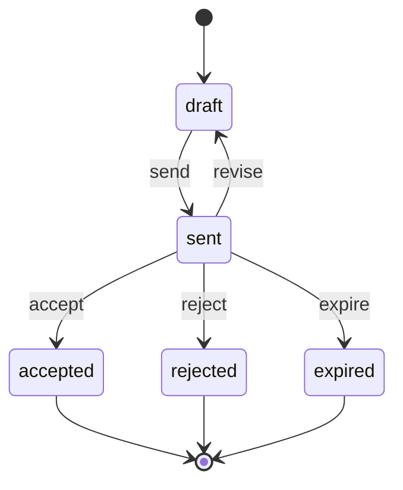
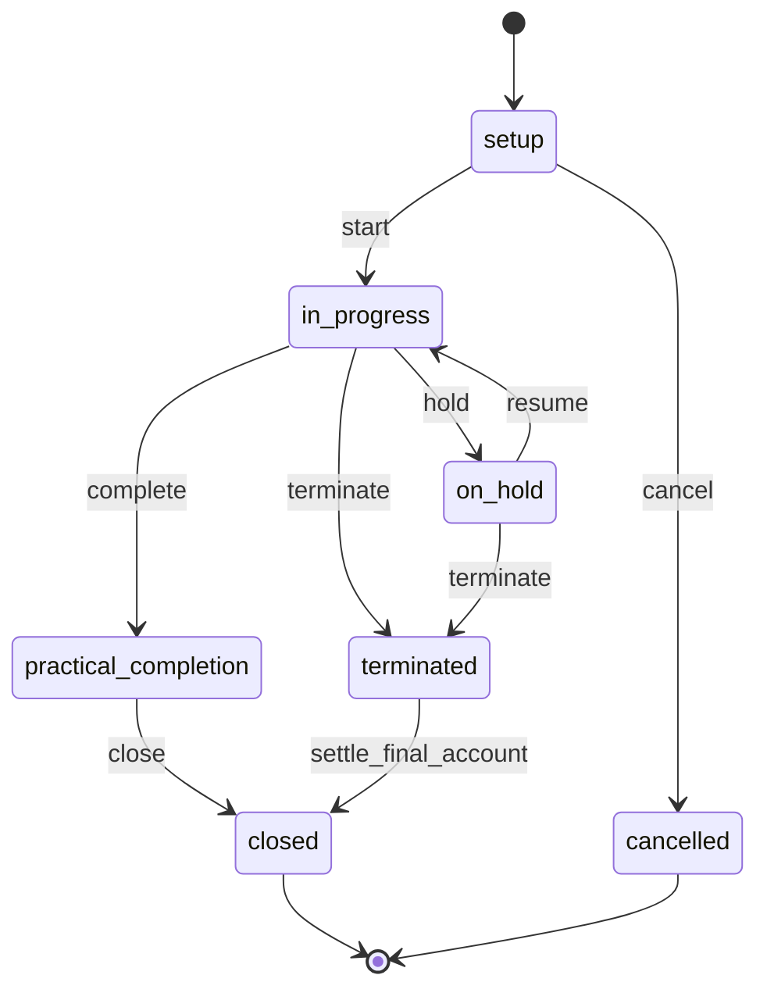
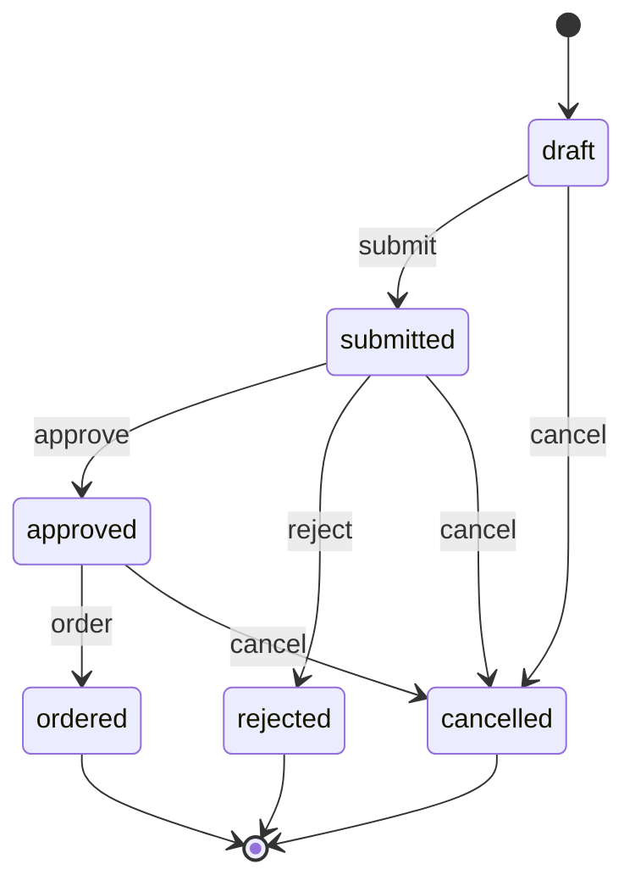
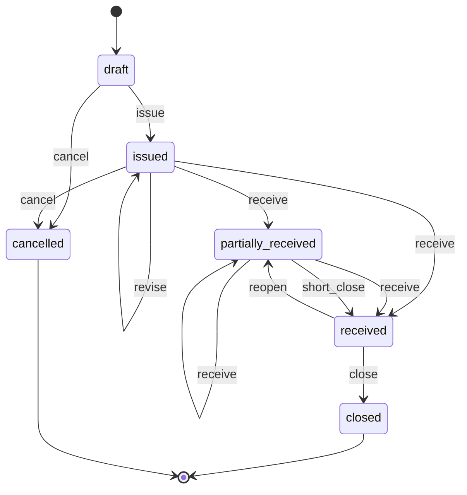
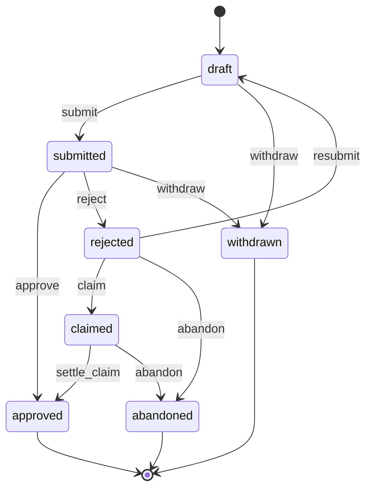
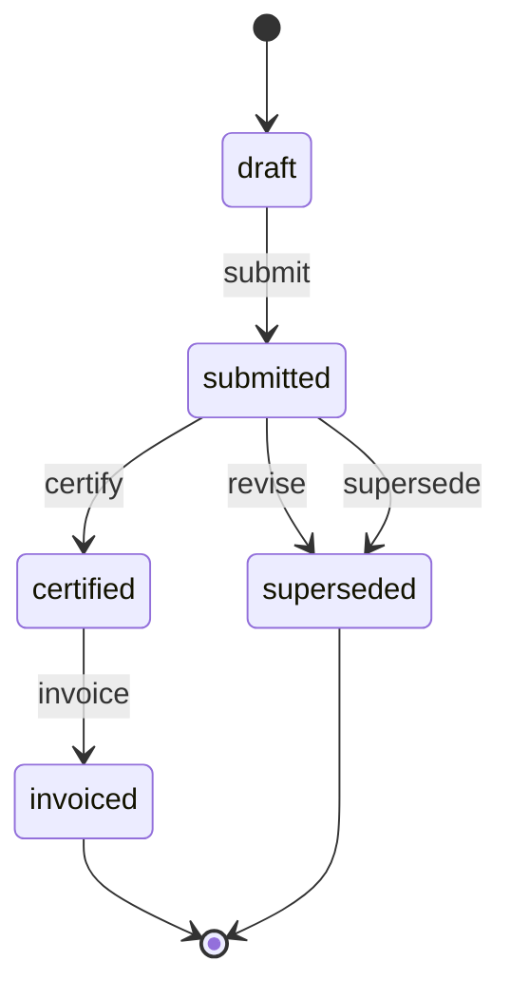
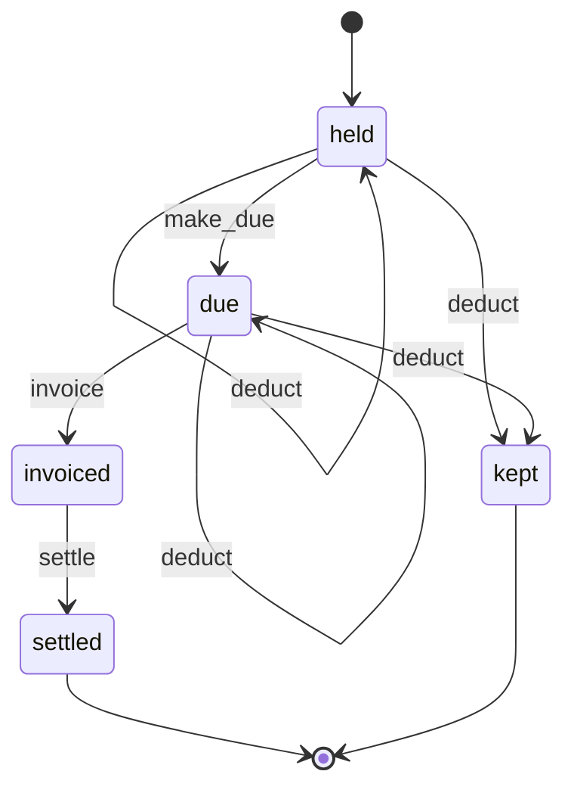
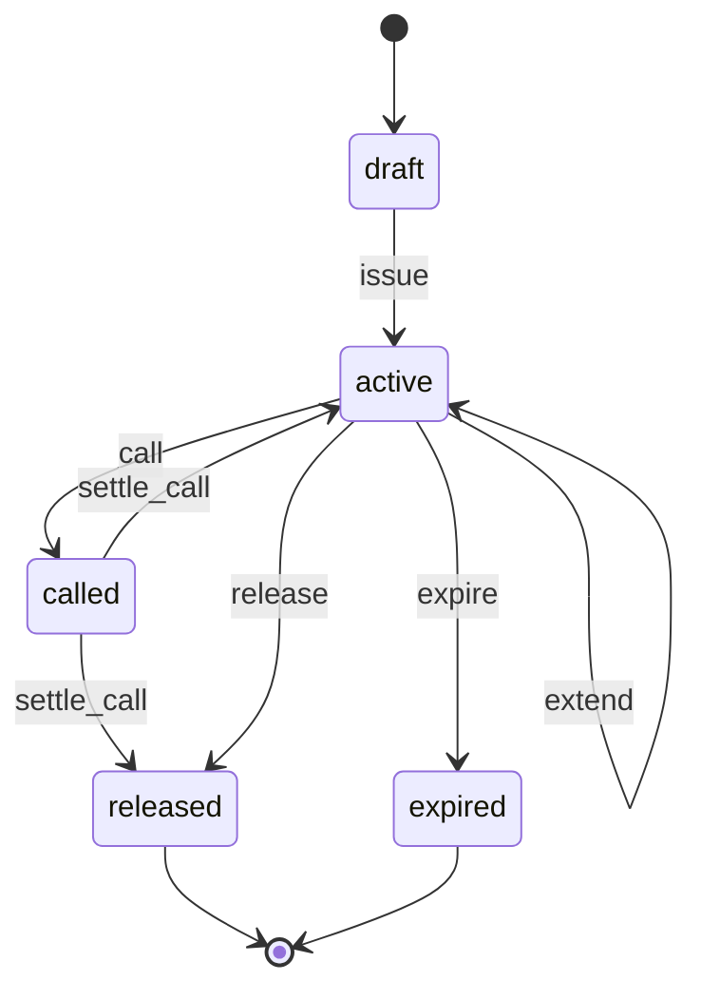
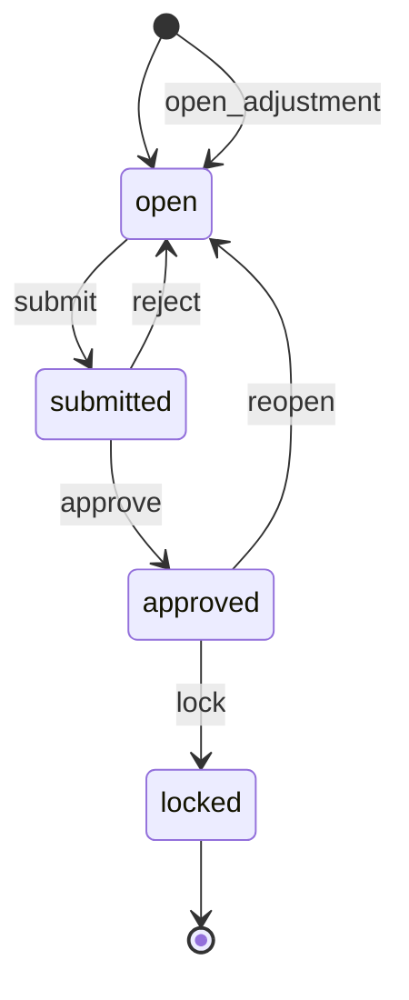

# 02 — Construction & Fit-out Subcontractors

> Status: accepted · Reviewed: 2026-10-15 · Last updated: 2026-10-16

## 1. Summary

Mid-sized subcontractors in the UAE (fit-out, MEP, joinery, facade, civil works) run several
sites at once for main contractors or directly for clients. They lose money between the
site and the office: labour hours and materials are not tied to projects, progress claims
are prepared in Excel, and retentions and variations are forgotten. The app ties attendance,
materials and costs to each project, produces monthly payment applications with retention
and variations, and shows margin and cash per project.

## 2. Business context (UAE)

- **Customer size:** 30–500 workers, 5–40 office staff, 3–20 active projects, contract values
  from AED 200k to AED 50m.
- **How they work today:** BOQs and payment applications in Excel, attendance on paper or a
  biometric device at the camp, material requests by WhatsApp, stores in a notebook, and
  accounting in Tally/Zoho/QuickBooks. Project margin is known only after the project ends.
- **Rules and practice that shape the work:**
  - Work is priced from a **BOQ** (bill of quantities). Awarded by an **LPO** or a
    subcontract agreement.
  - Payment is by monthly **interim payment applications (IPAs)**. The main contractor or
    consultant **certifies** an amount, often lower than claimed, and pays on 60–120 day
    terms, often by post-dated cheque. ✔ "Pay when paid" clauses are common. UAE courts
    treat them as conditions that delay payment rather than cancel it, and a subcontractor
    can defeat one by showing the employer withheld payment because of the main
    contractor's fault; "pay if paid" is read narrowly [S1][S2]. The app tracks when the
    main contractor was paid, where known, against each certified IPA.
  - **Retention** of 5–10% is withheld from each payment. ✔ No law sets it; it is purely
    contractual. Half is usually released at practical completion and half at the end of
    the **defects liability period** (typically 12 months) [S1]. The percentage, cap,
    release split and period are set per project.
  - ✔ **Civil Transactions Law:** Federal Decree-Law 25/2025 replaced the 1985 Civil Code
    from 1 June 2026; contracts signed earlier stay under the old Code. Contracting work
    (*muqawala*) is in Arts. 812–839, and the 10-year decennial liability for structural
    defects is in Arts. 821–824; it does not cover the main contractor's recourse against
    subcontractors, whose liability follows the subcontract [S3].
  - **Advance payments** (10–20%) are secured by an advance payment guarantee and recovered
    pro rata from IPAs. A **performance bond** (often 10%) is held by the client. Both are bank
    guarantees with expiry dates.
  - **Variations (VOs)** must be instructed and approved before they can be claimed.
  - **Labour:** workers are on company visas, live in labour accommodation and are bused to
    sites. Salaries are paid through **WPS**; since 1 June 2026 wages are due by the 1st of
    the following month (Ministerial Resolution 340/2026) [S9]. ✔ A **midday break** applies
    to outdoor work from 12:30 to 15:00, 15 June–15 September, with fines of AED 5,000 per
    worker [S8]. ✔ Normal hours are at most 8 a day; overtime is capped at 2 hours a day and
    paid at least +25%, +50% between 22:00 and 04:00 (Federal Decree-Law 33/2021,
    Arts. 17–19) [S8]. ✔ Employers with 50 or more workers earning AED 1,500 a month or less
    must house them in registered labour accommodation (Ministerial Resolution 44/2022)
    [S7].
  - ✔ **Fit-out approvals:** a landlord or master-developer NOC (e.g. Emaar, Nakheel)
    comes first. The permit then comes from Dubai Municipality on the mainland, Trakhees in
    ports and its free zones, the Dubai Development Authority in TECOM-area communities,
    DIFC or DMCC in their zones, or DMT (via TAMM) in Abu Dhabi; Dubai Civil Defence signs
    off before completion [S5]. No official validity period was found, so each permit is
    recorded with the expiry printed on it.
  - ✔ **Contractor registration:** under Dubai Law 7/2025 (in force 8 January 2026) every
    contractor, including in free zones, must be registered and classified in Dubai
    Municipality's register; contractors must check that their own subcontractors are
    registered, and subcontracting needs approval. Fines reach AED 100,000 [S6].
  - **VAT:** construction services are standard-rated at 5%. ✔ Certification alone does
    not create a tax point; see §9 [S4].

## 3. Users and access

Follows [ACCESS-CONTROL.md](../ACCESS-CONTROL.md). Platform-wide rules (`PLT.ACL.*`) are not
repeated here.

### 3.1 Roles

| Role | Actor type | What they do | Permissions (summary) | Typical scope |
|---|---|---|---|---|
| Company admin / MD | staff | Configures the company; approves large purchases and variations; sees all margins | all | global |
| Project manager | staff | Runs projects: budget, variations, IPAs, handover; approves material requests and timesheets | projects, variations, IPAs, purchase approval, timesheet approval, reports | project |
| Quantity surveyor (QS) | staff | Imports and prices BOQs, measures progress, prepares IPAs and variations | quotations, BOQ, progress, IPAs, variations (prepare) | project or global |
| Site engineer / supervisor | field | Daily site report, crew attendance, material requests, snags | attendance, daily reports, material requests, tickets | project |
| Storekeeper | field | Receives deliveries, issues and transfers materials | goods received, stock movements | site store |
| Procurement officer | staff | Requests quotes, issues purchase orders, follows up deliveries | purchase orders, suppliers | global |
| Accountant | staff | Supplier bills, invoices from certified IPAs, cheques, retentions, guarantees | finance, guarantees, reports | global |
| HR / PRO | staff | Worker records, visas and passes, timesheet export | workers, documents, sensitive HR data | global |
| HSE officer | field | Inspections, toolbox talks, incidents (Later) | checklists, incidents | project |
| Worker | field | Self check-in where the company allows it | own attendance only | project |
| Client / main contractor contact | external | Sees IPAs, certificates, variations, handover documents (Later) | portal: projects | own projects |
| Supplier | external | Sees purchase orders and payment status (Later) | portal: orders | own orders |

### 3.2 Scope

The scope unit is the **project** (one or more sites). Project managers, QSs, supervisors and
HSE officers are assigned per project and can be moved between projects with dated
assignments. A storekeeper's scope is a **site store**. Procurement, accounts and HR are
usually global.

### 3.3 Access rules

| ID | Rule | Pattern | Applies to | Parameter (default) |
|---|---|---|---|---|
| `HRM.ACL.01` *(shared, formerly `CON.ACL.01`)* | A supervisor records attendance only for crews assigned to their project, and only for today or recent days | scope, `TIM` | supervisor | 1 day back |
| `STK.ACL.03` *(shared, formerly `CON.ACL.02`)* | A material request above a threshold needs project manager approval; above a second threshold, the MD | `LIM` | supervisor, project manager | AED 10,000 / AED 50,000 |
| `STK.ACL.01` *(shared, formerly `CON.ACL.03`)* | The user who creates a purchase order cannot approve it | `SOD` | procurement | on |
| `STK.ACL.04` *(shared, formerly `CON.ACL.04`)* | Goods are received only at the receiving site's store; over-receipt beyond a tolerance needs approval | scope, `LIM` | storekeeper | 5% |
| `CON.ACL.05` | A submitted IPA is locked; corrections are made in a new revision | `STA` | QS, project manager | — |
| `CON.ACL.06` | A QS prices a variation; only the project manager submits it to the client | `SOD` | QS, project manager | on |
| `FIN.ACL.08` *(shared, formerly `CON.ACL.07`)* | Budget, cost rates and margin are hidden from site roles | `FLD` | supervisor, storekeeper, worker | — |
| `HRM.ACL.03` *(shared, formerly `CON.ACL.08`)* | Worker salaries, passports and visa documents need `employees.sensitive.view`; each view is audited | `SEN` | all staff | — |
| `HRM.ACL.02` *(shared, formerly `CON.ACL.09`)* | An approved timesheet is locked; changes need the project manager to reopen it | `STA` | supervisor | — |
| `FIN.ACL.03` *(shared, formerly `CON.ACL.10`)* | A supplier bill is approved for payment only after a 3-way match (PO, goods received, bill) within tolerance, otherwise it needs approval | `STA`, `LIM` | accountant | 2% |
| `CON.ACL.11` | A retention release is invoiced only after practical completion (first part) or the end of the defects liability period (rest) is recorded, per the project's release split; a part is also invoiced once an `active` retention bond linked to it replaces it, or once the project's termination effective date is reached (both parts, unless `retention_due_on_termination` is off) | `STA` | accountant | 50:50 |
| `CON.ACL.12` | A client contact sees only IPAs, certificates, variations and handover documents of their own projects | `OWN` | client contact | — |
| `CON.ACL.13` | A purchase order to a subcontractor (a supplier party with the role `subcontractor`) on a Dubai project needs approval when the subcontractor has no valid Dubai Municipality contractor registration on file on the PO date; checked on `issue` and again on each `revise`; the approver is the project manager of the PO's project, never the PO's issuer | `LIM` | procurement, project manager | on for Dubai projects |
| `POR.ACL.01` *(shared)* | After a project's final account is closed, client contacts keep read-only access to its documents, then the portal closes | `TIM` | client contact | closes after 90 days |
| `HRM.ACL.08` *(shared)* | A locked timesheet is never edited or reopened; it is corrected by an adjustment timesheet approved by a project manager who did not create it | `STA`, `SOD` | supervisor, project manager | — |
| `HRM.ACL.09` *(shared)* | Attendance flagged `overtime_cap`, `midday_break`, `permit_invalid` or `overlap` is accepted only by `attendance.review` with a reason, not by the supervisor who marked it | `STA`, `SOD` | supervisor | reviewer: project manager (overtime, midday break, overlap), HR (permit) |
| `HRM.ACL.07` *(shared)* | Reporting a worker as absconded is requested by HR and approved by another user with `employees.exit.approve` | `SOD` | HR / PRO | approver: MD |
| `STK.ACL.06` *(shared)* | A return to supplier above a value needs approval by someone other than its creator | `LIM`, `SOD` | storekeeper, procurement | AED 10,000; approver: project manager |
| `FIN.ACL.15` *(shared)* | Writing off a client's unpaid balance always needs approval by someone other than the requester | `LIM`, `SOD` | accountant | AED 0 (always); approver: MD |
| `CON.ACL.14` | Deductions on a certificate (back-charge, contra-charge, liquidated damages) and deductions from retention are recorded by the QS; the project manager accepts or disputes each one (never the user who recorded it); accepting one above a value, checked per line excluding VAT, needs the MD | `LIM`, `SOD` | QS, project manager | AED 25,000 |
| `CON.ACL.15` | Terminating a project mid-way is requested by the project manager and approved by the MD | `SOD` | project manager | on |
| `CON.ACL.16` | Abandoning a rejected variation or an unsettled claim (its cost stays unrecovered) needs MD approval | `LIM` | project manager | any amount |

## 4. Value streams

### 4.1 Quotation to project

1. An enquiry with drawings arrives from a main contractor or client (`PTY.PTY.01`,
   `DOC.FIL.01`).
2. The BOQ is imported from Excel and priced line by line (`CON.TND.01`).
3. A quotation is issued with validity and terms (`FIN.QUO.01`, `DOC.GEN.01`).
4. On award (LPO or subcontract), the quotation is accepted and a project is created with the
   contract value, the BOQ as baseline, retention %, advance %, payment terms, site location
   and geofence (`CON.PRJ.01`).
5. BOQ lines become cost codes, and a budget is set per cost code (`CON.PRJ.02`,
   `FIN.CST.01`).
6. Guarantees (advance, performance) and permits are recorded with expiry dates
   (`CON.GUA.01`, `CON.PMT.01`, `DOC.EXP.01`).

### 4.2 Labour to cost

1. Crews are assigned to a project (`HRM.ATT.01`).
2. Each day the supervisor marks crew attendance on site, with the location at that moment
   (`HRM.ATT.01`). Where the client allows it, workers check in themselves within the site
   geofence. Without a signal, the supervisor keeps a paper or photographed list and enters
   it later, within the late-entry window (`HRM.ACL.01`).
3. Hours are allocated to cost codes on the timesheet, overtime is flagged, and the
   project manager approves (`HRM.TMS.01`).
4. Approved hours × the trade's fully loaded cost rate (salary, amortised visa costs, camp,
   transport, insurance; normal and overtime rates) become labour cost on the project
   (`FIN.CST.01`). A worker may override the trade rate (e.g. a foreman).
5. Approved timesheets are exported for payroll (`HRM.TMS.01`; WPS file Later, `HRM.WPS.01`).

**When it goes wrong**

| Situation | What happens |
|---|---|
| Hours inside the midday break, or above the overtime cap | In the season the break field of outdoor sites is pre-filled with the break window; removing it, or hours that cross it, flag the record `midday_break`. Hours above 8 + 2 a day across all sites, or overtime above 144 hours in three weeks, flag `overtime_cap` (`HRM.RUL.01`, `HRM.RUL.13`). The HSE officer and project manager are told; a reviewer accepts with a reason (`HRM.ACL.09`), for example an exempt emergency job |
| A worker with an expired visa or work permit is marked present | `HRM.RUL.14` flags the record `permit_invalid`; HR and the supervisor are told the same day. The hours are paid and costed to the project, but the record waits for HR's review (`HRM.ACL.09`). The worker's visa and work permit kinds block `attendance_record.accept` in `flag` mode; 30 days before expiry `DOC.RUL.02` lists the crews affected |
| The same worker is marked on two sites | Both records are flagged `overlap`; timesheet `submit` refuses hours above the attended hours |
| A locked timesheet is wrong | An adjustment timesheet with the difference and a reason (origin `attendance_error` or `payroll_error`), approved by a project manager other than its creator (`HRM.ACL.08`); the cost delta is posted to the cost codes and the payroll export carries the difference |
| A worker stops coming | `CON.RUL.08` opens an absence case for HR after 3 working days without attendance or approved leave. After 7 days HR may report absconding (`report_absconding`, approved by the MD, `HRM.ACL.07`): the worker leaves the crew, payroll lines are held, and the cancellation case starts in wl-hr |
| Attendance entered after the late-entry window | Refused for the supervisor (`HRM.ACL.01`); the project manager enters it with the late-entry flag and a reason (`PLT.ACL.10`) |

### 4.3 Procure to site

1. The supervisor raises a material request against a cost code (`STK.PRQ.01`).
2. It is approved according to the limits (`STK.ACL.03`, `PLT.APR.01`).
3. Procurement requests quotes and issues a purchase order (`STK.PUR.01`).
4. The supplier delivers to the site store, charged to the project on receipt, or to the
   optional central store, charged when issued or transferred to a project. The storekeeper
   records goods received against the PO with the delivery note (`STK.GRN.01`). Imported
   materials are bought in their currency and carry landed cost (`FIN.CUR.01`,
   `STK.LND.01`).
5. Materials are issued from the site store to a cost code, or transferred to another site
   (`STK.MOV.01`, `STK.LOC.01`).
6. The supplier's bill is matched to the PO and goods received, then approved and paid
   (`FIN.PAB.01`, `FIN.ACL.03`, `FIN.PAY.01`, `FIN.CHQ.01`).
7. Committed (PO) and actual (received/issued) costs update the project budget
   (`FIN.CST.01`).
8. Site stores are counted at least once a quarter and before a project closes; approved
   variances become adjustments charged to the project (`STK.CNT.01`, `STK.ACL.02`). No rule
   enforces the quarterly count; the only automatic count is the one project `terminate`
   opens, and closing a project with a count still open shows a warning, not a refusal.

**When it goes wrong**

| Situation | What happens |
|---|---|
| Damaged or wrong materials delivered | The storekeeper records accepted and rejected quantities per line with a reason (`damaged`, `wrong_item`, `quality`, `excess`) and photos. Only accepted quantity enters stock, the PO and the 3-way match. Goods refused at the door create a Return to supplier dispatched at once; goods kept for collection create a draft one. Procurement and the supplier are told |
| Rejected goods must be replaced or credited | Return to supplier lines are `replace` (the PO quantity is outstanding again) or `credit` (a supplier debit note is drafted against the bill, `FIN.RUL.17`). Returns above AED 10,000 need the project manager (`STK.ACL.06`); returns still `dispatched` after 30 days are chased (`STK.RUL.08`) |
| The PO must change after it was issued | PO `revise` with a reason: a new revision is sent to the supplier; a higher total is approved again (`STK.ACL.03`); committed cost is adjusted |
| The supplier cannot deliver the rest | PO `short_close` with a reason; the remaining committed cost is released |
| A goods receipt was posted to the wrong PO or site | Goods receipt `reverse` while the stock is still there and nothing is billed; otherwise a transfer or adjustment |
| The site count differs from the system | Variances above AED 1,000 need approval by someone who did not count (`STK.ACL.02`); losses are charged to the project's cost code for wastage |

### 4.4 Progress to cash

1. At the monthly cut-off, a draft IPA is created per active project (`CON.RUL.03`).
2. The QS records cumulative progress per BOQ line, as quantity or % (`CON.PRG.01`).
3. The IPA calculates: work done to date + approved variations − retention − advance
   recovery − previous certified = amount due this period (`CON.IPA.01`). *Previous
   certified* is the cumulative certified amount of the latest IPA that is `certified` or
   `invoiced`; an IPA still waiting for its certificate is never counted.
4. The project manager submits it, with a PDF and supporting photos (`DOC.GEN.01`).
5. The certified amount is recorded when the certificate arrives: the amount the client
   certifies for the work before its deductions, which are separate typed lines. The difference
   from the claim compares the claim with the certified work, not with the net paid
   (`CON.IPA.02`).
6. A tax invoice is issued for the certified amount of work (`FIN.INV.01`). Retention is not
   invoiced here; it follows its own lifecycle (§7.1 Retention).
7. Payment arrives, often as a post-dated cheque, and is allocated (`FIN.PAY.01`,
   `FIN.CHQ.01`, `FIN.REC.01`).

**When it goes wrong**

| Situation | What happens |
|---|---|
| The previous IPA is not certified at the next cut-off | `CON.RUL.03` still creates the draft, marked *previous pending*, and tells the QS and project manager. The new IPA can be submitted only as a replacement of the pending one, which becomes `superseded` and the client is told; a certificate that arrives later for the superseded IPA is recorded on the one that replaced it. `CON.RUL.04` keeps chasing the certificate |
| The client deducts back-charges, contra-charges or liquidated damages from a certificate | Each deduction is a typed line on the certificate (`back_charge`, `contra_charge`, `liquidated_damages`, `other`) with its reference, which the project manager accepts or disputes (`CON.ACL.14`). Accepted back- and contra-charges for goods, services or labour the client supplied are recorded as a supplier bill from the client and set off against the IPA invoice (a payment of method `set_off` in wl-payments, allocated to both and moving no money); accepted liquidated damages and price reductions, and accepted lines of type `other` (which need a description), are a credit note against the IPA invoice (VAT treatment of liquidated damages `⚠ open: accountant (A-07)`). A disputed deduction stays on the IPA as *contested*, the unpaid part of the invoice is flagged `disputed`, and it is carried into the final account |
| The client certifies less than claimed | The gap is tracked per IPA; the unclaimed work stays in the cumulative valuation of the next IPA |
| A client cheque bounces | Cheque `bounce`, follow-up as in wl-payments (re-present, replace, legal case, write-off). No bounce fee in 02 by default. The project manager is told and decides whether to slow or suspend work under the contract (suspension rights `⚠ open: lawyer (L-37)`) |
| The client disputes an invoice | Invoice `dispute`: reminders pause; the dispute ends `upheld` or `credited`; `FIN.RUL.15` escalates after 14 days |
| A debt is uncollectable (for example the main contractor is insolvent) | Invoice `write_off` with the MD's approval (`FIN.ACL.15`); bad-debt VAT relief proposed when its conditions are met (`FIN.RUL.14`) |
| An e-invoice is rejected by the ASP (from 2027) | The invoice stands; a task to correct and resend (`FIN.RUL.16`); content errors are corrected by credit note and a new invoice |

### 4.5 Variation

1. A site instruction or client request for extra, omitted or changed work is recorded with
   photos and the instruction reference (`CON.VAR.01`). Its kind is `addition`, `omission`
   or `time` (an extension of time). Work executed on a site instruction before approval is
   marked as such, and its cost is booked on the variation's own cost code.
2. The QS prices it from BOQ rates or new rates; an extension of time states the days asked
   and the delay event.
3. The project manager submits it to the client (`CON.ACL.06`), within the contract's notice
   period for the event when the contract sets one (`CON.RUL.10`).
4. Once approved, the amount is added to the contract value (or deducted, for an omission),
   the budget and the next IPA; an approved extension moves the completion date
   (`CON.VAR.01`, `FIN.CST.01`).

**When it goes wrong**

| Situation | What happens |
|---|---|
| The client does not answer | `CON.RUL.09` reminds the project manager after 14 days and escalates to the MD after 30 |
| The client rejects a variation already executed on a site instruction | The cost stays on the variation's cost code, marked unrecovered. The project manager resubmits it with more evidence or a new price, or turns it into a claim for the final account (`claim`); abandoning it needs the MD (`CON.ACL.16`) |
| The client approves less than priced | The approved amount is recorded; the gap shows in the variation report |
| An omission covers work already done | The omitted quantity cannot exceed what is not yet done; work already done stays in the valuation, or becomes a claim |
| The notice period for an extension of time is about to lapse | `CON.RUL.10` warns the project manager before the contract's period ends; a notice sent late is recorded with its date |

### 4.6 Handover and defects liability

1. A snag list is walked with the client and recorded as checklist items and tickets
   (`WRK.CHK.01`, `WRK.TKT.01`).
2. Snags are fixed and closed with photos (`WRK.TKT.03`).
3. Practical completion is recorded with the handover certificate. The defects liability
   period starts (`CON.HND.01`).
4. The first half of the retention becomes due and is invoiced (`CON.RET.01`, `FIN.INV.01`).
5. Defects reported during the defects liability period are handled as tickets
   (`WRK.TKT.01`).
6. At its end, the final retention is invoiced and the performance bond is released
   (`CON.RET.01`, `CON.GUA.01`).

**When it goes wrong**

| Situation | What happens |
|---|---|
| The client keeps part or all of the retention for defects it fixed itself | Before the retention is invoiced: retention `deduct` with the client's notice; the amount is booked to the project's back-charge cost code and no tax document is issued, because nothing was invoiced; when nothing remains the retention part is `kept`. After it was invoiced: the invoice is disputed and the agreed amount is a credit note (`credited`). Each deduction is accepted or disputed by the project manager (`CON.ACL.14`) |
| The client disputes or delays the retention release | The part stays `due`; the accountant still issues the retention invoice before the one-year limit (`CON.RUL.07`) unless the accountant decides otherwise; a disputed invoice follows invoice `dispute` |
| Retention is replaced by a bond | A guarantee of type *retention bond* is recorded; the retention part becomes `due` and is invoiced; the bond is released at the end of the defects liability period |
| A guarantee is about to expire before it may be released | `CON.RUL.11` gives the accountant a task 60 days before expiry to extend it; the client may call a guarantee that is not extended |
| The client calls a guarantee | Guarantee `call` with the demand notice: the MD, project manager and accountant are told at once; the amount paid by the bank is booked to the project and, when disputed, carried as a claim in the final account. A call the beneficiary withdraws before payment is closed by `settle_call` with amount paid 0 and the withdrawal letter, and the guarantee is `active` again |

### 4.7 Daily site report

1. The supervisor files a daily report: manpower by trade, work done by cost code, photos,
   materials received, issues and delays (`CON.DSR.01`).
2. The project manager reviews it. Delays and issues feed the weekly client report.

### 4.8 Project stops early

1. The client terminates the subcontract, the main contractor becomes insolvent, or both
   sides agree to stop. The project manager records the termination with the notice and the
   effective date; the MD approves (`CON.ACL.15`).
2. The effective date is the last working day: from the day after it attendance stops and
   crews are released to other projects (their assignments end on the effective date); open
   purchase requests are cancelled; issued POs are cancelled or short-closed with the
   supplier.
3. The site store is counted. Each material is transferred to another site or the central
   store, returned to the supplier, or listed as *materials on site* for the final account
   (`STK.CNT.01`, `STK.MOV.01`).
4. A final account IPA is prepared: work done to the effective date, materials on site,
   approved variations, open claims and termination costs (`CON.IPA.01`). Both retention
   parts become due, unless the contract says otherwise (`⚠ open: lawyer (L-37)`).
5. Guarantees are followed up: the advance guarantee reduced to the unrecovered advance, the
   performance bond released or called (`CON.GUA.01`).
6. Open snags and defect tickets are cancelled with the reason. When the final account is
   agreed and invoiced, the project closes and the client portal turns read-only
   (`POR.ACL.01`).
7. If the main contractor is insolvent, open invoices are disputed or written off with the MD's
   approval; filing a claim with the liquidator is outside the platform (`⚠ open: lawyer (L-37)`).

## 5. Capabilities

| ID | Capability | Shared or specific | Proposed module | Scope |
|---|---|---|---|---|
| `PLT.ORG.01` | Branded deployment | shared | wl-kernel | MVP |
| `PLT.USR.01` | Staff users, roles, permissions scoped per project | shared | Renox Permissions | MVP |
| `PLT.AUD.01` | Audit trail | shared | Renox Audit | MVP |
| `PLT.APR.01` | Approval requests (material requests, POs, variations) | shared | wl-kernel | MVP |
| `PLT.WFL.01` | State machines with history | shared | Renox (R12) + wl-kernel | MVP |
| `PLT.ATM.01` | Default automation rules | shared | wl-kernel | MVP |
| `PLT.HOK.01` | Outbound webhooks | shared | Renox (R11) | Later |
| `PTY.PTY.01` | Parties: clients, main contractors, consultants, suppliers | shared | wl-parties | MVP |
| `PTY.KYC.01` | Identity fields: trade licence, TRN, Emirates ID, passport | shared | wl-parties | MVP |
| `DOC.FIL.01` | Attach documents to any record (drawings, LPOs, certificates) | shared | wl-documents | MVP |
| `DOC.EXP.01` | Expiry reminders (guarantees, permits, insurance, worker passes, visas, ISO certificates, trademark) | shared | wl-documents | MVP |
| `DOC.GEN.01` | Generate documents (quotation, IPA, variation, daily report) | shared | wl-documents | MVP |
| `FIN.QUO.01` | Quotations with lines, validity, terms; accepted → order or project | shared (**new**) | wl-invoicing | MVP |
| `FIN.CST.01` | Cost objects and job costing: budget vs committed vs actual per cost code | shared (**new**) | wl-invoicing | MVP |
| `FIN.INV.01` | Tax invoices with VAT | shared | wl-invoicing | MVP |
| `FIN.PAY.01` | Record and allocate payments | shared | wl-payments | MVP |
| `FIN.CHQ.01` | Post-dated cheque register (received and issued) | shared | wl-payments | MVP |
| `FIN.REC.01` | Receivables ageing and reminders | shared | wl-invoicing | MVP |
| `FIN.PAB.01` | Supplier bills with 3-way match | shared | wl-invoicing | MVP |
| `FIN.EXT.01` | Export to accounting software | shared | wl-invoicing | Later |
| `WRK.TKT.01` | Raise tickets (snags, defects) | shared | wl-ticketing | MVP |
| `WRK.TKT.02` | Triage and assignment | shared | wl-ticketing | MVP |
| `WRK.TKT.03` | Field updates with photos and sign-off | shared | wl-ticketing | MVP |
| `WRK.CHK.01` | Checklists with photos and signature (snag walks, QC, HSE) | shared | wl-ticketing | MVP |
| `POR.SLF.01` | External self-service portal (client contact) | shared | wl-portal | Later |
| `NTF.MSG.01` | Email notifications | shared | wl-notify | MVP |
| `NTF.MSG.02` | WhatsApp notifications | shared | wl-notify | Later |
| `RPT.DSH.01` | Role-based dashboards | shared | Renox charts + wl-kernel | MVP |
| `HRM.ATT.01` | Attendance: crew marking by supervisor (default), with late entry for days without signal; self check-in within a geofence where the client allows it | shared (**new**) | wl-attendance | MVP |
| `HRM.TMS.01` | Timesheets allocated to cost objects, overtime, approval, export | shared (**new**) | wl-attendance | MVP |
| `HRM.EMP.01` | Worker and staff records: trade, documents, visa and ID expiry | shared | wl-hr | MVP |
| `HRM.PAY.01` | Payroll calculation (feeds the WPS file) | shared | wl-hr | Later |
| `HRM.WPS.01` | WPS salary file (SIF) export | shared (**new**) | wl-hr | Later |
| `STK.ITM.01` | Item catalogue with units of measure | shared (**new**) | wl-inventory | MVP |
| `STK.LOC.01` | Stock per location (site stores, optional central store) | shared (**new**) | wl-inventory | MVP |
| `FIN.CUR.01` | Multi-currency purchases with exchange rates (client invoices stay in AED) | shared | wl-invoicing | MVP |
| `STK.LND.01` | Landed cost: freight, duty and clearing spread over received materials | shared | wl-inventory | MVP |
| `STK.MOV.01` | Stock movements: receive, issue to cost code, transfer, adjust | shared (**new**) | wl-inventory | MVP |
| `STK.PRQ.01` | Purchase requests with approval | shared (**new**) | wl-inventory | MVP |
| `STK.PUR.01` | Purchase orders to suppliers | shared (**new**) | wl-inventory | MVP |
| `STK.GRN.01` | Goods received against a PO, with delivery note | shared (**new**) | wl-inventory | MVP |
| `STK.CNT.01` | Stock counts with variance and approved adjustment (site stores, before a project closes or stops) | shared | wl-inventory | MVP |
| `STK.AST.01` | Asset register: equipment and tools, location, assignment, service due | shared (**new**) | wl-inventory | Later |
| `PLT.ENT.01` | Legal entities: several trade licences and TRNs in one deployment; issuer on every document | shared | wl-kernel | MVP |
| `PLT.IMP.01` | Data import and migration: Excel templates per entity, validation, dry run, rollback | shared | wl-kernel | MVP |
| `PLT.SRC.01` | Global search across records, including Arabic names | shared | wl-kernel + Renox search | MVP |
| `PLT.NOT.01` | Notes, comments and @mentions on any record, with an activity timeline | shared | wl-kernel | MVP |
| `PLT.SSO.01` | Staff single sign-on with Microsoft 365 or Google Workspace | shared | Renox OAuth (renox-oauth) | Later |
| `RPT.LIB.01` | Report library: filtered reports with export to Excel, CSV and PDF | shared | wl-kernel | MVP |
| `RPT.SCH.01` | Scheduled reports sent by email | shared | wl-kernel | Later |
| `FIN.VAT.01` | VAT summary per period and entity: output and input VAT, for the accountant | shared | wl-invoicing | MVP |
| `FIN.EXP.01` | Expense claims and petty cash: submit with receipt, approve, reimburse, top up | shared | wl-payments | MVP |
| `FIN.BNK.01` | Bank statement import and matching of receipts to open invoices | shared | wl-payments | Later |
| `SAL.CRM.01` | Leads and enquiries pipeline (tenders and enquiries from main contractors) | shared | wl-sales | MVP |
| `SAL.CRM.02` | Lead sources and campaigns: cost per campaign, conversion by source and channel, cost per lead, customer acquisition cost and return on ad spend | shared | wl-sales | MVP |
| `FIN.CFL.01` | Cash-flow forecast: expected receipts and payments by week from invoices, supplier bills, scheduled charges, post-dated cheques, payroll and budgets | shared | wl-invoicing | MVP |
| `STK.SUP.01` | Supplier scorecard and alternative suppliers: on-time delivery, rejected quantity, NCRs, price variance; preferred and alternative suppliers per item | shared | wl-inventory | MVP |
| `FIN.BUD.01` | Company budget vs actual by period, category and entity; owner drawings kept apart from operating cost | shared | wl-invoicing | MVP |
| `HRM.ONB.01` | Staff onboarding checklists per role and a library of SOP documents with acknowledgement | shared | wl-hr + wl-documents | MVP |
| `CON.TND.01` | BOQ import from Excel and pricing per line | specific | apps/construction | MVP |
| `CON.PRJ.01` | Project: contract value, terms, retention %, advance %, sites, geofence | specific | apps/construction | MVP |
| `CON.PRJ.02` | Cost codes from BOQ lines | specific | apps/construction | MVP |
| `CON.PRG.01` | Progress measurement per BOQ line | specific | apps/construction | MVP |
| `CON.IPA.01` | Interim payment applications: cumulative claim, variations, retention, advance recovery (pro rata by default, or a fixed % per IPA from IPA N; manual override with a reason) | specific | apps/construction | MVP |
| `CON.IPA.02` | Certification: certified vs claimed | specific | apps/construction | MVP |
| `CON.VAR.01` | Variations: record, price, submit, approve | specific | apps/construction | MVP |
| `CON.RET.01` | Retention tracking and release | specific | apps/construction | MVP |
| `CON.GUA.01` | Bank guarantees and bonds register | specific | apps/construction | MVP |
| `CON.PMT.01` | Authority and landlord permits / NOCs | specific | apps/construction | Later |
| `CON.DSR.01` | Daily site report | specific | apps/construction | MVP |
| `CON.HND.01` | Practical completion, handover certificate, defects liability period | specific | apps/construction | MVP |
| `CON.SUB.01` | Submittals and RFIs with the consultant (transmittals) | specific | apps/construction | Later |
| `CON.SBC.01` | Payment applications from own subcontractors (payable side) | specific | apps/construction | Later |
| `CON.HSE.01` | HSE: toolbox talks, incidents, permits to work | specific | apps/construction | Later |
| `CON.RPT.01` | Project cost report and margin forecast; cash: claimed vs certified vs received | specific | apps/construction | MVP |

*New* = a shared capability first needed by this vertical.

## 6. Key entities

| Entity | Description | Important fields | Owned by |
|---|---|---|---|
| Quotation | Priced offer | party, lines (from BOQ), validity, terms, status | wl-invoicing |
| Project | An awarded contract | client, main contractor, consultant, contract value, retention %, cap and release split, retention due on termination (`retention_due_on_termination`, default yes, `⚠ open: lawyer (L-37)`), defects liability period, advance % and recovery method, payment terms, notice period for delay events, sites, geofence, dates, termination (reason, notice, effective date), status | apps/construction |
| BOQ line / cost code | One item of work | section, description, unit, quantity, rate, amount, budget | apps/construction |
| Site | A physical location | project, address, geofence polygon, store | apps/construction |
| Worker | A field employee | party, trade, cost rate override, visa and ID documents, crew | wl-hr (+ wl-parties); crews in wl-attendance |
| Trade rate | Fully loaded labour cost per trade | trade, salary basis, visa amortisation, camp, transport, insurance, normal and overtime hourly rates, validity | apps/construction |
| Crew | Group of workers | foreman, project assignment | wl-attendance |
| Attendance | Presence for a day | worker, site, in/out, method (supervisor/self), location | wl-attendance |
| Timesheet | Hours for a period | worker or crew, entries by cost code, overtime, status | wl-attendance |
| Item | Material or consumable | code, name, unit, category | wl-inventory |
| Stock movement | Quantity change | item, from/to location, cost code, quantity, reference | wl-inventory |
| Purchase request | Need from site | project, cost code, lines, needed by, status | wl-inventory |
| Purchase order | Order to supplier | supplier, lines, delivery site, dates, status | wl-inventory |
| Goods received | Delivery recorded | PO, lines, delivery note, store | wl-inventory |
| Supplier bill | Supplier invoice | supplier, PO, lines, VAT, match result | wl-invoicing |
| Variation | Change to scope or time | project, kind (one per variation: addition, omission, time; an addition with an extension of time is two variations linked by the same instruction), description, site instruction reference, executed before approval (yes/no), own cost code, priced amount, approved amount, days asked and granted, event date and notice date, notice late (marker), revision, resubmitted as (revision), status | apps/construction |
| IPA | Interim payment application | project, period, kind (interim, final account), revision, replaces (pending IPA), lines (cumulative), variations, retention, advance recovery, claimed, certified (the work, before deductions), deduction lines (type, reference, amount, accepted or contested), status | apps/construction |
| Retention | Held amount, one record per release part (first, final) | project, part, % and amount held, deductions (reason, notice, cost code), retention invoice, replaced by bond, dates, status | apps/construction |
| Guarantee | Bank guarantee or bond | type (advance, performance, retention bond), bank, beneficiary, amount, expiry, amendments, call (date, notice, amount, paid), project, status | apps/construction |
| Daily report | Site diary | project, date, manpower, work done, photos, issues | apps/construction |

## 7. Workflow

Follows [WORKFLOW.md](../WORKFLOW.md). **Invoice, cheque and ticket** (snags, defects) reuse
the module state machines shown in [01-property.md](01-property.md#71-state-machines), with
these 02 settings: write-off always approved by the MD (`FIN.ACL.15`); client disputes
recorded by staff (portal Later); no bounce fee; at most 2 presentations of a bounced cheque;
snag and defect tickets are never chargeable; payment method *set-off* enabled (wl-payments
"Payment methods enabled"), for back- and contra-charges set off against an IPA invoice.

### 7.1 State machines

#### Quotation *(shared — wl-invoicing)*

> **Canonical definition:** *Quotation* in [`wl-invoicing` §4](../modules/wl-invoicing.md#4-lifecycles). This section is this vertical's original requirement; where it differs, the module definition wins and its vertical mapping table records the difference.

| State | Tone | Terminal | Meaning |
|---|---|---|---|
| `draft` | neutral | no | Being priced |
| `sent` | info | no | Issued to the party |
| `accepted` | success | yes | Awarded; converted into a project or order |
| `rejected` | neutral | yes | Lost |
| `expired` | neutral | yes | Validity passed without an answer |

| Transition | From | To | By | Guards | Effects |
|---|---|---|---|---|---|
| `send` | draft | sent | `quotations.send` | lines priced; validity set | PDF generated; number assigned |
| `revise` | sent | draft | `quotations.create` | — | new revision; old revision kept |
| `accept` | sent | accepted | `quotations.accept` | award document (LPO) attached | event `QuotationAccepted` → project created |
| `reject` | sent | rejected | `quotations.create` | reason given | — |
| `expire` | sent | expired | system | validity date passed | — |

#### Project

| State | Tone | Terminal | Meaning |
|---|---|---|---|
| `setup` | neutral | no | Created from an accepted quotation; budget and team being set |
| `in_progress` | info | no | Work on site |
| `on_hold` | warning | no | Suspended by the client or us |
| `practical_completion` | success | no | Handed over; defects liability period running |
| `terminated` | warning | no | Stopped before completion; final account being agreed |
| `closed` | success | yes | Defects liability period ended and final retention invoiced, or the final account after a termination agreed and invoiced |
| `cancelled` | neutral | yes | Cancelled before work started |

| Transition | From | To | By | Guards | Effects |
|---|---|---|---|---|---|
| `start` | setup | in_progress | `projects.manage` | budget set; at least one site with geofence | attendance and IPAs enabled |
| `hold` | in_progress | on_hold | `projects.manage` | reason given | attendance blocked |
| `resume` | on_hold | in_progress | `projects.manage` | — | — |
| `complete` | in_progress | practical_completion | `projects.manage` | handover certificate attached; no open snags marked blocking | defects liability end date set; first retention part `make_due` |
| `close` | practical_completion | closed | `projects.manage` | defects liability end date passed; no open defect tickets; a site store count still open is a warning, not a guard | final retention part `make_due`; performance bond release task (one per `active` performance or retention bond) |
| `terminate` | in_progress, on_hold | terminated | `projects.cancel` | `CON.ACL.15`; reason (terminated by the client, for our default, main contractor insolvent, agreed), termination notice and effective date recorded | the effective date is the last working day: attendance blocked from the day after it (an effective date in the past is allowed: attendance already recorded after it is kept, flagged for the project manager's review and stays costed until accepted or adjusted); crew assignments end on the effective date, so crews work until then (task to reassign created on approval); open purchase requests without a PO cancelled; one task to procurement to cancel or short-close open POs; site store count opened (`STK.CNT.01`); final account IPA drafted (a `draft` IPA of the project becomes it, valued to the effective date; an IPA still `submitted` stays and is certified normally); both retention parts `make_due` unless `retention_due_on_termination` is off; guarantee follow-up tasks; open snags and defects cancelled with the reason; client contact told; event `ProjectTerminated` |
| `settle_final_account` | terminated | closed | `projects.manage` | final account certified, or decided by a court or arbitration and recorded (as the final account IPA's certificate, with the judgment attached); final account IPA invoiced, or its balance written off; open retention parts, guarantees and a site store count still open are warnings, not guards (they keep their own lifecycles) | client portal read-only (`POR.ACL.01`) |
| `cancel` | setup | cancelled | `projects.cancel` (MD) | reason given; no attendance, goods receipt or IPA recorded | open POs flagged for cancellation |

#### Purchase request *(shared — wl-inventory)*

> **Canonical definition:** *Purchase request* in [`wl-inventory` §4](../modules/wl-inventory.md#4-lifecycles). This section is this vertical's original requirement; where it differs, the module definition wins and its vertical mapping table records the difference.

| State | Tone | Terminal | Meaning |
|---|---|---|---|
| `draft` | neutral | no | Being written by site |
| `submitted` | info | no | Waiting for approval |
| `approved` | success | no | Can be ordered |
| `ordered` | success | yes | Covered by one or more POs |
| `rejected` | neutral | yes | Not approved |
| `cancelled` | neutral | yes | Withdrawn |

| Transition | From | To | By | Guards | Effects |
|---|---|---|---|---|---|
| `submit` | draft | submitted | `purchase_requests.create` | project and cost code set | approvers notified |
| `approve` | submitted | approved | `purchase_requests.approve` | `STK.ACL.03` limits | procurement notified |
| `reject` | submitted | rejected | `purchase_requests.approve` | reason given | requester notified |
| `order` | approved | ordered | system (PO `issue`) | all lines on issued POs | — |
| `cancel` | draft, submitted, approved | cancelled | requester or `purchase_requests.approve` | no PO issued | — |

#### Purchase order *(shared — wl-inventory)*

> **Canonical definition:** *Purchase order* in [`wl-inventory` §4](../modules/wl-inventory.md#4-lifecycles). This section is this vertical's original requirement; where it differs, the module definition wins and its vertical mapping table records the difference. Goods receipts record accepted and rejected quantities, and rejected goods go back through a Return to supplier, as defined in the module.

| State | Tone | Terminal | Meaning |
|---|---|---|---|
| `draft` | neutral | no | Being prepared |
| `issued` | info | no | Sent to the supplier |
| `partially_received` | info | no | Some lines delivered |
| `received` | success | no | All lines delivered, or short-closed |
| `closed` | success | yes | Received and billed |
| `cancelled` | neutral | yes | Cancelled before delivery |

| Transition | From | To | By | Guards | Effects |
|---|---|---|---|---|---|
| `issue` | draft | issued | `purchase_orders.issue` | `STK.ACL.01` (SoD); supplier, prices and delivery site set; Dubai subcontractor registration (`CON.ACL.13`) | PDF sent to supplier; committed cost added to budget |
| `revise` | issued, partially_received | unchanged | `purchase_orders.issue` | reason given; no line below its accepted quantity; a higher total is approved again (`STK.ACL.03`) | new revision sent to the supplier; committed cost adjusted |
| `receive` | issued, partially_received | partially_received, received | system (goods received) | `STK.ACL.04` tolerance on accepted quantity | stock and actual cost updated for accepted quantity only |
| `reopen` | received | partially_received | system (Return to supplier with replacement) | not `closed` | returned quantity outstanding again |
| `short_close` | partially_received | received | `purchase_orders.issue` | reason given | remaining committed cost released; supplier informed |
| `close` | received | closed | system (supplier bill matched) | — | — |
| `cancel` | draft, issued | cancelled | `purchase_orders.issue` | nothing received; supplier informed | committed cost released |

#### Variation

| State | Tone | Terminal | Meaning |
|---|---|---|---|
| `draft` | neutral | no | Recorded from a site instruction; being priced |
| `submitted` | info | no | Sent to the client |
| `approved` | success | yes | Approved (possibly for a different amount) |
| `rejected` | error | no | Not accepted; if the work was executed, its cost is unrecovered until resubmitted, claimed or abandoned |
| `claimed` | warning | no | Pursued as a claim in the final account |
| `abandoned` | neutral | yes | Given up; its cost stays unrecovered |
| `withdrawn` | neutral | yes | Withdrawn by us |

| Transition | From | To | By | Guards | Effects |
|---|---|---|---|---|---|
| `submit` | draft | submitted | `variations.submit` (project manager) | priced (time: days asked and delay event); `CON.ACL.06`; omission: omitted quantity not above the quantity not yet done (from the latest recorded progress: the draft IPA if any, else the latest submitted or certified IPA) | PDF generated; notice date set; when after the contract's notice deadline (`CON.RUL.10`), the variation is marked *notice late* (not refused) |
| `approve` | submitted | approved | `variations.record` | approved amount (or days) and client reference recorded | contract value, budget and next IPA updated (an omission reduces them); time: completion date moved; an omission that now exceeds the quantity not yet done is still approved and the QS is warned to record the excess as a claim |
| `reject` | submitted | rejected | `variations.record` | reason recorded | executed work: its cost stays on the variation's cost code, marked unrecovered; QS and project manager notified |
| `resubmit` | rejected | draft | `variations.submit` | — | new revision; the rejected one kept read-only, shown as "resubmitted as rev n+1", and can no longer be claimed or abandoned |
| `claim` | rejected | claimed | `variations.submit` | work executed on a site instruction | listed in the project's claims for the final account |
| `settle_claim` | claimed | approved | `variations.record` | agreed amount and client reference recorded | as `approve` |
| `abandon` | rejected, claimed | abandoned | `variations.submit` | `CON.ACL.16` (MD) | cost written into the project's unrecovered variations |
| `withdraw` | draft, submitted | withdrawn | `variations.submit` | — | — |

#### IPA (interim payment application)

| State | Tone | Terminal | Meaning |
|---|---|---|---|
| `draft` | neutral | no | Progress being measured |
| `submitted` | info | no | Sent; locked (`CON.ACL.05`) |
| `certified` | success | no | Certificate received; certified amount and deductions recorded |
| `invoiced` | success | yes | Tax invoice issued for the certified amount |
| `superseded` | neutral | yes | Replaced by a new revision, or by a later IPA, before certification |

| Transition | From | To | By | Guards | Effects |
|---|---|---|---|---|---|
| `submit` | draft | submitted | `ipas.submit` (project manager) | progress recorded for the period; no earlier IPA of the project still `submitted`, unless this one replaces it | PDF with photos generated; a replaced IPA `supersede`, and the client told |
| `revise` | submitted | superseded | `ipas.prepare` | — | new `draft` revision created from this one |
| `supersede` | submitted | superseded | system (a later IPA `submit` that replaces it) | — | a certificate arriving later for it is recorded on the replacing IPA; when that one is already `certified`, it is attached for reference only, no amounts change, and the QS is told |
| `certify` | submitted | certified | `ipas.certify` | certified amount (the work, before deductions) and certificate attached; each deduction line typed and accepted or contested (`CON.ACL.14`); lines editable until `certify` | difference from claim recorded; contested deductions listed for the final account |
| `invoice` | certified | invoiced | `invoices.issue` | — | tax invoice created for the certified work (`FIN.INV.01`); retention added to the held retention parts; advance recovery booked; accepted back- and contra-charges recorded as a supplier bill from the client (no PO match; approved by the accountant) and, once it is approved, set off by the accountant with a payment of method `set_off` (wl-payments); accepted liquidated damages, price reductions and `other` lines issued as a credit note against the invoice; the unpaid part for contested deductions flagged `disputed` |

*Previous certified* in the IPA calculation is the cumulative certified amount of the latest
IPA in `certified` or `invoiced`.

#### Retention

One record per release part (first and final, per the project's release split). Retention is
not invoiced on the IPA invoice; VAT is due on a separate retention invoice (§9). Each IPA
`invoice` withholds retention % × the period's certified work and adds it to the parts per the
release split, until the total withheld on the project reaches its cap (an amount in AED; no
cap when empty). The IPA that reaches the cap withholds only the rest up to the cap, and later
IPAs withhold nothing (the accountant is notified once when the cap is reached). The withheld
amount is split per the release split whatever its size, rounded half up to 0.01 AED with the
remainder cent to the final part, so at the cap the parts hold cap × split exactly.

| State | Tone | Terminal | Meaning |
|---|---|---|---|
| `held` | info | no | Withheld on certified IPAs; no tax document yet |
| `due` | warning | no | Release condition met; to be invoiced |
| `invoiced` | info | no | Retention tax invoice issued; follows the invoice lifecycle |
| `settled` | success | yes | Retention invoice paid, credited or written off |
| `kept` | neutral | yes | Kept in full by the client before it was invoiced |

| Transition | From | To | By | Guards | Effects |
|---|---|---|---|---|---|
| `make_due` | held | due | system (project `complete` for the first part; `close` or the end of the defects liability period for the final part; `terminate` for both) or `retentions.manage` (replaced by a retention bond) | `CON.ACL.11`; for a bond, a guarantee of type *retention bond* `active` and linked to the part (a bond amount below the part's held amount is a warning) | accountant notified |
| `deduct` | held, due | held, due, kept | `retentions.manage` | reason and the client's notice or contra-charge reference; `CON.ACL.14` | amount reduced; deducted amount booked to the project's back-charge cost code; no tax document; `kept` when nothing remains |
| `invoice` | due | invoiced | `invoices.issue` | `CON.ACL.11` | retention tax invoice at 5% for the remaining amount (`FIN.INV.01`); `CON.RUL.07` stops |
| `settle` | invoiced | settled | system (retention invoice `paid`, `credited` or `written_off`) | — | a deduction made after invoicing goes through invoice `dispute` and ends as a credit note (outcome `credited`); `settled` stays terminal if the invoice is later reopened, and the retention report reads the invoice's state |

#### Guarantee

| State | Tone | Terminal | Meaning |
|---|---|---|---|
| `draft` | neutral | no | Requested from the bank |
| `active` | success | no | Issued and held by the beneficiary |
| `called` | error | no | The beneficiary demanded payment |
| `released` | success | yes | Returned, cancelled by the bank, or ended after a call was paid |
| `expired` | neutral | yes | Expiry date passed without extension |

| Transition | From | To | By | Guards | Effects |
|---|---|---|---|---|---|
| `issue` | draft | active | `guarantees.manage` | bank document attached; type, amount, beneficiary and expiry set | expiry reminders (`DOC.RUL.01`, `CON.RUL.11`) |
| `reduce` | active | active | `guarantees.manage` | bank amendment or the beneficiary's consent attached; advance guarantee: not below the unrecovered advance | amount updated |
| `extend` | active | active | `guarantees.manage` | bank amendment with the new expiry attached | reminders reset |
| `call` | active | called | `guarantees.manage` | the beneficiary's demand notice and amount recorded | MD, project manager and accountant told at once; task to respond to the call |
| `settle_call` | called | released, active | `guarantees.manage` | bank's debit advice attached with the amount paid; or, for a call withdrawn before payment, amount paid 0 with the beneficiary's withdrawal letter | amount paid booked to the project's cost code for called guarantees; when disputed, carried as a claim in the final account; `active` with the remaining amount when the call was partial, or with the full amount when it was withdrawn |
| `release` | active | released | `guarantees.manage` | original returned or the bank's cancellation letter attached | — |
| `expire` | active | expired | system | expiry date passed; no extension recorded | accountant and project manager notified |

A `called` guarantee does not expire: a demand made before the expiry date stays valid with
the bank, so the guarantee stays `called` past its expiry date until `settle_call`. If
`settle_call` returns it to `active` (partial or withdrawn call) after the expiry date, `expire`
runs on the next daily run; `CON.RUL.11` sends no extension task for a guarantee that is
`called`.

#### Timesheet *(shared — wl-attendance)*

> **Canonical definition:** *Timesheet* in [`wl-attendance` §4](../modules/wl-attendance.md#4-lifecycles). The terminal state `exported` is now `locked`, set by the first consumer (payroll export). This section is this vertical's original requirement; where it differs, the module definition wins and its vertical mapping table records the difference.

| State | Tone | Terminal | Meaning |
|---|---|---|---|
| `open` | neutral | no | Hours being entered for the period |
| `submitted` | info | no | Waiting for approval |
| `approved` | success | no | Approved (`HRM.ACL.02`); cost posted |
| `locked` | success | yes | Exported to payroll; corrected only by an adjustment timesheet (`HRM.ACL.08`) |

| Transition | From | To | By | Guards | Effects |
|---|---|---|---|---|---|
| `open_adjustment` | — | open | `timesheets.adjust` | the original is `locked`; reason and origin given | adjustment timesheet with the signed difference, linked to the original |
| `submit` | open | submitted | `timesheets.submit` | every attended day has hours by cost code; no attendance left flagged | approver notified |
| `approve` | submitted | approved | `timesheets.approve` | adjustment: approver ≠ creator (`HRM.ACL.08`) | labour cost (or its delta) posted to cost codes |
| `reject` | submitted | open | `timesheets.approve` | reason given | supervisor notified |
| `reopen` | approved | open | `timesheets.approve` | not exported | labour cost reversed |
| `lock` | approved | locked | system (payroll export) | — | payroll file generated |

### 7.2 Automations

Reused unchanged from [01-property.md](01-property.md#72-automations): `FIN.RUL.01`–`04`,
`DOC.RUL.01` (guarantees, permits, visas), `WRK.RUL.01`–`02` (snags, defects).

Days are calendar days in Asia/Dubai unless a row says working days. Daily rules, and the
"N days after" or "N days before" steps of the rules below, run at 02:00 Asia/Dubai unless the
row gives a time (a rule about attendance looks at the previous days, so entries made within the
late-entry window are seen); a run on the same day again does nothing new.

| ID | When | If | Then | Parameters (default) | Default | Scope |
|---|---|---|---|---|---|---|
| `HRM.RUL.07` *(shared, formerly `CON.RUL.01`)* | daily at time T | project `in_progress`, site day is a working day, no attendance recorded | notify supervisor | T = 10:00 | on | MVP |
| `CON.RUL.02` | daily at time T | project `in_progress`, no daily report filed | notify supervisor and project manager | T = 18:00 | on | MVP |
| `CON.RUL.03` | schedule: monthly on cut-off day D (the last day of the month when D does not exist in it) | project `in_progress`; no IPA of the project in `draft` | create a draft IPA; when an earlier IPA is still `submitted`, mark the draft *previous pending* and notify the QS and project manager; otherwise notify the QS | D = 25 | on | MVP |
| `CON.RUL.04` | N days after IPA → `submitted` | not `certified` | notify QS and project manager | N = 14 | on | MVP |
| `CON.RUL.05` | N days before the defects liability end date | project `practical_completion` | notify project manager and accountant to prepare the final retention invoice | N = 30 | on | MVP |
| `CON.RUL.07` | N days before 12 months after the completion certificate, or after the termination effective date for a terminated project | a retention part `held` or `due` | notify the accountant that VAT on the retention becomes due; the accountant may dismiss the notice with a reason, which changes nothing else | N = 30 | on | MVP |
| `CON.RUL.08` | daily | a worker assigned to a crew has no attendance and no approved leave for N consecutive working days of the crew's site (days when the project is `on_hold` or `terminated` do not count) | open an absence case ticket for HR (category *absence*), one per absence spell; notify the supervisor; at M consecutive working days, counted the same way, remind HR that `report_absconding` may be requested; attendance recorded again stops the count | N = 3; M = 7 | on | MVP |
| `CON.RUL.09` | N and M days after variation → `submitted` | not approved or rejected | at N: remind the project manager to chase the client; at M: notify the MD | N = 14; M = 30 | on | MVP |
| `CON.RUL.10` | N days before the contract's notice deadline for a delay event or variation | variation of the project in `draft` for that event | notify the project manager and QS | N = 7, 2; deadline per project (none by default) | on | MVP |
| `CON.RUL.11` | N days before a guarantee's expiry | guarantee `active`; the project has not reached the guarantee's release point (completion for the advance guarantee, end of the defects liability period for performance and retention bonds) | task to the accountant to request an extension from the bank; notify the project manager | N = 60 | on | MVP |
| `FIN.RUL.07` *(shared, formerly `CON.RUL.06`)* | quotation validity in N days | quotation `sent` | notify QS | N = 3 | on | MVP |
| `FIN.RUL.05` *(shared)* | committed + actual cost reaches P% of a cost code's budget | — | notify project manager | P = 90 | on | MVP |
| `STK.RUL.01` *(shared)* | PO expected delivery date passed | PO `issued` or `partially_received` | notify procurement | — | on | MVP |
| `STK.RUL.02` *(shared)* | stock of an item at a location below its minimum | — | notify storekeeper | — | off | Later |
| `HRM.RUL.01` *(shared)* · compliance-critical | worker checks in during the midday break period | outdoor site | flag the attendance for review; notify HSE officer | 12:30–15:00, 15 Jun–15 Sep | on | MVP |
| `HRM.RUL.13` *(shared)* · compliance-critical | attendance recorded or corrected; timesheet entry saved | hours above 8 + 2 a day across sites, overtime above 144 h in three weeks (a rolling 21-day window ending on the attendance day), or at an outdoor site in the season worked hours crossing the midday break | flag `overtime_cap` or `midday_break`; notify the supervisor and HSE officer | caps 2 h/day, 144 h/3 weeks; break field pre-filled on outdoor sites | on | MVP |
| `HRM.RUL.14` *(shared)* · compliance-critical | attendance recorded | the worker's work permit or residence visa not valid on the date | flag `permit_invalid`; notify HR and the supervisor | kinds: work permit, residence visa | on | MVP |
| `STK.RUL.08` *(shared)* | 30 days after Return to supplier → `dispatched` | not credited | task to procurement to chase the supplier | — | on | MVP |
| `FIN.RUL.18` *(shared)* | 3 and 14 days after cheque → `bounced` | still `bounced` | remind the client and the project manager; then task to re-present, refer to legal or write off | no bounce fee in 02 | on | MVP |
| `FIN.RUL.15` *(shared)* | 14 days after invoice `dispute` | still disputed | remind the accountant, then escalate to the project manager | — | on | MVP |

**Compliance-critical rules and owner alerts.** The rules marked compliance-critical protect
labour law duties (midday break, overtime cap, work permits). If one fails or does not run,
`PLT.RUL.04` alerts the owner role, which in 02 is the MD, and the company admin. The caps,
the midday break window and its season are legal values: the seed marks them read-only for
clients.

**Expired documents.** Worker visa and work permit kinds block `attendance_record.accept` in
`flag` mode (no override needed, the record is reviewed). Guarantees, permits and the
contractor registration only remind (`DOC.RUL.01`); the subcontractor registration guards PO
`issue` through `CON.ACL.13`.

**Negative-flow settings** ([WORKFLOW.md](../WORKFLOW.md) §8 checklist)

| Machine | Void | Approval rejected or returned | Cancel after work started | Document guards | Party blocked | Integration and late entry | Dispute |
|---|---|---|---|---|---|---|---|
| Project | no | — | `terminate` with final account (§4.8) | — | client blocked: block effect `continue` (decided by the MD); IPAs and variations still prepared; quotations may still be sent, but `accept` is refused, so no new project starts; money out to the client stops (`PTY.ACL.03`), including a `set_off` of a supplier bill from the client, which waits with the IPA invoice open for that amount | — | via invoices and contested deductions |
| Variation | no; `withdraw` | stays `draft` | executed work: `claim` | — | — | — | `rejected` → `claim` |
| IPA | no; `revise` while `submitted` | — | — | — | — | — | contested deductions; invoice `dispute` |
| Retention, guarantee | no | — | — | bank documents attached on each transition | — | — | retention invoice `dispute` |
| Purchase request, PO | no; `cancel`, `short_close` | back to `submitted` or `draft` with the reason | `short_close`; Return to supplier | Dubai subcontractor registration (`CON.ACL.13`) | supplier blocked: no new PO; payments stop | — | — |
| Goods receipt | `reverse` while unbilled | — | — | — | — | entered late with the delivery date as business time | rejected quantity |
| Attendance, timesheet | no; adjustment timesheet | `reject` back to `open` | — | visa, work permit (`flag`) | — | online only; paper list entered within the late-entry window (`HRM.ACL.01`, `PLT.ACL.10`) | — |

**Settings for the shared sales, finance, staff and document capabilities (02
defaults):**

| Setting | 02 value |
|---|---|
| Cash-flow forecast alert (`FIN.CFL.01`, `FIN.RUL.23`) | projected balance below AED 200,000 in any of the next 13 weeks (weeks start Monday): `FIN.RUL.23` alerts the MD and the accountant, checked daily at 06:00; certified IPAs by due date; retention releases on their expected release date; payroll by the WPS due date; due dates adjusted by each client's average days late: on; disputed amounts counted: off |
| Budget categories and approval (`FIN.BUD.01`, `FIN.RUL.24`) | company budget (overheads: office, yard, plant, staff) per legal entity and month; categories owned by the accountant and mapped to cost codes; approved by the MD; project budgets stay in job costing; `FIN.RUL.24` warns the category's owner role and the accountant when a month's actual reaches 100% of its line |
| Owner drawings (`FIN.BUD.01`, `FIN.ACL.21`) | expense category and payment purpose *owner drawings*, kept out of operating cost, project cost and profit; every drawing (AED 0) approved by the MD, never by the requester (`FIN.ACL.21`) |
| Lead sources used (`SAL.CRM.02`) | referral, website, event, partner (consultants and main contractors), other; tenders and enquiries from main contractors are leads (`SAL.CRM.01`); no source requires a campaign |
| Campaign channels (`SAL.CRM.02`, `SAL.ACL.07`) | tender invitations, exhibitions, LinkedIn, email, company profile mailings; converted value: the first accepted quotation; a cost entry that takes a campaign over its budget needs a manager (`SAL.ACL.07`: on) |
| Supplier scorecard review (`STK.SUP.01`, `STK.RUL.09`, `STK.ACL.07`) | score on a 0–100 scale over a 3-month window (grace 1 day, at least 3 receipts, module weights); below 70 `STK.RUL.09` gives the procurement officer a review task and tells the project manager; preferred and alternative suppliers per item offered on purchase requests and reorder suggestions; making another supplier an item's preferred one needs a second person (`STK.ACL.07`: on) |
| Onboarding checklists (`HRM.ONB.01`, `HRM.RUL.16`, `HRM.RUL.17`, `HRM.ACL.10`) | templates for worker (site induction, PPE issue, visa and ID documents), supervisor, storekeeper, procurement officer and QS, started by `HRM.RUL.16` when the employee record (`HRM.EMP.01`) is created; checklist steps use `WRK.CHK.01`; tasks to HR / PRO, the project manager and the employee; the employee's own steps recorded only by them (`HRM.ACL.10`); `HRM.RUL.17` reminds overdue steps every 2 days and tells HR / PRO and the line manager after 5 days; completion blocks nothing (role activation not blocked) |
| SOP library (`HRM.ONB.01`, `DOC.RUL.04`, `HRM.ACL.10`) | SOP owners: HSE officer (safety SOPs, method statements) and project manager (site SOPs); required readers: supervisors and the workers of the project's crews; `DOC.RUL.04` asks each reader to acknowledge within 7 days, reminds every 3 days and tells the manager and the owner role (MD) after 7 days; acknowledged only by the reader, in person with a drawn signature and a staff witness for workers without a session (`HRM.ACL.10`); a new version asks for a new acknowledgement |
| Registration and certification kinds (`DOC.EXP.01`, `DOC.RUL.01`) | *ISO certificate* (subject: legal entity; responsible role HSE officer); *Trademark registration* and *Other certification* (legal entity; MD); `DOC.RUL.01` at 90, 30 and 7 days; no `blocks` |

## 8. Integrations

| System | Purpose | Required for MVP | Access / notes |
|---|---|---|---|
| Excel import | BOQ, items, workers | Yes | Renox import |
| Browser geolocation + camera | Self check-in within the geofence, site photos | Yes | PWA (R5 `rx-geolocate`, `rx-camera-capture`; R6) |
| Email | Notifications, PDFs to clients and suppliers | Yes | Renox mail |
| Biometric / face devices at camps or sites | Import attendance | No (Later) | Vendor-specific export (CSV) first |
| WPS (bank or exchange house) | Salary file | No (Later) | ✔ SIF: a CSV with one EDR line per employee and an SCR control line, submitted through a WPS agent [S10]; no official public specification, so presets per agent |
| Accounting software | Ledger | No (Later): CSV export first | — |
| Main contractor platforms (Aconex, Procore) | Document exchange | No | Out of scope; PDFs by email |
| WhatsApp | Site notifications | No (Later) | BSP |

## 9. Compliance and data

- **VAT:** ✔ 5% on construction services. Progress payments are periodic supplies (Art. 26
  FDL 8/2017): the tax point is the earliest of the tax invoice, the due date on it, or
  payment, and at the latest one year after the work. Certification alone does not trigger
  VAT (FTA guide VATGRE1 §12) [S4]. The app issues the tax invoice from the certified
  amount within 14 days; retention withheld is **not** taxed on the IPA invoice but on a
  separate retention invoice when released, with a reminder to the accountant before 12
  months after the completion certificate (`CON.RUL.07`). Advances are taxed when received.
  The VAT document follows the retention's state (§7.1 Retention): while `held` or `due`
  there is no tax document; a part the client keeps before it is invoiced is reduced
  (`deduct`) with no credit note, because nothing was invoiced; once `invoiced`, a later
  reduction is a credit note against the retention invoice. Whether VAT becomes due on
  retention at the one-year limit even when the client keeps it, and the treatment of the
  kept part, are `⚠ open: accountant (A-13)`.
- **Certificate deductions:** back- and contra-charges for goods, services or labour the
  client supplied are the client's supplies to us, recorded as supplier bills and set off;
  liquidated damages and agreed price reductions are credit notes against the IPA invoice
  by default. Whether liquidated damages reduce the price or are compensation outside the
  scope of VAT is `⚠ open: accountant (A-07)`.
- **Termination and guarantees:** the platform records the termination notice, the final
  account, guarantee calls and the evidence; it does not judge whether a termination or a
  call is valid. Whether retention becomes due on termination, the subcontractor's right to
  suspend work for non-payment, and claims against an insolvent main contractor are
  `⚠ open: lawyer (L-37)`.
- **Corporate tax:** ✔ taxable income starts from accounting profit under IFRS (IFRS for SMEs
  allowed up to AED 50m revenue) (Ministerial Decision 114 of 2023) [S13], so long-term
  contracts follow IFRS 15: revenue recognised over time by stage of completion where the
  criteria are met. The IPA and cost data must support this, but the accounting stays in the
  client's ledger.
- **E-invoicing:** ✔ B2B and B2G invoices go through an accredited service provider: from
  1 January 2027 for revenue of AED 50m or more, from 1 July 2027 for the rest [S11].
- **Labour:** ✔ midday break (`HRM.RUL.01`), working hours and overtime (§2) [S8]; WPS
  under Ministerial Resolution 340/2026 [S9]. Labour accommodation (Ministerial Resolution
  44/2022) is out of scope beyond its cost in the trade rate [S7].
- **PDPL:** worker passports, visas, Emirates IDs and salaries are sensitive (`HRM.ACL.03`).
  Location data from self check-in is collected only at check-in and check-out, never
  tracked continuously.
- **Retention of records:** ✔ commercial books and invoices at least 5 years, corporate
  tax records 7 years after the tax period [S12]; default 7 years. Because decennial
  liability runs 10 years, project handover documents (as-built drawings, completion
  certificates, warranties) are kept for at least 10 years after completion.
- **Contractor registration:** ✔ the client's Dubai Municipality registration and
  classification is a document with expiry per entity (`DOC.RUL.01`); a PO to a
  subcontractor without a valid registration on a Dubai project needs approval
  (`CON.ACL.13`) [S6].

## 10. Reports and KPIs

- Per project: contract value incl. approved variations, budget vs committed vs actual,
  forecast margin
- Cash per project: claimed vs certified vs received; certification gap %
- Retention receivable: amount, release dates
- Receivables ageing and post-dated cheques due
- Labour: hours per project and cost code, overtime %, attendance % by crew
- Procurement: requests waiting for approval, POs overdue for delivery
- Guarantees and permits expiring in 30/60/90 days
- Open snags and defects per project
- Unrecovered variations and open claims; contested certificate deductions per project
- Retention by state (held, due, invoiced, kept); guarantees called
- Attendance flags waiting for review (midday break, overtime cap, permit invalid); open absence cases
- Rejected deliveries and open returns to suppliers

## 11. Platform fit

- **Renox provides:** users and per-project roles, import from Excel, grids for BOQs and
  IPAs, wizards, uploads, queue and scheduler, charts, kanban (snags), audit.
- **Shared modules provide:** parties, documents and expiry, quotations, job costing,
  invoices, payments and cheques, supplier bills with matching, tickets and checklists,
  attendance and timesheets, inventory and purchasing, notifications, approvals and state
  machines.
- **Specific to this vertical:** BOQ pricing, projects and cost codes, progress measurement,
  IPAs and certification, variations, retentions, guarantees, daily site reports, handover
  and defects liability.
- **Estimated reuse:** 59 of 75 capabilities (79%) come from shared modules or Renox. Among
  them are 12 shared capabilities first needed here (quotations, job costing,
  attendance, timesheets, WPS, inventory and purchasing, assets). These are reused by
  manufacturing, F&B, auto and manpower.

## 12. MVP scope

**Included:** quotations from an imported BOQ, projects with sites and geofences, cost codes
and budgets, crew attendance by supervisor (self check-in optional), trade cost rates,
timesheets by cost code with
approval and export, purchase requests → POs (multi-currency, landed cost) → goods received
at site stores or a central store, stock issues and
transfers, supplier bills with 3-way match, IPAs with variations, retention and advance
recovery, certification, invoices, cheques and receivables, variations, guarantees register,
daily site reports, snag lists, practical completion and defects liability, project cost and
cash reports, dashboards. The negative paths are in the MVP too: project termination with a
final account, rejected and omission variations, claims and extension-of-time notices,
certificate deductions, retention deductions and release disputes, the guarantee lifecycle
with calls, overlapping IPAs, rejected deliveries with returns to suppliers and debit notes,
PO revisions, site stock counts, attendance flags for the midday break, overtime and expired
permits, adjustment timesheets, and absence cases leading to an absconding report.

**Also included:** tenders and enquiries as leads with sources and campaigns (`SAL.CRM.01`,
`SAL.CRM.02`), the cash-flow forecast (`FIN.CFL.01`), supplier scorecards (`STK.SUP.01`),
company budget with owner drawings (`FIN.BUD.01`), onboarding and SOPs (`HRM.ONB.01`), ISO and
trademark reminders (`DOC.EXP.01`).

**Excluded from the MVP:** cost build-up estimating (rates are entered per BOQ line),
submittals and RFIs, HSE, equipment register, own-subcontractor payment applications, WPS
file, client and supplier portals, permits register, offline mode, biometric device import,
planning and Gantt charts (clients keep MS Project or Primavera), integration with Aconex or
Procore.

## 13. Open questions

1. ~~Is an offline attendance mode needed for the MVP?~~ Decided (2026-10-15): no. Attendance is
   online, as on the rest of the platform; without a signal the supervisor keeps a paper or
   photographed list and enters it within the late-entry window (`HRM.ACL.01`). The offline
   queue stays one shared Renox gap (R25, Later).
2. ~~Do workers check in themselves?~~ Decided (2026-10-15): the supervisor marks crews by default.
   Self check-in through the worker PWA is optional per client; biometric import is Later.
3. ~~Which retention split and defects liability period are most common?~~ Decided (2026-10-15):
   parameters per project: retention % (default 10%), cap, release split (default 50:50),
   defects liability period (default 12 months), and the option to replace retention with
   a bank guarantee. No law sets them [S1].
4. ~~Is advance recovery always pro rata?~~ Decided (2026-10-15): per contract, pro rata (default)
   or a fixed % per IPA from IPA N until recovered; the QS may override one IPA with an
   audited reason.
5. ~~When is VAT due on progress payments and on retention release?~~ Decided (2026-10-15): tax
   invoice from the certified amount; retention taxed on a separate invoice when released,
   with a reminder before the 12-month limit (`CON.RUL.07`); advances taxed on receipt [S4].
   See §9.
9. ~~How does the app support Dubai Law 7/2025 on contractor registration?~~ Decided
   (2026-10-15): the client's registration is a document with expiry; a PO to an unregistered
   subcontractor on a Dubai project needs approval (`CON.ACL.13`) [S6].
6. ~~Do they buy per project, or keep a central stock?~~ Decided (2026-10-15): both. Site stores
   per project and an optional central store; delivery to site is charged on receipt,
   central stock when issued or transferred.
7. ~~Do they need multi-currency for imported materials?~~ Decided (2026-10-15): yes, reusing
   `FIN.CUR.01` and landed cost `STK.LND.01`; client invoices stay in AED.
8. ~~How is the labour cost rate set?~~ Decided (2026-10-15): per trade, fully loaded (salary,
   amortised visa costs, camp, transport, insurance), with normal and overtime rates and an
   optional override per worker.
10. Retention VAT: is VAT due at the one-year limit on retention the client keeps, and how
    is the kept part treated? Are liquidated damages a price reduction (credit note) or
    compensation outside the scope of VAT? *(accountant)*
11. On termination, does retention become due, and when may a subcontractor suspend work
    for non-payment? How are claims against an insolvent main contractor handled? *(lawyer)*

## Sources

Checked 2026-10-15. *Official* = government or legislation; others are secondary.

| # | Source | Type | Used for |
|---|---|---|---|
| S1 | Fenwick Elliott, "Subcontracting under UAE Law", https://www.fenwickelliott.com/research-insight/newsletters/international-quarterly/subcontracting-under-uae-law | Secondary | Pay when paid, retention practice |
| S2 | Al Tamimi, "Back to back clauses in construction contracts may not be enforced", https://tamimi.com/law-update-articles/back-to-back-clauses-in-construction-contracts-may-not-be-enforced | Secondary | Pay when paid in UAE courts |
| S3 | Chambers, "UAE Civil Transactions Law: key changes under Federal Decree-Law No. 25 of 2025", https://chambers.com/articles/uae-civil-transactions-law-key-changes-under-federal-decree-law-no-25-of-2025; Mondaq, https://www.mondaq.com/real-estate/1801300/ | Secondary | New Civil Transactions Law, decennial liability |
| S4 | FTA, "Real Estate VAT Guide VATGRE1", §12, https://tax.gov.ae/DownloadOpenTextFile?fileUrl=en%2FVAT_VAT_Guides%2FReal_Estate_Guide%2FReal_Estate_Guide_VATGRE1_EN_19_04_2021_EN.pdf; FDL 8/2017 Art. 26, https://tax.gov.ae/DataFolder/Files/Pdf/VAT-Decree-Law-No-8-of-2017.pdf | Official | Tax point for progress payments, retention, advances |
| S5 | Dubai Development Authority, "Fit-out permit", https://dda.gov.ae/planning-development/construction/permits-nocs/fit-out-permit; PCFC/Trakhees operational requirements, https://www.pcfc.ae/ | Official | Fit-out approvals |
| S6 | Mayer Brown, "Dubai overhauls construction sector with new law to regulate contracting activities", https://www.mayerbrown.com/en/insights/publications/2025/08/dubai-overhauls-construction-sector-with-new-law-to-regulate-contracting-activities-what-contractors-need-to-know-part-1 | Secondary | Dubai Law 7/2025 contractor register |
| S7 | u.ae, "Labour accommodation", https://u.ae/en/information-and-services/jobs/employment-in-the-private-sector/labour-accommodation | Official | Ministerial Resolution 44/2022 |
| S8 | MoHRE, "Dear worker, know your rights", https://mohre.gov.ae/en/guidance-and-awareness-portal-new/employee-companies/dear-worker-know-your-rights | Official | Working hours, overtime, midday break |
| S9 | EY, "UAE introduces enhanced Wage Protection System effective 1 June 2026", https://www.ey.com/en_gl/technical/tax-alerts/uae-introduces-enhanced-wage-protection-system-effective-1-june-2026 | Secondary | WPS under Ministerial Resolution 340/2026 |
| S10 | Mashreq, "WPS file format", https://netbanking.mashreqbank.com/B001/WPS_File_Format_eng.html | Secondary | SIF layout |
| S11 | Andersen, e-invoicing alert, https://ae.andersen.com/insights/E-Invoicing%20Alert.pdf | Secondary | E-invoicing phases |
| S12 | Federal Decree-Law 50/2022 (Commercial Transactions), https://uaelegislation.gov.ae/en/legislations/1610/download | Official | Record retention |
| S13 | PwC, "UAE CT: Ministerial Decisions No. 114 & 115 released", https://pwc.com/m1/en/services/tax/me-tax-legal-news/2023/uae-ct-ministerial-decisions-no-114-115-releases.html | Secondary | Corporate tax follows IFRS accounts |
