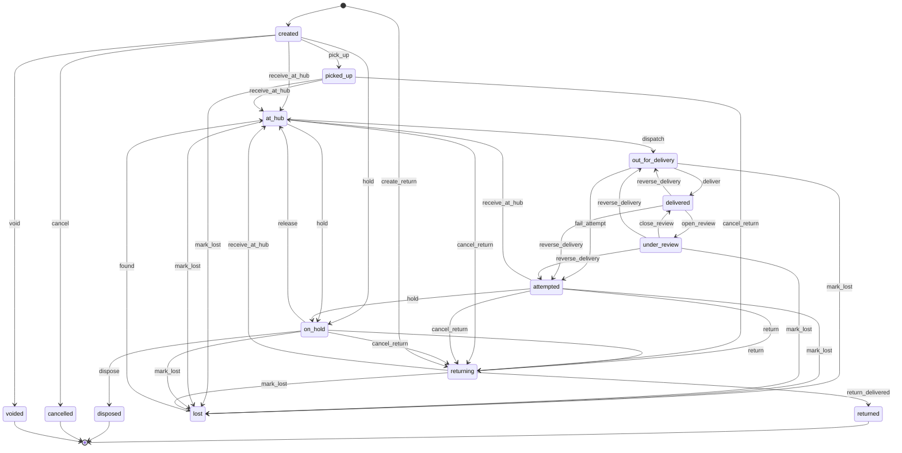
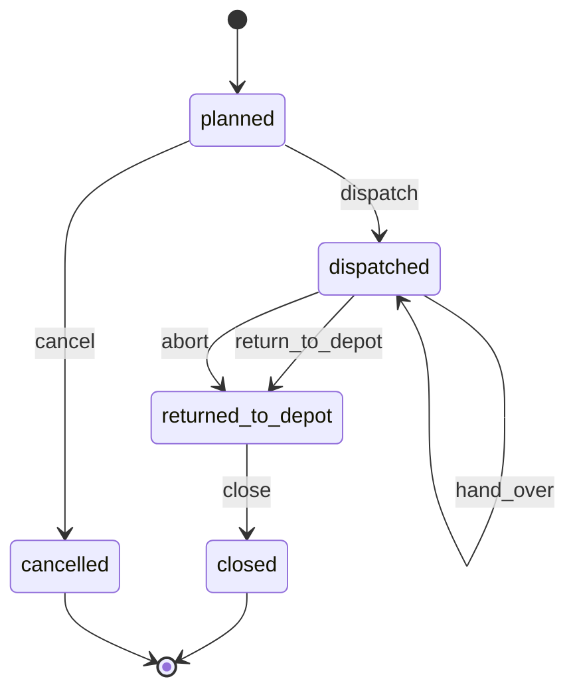
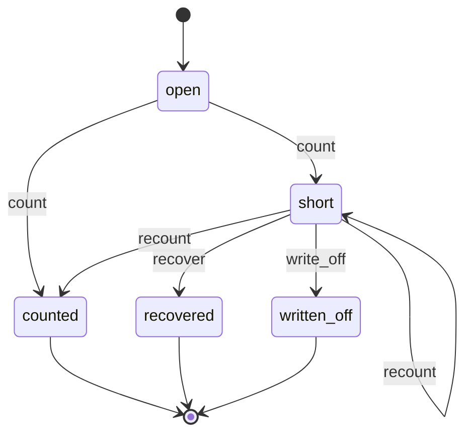
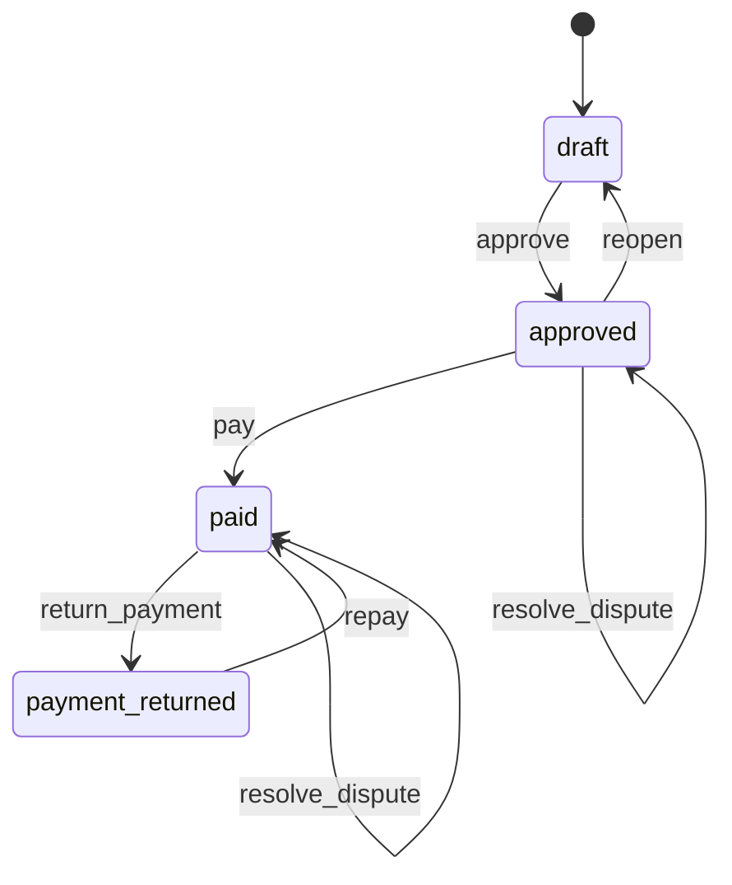
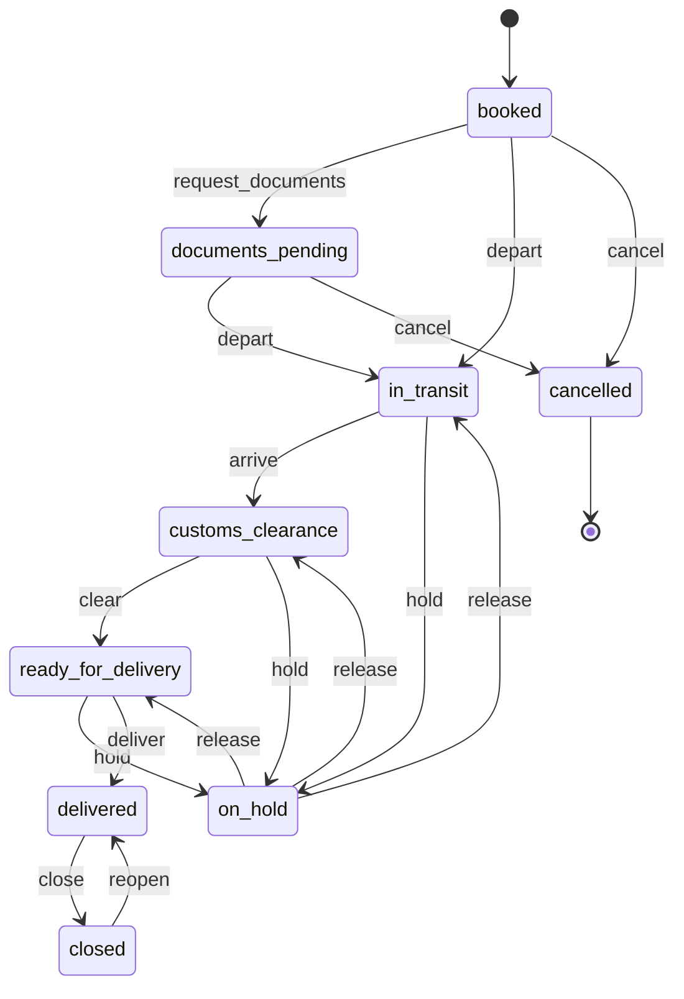
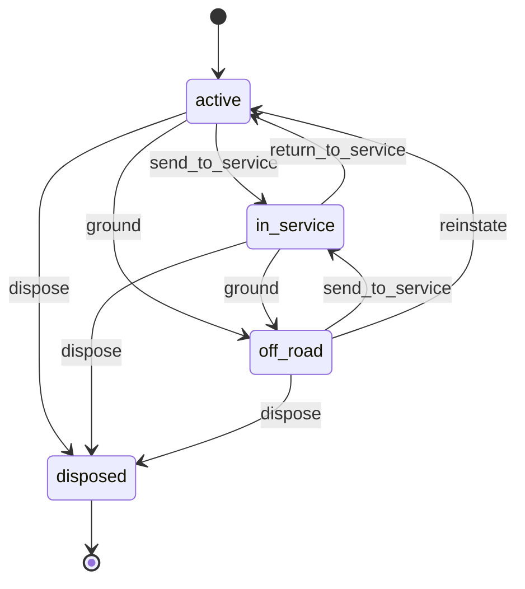

# 03 — Logistics & Freight Forwarding

> Status: accepted · Reviewed: 2026-10-15 · Last updated: 2026-10-16

## 1. Summary

Mid-sized logistics companies in the UAE do one or more of three things: last-mile parcel
delivery for e-commerce sellers (often cash on delivery), B2B trucking inside the UAE and the
GCC, and freight forwarding (sea and air import/export with customs clearance). They run
20–200 vehicles. Bookings arrive by WhatsApp and Excel, drivers report on paper run sheets,
COD cash is reconciled by hand, and clients phone in to ask where their shipment is. The app
gives clients a portal to book and track shipments, gives drivers a PWA for runs, scans and
e-POD, and gives the office dispatch, fleet, COD reconciliation and billing in one place.
It is **one app**: last-mile and B2B trucking are on by default, and freight forwarding
(freight jobs, customs references, disbursements, multi-currency) is switched on per client
through configuration. Drivers can use company phones or their own.

## 2. Business context (UAE)

- **Customer size:** 20–200 vehicles (vans, pick-ups, 3- to 10-ton trucks, motorbikes for
  express), 30–400 drivers and helpers, 1–6 depots or hubs, 5–200 B2B clients.
- **How they work today:** client orders by email, WhatsApp or Excel; printed run sheets;
  COD cash counted in a notebook at the end of the day; vehicle documents and services in a
  spreadsheet; customs paperwork handled by clearing agents over email; invoicing in
  Tally/Zoho/QuickBooks from exported Excel.
- **Rules and practice that shape the work:**
  - **Addresses are imprecise.** Many deliveries rely on area, building name, landmark and a
    phone call. A pin or a Makani number (Dubai) helps when available. Failed first attempts
    are common.
  - **Cash on delivery** remains widespread in e-commerce. The courier holds the client's
    money until it is remitted, usually weekly, minus delivery and COD fees.
  - **Commercial vehicles** need registration (Mulkiya), insurance and, for some activities,
    permits. Each has an expiry date. ✔ In Abu Dhabi every goods vehicle, light or heavy, is
    registered on Abu Dhabi Mobility's Asateel platform and needs a working tracking device
    from an approved supplier before a permit is issued [S1]. In Dubai, RTA requires
    telematics on heavy vehicles of 2.5 tonnes or more [S2]. Trucks moving goods under
    customs control also need an electronic tracking device.
  - ✔ **Truck movement bans** change often. From 1 October 2026 Dubai bans trucks on some
    roads all day (e.g. Al Qudra Street, Airport Tunnel), on others 06:00–22:00 (e.g. Sheikh
    Zayed Road) and on others at peak hours; trips in banned times need an RTA mobility
    permit [S3]. Abu Dhabi city bans heavy vehicles at morning and evening peaks [S4]. The
    app keeps these as dispatcher notes per zone, not as hard-coded rules.
  - **Delivery riders:** ✔ in Dubai each motorbike rider needs an RTA delivery permit and
    qualification certificate, renewed yearly, after training, a medical test and police
    clearance; the company registers its riders with RTA [S9]. Since November 2025 riders
    may not use the fastest lanes [S8]. Abu Dhabi has similar lane limits. Permits,
    certificates and their expiry dates are kept on the driver's record (`HRM.EMP.01`,
    `DOC.EXP.01`).
  - **Courier licence:** ✔ Emirates Post states that every courier company needs its
    courier licence [S10]. ✔ Emirates Post Group issues the postal activity (courier)
    licence under Federal Decree-Law 21 of 2019, which replaced Federal Law 3 of 2013, for
    items up to 30 kg; the fee is 10% of annual sales from the licensed activity, at least
    AED 100,000. TDRA's licensing covers telecoms only [S22]. Whether a client delivering
    only its own merchants' parcels needs the licence stays `⚠ open: lawyer (L-15)`.
  - **Tolls and fines:** Salik (Dubai) and Darb (Abu Dhabi) tolls and traffic fines are
    charged to the vehicle's owner. They must be allocated to the driver or the job.
  - **Freight forwarding:** ✔ import and export declarations go through Dubai Customs
    (Mirsal 2, via the Dubai Trade portal) [S5] or Abu Dhabi's ATLP (Advanced Trade &
    Logistics Platform, run by Maqta Gateway) [S6]. Free-zone moves (e.g. Jebel Ali) need
    their own permits. Duties and port charges are often paid on the client's behalf and
    recharged as disbursements.
  - **Midday break:** ✔ outdoor work is banned 12:30–15:00 from 15 June to 15 September,
    and MoHRE applies it to delivery work. Riders cannot be forced to work in that window;
    if they do, a trip may have at most 3 orders and last under 60 minutes, and riders must
    be told where the air-conditioned rest stations are [S7]. The app warns the dispatcher
    (`WRK.RUL.15`).
  - **VAT:** domestic transport is standard-rated at 5%. ✔ International transport of goods
    that starts or ends in the UAE, or passes through it, is zero-rated with directly
    related services (Art. 45 FDL 8/2017). Since 15 November 2024 a UAE leg is zero-rated
    only when the same supplier is contracted for the whole international move; a
    subcontractor doing only the domestic leg charges 5% (Art. 33 Executive Regulation, as
    amended by Cabinet Decision 100/2024; FTA clarification VATP040) [S16]. ✔ Costs paid as
    the client's agent are disbursements outside the scope of VAT only when the third-party
    invoice is in the client's name, the client authorised the payment, and the exact amount
    is shown separately; otherwise they are reimbursements taxed like the main service
    (FTA clarification VATP013) [S17].
  - **Cash on delivery:** a courier collecting money for merchants may fall under the
    Central Bank's retail payment services regulation (Circular 15/2021). Its exclusions
    have no commercial agent carve-out, and no CBUAE guidance on COD was found [S23], so
    whether COD collection needs a licence is `⚠ open: lawyer (L-14)` (§13 question 11).

### Tracking within the PWA constraint

The platform is web + PWA only ([decision 0001](../decisions/0001-first-two-verticals.md),
[ARCHITECTURE.md](../ARCHITECTURE.md) §1). A browser cannot track a phone's location in the
background. Tracking therefore works by **events**:

1. Every scan and status update (picked up, at hub, out for delivery, delivered, attempted)
   is a tracking event. The driver's location is captured **at that moment** from the
   foreground app.
2. The client and the recipient see a timeline of events and the shipment's position in the
   driver's run (e.g. "6 stops before yours").
3. Live vehicle positions come **later** from a telematics integration (GPS devices fitted
   to vehicles), not from drivers' phones (`LOG.TRK.02`).

## 3. Users and access

Follows [ACCESS-CONTROL.md](../ACCESS-CONTROL.md). Platform-wide rules (`PLT.ACL.*`) are not
repeated here.

### 3.1 Roles

| Role | Actor type | What they do | Permissions (summary) | Typical scope |
|---|---|---|---|---|
| Company admin | staff | Configures the company, users, rate cards, branding | all | global |
| Operations manager | staff | Runs a depot: dispatch, exceptions, cash handovers, driver issues; approves write-offs | shipments, runs, drivers, cash handovers (approve), reports | depot |
| Dispatcher | staff | Builds runs, assigns drivers and vehicles, handles reattempts | shipments, runs, assignments | depot |
| Hub staff | field | Scans shipments in and out, sorts by route, records exceptions | scanning, exceptions | depot |
| Driver | field | Works the assigned run: load, deliver, e-POD, collect COD, hand over cash | own runs only | depot |
| Documentation officer | staff | Freight jobs, shipping and customs documents, clearing agents | freight jobs, documents | global or depot |
| Fleet manager | staff | Vehicles, documents, services, fuel, fines | fleet, maintenance tickets, fines | global |
| Accountant | staff | Invoices from rate cards, COD remittances, supplier bills, cheques | finance, remittances (prepare) | global |
| Customer service | staff | Answers client and recipient queries, raises complaints and claims | shipments (read), tickets | global |
| Client user | external | Books shipments, tracks, downloads labels and POD, sees invoices and COD statements | portal: shipments, finance | own company |
| Recipient | external | Tracks one shipment through a link; chooses a delivery slot (Later) | tracking link only | one shipment |
| Subcontracted carrier | external | Works runs assigned to them (Later) | own runs | — |

### 3.2 Scope

The scope unit is the **depot** (hub or branch). Operations managers, dispatchers, hub staff
and drivers are assigned per depot. Fleet, documentation, accounts and customer service are
usually global. Client users are scoped by party ownership (`OWN`). Recipients have no
account: they get a signed, time-limited tracking link.

### 3.3 Access rules

| ID | Rule | Pattern | Applies to | Parameter (default) |
|---|---|---|---|---|
| `WRK.ACL.05` *(shared, formerly `LOG.ACL.01`)* | A driver sees only runs assigned to them for the current day; a recipient's phone and full address are visible only while the shipment is on their run and not yet delivered | `ASG`, `TIM` | driver | — |
| `LOG.ACL.02` | A client user sees only their own company's shipments, invoices and COD statements | `OWN` | client user | — |
| `LOG.ACL.03` | The public tracking link shows the status timeline, the recipient's first name and area only; it expires after delivery | `FLD`, `TIM` | recipient | 14 days after delivery |
| `WRK.ACL.06` *(shared, formerly `LOG.ACL.04`)* | A delivery's e-POD is never edited once the shipment is `delivered`. A correction is only an audited `reverse_delivery` that keeps the original proof and marks it reversed; a dispute is a ticket and puts the shipment `under_review` | `STA` | all staff | — |
| `WRK.ACL.09` *(shared)* | COD collected below the amount due by more than the tolerance is accepted only with a difference reason and an operations manager's approval from the phone, who chooses who absorbs it (*client*, *business* or *driver*; none preselected, the wl-delivery option *customer* not offered); the driver cannot approve; without an answer the attempt fails | `LIM`, `SOD` | driver, operations manager | AED 0 |
| `WRK.ACL.10` *(shared)* | `reverse_delivery` and a manual `mark_lost` of a delivery need an operations manager's approval; the requester cannot approve, and the driver of the run can neither request nor approve | `SOD`, `STA` | all staff | on |
| `FIN.ACL.05` *(shared, formerly `LOG.ACL.05`)* | The cash handover is counted by a cashier or operations manager, never by the driver who hands it over | `SOD` | driver, cashier | on |
| `FIN.ACL.06` *(shared, formerly `LOG.ACL.06`)* | Writing off a driver's cash shortage needs an operations manager's approval above a threshold | `LIM` | cashier | AED 50 |
| `FIN.ACL.19` *(shared)* | Recovering a cash shortage by salary deduction needs approval by another user than the counter, and the driver's acknowledgement | `SOD` | cashier, operations manager | off (`⚠ open: lawyer (L-20)`, as in wl-payments) |
| `LOG.ACL.07` | A COD remittance is prepared by one user and approved by another before payment | `SOD` | accountant | on |
| `LOG.ACL.08` | Any change to a client's rate card needs a manager's approval | `LIM` | accountant, customer service | any change |
| `LOG.ACL.09` | A client user can cancel a shipment only while it is `created`. After pickup only a dispatcher or operations manager can cancel it, on the client's instruction (a note of who asked, when and how, or the client user's portal request "ask us to return it", a ticket of category *client instruction*): the shipment goes back to the client (`cancel_return` to `returning`, return charge per rate card). A shipment out for delivery is first stopped by a failed attempt with the reason *cancelled by client* | `STA` | client user, dispatcher | — |
| `LOG.ACL.10` | A fine or toll allocated to a driver for salary deduction needs an operations manager's approval | `SOD` | fleet manager | on |
| `LOG.ACL.11` | Commercial invoices and declared values on freight jobs are visible only to the documentation team, accountants and the client | `FLD`, `OWN` | all staff | — |
| `LOG.ACL.12` | An adjustment line on a COD remittance (a correction after payment, a reversed or disputed delivery, a statement dispute outcome) is prepared by one user and approved by another with `remittances.approve`; a user may approve both a line and the remittance if they prepared neither; the client sees the line and its reason on the next statement | `SOD` | accountant | on |
| `LOG.ACL.13` | A change to a client's remittance bank account takes effect only after a second user approves it and the client confirms it from its known contact (the primary contact on record before the request, never a contact added or changed in the same request); until then remittances use the old account or wait. One pending change per client at a time; a pending change not both approved and confirmed within 14 days lapses and the requester is told | `SOD` | accountant | on; lapses after 14 days |
| `LOG.ACL.14` | A shipment that is not on a delivery (`picked_up`, `at_hub`, `on_hold`, `returning`) is marked `lost` or `disposed` only with an operations manager's approval; the requester cannot approve. Disposal also needs the client's written instruction attached, unless the goods are dangerous | `SOD`, `STA` | hub staff, dispatcher | on |
| `PTY.ACL.03` *(shared)* | While a client is blocked, no COD remittance or refund is paid to it and no rate card is renewed or extended, unless the company admin approves an exception (03 has no finance manager role; the requester cannot approve; screening is off in 03) | `STA`, `LIM` | accountant | — |
| `FIN.ACL.15` *(shared)* | Writing off an invoice balance as a bad debt needs approval; the requester cannot approve | `LIM`, `SOD` | accountant | AED 0 (every write-off approved by the operations manager or company admin) |
| `POR.ACL.01` *(shared)* | After a client's contract ends, its portal users keep read-only access to shipments, invoices and COD statements, then the portal closes | `TIM` | client user | closes after 90 days |
| `FIN.ACL.08` *(shared)* | Job costs, carrier rates and margins are hidden from drivers, hub staff, customer service and external users | `FLD` | listed roles | — |

Where a rule above asks for an operations manager's approval (`WRK.ACL.09`, `WRK.ACL.10`,
`FIN.ACL.06`, `LOG.ACL.14`), the company admin may also approve, because it holds every
permission (for example in a depot with a single operations manager); the requester never may.

## 4. Value streams

### 4.1 Booking to delivery (last mile)

1. The client creates shipments in the portal, by CSV upload, or later through the API
   (`LOG.SHP.01`, `POR.SLF.01`, `PLT.API.01`).
2. Labels and waybills with a barcode are printed (`LOG.SHP.02`, `DOC.GEN.01`).
3. A driver picks up from the client, or the client drops off at the hub. Each parcel is
   scanned (`LOG.HUB.01`, `PLT.SCN.01`).
4. At the hub, parcels are scanned in, sorted by area and exceptions (damaged, missing) are
   recorded (`LOG.HUB.01`).
5. The dispatcher groups shipments into runs and assigns a driver and a vehicle
   (`LOG.RTE.01`, `WRK.DSP.01`).
6. The driver checks in at the depot, completes the vehicle check, and scans the run out
   (`HRM.ATT.01`, `WRK.CHK.01`, `LOG.HUB.01`).
7. The recipient receives an SMS with the tracking link (`NTF.MSG.03`, `LOG.TRK.01`).
8. At each stop the driver records delivery with e-POD: photo, signature or OTP, and the
   location at that moment (`WRK.POD.01`). COD is collected (`LOG.COD.01`).
9. A failed attempt is recorded with a reason. The shipment is reattempted or returned to
   the client (`WRK.POD.01`).
10. At the end of the day, the driver hands over COD cash, counted by a cashier
    (`FIN.CSH.01`, `FIN.ACL.05`).
11. COD is remitted to the client weekly with a statement, minus fees (`LOG.COD.01`). The
    amount owed is the COD recorded on delivered shipments, whatever happened to the cash
    after collection: a driver's shortage is the company's loss, never the client's.
12. Delivered shipments are billed monthly from the client's rate card (`FIN.RAT.01`,
    `FIN.USG.01`, `FIN.INV.01`).

**When it goes wrong**

| Case | What happens | Where |
|---|---|---|
| Duplicate booking | A CSV row or API shipment with a client reference already used by the same client, in any state including `voided` and `cancelled`, is refused (a real re-booking needs a new reference); a booking without a reference is not checked; a duplicate found later is voided while `created` (no charge, number kept) | Shipment `void`, `PLT.ACL.09` |
| Client cancels | Before pickup: `cancel` (cancellation fee only if the rate card has one). After pickup: the dispatcher runs `cancel_return` and the goods go back with the return charge; a shipment returned before any delivery attempt is billed the return charge only. Out for delivery: the driver fails the stop with *cancelled by client* (not counted as an attempt), then `cancel_return` | `LOG.ACL.09` |
| Fewer parcels handed over than booked | `pick_up` (or `receive_at_hub` for a drop-off) records the missing parcels as *not received*; the shipment goes ahead with the parcels received, weight and price are recalculated, the client is told. Parcels *not received* are never picked up later on that shipment: the client books a new one. The COD amount is not changed; the client may edit it before dispatch (audited). No parcel handed over: the pickup attempt fails and the shipment stays `created` | Shipment `pick_up` |
| Weight or size differs at the hub | Hub staff record the measured weight and dimensions with a photo of the scale. Above the client's tolerance (0 kg when the rate card sets none) the shipment is priced on the measured values (re-weigh surcharge on the monthly invoice) and the client is told; a measured weight lower than the booked one never reprices. The tolerance is compared on the chargeable weight: the higher of actual and volumetric weight when the rate card prices by volume (volumetric divisor from the rate card). When the shipment is re-weighed, the latest measurement counts. The client may dispute it through a ticket before the invoice is issued; the surcharge is held out of the draft while the ticket is open, and the shipment is held (`hold`, *re-weigh dispute*) only if the client asks to stop delivery | `LOG.HUB.01`, `FIN.RAT.01` |
| Wrong or incomplete address | Before dispatch, the client or customer service corrects it (audited; a zone change re-prices the shipment). After a failed attempt with *wrong address*, the system puts the shipment `on_hold` (reason *address issue*) instead of queuing a reattempt, and the client is asked to confirm the address in the portal; then `release` | Shipment `hold`, `release` |
| Parcel damaged at the hub | Shipment `hold` with reason *damaged* and photos; the client chooses: deliver as is (`release`), return (`return`) or dispose (`dispose`, written instruction, `LOG.ACL.14`). When the company is liable (set on the hold or later, while `on_hold`), a claim ticket is opened | §4.4 |
| Driver or vehicle document expired | Run `dispatch` and delivery assignment are refused; planned runs are flagged in advance (`DOC.RUL.02`) | §9 Document blocks |
| Recipient refuses some parcels of a multi-parcel shipment | Partial acceptance: delivered for the accepted parcels; refused parcels come back with the driver and go back to the client on a linked return shipment with the return charge. Parcels carry no COD amount, so the shipment's COD amount stays expected in full; a shortfall follows the COD difference row below. Single-parcel shipments: partial acceptance is off | `WRK.POD.01` |
| Recipient pays less than the COD amount or refuses to pay | The driver records the cash collected. Above the tolerance (AED 0), the driver enters a reason and asks the operations manager from the phone (`WRK.ACL.09`), who must choose who absorbs the difference (none preselected): *client* (only with the client's instruction, e.g. an agreed discount: deducted on the remittance line with the reason, shown on the statement), *business* (COD loss) or *driver* (stays expected in the cash handover). No answer during the stop, or nothing paid: forced failed attempt *refused to pay* or *no cash* | wl-delivery §4.1 |
| Recipient denies the delivery, or it was marked by mistake | Customer service opens a dispute ticket: shipment `under_review`, its COD held out of remittances and its billing held. Outcome: `close_review` (upheld) or `reverse_delivery` with an operations manager's approval and a liability decision (driver, business, client, none); *driver* gives the operations manager a task to raise a later cash shortage against the driver (`raise_shortage`, wl-payments) or open an HR case. Already remitted COD that is refunded to the payer becomes a negative adjustment line on the next remittance (`LOG.ACL.12`); an invoiced shipment gets a credit note | `WRK.ACL.10`, Shipment `reverse_delivery` |
| Shipment cannot be found | On a delivery: `WRK.RUL.17` marks it `lost` after 7 days untraced. Elsewhere (hub, return): `LOG.RUL.12` opens a trace task after 3 days and, after 7 (both counted from the last scan, tracking event or note), escalates it to the operations manager so that a user requests `mark_lost`; a user may also request it earlier. The client is told, a claim ticket is always opened (liability is decided on the claim), the shipment is left out of billing (credit note if already invoiced), and no COD is expected. If found, it goes back to `at_hub`; after a settled claim it is then held (*client instruction*) until the client chooses (§4.4) | §4.4, `LOG.ACL.14` |
| Run cannot continue (breakdown, accident, driver unwell) | Run `hand_over` to another driver, who confirms each parcel and counts the cash; or run `abort`: open stops fail with *run aborted* (not counted as an attempt), recipients are told of the delay, and a breakdown or accident ticket is opened | Run |
| Driver does not hand over the cash, or disappears | `LOG.RUL.05` and `LOG.RUL.13` escalate. After 48 hours the operations manager aborts the run if needed and counts the handover at what was received (often zero): the full amount is a shortage. HR follows the absconding path (`report_absconding` after 7 days of absence, wl-hr); recovery by deduction from salary or final dues only if allowed (`FIN.ACL.19`, §13 question 13); the rest is written off with approval (`FIN.ACL.06`). The client is remitted in full in any case | Cash handover, `LOG.RUL.13` |
| Remittance wrong after payment | Never edited: an adjustment line (positive or negative, with reason) goes on the next remittance, approved by a second user (`LOG.ACL.12`), and the client sees it on the statement | COD remittance |
| Bank returns the remittance transfer | Remittance `return_payment`: the amount is owed to the client again, the client is asked to confirm its bank account (`LOG.ACL.13`), then `repay` | COD remittance |
| Client disputes a COD statement | `dispute` flag with a ticket; the outcome is *upheld* or an adjustment line on the next remittance | COD remittance |
| Client owes invoices | When the client's contract allows netting, the draft remittance offsets open, undisputed delivery invoices; on `pay` the offsets are recorded as payments allocated to those invoices | `LOG.COD.01`, `FIN.PAY.01` |
| Client blocked (e.g. non-payment, legal dispute) | New bookings are refused with a neutral message; shipments booked before the block may still be picked up (the dispatcher sees "client on hold"); shipments already picked up are delivered or returned as normal; COD remittances wait for unblock or an approved exception (`PTY.ACL.03`); invoices and receipts continue | wl-parties §5.6 |
| Driver without signal at a stop | The MVP is online only: the driver records the stop on the paper run sheet and enters it later; the e-POD keeps the stop time as its business time and gets a late-entry flag with a reason; beyond 24 hours an operations manager approves (`PLT.ACL.10`) | wl-kernel §5.13 |

### 4.2 Freight job (forwarding and B2B trucking)

1. A quotation is issued for the move: mode, route, charges (`FIN.QUO.01`).
2. On acceptance, a freight job is opened with milestones: booking, documents, departure,
   arrival, clearance, delivery (`LOG.JOB.01`).
3. Shipping documents are collected: commercial invoice, packing list, bill of lading or
   air waybill, certificate of origin (`DOC.FIL.01`).
4. The customs declaration is filed by the in-house team or a clearing agent. Its number,
   duties and the delivery order are recorded (`LOG.CUS.01`).
5. Duties and port charges paid on the client's behalf are recorded as disbursements
   (`FIN.DSB.01`). Supplier bills (shipping line, haulier, agent) are allocated to
   the job (`FIN.PAB.01`, `FIN.CST.01`).
6. The cargo is collected and delivered, with e-POD (`WRK.POD.01`).
7. The job is invoiced: services with VAT, disbursements at cost (`FIN.INV.01`). Amounts in
   USD or other currencies are converted (`FIN.CUR.01`).
8. Job margin = revenue − costs (`FIN.CST.01`).

**When it goes wrong**

| Case | What happens | Where |
|---|---|---|
| Customs hold, inspection, declaration rejected, duty unpaid, documents missing | Freight job `hold` with a reason: the job is `on_hold` and its milestone clock stops; the client and the documentation officer are told; the reason is shown in the portal. `release` returns the job to where it was | Freight job |
| Mirsal or ATLP down | Declarations are filed on the portal or by the clearing agent anyway (there is no integration in the MVP); a hold with reason *customs platform down* records the delay for the client | Freight job `hold` |
| Container free time running out (demurrage, detention, port storage) | Each container records its free-time end dates. `LOG.RUL.14` alerts the documentation officer and the client 2 days before and on the day, then only logs each day past it. Daily charges, when billed by the shipping line or port, are allocated to the job as costs with a liability, required before the bill is approved for the job: *client* (late documents, late duty payment, late collection by the client) recharged per the quotation terms, as a disbursement only when the VATP013 conditions are met [S17]; *company* (company delay, other) absorbed in the job margin | `LOG.JOB.01`, `FIN.PAB.01`, `FIN.DSB.01` |
| Supplier bill arrives after the job is closed | The job is reopened (`reopen`, reason: late supplier bill, demurrage, port storage, or *other* with a note), the cost allocated, a supplementary invoice issued if rechargeable, and the job closed again with the new margin | Freight job `reopen` |
| Client cancels before departure | `cancel` with cancellation charges per the quotation; costs already incurred are recharged per its terms. A quotation without cancellation terms drafts no charge, and the documentation officer gets a task to decide the incurred costs. A cost billed after `cancel` is allocated to the cancelled job (it stays `cancelled`) and the accountant decides whether to invoice it | Freight job `cancel` |

### 4.3 Fleet

1. Each vehicle is registered with its documents (Mulkiya, insurance, permits) and their
   expiry dates (`STK.AST.01`, `LOG.FLT.01`, `DOC.EXP.01`).
2. Drivers record odometer readings at the daily vehicle check (`WRK.CHK.01`,
   `LOG.FLT.01`).
3. Services are planned by date or kilometres (`WRK.PPM.01`).
4. Breakdowns and accidents are raised as tickets (`WRK.TKT.01`).
5. Fuel, Salik/Darb tolls and fines are imported and allocated to a vehicle, a driver or a
   job (`LOG.FIN.01`).

### 4.4 Complaint or claim

1. A client or recipient reports a problem: late, damaged, lost (`WRK.TKT.01`).
2. Customer service investigates with the tracking timeline and e-POD (`LOG.TRK.01`).
3. A claim is valued against the liability limit in the client's terms (`LOG.CLM.01`).
   In the MVP the claim is a ticket (category *claim*) opened automatically for every lost
   shipment (its liability is decided on the claim, so a system marking with liability *none*
   still opens one) and for a reversed or disposed shipment where the company is liable
   (*driver* or *business*); customer service values it by
   hand against the client's terms and records the decision and the liability (driver,
   business, client). Valuation from liability limits is Later.
4. An approved claim becomes a credit note (`FIN.INV.01`). A shipment marked lost is left
   out of the monthly invoice; if it was already invoiced, its charge is credited too. If a
   lost shipment is found after the claim was settled, the claim ticket is reopened and the
   client chooses delivery (the claim credit is reversed by an invoice) or keeping the
   settlement (the goods are returned to the client or disposed of with its instruction).
5. A complaint about an invoice is a `disputed` invoice (wl-invoicing): reminders pause until
   the dispute is resolved as *upheld* or *credited*. Client users may raise it in the
   portal.

## 5. Capabilities

| ID | Capability | Shared or specific | Proposed module | Scope |
|---|---|---|---|---|
| `PLT.ORG.01` | Branded deployment | shared | wl-kernel | MVP |
| `PLT.USR.01` | Staff users, roles, permissions scoped per depot | shared | Renox Permissions | MVP |
| `PLT.AUD.01` | Audit trail | shared | Renox Audit | MVP |
| `PLT.APR.01` | Approval requests (write-offs, remittances, rate changes) | shared | wl-kernel | MVP |
| `PLT.WFL.01` | State machines with history | shared | Renox (R12) + wl-kernel | MVP |
| `PLT.ATM.01` | Default automation rules | shared | wl-kernel | MVP |
| `PLT.HOK.01` | Outbound webhooks (shipment status to client systems) | shared | Renox (R11) | Later |
| `PLT.API.01` | API for external parties to push records (shipments) with their own tokens | shared (**new**) | wl-kernel + Renox tokens | Later |
| `PLT.SCN.01` | Scan barcodes and QR codes with the device camera in the PWA | shared (**new**) | Renox (R5) | MVP |
| `PTY.PTY.01` | Parties: clients, recipients, carriers, agents, suppliers | shared | wl-parties | MVP |
| `PTY.KYC.01` | Identity fields: trade licence, TRN, driver Emirates ID and licence | shared | wl-parties | MVP |
| `DOC.FIL.01` | Attach documents (shipping documents, POD, vehicle papers) | shared | wl-documents | MVP |
| `DOC.EXP.01` | Expiry reminders (Mulkiya, insurance, permits, driving licences, trademark and other registrations) | shared | wl-documents | MVP |
| `DOC.GEN.01` | Generate documents (labels, waybills, run sheets, remittance statements) | shared | wl-documents | MVP |
| `FIN.QUO.01` | Quotations for freight jobs | shared | wl-invoicing | MVP |
| `FIN.CST.01` | Job costing per freight job | shared | wl-invoicing | MVP |
| `FIN.INV.01` | Tax invoices with VAT (standard and zero-rated) | shared | wl-invoicing | MVP |
| `FIN.PAY.01` | Record and allocate payments | shared | wl-payments | MVP |
| `FIN.PAY.02` | Online payment by link or card | shared | wl-payments | Later |
| `FIN.CHQ.01` | Post-dated cheque register | shared | wl-payments | MVP |
| `FIN.REC.01` | Receivables ageing and reminders | shared | wl-invoicing | MVP |
| `FIN.PAB.01` | Supplier bills (carriers, shipping lines, agents, fuel) | shared | wl-invoicing | MVP |
| `FIN.EXT.01` | Export to accounting software | shared | wl-invoicing | Later |
| `FIN.CUR.01` | Multi-currency amounts with exchange rates | shared (**new**) | wl-invoicing | MVP |
| `FIN.USG.01` | Periodic invoices built from many priced transactions (rate card × usage) | shared (**new**) | wl-invoicing | MVP |
| `FIN.CSH.01` | Cash held by field staff: collection, end-of-day handover, shortages | shared (**new**) | wl-payments | MVP |
| `FIN.DSB.01` | Costs paid on a client's behalf and recharged at cost, outside VAT where allowed | shared (**new**) | wl-invoicing | MVP |
| `WRK.TKT.01` | Raise tickets (breakdowns, complaints, claims) | shared | wl-ticketing | MVP |
| `WRK.TKT.02` | Triage and assignment | shared | wl-ticketing | MVP |
| `WRK.TKT.03` | Updates with photos and sign-off | shared | wl-ticketing | MVP |
| `WRK.PPM.01` | Planned vehicle services by date or kilometres | shared | wl-ticketing | MVP |
| `WRK.CHK.01` | Checklists (daily vehicle check) | shared | wl-ticketing | MVP |
| `WRK.POD.01` | Proof of delivery: photo, signature or OTP, location at the moment (absorbs `LOG.ATT.01`) | shared (**new**) | wl-delivery | MVP |
| `POR.SLF.01` | Client portal: book, track, labels, POD, invoices, COD statements | shared | wl-portal | MVP |
| `POR.SLF.02` | Recipient tracking page (no login, signed link) | shared | wl-portal | MVP |
| `NTF.MSG.01` | Email notifications | shared | wl-notify | MVP |
| `NTF.MSG.02` | WhatsApp notifications | shared | wl-notify | Later |
| `NTF.MSG.03` | SMS notifications | shared (**new**) | wl-notify | MVP |
| `RPT.DSH.01` | Role-based dashboards | shared | Renox charts + wl-kernel | MVP |
| `HRM.ATT.01` | Driver shift check-in and check-out at the depot | shared | wl-attendance | MVP |
| `HRM.EMP.01` | Driver and staff records with licences and documents | shared (**new**) | wl-hr | MVP |
| `HRM.QUA.01` | Driving licences and RTA rider permits per driver, with the validity guard on run dispatch and delivery assignment | shared | wl-hr | MVP |
| `STK.AST.01` | Asset register: vehicles | shared | wl-inventory | MVP |
| `SAL.CRM.01` | Leads and enquiries pipeline | shared (**new**) | wl-sales | MVP |
| `PLT.ENT.01` | Legal entities: several trade licences and TRNs in one deployment; issuer on every document | shared | wl-kernel | MVP |
| `PLT.IMP.01` | Data import and migration: Excel templates per entity, validation, dry run, rollback | shared | wl-kernel | MVP |
| `PLT.SRC.01` | Global search across records, including Arabic names | shared | wl-kernel + Renox search | MVP |
| `PLT.NOT.01` | Notes, comments and @mentions on any record, with an activity timeline | shared | wl-kernel | MVP |
| `PLT.SSO.01` | Staff single sign-on with Microsoft 365 or Google Workspace | shared | Renox OAuth (renox-oauth) | Later |
| `RPT.LIB.01` | Report library: filtered reports with export to Excel, CSV and PDF | shared | wl-kernel | MVP |
| `RPT.SCH.01` | Scheduled reports sent by email | shared | wl-kernel | Later |
| `FIN.VAT.01` | VAT summary per period and entity: output and input VAT, for the accountant | shared | wl-invoicing | MVP |
| `FIN.EXP.01` | Expense claims and petty cash: submit with receipt, approve, reimburse, top up | shared | wl-payments | MVP |
| `FIN.BNK.01` | Bank statement import and matching of receipts to open invoices | shared | wl-payments | Later |
| `WRK.FBK.01` | Customer feedback and ratings after a completed service; low ratings open a ticket | shared | wl-ticketing | Later |
| `LOG.SHP.01` | Shipment booking: recipient, address, parcels, weight, service, COD amount | specific | apps/logistics | MVP |
| `LOG.SHP.02` | Labels and waybills with barcode | specific | apps/logistics | MVP |
| `LOG.HUB.01` | Hub scanning: in, sort, out, exceptions | specific | apps/logistics | MVP |
| `LOG.RTE.01` | Runs: group shipments by area and sequence stops | specific | apps/logistics | MVP |
| `LOG.RTE.02` | Route optimisation | specific | apps/logistics | Later |
| `WRK.DSP.01` | Dispatch: assign runs to driver and vehicle (formerly `LOG.DSP.01`) | shared (**new**) | wl-delivery | MVP |
| `LOG.TRK.01` | Tracking timeline from events, with location at each event; public tracking link | specific | apps/logistics | MVP |
| `LOG.TRK.02` | Live vehicle location from telematics devices | specific | apps/logistics | Later |
| `LOG.COD.01` | COD collection and weekly remittance to clients | specific | apps/logistics | MVP |
| `FIN.RAT.01` | Rate cards per client: each line priced per zone × weight, per trip or route, per hour or day, or per pallet or CBM (including storage per day); COD fee and surcharges (formerly `LOG.RAT.01`) | shared (**new**) | wl-invoicing | MVP |
| `SAL.CRM.02` | Lead sources and campaigns: cost per campaign, conversion by source and channel, cost per lead, customer acquisition cost and return on ad spend | shared | wl-sales | MVP |
| `FIN.CFL.01` | Cash-flow forecast: expected receipts and payments by week from invoices, supplier bills, scheduled charges, post-dated cheques, payroll and budgets | shared | wl-invoicing | MVP |
| `FIN.BUD.01` | Company budget vs actual by period, category and entity; owner drawings kept apart from operating cost | shared | wl-invoicing | MVP |
| `HRM.ONB.01` | Staff onboarding checklists per role and a library of SOP documents with acknowledgement | shared | wl-hr + wl-documents | MVP |
| `LOG.JOB.01` | Freight jobs: mode, route, BL/AWB, containers, milestones | specific | apps/logistics | MVP |
| `LOG.CUS.01` | Customs and free-zone documentation: declaration numbers, duties, delivery orders | specific | apps/logistics | MVP |
| `LOG.FLT.01` | Fleet details: odometer, fuel logs, vehicle documents | specific | apps/logistics | MVP |
| `LOG.FIN.01` | Fines and tolls (Salik, Darb) imported and allocated to driver, vehicle or job | specific | apps/logistics | MVP |
| `LOG.CLM.01` | Claims for lost or damaged shipments, valued against liability limits | specific | apps/logistics | Later |
| `LOG.SUB.01` | Subcontracted carriers and owner-drivers: assign runs, settle payments | specific | apps/logistics | Later |
| `LOG.RPT.01` | Operations reports: first-attempt success, on-time, returns, cost per drop | specific | apps/logistics | MVP |

*New* = a shared capability first needed by this vertical. *Placeholder* = an ID to be
assigned when the capability map is built.

## 6. Key entities

| Entity | Description | Important fields | Owned by |
|---|---|---|---|
| Shipment | One consignment to one recipient | client, client reference (optional; when given, unique per client across all states), recipient name/phone, address, area, pin, parcels, booked and measured weight, service, COD amount, COD collected and difference, COD already remitted (kept after a reversal), run, liability (when lost, reversed or disposed), claim ticket, return shipment link, status | apps/logistics |
| Parcel | One labelled piece | shipment, barcode, weight, dimensions | apps/logistics |
| Tracking event | A status change or scan | shipment, type, time, actor, location at the moment, note | apps/logistics |
| Delivery attempt | One try to deliver | shipment, run, result, failure reason, e-POD | wl-delivery |
| Run | A driver's trip | depot, date, driver, vehicle, ordered stops, status | apps/logistics |
| Rate card | Client prices | client, lines (pricing model: zone × weight, trip/route, hour/day, pallet/CBM), service levels, COD fee, surcharges, validity | wl-invoicing (`FIN.RAT.01`) |
| COD remittance | Payout of collected cash to a client | client, period, shipments, collected, fees, COD differences absorbed by the client, adjustment lines (reason, approver), invoice offsets, net, bank account, payment reference, dispute flag and ticket, status | apps/logistics |
| Cash handover | Cash from a driver at the end of a run | driver, run, expected, counted, shortage, status | wl-payments |
| Freight job | A forwarding or trucking move | client, mode, origin/destination, BL/AWB, containers with free-time end dates (port storage, demurrage, detention), milestones, declaration no., hold reason, status | apps/logistics |
| Disbursement | Cost paid for a client | job, payee, amount, receipt, recharged on invoice | wl-invoicing |
| Vehicle | A fleet asset | plate, type, capacity, Mulkiya and insurance expiry, odometer, assigned driver, status | wl-inventory (+ apps/logistics) |
| Fine / toll | Charge on a vehicle | vehicle, date, type, amount, allocated to driver/job, status | apps/logistics |
| Driver | An employee | party, licence and expiry, visa, rider permit and certificate expiry (Dubai RTA), depot, vehicle type (van, truck, motorbike, on foot) | wl-hr (+ wl-parties) |
| Claim | Loss or damage claim | shipment, ticket, declared value, liability limit, settled amount | apps/logistics |

## 7. Workflow

Follows [WORKFLOW.md](../WORKFLOW.md). **Invoice, cheque and ticket** reuse the state
machines in [01-property.md](01-property.md#71-state-machines); **quotation** reuses the one
in [02-construction.md](02-construction.md#71-state-machines). All unchanged.

### 7.1 State machines

#### Shipment

> **Canonical definition:** *Delivery* in [`wl-delivery` §4](../modules/wl-delivery.md#4-lifecycles). The shipment stays specific to Logistics; its `dispatch`, `deliver`, `fail_attempt` and `return` transitions are driven by delivery events. This section is this vertical's original requirement; where it differs, the module definition wins and its vertical mapping table records the difference.

| State | Tone | Terminal | Meaning |
|---|---|---|---|
| `created` | neutral | no | Booked, label printed, not yet collected |
| `picked_up` | info | no | Collected from the client |
| `at_hub` | info | no | Scanned in at a depot |
| `out_for_delivery` | info | no | On a dispatched run |
| `attempted` | warning | no | Delivery failed; waiting for reattempt or return |
| `on_hold` | warning | no | Exception: damaged, address issue, client instruction, re-weigh dispute |
| `returning` | warning | no | Being returned to the client |
| `delivered` | success | no | Delivered with e-POD; reversible only through review |
| `under_review` | warning | no | The recipient or the client denies the delivery, or it was marked by mistake; COD and billing held |
| `lost` | error | no | Untraced; out of billing; can be found again |
| `returned` | neutral | yes | Back with the client |
| `disposed` | neutral | yes | Destroyed on the client's written instruction (damaged, dangerous) |
| `cancelled` | neutral | yes | Cancelled before pickup |
| `voided` | neutral | yes | Entered in error or duplicate; number kept, never charged |

| Transition | From | To | By | Guards | Effects |
|---|---|---|---|---|---|
| `pick_up` | created | picked_up | `shipments.scan` | at least one parcel scanned; parcels not handed over marked *not received* | tracking event; weight and price recalculated from the parcels received; client told of missing parcels |
| `receive_at_hub` | created, picked_up, attempted, returning | at_hub | `shipments.scan` | from `created` (drop-off): as `pick_up`, parcels not handed over marked *not received* | tracking event; from `created`: as `pick_up` |
| `dispatch` | at_hub | out_for_delivery | system (run `dispatch`) | on a run; driver and vehicle documents valid (run guard, §9) | recipient SMS with tracking link |
| `deliver` | out_for_delivery | delivered | `shipments.deliver` (`WRK.ACL.05`) | e-POD captured; COD collected as due, or the difference approved (`WRK.ACL.09`); in a multi-parcel shipment every refused parcel has a reason | tracking event; refused parcels go back to the client on a linked return shipment (`create_return`); event `ShipmentDelivered` |
| `create_return` | — (new record) | returning | system (`deliver` with refused parcels) | at least one refused parcel with a reason | new shipment linked to the original, created directly in `returning` because the parcels are on the vehicle: refused parcels moved to it (barcodes kept), client = the original client, address = the client's pickup address, COD = 0; the return charge is on this shipment only |
| `fail_attempt` | out_for_delivery | attempted | `shipments.deliver` | failure reason chosen (including *refused to pay*, *no cash*, *cancelled by client*, *run aborted*, *wrong address*); *cancelled by client* and *run aborted* are not counted as attempts (`WRK.RUL.08`) | recipient and client notified; *wrong address*: system `hold` with reason *address issue* |
| `hold` | created, at_hub, attempted | on_hold | `shipments.manage` or `shipments.scan` (hub exception), or system (failed attempt with *wrong address*; `found` after a settled claim, reason *client instruction*) | exception reason; photos when damaged | client notified; *address issue*: client asked to confirm the address in the portal |
| `release` | on_hold | at_hub | `shipments.manage` | address confirmed or client instruction recorded | — |
| `return` | attempted, on_hold | returning | `shipments.manage` or system (`WRK.RUL.08`) | — | return charge per rate card; client notified |
| `cancel_return` | picked_up, at_hub, attempted, on_hold | returning | `shipments.manage` (dispatcher, `LOG.ACL.09`) | client's instruction recorded | return charge per rate card; open delivery cancelled; client notified |
| `return_delivered` | returning | returned | `shipments.deliver` | e-POD from the client | — |
| `cancel` | created | cancelled | client user or `shipments.manage` (`LOG.ACL.09`) | not picked up | cancellation fee only if the rate card has one; delivery cancelled |
| `void` | created | voided | `shipments.manage`, or the client user who booked it | reason (duplicate, entered in error); no parcel scanned (`PLT.ACL.09`) | label invalidated; never billed; number kept; event `RecordVoided` |
| `open_review` | delivered | under_review | system (`DeliveryDisputed`) | dispute ticket linked | COD held out of remittances (its line removed from a `draft`; an `approved` remittance holding it goes back to `draft` with `reopen` and the accountant is told); billing held, or the issued invoice set `disputed`; client notified |
| `close_review` | under_review | delivered | system (`DeliveryDisputeClosed`) | outcome *upheld* | COD and billing released |
| `reverse_delivery` | delivered, under_review | out_for_delivery, attempted | system (`DeliveryReversed`) | approved under `WRK.ACL.10` | original proof kept, marked reversed; out of billing until delivered again (credit note if invoiced); COD kept for the next attempt (marked *already remitted* when it was, so it is never remitted again) or refunded to the payer, as a negative adjustment line if already remitted (`LOG.ACL.12`); liability: *driver* → task for the operations manager naming the amount, to raise a later cash shortage against the driver (`raise_shortage` in wl-payments; while the driver's handover for that cash is still `open`, the amount is added to its expected total instead) or open an HR case, *business* → loss; claim ticket when *driver* or *business*; client notified |
| `mark_lost` | out_for_delivery, attempted, under_review, picked_up, at_hub, on_hold, returning | lost | system (`DeliveryLost`, `WRK.RUL.17`) while on a delivery; otherwise a user with `shipments.manage` requests it (usually prompted by the `LOG.RUL.12` trace task; it may be requested earlier) | manual: reason, liability and approval (`WRK.ACL.10` on a delivery, `LOG.ACL.14` otherwise); no scan since the request, checked at final approval | claim ticket opened (always, whatever the liability; liability is decided on the claim, §4.4); client notified; out of billing (if invoiced: a task for the invoice owner to credit the charge); no COD expected (COD already remitted is not taken back automatically: customer service decides through the claim); event `ShipmentLost` |
| `found` | lost | at_hub | `shipments.scan`, or system (`DeliveryFound`) | scanned at a depot | client notified; claim ticket updated, reopened if already settled (§4.4); after a settled claim, system `hold` with reason *client instruction* until the client chooses |
| `dispose` | on_hold | disposed | `shipments.manage` | reason and photo; client's written instruction attached and approval (`LOG.ACL.14`) | claim ticket when the company is liable; disposal charged only when the client caused it (AED 0 and a note to the accountant when the rate card has no disposal line); client notified |

#### Run *(shared — wl-delivery)*

> **Canonical definition:** *Run* in [`wl-delivery` §4](../modules/wl-delivery.md#4-lifecycles). This section is this vertical's original requirement; where it differs, the module definition wins and its vertical mapping table records the difference.

| State | Tone | Terminal | Meaning |
|---|---|---|---|
| `planned` | neutral | no | Shipments grouped; driver and vehicle assigned |
| `dispatched` | info | no | Loaded and scanned out |
| `returned_to_depot` | warning | no | Driver back, or the run was aborted; cash and undelivered shipments to hand over |
| `closed` | success | yes | Cash handed over; undelivered shipments scanned back in or reported missing |
| `cancelled` | neutral | yes | Not driven |

| Transition | From | To | By | Guards | Effects |
|---|---|---|---|---|---|
| `dispatch` | planned | dispatched | `runs.dispatch` | driver checked in; daily vehicle check done; every shipment scanned out; driver's driving licence (and RTA rider permit for riders) valid today (`qualification_valid`); vehicle's Mulkiya, insurance and permits valid today (`document_valid`); no override (§9) | shipments `dispatch` |
| `hand_over` | dispatched | dispatched | `runs.dispatch` | receiving run `planned` or `dispatched` with another driver whose documents are valid; receiving driver scans each parcel and counts the cash; reason (breakdown, accident, driver unwell, load balancing) | shipments move to the receiving run; the giving driver's cash moves to the receiving driver's custody; event `RunHandedOver` |
| `return_to_depot` | dispatched | returned_to_depot | `runs.drive` (driver) | every stop has a result or was handed over | open stops fail with *not attempted*; cash handover opened |
| `abort` | dispatched | returned_to_depot | `runs.dispatch`, or `runs.drive` with a reason | reason (breakdown, accident, driver unwell, driver unreachable, weather, other) | open stops fail with *run aborted* (not counted as an attempt); recipients told of the delay; breakdown or accident ticket opened when chosen; cash handover opened; operations manager notified |
| `close` | returned_to_depot | closed | system (cash handover `count`) | undelivered shipments scanned in, or reported missing (traced by `LOG.RUL.12` and `WRK.RUL.17`) | — |
| `cancel` | planned | cancelled | `runs.dispatch` | — | shipments back to `at_hub` pool |

Planning a run for a later date checks the same documents for that date and warns, without
refusing; `DOC.RUL.02` lists planned runs that fall after a document's expiry date.

#### Cash handover *(shared — wl-payments, `FIN.CSH.01`)*

> **Canonical definition:** *Cash handover* in [`wl-payments` §4](../modules/wl-payments.md#4-lifecycles). This section is this vertical's original requirement; where it differs, the module definition wins and its vertical mapping table records the difference.

| State | Tone | Terminal | Meaning |
|---|---|---|---|
| `open` | warning | no | The driver holds cash collected on the run |
| `counted` | success | yes | Counted amount equals expected |
| `short` | error | no | Counted less than expected |
| `recovered` | success | yes | Shortage recovered from the driver |
| `written_off` | neutral | yes | Shortage written off with approval |

| Transition | From | To | By | Guards | Effects |
|---|---|---|---|---|---|
| `count` | open | counted, short | `cash.count` | counter ≠ driver (`FIN.ACL.05`); for a driver who does not come back (`LOG.RUL.13`), the operations manager counts what was received, often nothing | run `close`; cash moved to the depot safe; on `short`, driver and operations manager notified |
| `recount` | short | counted, short | `cash.count` | counter ≠ driver and ≠ the first counter | difference updated |
| `recover` | short | recovered | `cash.count` | recovery recorded: cash from the driver, or a salary or final-settlement deduction with approval (`FIN.ACL.19`, within the legal limits) | — |
| `write_off` | short | written_off | `cash.write_off` | `FIN.ACL.06` limit, otherwise approval | loss posted to the depot; the client's COD remittance is not reduced |

#### COD remittance

| State | Tone | Terminal | Meaning |
|---|---|---|---|
| `draft` | neutral | no | Collected COD for the period, minus fees, adjustments and offsets |
| `approved` | info | no | Checked by a second user (`LOG.ACL.07`) |
| `paid` | success | no | Paid to the client; statement in the portal |
| `payment_returned` | error | no | The bank returned the transfer; the amount is owed to the client again |

The `disputed` flag (not a state) marks a statement the client contests: a ticket is linked
and customer service answers it; it pauses nothing, because the next remittance is due
anyway.

| Transition | From | To | By | Guards | Effects |
|---|---|---|---|---|---|
| `approve` | draft | approved | `remittances.approve` | approver ≠ preparer; adjustment lines approved (`LOG.ACL.12`) | — |
| `reopen` | approved | draft | `remittances.approve` | — | — |
| `pay` | approved | paid | `remittances.pay` | payment reference recorded; client not blocked, or an exception approved (`PTY.ACL.03`); bank account approved (`LOG.ACL.13`); each invoice offset re-checked: one that became `disputed`, paid or written off sends the remittance back to `draft` with a message, never a silently smaller payment | statement PDF published to the client portal; invoice offsets recorded as payments allocated to those invoices |
| `return_payment` | paid | payment_returned | `remittances.pay` | bank return advice attached | client told and asked to confirm its bank account; offsets stay allocated |
| `repay` | payment_returned | paid | `remittances.pay` | new payment reference; client not blocked, or an exception approved (`PTY.ACL.03`); a changed bank account approved (`LOG.ACL.13`), or, for the same account, the client's confirmation that it is correct recorded | statement updated |
| `dispute` | approved, paid | approved, paid | client user in the portal or customer service | reason given | `disputed` set; ticket opened for the accountant |
| `resolve_dispute` | approved, paid | approved, paid | `remittances.approve` | outcome *upheld* or *adjusted* with a note | `disputed` cleared; *adjusted*: an adjustment line on the next draft remittance (`LOG.ACL.12`); client told of the outcome |

A paid remittance is never edited. Any later correction (a reversed or disputed delivery, a
statement dispute, a COD difference the client agreed to absorb after the statement) is an
adjustment line on the next draft. Shipments `under_review` or `lost` are left out of the
draft until their outcome is known. `dispute` is not offered while a transfer is returned
(`payment_returned`); the client's question is a normal ticket. An adjustment line is *open*
until the remittance carrying it is `paid`: a line with no draft yet waits for the next weekly
run, and rebuilding a `draft` recomputes its shipment lines and offsets but keeps the
adjustment lines attached to it (approved or not).

#### Freight job

| State | Tone | Terminal | Meaning |
|---|---|---|---|
| `booked` | neutral | no | Opened from an accepted quotation |
| `documents_pending` | warning | no | Waiting for shipping documents |
| `in_transit` | info | no | Departed origin |
| `customs_clearance` | info | no | Arrived; declaration in progress |
| `ready_for_delivery` | info | no | Cleared; delivery order received |
| `on_hold` | warning | no | Stopped: customs hold or inspection, declaration rejected, duty unpaid, documents missing, customs platform down, client instruction |
| `delivered` | success | no | Delivered with e-POD |
| `closed` | success | no | All costs recorded and invoiced; reopened only for a late cost |
| `cancelled` | neutral | yes | Cancelled before departure |

| Transition | From | To | By | Guards | Effects |
|---|---|---|---|---|---|
| `request_documents` | booked | documents_pending | `jobs.manage` | — | client notified of missing documents |
| `depart` | booked, documents_pending | in_transit | `jobs.manage` | BL/AWB recorded | client notified |
| `arrive` | in_transit | customs_clearance | `jobs.manage` | — | — |
| `clear` | customs_clearance | ready_for_delivery | `jobs.manage` | declaration number and duties recorded; delivery order attached | — |
| `hold` | in_transit, customs_clearance, ready_for_delivery | on_hold | `jobs.manage` | reason given | client and documentation officer notified; reason shown in the portal; the state before the hold is kept |
| `release` | on_hold | in_transit, customs_clearance, ready_for_delivery | `jobs.manage` | hold reason resolved (e.g. inspection passed, declaration accepted, duty paid) | back to the state before the hold; client notified |
| `deliver` | ready_for_delivery | delivered | `jobs.deliver` | e-POD captured | — |
| `close` | delivered | closed | `jobs.close` | all supplier bills and disbursements allocated; invoice issued | job margin final |
| `reopen` | closed | delivered | `jobs.close` | reason (late supplier bill, demurrage, port storage, or *other* with a note) | late cost allocated; supplementary invoice when rechargeable; margin recalculated at the next `close` |
| `cancel` | booked, documents_pending | cancelled | `jobs.manage` | reason given | cancellation charges per quotation and rechargeable incurred costs drafted on one invoice; no cancellation terms: no charge, task for the documentation officer; costs billed later are allocated to the cancelled job and the accountant decides whether to invoice them |

#### Vehicle *(shared — wl-inventory, asset)*

> **Canonical definition:** *Asset* in [`wl-inventory` §4](../modules/wl-inventory.md#4-lifecycles). `off_road` is `out_of_service` there, and `ground` is `take_out_of_service`. This section is this vertical's original requirement; where it differs, the module definition wins and its vertical mapping table records the difference.

| State | Tone | Terminal | Meaning |
|---|---|---|---|
| `active` | success | no | Available for runs |
| `in_service` | warning | no | At the workshop (planned service or repair) |
| `off_road` | error | no | Not allowed on the road: expired registration or insurance, accident |
| `disposed` | neutral | yes | Sold or scrapped |

| Transition | From | To | By | Guards | Effects |
|---|---|---|---|---|---|
| `send_to_service` | active, off_road | in_service | `fleet.manage` | open maintenance ticket | removed from planning |
| `return_to_service` | in_service | active | `fleet.manage` | ticket resolved; documents valid | — |
| `ground` | active, in_service | off_road | `fleet.manage` or system | reason (document expired, accident) | removed from planning; dispatcher notified |
| `reinstate` | off_road | active | `fleet.manage` | documents valid | — |
| `dispose` | active, in_service, off_road | disposed | `fleet.dispose` | — | asset record archived |

**Negative-flow checklist** ([WORKFLOW.md](../WORKFLOW.md) §8). Rejected or returned
approvals leave the record in the state it had before the request (wl-kernel §4.1).

| Machine | Void | Cancel after work started | Document guards | Party blocked | Integration and fallback | Late entry (business time) | Dispute | Compliance-critical rules |
|---|---|---|---|---|---|---|---|---|
| Shipment | `void` from `created` only | `cancel_return` with the return charge (`LOG.ACL.09`) | through the run (`run.dispatch`, `delivery.assign`) | new bookings refused; shipments in progress finish | SMS gateway: tracking SMS queued, dispatcher calls the recipient | POD and scan time | `under_review` (delivery) | — |
| Run | no (`cancel` while `planned`) | `abort`, `hand_over` | driving licence, rider permit, Mulkiya, insurance, permits (block, no override) | — | none | dispatch and stop times | — | `WRK.RUL.15` |
| Cash handover | no (`recount`) | — | — | — | none | count time | holder may ask for a `recount` | — |
| COD remittance | no (adjustment line on the next one) | — | — | `pay` waits (`PTY.ACL.03`) | bank transfer outside the app; returned transfer → `return_payment` | payment date | `disputed` flag | — |
| Freight job | no (`cancel` before departure) | `hold`, `reopen` for late costs | — | new jobs refused; open jobs continue | Mirsal, ATLP: filed by hand, `hold` reason *customs platform down* | milestone dates | ticket | — |
| Vehicle | no | — | Mulkiya, insurance, permits (`LOG.RUL.10` grounds it) | — | none | odometer reading date | — | `LOG.RUL.10` |

### 7.2 Automations

Reused unchanged: `FIN.RUL.01`–`04` (from [01-property.md](01-property.md#72-automations)),
`DOC.RUL.01` (vehicle documents, driving licences, rider permits and certificates), `WRK.RUL.01`–`02` (breakdowns,
complaints). Also used: `DOC.RUL.02` and `DOC.RUL.03` (look-ahead and expiry of the blocking
kinds in §9), `HRM.RUL.10` (`QualificationExpired` lists the driver's planned runs),
`FIN.RUL.14`–`16` (bad-debt relief proposal, dispute escalation after 14 days, e-invoice
rejected or late), `PLT.RUL.04`–`06` (owner alert, integration down, digest of voids and late
entries).

| ID | When | If | Then | Parameters (default) | Default | Scope |
|---|---|---|---|---|---|---|
| `WRK.RUL.07` *(shared, formerly `LOG.RUL.01`)* | shipment → `out_for_delivery` | recipient phone present | SMS to the recipient with the tracking link | — | on | MVP |
| `WRK.RUL.08` *(shared, formerly `LOG.RUL.02` and `LOG.RUL.03`)* | shipment → `attempted` | failure reason not *wrong address* (that one goes `on_hold`, §7.1 `fail_attempt`); attempts counted without *run aborted* and *cancelled by client* | attempts < N: notify recipient and client, queue for reattempt next day; attempts ≥ N: shipment `return`, notify client | N = 3 | on | MVP |
| `LOG.RUL.04` | shipment `at_hub` for N hours | not on a run | notify dispatcher | N = 24 | on | MVP |
| `LOG.RUL.05` | daily at time T | run `returned_to_depot` with cash handover still `open` | notify operations manager | T = 21:00 | on | MVP |
| `LOG.RUL.06` | schedule: weekly on day D | client has COD collected in the period, or open adjustment lines | create (or rebuild the client's existing `draft`) a draft COD remittance from every delivered shipment with COD recorded that is not yet on a remittance and was delivered by the period end, so shipments released from review later are picked up cumulatively (whatever the state of the drivers' cash handovers), less fees and client-absorbed COD differences, plus adjustment lines and, where the contract allows netting, offsets of open undisputed invoices capped so the net is not negative; shipments `under_review`, `lost` or marked *already remitted* left out; a net below zero from adjustment lines is set to AED 0 and the rest carried as an open adjustment line to the next draft; notify accountant | D = Monday | on | MVP |
| `LOG.RUL.07` | schedule: monthly on day D | client has billable shipments in the previous month (delivered, returned to it, or disposed when client-caused) | create draft invoice from the rate card, with re-weigh surcharges and return charges (a return charge is recorded when the return starts, at `return`, `cancel_return` or `create_return`, and billed in the month of `return_delivered`); shipments `under_review`, `lost`, `voided` or `disposed` (unless client-caused) left out | D = 1 | on | MVP |
| `HRM.RUL.07` *(shared, formerly `LOG.RUL.08`)* | N minutes after the driver's shift or first run start | driver expected, not checked in | notify dispatcher | N = 15 | on | MVP |
| `LOG.RUL.09` | freight job ETA date reached | job not `ready_for_delivery` and not `on_hold` (hold periods are stored and left out of on-time measures; after `release` the alert applies to the ETA as recorded) | notify documentation officer | — | on | MVP |
| `LOG.RUL.10` | vehicle document expired | vehicle `active` | vehicle `ground`; notify fleet manager and dispatcher | — | on | MVP |
| `WRK.RUL.15` *(shared, formerly `LOG.RUL.11`)* | run assigned to a motorbike or on-foot rider | run time overlaps the midday break window, and stops > N or estimated duration > M minutes | warn the dispatcher; record the override in the audit; the rider may decline the run | window 12:30–15:00, 15 Jun–15 Sep; N = 3; M = 60 | on | MVP |
| `WRK.RUL.03` *(shared)* | odometer reading recorded | reading ≥ next service kilometres | create planned service ticket | — | on | MVP |
| `WRK.RUL.17` *(shared)* | a delivery `out_for_delivery`, `attempted` or `under_review` untraced for N days | goods not received back or traced | delivery and shipment `mark_lost`; notify the dispatcher and the client; open a claim ticket | N = 7 | on | MVP |
| `LOG.RUL.12` | daily | shipment `picked_up`, `at_hub`, `on_hold` or `returning` (not on a delivery) with no scan, tracking event or note for N days | trace task for the operations manager of the last depot (one open task per shipment; a scan closes it); after M days still untraced (M counted, like N, from the last scan, tracking event or note), the task is escalated to the depot's operations manager as "request `mark_lost` now": a user requests it and another approves (`LOG.ACL.14`); the rule never requests it itself | N = 3; M = 7 | on | MVP |
| `LOG.RUL.13` | N hours after a run's `return_to_depot`, or after the end of the driver's shift (23:59 of the run date when no shift is recorded) for a run still `dispatched`; M counted from the same start | cash handover `open`, or the driver has not returned | task for the operations manager (call the driver, abort the run); after M hours notify the company admin, and the operations manager counts the handover at what was received; if the driver has not checked in since the start (no wl-attendance check-in, `HRM.ATT.01`, recorded after it), the driver's HR record gets an absence note for the absconding path. Replaces `FIN.RUL.22` for drivers | N = 12; M = 48 | on | MVP |
| `LOG.RUL.14` | daily | a container on an open freight job (any state but `closed` and `cancelled`) is N days before a free-time end date (port storage, demurrage, detention), on that date, or past it and not yet collected or returned empty | N days before and on the date: notify the documentation officer and the client, once each per container, charge type and end date (an extended end date gets its own notices); past the date: no notice, add a daily line to the job's free-time log so the later supplier bill can be checked | N = 2 | on | MVP |

**Compliance-critical** (owner alert `PLT.RUL.04` to the company admin, the owner role in
this vertical): `LOG.RUL.10` (expired vehicle documents ground the vehicle), `DOC.RUL.03` for
the blocking kinds in §9, and `WRK.RUL.15` (midday break).

**Settings for the shared sales, finance, staff and document capabilities (03
defaults):**

| Setting | 03 value |
|---|---|
| Cash-flow forecast alert (`FIN.CFL.01`, `FIN.RUL.23`) | projected balance below AED 100,000 in any of the next 13 weeks (weeks start Monday): `FIN.RUL.23` alerts the company admin and the accountant, checked daily at 06:00; COD remittances to clients counted as payments on their schedule (a `CashForecastSource` of 03); disbursements by their recharge invoice; due dates adjusted by each client's average days late: on; disputed amounts counted: off |
| Budget categories and approval (`FIN.BUD.01`, `FIN.RUL.24`) | categories (fuel, tolls and fines, vehicle maintenance, rent, staff, carriers) owned by the accountant and mapped to the export accounts; one budget per legal entity and fiscal year, by month, approved by the company admin; `FIN.RUL.24` warns the category's owner role and the accountant when a month's actual reaches 100% of its line |
| Owner drawings (`FIN.BUD.01`, `FIN.ACL.21`) | expense category and payment purpose *owner drawings*, kept out of operating cost and profit; every drawing approved, whatever its amount (`FIN.ACL.21` limit AED 0), by the company admin, never by the requester (`FIN.ACL.21`) |
| Lead sources used (`SAL.CRM.02`) | referral, website, social, paid ads, partner (e-commerce platforms, freight agents), event, other; recorded on the lead (`SAL.CRM.01`) and carried to the client party when it converts; no source requires a campaign |
| Campaign channels (`SAL.CRM.02`, `SAL.ACL.07`) | LinkedIn, search ads, email, trade events, marketplaces; converted value: the client's first invoice; a cost entry that takes a campaign over its budget needs a manager (`SAL.ACL.07`: on) |
| Onboarding checklists (`HRM.ONB.01`, `HRM.RUL.16`, `HRM.RUL.17`, `HRM.ACL.10`) | templates for driver (licence and documents, vehicle handover, PWA and e-POD training, cash handover), hub staff, dispatcher and customer service, started by `HRM.RUL.16` when the employee record (`HRM.EMP.01`) is created in `onboarding` (none for a record created directly `active`, e.g. by a data import); checklist steps use `WRK.CHK.01`; tasks to the operations manager, the line manager and the employee; the employee's own steps recorded only by them (`HRM.ACL.10`); `HRM.RUL.17` reminds the assignees of an overdue step on the first run after its due date, then every 2 days, and tells the operations manager and the line manager after 5 days; completion blocks nothing (run dispatch stays guarded by the driving licence) |
| SOP library (`HRM.ONB.01`, `DOC.RUL.04`, `HRM.ACL.10`) | SOP owners: operations manager (dispatch, delivery, cash handover, hub) and fleet manager (daily vehicle check); required readers by role per depot; `DOC.RUL.04` asks each reader to acknowledge within 7 days, reminds every 3 days and tells the reader's manager and the SOP's owner role (the SOP owner named above) after 7 days overdue; acknowledged only by the reader (`HRM.ACL.10`); a new version asks for a new acknowledgement |
| Registration and certification kinds (`DOC.EXP.01`, `DOC.RUL.01`) | *Trademark registration* and *Other certification* (subject: legal entity); responsible role company admin; `DOC.RUL.01` at 180, 90 and 30 days for trademarks and 90, 30 and 7 days for the others; no `blocks` |

## 8. Integrations

| System | Purpose | Required for MVP | Access / notes |
|---|---|---|---|
| SMS gateway | Recipient notifications with the tracking link | Yes | ✔ The client registers its own alphanumeric sender ID (one per brand) with e& and du through the SMS provider; approval takes about 5–25 working days. Tracking SMS are transactional, so no `AD-` prefix. The provider's default sender ID is used until approval [S12] |
| Browser camera + geolocation | Barcode scanning, e-POD photos, location at each event | Yes | PWA (R5, R6, `PLT.SCN.01`) |
| Label printing | 4×6 labels | Yes | PDF printed from the browser to thermal printers |
| CSV import | Shipments, vehicles, drivers, fines | Yes | Renox import |
| Client API / e-commerce plugins (Shopify, WooCommerce, Salla, Zid) | Shipments created from the client's store | No (Later) | `PLT.API.01`, outbound webhooks (R11) |
| Telematics (GPS devices) | Live vehicle location, odometer | No (Later); odometer CSV import in the MVP | One generic adapter (position, odometer, ignition); vendor connectors built when the first client asks. Abu Dhabi Asateel trackers are a likely first source [S1] |
| Address services (Makani, Onwani, maps geocoding) | Better addresses and pins | No (Later) | ✔ Makani (Dubai) is published as open data; commercial use is allowed, resale is not, and there is no self-serve API [S13]. Onwani (Abu Dhabi) data reaches users through map providers; no public API found [S14]. Makani numbers are stored as typed by the client |
| Dubai Customs (Mirsal) / Abu Dhabi (ATLP) | Declarations | No | Manual references; filed by the team or a clearing agent |
| Salik / Darb / RTA fines | Toll and fine data | No: CSV import | ✔ Statements and trip lists are downloaded from the Salik, Darb and RTA corporate portals; no public fleet API was found [S15]. Import presets per source |
| Card-on-delivery terminals | Card COD | No (Later) | Bank POS provider |
| WhatsApp | Recipient and client notifications | No (Later) | BSP |
| Accounting software | Ledger | No (Later): CSV export first | — |
| E-invoicing ASP | B2B invoices and credit notes | Yes, from the entity's go-live date | Shared adapter in wl-invoicing; go-live date and ASP set per legal entity at onboarding. While the ASP is down, transmissions stay queued and `FIN.RUL.16` raises a task after 24 hours |

**Integration down** (wl-kernel §5.14). Connections registered with a manual fallback: SMS
gateway (tracking SMS queued; the dispatcher calls recipients on today's runs; the client is
told by email), e-invoicing ASP (invoices issued and sent as PDF; transmissions sent when it
recovers). The driver PWA has no offline mode in the MVP: stops done without signal are
written on the run sheet and entered later with the late-entry flag (§4.1).

## 9. Compliance and data

- **VAT:** ✔ 5% on domestic delivery and trucking; 0% for qualifying international
  transport and related services [S16]. Each charge line on a freight job carries its VAT
  category. `zero_rated` can be chosen only when the job is marked international with the
  client contracted for the whole move, and the invoice cannot be issued until the evidence
  (bill of lading or air waybill, customs declaration) is attached. A subcontracted
  domestic leg defaults to 5%. Cancellation charges of a freight job cancelled before
  departure are standard rated (5%): no transport took place, so there is no evidence for zero
  rating. The client's accountant has the final say.
- **Disbursements:** ✔ each cost paid for a client records the VATP013 conditions (invoice
  in the client's name, client's authorisation, exact amount) [S17]. When all are met it is
  billed as `out_of_scope` in a separate invoice section, with the receipt attached and no
  markup; otherwise it is billed as a reimbursement with the VAT of the main service
  (`FIN.DSB.01`). When the company imports under its own TRN for a client, the import VAT
  is passed on by statement so the client can recover it [S18].
- **COD money is the client's money**, not revenue. It is reported separately, and remitted
  minus fees with a statement.
- **E-invoicing:** ✔ B2B and B2G invoices must go through an accredited service provider:
  from 1 January 2027 for revenue of AED 50m or more, from 1 July 2027 for the rest.
  International goods transport with an air waybill is excluded for 24 months from
  go-live; sea and road freight are not (Ministerial Decisions 243 and 244 of 2025) [S19].
  The wl-invoicing `EInvoiceScope` for this vertical leaves out invoices for international
  goods transport with an air waybill during that window. A rejected transmission never
  changes the issued invoice: errors in the content are corrected by a credit note and a new
  invoice (wl-invoicing §5.12).
- **PDPL:** recipient names, phones and addresses are personal data. Visible only for the
  duration of the delivery (`WRK.ACL.05`, `LOG.ACL.03`), purged or anonymised after a
  retention period. ✔ The PDPL sets no fixed period, only that data is kept no longer than
  needed [S20]; the default is 12 months after delivery, configurable per client. Invoices
  and their supporting records are kept for at least 5 years (VAT law) [S21].
- **Driver location:** captured only at scans and status updates while the driver uses the
  app, never tracked continuously from the phone. Live vehicle tracking (Later) comes from
  vehicle devices and is disclosed to drivers.
- **Vehicles:** registration, insurance and permits must be valid. An expired document
  grounds the vehicle (`LOG.RUL.10`).
- **Document blocks** (wl-documents §5.6). These kinds block, not only remind:

  | Document kind (subject) | `blocks` (mode) | Override | Look-ahead | Responsible role |
  |---|---|---|---|---|
  | Driving licence (driver, through `HRM.QUA.01`) | `run.dispatch`, `delivery.assign` (block) | never (legal block) | 30 days | operations manager (driver's depot) |
  | RTA rider permit and qualification certificate (motorbike rider, Dubai) [S9] | `run.dispatch`, `delivery.assign` (block) | never (legal block) | 30 days | operations manager (driver's depot) |
  | Mulkiya, vehicle insurance, Asateel or other vehicle permit (vehicle) [S1] | `run.dispatch` (block); the vehicle is also grounded (`LOG.RUL.10`) | never (legal block) | 30 days | fleet manager |

  Each guarded record maps to its subjects through `BlockSubjects` (a run → its driver and
  vehicle; a delivery → the run's driver) and lists planned runs through `FutureWork`. A run
  dispatched before midnight finishes its day; the next day's dispatch is refused. Whether
  these kinds are legal blocks in the strict sense (the law forbids driving without them) is
  assumed and `⚠ open: lawyer (L-19)` per wl-documents; until confirmed no override is offered
  and the override mode of these kinds cannot be changed in the settings. They are
  compliance-critical: on expiry the company admin is told as well. The responsible role is
  seeded per kind (wl-documents §5.2): it receives the expiry reminders (`DOC.RUL.01`) and the
  renewal task (`DOC.RUL.03`) in the subject's scope. Other 03 kinds: shipping and customs
  documents of a freight job → documentation officer; client contracts and rate card
  agreements → accountant.
- **COD and the client's money:** a driver's shortage, a written-off shortage or a driver who
  absconds never reduces what the client is remitted; only a COD difference the client
  agreed to absorb, or an approved adjustment line, does (`LOG.ACL.12`).
- **Bad debts:** an uncollectable client invoice is written off with approval (`FIN.ACL.15`,
  every write-off approved), the write-off notice is sent to the client, and the VAT
  bad-debt relief is proposed by `FIN.RUL.14` once its conditions are met (wl-invoicing
  §5.9). A bounce fee on a returned cheque is off by default.
- **Notification types:** each type 03 registers names its wl-notify group (§5.4 there), which
  sets its give-up reaction. Client shipment notices (pickup short, re-weigh, hold, failed
  attempt, lost, found, returned, disposed) and recipient tracking SMS → *marketing and
  tracking* (`none`). Requests that ask the client to act (address confirmation, instruction
  for a damaged parcel, bank account confirmation, freight documents requested) and freight
  job holds and free-time alerts → *portal and signatures* (contact marked invalid, staff task
  to the request's owner: the dispatcher, the accountant or the documentation officer). COD
  remittance statements and adjustment notices → *invoices* (the client's other finance
  contact, then the accountant as collector role). No 03 type is statutory.
- **Customs records:** ✔ declarations and supporting documents are kept for 5 years from
  filing (Dubai Customs Notice 04/2023) [S11].

## 10. Reports and KPIs

- Shipments per day per depot and per client
- First-attempt delivery %, on-time %, return %, average attempts
- COD: collected today, outstanding per driver, outstanding per client, days to remit
- Cash shortages and write-offs; COD differences by who absorbed them; drivers with cash not
  handed over
- Shipments lost, under review, reversed or disposed, with liability; claims paid
- Remittance adjustment lines and returned transfers
- Freight jobs on hold by reason; demurrage, detention and storage costs by liability
- Cost per drop and per run; vehicle utilisation
- Vehicles off road or due for service; documents expiring in 30/60/90 days
- Unallocated fines and tolls
- Freight jobs by milestone; job margin
- Receivables ageing; complaints and claims open

## 11. Platform fit

- **Renox provides:** users and per-depot roles, API tokens, import from CSV, grids, PDF
  downloads, queue and scheduler (SMS, remittances, monthly billing), charts, audit.
- **Shared modules provide:** parties, documents and expiry, quotations, job costing,
  invoices with zero-rating, payments and cheques, supplier bills, tickets, checklists,
  planned services, proof of delivery, portals, SMS and email, attendance, employee records,
  asset register, approvals and state machines.
- **Specific to this vertical:** shipments and parcels, hub scanning, runs and dispatch,
  tracking timeline, delivery attempts, COD and remittances, rate cards, freight jobs,
  customs documentation, fleet details, fines and tolls, claims, subcontracted carriers,
  operations reports.
- **Estimated reuse:** 61 of 76 capabilities (80%) come from shared modules or Renox. Among
  them are 12 shared capabilities first needed here: multi-currency, SMS, proof of
  delivery, dispatch, employee records, leads, usage billing, rate cards, cash custody,
  disbursements, barcode scanning and the client API.

## 12. MVP scope

**Included:** shipment booking from the portal and CSV, labels, pickup and hub scanning,
runs and dispatch, driver PWA with e-POD, delivery attempts and returns, tracking timeline
and public tracking link, recipient SMS, COD collection, cash handover and weekly
remittances, rate cards and monthly billing, freight jobs with documents, customs
references and disbursements, job costing, multi-currency, vehicles with documents,
services, daily checks, fines and tolls, driver records and shift check-in, tickets for
breakdowns and complaints, dashboards. Freight forwarding is part of the MVP but off by
default; it is switched on per client. Storage is billed per pallet or CBM per day from the
rate card, without warehouse management. Odometer readings can be imported by CSV. The
dispatcher is warned about rider runs during the midday break (`WRK.RUL.15`).
Negative flows in the MVP: cancel after pickup with return, void of duplicate bookings,
partial pickup, re-weigh surcharges, damaged-parcel decisions, partial acceptance of
multi-parcel shipments, COD differences with approval, delivery review and reversal, lost
shipments with a claim ticket (manual valuation), run hand-over and abort, cash escalation
for drivers who do not hand over, remittance adjustment lines, returned transfers and
statement disputes, COD netting against invoices, document blocks on run dispatch, freight
job holds, free-time alerts and reopening for late costs.

**Also included:** leads with sources and campaigns (`SAL.CRM.01`, `SAL.CRM.02`), the
cash-flow forecast (`FIN.CFL.01`), budget vs actual with owner drawings (`FIN.BUD.01`),
onboarding checklists and SOPs (`HRM.ONB.01`) and trademark reminders (`DOC.EXP.01`).

**Excluded from the MVP:** live vehicle tracking (telematics), route optimisation, client
API and e-commerce plugins, outbound webhooks, WhatsApp, recipient delivery-slot choice,
card-on-delivery, claims valuation from liability limits, subcontracted carriers, address geocoding services,
customs system integration, warehouse management (bin locations, stock per client SKU,
pick and pack), accounting export.

## 13. Open questions

1. ~~What mix do target clients have: last-mile COD parcels, B2B trucking, or forwarding? If
   most do only one, the MVP can be split into two editions.~~ Decided (2026-10-15): one app with
   modules switched on per client. Last-mile and trucking are on by default; freight
   forwarding is in the MVP and switched on through configuration. No separate editions.
2. ~~Do drivers use company phones or their own?~~ Decided (2026-10-15): both are supported. The
   PWA runs on any phone; location is captured only at scans and status updates; recipient
   data disappears from the driver's view after the stop (`WRK.ACL.05`); the session ends
   at the end of the shift.
3. ~~How do they price today: per zone and weight, per trip, per hour, or per pallet?~~
   Decided (2026-10-15): all of them. Each rate card line chooses its pricing model
   (`FIN.RAT.01`), plus COD fees and surcharges.
4. ~~Do they also run warehouses (storage, pick and pack)?~~ Decided (2026-10-15): warehouse
   management (bin locations, stock per client SKU, pick and pack) is Later. In the MVP,
   storage is billed per pallet or CBM per day from the rate card.
5. ~~Which telematics devices do they already have, if any?~~ Decided (2026-10-15): telematics
   stays Later, behind one generic adapter (position, odometer, ignition); vendor
   connectors are built when the first client asks. Odometer readings can be imported by
   CSV in the MVP.
6. ~~Under which conditions can international freight be zero-rated, and how must evidence be
   kept?~~ Decided (2026-10-15): VAT category per charge line; `zero_rated` only for jobs marked
   international with the client contracted for the whole move, and only with evidence
   attached; subcontracted domestic legs default to 5% [S16]. See §9.
7. ~~Are disbursements recharged at cost outside VAT, or re-invoiced with VAT?~~ Decided
   (2026-10-15): both, decided per cost by a checklist of the VATP013 conditions; outside VAT
   only when all are met, at exact cost [S17]. See §9.
8. ~~Is SMS sender ID registration required for each client brand?~~ Answered (2026-10-15): yes,
   one per brand, registered with e& and du [S12]. Each client registers its own sender ID
   through the SMS provider during onboarding; the provider's default ID is used until it
   is approved. Merchants' names are not used as sender IDs.
9. ~~Should the app enforce the midday break for riders?~~ Decided (2026-10-15): it warns.
   `WRK.RUL.15` warns the dispatcher when a rider's run in the window has more than 3
   stops or is estimated at over 60 minutes, records any override in the audit, and lets
   the rider decline the run [S7].
10. ~~Which body licenses courier activity today: Emirates Post (Federal Law 3/2013) or
    TDRA?~~ Answered (2026-10-15): Emirates Post Group, under Federal Decree-Law 21 of 2019
    ([S22]). Still open: does a client delivering only its own merchants' parcels need it?
    *(lawyer)*
11. Is collecting cash on delivery for merchants and remitting it a licensed retail payment
    service under CBUAE Circular 15/2021? Answered in part (2026-10-15): the regulation has
    no commercial agent exclusion ([S23]). Still open: how COD collection is treated.
    *(lawyer)*
12. Are the driving licence, the RTA rider permit and the vehicle documents legal blocks, so
    that no override of the run dispatch guard is ever lawful (§9)? Until answered, none is
    offered. *(lawyer)*
13. May a cash shortage, including one left by an absconding driver, be recovered by salary
    or final-settlement deduction, and within which limits (`FIN.ACL.19`, off until
    answered)? *(lawyer)*

## Sources

Checked 2026-10-15. *Official* = government or legislation; others are secondary.

| # | Source | Type | Used for |
|---|---|---|---|
| S1 | Abu Dhabi Mobility, "Commercial Transport" (Asateel), https://admobility.gov.ae/en/digital-services/commercial-transport | Official | Goods vehicle registration and tracking devices in Abu Dhabi |
| S2 | Gulf News, "Monitoring devices must for all heavy trucks", https://gulfnews.com/news/uae/transport/monitoring-devices-must-for-all-heavy-trucks-from-august-1.2197763 | Secondary | Telematics on heavy vehicles in Dubai |
| S3 | WAM, "RTA, Dubai Police announce truck movement restrictions", https://www.wam.ae/en/article/c2fwakt-rta-dubai-police-announce-truck-movement; Khaleej Times, https://www.khaleejtimes.com/uae/transport/trucks-movement-restriction-dubai-roads-from-october-1 | Official / secondary | Dubai truck bans from 1 Oct 2026 |
| S4 | WAM, "Abu Dhabi Mobility announces update to restricted movement hours", https://www.wam.ae/en/article/bhs9weo-abu-dhabi-mobility-announces-update-restricted | Official | Abu Dhabi truck bans |
| S5 | Dubai Customs news, https://www.dubaicustoms.gov.ae/en/mobile/Pages/newsdetails.aspx?itemid=254 | Official | Mirsal 2 declarations |
| S6 | Abu Dhabi Media Office, Maqta Gateway on ATLP, https://www.mediaoffice.abudhabi/en/security/maqta-gateway-launches-inspection-and-clearance-services-on-ATLP/ | Official | Abu Dhabi customs platform |
| S7 | Khaleej Times, "Delivery drivers cannot be forced to work during midday break", https://www.khaleejtimes.com/uae/delivery-drivers-cannot-be-forced-work-midday-break | Secondary | Midday break for riders |
| S8 | Dubai Media Office, "RTA and Dubai Police regulate delivery bike use on high-speed lanes", https://mediaoffice.ae/en/news/2025/october/19-10/rta-and-dubai-police-regulate-delivery-bike-use-on-high-speed-lanes-across-dubai | Official | Rider lane rules |
| S9 | RTA, "RTA rolls out programme for certifying delivery motorbike riders", https://rta.ae/wps/portal/rta/ae/home/news-and-media/all-news/NewsDetails/rta-rolls-out-programme-for-certifying-delivery-motorbike-riders | Official | Rider permits and certificates |
| S10 | Emirates Post, "Courier License", https://emiratespost.ae/all-services/courier-license | Official | Courier licence |
| S11 | PwC, "UAE update on the submission of customs declarations supporting documents", https://pwc.com/m1/en/services/tax/me-tax-legal-news/2023/uae-update-on-the-submission-of-customs-declarations-supporting-documents.html; RAK Customs procedures, https://rakcustoms.rak.ae/PublicationDocuments/Procedure_2025_en.pdf | Secondary / official | Customs record retention (5 years) |
| S12 | Telerivet, "UAE SMS compliance: TDRA and the AD- prefix", https://www.telerivet.com/blog/uae-sms-compliance-tdra-ad-prefix; D7 Networks, https://d7networks.com/sms/uae/sms-regulations/ | Secondary | SMS sender ID registration |
| S13 | Dubai Municipality, "Open Data for Makani", https://www.dm.gov.ae/open-data/open-data-for-makani/ | Official | Makani data terms |
| S14 | Onwani, https://onwani.abudhabi.ae/en/ | Official | Abu Dhabi addressing |
| S15 | Smart Salik app, https://apps.apple.com/app/id912158362; Dubizzle on Darb registration, https://www.dubizzle.com/blog/cars/abu-dhabi-toll-gate-registration/ | Official / secondary | Toll and fine exports |
| S16 | KPMG, "Public Clarification No. 40", https://kpmg.com/ae/en/home/insights/2025/03/public-clarification-no-40-on-amendments-to-the-vat-executive-regulation.html; Deloitte, "Amendments to the UAE VAT Executive Regulations", https://www.deloitte.com/middle-east/en/services/tax/perspectives/amendments-to-the-uae-vat-executive-regulations.html | Secondary | Zero-rating of international transport |
| S17 | Pinsent Masons, "UAE clarifies VAT treatment of disbursements", https://www.pinsentmasons.com/out-law/news/uae-clarifies-vat-treatment-of-disbursements-reimbursements-and-options | Secondary | Disbursements (VATP013) |
| S18 | FTA, "Importers" guide, https://u.ae/-/media/Information-and-services/Finance-and-Investment/VAt-guidelines/fta-importers-Eng.pdf; Diacron on importation by agents, https://www.diacrongroup.com/en/tax-news/public-clarification-on-importation-of-goods-by-agents-on-behalf-of-vat-registered-persons/ | Official / secondary | Import VAT paid by an agent |
| S19 | Andersen, e-invoicing alert, https://ae.andersen.com/insights/E-Invoicing%20Alert.pdf; WAM, https://www.wam.ae/en/article/c055277-mof-announces-targeted-amendments-einvoicing | Secondary / official | E-invoicing phases and transport exclusion |
| S20 | Business Dubai, "UAE PDPL", https://www.businessdubai.ae/blogs/uae-pdpl-data-protection | Secondary | PDPL storage limitation |
| S21 | Simmons & Simmons, "UAE updates tax procedures", https://www.simmons-simmons.com/en/publications/cmov938aj00gouxskssk21hjn/uae-updates-tax-procedures | Secondary | VAT record retention (5 years; +2 for pending refunds) |
| S22 | Emirates Post Group, "Issue Postal Activity License", https://www.epgl.ae/issue-license; u.ae, "Mail services", https://u.ae/en/information-and-services/infrastructure/mail-services | Official | Courier licensing body, law, fee |
| S23 | CBUAE, "Retail Payment Services and Card Schemes Regulation (Circular 15/2021)", https://www.centralbank.ae/media/4came3rh/2021-c-15-2021-retail-payment-services-and-card-schemes-reg_0.pdf | Official | Exclusions (no commercial agent carve-out) |
