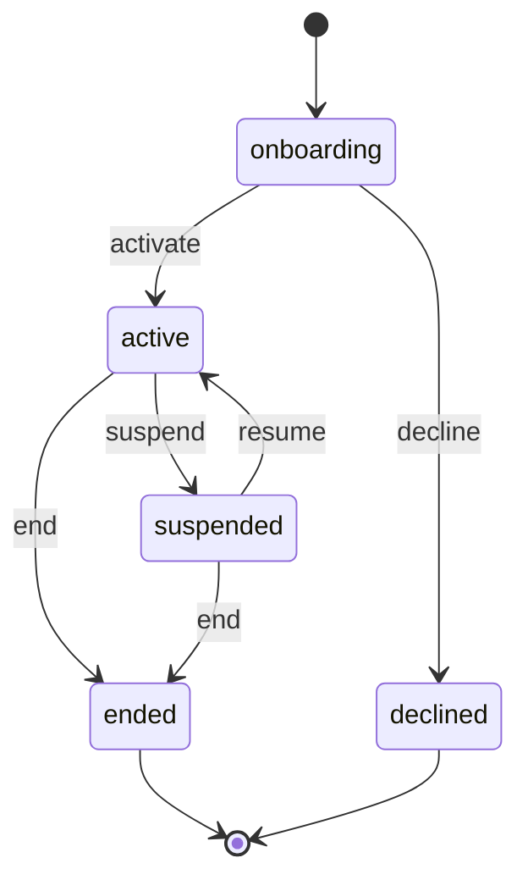
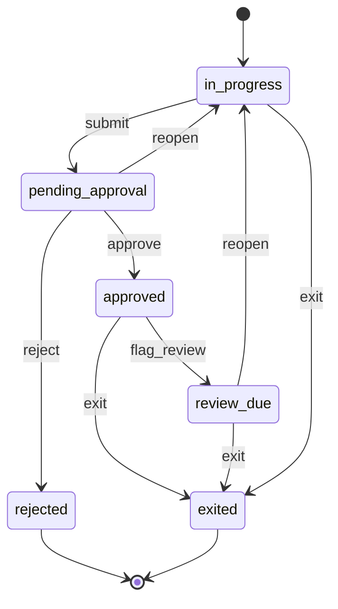
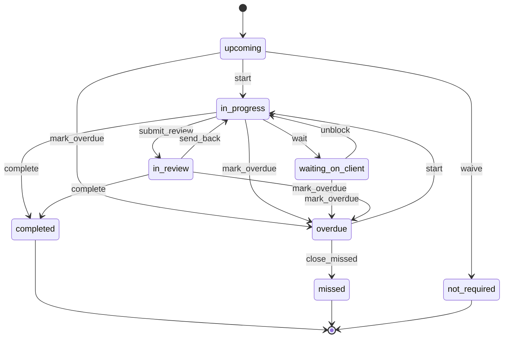
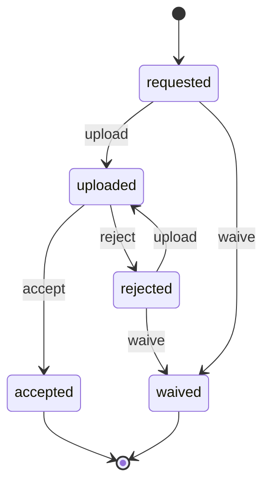
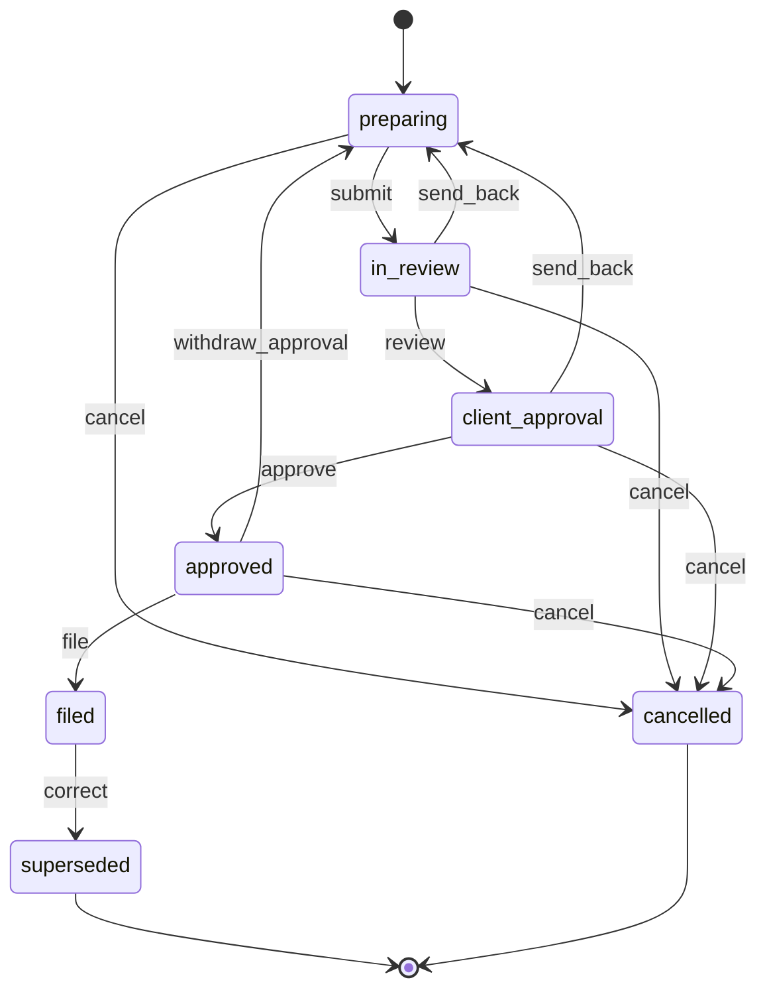
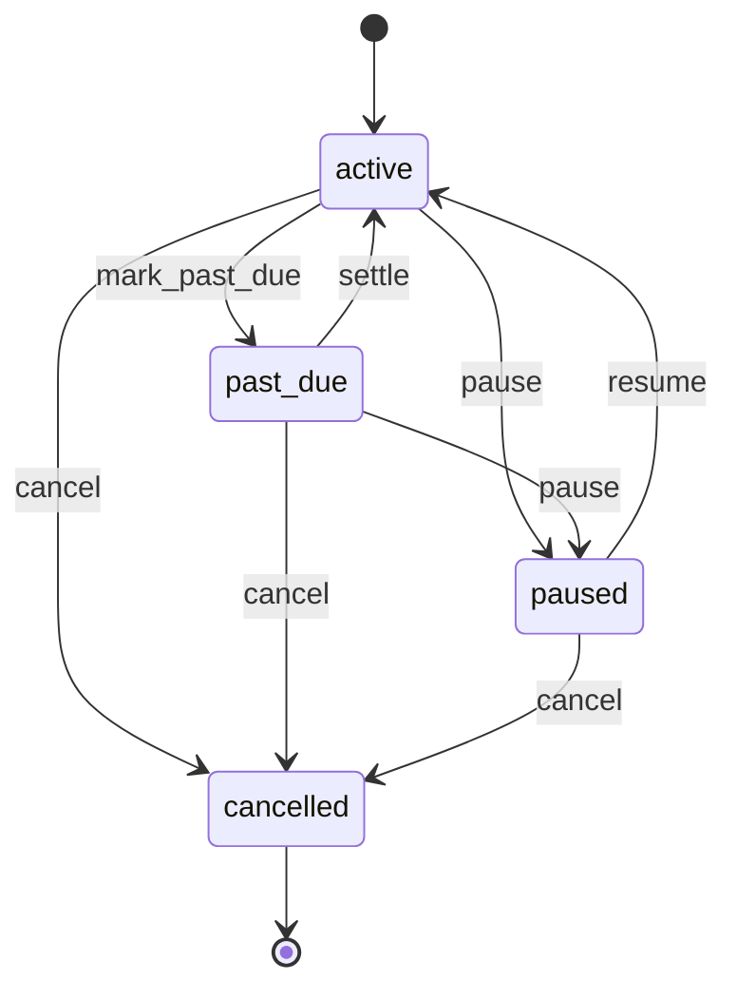
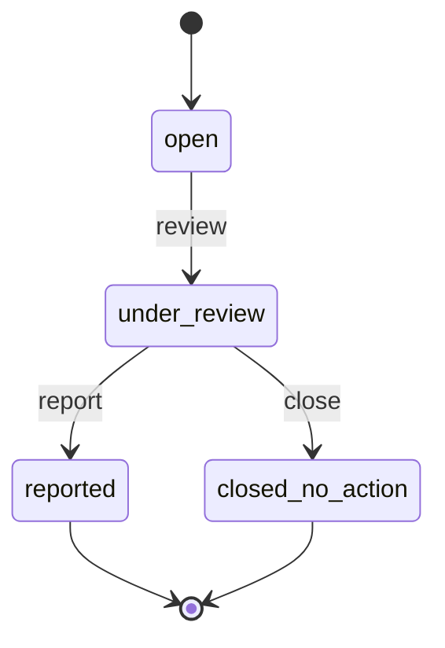
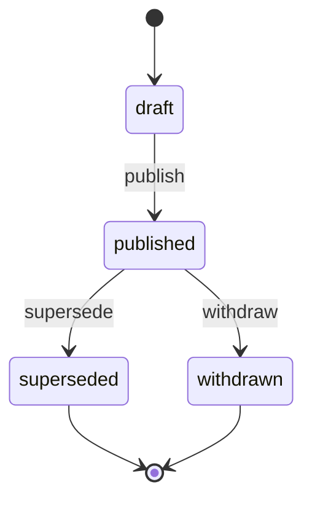

# 04 — Accounting Firms & Fractional CFO Services

> Status: accepted · Reviewed: 2026-10-15 · Last updated: 2026-10-16

## 1. Summary

Small and mid-sized accounting, tax and fractional-CFO firms in the UAE serve dozens to
hundreds of SME clients each. Since corporate tax arrived and VAT enforcement tightened,
they have more work and more deadlines than their spreadsheets and email inboxes can track.
Chasing documents, meeting filing dates and keeping anti-money-laundering files complete are
the main pain points. The app gives the firm one place for client onboarding and due
diligence, a compliance calendar per client, document requests through a secure client
portal, return workflows with review and client approval, time and retainer billing, and
KPI packs for clients. **It is not a general ledger.** Clients' books stay in Zoho Books,
Xero, QuickBooks or Tally.

## 2. Business context (UAE)

- **Customer size:** 3–60 staff, 30–600 client companies, mostly SMEs on the mainland and in
  free zones. Revenue comes from monthly retainers (bookkeeping, VAT, CFO services) plus
  one-off work (corporate tax registration and returns, audits support, liquidations).
- **How they work today:** a shared drive per client, email and WhatsApp for document
  requests, an Excel deadline tracker, time sheets in Excel or not at all, invoices from their
  own accounting software, and AML files as scanned folders.
- **Rules and practice that shape the work:**
  - **VAT returns** are filed per tax period (usually quarterly, some monthly) on the FTA's
    **EmaraTax** portal; return and payment are due by the 28th day after the period ends
    ✔ [S1]. Tax periods are staggered by the FTA, so each client has its own cycle.
  - **Corporate tax** at 9% on taxable income above AED 375,000 applies to financial years
    starting on or after 1 June 2023. Return and payment are due within 9 months of the end
    of the tax period ✔ [S2]. **Small Business Relief** (revenue up to AED 3m, elected in the
    return) now covers tax periods ending on or before **31 December 2029** (Ministerial
    Decision 131 of 2026) ✔ [S3]. A **Qualifying Free Zone Person** pays 0% on qualifying
    income if it meets substance, audited accounts, transfer pricing and the de minimis test
    (non-qualifying revenue at most 5% of revenue or AED 5m, whichever is lower; Cabinet
    Decision 100 of 2023, Ministerial Decision 229 of 2025); failing loses the status for
    five years ✔ [S4].
  - **Tax agents** must be on the FTA register to represent clients; a firm registers as a
    tax agency linked to at least one registered individual agent ✔ [S5]. The client stays
    legally responsible and may file through its own EmaraTax users. The Tax Procedures Law
    (Decree-Law 28 of 2022, Art. 12(2)) bars anyone not on the register from practising as a
    tax agent, and does not expressly stop a client from authorising a user on its own
    account ✔ [S16]. Whether an outside firm filing that way for a fee counts as unregistered
    practice is `⚠ open: lawyer (L-16)`; the app assumes filing by a registered agent or by the
    client's own staff.
  - **AML/CFT:** the law is Federal Decree-Law 10 of 2025 with its executive regulations,
    Cabinet Resolution 134 of 2025 (replacing Decree-Law 20 of 2018 and Cabinet Resolution
    10 of 2019) ✔ [S10]. Independent accountants are **DNFBPs** when they prepare or carry out
    transactions for clients: real estate, managing client money or accounts, organising
    contributions, or creating and managing companies (Art. 3(4)). In practice the supervisor,
    the **Ministry of Economy and Tourism**, registers all accounting and audit firms
    ✔ [S10], [S11]. Obligations ✔ [S10]:
    - customer due diligence, kept up to date by risk, with enhanced due diligence for high
      risk (Art. 8); the review cycle (12/24/36 months here) is firm policy;
    - beneficial owners: 25% or more, otherwise control, otherwise senior management (Art. 10);
    - a compliance officer (MLRO) at management level (Art. 22);
    - suspicious transaction reports through **goAML**, immediately (Art. 18); registering
      on goAML is mandatory, and MoET has suspended firms that did not ✔ [S11];
    - no tipping off (Art. 19);
    - records kept at least 5 years from the end of the relationship or transaction, or from
      a later inspection, investigation or judgment (Art. 25).
  - **Targeted financial sanctions** (Cabinet Decision 74 of 2020): register with the
    Executive Office's notification system, screen regularly and immediately after list
    changes, and **freeze without delay (within 24 hours)** on a match, then notify the
    supervisor ✔ [S12]. Lists: the UAE Local Terrorist List (PDF, Excel) and the UN
    Consolidated List (XML) ✔ [S12], [S13].
  - **UBO register** (Cabinet Resolution 109 of 2023): companies keep a beneficial-owner
    register, record changes within 15 days, give the data to the registrar within 60 days
    and answer registrar requests within 14 days. Penalties AED 15,000–100,000 (Cabinet
    Resolution 132 of 2023) ✔ [S14].
  - **ESR** (economic substance) applies only to financial years 2019–2022 (Cabinet
    Decision 98 of 2024) ✔ [S6]. Out of scope.
  - **E-invoicing** covers all B2B supplies, including the firm's own invoices to its
    clients, through an accredited service provider (ASP). Pilot from 1 July 2026; revenue
    of AED 50m or more goes live 1 January 2027 (ASP appointed by 30 October 2026), others 1
    July 2027 (ASP by 31 March 2027) ✔ [S7]. For the app this is the shared e-invoicing
    adapter behind `FIN.INV.01`; for the firm it is also advisory work.

## 3. Users and access

Follows [ACCESS-CONTROL.md](../ACCESS-CONTROL.md). Platform-wide rules (`PLT.ACL.*`) are not
repeated here.

### 3.1 Roles

| Role | Actor type | What they do | Permissions (summary) | Typical scope |
|---|---|---|---|---|
| Partner | staff | Owns client relationships; accepts clients; signs off returns; approves write-offs and high-risk clients | all, including fees and profitability | global |
| Manager | staff | Runs a portfolio of clients; reviews returns; assigns work | engagements, tasks, returns (review), time approval, invoices (draft) | client company |
| Accountant / associate | staff | Collects documents, prepares returns and KPI packs, logs time | requests, tasks, returns (prepare), time entries | client company |
| Tax specialist | staff | Corporate tax and VAT technical work, reviews | returns (prepare, review), tax profiles | client company or global |
| Compliance officer (MLRO) | staff | CDD approvals, periodic reviews, AML cases, goAML reports | CDD, AML cases (sensitive), screening | global |
| Billing / admin | staff | Proposals, retainers, invoices, collections, client onboarding admin | quotations, subscriptions, invoices, payments | global |
| Client owner / approver | external | Signs the engagement letter, approves returns for filing, sees everything of their company | portal: all of own company, approve | own company |
| Client finance contact | external | Uploads documents, answers queries, sees deadlines and KPI packs | portal: requests, queries, KPI packs | own company |
| Client viewer | external | Sees KPI packs and filed returns only | portal: read-only | own company |

### 3.2 Scope

The scope unit is the **client company (engagement)**. Managers, accountants and tax
specialists are assigned per client, and can cover a colleague's clients for a dated period
(holidays, filing peaks). Partners, the MLRO and billing staff are usually global. Client
users have no scope. Their access comes from party ownership (`OWN`).

### 3.3 Access rules

| ID | Rule | Pattern | Applies to | Parameter (default) |
|---|---|---|---|---|
| `ACC.ACL.01` | A client user sees only their own company's requests, documents, deadlines, returns, invoices and KPI packs | `OWN` | client users | — |
| `ACC.ACL.02` | Staff see only clients of engagements they are assigned to | scope | manager, accountant, tax specialist | — |
| `ACC.ACL.03` | The reviewer of a VAT or corporate tax return cannot be its preparer | `SOD` | accountant, tax specialist, manager | on |
| `ACC.ACL.04` | A filed return is locked; a correction is a new version. For VAT, an error above AED 10,000 of tax needs a voluntary disclosure reference; a smaller error is corrected in the next period's return, which the new version names ✔ [S18]. Corporate tax corrections need a voluntary disclosure reference until an accountant confirms otherwise (`⚠ open: accountant (A-14)`) | `STA` | all staff | AED 10,000 |
| `ACC.ACL.05` | AML cases and suspicious-activity reports are visible only to the MLRO and their deputy, never to client-facing staff or the portal (no tipping off) | `SEN`, `FLD` | all except MLRO | — |
| `ACC.ACL.06` | Accepting a client rated high risk needs the MLRO's and a partner's approval | `LIM`, `SOD` | manager, partner | risk rating = high |
| `ACC.ACL.07` | An engagement cannot become active until CDD is approved | `STA` | partner, manager | — |
| `ACC.ACL.08` | Fees, cost rates and client profitability are hidden from associates | `FLD` | accountant | — |
| `ACC.ACL.09` | Writing off unbilled time above a share of the engagement's WIP needs a partner | `LIM` | manager | 10% |
| `ACC.ACL.10` | Passports, Emirates IDs and bank statements need `kyc.sensitive.view`; each view is audited | `SEN` | all staff | — |
| `ACC.ACL.11` | Only a client user with the *approver* portal role can approve a return for filing | `OWN` | client users | — |
| `ACC.ACL.13` | A change to the tax profile fields that drive the calendar (VAT period and stagger, financial year end, VAT or corporate tax registration or deregistration, Small Business Relief, QFZP status) takes effect only after a manager other than the requester approves it, with an effective date; one pending change per profile at a time | `SOD` | accountant, tax specialist, manager | on |
| `ACC.ACL.14` | When an engagement is suspended or ended for a restricted reason (sanctions, AML concern), staff without `parties.block_reason.view` and the portal see only "On hold" or "Ended"; no automatic message goes to the client; the MLRO decides what the client is told, with a neutral template | `SEN`, `FLD` | all except MLRO and deputy | — |
| `ACC.ACL.15` | A return is filed only by a staff member whose FTA tax agent registration is valid on the filing date and linked to the firm's tax agency (`qualification_valid`, `HRM.QUA.01`), or recorded as filed by the client through its own EmaraTax user ("filed by the client's own staff"; the acknowledgement shows the client's user, noted on the return) | `STA` | returns.file holders | — |
| `PTY.ACL.02` *(shared)* | Restricted block reasons (sanctions, AML concern) and block records are visible only to the MLRO and deputy (`parties.block_reason.view`); everyone else sees "On hold"; the portal sees no block | `SEN`, `FLD` | all staff, client users | — |
| `PTY.ACL.03` *(shared)* | While a client is blocked, no engagement or retainer is started, renewed or extended (no exception), and no money is paid out to it (refund of a prepaid retainer, credit balance) unless the MLRO approves an exception for that payment | `STA`, `LIM` | partner, billing | — |
| `DOC.ACL.02` *(shared)* | An expired client KYC document blocks engagement activation; a one-use override needs a reason and the MLRO's approval, valid 72 hours | `SOD`, `TIM` | manager, MLRO | 72 hours |
| `FIN.ACL.15` *(shared)* | Writing off an invoice balance as a bad debt needs a partner's approval; the requester cannot approve | `LIM`, `SOD` | billing, manager | AED 0 (every write-off) |
| `POR.ACL.01` *(shared, formerly `ACC.ACL.12`)* | After an engagement ends, client users keep read-only access to their filed returns and documents, then the portal closes | `TIM` | client users | closes after 90 days |

## 4. Value streams

### 4.1 Lead to engagement

1. An enquiry is recorded and qualified (`SAL.CRM.01`).
2. A proposal with services and fees is sent (`FIN.QUO.01`, `DOC.GEN.01`).
3. On acceptance, the client company, its shareholders and beneficial owners are recorded
   with their identity documents (`PTY.PTY.01`, `PTY.KYC.01`, `PTY.UBO.01`, `DOC.FIL.01`).
4. Names are screened against sanctions lists (`PTY.SCR.01`).
5. The CDD risk assessment is completed and approved. A high-risk client needs enhanced due
   diligence and extra approval (`ACC.KYC.01`, `ACC.ACL.06`, `PLT.APR.01`).
6. The engagement letter is generated and signed in the portal (`DOC.GEN.01`,
   `DOC.SIG.01`).
7. The engagement is activated: services, team, fees, tax profile (TRN, VAT period,
   financial year, corporate tax status). Its compliance calendar is generated
   (`ACC.ENG.01`, `ACC.TAX.01`, `ACC.CMP.01`).
8. Retainer billing starts (`FIN.SUB.01`).

**When it goes wrong**

| Case | What happens | Where |
|---|---|---|
| Engagement letter never signed | `ACC.RUL.11` reminds the client approver at 7 and 14 days; at 30 days the manager gets a task to chase or `decline` with the reason *letter not signed* | Engagement `decline` |
| CDD rejected | The engagement is `decline`d; the reason stays visible to the MLRO only; the client is told with a neutral template | CDD `reject` |
| A KYC document expires before activation | `activate` is refused (block); the MLRO may approve a one-use override with a reason (`DOC.ACL.02`) | §9 Document blocks |
| Sanctions lists are stale or a possible match is open | `activate` and CDD `approve` are refused until the lists are current and the screening is re-run (`PTY.RUL.02`), or the possible match is decided | §4.6 |

### 4.2 Period document collection and close

1. At each period end, a document request list (sales invoices, purchase invoices, bank
   statements, payroll) is created from the engagement's template (`ACC.REQ.01`,
   `POR.DOC.01`).
2. The client uploads files in the portal against each item (`POR.SLF.01`, `POR.DOC.01`).
3. The accountant accepts or rejects each item, and raises queries as tickets the client
   answers in the portal (`WRK.TKT.01`, `WRK.TKT.02`).
4. Bookkeeping happens in the client's own ledger (outside the app).
5. The month-end close checklist is completed (`ACC.MCL.01`, `WRK.CHK.01`).
6. The trial balance or P&L is exported from the client's ledger and imported. A KPI pack is
   published to the portal (`ACC.KPI.01`).

**When it goes wrong**

| Case | What happens | Where |
|---|---|---|
| The client never uploads | `POR.RUL.01` reminds the client, then the accountant; the linked task waits on the client and turns `overdue` at its due date | Task |
| Request e-mail bounces | The notice is statutory: the contact point is marked invalid and a staff task (1 working day) asks for delivery by another means with proof; until then the request shows "notice not delivered" and its reminder deadlines do not start (`NTF.RUL.01`) | §9 Notices |
| Trial balance re-imported after publication | `ACC.RUL.06` creates a new draft version; the published pack shows "being revised" until the new version is published, then becomes `superseded` | KPI pack |
| Pack published to the wrong client or with wrong figures | `withdraw` removes it from the portal; a wrong-client release opens a privacy incident task for the company admin | KPI pack |
| Engagement suspended | No new request lists are created; open requests stop reminding the client | Engagement `suspend` |

### 4.3 Compliance calendar

1. Deadlines are generated from each client's tax profile and documents: VAT returns, VAT
   payments, corporate tax registration and return, trade licence renewal, UBO updates
   (`ACC.CMP.01`, `WRK.TSK.01`, `DOC.EXP.01`).
2. Each deadline becomes a task with an owner and a lead time (`WRK.TSK.01`).
3. Reminders go to staff and, where the client must act, to the client (`ACC.RUL.01`).
4. A task closes only with evidence attached, e.g. the FTA acknowledgement (`DOC.FIL.01`).

**When it goes wrong**

| Case | What happens | Where |
|---|---|---|
| Due date passes | The task becomes `overdue` (`ACC.RUL.04`), the partner is told, and it can still be completed (flagged *late*); a manager closes it as `missed` only with a reason | Task |
| Tax profile changes (new stagger, financial year, registration or deregistration) | Approved by a manager (`ACC.ACL.13`) with an effective date; `ACC.RUL.10` regenerates the calendar from that date (tasks for periods ending before it stay as they are): upcoming tasks that no longer apply are waived with the reason *tax profile changed*, new tasks are created, and started or overdue tasks that no longer match are listed for the manager | `ACC.RUL.10` |
| Deadlines fall inside a suspension | On `suspend`, `ACC.RUL.09` sends the client the statutory deadlines due in the next 90 days, says the firm will not act on them while suspended, and asks the client approver to acknowledge in the portal. No acknowledgement within 7 days: task for the partner. Not sent for a restricted reason (`ACC.ACL.14`); on `end` for a restricted reason the MLRO gets a task with the deadline list instead (`ACC.RUL.09`) | Engagement `suspend` |
| Deadline notice not delivered | Statutory notice: staff task to deliver it by another means and record proof (`NTF.RUL.01`) | §9 Notices |

### 4.4 Tax return (VAT or corporate tax)

1. A return is opened for the period from the compliance calendar (`ACC.VAT.01`,
   `ACC.CTX.01`).
2. The preparer completes the workpapers and attaches the figures.
3. A different reviewer reviews it (`ACC.ACL.03`).
4. The client approver approves it in the portal (`ACC.ACL.11`).
5. The firm files it on EmaraTax and uploads the acknowledgement (manual step).
6. If tax is payable, the client is reminded of the payment deadline (`ACC.RUL.01`).
7. A later correction is a new version (`ACC.ACL.04`). For VAT, a tax error above AED
   10,000 needs a voluntary disclosure within 20 business days of finding it; a smaller
   error is corrected in the next return ✔ [S18].

**When it goes wrong**

| Case | What happens | Where |
|---|---|---|
| Reviewer or client sends it back | `send_back` to `preparing` with a comment | Return |
| Client withdraws its approval before filing | `withdraw_approval` returns it to `preparing`; the signature is kept and marked withdrawn; the preparer gets a task to rework the return and bring the linked task back to work | Return |
| Filer is not a registered tax agent | `file` is refused unless the filer's tax agent registration is valid, or the return is recorded as filed by the client itself (`ACC.ACL.15`) | Return `file` |
| A client KYC document has expired | `file` runs but the return is flagged for the MLRO (flag mode) | §9 Document blocks |
| Return no longer needed (engagement ended, client files itself) | `cancel` with a reason; the client is told who now files it | Return `cancel` |

### 4.5 Time to cash

1. Staff log time against an engagement and service (`HRM.TMS.01`).
2. The monthly retainer is invoiced automatically (`FIN.SUB.01`, `FIN.INV.01`).
3. Work outside the retainer is billed from approved time (WIP), with write-offs approved
   above the limit (`ACC.TIM.01`, `ACC.ACL.09`).
4. Payments are received and allocated. Overdue invoices trigger reminders, and optionally
   suspension of the engagement (`FIN.PAY.01`, `FIN.CHQ.01`, `FIN.REC.01`, `ACC.RUL.07`).

**When it goes wrong**

| Case | What happens | Where |
|---|---|---|
| Client disputes an invoice | Client users with the approver role may raise it in the portal; the invoice is `disputed`, reminders and `ACC.RUL.07` pause, and a ticket goes to the engagement manager; resolved as *upheld* or *credited* | wl-invoicing §5.10 |
| Cheque bounces | wl-payments cheque path (re-present, settle, legal case or write-off); the client goes on credit hold until resolved: in 04 the hold is only a *credit hold* badge shown to billing staff and partners (there are no sales orders to hold) and blocks nothing; no bounce fee by default | wl-payments |
| Invoice uncollectable | `write_off` with a partner's approval (`FIN.ACL.15`); the write-off notice goes to the client; VAT bad-debt relief is proposed by `FIN.RUL.14` when its conditions are met | wl-invoicing §5.9 |
| Engagement suspended | The retainer is paused (no cycle invoices) and resumes with the engagement; time already logged stays billable | Engagement `suspend` |
| Engagement ends mid-period | The retainer is cancelled with a pro-rata final invoice or credit; unbilled WIP is billed or written off (`ACC.ACL.09`); returns not filed are cancelled or finished first; the client gets the list of deadlines due in the next 90 days (`ACC.RUL.09`) | Engagement `end` |

### 4.6 Ongoing AML

1. CDD reviews are scheduled by risk rating (`ACC.KYC.02`).
2. Re-screening runs when sanctions lists change or at review (`PTY.SCR.01`).
3. Staff raise concerns internally. The MLRO opens a case, investigates, and either closes
   it or files a suspicious transaction report on goAML (manual), recording the reference
   (`ACC.AML.01`, `ACC.ACL.05`).
4. **Confirmed sanctions match on an active client** (the client, a UBO, a director or a
   signatory): `confirm_match` blocks the party with the restricted reason `sanctions`;
   wl-parties also blocks the related client company (related-person block, on; if it did not,
   `ACC.RUL.12` blocks it itself), and `ACC.RUL.12` opens an AML case linked to the screening,
   and the freeze and report tasks (due 24 hours after the flag) go to the MLRO. The block
   suspends the engagement with the neutral reason *on hold*, pauses the retainer, holds
   open tasks and stops money out (`PTY.ACL.03`). No message goes to the client
   (`ACC.ACL.14`). The MLRO then decides to keep the engagement suspended or exit.
5. **MLRO exits a client:** CDD `exit` (reason visible to the MLRO only). The partner gets a
   task to `end` the engagement with the neutral reason *relationship ended*; returns not
   filed are cancelled. Nothing goes to the client automatically: on `end` the MLRO gets a task
   with the deadline list and chooses the neutral template that tells the client which
   deadlines it must now meet itself (`ACC.RUL.09`).
6. **List freshness:** each list shows its last successful update. A failed or late download
   (over 24 hours) alerts the MLRO at once and retries hourly (`PTY.RUL.02`); screenings run
   on a stale list are re-run after the next update, and onboarding cannot finish meanwhile.
7. **No tipping off:** suspension, end and block reasons show as "On hold" to everyone except
   the MLRO and deputy; the portal shows no block and gets no automatic message
   (`PTY.ACL.02`, `ACC.ACL.14`).

## 5. Capabilities

| ID | Capability | Shared or specific | Proposed module | Scope |
|---|---|---|---|---|
| `PLT.ORG.01` | Branded deployment | shared | wl-kernel | MVP |
| `PLT.USR.01` | Staff users, roles, permissions scoped per client | shared | Renox Permissions | MVP |
| `PLT.AUD.01` | Audit trail | shared | Renox Audit | MVP |
| `PLT.APR.01` | Approval requests (client acceptance, write-offs) | shared | wl-kernel | MVP |
| `PLT.WFL.01` | State machines with history | shared | Renox (R12) + wl-kernel | MVP |
| `PLT.ATM.01` | Default automation rules | shared | wl-kernel | MVP |
| `PLT.HOK.01` | Outbound webhooks | shared | Renox (R11) | Later |
| `PTY.PTY.01` | Parties: client companies, shareholders, contacts | shared | wl-parties | MVP |
| `PTY.REL.01` | Client groups: related companies under one group, with the portal party switcher | shared | wl-parties | MVP |
| `PTY.KYC.01` | Identity fields: trade licence, TRN, Emirates ID, passport | shared | wl-parties | MVP |
| `PTY.UBO.01` | Ownership structure and beneficial owners of a company party | shared (**new**) | wl-parties | MVP |
| `PTY.SCR.01` | Sanctions and watch-list screening of parties, with re-screening and results log | shared (**new**) | wl-parties | MVP |
| `DOC.FIL.01` | Attach documents (filings, acknowledgements, workpapers) | shared | wl-documents | MVP |
| `DOC.EXP.01` | Expiry reminders (trade licences, passports, Emirates IDs of UBOs, trademark and other registrations of the firm) | shared | wl-documents | MVP |
| `DOC.GEN.01` | Generate documents (proposal, engagement letter, KPI pack) | shared | wl-documents | MVP |
| `DOC.SIG.01` | E-signature / acceptance (engagement letters, return approvals) | shared (**new**) | wl-documents | MVP |
| `FIN.QUO.01` | Proposals (quotations) | shared | wl-invoicing | MVP |
| `FIN.BIL.01` | Charge schedule from an agreement (fixed-fee instalments) | shared | wl-invoicing | MVP |
| `FIN.SUB.01` | Recurring retainers billed to clients | shared (**new**) | wl-invoicing (+ renox-billing via wl-payments) | MVP |
| `FIN.INV.01` | Tax invoices with VAT | shared | wl-invoicing | MVP |
| `FIN.PAY.01` | Record and allocate payments | shared | wl-payments | MVP |
| `FIN.PAY.02` | Online payment from the portal | shared | wl-payments | Later |
| `FIN.CHQ.01` | Post-dated cheque register | shared | wl-payments | MVP |
| `FIN.REC.01` | Receivables ageing and reminders | shared | wl-invoicing | MVP |
| `FIN.EXT.01` | Export to the firm's accounting software | shared | wl-invoicing | Later |
| `WRK.TKT.01` | Raise queries (staff to client and back) | shared | wl-ticketing | MVP |
| `WRK.TKT.02` | Triage and assignment | shared | wl-ticketing | MVP |
| `WRK.CHK.01` | Checklists (month-end close, onboarding) | shared | wl-ticketing | MVP |
| `WRK.TSK.01` | Recurring tasks and deadline calendar | shared (**new**) | wl-ticketing | MVP |
| `POR.SLF.01` | Client self-service portal | shared | wl-portal | MVP |
| `POR.DOC.01` | Secure document exchange through the portal (request lists, uploads) | shared (**new**) | wl-portal | MVP |
| `NTF.MSG.01` | Email notifications | shared | wl-notify | MVP |
| `NTF.MSG.02` | WhatsApp notifications | shared | wl-notify | Later |
| `RPT.DSH.01` | Role-based dashboards | shared | Renox charts + wl-kernel | MVP |
| `HRM.TMS.01` | Time entries against engagements and services | shared | wl-attendance | MVP |
| `HRM.EMP.01` | Minimal staff records for time entries: person, team, cost rate (no payroll or visas) | shared | wl-hr | MVP |
| `HRM.QUA.01` | FTA tax agent registration per staff member, with the validity guard on return filing | shared | wl-hr | MVP |
| `SAL.CRM.01` | Leads and enquiries pipeline | shared | wl-sales | MVP |
| `PLT.ENT.01` | Legal entities: several trade licences and TRNs in one deployment; issuer on every document | shared | wl-kernel | MVP |
| `PLT.IMP.01` | Data import and migration: Excel templates per entity, validation, dry run, rollback | shared | wl-kernel | MVP |
| `PLT.SRC.01` | Global search across records, including Arabic names | shared | wl-kernel + Renox search | MVP |
| `PLT.NOT.01` | Notes, comments and @mentions on any record, with an activity timeline | shared | wl-kernel | MVP |
| `PLT.SSO.01` | Staff single sign-on with Microsoft 365 or Google Workspace | shared | Renox OAuth (renox-oauth) | Later |
| `RPT.LIB.01` | Report library: filtered reports with export to Excel, CSV and PDF | shared | wl-kernel | MVP |
| `RPT.SCH.01` | Scheduled reports sent by email | shared | wl-kernel | Later |
| `FIN.VAT.01` | VAT summary per period and entity: output and input VAT, for the accountant | shared | wl-invoicing | MVP |
| `FIN.EXP.01` | Expense claims and petty cash: submit with receipt, approve, reimburse, top up | shared | wl-payments | Later |
| `FIN.BNK.01` | Bank statement import and matching of receipts to open invoices | shared | wl-payments | MVP |
| `SAL.CRM.02` | Lead sources and campaigns: cost per campaign, conversion by source and channel, cost per lead, customer acquisition cost and return on ad spend | shared | wl-sales | MVP |
| `FIN.CFL.01` | Cash-flow forecast: expected receipts and payments by week from invoices, supplier bills, scheduled charges, post-dated cheques, payroll and budgets | shared | wl-invoicing | MVP |
| `FIN.BUD.01` | Company budget vs actual by period, category and entity; owner drawings kept apart from operating cost | shared | wl-invoicing | MVP |
| `HRM.ONB.01` | Staff onboarding checklists per role and a library of SOP documents with acknowledgement | shared | wl-hr + wl-documents | MVP |
| `ACC.KYC.01` | CDD risk assessment and rating, enhanced due diligence, approval | specific | apps/accounting | MVP |
| `ACC.KYC.02` | Periodic CDD reviews scheduled by risk rating | specific | apps/accounting | MVP |
| `ACC.AML.01` | AML case log for the MLRO, with goAML report references | specific | apps/accounting | MVP |
| `ACC.ENG.01` | Engagements: services, team, fees, terms, period templates | specific | apps/accounting | MVP |
| `ACC.TAX.01` | Client tax profile: TRN, VAT period, financial year, corporate tax registration and status | specific | apps/accounting | MVP |
| `ACC.CMP.01` | Compliance calendar generated from the tax profile | specific | apps/accounting | MVP |
| `ACC.REQ.01` | Period document request lists (PBC) from templates | specific | apps/accounting | MVP |
| `ACC.VAT.01` | VAT return workflow: prepare, review, client approval, filing evidence | specific | apps/accounting | MVP |
| `ACC.CTX.01` | Corporate tax return workflow | specific | apps/accounting | MVP |
| `ACC.MCL.01` | Month-end close checklist templates per client | specific | apps/accounting | MVP |
| `ACC.KPI.01` | Client KPI packs from imported trial balance or P&L (CSV/Excel; presets for Zoho Books, Xero, QuickBooks and Tally; saved account mapping per client) | specific | apps/accounting | MVP |
| `ACC.KPI.02` | Live connectors to Zoho Books, Xero, QuickBooks | specific | apps/accounting | Later |
| `ACC.TIM.01` | Billing of work in progress from time, with write-offs | specific | apps/accounting | MVP |
| `ACC.CAP.01` | Staff capacity and workload planning | specific | apps/accounting | Later |
| `ACC.RPT.01` | Firm reports: deadline status, WIP, realisation, profitability per client | specific | apps/accounting | MVP |

*New* = a shared capability first needed by this vertical among 03–10.

## 6. Key entities

| Entity | Description | Important fields | Owned by |
|---|---|---|---|
| Client company | The firm's client | party (company), client group (optional), trade licence, jurisdiction (mainland/free zone), industry, contacts | wl-parties |
| Beneficial owner | Person owning or controlling the client | party (person), ownership %, control type, identity documents | wl-parties |
| Screening result | A sanctions check | party, lists checked, date, hits, decision, reviewer | wl-parties |
| CDD file | Due diligence record | client, risk factors, rating, EDD notes, approvals, next review date, exit reason (MLRO only), status | apps/accounting |
| Engagement | The service contract | client, services, team, fee basis (retainer/fixed/time), period templates, start/end, suspension or end reason (neutral code shown to staff), deadline notice and client acknowledgement, status | apps/accounting |
| Tax profile | Client's tax facts, versioned by effective date | TRN, VAT period and stagger, financial year end, CT registration no., small business relief, QFZP status, effective date, approved by | apps/accounting |
| Task (deadline) | Something due by a date | client, type, due date, lead time, owner, evidence, status | wl-ticketing |
| Document request | One item the client must provide | client, period, item, due date, uploaded files, status | wl-portal + wl-documents |
| Return | A VAT or corporate tax return | client, type, period, version, preparer, reviewer, figures, filed by (tax agent and registration number, or the client), acknowledgement, correction route (voluntary disclosure reference, or the next return), status | apps/accounting |
| Query | A question to or from the client | client, subject, messages, status | wl-ticketing (ticket) |
| Time entry | Work logged | staff, engagement, service, date, hours, billable, rate | wl-attendance |
| Subscription (retainer) | Recurring fee | client, plan/amount, cycle, start, status | wl-invoicing (renox-billing) |
| KPI pack | Periodic management report | client, period, version, imported figures, KPIs, commentary, published date, status | apps/accounting |
| AML case | Internal suspicion | client, raised by, facts, decision, goAML reference, status | apps/accounting |

## 7. Workflow

Follows [WORKFLOW.md](../WORKFLOW.md). **Invoice, cheque and ticket** (queries) reuse the
state machines in [01-property.md](01-property.md#71-state-machines). **Quotation**
(proposals) and **timesheet** (time approval) reuse those in
[02-construction.md](02-construction.md#71-state-machines).

*Working day* and *business day* mean the same here: a day of the firm's kernel business
calendar (Asia/Dubai; weekends and UAE public holidays excluded). "Due in 1 working day" is the
next such day after the event.

### 7.1 State machines

#### Engagement

| State | Tone | Terminal | Meaning |
|---|---|---|---|
| `onboarding` | neutral | no | Proposal accepted; CDD and engagement letter in progress |
| `active` | success | no | Services running; calendar and billing on |
| `suspended` | warning | no | Paused for non-payment, at the client's request, or because the client is blocked; tasks held |
| `ended` | neutral | yes | Services stopped; portal read-only (`POR.ACL.01`) |
| `declined` | neutral | yes | Not accepted (CDD failed, letter not signed, or client withdrew) |

| Transition | From | To | By | Guards | Effects |
|---|---|---|---|---|---|
| `activate` | onboarding | active | `engagements.manage` | CDD `approved` (`ACC.ACL.07`); engagement letter signed; tax profile complete; client KYC documents valid (`document_valid`, block; override `DOC.ACL.02`); latest screening of each screened party of the CDD file (the client company, its UBOs, directors and signatories, as for CDD `approve`) not run on a stale list and no open possible match (`PTY.RUL.02`); client not blocked (no exception: the `PTY.ACL.03` exception covers money out only) | compliance calendar generated; retainer subscription started |
| `decline` | onboarding | declined | `engagements.manage` | reason given | client users disabled; client told with a neutral template |
| `suspend` | active | suspended | `engagements.manage`, or system (`ACC.RUL.07`; `PartyBlocked` with the neutral reason *on hold*) | reason given | open tasks held (no client reminders, no new request lists); retainer `pause`; for a reason that is not restricted, `ACC.RUL.09` sends the client the statutory deadlines due in the next 90 days and asks for acknowledgement; for a restricted reason nothing is sent (`ACC.ACL.14`); for a suspension from `PartyBlocked` nothing is sent automatically (wl-parties §5.6) and, when the block reason is not restricted, the partner gets a task with the deadline list and the neutral template (`ACC.RUL.09`). A block on an engagement already suspended runs no second transition: the shown reason becomes *on hold* and the original reason stays in the history for staff with access |
| `resume` | suspended | active | `engagements.manage`; after a block, only once the party is unblocked, through an approval request to the MLRO or deputy (rejected or returned: stays `suspended`) | client not blocked | tasks released, past-due ones `overdue`; retainer `resume`; request lists for skipped periods created at once, due today plus the template's lead days, with one client notice for all; pending deadline notice reminders cancelled |
| `end` | active, suspended | ended | `engagements.end` (partner); after a CDD `exit`, on the MLRO's task | end date today or later (a future date keeps the engagement `active` until a scheduled `end` on that date, with the guards checked again then; if one fails, the end does not run, the partner gets a task listing the open items, and the scheduled `end` is tried again each day until it passes or the partner changes or removes the date); every open return filed or cancelled; unbilled WIP billed or written off (`ACC.ACL.09`); final invoice or credit issued | retainer `cancel` with pro-rata final invoice or credit; upcoming tasks waived; the client gets the statutory deadlines due in the next 90 days (`ACC.RUL.09`); for a restricted reason (an `end` after a CDD `exit` or a rejected review always counts as restricted) nothing is sent automatically and the MLRO gets a task with the deadline list and the neutral template; refunds to a blocked client wait (`PTY.ACL.03`) |

**Block effect** (wl-parties §5.6): *pause*. A blocked client's engagement is suspended with
the neutral reason; ending it is the MLRO's decision, carried out by the partner through
`end`. The retainer pauses; money out stops; money in continues and, for a restricted reason,
is neither refunded nor paid on without the MLRO.

#### CDD file

| State | Tone | Terminal | Meaning |
|---|---|---|---|
| `in_progress` | neutral | no | Information and documents being collected |
| `pending_approval` | info | no | Risk assessed; waiting for approval |
| `approved` | success | no | Client may be served |
| `review_due` | warning | no | Periodic review date reached |
| `rejected` | error | yes | Client not accepted at onboarding or at a review |
| `exited` | error | yes | Existing relationship ended by the MLRO |

| Transition | From | To | By | Guards | Effects |
|---|---|---|---|---|---|
| `submit` | in_progress | pending_approval | `cdd.prepare` | UBOs identified; identity documents attached; screening done and not on a stale list; risk factors rated | approvers notified |
| `approve` | pending_approval | approved | `cdd.approve` (MLRO) | `ACC.ACL.06` for high risk; no open possible match; no list stale and the latest screenings not run on a stale list (`PTY.RUL.02`) | next review date set from the rating |
| `reject` | pending_approval | rejected | `cdd.approve` | reason recorded (visible to MLRO only) | onboarding: engagement `decline`; existing client: as `exit` |
| `flag_review` | approved | review_due | system | next review date reached, or an AML case `report` (from `approved` only; a file in another state gets the task without a transition) | task for the compliance officer |
| `reopen` | review_due, pending_approval | in_progress | `cdd.prepare` | — | — |
| `exit` | approved, review_due, in_progress | exited | `cdd.approve` (MLRO) | reason recorded (visible to MLRO only) | task for the partner, due in 5 working days, to `end` the engagement with the neutral reason *relationship ended* (one task listing every `active` or `suspended` engagement); no new work accepted; client told only with the neutral template the MLRO chooses (`ACC.ACL.14`) |

#### Task (deadline) *(shared — wl-ticketing)*

> **Canonical definition:** *Task* in [`wl-ticketing` §4](../modules/wl-ticketing.md#4-lifecycles). The terminal `missed` state is replaced by a non-terminal `overdue` state and an explicit `close_missed` transition. This section is this vertical's original requirement; where it differs, the module definition wins and its vertical mapping table records the difference.

`waiting_on_client` is the module's `waiting` state with this vertical's label.

| State | Tone | Terminal | Meaning |
|---|---|---|---|
| `upcoming` | neutral | no | Generated from the calendar; not started |
| `in_progress` | info | no | Being worked on |
| `waiting_on_client` | warning | no | Blocked on client input |
| `in_review` | info | no | Prepared; being reviewed |
| `overdue` | error | no | Due date passed, not completed; can still be completed |
| `completed` | success | yes | Done, with evidence; flagged *late* if it passed through `overdue` |
| `missed` | error | yes | Closed as not done, with a reason |
| `not_required` | neutral | yes | Not applicable this period (e.g. nil return not needed, tax profile changed, engagement ended) |

| Transition | From | To | By | Guards | Effects |
|---|---|---|---|---|---|
| `start` | upcoming, overdue | in_progress | `tasks.work` | — | — |
| `wait` | in_progress | waiting_on_client | `tasks.work` | open request or query linked | client notified |
| `unblock` | waiting_on_client | in_progress | `tasks.work` or system | linked items answered | assignee notified |
| `submit_review` | in_progress | in_review | `tasks.work` | — | reviewer notified |
| `send_back` | in_review | in_progress | `tasks.review` | comment given | — |
| `complete` | in_progress, in_review | completed | `tasks.work` / `tasks.review` | evidence attached when the task type requires it | next occurrence generated |
| `mark_overdue` | upcoming, in_progress, waiting_on_client, in_review | overdue | system (`ACC.RUL.04`) | due date passed | assignee, manager and partner notified |
| `close_missed` | overdue | missed | `tasks.manage` | reason given | next occurrence generated |
| `waive` | upcoming | not_required | `tasks.manage` or system (`ACC.RUL.10`, engagement `end`) | reason given | next occurrence generated, unless the engagement ended or the waive comes from `ACC.RUL.10` (regeneration creates the new tasks) |

While the engagement is suspended, its tasks are *held*: they keep their state and due date,
client reminders stop, and `mark_overdue` still runs because the due date is a fact. A
started task that no longer applies (tax profile changed, engagement ended) is listed for the
manager, who completes it or closes it as `missed` once overdue.

#### Document request *(shared — wl-portal + wl-documents)*

> **Canonical definition:** *Document request* in [`wl-portal` §4](../modules/wl-portal.md#4-lifecycles). Uploaded files become documents in `wl-documents`. This section is this vertical's original requirement; where it differs, the module definition wins and its vertical mapping table records the difference.

| State | Tone | Terminal | Meaning |
|---|---|---|---|
| `requested` | neutral | no | Asked from the client, with a due date |
| `uploaded` | info | no | Client uploaded files; waiting for review |
| `accepted` | success | yes | Files are usable |
| `rejected` | warning | no | Not usable; reason sent to the client |
| `waived` | neutral | yes | Not needed this period |

| Transition | From | To | By | Guards | Effects |
|---|---|---|---|---|---|
| `upload` | requested, rejected | uploaded | client user (`ACC.ACL.01`) | at least one file | assignee notified |
| `accept` | uploaded | accepted | `requests.review` | — | linked task may `unblock` |
| `reject` | uploaded | rejected | `requests.review` | reason given | client notified |
| `waive` | requested, rejected | waived | `requests.review` | reason given | — |

#### Return (VAT or corporate tax)

| State | Tone | Terminal | Meaning |
|---|---|---|---|
| `preparing` | neutral | no | Workpapers in progress |
| `in_review` | info | no | With the reviewer |
| `client_approval` | info | no | Sent to the client approver |
| `approved` | success | no | Approved by the client; ready to file |
| `filed` | success | no | Filed on EmaraTax; acknowledgement attached; locked (`ACC.ACL.04`) |
| `superseded` | neutral | yes | Replaced by a corrected version |
| `cancelled` | neutral | yes | Not filed by the firm (engagement ended, client files itself, not required) |

| Transition | From | To | By | Guards | Effects |
|---|---|---|---|---|---|
| `submit` | preparing | in_review | `returns.prepare` | figures entered; workpapers attached | reviewer notified |
| `send_back` | in_review, client_approval | preparing | `returns.review` or client approver | comment given | preparer notified |
| `review` | in_review | client_approval | `returns.review` | reviewer ≠ preparer (`ACC.ACL.03`) | summary PDF sent to the client approver |
| `approve` | client_approval | approved | client approver (`ACC.ACL.11`) | — | signature recorded (`DOC.SIG.01`) |
| `withdraw_approval` | approved | preparing | client approver, or `returns.review` on the client's written instruction | reason given; a reviewer attaches the written instruction | signature kept and marked withdrawn; preparer and reviewer notified; the linked task is not moved back to work by the system (`mark_overdue` may still move it to `overdue`): the preparer gets a task (due 1 working day, reason "client withdrew approval") to rework the return and bring the linked task back to work through its own transitions (`send_back` by the reviewer from `in_review`, `start` from `overdue`) |
| `file` | approved | filed | `returns.file` | FTA acknowledgement attached; filer's tax agent registration valid on the filing date, or filed by the client (`ACC.ACL.15`); client not blocked, or the MLRO approves (an approval request valid for this return only) | linked task `complete`; payment reminder if tax payable; if a client KYC document has expired, the return is flagged for the MLRO (flag mode) |
| `correct` | filed | superseded | `returns.prepare` | reason; error amount and the date it was found; route, fixed at `correct`: *voluntary disclosure* (always for VAT errors above AED 10,000 of tax, and for corporate tax; the reference may be entered later, but the disclosure task cannot be completed without it) or *next return* (VAT errors of AED 10,000 or less; a later VAT return of the client not yet `filed` is named, or only its period when it does not exist yet) (`ACC.ACL.04`) | new `preparing` version created; for a voluntary disclosure, a task due 20 business days after the error was found ✔ [S18]; for the next-return route, the adjustment is attached to that return (when it is opened, if named by period), and the new version, marked *corrected via next return* and never filed itself, is `cancel`led with the reason *not required* once the named return is filed |
| `cancel` | preparing, in_review, client_approval, approved | cancelled | `returns.review` (manager) | reason given (*engagement ended*, *client files itself*, *not required*) | linked task: *not required* → waived when `upcoming`, otherwise listed for the manager; *client files itself* or *engagement ended* → handed over (completed with the evidence "handed over to client"; the portal shows the deadline as the client's); client told who files it, except for a restricted end reason, including any end after a CDD `exit` (`ACC.ACL.14`; the MLRO's template tells the client instead) |

`filed` is no longer terminal only because `correct` leaves it; the filed version itself is
never edited.

#### Subscription (retainer) *(shared — wl-invoicing, renox-billing)*

> **Canonical definition:** *Subscription* in [`wl-invoicing` §4](../modules/wl-invoicing.md#4-lifecycles). This section is this vertical's original requirement; where it differs, the module definition wins and its vertical mapping table records the difference.

| State | Tone | Terminal | Meaning |
|---|---|---|---|
| `active` | success | no | Invoiced every cycle |
| `past_due` | error | no | Latest invoice overdue |
| `paused` | warning | no | Not invoiced for now |
| `cancelled` | neutral | yes | Stopped |

| Transition | From | To | By | Guards | Effects |
|---|---|---|---|---|---|
| `mark_past_due` | active | past_due | system | linked invoice `overdue` | — |
| `settle` | past_due | active | system | overdue invoices paid | — |
| `pause` | active, past_due | paused | `subscriptions.manage` | reason given | — |
| `resume` | paused | active | `subscriptions.manage` | — | next invoice date recalculated |
| `cancel` | active, past_due, paused | cancelled | `subscriptions.manage` | end date set | final invoice if pro rata |

In this vertical the retainer is paused and resumed by the system with the engagement
(`suspend`, `resume`, and wl-parties block effect *pause*), and cancelled on engagement `end`
with a pro-rata final invoice or credit. A cycle invoice that is `disputed` does not make the
retainer `past_due`.

#### AML case

| State | Tone | Terminal | Meaning |
|---|---|---|---|
| `open` | warning | no | Concern raised internally, or a confirmed sanctions match |
| `under_review` | warning | no | MLRO investigating |
| `reported` | error | yes | Suspicious transaction report filed on goAML |
| `closed_no_action` | neutral | yes | Reviewed; no report needed, reason recorded |

| Transition | From | To | By | Guards | Effects |
|---|---|---|---|---|---|
| `open` | — | open | `aml.raise` (any staff), or system (`ACC.RUL.12` on `ScreeningMatchConfirmed`) | facts given | MLRO notified; for a sanctions match the screening and the freeze and report tasks are linked |
| `review` | open | under_review | `aml.manage` (MLRO) | — | — |
| `report` | under_review | reported | `aml.manage` | goAML reference and date recorded | CDD `flag_review` when the file is `approved`, otherwise a task for the compliance officer "review CDD after report"; partner told only that the MLRO needs to discuss the client, with no access to the case (`ACC.ACL.05`); task for the MLRO, due 1 working day, to record the engagement decision: continue, suspend (neutral reason) or CDD `exit` |
| `close` | under_review | closed_no_action | `aml.manage` | reason recorded; for a sanctions match, freeze and report tasks done | if the client was blocked with `aml_concern`, the MLRO decides whether to unblock |

#### KPI pack

| State | Tone | Terminal | Meaning |
|---|---|---|---|
| `draft` | neutral | no | Figures imported; KPIs calculated; commentary in progress |
| `published` | success | no | Visible in the portal |
| `superseded` | neutral | yes | Replaced by a newer version of the same period |
| `withdrawn` | error | yes | Removed from the portal (wrong client, wrong figures) |

| Transition | From | To | By | Guards | Effects |
|---|---|---|---|---|---|
| `publish` | draft | published | `kpi.publish` (manager) | every account mapped to a KPI category; commentary added when the template requires it | portal updated; client notified; a previous published version of the period `supersede`s |
| `supersede` | published | superseded | system (`publish` of a newer version) | — | the old version stays readable by staff, marked superseded |
| `withdraw` | published | withdrawn | `kpi.publish` | reason given (*wrong client*, *wrong figures*) | removed from the portal; client users told it was withdrawn (for a wrong client, without naming the other company); for a wrong client, a privacy incident task for the company admin |

A trial balance imported again for a period that has a published pack creates a new `draft`
version (`ACC.RUL.06`); the published one shows "being revised" until the new one is
published. The client is not notified at re-import, only at the new `publish`.

**Negative-flow checklist** ([WORKFLOW.md](../WORKFLOW.md) §8). Rejected or returned
approvals leave the record in the state it had before the request (wl-kernel §4.1).

| Machine | Void | Cancel after work started | Document guards | Party blocked | Integration and fallback | Late entry (business time) | Dispute | Compliance-critical rules |
|---|---|---|---|---|---|---|---|---|
| Engagement | no (`decline` while onboarding) | `end` with final invoice or credit, deadline notice | KYC documents on `activate` (block, MLRO override) | `suspend` (pause), end by the MLRO | e-mail: portal shows notices; statutory notices delivered by other means | — | invoice dispute pauses `ACC.RUL.07` | `ACC.RUL.09`, `ACC.RUL.12` |
| CDD file | no | `exit` | screening not stale on `submit`, `approve` | stays; MLRO decides `exit` | sanctions lists: MLRO screens by hand on the official lists and records it until the download works | review date | — | `ACC.RUL.05`, `PTY.RUL.01`, `PTY.RUL.02` |
| Task | no (`waive` while upcoming) | `close_missed` | — | held with the engagement | — | evidence date | — | `ACC.RUL.04` |
| Return | no (filed returns are corrected) | `cancel`, `withdraw_approval` | tax agent registration on `file` (block, no override); KYC documents on `file` (flag) | `file` needs the MLRO | EmaraTax: filed by hand, acknowledgement uploaded | filing date from the acknowledgement | client `send_back` | — |
| AML case | no | — | — | — | goAML: filed by hand, reference recorded | report date | — | — |
| KPI pack | `withdraw` | — | — | held with the engagement | ledger exports imported by hand | period | ticket | — |
| Time entry (wl-attendance) | before approval only | — | — | — | — | work date; into a locked timesheet period only with approval (`PLT.ACL.10`) | — | — |

### 7.2 Automations

Reused unchanged: `FIN.RUL.01`–`02` (invoice reminders and overdue), `FIN.RUL.03`–`04`
(cheques), `DOC.RUL.01` (trade licences, passports, Emirates IDs of beneficial owners).
Also used: `DOC.RUL.02`–`03` (look-ahead and expiry of the blocking kinds in §9),
`HRM.RUL.10` (expired tax agent registration), `FIN.RUL.14`–`16` (bad-debt relief proposal,
dispute escalation, e-invoice rejected or late), `FIN.RUL.18` (bounced cheque follow-up),
`NTF.RUL.01` (give-up reactions, §9), `PLT.RUL.04`–`06` (owner alert, integration down,
digest of voids and late entries).

| ID | When | If | Then | Parameters (default) | Default | Scope |
|---|---|---|---|---|---|---|
| `ACC.RUL.01` | N days before a task's due date | task not `completed` | notify assignee and manager; if the task needs client input, notify the client | N = 30, 14, 7, 3 | on | MVP |
| `ACC.RUL.02` | a tax period or month ends | engagement `active` | create the period's document request list from the template; notify the client | — | on | MVP |
| `POR.RUL.01` *(shared, formerly `ACC.RUL.03`)* | N days after a document request's due date | request `requested` or `rejected` | remind the client finance contact; after the last reminder, notify the assigned accountant | N = 3, 7 | on | MVP |
| `ACC.RUL.04` | due date passed | task not `completed`, `missed` or `not_required` | task `mark_overdue` (the task can still be completed and is flagged *late*); notify assignee, manager and partner | — | on | MVP |
| `ACC.RUL.05` | CDD next review date reached | CDD `approved` | CDD `flag_review`; task for the compliance officer | high 12 / medium 24 / low 36 months (firm policy; the law only requires risk-based updates) | on | MVP |
| `ACC.RUL.06` | trial balance imported for a period | — | recalculate the KPI pack; notify the manager to add commentary | — | on | MVP |
| `ACC.RUL.07` | an invoice overdue by N days (counted from the due date; days in dispute are not excluded) | engagement `active`; invoice not `disputed` | engagement `suspend`; notify partner | N = 60 | off | Later |
| `PTY.RUL.01` *(shared, formerly `ACC.RUL.08`)* | sanctions list updated, and at each party's review date | — | re-screen all active client parties; for each new possible hit, alert the MLRO at once and open a task due within 24 hours (freeze and report on a confirmed match) | — | on | MVP |
| `PTY.RUL.02` *(shared)* | a sanctions list download fails, or a list has no successful update for N hours | screening on | alert the MLRO at once (in-app and e-mail); retry hourly; mark screenings run on the stale list and re-run them after the next update; while stale, engagement `activate` and CDD `submit` and `approve` are refused | N = 24 | on | MVP |
| `ACC.RUL.09` | engagement `suspend` or `end` | reason not restricted (an `end` after a CDD `exit` or a rejected review counts as restricted); for `end` with a restricted reason and for a suspension from `PartyBlocked`, see Then | send the client approver the statutory deadlines due in the next N days, stating the firm will not act on them, and ask for acknowledgement in the portal; remind after 3 days; no acknowledgement after 7 days: task for the partner. Statutory notice (give-up reaction `statutory_notice`). `end` with a restricted reason: nothing sent; task for the MLRO with the deadline list and the neutral template, sent when the MLRO decides. Suspension from `PartyBlocked`: nothing sent automatically (wl-parties §5.6); for a block reason that is not restricted (e.g. `non_payment`, `legal_dispute`), task for the partner with the deadline list and the neutral template, sent when the partner decides; for a restricted block reason, no task. Restricted `suspend`: nothing sent, no task | N = 90 | on | MVP |
| `ACC.RUL.10` | tax profile change approved (`ACC.ACL.13`) | engagement `active` or `suspended` | regenerate the calendar from the effective date (tasks for periods that end before the effective date are not compared and stay as they are; the new profile's first period starts on the effective date and ends on the new profile's first period end on or after it): upcoming tasks that no longer apply `waive` with the reason *tax profile changed*; an upcoming task of the same type and period whose due date changed gets the new due date (audited) instead of being waived and recreated; new tasks created (no duplicate of a task that still matches); started or overdue tasks that no longer match, and returns in progress for affected periods, listed for the manager | — | on | MVP |
| `ACC.RUL.11` | N days after the engagement letter was sent (a new version re-sent restarts the count from its sent date) | not signed; engagement `onboarding` | remind the client approver; at M days, task for the manager to chase or `decline` with the reason *letter not signed* | N = 7, 14; M = 30 | on | MVP |
| `ACC.RUL.12` | `ScreeningMatchConfirmed` for a client party or its UBO, director or signatory | — | check the client company is blocked too (wl-parties related-person block, reason `sanctions`, restricted); if it is not (related-person block off, or the person is linked only through the CDD file), block it with that reason and record this on the case; open an AML case linked to the screening, or add to the client company's open sanctions case (one per company); the block suspends the engagement (neutral reason) and pauses the retainer; no client message; MLRO notified | — | on | MVP |

**Compliance-critical** (owner alert `PLT.RUL.04` to the partner role, which is this
vertical's owner role, and the company admin): `ACC.RUL.04`, `ACC.RUL.05`, `ACC.RUL.09`,
`ACC.RUL.12`, `PTY.RUL.01`, `PTY.RUL.02`, and `DOC.RUL.03` for the blocking kinds in §9.

**Settings for the shared sales, finance, staff and document capabilities (04
defaults):**

| Setting | 04 value |
|---|---|
| Cash-flow forecast alert (`FIN.CFL.01`, `FIN.RUL.23`) | the firm's own cash: projected balance below AED 25,000 in any of the next 13 weeks (weeks start Monday): `FIN.RUL.23` alerts the partner and billing / admin, checked daily at 06:00; retainers by cycle date; due dates adjusted by each client's average days late: on; disputed amounts counted: off |
| Budget categories and approval (`FIN.BUD.01`, `FIN.RUL.24`) | categories owned by billing / admin and mapped to the export accounts; one budget per legal entity and month, approved by a partner; `FIN.RUL.24` warns the category's owner role and billing / admin when a month's actual reaches 100% of its line |
| Owner drawings (`FIN.BUD.01`, `FIN.ACL.21`) | expense category and payment purpose *owner drawings* (partner drawings), kept out of operating cost and profit; every drawing (AED 0) approved by a partner other than the requester (`FIN.ACL.21`) |
| Lead sources used (`SAL.CRM.02`) | referral, website, social, paid ads, partner (banks, business setup consultants), event, other; recorded on the lead (`SAL.CRM.01`) and carried to the client party when the engagement letter is signed; no source requires a campaign |
| Campaign channels (`SAL.CRM.02`, `SAL.ACL.07`) | search ads, LinkedIn, email newsletters, seminars and webinars; converted value: the first engagement's fees; a cost entry that takes a campaign over its budget needs a manager (`SAL.ACL.07`: on) |
| Onboarding checklists (`HRM.ONB.01`, `HRM.RUL.16`, `HRM.RUL.17`, `HRM.ACL.10`) | templates for accountant / associate, tax specialist and billing / admin, started by `HRM.RUL.16` when an employee record (`HRM.EMP.01`) is created; checklist steps use `WRK.CHK.01`; tasks to the manager and the employee; the employee's own steps recorded only by them (`HRM.ACL.10`); `HRM.RUL.17` reminds overdue steps every 2 days and tells billing / admin (HR) and the manager after 5 days; completion blocks nothing (role activation not blocked) |
| SOP library (`HRM.ONB.01`, `DOC.RUL.04`, `HRM.ACL.10`) | SOP owners: MLRO (the firm's AML and CDD procedures, read by every client-facing role) and manager (engagement, return and month-end close procedures); `DOC.RUL.04` asks each reader to acknowledge within 7 days, reminds every 3 days and tells the manager and the owner role after 7 days; acknowledged only by the reader (`HRM.ACL.10`); a new version asks for a new acknowledgement |
| Registration and certification kinds (`DOC.EXP.01`, `DOC.RUL.01`) | *Trademark registration* and *Other certification* (subject: the firm's legal entity); responsible role partner; `DOC.RUL.01` at 90, 30 and 7 days; no `blocks` |

## 8. Integrations

| System | Purpose | Required for MVP | Access / notes |
|---|---|---|---|
| EmaraTax (FTA) | Filing VAT and corporate tax returns | No: filed manually, acknowledgement uploaded | No public filing API for firms found ✔ [S8]; filed in the EmaraTax tax-agent view |
| goAML (FIU) | Suspicious transaction reports | No: filed manually, reference recorded | Registration of the firm is mandatory ✔ [S11] |
| Sanctions lists (UN consolidated list, UAE Local Terrorist List) | Screening | Yes: list download and matching | Official lists: UAE Local Terrorist List (PDF, Excel) and UN Consolidated List (XML) ✔ [S12], [S13]; commercial screening providers Later. Last successful update shown on every screening; stale after 24 hours (`PTY.RUL.02`) |
| E-invoicing ASP | The firm's own B2B invoices and credit notes | Yes, from the firm's go-live date | Shared adapter in wl-invoicing; go-live date and ASP per legal entity at onboarding; rejected or late transmissions raise a task (`FIN.RUL.16`) |
| Zoho Books, Xero, QuickBooks | Trial balance for KPI packs | No: CSV/Excel import first (`ACC.KPI.02` Later) | OAuth APIs per provider |
| Email | Notifications, requests | Yes | Renox mail |
| WhatsApp | Request reminders | No (Later) | BSP |
| Payment gateway | Online invoice payment | No (Later) | Per-firm account |
| UAE PASS | Digital signing by clients | No (Later) | UAE PASS offers digital signature and eSeal APIs to private organisations after a service provider agreement ✔ [S15]; a qualified electronic signature has the same effect as a handwritten one (Decree-Law 46 of 2021, Art. 18(3)), and UAE PASS verified accounts sign at qualified level, advanced accounts at advanced level ✔ [S17]. Whether UAE PASS is on TDRA's UAE Trust List `⚠ open: lawyer (L-17)` |

**Integration down** (wl-kernel §5.14). Connections registered with a manual fallback:
sanctions list download (the MLRO screens new clients by hand against the official lists
and records the result; onboarding stays blocked until the lists are current), e-mail
(notices stay visible in the portal; statutory notices are delivered by other means,
`NTF.RUL.01`), e-invoicing ASP (transmissions queued and sent on recovery). EmaraTax and
goAML are manual in the MVP, so their outages only delay the filing task.

## 9. Compliance and data

- **AML/CFT:** CDD and enhanced due diligence, beneficial owners, sanctions screening, MLRO
  role, suspicious transaction reporting, no tipping off, record retention of at least 5 years
  from the latest of end of relationship, inspection, investigation or judgment ✔ [S10]. A
  confirmed sanctions match must be frozen and reported within 24 hours, so re-screening on
  list updates alerts the MLRO at once ✔ [S12].
- **Tax records:** the firm keeps workpapers and filing evidence. Clients' statutory retention
  periods shape what the portal keeps: 5 years after the tax period in general, 7 years for
  corporate tax, 15 years for real estate VAT records, plus 2 more years while a refund
  application is pending (Cabinet Decision 17 of 2026) ✔ [S9].
- **Professional confidentiality:** client data is visible only to assigned staff
  (`ACC.ACL.02`). Every access to sensitive files is audited.
- **PDPL:** identity documents, bank statements and payroll files are personal data.
  Encrypted at rest, retention per category, deletion after retention ends.
- **Data residency:** hosted in the UAE ([ARCHITECTURE.md](../ARCHITECTURE.md) §8).
- **Tax agent status:** returns filed on behalf of clients by registered tax agents only
  ✔ [S5]. The app records which agent filed each return, and `file` checks that agent's
  registration (`ACC.ACL.15`), or records that the client filed through its own user.
- **Corrections of filed returns:** ✔ a VAT error above AED 10,000 of tax needs a voluntary
  disclosure within 20 business days of finding it; smaller errors are corrected in the next
  return (Tax Procedures Executive Regulation Art. 10, amended by Cabinet Decision 17 of
  2026) [S18]. Whether a small corporate tax error can be corrected without a voluntary
  disclosure is `⚠ open: accountant (A-14)`; until answered the app asks for one.
- **Document blocks** (wl-documents §5.6):

  | Document kind (subject) | `blocks` (mode) | Override | Look-ahead | Responsible role |
  |---|---|---|---|---|
  | Client trade licence; UBO passport and Emirates ID (party) | `engagement.activate` (block); `return.file` (flag) | with approval by the MLRO (`DOC.ACL.02`) | 30 days | compliance officer (MLRO) |
  | FTA tax agent registration (staff, `HRM.QUA.01`) | `return.file` (block) | never (legal block) [S5], [S16] | 30 days | partner |

  `BlockSubjects`: an engagement → the client company and its UBOs; a return → its client
  and its filer. `FutureWork`: tasks and returns due after the expiry date. Expired KYC
  documents of an active client do not suspend the engagement on their own; they flag
  returns and open a CDD update task for the compliance officer (the manager as watcher), due
  14 days after the expiry, one per document and client, completed when the renewal is
  accepted. The responsible role (wl-documents §5.2) gets the kind's expiry reminders
  (`DOC.RUL.01`) and renewal task (`DOC.RUL.03`) in the subject's scope.
- **Block effects and no tipping off:** a blocked client's engagement is suspended with the
  neutral reason and its retainer paused (§7.1); ending it is the MLRO's decision. Money out
  stops (`PTY.ACL.03`). Restricted reasons are visible only to the MLRO and deputy, and the
  portal shows no block and receives no automatic message (`PTY.ACL.02`, `ACC.ACL.14`).
  Whether the firm may still file a return for a client whose funds are frozen is
  `⚠ open: lawyer (L-31)`; until answered `file` needs the MLRO's approval.
- **Notices:** deadline notices, document requests, suspension and end notices (`ACC.RUL.09`)
  are statutory notification types: on give-up the contact point is marked invalid and a
  staff task asks for delivery by another means with proof; dependent deadlines do not start
  until then. Return approval requests go to another client approver, then a staff task.
  Invoices and statements go to the other finance contact, then the billing role. Each type
  04 registers names its wl-notify group (§5.4 there): deadline notices, document requests and
  their reminders, suspension and end notices → statutory; return approval requests →
  *portal and signatures*, with the reaction changed to another client approver, then a staff
  task; engagement letters, KPI pack and query notices → *portal and signatures* (staff task
  to the engagement manager); invoices, statements, retainer and write-off notices →
  *invoices* (collector role: billing). MLRO alerts on lists and matches are staff-only, with
  urgency `urgent` and no group.
- **Bad debts:** write-offs need a partner's approval (`FIN.ACL.15`, every write-off); the
  write-off notice is sent so VAT bad-debt relief can be claimed when its conditions are met
  (wl-invoicing §5.9). Client approvers may dispute invoices in the portal. No bounce fee by
  default.

## 10. Reports and KPIs

**For the firm:**
- Deadlines due this week, waiting on client, overdue, completed late, missed this month
- Suspended engagements and deadline acknowledgements outstanding; notices not delivered
- Corrections: voluntary disclosures and next-return adjustments
- Returns by status and by reviewer
- Document requests outstanding per client, with days late
- CDD reviews due; open AML cases (MLRO only)
- WIP and unbilled time; realisation rate; write-offs
- Revenue and profitability per client and per service
- Receivables ageing; staff utilisation

**For each client (KPI pack):**
- Revenue, gross margin, net profit, against the previous period and budget
- Cash position, receivable days, payable days
- Estimated VAT payable for the open period; estimated corporate tax
- Upcoming deadlines and what the firm is waiting for

## 11. Platform fit

- **Renox provides:** users and per-client roles, 2FA, audit, import from CSV/Excel, grids,
  wizards (onboarding), uploads, encrypted fields, queue and scheduler (calendar, reminders),
  charts (KPI packs), renox-billing for retainers.
- **Shared modules provide:** parties with beneficial owners and screening, documents and
  expiry, e-signature, proposals, retainers and invoices, payments and cheques, queries,
  tasks and the deadline calendar, checklists, the client portal with document requests,
  notifications, approvals and state machines.
- **Specific to this vertical:** CDD and AML case management, engagements, tax profiles,
  compliance calendar generation, VAT and corporate tax return workflows, document request
  templates, month-end close templates, KPI packs, WIP billing, firm reports.
- **Estimated reuse:** 52 of 67 capabilities (78%) come from shared modules or Renox.

## 12. MVP scope

**Included:** client onboarding with beneficial owners, sanctions screening and CDD approval;
engagement letters with in-portal acceptance and an acceptance certificate; engagements,
tax profiles and generated compliance calendars; tasks with reminders and evidence; client
portal with client groups, document request lists per service, uploads and queries; VAT and corporate tax return workflows with review and client
approval; month-end close checklists; KPI packs from imported trial balances (generic template and presets for Zoho Books,
Xero, QuickBooks and Tally); time entries,
retainers, fixed fees and time-based WIP billing, invoices, payments and cheques; AML case log for the MLRO; firm
dashboards. Negative flows in the MVP: letter-not-signed reminders, overdue tasks that can
still be completed, calendar regeneration on approved tax profile changes, suspension and
end notices with client acknowledgement, retainer pause and pro-rata end, return approval
withdrawal and cancellation, corrections by voluntary disclosure or next return, tax agent
check on filing, KYC document blocks, sanctions list freshness, automatic AML case on a
confirmed match, CDD exit, neutral reasons, invoice disputes and bad-debt write-offs, KPI pack
versions and withdrawal.

**Also included:** the leads pipeline with sources and campaigns (`SAL.CRM.01`,
`SAL.CRM.02`), the firm's cash-flow forecast (`FIN.CFL.01`), budget vs actual with partner
drawings (`FIN.BUD.01`), onboarding and SOPs (`HRM.ONB.01`), trademark reminders (`DOC.EXP.01`).

**Excluded from the MVP:** general ledger and bookkeeping, live accounting connectors, direct
filing to EmaraTax or goAML, commercial screening providers, UAE PASS signing,
online payment, WhatsApp, capacity planning, ESR, payroll processing for clients, audit
engagement methodology (working papers per auditing standards).

## 13. Open questions

1. ~~Do target firms prepare clients' books or review them?~~ Answered (2026-10-15): both,
   per service. Each service in an engagement has its own document request template:
   bookkeeping asks for source documents (bank statements, invoices, receipts); review and
   VAT work ask for outputs (trial balance, VAT report, reconciliations). One client can
   have both. *(client)*
2. ~~Which ledgers do clients use most?~~ Answered (2026-10-15): the MVP ships one generic
   Excel template plus column-mapping presets for the standard exports of Zoho Books, Xero,
   QuickBooks and Tally. Each client's accounts are mapped once to KPI categories and the
   mapping is reused every period. API connectors stay Later (`ACC.KPI.02`). *(client)*
3. ~~Does one client login need to see a whole client group?~~ Answered (2026-10-15): yes.
   Clients can be grouped (holding and subsidiaries). One person, such as a group CFO, holds
   a portal grant per company and switches between them without signing in again
   ([wl-portal](../modules/wl-portal.md) party switcher). Rights stay per company, so
   subsidiary staff see only their own. *(client)*
4. ~~Current AML law, supervisor and record retention period?~~ Answered by verification:
   Decree-Law 10 of 2025 and Cabinet Resolution 134 of 2025, supervised by the Ministry of
   Economy and Tourism, records at least 5 years ([S10]). *(authority)*
5. ~~Which sanctions lists, and how often?~~ Answered by verification: the UAE Local
   Terrorist List and the UN Consolidated List, regularly and immediately after every list
   change; matches are frozen within 24 hours ([S12], [S13]). *(MLRO / authority)*
6. ~~Is in-portal acceptance enough, or is a qualified signature needed?~~ Decided
   (2026-10-15): in the MVP the client accepts in the portal after signing in; the app
   records name, time, IP address and the document hash, and produces an acceptance
   certificate PDF. UAE PASS digital signature ([S15]) is Later for engagement letters that
   need stronger legal weight. Confirm the legal weight under Decree-Law 46 of 2021 with a
   lawyer. *(lawyer)*
7. ~~Is time tracking used for billing or only for profitability?~~ Answered (2026-10-15):
   both, per engagement. Time is always recorded. The engagement's fee basis decides its
   use: retainer (time measures profitability and over-servicing), fixed fee, or time-based
   (time is billed as work in progress, and write-offs need approval). *(client)*
8. ~~Do any target firms still need ESR support?~~ Answered by verification: ESR ended with
   financial year 2022 ([S6]). Out of scope. *(client)*
9. Can a corporate tax error below a threshold be corrected in a later return, or does every
   corporate tax correction need a voluntary disclosure (§9)? *(accountant)*
10. May the firm keep filing returns for a client whose funds are frozen after a confirmed
    sanctions match, and must it tell the client of upcoming deadlines (§9)? *(lawyer)*

## Sources

Checked 2026-10-15. *Official* = government or legislation; others are secondary. Article
numbers for VAT and tax procedures were not re-read in the official text.

| # | Source | Kind |
|---|---|---|
| S1 | VAT Decree-Law 8 of 2017, Arts. 62 and 64 (EmaraTax return and payment by day 28); Baker McKenzie note on Decree-Laws 16 and 17 of 2025 | law / law firm |
| S2 | Corporate Tax Law (Decree-Law 47 of 2022), Arts. 3, 48, 53; Finance Middle East summary of FTA guidance | law / media |
| S3 | [Ministry of Finance — Small Business Relief extended to 31 December 2029](https://mof.gov.ae/en/news/ministry-of-finance-announces-extension-of-small-business-relief-for-corporate-tax-purposes-until-31-december-2029/) (Ministerial Decision 131 of 2026) | official |
| S4 | Cabinet Decision 100 of 2023 and Ministerial Decision 229 of 2025 on Qualifying Free Zone Persons, via [Middle East Briefing](https://www.middleeastbriefing.com/news/understanding-uaes-new-free-zone-tax-regulations/) and BSA | advisory |
| S5 | [FTA — Registration of tax agents](https://tax.gov.ae/en/services/registration.of.tax.agents.aspx) · [Linking a tax agent to a tax agency](https://tax.gov.ae/en/services/linking.a.tax.agent.to.a.tax.agency.aspx) | official |
| S6 | Cabinet Decision 98 of 2024 (ESR limited to 2019–2022), via PwC and ADGM updates | advisory / regulator |
| S7 | Ministerial Decisions 243 and 244 of 2025 as amended by 66 of 2026 (e-invoicing), via Gulf News and BSA | media / advisory |
| S8 | No public EmaraTax filing API found; a vendor (Tally) mentions access for approved software providers | vendor |
| S9 | Cabinet Decision 17 of 2026 (records kept while a refund is pending) and Decree-Law 17 of 2025, via DLA Piper and PwC (2026) | law firm |
| S10 | [MoET — Financial crimes legislation](https://www.moet.gov.ae/en/financial-crimes-legislations): Decree-Law 10 of 2025, Cabinet Resolution 134 of 2025 | official |
| S11 | MoET news — 50 DNFBPs suspended for not registering on goAML | official |
| S12 | Cabinet Decision 74 of 2020 (targeted financial sanctions) on the MoET page; [Executive Office — UN and local lists](https://www.uaeiec.gov.ae/en-us/un-page) | official |
| S13 | [UN Security Council Consolidated List](https://www.un.org/securitycouncil/content/un-sc-consolidated-list) | official |
| S14 | Cabinet Resolutions 109 of 2023 (beneficial owners) and 132 of 2023 (penalties) on the MoET page | official |
| S15 | [UAE PASS — FAQ for service providers](https://docs.uaepass.ae/faq) | official |
| S16 | [FTA — Federal Decree-Law 28 of 2022 on Tax Procedures](https://tax.gov.ae/DataFolder/Files/Legislation/Federal%20Decree-Law%20No.%2028%20of%202022%20-%20for%20publishing.pdf), Arts. 12 and 14 · [FTA — User authorisation manual](https://tax.gov.ae/DownloadOpenTextFile?fileUrl=en%2FVAT_General_Procedures%2FManage_Online_User%2FLink_multiple_User_EN.pdf) | official |
| S17 | [Federal Decree-Law 46 of 2021 on electronic transactions and trust services (u.ae)](https://assets.u.ae/api/public/content/83039e37384242afaf63c2e4bc05d7a1?v=3ce37943), Arts. 18–20 · [UAE PASS — Signing guide](https://docs.uaepass.ae/feature-guides/signature-integration-guide/digital-signature-single-document/signing-guide) · [User account types](https://docs.uaepass.ae/quick-start-guide-uae-pass-staging-environment/user-account-types) | official |
| S18 | [PwC — Amendments to the Executive Regulations of the Tax Procedures Law](https://www.pwc.com/m1/en/services/tax/middle-east-tax-news-alerts/2026/uae-tax-procedures-law-executive-regulations-amendments.html) · [DLA Piper — Gulf Tax Insights, April 2026](https://www.dlapiper.com/insights/publications/gulf-tax-insights/2026/gulf-tax-insights-april-2026/amendments-to-the-executive-regulation-of-the-tax-procedures-law-effective-april-2026) (Cabinet Decision 17 of 2026: voluntary disclosure threshold, 20 business days) | law firm |
