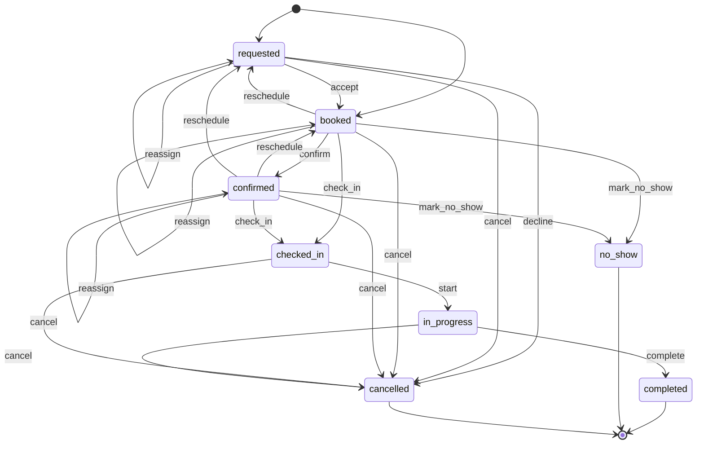
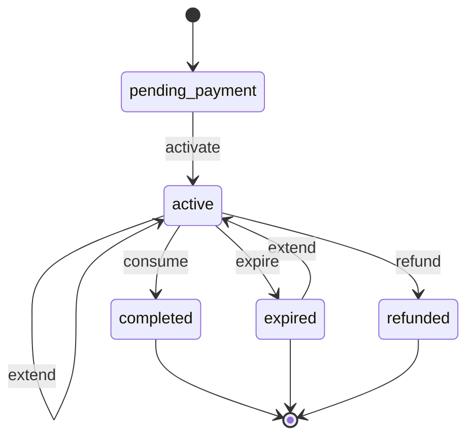
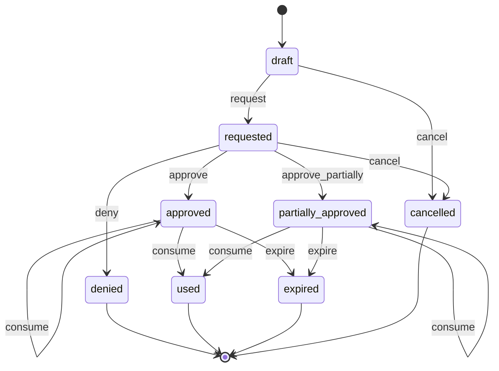
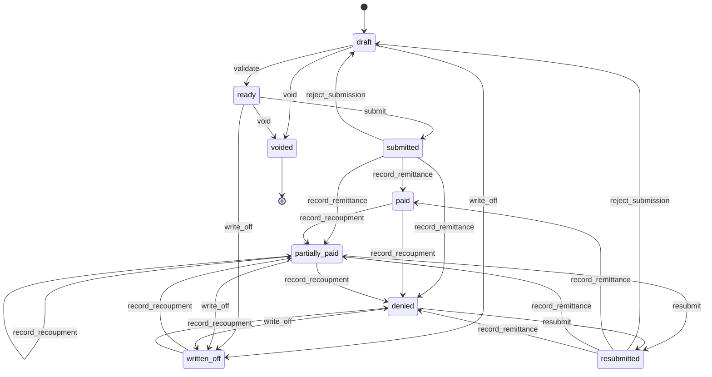

# 05 — Private Clinics

> Spec: accepted · Reviewed: 2026-10-15 · Spec text last changed: 2026-10-16

**Build status (2026-10-24):** Built in F5 (#499, #514, #515), merged. **Built:** the Prior authorisation and Claim machines of §7.1 (with technical rejection, recoupment, late closing and void), check-in with eligibility and the coverage outcomes, the Appointment on wl-scheduling, recalls traced to patients, remittance recording per claim, the Clinics demo (`clinics:demo`). **Not built or not found (MVP items still open):** patient portal (only the card-request route exists), patient feedback after a visit (`WRK.FBK.01`), waiting list, bank-side matching of remittances. Online payment and prepaid packages belong to wl-payments and wl-sales and are not clinic-specific. **Machines in code but not in the spec:** `Visit` (opened by check-in; states `checked_in`, `in_progress`, `completed`, `cancelled`, all system-driven) and `RecallNotice` (README). See [STATUS.md](STATUS.md) and [apps/clinics/README.md](../../apps/clinics/README.md).

## 1. Summary

Private outpatient clinics in the UAE compete on patient experience and lose revenue to
no-shows and rejected insurance claims. Today they run a front-desk system or a basic EMR, plus
WhatsApp, spreadsheets and insurer portals. The app handles the **business side of the
clinic**:

- booking and reminders;
- a branded patient portal;
- front-desk billing, packages and memberships;
- insurance eligibility, prior authorisation and claim follow-up;
- practitioner licences and rosters;
- consumables stock.

**Clinical records stay in the clinic's licensed EMR** (see [§2](#scope-decision-business-side-only-no-clinical-records)).

**Target segment** (decided 2026-10-15): clinics whose clinical records are light or already
in an EMR, and whose revenue depends on bookings, packages and memberships: aesthetics and
cosmetic dermatology, physiotherapy, dental, wellness and IV therapy. The app is positioned
as the EMR's business partner, with charge capture imported from the EMR. Large
multi-specialty polyclinics that want one all-in-one product are not targeted.

## 2. Business context (UAE)

- **Customer size:** 1–5 branches, 3–40 practitioners, 10–150 staff, 30–500 visits per day.
- **How they work today:** a practice-management or EMR product (often local or legacy),
  WhatsApp and phone for bookings, insurer and clearing-house portals for claims, Excel for
  packages and licence expiry, and an accounting package.
- **Regulators and rules that shape the work:**
  - **Regulators by emirate.** Private facilities and practitioners are licensed by **DHA**
    (Dubai, including DHCC), **DoH** (Abu Dhabi), the **Sharjah Health Authority** (Sharjah,
    since Executive Council Resolution 29 of 2025) and **MOHAP** (Ajman, Umm Al Quwain, Ras Al
    Khaimah, Fujairah). EHS runs federal public facilities ✔ [S1], [S2]. Each practitioner
    holds a licence tied to the facility, renewed with malpractice insurance and completed
    CME/CPD hours: 40 a year for physicians and dentists under DHA, DoH and MOHAP (DoH: at
    least 20 in Category 1). A DHA licence is renewed for 1, 2 or 3 years with the hours
    added up ✔ [S21], [S22], [S23]. DoH and MOHAP do not publish a fixed licence term
    `⚠ open: authority (AU-16)`.
  - **Mandatory health insurance** applies in Dubai and Abu Dhabi, and in the northern
    emirates for private-sector employees since 1 January 2025 ✔ [S11], so most visits are
    billed to an insurer or a TPA, with a patient copay or deductible per policy. Dubai's
    Essential Benefits Plan was revised from 2025 (DHA circular GC 03/2024): 20% coinsurance
    per outpatient visit for consultations, lab and radiology (none for a follow-up within 7
    days) with no outpatient cap; inpatient 20% capped at AED 500 per encounter and AED 1,000
    a year; 30% per prescription within an AED 2,500 yearly drug limit ✔ [S24].
  - **Claims go electronically through the emirate's system:** **eClaimLink/DHPO** in Dubai
    (manual claims banned), **Shafafiya** in Abu Dhabi, and MOHAP's **e-Claims Post Office in
    Riayati** for the northern emirates ✔ [S12], [S13], [S14]. Codes: ICD-10-CM diagnoses,
    CPT and HCPCS services, the emirate's drug codes, and dental codes that differ by
    emirate (**CDT** in Dubai, **USCLS** in Abu Dhabi); Abu Dhabi bills outpatient surgery
    under IR-DRG from November 2025 ✔ [S12], [S15]. Many services need **prior
    authorisation**. Payers send **remittance advices** listing paid and denied lines.
  - **Claim deadlines:** Dubai's Claims Management Policy Directive (from 16 November 2025)
    replaced the 2019 rules: prior authorisation requested within 1 hour of the order, payer
    replies within 6 hours (elective outpatient), payment within 45 days (30 for
    resubmissions), at most 2 resubmissions ✔ [S16] (law firm summaries). The 2019 rules
    required submission by the 15th of the month after the service ✔ [S25]; whether the 2025
    directive keeps it is `⚠ open: authority (AU-17)`. Abu Dhabi: resubmission within 45 days of the
    remittance ✔ [S15] (2018 rules); DoH's 2017 manual requires submission within 24 hours
    of the encounter end ✔ [S25], and the 2025 rules set no window, so whether it still
    applies is `⚠ open: authority (AU-17)`. Windows are parameters per payer.
  - **Health information exchanges** require licensed facilities to share clinical data:
    **NABIDH** (all DHA-licensed facilities) and **Malaffi** (all DoH-licensed facilities)
    ✔ [S17], [S18]; **Riayati** for MOHAP and EHS. The duty sits with the facility and is
    met through its EMR, so it stays out of this app's scope.
  - **Health data law:** Federal Law No. 2 of 2019 on ICT in health fields (Art. 13) bars
    storing or processing UAE health data outside the UAE, free zones included, and requires
    keeping it at least **25 years from the last health procedure** ✔ [S3]. Ministerial
    Decision 51 of 2021 allows listed exceptions, including insurance claims administration,
    each approved by the health authority ✔ [S4]. Abu Dhabi facilities must comply with
    **ADHICS v2.0** (DoH, effective August 2024), which explicitly covers third-party and
    SaaS systems used by the facility and healthcare technology providers ✔ [S5].
  - **VAT:** healthcare "generally accepted in the medical profession as being necessary for
    the treatment of the recipient", including preventive care, is zero-rated (VAT
    Decree-Law Art. 45, Executive Regulation Art. 41); cosmetic services that are not
    medically required are 5% ✔ [S19]. VAT is set per service. How insurer-paid claims are
    treated: under VATP016 zero-rating needs the patient to be the recipient; in a normal
    payer contract the insurer only pays for the patient, but some contracts (capitation,
    services bought by the insurer) make the insurer the recipient at 5% ✔ [S19]. Each payer
    contract is reviewed `⚠ open: accountant (A-01)`.
  - **Advertising** of health services needs approval: MOHAP issues health advertisement
    permits under Cabinet Resolution 7 of 2007 (also required for Sharjah facilities), and
    DHA's 2026 standards for medical advertising on social media name WhatsApp, ban absolute
    claims and need the medical director's approval ✔ [S6], [S7]. Promotional SMS and
    WhatsApp campaigns are treated as advertising. In Abu Dhabi, facilities log each health
    advertisement with DoH through its eServices on TAMM (Health Media and Advertising
    System), under the content rules of the Healthcare Providers Manual ✔ [S26].

### Scope decision: business side only, no clinical records

| In scope | Out of scope, and why |
|---|---|
| Patients' demographics, contacts, Emirates ID, insurance cards | **Clinical notes, diagnoses as a clinical record, prescriptions, lab and imaging results, treatment plans**: an EMR must meet regulator certification, HIE integration (NABIDH/Malaffi/Riayati), clinical coding and safety requirements. That is a product of its own, and wrong data harms patients |
| Appointments, rosters, rooms, reminders, waiting lists | **HIE submission**: belongs to the EMR, which owns the clinical data |
| Front-desk billing, packages, memberships, refunds | **e-Prescribing and dispensing**: regulated pharmacy workflows |
| Insurance: payer contracts, eligibility, prior authorisation, claims tracking, remittances, denials | **Telehealth video**: Later, via a licensed telehealth provider |
| **Charge capture**: the billing codes (ICD-10, CPT) and charges of a visit, entered by the practitioner or a coder, or imported from the EMR | |
| Consent and administrative forms signed by the patient (registration, data, financial, treatment consent forms as signed documents) | |
| Practitioner licences, privileges per branch, rosters | |
| Consumables stock with lot and expiry | |

Even inside this scope, **every deployment is treated as holding health data.** Knowing that
a person visited a dermatologist is health information. Hosting stays in the UAE, access is
tightly scoped, and retention follows the health data law, not only PDPL.

## 3. Users and access

Follows [ACCESS-CONTROL.md](../ACCESS-CONTROL.md). Platform-wide rules (`PLT.ACL.*`) are not
repeated here.

### 3.1 Roles

| Role | Actor type | What they do | Permissions (summary) | Typical scope |
|---|---|---|---|---|
| Owner / medical director | staff | Oversees branches, pricing, payer contracts, performance | all | global |
| Clinic manager | staff | Runs a branch: rosters, approvals, refunds, complaints | appointments, rosters, billing approvals, reports | branch |
| Receptionist | staff | Registers patients, books, checks in, collects payments | patients (non-clinical fields), appointments, front-desk billing | branch |
| Call-centre agent | staff | Books and reschedules for all branches; follows up leads | appointments, leads, patient contacts | global |
| Practitioner (doctor, dentist, therapist) | staff | Sees own schedule; enters charge capture (codes) for own visits | own appointments, charge capture, consent forms | branch (licensed facility) |
| Nurse / assistant | staff | Prepares rooms, records consumables used, helps with consent forms | appointments (read), consumables, consent forms | branch |
| Insurance / billing coordinator | staff | Eligibility, prior authorisations, claims, remittances, denials | insurance, claims, patient balances | global or branch |
| Accountant | staff | Invoices, payments, refunds, supplier bills, exports | finance, reports | global |
| Marketing coordinator | staff | Aesthetic leads, campaigns to consenting patients | leads, campaign lists (consented only) | global |
| Storekeeper | staff | Receives and issues consumables | stock, purchase orders | branch store |
| Patient | external | Books, sees appointments, invoices, receipts and documents; pays; signs forms | portal: own records | own |
| Guardian | external | Does the same for dependants (children, family members) | portal: dependants' records | own dependants |

### 3.2 Scope

The scope unit is the **clinic branch**. A practitioner is assigned to each branch where they
are licensed and privileged, with dates matching the licence. Receptionists, nurses, clinic
managers and storekeepers are per branch. Call-centre, billing, accounts and marketing are
usually global.

### 3.3 Access rules

| ID | Rule | Pattern | Applies to | Parameter (default) |
|---|---|---|---|---|
| `CLN.ACL.01` | Visit reasons, billing codes (ICD-10/CPT), consent forms and insurance details are health data: visible only to practitioners, nurses and billing roles in scope; each view is audited | `SEN` | all staff | — |
| `CLN.ACL.02` | Receptionists and call-centre agents see the schedule, demographics and balances, but not visit reasons or codes | `FLD` | receptionist, call-centre agent | — |
| `SCH.ACL.03` *(shared, formerly `CLN.ACL.03`)* | A practitioner sees their own appointments and charge capture; other practitioners' schedules show as busy/free only | `ASG`, `FLD` | practitioner | — |
| `SCH.ACL.04` *(shared, formerly `CLN.ACL.04`)* | A practitioner cannot be booked, and cannot enter charge capture, at a branch where their licence or privileges are expired or missing | `TIM`, `STA` | all booking roles | — |
| `CLN.ACL.05` | A patient sees only their own records; a guardian also sees those of linked dependants | `OWN` | patient, guardian | — |
| `PTY.ACL.01` *(shared, formerly `CLN.ACL.06`)* | Guardian access to a dependant ends when the dependant reaches the age of majority, unless renewed with the dependant's consent | `TIM` | guardian | 18 years (age of majority, Decree-Law 25 of 2025, from 1 June 2026) ✔ [S8] |
| `SAL.ACL.02` *(shared, formerly `CLN.ACL.07`)* | A discount above a threshold needs the clinic manager's approval | `LIM` | receptionist | 10% |
| `FIN.ACL.04` *(shared, formerly `CLN.ACL.08`)* | The user who records a refund cannot approve it | `SOD` | receptionist, accountant | on |
| `CLN.ACL.09` | A submitted claim is locked; corrections go through a resubmission | `STA` | billing coordinator | — |
| `CLN.ACL.10` | A package session cannot be used after the package expires, unless the clinic manager extends it | `STA`, `LIM` | receptionist | — |
| `NTF.ACL.01` *(shared, formerly `CLN.ACL.11`)* | Patient lists for campaigns include only patients with marketing consent, and exporting them needs `patients.export` | `SEN` | marketing coordinator | — |
| `CLN.ACL.12` | Emirates ID and insurance card images need `patients.sensitive.view` | `SEN` | all staff | — |
| `CLN.ACL.13` | A campaign that promotes services (`SAL.CRM.02` acquisition or `SAL.LOY.01` retention) can be activated and sent only with a regulator advertising permit number and validity recorded, approved by the medical director; it goes only to patients with marketing consent (`NTF.ACL.01`), with opt-out; its content and segments use no clinical data (segment rules on clinical services off, wl-sales §7) | `STA` | marketing coordinator | on |
| `FIN.ACL.14` *(shared)* | Writing off the open amount of a claim above a limit needs the owner's approval | `LIM` | clinic manager | AED 1,000 |
| `FIN.ACL.16` *(shared)* | Moving a payer overpayment to the payer credit balance, or recording a payer recoupment, needs a second person (a reversal from wl-payments is exempt) | `SOD`, `LIM` | billing coordinator, accountant | any amount |
| `SCH.ACL.05` *(shared)* | A booking deposit is forfeited only on a patient's late cancellation or a no-show (a walk-out after check-in applies it to work done and refunds the remainder, §13 question 8); a clinic-initiated cancel or reschedule refunds it in full; waiving a forfeiture needs `bookings.waive_deposit` | `STA` | receptionist, clinic manager | waiver: clinic manager |
| `SCH.ACL.06` *(shared)* | An appointment in `checked_in` or `in_progress` is cancelled only by staff with a reason code, after the visit's work done is captured or marked none; the patient cannot cancel after check-in | `STA` | receptionist, clinic manager | — |
| `FIN.ACL.05`, `FIN.ACL.06`, `FIN.ACL.19` *(shared)* | Front-desk cash is counted by someone other than the receptionist who holds it; a shortage is written off only with approval; recovery by salary deduction needs another approver and the holder's acknowledgement | `SOD`, `LIM` | receptionist, clinic manager | write-off AED 0 (always approval); salary recovery off |
| `STK.ACL.05` *(shared)* | Releasing recall-held consumables needs a second holder of `lots.release` | `SOD` | storekeeper, clinic manager | on |
| `CLN.ACL.14` | A claim is voided only from `draft` or `ready` (entered in error: duplicate visit, wrong payer or policy); a submitted claim is never voided, only resubmitted or written off (`PLT.ACL.09`) | `STA` | billing coordinator | — |
| `CLN.ACL.15` | When coverage fails at check-in or before the service (eligibility negative, card or policy expired, prior authorisation missing, expired or used up), the service starts as self-pay only after the patient signs a self-pay consent showing the estimated price; otherwise the visit is re-split to a valid policy or the appointment is rescheduled | `STA` | receptionist, practitioner | on |
| `CLN.ACL.16` | A claim that missed the payer's first-submission window is closed (`write_off`) with a reason; its payer share is moved to the patient only when the payer contract allows it, never by default | `STA`, `LIM` | billing coordinator, clinic manager | moving to the patient: off `⚠ open: lawyer (L-34)` |

## 4. Value streams

### 4.1 Enquiry to appointment

1. An enquiry comes in from the website, a social media lead form, the phone or WhatsApp
   (`SAL.CRM.01`).
2. The call-centre agent or the patient picks a service, branch, practitioner and slot
   (`SCH.RES.01`, `SCH.BKG.01`, `SCH.SLF.01`). Bookings check practitioner licences
   (`SCH.ACL.04`).
3. A new patient is registered with demographics, Emirates ID, insurance card and consents
   (`PTY.PTY.01`, `PTY.KYC.01`, `PTY.CNS.01`, `CLN.INS.02`).
4. Reminders go out by SMS/WhatsApp/email; the patient confirms or reschedules (`SCH.RMD.01`).

**When it goes wrong**

| Situation | What happens |
|---|---|
| Deposit payment link stays pending or fails | The slot stays on hold until the link expires (`SCH.RUL.04`); a pending payment is checked with the gateway after 30 minutes (`FIN.RUL.19`). A payment confirmed after the hold expired is refunded automatically (late confirmation, wl-payments) |
| Practitioner calls in sick on the day | Same-day leave or a manual *sick* block raises `BookingConflict` for each appointment (wl-scheduling §5.5). The front desk reassigns to another practitioner privileged for the service at the same time, or offers new times; each patient gets one message without the reason. A patient who cancels from it gets the deposit back. Open conflicts 2 hours before the start go to the clinic manager (`SCH.RUL.06`) |
| Practitioner licence or privileges will expire before a booked appointment | `SCH.RUL.05` checks bookings 30 days ahead and raises `BookingConflict` (cause `eligibility`); the front desk reassigns or reschedules as above. A renewal accepted in time clears the conflict |
| Clinic cancels (equipment failure, branch closed) | Cancel with a business-initiated reason code: the deposit is refunded in full or carried to the new booking (`SCH.ACL.05`) |

### 4.2 Visit to payment

1. At check-in, the receptionist verifies identity and the insurance card, and records the
   eligibility check result (`CLN.ENC.01`, `CLN.INS.02`).
2. If the service needs prior authorisation and none is approved, the visit is flagged
   (`CLN.INS.03`).
3. The patient signs any required forms on a tablet (`DOC.SIG.01`).
4. The practitioner sees the patient. Clinical notes go into the clinic's EMR.
5. The practitioner or coder records charge capture: services (CPT), diagnoses (ICD-10),
   consumables used (`CLN.ENC.01`, `STK.MOV.01`).
6. The system splits the charge between the insurer and the patient (copay, deductible,
   non-covered items) using the payer contract (`CLN.ENC.02`, `CLN.INS.01`).
7. The patient pays their share. A receipt or tax invoice is issued (`FIN.INV.01`,
   `FIN.PAY.01`, `FIN.PAY.02`).
8. Follow-ups and recalls are scheduled (`CLN.RCL.01`).
9. At the end of each day, each receptionist hands over the cash they collected at the branch. The
   clinic manager (or another user, never the holder) counts it against the cash payments the
   receptionist recorded (`FIN.CSH.01`, `FIN.ACL.05`).

**When it goes wrong**

| Situation | What happens |
|---|---|
| Eligibility negative, or the insurance card or policy expired, at check-in | The receptionist records the result and one coverage outcome on the visit: **re-split** to another valid policy or an updated card (the patient share is recalculated), **self-pay** with the patient's signed self-pay consent showing the estimated price (`CLN.ACL.15`), or **reschedule** so the patient can sort out cover (deposit carried to the new booking). On a self-pay visit, a service added that is not on the signed consent needs an updated consent (new signature) before charge capture accepts it; the bill uses the self-pay price list on the visit date, not the estimate. If eligibility turns positive before `start`, the receptionist may change the outcome to *insured*; the signed consent stays on file marked *superseded*. After `start` the outcome is fixed |
| Prior authorisation missing, expired or used up before the visit | Flagged ahead by `CLN.RUL.07` and `CLN.RUL.09`. At check-in, a service that needs authorisation goes ahead only with a valid authorisation with units left on the visit date, or as self-pay with consent (`CLN.ACL.15`), or the appointment is rescheduled while a new authorisation is requested. Units left at check-in = approved − consumed − units of the same authorisation on other visits already checked in and not yet completed or cancelled. The units a visit needs for a service are entered at check-in (default 1); a checked-in visit counts those units against the authorisation |
| Practitioner's licence expired on the day | `check_in` and `start` are refused (`SCH.ACL.04`, legal block, no override); the appointment is reassigned to an eligible practitioner or rescheduled |
| Patient walks out after check-in | Staff cancel with reason `walked_out`. Work done (consumables used, a service already delivered) is recorded in charge capture and billed as a normal visit; a held deposit settles it first and the remainder is refunded (`SCH.ACL.05`, `SCH.ACL.06`; §13 question 8: forfeit only on a no-show or late cancellation) |
| Clinic stops the visit after check-in (emergency, equipment failure) | Staff cancel with a business-initiated reason; nothing is charged unless the patient accepts the work done; the deposit is refunded in full. Consumables already issued stay issued (the stock was used); without acceptance the visit records them at price 0 with reason *clinic stop*, and neither the patient nor the payer is charged (no claim is created). With acceptance the work done is billed as a normal visit: the payer split applies and a draft claim is created for a payer share |
| Practitioner sees the patient and decides the planned procedure is not suitable | The appointment completes with the consultation in charge capture (the practitioner picks the consultation service they gave from the service catalogue); the procedure is not charged. A procedure deposit is applied to the consultation's patient share first and the remainder refunded; the receptionist may refund it in full instead (consultation covered by the payer, or waived by the clinic). It is never forfeited |
| Patient disputes a patient-share invoice | The invoice is flagged `disputed` (wl-invoicing §5.10), at the front desk or from the portal complaint form; a billing complaint ticket is linked; `FIN.RUL.01` reminders pause and `FIN.RUL.15` escalates after 14 days. Outcome `upheld` or `credited` (credit note, `FIN.ACL.07` above the limit) |
| Card payment reversed or charged back | The invoice reopens (`InvoiceReopened`); the accountant gets the evidence task (`FIN.RUL.20`); accepting the loss needs a second person (`FIN.ACL.18`). A package bought with that payment stays active and the front desk is told to collect before the next session |
| Refund to the patient fails | The refund goes to `failed`, is retried once after 24 hours (`FIN.RUL.21`), then paid by another method or kept as the patient's credit |
| Cash count is short | The handover goes `short`; a third user may recount. The shortage is recovered in cash from the receptionist or written off with approval (`FIN.ACL.06`, AED 0: always). Salary deduction is off (`FIN.ACL.19`, `⚠ open: lawyer (L-20)` in wl-payments) |

### 4.3 Claim to cash (insurance)

1. Charge capture for insurer shares becomes a draft claim per visit (`CLN.CLM.01`).
2. The billing coordinator checks the codes, the prior authorisation and the attachments,
   then marks the claim ready.
3. The claim is submitted through the emirate's channel (MVP: through the existing
   clearing-house or insurer portal, with the status recorded; Later: integrated,
   `CLN.CLM.02`).
4. The remittance advice is recorded. Paid lines are reconciled and denied lines are flagged
   with reasons (`CLN.CLM.03`).
5. Denials are corrected and resubmitted before the deadline, or written off, or billed to
   the patient where the contract allows (`CLN.CLM.03`, `FIN.REC.01`).

**When it goes wrong**

| Situation | What happens |
|---|---|
| The channel rejects the submission for technical reasons (format, missing field, wrong member ID) | Claim `reject_submission` back to `draft` (never to `ready`: it must be validated again) with the channel's error codes (payer bill `submission_rejected`). It is fixed, validated and submitted again with the same number; this is not a resubmission and does not count against the payer's limit. A rejected resubmission is validated against the resubmission window, not the first-submission window |
| First-submission window about to pass | `CLN.RUL.03` tells the billing coordinator after 7 days and the clinic manager 2 days before the window ends |
| First-submission window missed | The claim is closed from `draft` or `ready` (`write_off`) with a reason and `FIN.ACL.14` above the limit. The payer share moves to the patient only where the payer contract allows it (`CLN.ACL.16`); otherwise it is written off. A payer that accepts late claims (payer contract setting) gets the claim with a late reason instead |
| Claim created in error (duplicate visit, wrong payer or policy) | `void` from `draft` or `ready` (`CLN.ACL.14`); its payer bill is voided too (`voided`, number kept, never deleted). The visit's payer split is removed and the visit is re-split to the right policy, which creates a new claim. With no right policy, the visit stays without a payer split, is flagged *coverage to resolve* and the billing coordinator gets a task; nothing moves to the patient automatically |
| Remittance pays more than is open on a line | The excess waits until a second person approves moving it to the payer credit balance (`FIN.ACL.16`) |
| Payer recoups money paid earlier in a later remittance | Claim `record_recoupment` (from `paid`, `partially_paid` or `written_off`), with approval (`FIN.ACL.16`); the recouped lines reopen as denied with the payer's code and `CLN.RUL.05` opens the denial task (resubmit, move to the patient, or write off). The amount is set off from the payer credit balance first |

### 4.4 Packages and memberships

1. A patient buys a package (e.g. 6 laser sessions, 10 physiotherapy sessions) or a monthly
   membership (`SAL.PKG.01`, `FIN.SUB.01`).
2. Each visit consumes a session. The remaining balance is visible to the patient and the
   front desk.
3. Expiry and remaining sessions trigger reminders. Unused balances are reported as a
   liability (`CLN.RPT.01`).

### 4.5 Practitioner licences and rosters

1. Each practitioner's licence, privileges per branch and expiry dates are recorded with
   documents (`HRM.EMP.01`, `HRM.QUA.01`, `DOC.EXP.01`).
2. Rosters assign practitioners to branches, rooms and session types (`HRM.ROS.01`,
   `SCH.RES.01`). Leave blocks the calendar (`HRM.LEV.01`).
3. An expiring licence triggers reminders; an expired one blocks booking (`SCH.ACL.04`).
4. Appointments already booked after the expiry date are flagged 30 days ahead and moved
   before the licence lapses (`SCH.RUL.05`, see §4.1).

The practitioner licence and branch privileges are document kinds that block
`booking.book`, `booking.check_in` and `booking.start` (mode `block`) with override mode
`never`, as `SCH.ACL.04` already requires; recording them as legal blocks in the platform is
`⚠ open: lawyer (L-19)` (wl-documents §10). They are compliance-critical: the owner / medical director is alerted when they
expire with appointments affected (`DOC.RUL.03`).

### 4.6 Consumables

1. Consumables (dental materials, injectables, dressings) are bought and received with lot
   numbers and expiry dates (`STK.PUR.01`, `STK.GRN.01`, `STK.LOT.01`).
2. Items used in a visit are issued from the branch store (`STK.MOV.01`). Every issue of a
   lot-tracked item to a visit records its lot (scanned or picked; the earliest expiry is
   proposed). The visit cannot be completed with a lot-tracked line that has no lot, except as
   a pending issue (below). A wrong lot is corrected by editing the line before check-out;
   after check-out, by a reversing movement and a new issue (both audited), never by editing
   the posted movement.
3. Near-expiry lots and low stock are flagged.

**When it goes wrong**

| Situation | What happens |
|---|---|
| Not enough stock at the branch store for a visit's consumables | Every branch store uses the negative stock policy `block`. The visit is not blocked: the short quantity becomes a *pending issue* that posts when stock arrives, with the lot *assigned on arrival*; `STK.RUL.06` tells the storekeeper and, after 24 hours, the clinic manager |
| Supplier, manufacturer or regulator recalls a lot (an injectable, a filler, a dental material) | The clinic manager or medical director opens a recall (wl-inventory §5.7): every lot in scope is held at every branch. The trace lists each visit that used the lot and its patient (`TracePartyResolver`: visit → patient); pending issues show "lot uncertain" (a visit's pending issue of the recalled item whose lot is not yet assigned is listed as *possible* when it was recorded while a lot in scope had a balance at that branch store, from the lot's first receipt or transfer into the store until its balance there reached zero or it was held). Notices to patients name the clinic and ask them to call, never the product's clinical details in the message body; a notice that cannot be delivered becomes a call task for the front desk. Held lots are discarded, returned to the supplier or released (second person, `STK.ACL.05`). Whether the clinic must notify DHA, DoH or MOHAP, and by when, is `⚠ open: authority (AU-20)` (wl-inventory §10) |
| A consumable is suspect (complaint, broken cold chain) | A stock hold with reason `quality` on the lot; the storekeeper or clinic manager decides discard, return to supplier or release (`STK.RUL.07` reminds every 24 hours) |

## 5. Capabilities

| ID | Capability | Shared or specific | Proposed module | Scope |
|---|---|---|---|---|
| `PLT.ORG.01` | Branded deployment | shared | wl-kernel | MVP |
| `PLT.USR.01` | Staff users, roles, permissions scoped per branch | shared | Renox Permissions | MVP |
| `PLT.AUD.01` | Audit trail, including views of health data | shared | Renox Audit | MVP |
| `PLT.APR.01` | Approval requests (discounts, refunds, package extensions) | shared | wl-kernel | MVP |
| `PLT.WFL.01` | State machines with history | shared | Renox (R12) + wl-kernel | MVP |
| `PLT.ATM.01` | Default automation rules | shared | wl-kernel | MVP |
| `PLT.HOK.01` | Outbound webhooks (e.g. to the clinic's EMR or marketing tools) | shared | Renox (R11) | Later |
| `PTY.PTY.01` | Parties: patients, payers/TPAs, suppliers | shared | wl-parties | MVP |
| `PTY.KYC.01` | Identity fields: Emirates ID, passport, nationality | shared | wl-parties | MVP |
| `PTY.REL.01` | Links between parties: guardian ↔ dependant, family members | shared (**new**) | wl-parties | MVP |
| `PTY.CNS.01` | Recorded consents per party and purpose (data processing, marketing, channel), with date and withdrawal | shared (**new**) | wl-parties | MVP |
| `DOC.FIL.01` | Attach documents (insurance cards, referrals, reports from the EMR) | shared | wl-documents | MVP |
| `DOC.EXP.01` | Expiry reminders (practitioner licences, facility licence, insurance cards, trademark and other registrations) | shared | wl-documents | MVP |
| `DOC.GEN.01` | Generate documents (receipts, invoices, package statements, forms) | shared | wl-documents | MVP |
| `DOC.SIG.01` | Signature / consent capture on a tablet or in the portal | shared | wl-documents | MVP |
| `FIN.INV.01` | Tax invoices and receipts with per-service VAT | shared | wl-invoicing | MVP |
| `FIN.PAY.01` | Record and allocate payments (cash, card terminal, transfer) | shared | wl-payments | MVP |
| `FIN.PAY.02` | Online payment link or card in the portal | shared | wl-payments | MVP |
| `FIN.REC.01` | Patient and payer receivables ageing | shared | wl-invoicing | MVP |
| `FIN.CSH.01` | Cash custody: cash collected by each receptionist at the front desk, counted at the end of the day; shortages | shared | wl-payments | MVP |
| `FIN.SUB.01` | Recurring memberships billed to patients | shared | wl-invoicing (+ renox-billing via wl-payments) | Later |
| `FIN.PAB.01` | Supplier bills with 3-way match | shared | wl-invoicing | Later |
| `FIN.EXT.01` | Export to accounting software | shared | wl-invoicing | Later |
| `SAL.PKG.01` | Prepaid packages of sessions or units: sell, consume, expire, refund, liability | shared (**new**) | wl-sales | MVP |
| `SAL.CRM.01` | Leads and enquiries pipeline (aesthetics, campaigns) | shared | wl-sales | MVP |
| `SAL.CAT.01` | Service catalogue with self-pay price lists | shared (**new**) | wl-sales | MVP |
| `WRK.TKT.01` | Patient complaints and feedback as tickets | shared | wl-ticketing | MVP |
| `WRK.TKT.02` | Complaint triage, assignment and SLA | shared | wl-ticketing | MVP |
| `POR.SLF.01` | Patient portal: appointments, invoices, receipts, packages, forms | shared | wl-portal | MVP |
| `POR.DOC.01` | Secure document exchange via the portal (reports uploaded from the EMR, sick leave certificates) | shared | wl-portal | Later |
| `NTF.MSG.01` | Email notifications | shared | wl-notify | MVP |
| `NTF.MSG.02` | WhatsApp notifications | shared | wl-notify | MVP |
| `NTF.MSG.03` | SMS notifications | shared | wl-notify | MVP |
| `RPT.DSH.01` | Role-based dashboards | shared | Renox charts + wl-kernel | MVP |
| `SCH.RES.01` | Resources and availability: practitioners, rooms, equipment | shared (**new**) | wl-scheduling | MVP |
| `SCH.BKG.01` | Bookings by staff, with waiting list | shared (**new**) | wl-scheduling | MVP |
| `SCH.SLF.01` | Online self-booking from the website and portal | shared (**new**) | wl-scheduling | MVP |
| `SCH.RMD.01` | Booking reminders, confirmations and no-show handling | shared (**new**) | wl-scheduling | MVP |
| `HRM.EMP.01` | Staff and practitioner records with documents and licences | shared | wl-hr | MVP |
| `HRM.LEV.01` | Leave and absence blocking the calendar | shared (**new**) | wl-hr | Later |
| `STK.ITM.01` | Consumables catalogue with units | shared | wl-inventory | MVP |
| `STK.LOC.01` | Stock per branch store | shared | wl-inventory | MVP |
| `STK.MOV.01` | Stock movements: receive, issue to a visit, adjust | shared | wl-inventory | MVP |
| `STK.PUR.01` | Purchase orders to suppliers | shared | wl-inventory | Later |
| `STK.GRN.01` | Goods received | shared | wl-inventory | Later |
| `STK.LOT.01` | Batch/lot and expiry tracking | shared (**new**) | wl-inventory | MVP |
| `PLT.ENT.01` | Legal entities: several trade licences and TRNs in one deployment; issuer on every document | shared | wl-kernel | MVP |
| `PLT.IMP.01` | Data import and migration: Excel templates per entity, validation, dry run, rollback | shared | wl-kernel | MVP |
| `PLT.SRC.01` | Global search across records, including Arabic names | shared | wl-kernel + Renox search | MVP |
| `PLT.REL.01` | Related records of any record, in a panel and as a tool ([decision 0006](../decisions/0006-search-and-ai-agents.md)) | shared | wl-kernel | MVP |
| `PLT.AGT.01` | AI assistant connection (MCP): search, read, summarise, reports | shared | wl-kernel + Renox (R26, R27) | Later |
| `PLT.AGT.02` | AI assistant actions: transitions and drafts, with preview and confirm | shared | wl-kernel + Renox (R28) | Later |
| `PLT.AGT.03` | AI assistant inbox and messages | shared | wl-kernel + wl-notify | Later |
| `PLT.NOT.01` | Notes, comments and @mentions on any record, with an activity timeline | shared | wl-kernel | MVP |
| `PLT.SSO.01` | Staff single sign-on with Microsoft 365 or Google Workspace | shared | Renox OAuth (renox-oauth) | Later |
| `RPT.LIB.01` | Report library: filtered reports with export to Excel, CSV and PDF | shared | wl-kernel | MVP |
| `RPT.SCH.01` | Scheduled reports sent by email | shared | wl-kernel | Later |
| `FIN.VAT.01` | VAT summary per period and entity: output and input VAT, for the accountant | shared | wl-invoicing | MVP |
| `FIN.EXP.01` | Expense claims and petty cash: submit with receipt, approve, reimburse, top up | shared | wl-payments | Later |
| `FIN.BNK.01` | Bank statement import and matching of receipts to open invoices | shared | wl-payments | Later |
| `WRK.FBK.01` | Customer feedback and ratings after a completed service; low ratings open a ticket | shared | wl-ticketing | MVP |
| `WRK.SVC.01` | Vendor service contracts (AMC): scope, assets, planned visits, SLA, cost | shared | wl-ticketing | Later |
| `CLN.INS.01` | Payer contracts: plans, networks, tariffs, copay and deductible rules, coverage exclusions | specific | apps/clinics | MVP |
| `CLN.INS.02` | Patient insurance policies and eligibility check results | specific | apps/clinics | MVP |
| `CLN.INS.03` | Prior authorisation requests and their validity | specific | apps/clinics | MVP |
| `CLN.ENC.01` | Visit check-in/out and charge capture (ICD-10, CPT, consumables) | specific | apps/clinics | MVP |
| `CLN.ENC.02` | Patient-share calculation (copay, deductible, non-covered) at the front desk | specific | apps/clinics | MVP |
| `CLN.CLM.01` | Claim preparation and validation from charge capture | specific | apps/clinics | MVP |
| `CLN.CLM.02` | Integrated claim submission and remittance download (eClaimLink/DHPO, Shafafiya, MOHAP) | specific | apps/clinics | Later |
| `FIN.TPP.01` | Third-party payer billing: patient and insurer shares, payer invoices, remittance reconciliation per line, payer receivables | shared (**new**) | wl-invoicing | MVP |
| `CLN.CLM.03` | Denial management with denial codes, resubmission, write-off | specific | apps/clinics | MVP |
| `HRM.QUA.01` | Practitioner licences and privileges per branch, with booking guard (formerly `CLN.LIC.01`) | shared (**new**) | wl-hr | MVP |
| `HRM.ROS.01` | Rosters: practitioners to branches, rooms and session types (formerly `CLN.ROS.01`) | shared (**new**) | wl-attendance | MVP |
| `SAL.CRM.02` | Lead sources and campaigns: cost per campaign, conversion by source and channel, cost per lead, customer acquisition cost and return on ad spend | shared | wl-sales | MVP |
| `FIN.CFL.01` | Cash-flow forecast: expected receipts and payments by week from invoices, supplier bills, scheduled charges, post-dated cheques, payroll and budgets | shared | wl-invoicing | MVP |
| `SAL.LOY.01` | Loyalty and retention: points or visit rewards, customer segments, and retention campaigns sent with marketing consent | shared | wl-sales + wl-notify | MVP |
| `FIN.BUD.01` | Company budget vs actual by period, category and entity; owner drawings kept apart from operating cost | shared | wl-invoicing | MVP |
| `HRM.ONB.01` | Staff onboarding checklists per role and a library of SOP documents with acknowledgement | shared | wl-hr + wl-documents | MVP |
| `WRK.CHK.01` | Checklists with photos and signature (onboarding steps, `HRM.ONB.01`) | shared | wl-ticketing | MVP |
| `STK.SUP.01` | Supplier scorecard and alternative suppliers: on-time delivery, rejected quantity, NCRs, price variance; preferred and alternative suppliers per item | shared | wl-inventory | Later |
| `CLN.RCL.01` | Recalls and follow-up schedules (e.g. 6-month dental check-up) | specific | apps/clinics | MVP |
| `CLN.TEL.01` | Telehealth appointments via a licensed provider | specific | apps/clinics | Later |
| `CLN.HIE.01` | EMR integration: import charge capture, export bookings and demographics (HL7/FHIR) | specific | apps/clinics | Later |
| `CLN.RPT.01` | Clinic KPIs: utilisation, no-shows, revenue per practitioner, denial rate, package liability | specific | apps/clinics | MVP |

## 6. Key entities

| Entity | Description | Important fields | Owned by |
|---|---|---|---|
| Patient | A person receiving care | party, MRN, date of birth, gender, nationality, Emirates ID, guardians, consents | wl-parties + apps/clinics |
| Payer | Insurer or TPA | party, regulator payer ID, networks, contract | apps/clinics |
| Payer contract | Commercial terms with a payer | plans, tariff per service code, copay/deductible rules, prior-auth list, first-submission window (required: a contract without it cannot be activated), resubmission window and limit, accepts late claims, missed-window share may be billed to the patient (off; owner only, `CLN.ACL.16`) | apps/clinics |
| Insurance policy | A patient's coverage | patient, payer, plan, member ID, card images, valid from/to | apps/clinics |
| Practitioner | Licensed professional | employee, licence no., regulator, specialty, privileges per branch, expiry | wl-hr (+ apps/clinics) |
| Resource | Bookable practitioner, room or equipment | type, branch, availability rules | wl-scheduling |
| Service | Bookable or billable service | code (CPT/internal), duration, self-pay price, VAT category, resources needed | wl-sales |
| Appointment | A booking | patient, service, practitioner, room, branch, start/end, source, status | wl-scheduling |
| Visit | What happened at an appointment | appointment, check-in/out, eligibility result, coverage outcome (insured, re-split, self-pay with consent reference), charge lines (codes, consumables with lot), patient share, work done when cancelled after check-in | apps/clinics |
| Prior authorisation | Approval from a payer | patient, payer, services, approved units, reference, valid until, status | apps/clinics |
| Claim | Request for payment to a payer | visit(s), lines with codes, amounts, submission reference, submission errors per attempt, resubmission count, late reason, status, remittance, recoupments | apps/clinics (money side: payer bill in wl-invoicing) |
| Package | Prepaid sessions | patient, service, sessions bought/used, price, expiry, status | wl-sales |
| Consent / form | Signed patient form | patient, template, version, signature, date | wl-documents |
| Lot | Batch of a consumable | item, lot no., expiry, quantity, store | wl-inventory |

## 7. Workflow

Follows [WORKFLOW.md](../WORKFLOW.md). **Invoice** and **ticket** (complaints) reuse the
state machines in [01-property.md](01-property.md#71-state-machines) unchanged.

### 7.1 State machines

#### Appointment *(shared — wl-scheduling)*

> **Canonical definition:** *Booking* in [`wl-scheduling` §4](../modules/wl-scheduling.md#4-lifecycles). This section is this vertical's original requirement; where it differs, the module definition wins and its vertical mapping table records the difference.

| State | Tone | Terminal | Meaning |
|---|---|---|---|
| `requested` | neutral | no | Requested online; waiting for confirmation by staff (when the service requires it) |
| `booked` | info | no | Slot reserved |
| `confirmed` | info | no | The patient confirmed |
| `checked_in` | info | no | The patient arrived |
| `in_progress` | info | no | With the practitioner |
| `completed` | success | yes | Seen; the visit record exists |
| `no_show` | error | yes | Did not arrive |
| `cancelled` | neutral | yes | Cancelled or declined by the patient or the clinic |

| Transition | From | To | By | Guards | Effects |
|---|---|---|---|---|---|
| `accept` | requested | booked | `appointments.manage` | slot still free; practitioner licensed (`SCH.ACL.04`) | patient notified |
| `decline` | requested | cancelled | `appointments.manage` | reason given | slot released; patient notified |
| `book` | — | booked | `appointments.manage` or patient (self-booking) | slot free; practitioner licensed | confirmation sent |
| `confirm` | booked | confirmed | patient or `appointments.manage` | — | — |
| `reschedule` | requested, booked, confirmed | requested, booked | patient (until N hours before) or `appointments.manage` | new slot free; practitioner licensed at the new time | old slot released; notification sent; a held deposit moves to the new appointment |
| `reassign` | requested, booked, confirmed | same state | `appointments.manage` | same time; new practitioner free and licensed and privileged for the service at the branch on that date | patient told the new practitioner with *accept*, *pick another time* and *cancel* links, never the reason; conflict cleared |
| `check_in` | booked, confirmed | checked_in | `appointments.checkin` | identity checked; practitioner licensed today (`SCH.ACL.04`); for insured visits: eligibility recorded and a coverage outcome set (insured, re-split, or self-pay with consent, `CLN.ACL.15`); for services that need prior authorisation: a valid authorisation with units left, or self-pay with consent | visit created |
| `start` | checked_in | in_progress | practitioner | practitioner licensed today | — |
| `complete` | in_progress | completed | practitioner | — | charge capture opened; follow-up offered |
| `mark_no_show` | booked, confirmed | no_show | system or `appointments.manage` | start time + M minutes passed; no open conflict on the appointment | no-show counted; the booking deposit is forfeited if the service type requires one |
| `cancel` | requested, booked, confirmed, checked_in, in_progress | cancelled | patient (until N hours before; never after check-in) or `appointments.manage` | reason code and *initiated by* recorded; after check-in: staff only, with the visit's work done captured or marked none (`SCH.ACL.06`) | slot released; waiting list offered; deposit per `SCH.ACL.05` (clinic-initiated: refunded in full; late patient cancel: forfeited; walk-out: applied to work done, the remainder refunded); work done billed through charge capture |

Reason codes are the module's list (wl-scheduling §4.1). 05 adds `coverage_not_confirmed`
(insurance or authorisation failed at check-in and the patient declined self-pay). It counts
as clinic-initiated for the deposit, so the deposit is refunded in full or carried to the new
booking. `resource_ineligible` is used when the practitioner's licence or privileges lapse.

#### Package *(shared — wl-sales)*

> **Canonical definition:** *Package* in [`wl-sales` §4](../modules/wl-sales.md#4-lifecycles). This section is this vertical's original requirement; where it differs, the module definition wins and its vertical mapping table records the difference.

| State | Tone | Terminal | Meaning |
|---|---|---|---|
| `pending_payment` | neutral | no | Sold, not yet paid |
| `active` | info | no | Paid; sessions available |
| `completed` | success | yes | All sessions used |
| `expired` | warning | yes | Validity ended with sessions left |
| `refunded` | neutral | yes | Unused balance refunded |

| Transition | From | To | By | Guards | Effects |
|---|---|---|---|---|---|
| `activate` | pending_payment | active | system (payment recorded) | paid in full or first instalment | expiry date set |
| `consume` | active | active, completed | system (visit completed) | sessions remaining > 0; not expired (`CLN.ACL.10`) | remaining sessions reduced; `completed` when zero |
| `extend` | active, expired | active | `packages.extend` (clinic manager) | new expiry date | — |
| `expire` | active | expired | system | expiry date passed | unused value reported |
| `refund` | active | refunded | `packages.refund` | `FIN.ACL.04` (SoD) | refund payment recorded |

#### Prior authorisation

| State | Tone | Terminal | Meaning |
|---|---|---|---|
| `draft` | neutral | no | Being prepared |
| `requested` | info | no | Sent to the payer |
| `approved` | success | no | Approved for the requested services and units |
| `partially_approved` | warning | no | Approved with fewer services or units |
| `denied` | error | yes | Refused |
| `used` | success | yes | All approved units consumed |
| `expired` | neutral | yes | Validity ended |
| `cancelled` | neutral | yes | No longer needed |

| Transition | From | To | By | Guards | Effects |
|---|---|---|---|---|---|
| `request` | draft | requested | `insurance.manage` | services, codes and supporting documents attached | reference recorded |
| `approve` | requested | approved | `insurance.manage` | approval reference and validity recorded | linked appointments unflagged |
| `approve_partially` | requested | partially_approved | `insurance.manage` | approved units recorded | front desk notified of the patient share |
| `deny` | requested | denied | `insurance.manage` | reason recorded | patient informed; self-pay option offered; linked future appointments flagged (`CLN.RUL.09`) |
| `consume` | approved, partially_approved | approved, partially_approved, used | system (visit charge capture) | units remaining | `used` when zero; on `used`, later appointments that relied on it are flagged (`CLN.RUL.09`) |
| `expire` | approved, partially_approved | expired | system | validity date passed | appointments after the date that relied on it are flagged (`CLN.RUL.09`) |
| `cancel` | draft, requested | cancelled | `insurance.manage` | — | — |

#### Claim

The money side of a claim is a payer bill in [`wl-invoicing`](../modules/wl-invoicing.md)
(*Payer bill*, `FIN.TPP.01`); coding, validation and the submission channel stay here.

| State | Tone | Terminal | Meaning |
|---|---|---|---|
| `draft` | neutral | no | Created from charge capture, or returned after a technical rejection |
| `ready` | info | no | Validated; waiting for submission |
| `submitted` | info | no | Sent to the payer; locked (`CLN.ACL.09`) |
| `paid` | success | no | All lines paid as claimed; only `record_recoupment` leaves it |
| `partially_paid` | warning | no | Some lines paid, some denied, reduced or recouped |
| `denied` | error | no | All lines denied or recouped |
| `resubmitted` | info | no | Corrected and sent again |
| `written_off` | neutral | no | Remaining balance written off or moved to the patient; only `record_recoupment` leaves it |
| `voided` | neutral | yes | Created in error before submission; never sent |

| Transition | From | To | By | Guards | Effects |
|---|---|---|---|---|---|
| `validate` | draft | ready | `claims.manage` | codes present; prior authorisation linked where required; within the window of the attempt being prepared (resubmission count 0: the first-submission window from the visit date; count above 0, after a technical rejection of a resubmission: the resubmission window from the remittance that denied it), or the payer contract accepts late claims and a late reason is recorded | — |
| `submit` | ready | submitted | `claims.manage` | — | submission reference and date recorded; payer bill `issue` (same number when issued again) |
| `reject_submission` | submitted, resubmitted | draft | `claims.manage` or system (integration, Later) | rejected by the channel before adjudication (format, missing field, member ID); no remittance recorded | channel error codes and messages stored with the attempt; resubmission count unchanged; payer bill `submission_rejected`; task for the billing coordinator with the errors and the submission deadline |
| `record_remittance` | submitted, resubmitted | paid, partially_paid, denied | `claims.manage` or system (integration, Later) | remittance lines matched; an amount above the open line goes to the payer credit balance only with approval (`FIN.ACL.16`) | payments allocated; denial reasons stored; recoupment lines on the same advice run `record_recoupment` on the earlier claims |
| `record_recoupment` | paid, partially_paid, written_off | partially_paid, denied | `claims.manage` or system (remittance import; wl-payments `PaymentReversed`) | recouped amount not above the paid amount; payer's recoupment code; approval by a second person (`FIN.ACL.16`, not for a reversal from wl-payments) | payer bill `record_recoupment`; recouped lines reopen as denied with the payer's code; set off from the payer credit balance first; denial task (`CLN.RUL.05`) |
| `resubmit` | partially_paid, denied | resubmitted | `claims.manage` | corrections recorded; within resubmission window and limit | payer bill `resubmit` (count + 1) |
| `write_off` | draft, ready, partially_paid, denied | written_off | `claims.writeoff` (clinic manager) | reason given; above the limit needs the owner (`FIN.ACL.14`); from `draft` or `ready` only after the first-submission window passed and the payer does not accept late claims (`CLN.ACL.16`) | balance moved to the patient where the contract allows, otherwise written off (payer bill `transfer_to_customer` or `write_off`); a missed window is reported in the denial KPI as *not submitted in time* |
| `void` | draft, ready | voided | `claims.manage` | reason given (duplicate, wrong payer or policy); never after `submit`: a claim with any recorded submission attempt is refused (`CLN.ACL.14`, `PLT.ACL.09`) | payer split removed from the visit; its payer bill runs `void` (`voided`, number kept); the visit is re-split to the right policy when there is one (new claim), otherwise flagged *coverage to resolve* with a task for the billing coordinator; number kept, shown as void |

### 7.2 Automations

Reused unchanged: `FIN.RUL.01`–`02` (patient balances), `DOC.RUL.01` (practitioner
licences, facility licence, insurance cards), `WRK.RUL.01` (complaint SLA), `DOC.RUL.02`–`03`
(licence look-ahead and expiry), `SCH.RUL.04` (unpaid deposit hold), `FIN.RUL.15` (disputed
invoice), `FIN.RUL.19`–`21` (pending payment, chargeback evidence, failed refund),
`STK.RUL.06`–`07` (pending issues, open stock holds).

| ID | When | If | Then | Parameters (default) | Default | Scope |
|---|---|---|---|---|---|---|
| `SCH.RUL.01` *(shared)* | N hours before an appointment | appointment `booked` or `confirmed` | send a reminder with confirm/reschedule links | N = 24, 2 | on | MVP |
| `SCH.RUL.02` *(shared)* | M minutes after the start time | appointment not `checked_in` | appointment `mark_no_show`; notify the front desk; offer the slot to the waiting list | M = 15 | on | MVP |
| `CLN.RUL.01` *(generalised by `HRM.RUL.10`)* | `QualificationExpired` (wl-hr `HRM.RUL.10`) for a practitioner licence or branch privileges | — | no second expiry scan: the block on new bookings for that practitioner and branch is `HRM.RUL.10`'s (`qualification_valid` = no); 05 sends one combined message per recipient (clinic manager of the branch, owner / medical director) naming the practitioner, the branch and the number of affected appointments, and no second owner message for the same expiry (`DOC.RUL.03`); appointments already booked are in conflict through `SCH.RUL.05` | — | on | MVP |
| `CLN.RUL.02` | recall date reached | no future appointment for the service | invite the patient to book | dental: 6 months | on | MVP |
| `CLN.RUL.03` | N days after a visit with an insurer share; and D days before the payer's first-submission window ends | claim still `draft` or `ready` | at N: notify the billing coordinator; at D: task for the clinic manager | N = 7 (parameter per payer; a payer contract with N not below its submission window is refused; N = 0 is allowed, for windows of 1 day, and notifies on the first run after the visit); D = 2 | on | MVP |
| `FIN.RUL.13` *(shared, formerly `CLN.RUL.04`)* | N days after a claim → `submitted` | no remittance | create a follow-up task for the billing coordinator | N = 45 | on | MVP |
| `CLN.RUL.05` | claim → `denied` or `partially_paid`, including after a recoupment (`PayerRecoupmentRecorded`) | — | create a task with the resubmission deadline | — | on | MVP |
| `SAL.RUL.02` *(shared, formerly `CLN.RUL.06`)* | N days before a package expires | sessions remaining > 0 | notify the patient | N = 14 | on | MVP |
| `CLN.RUL.07` | appointment booked for a service that needs prior authorisation | no `approved` authorisation valid on that date | flag the appointment; notify the billing coordinator | — | on | MVP |
| `CLN.RUL.08` | *(absorbed by `WRK.RUL.09` and `WRK.RUL.10`, which run with `WRK.FBK.01` in the MVP; only patients with feedback consent are asked)* | — | — | N = 3 | — | — |
| `STK.RUL.03` *(shared)* | N days before a lot expires | quantity > 0 | notify the storekeeper | N = 60 | on | MVP |
| `SCH.RUL.05` *(shared)* | daily; licence or privilege expiring or expired | an appointment within D days whose practitioner will not be licensed or privileged at its start | raise `BookingConflict` (cause `eligibility`); task for the front desk to reassign or reschedule | D = 30 days | on | MVP |
| `SCH.RUL.06` *(shared)* | H hours before the start | appointment has an open conflict | notify the clinic manager; send the patient the change message (no reason given); no normal reminder | H = 2 | on | MVP |
| `CLN.RUL.09` | prior authorisation → `expired`, `used` or `denied`; and D days before its validity ends | a future appointment of the patient for a service it covered, with no other valid authorisation on its date | flag the appointment; task for the billing coordinator to request a new authorisation; the front desk sees the flag at check-in | D = 3 | on | MVP |
| `CLN.RUL.10` | N days before an insured appointment | the patient's policy ends before the appointment date, or the card on file has expired | send the patient a message with a portal link to upload the new card; flag the appointment for the front desk; the flag clears when staff accept an uploaded card valid on the appointment date (an upload alone does not clear it) | N = 2 | on | MVP |

Compliance-critical (owner alert through `PLT.RUL.04` to the owner / medical director when
they fail or miss their schedule): `CLN.RUL.01`, `SCH.RUL.05`, `CLN.RUL.03` (payer
submission windows) and `DOC.RUL.03` for practitioner licences and the facility licence.

**Settings for the shared negative flows (05 defaults):**

| Setting | 05 value |
|---|---|
| Licence kinds per service type checked by `SCH.RUL.05` and at `check_in` / `start` | practitioner licence (DHA, DoH, Sharjah Health Authority or MOHAP) and branch privileges for every service type |
| Eligibility look-ahead D (`SCH.RUL.05`) / conflict escalation H (`SCH.RUL.06`) | 30 days / 2 hours |
| Walk-out after check-in: deposit | applied to work done; the remainder refunded (forfeit only on no-show or late cancellation, §13 question 8) |
| Partial price for work done when cancelled after check-in | consumables used at their price; a service only if the practitioner records it as delivered, at its normal price; a package session is consumed only when the package's service is recorded as delivered |
| Invoice write-off limit (`FIN.ACL.15`) for patient balances | AED 0 (always approval) |
| Patients may raise a billing dispute in the portal | yes, through the complaint form (category *billing*) |
| Negative stock policy | `block` at every branch store; no `allow_consumption` (consumables are lot-tracked) |
| Cash holders | each receptionist, per person, per day at the branch (one handover per receptionist, branch and day) |
| Recall owner | owner / medical director; notices sent by the clinic manager |
| Records that support `void` | claim (`draft`, `ready`); payments, receipts and appointments follow their module |
| Late entry after an outage (business time) | check-in and check-out time, cash payments, consumables issued (paper sheets entered later) |
| Responsible role per document kind (wl-documents §5.2) | practitioner licence and branch privileges: clinic manager of the branch; facility licence: owner / medical director; patient Emirates ID and insurance card: receptionist, with the patient (or guardian) notified as the party |
| Cash-flow forecast alert (`FIN.CFL.01`, `FIN.RUL.23`) | projected balance below AED 50,000 in any of the next 13 weeks (weeks start Monday): `FIN.RUL.23` alerts the owner / medical director and the accountant, checked daily at 06:00; insurer remittances by claim due date, adjusted by each payer's average days late: on; disputed amounts counted: off |
| Budget categories and approval (`FIN.BUD.01`, `FIN.RUL.24`) | categories owned by the accountant and mapped to the export accounts; one budget per legal entity and fiscal year, by month (budget lines have no branch; the seed has no branch categories, and a client who wants branch lines has the accountant map branch-specific export accounts to categories of their own); approved by the owner / medical director; `FIN.RUL.24` warns the category's owner role and the accountant when a month's actual reaches 100% of its line |
| Owner drawings (`FIN.BUD.01`, `FIN.ACL.21`) | expense category and payment purpose *owner drawings*, kept out of operating cost and profit; every drawing approved, whatever its amount (`FIN.ACL.21` limit AED 0), by the owner / medical director, never by the requester (`FIN.ACL.21`) |
| Lead sources used (`SAL.CRM.02`) | referral, walk-in, website, social, paid ads, aggregator (booking platforms), partner (insurers, corporates), event, other; on leads and patients; a source is required, and a campaign is required for *paid ads* and *social* |
| Campaign channels (`SAL.CRM.02`, `SAL.ACL.07`, `CLN.ACL.13`) | Instagram, TikTok, search ads, SMS, WhatsApp, email; converted value: the patient's first paid visit; a cost entry that takes a campaign over its budget needs a manager (`SAL.ACL.07`: on); a campaign that promotes services needs the advertising permit before it is activated and before a retention broadcast starts (`CLN.ACL.13`, `NTF.ACL.04`), and is ended by the system on the day the permit's validity ends; whether campaign content needs health authority approval beyond the permit is outside the platform (`⚠ open: lawyer (L-38)`) |
| Loyalty earn and redeem (`SAL.LOY.01`, `SAL.RUL.07`) | `SAL.RUL.07` earns 1 point per AED 10 paid by the patient for self-pay services and products; none on the insurer's share or on package sessions; 100 points = an AED 10 discount line on a later self-pay invoice, confirmed by a one-time code to the patient (whether health authority rules limit rewards on medical services: `⚠ open: lawyer (L-38)`; VAT on the discounted supply: `⚠ open: accountant (A-15)`) |
| Loyalty expiry, segments and retention campaigns (`SAL.LOY.01`, `SAL.RUL.08`, `SAL.ACL.07`, `NTF.RUL.02`, `NTF.ACL.03`) | points expire 12 months after they are earned, reminder 30 days before (`SAL.RUL.08`); a manual adjustment above 500 points needs a manager (`SAL.ACL.07`); segments: no visit in 6 months, package with sessions left and no booking in 30 days, birthday month (segment rules on clinical services off: visit dates, spend and non-clinical items only); campaigns only to patients with marketing consent (`NTF.ACL.01`), with opt-out and the advertising permit (`CLN.ACL.13`); sent 07:00–21:00, at most 2 marketing messages per patient in 7 days (`NTF.RUL.02`); a broadcast to more than 200 patients needs a second approver (`NTF.ACL.03`) |
| Onboarding checklists (`HRM.ONB.01`, `HRM.RUL.16`, `HRM.RUL.17`, `HRM.ACL.10`) | templates for receptionist, call-centre agent, nurse / assistant, practitioner, billing coordinator and storekeeper, started by `HRM.RUL.16` when the employee record (`HRM.EMP.01`) is created in `onboarding` (none for a record created directly `active`, e.g. by a data import); checklist steps use `WRK.CHK.01` (photos and signature); tasks to the clinic manager, the line manager and the employee; the employee's own steps recorded only by them (`HRM.ACL.10`); `HRM.RUL.17` reminds the assignees of an overdue step on the first run after its due date, then every 2 days, and tells the clinic manager and the line manager after 5 days; completion blocks nothing (bookings stay guarded by licences, `SCH.ACL.04`) |
| SOP library (`HRM.ONB.01`, `DOC.RUL.04`, `HRM.ACL.10`) | SOP owners: clinic manager (front desk, billing, complaints) and owner / medical director (infection control and clinical SOPs); required readers by role per branch; `DOC.RUL.04` asks each reader to acknowledge within 7 days, reminds every 3 days and tells the reader's manager and the SOP's owner role (the SOP owner named above) after 7 days overdue; acknowledged only by the reader (`HRM.ACL.10`); a new version asks for a new acknowledgement |
| Registration and certification kinds (`DOC.EXP.01`, `DOC.RUL.01`) | *Trademark registration* and *Other certification* (subject: legal entity); responsible role owner / medical director; `DOC.RUL.01` at 180, 90 and 30 days for trademarks and 90, 30 and 7 days for the others; no `blocks` |

**Notification types registered by 05** (wl-notify §5.4: each names its group; quiet hours
and channels follow wl-notify):

| Type | Sent by | Group | Urgency | Give-up reaction |
|---|---|---|---|---|
| `clinic.card_upload_request` | `CLN.RUL.10` | Portal invitations, document requests, signature requests | normal | group default; the task goes to the receptionist of the appointment's branch |
| `clinic.recall_invite` | `CLN.RUL.02` (follow-up recall, e.g. dental check-up) | Booking confirmations and reminders | normal | group default (no task) |
| `clinic.prior_auth_denied` | prior authorisation `deny` (patient informed, no clinical reason) | Booking confirmations and reminders | normal | group default (no task) |
| `clinic.product_recall_notice` | recall `send_notices` (template *patient*, §4.6) | — | urgent | *Urgent types* row: call task for the front desk of the visit's branch, with an in-app alert |

A message about a dependant goes to the guardian (`PTY.REL.01`); when it gives up, the other
guardian is tried first (*Guardian messages* row), then the reaction above. Booking messages
(reminders, reassignment, clinic cancellation) are wl-scheduling's types; balance reminders
are wl-invoicing's.

## 8. Integrations

| System | Purpose | Required for MVP | Access / notes |
|---|---|---|---|
| eClaimLink / DHPO (Dubai), Shafafiya (Abu Dhabi), MOHAP channel (Ajman, Umm Al Quwain, Ras Al Khaimah, Fujairah; Sharjah under its own Sharjah Health Authority) | Claims, prior authorisations, remittances | No: MVP records submissions made through the existing clearing house or portal | Both offer web services for registered users (Shafafiya has a published connection guide); no formal vendor certification scheme found ✔ [S12], [S15]. Credentials belong to the facility |
| Clinic EMR | Charge capture in; demographics and bookings out | No (Later): manual entry or CSV first | HL7/FHIR or vendor API, per EMR |
| HIE (NABIDH, Malaffi, Riayati) | Clinical data sharing | No: out of scope, the EMR's responsibility | — |
| SMS gateway | Reminders | Yes | Sender IDs registered with e& and du under TDRA policy; promotional IDs carry the `AD-` prefix and may send only 07:00–21:00 with consent and opt-out (vendor sources) [S9] |
| WhatsApp Business (BSP) | Reminders, confirmations | Yes | Template approval |
| Email | Receipts, invoices, notifications | Yes | Renox mail |
| Card terminal / payment gateway | Front-desk and online payments | Yes for the gateway; terminals recorded manually | Per-client account |
| Emirates ID card reader | Read identity at check-in | No (Later) | ICP toolkit for standard PC/SC readers; businesses onboard with ICP ✔ [S20] |
| Website / social lead forms | Leads and online booking | Embed booking widget: MVP; lead forms: Later via webhooks | — |
| Accounting software | Ledger | No (Later): CSV export first | — |

**When a connection is down** (wl-kernel §5.14, `PLT.RUL.05`): payment gateway → take the
deposit or payment on the card terminal or in cash and record it; SMS or WhatsApp → the
front desk calls patients from a list per branch of `booked` and `confirmed` appointments
starting in the next 24 hours from the moment the connection went `down`, with a *called*
tick per row; claims
channel → submit through the payer's portal and record the reference (the MVP way). A
reminder that gives up (`MessageGaveUp`) needs no action; a recall notice that gives up
becomes a call task for the front desk.

## 9. Compliance and data

- **Health data law:** treat the whole deployment as health data. Hosting in the UAE.
  Retention follows the health data law (at least 25 years from the last procedure) ✔ [S3],
  which overrides the default archiving and deletion rules (`PLT.ACL.07`).
- **PDPL:** health data governed by its own legislation is excluded from PDPL (Art. 2), so
  Law 2 of 2019 applies to it; other personal data stays under PDPL ✔ [S10]. The stricter
  rule set applies in either case.
- **ADHICS v2.0** for Abu Dhabi clients: it covers third-party and SaaS systems, so the
  hosted app must meet the facility's control tier (Basic, Transitional or Advanced):
  security controls, access reviews and audit ✔ [S5].
- **VAT:** per-service category (zero-rated vs standard-rated); tax invoices for
  standard-rated services. Claims to insurers are B2B, so they likely fall under e-invoicing
  from 2027. The guidelines have no healthcare exclusion but leave supplies to individuals
  out of scope, so scope turns on whether the insurer or the patient is the recipient (see
  VATP016 above). An eClaimLink or Shafafiya claim is a regulator submission, not an
  e-invoice ✔ [S27]. How claims and e-invoices relate is `⚠ open: accountant (A-02)`.
- **Consent:** registration, data processing, marketing and treatment consents are recorded
  with versions and signatures. Marketing only to consenting patients (`NTF.ACL.01`).
- **Minors:** guardians act for dependants; access ends at the configured age (`PTY.ACL.01`).
- **Advertising:** a campaign that promotes services needs the regulator's permit before
  sending ✔ [S6], [S7]. The app records the permit number and validity on the campaign and
  blocks activating or sending it without them, for acquisition (`SAL.CRM.02`) and retention
  (`SAL.LOY.01`) campaigns alike (`CLN.ACL.13`). Reminders and transactional messages are not
  advertising.
- **Self-pay consent:** when insurance or prior authorisation fails, the patient signs a
  self-pay consent with the estimated price before the service (`CLN.ACL.15`); it is kept
  with the visit like other consent forms.
- **Patient messages after a change** (reassignment, cancellation by the clinic, recall
  notices) never state the reason or the clinical detail, only the clinic, the time and a
  link or phone number.
- **Missed submission windows:** whether a patient may be billed for a payer share the
  clinic did not submit in time depends on the payer contract and the emirate's rules; off by
  default (`CLN.ACL.16`) `⚠ open: lawyer (L-34)`.
- **Recalls:** the clinic traces affected patients through the visits that used a lot;
  whether and when the health authority must be notified is `⚠ open: authority (AU-20)` (wl-inventory
  §10).
- **Audit:** every view of health data and every change to claims, payments and refunds is
  audited.

## 10. Reports and KPIs

- Appointments per day and week; utilisation per practitioner and room
- No-show and late-cancellation rate
- New vs returning patients; lead conversion (aesthetics)
- Revenue per practitioner, per service, per branch; cash vs insurance mix
- Claims: submitted, outstanding, days in receivables by payer
- Denial rate by payer and reason; amount written off
- Package liability: unused sessions and their value
- Licences expiring in 30/60/90 days
- Consumables near expiry; stock value per branch

## 11. Platform fit

- **Renox provides:** users and per-branch roles, audit, admin, grids, forms and wizards
  (registration), uploads, mail, queue and scheduler (reminders), availability and calendar
  blocks, charts, 2FA.
- **Shared modules provide:** parties with guardians and consents, documents and signatures,
  scheduling with self-booking and reminders, invoicing and payments, packages and
  memberships, complaints as tickets, portal, notifications by SMS/WhatsApp/email, staff
  records and leave, onboarding checklists and SOPs, consumables with lots.
- **Specific to this vertical:** payer contracts and tariffs, insurance policies and
  eligibility, prior authorisations, charge capture, patient-share calculation, claims and
  remittances, practitioner licences and rosters, recalls, EMR and claims integrations.
- **Estimated reuse:** 72 of 84 capabilities (86%) come from shared modules or Renox.

## 12. MVP scope

**Included:**
- patients with guardians, consents and insurance cards;
- self-pay price list and payer contracts with tariffs;
- rosters and practitioner licences with a booking guard;
- online and staff booking, a waiting list, and SMS/WhatsApp/email reminders with no-show
  handling and optional booking deposits per service type;
- patient feedback after a visit, only for patients with feedback consent; a low rating
  opens a complaint ticket (`WRK.FBK.01`, decided 2026-10-15);
- check-in with eligibility recording and signed forms on a tablet;
- charge capture from the clinic's coded service list (or CSV import from the EMR) and
  patient-share calculation;
- receipts and tax invoices, payments including online payment;
- prepaid packages;
- prior authorisation tracking;
- claim preparation, recording of submission status (through the existing channel),
  remittance reconciliation and denial management;
- complaints;
- patient portal;
- consumables with lots and expiry, lot recorded on each issue to a visit, pending issues
  for short stock, stock holds and recalls traced to patients;
- reassignment and rescheduling when a practitioner is sick or their licence will lapse;
- coverage outcomes at check-in (re-split, self-pay with consent, reschedule);
- technical rejections, recoupments, late closing and void of claims;
- end-of-day cash handover per receptionist (`FIN.CSH.01`);
- recalls and dashboards;
- 25-year retention of all patient data;
- leads with sources and campaigns, loyalty and retention campaigns, cash-flow forecast,
  budget with owner drawings, onboarding and SOPs with checklists (photos and signature),
  trademark reminders (`SAL.CRM.01`, `SAL.CRM.02`, `SAL.LOY.01`, `FIN.CFL.01`,
  `FIN.BUD.01`, `HRM.ONB.01`, `WRK.CHK.01`, `DOC.EXP.01`); campaigns that promote services
  keep the advertising permit guard (`CLN.ACL.13`).

**Excluded from the MVP:**
- clinical records of any kind (notes, prescriptions, results, treatment plans) and HIE
  submission;
- integrated claim submission;
- EMR integration;
- telehealth;
- memberships;
- purchasing and goods received (stock is adjusted on receipt);
- Emirates ID reader;
- accounting export.

## 13. Open questions

1. ~~How does charge capture reach the app?~~ Answered (2026-10-15): in the MVP the
   practitioner or coder picks services from the clinic's service list, where each service
   is already mapped to its CPT code and payer prices, and adds the ICD-10 diagnosis. A CSV
   export from the EMR can be imported instead. API or HL7/FHIR integration per EMR is Later,
   starting with the EMR most used by the first clients. *(client)*
2. ~~Will clinics accept a business system next to their EMR?~~ Decided (2026-10-15): yes,
   for the target segment in §1 (aesthetics, physiotherapy, dental, wellness, IV therapy).
   No EMR is built. Validate with the first prospects. *(client / us)*
3. ~~Can a non-EMR system submit claims, and what certification does it need?~~ Answered
   in part by verification: both channels offer web services for registered users, and no
   formal vendor certification was found ([S12], [S15]). Direct submission stays Later and
   uses the facility's own credentials. *(regulator / clearing house)*
4. ~~Current claim windows per emirate and payer?~~ Answered in part: Dubai's 2025
   directive (2 resubmissions, payment in 45 days) and Abu Dhabi's 45-day resubmission
   window ([S15], [S16]). First submission: by the 15th of the next month in Dubai's 2019
   rules and within 24 hours in DoH's 2017 manual ([S25]); whether both still apply stays
   `⚠ open: authority (AU-17)`. All windows are parameters per payer. *(billing coordinator / regulator)*
5. ~~Which services are zero-rated and which standard-rated?~~ Answered by verification:
   medically necessary treatment and preventive care are zero-rated; cosmetic services not
   medically required are 5% ([S19]). Each service carries its VAT category, set with the
   client's accountant. *(accountant / FTA)*
6. ~~Does the 25-year retention apply to booking and billing data?~~ Decided (2026-10-15):
   yes, to all patient data. Bookings, diagnosis codes in charge capture, claims, payments
   and consents are kept at least 25 years from the patient's last visit, and automatic
   deletion is off for them. Data that is not about patients (stock, rosters) follows the
   default rules. *(lawyer / regulator)*
7. ~~Do promotions sent to existing patients need regulator approval?~~ Answered by
   verification: yes, treat them as health advertising ([S6], [S7]). *(regulator)*
8. ~~Is a no-show fee common, and may it be charged?~~ Decided (2026-10-15): optional and
   off by default. A clinic can require a booking deposit per service type; the deposit is
   forfeited on a no-show or a cancellation less than N hours before the start. The policy
   is shown and accepted at booking. No fee is invoiced after the event, and it is never
   billed to an insurer. *(client)*

## Sources

Checked 2026-10-15. *Official* = government or legislation; others are secondary.

| # | Source | Kind |
|---|---|---|
| S1 | [Sharjah Executive Council Resolution 29 of 2025 (Sharjah Health Authority licensing)](https://ec.shj.ae/en/?p=4910) · [Sharjah Health Authority](https://sha.shj.ae) | official |
| S2 | [MOHAP — Issue a health facility licence](https://mohap.gov.ae/en/services/issue-a-health-facility-license) | official |
| S3 | Federal Law 2 of 2019 on ICT in health fields and Cabinet Resolution 32 of 2020 (EHS law publication; u.ae page on ICT in health) | official |
| S4 | Ministerial Decision 51 of 2021 (exceptions to health data localisation), via Al Tamimi and Baker McKenzie | law firm |
| S5 | [DoH — ADHICS v2.0](https://www.doh.gov.ae/-/media/78A323607B4C4ACAA58D0C9ACCFB3D59.ashx) | official |
| S6 | [MOHAP — Licence for a healthcare advertisement](https://mohap.gov.ae/en/services/license-for-a-healthcare-advertisement-related-to-a-healthcare-event) (Cabinet Resolution 7 of 2007) | official |
| S7 | DHA standards for medical advertisement content on social media (September 2026), via Gulf News | media |
| S8 | Federal Decree-Law 25 of 2025 (Civil Transactions Law), Art. 84, via Khaleej Times and BSA | media / law firm |
| S9 | UAE A2P SMS sender ID rules (e& and du registration, `AD-` prefix), via Telerivet and Message Central | vendor |
| S10 | PDPL (Federal Decree-Law 45 of 2021), Art. 2 exclusions, via Gowling WLG | law firm |
| S11 | Mandatory health insurance in the northern emirates from 1 January 2025, via Gulf News | media |
| S12 | [eClaimLink — about](https://www.eclaimlink.ae/about.aspx) · [Dubai code sets](https://www.eclaimlink.ae/dhd_codes.aspx) | official |
| S13 | [DoH — Shafafiya](https://www.doh.gov.ae/en/Shafafiya) | official |
| S14 | [MOHAP — Riayati e-Claims Post Office](https://mohap.gov.ae/en/riayati/e-claims-post-office) | official |
| S15 | DoH Claims and Adjudication Rules V2025.1 and DoH business rules (resubmission within 45 days) | official |
| S16 | DHA Claims Management Policy Directive (from 16 November 2025), via Al Tamimi | law firm |
| S17 | DHA NABIDH interoperability standards | official |
| S18 | [DoH — Health information exchange (Malaffi)](https://www.doh.gov.ae/en/resources/HIE) | official |
| S19 | VAT Decree-Law 8 of 2017 Art. 45 and Cabinet Decision 52 of 2017 Art. 41; FTA clarification VATP016, via Pinsent Masons | law / law firm |
| S20 | [ICP — Emirates ID SDK toolkit](https://icp.gov.ae/en/id-card-benefits/sdk-toolkit/toolkit/) | official |
| S21 | [DHA — Manual for licensing healthcare professionals v1.3 (2025)](https://www.dha.gov.ae/uploads/082025/Manual%20For%20Licensing%20Healthcare%20Professionals-Final%20(1)2025859775.pdf) · [DHA — Continuing professional development policy](https://www.dha.gov.ae/uploads/112021/1e67953e-70f7-468e-a29f-8282a1c4aa62.pdf) | official |
| S22 | [DoH — CME programme](https://www.doh.gov.ae/en/programs-initiatives/meed/cme-program-for-applicant-detail) · [DoH — CME FAQ](https://www.doh.gov.ae/en/programs-initiatives/meed/faq-CME) | official |
| S23 | [MOHAP — Renewal of health professional licence, user guide (July 2025)](https://mohap.gov.ae/documents/20117/0/Renewal+of+Health+Professional+License+-+ENG.pdf/316ca53b-c446-037b-cede-665f0e24fdc1?t=1756113302493) | official |
| S24 | DHA circular GC 03/2024, updated EBP table of benefits (Appendix A), [copy hosted by APRIL](https://assets.april.fr/april-international/Resources/pdf-resources-dha-essential-benefits-plan.pdf) | official (third-party host) |
| S25 | [DHIC — Standards Notice 03 of 2019](https://www.isahd.ae/content/docs/SN%2003-2019.pdf) · [DoH — Healthcare Regulator Manual (2017)](https://www.doh.gov.ae/-/media/B8AE2259EF7B4F819BE5F908EB8BB699.ashx) | official |
| S26 | [DoH — eServices](https://www.doh.gov.ae/en/eservices) · [DoH — Healthcare Providers Manual (2017)](https://www.doh.gov.ae/-/media/7EA6916C486A4D6BBA0036C8CD931B11.ashx) | official |
| S27 | [MoF — UAE Electronic Invoicing Guidelines v1.1 (June 2026)](https://mof.gov.ae/wp-content/uploads/2026/06/UAE-Electronic-Invoicing-Guidelines_V-1.1-01June2026.pdf) | official |
