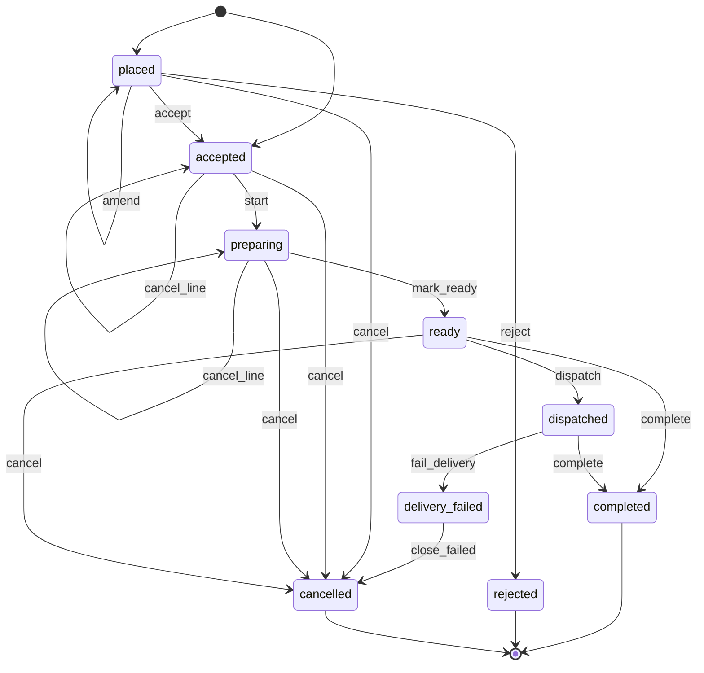
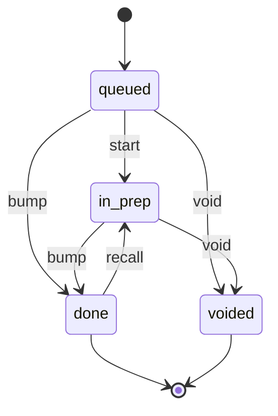
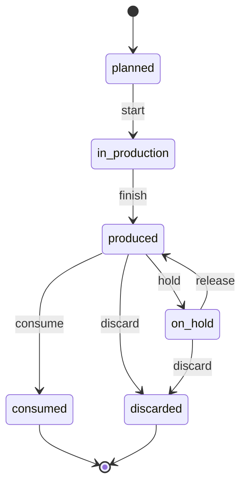
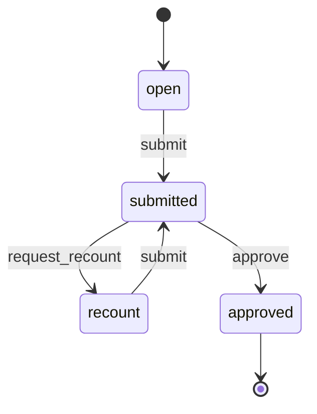
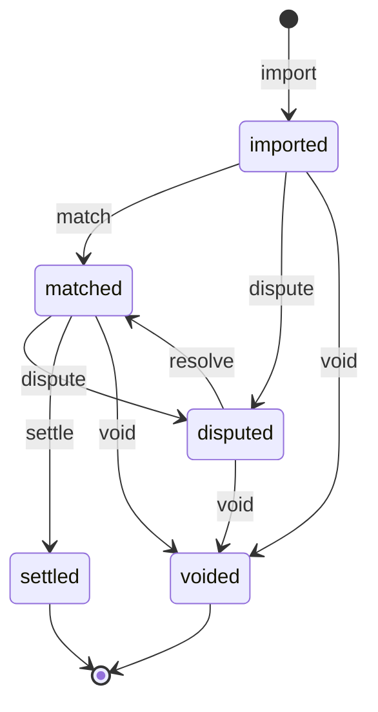
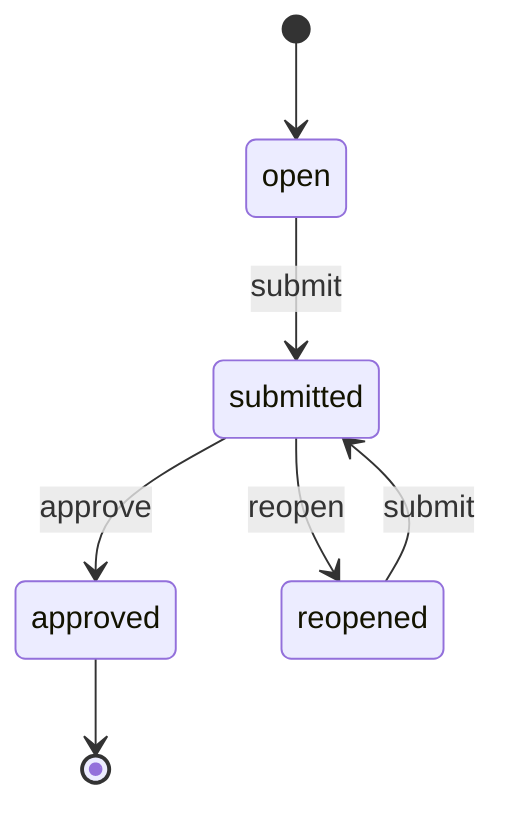
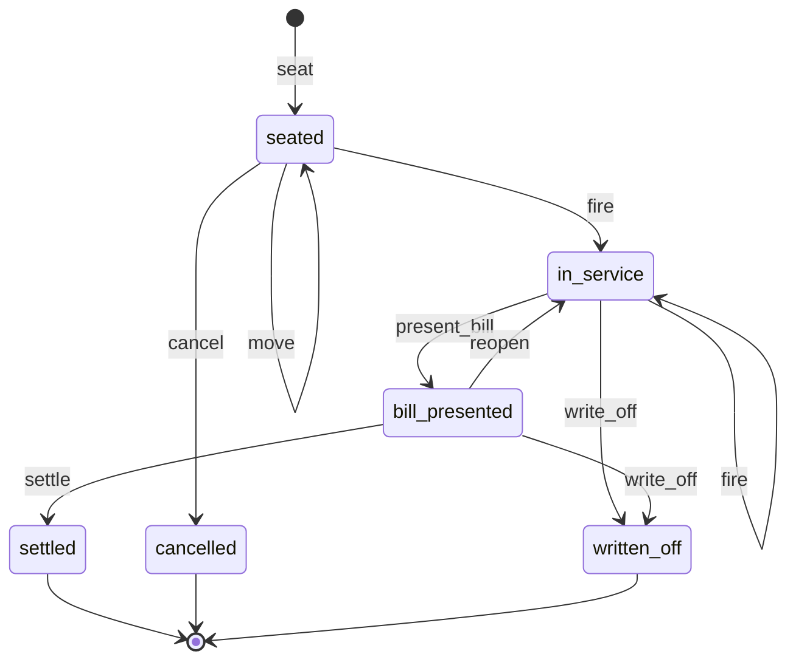

# 06 — Cloud Kitchens & Local F&B Chains

> Spec: accepted · Reviewed: 2026-10-15 · Spec text last changed: 2026-10-16

**Build status (2026-10-24):** Built in F6 (#520), merged. **Built:** the Order, Kitchen ticket, Production batch, Payout statement and Daily closing machines of §7.1, recalls traced to direct orders, outage and paper orders, refused-food refunds, the F&B demo (`fnb:demo`). **Not built (MVP items still open):** aggregator orders through Deliverect (the name appears only as a fallback label), the branded D2C ordering site with OTP login, `FNB.RUL.02` (prep target highlight), `FNB.RUL.06` (key ingredient at zero), `FNB.RUL.07` (batch expiry look-ahead), `FNB.RUL.09` (food cost variance alert); the authority notification of a recall (open item AU-20) and wastage posting for refused food are also open. `FNB.RUL.11`-`13` are Later. **Machines in code but not in the spec:** `Outage` (README). See [STATUS.md](STATUS.md) and [apps/fnb/README.md](../../apps/fnb/README.md).

## 1. Summary

UAE cloud-kitchen operators and local F&B chains run several brands and outlets. Their orders
come from Talabat, Careem, Deliveroo, Noon Food and their own channels, and each source has
its own tablet. Food cost is known only at month end, and aggregator commissions take a large
share of every order. The app brings orders from every channel into one kitchen screen,
controls recipes, stock and daily food cost, reconciles aggregator payouts, and gives each
brand a commission-free direct ordering site. The MVP works **without aggregator APIs**:
aggregator orders are entered on a tablet or imported from reports, and API integrations are
an add-on behind clearly marked dependencies (§8).

Local chains also run **dine-in restaurants**. Dine-in (tables, floor plan, table orders to the
kitchen, split bills, service charge, table reservations) is documented here as a scoped
**Later extension** on the same orders, kitchen display and POS. The MVP stays delivery,
pickup and counter takeaway (§2, *Scope decision*).

## 2. Business context (UAE)

- **Customer size:** 1–5 kitchens running 2–15 virtual brands, or a local chain with 3–30
  outlets and often a central kitchen. 20–400 staff. 200–5,000 orders a day. Chains often
  mix delivery-only kitchens with dine-in restaurants of 30–150 covers.
- **How they work today:**
  - one tablet per aggregator on the pass, with orders re-keyed into a POS or not recorded
    at all;
  - recipes and food cost in Excel;
  - stock counted irregularly, supplier orders sent by WhatsApp;
  - paper temperature logs;
  - aggregator payout statements reconciled by hand, or not at all.
- **Rules and practice that shape the work:**
  - **Aggregators:** Talabat, Deliveroo (owned by DoorDash since 2025), Careem Food, Noon
    Food and **Keeta** (Meituan; Dubai from September 2025, then other emirates) ✔ [S1].
    Commissions are reported at roughly 20–35% per order including delivery, with lower
    negotiated rates for some groups; promotion co-funding and payout frequency are set in
    each contract [S2]. Payouts are net of commissions, refunds and promotions.
  - **Aggregator APIs are partner-gated.** Each aggregator approves integrators. Order
    middleware already hold those integrations: Deliverect covers Talabat, Deliveroo, Noon
    Food and Keeta; Grubtech covers Talabat, Deliveroo, Careem and Noon ✔ [S3]. Integrating through one middleware is
    more realistic than integrating with each aggregator directly.
  - **Food safety:**
    - Dubai Municipality's Food Code, and Abu Dhabi's ADAFSA, set the rules for
      temperature control, cleaning and pest control records, labelling of prepared food,
      and a Dubai Municipality–certified **Person in Charge (PIC)** on site per shift
      (certificate valid 5 years, as reported by training providers) [S4]. Hot holding at
      60°C or above, cold at 5°C or below ✔ [S5]. In Abu Dhabi (ADAFSA Code of Practice 29
      of 2019, under Law 2 of 2008) chilled food is kept below 5°C and hot food above 63°C,
      all food handlers hold the EFST certificate, and temperature and calibration records
      are kept 3 years ✔ [S14]. No ADAFSA rule for a person in charge like Dubai's was
      found `⚠ open: authority (AU-14)`.
    - Food handlers need an **occupational health card**, issued by DHA within 30 days of
      starting work, usually valid one year [S6]. The Food Code requires the cards on file
      ✔ [S5], and DHA does the screening ✔ [S15], but no official source states the
      validity `⚠ open: authority (AU-15)`; the app tracks the expiry printed on each card.
    - Dubai Municipality's **FoodWatch** platform holds establishment registration, food
      handler training records, PIC daily reporting and inspections ✔ [S7]. No public API;
      records in this app are the outlet's own evidence.
  - **Labelling:** allergen information is expected on menus. Calorie labelling on menus
    was postponed and is **voluntary**; Dubai Municipality's guide applies when a calorie
    claim is made ✔ [S8].
  - **VAT:** food is standard-rated at 5%. Consumer prices must be shown VAT-inclusive
    (fine AED 5,000) ✔ [S9]. Hotel- and tourism-licensed outlets in Dubai add a 7%
    municipality fee; Abu Dhabi removed its restaurant tourism and municipality fees in
    September 2023 ✔ [S10].
  - **Dine-in practice:** restaurants seat walk-ins and reservations, take orders by course,
    print a bill per table and often split it. A **service charge** (up to 10%) is allowed
    only for hotel- or tourism-licensed outlets; other restaurants may not add one ✔ [S10].
    A mandatory service charge carries 5% VAT; voluntary tips passed to staff are outside
    VAT [S11]. Reservations also arrive from platforms such as SevenRooms (inside Deliveroo
    since June 2026) and Eat App, with partner-only APIs [S12].
- **Scope decision (dine-in):**
  - **MVP:** delivery-only kitchens, pickup and **counter takeaway** (walk-in orders paid at
    the counter, `SAL.POS.01`). This covers cloud kitchens and the takeaway counter of
    every outlet.
  - **Later extension:** full dine-in — floor plan and tables, table sessions, orders by
    course sent to the kitchen display, bill splitting and transfers, service charge and
    municipality fee lines, and table reservations through `wl-scheduling` with tables as
    bookable resources. It reuses the same order model (`SAL.ORD.01`), kitchen display
    (`FNB.KDS.01`), POS and day closing (`SAL.POS.01`), so no part of the MVP is rebuilt.
  - **Reason:** the documented pain (aggregator tablets, food cost, payout reconciliation)
    is strongest in delivery operations, and dine-in POS is a crowded market where clients
    often already own a POS (§13). The extension is planned so that a chain with
    restaurants can adopt the platform without a second system later.

## 3. Users and access

Follows [ACCESS-CONTROL.md](../ACCESS-CONTROL.md). Platform-wide rules (`PLT.ACL.*`) are not
repeated here.

### 3.1 Roles

| Role | Actor type | What they do | Permissions (summary) | Typical scope |
|---|---|---|---|---|
| Owner / operations director | staff | Sees all brands, outlets and margins; approves large purchases and write-offs | all | global |
| Area manager | staff | Oversees several outlets: sales, food cost, compliance, closings | outlets, reports, approvals | outlet (several) |
| Outlet / kitchen manager | staff | Runs one kitchen: orders, staff, stock counts, wastage, checklists, daily closing | orders, stock, wastage, checklists, closing, availability | outlet |
| Head chef / central kitchen chef | staff | Recipes, production batches, prep labels, quality | recipes, production, labels, wastage | outlet |
| Line cook / station | field | Sees and bumps kitchen tickets for their station | `kds.work` | outlet (station) |
| Cashier / order taker | staff | Enters aggregator and phone orders, handles pickups and counter sales, small refunds; settles table bills (Later) | orders (create, update and amend: `orders.manage`; cancel and line cancel: `orders.cancel`, with a manager above `SAL.ACL.01` or under `SAL.ACL.05`), refunds within limit, till | outlet |
| Host (Later) | staff | Manages reservations and the walk-in waiting list, seats guests, assigns tables | reservations, tables (seat, move), waiting list | outlet |
| Waiter (Later) | field | Takes table orders by course on a handheld, fires courses to the kitchen, presents and splits bills | table sessions in their section, `orders.create`, bills (present, split) | outlet (section) |
| Storekeeper / purchaser | staff | Supplier orders, receiving, transfers, counts | purchase orders, goods received, stock movements | outlet or central kitchen |
| Menu manager | staff | Menus, prices per channel, promotions, brand content | catalogue, price lists, promo codes | global |
| Accountant | staff | Aggregator reconciliation, supplier bills, closings review | finance, reconciliation, reports | global |
| Rider (own fleet) | field | Delivers direct orders in the driver PWA, records proof of delivery, collects cash on delivery and hands it over at the end of the shift (MVP, §13 question 4) | assigned deliveries only; own cash handover | outlet |
| Customer | external | Orders from the brand's site; sees own orders and addresses | portal: orders, addresses | own orders |
| Supplier | external | Sees purchase orders (Later) | portal: orders | own orders |

### 3.2 Scope

The scope unit is the **outlet**: a kitchen, a restaurant, or the central kitchen. Kitchen
managers, chefs, cooks, cashiers and storekeepers are assigned per outlet. Area managers hold
their role in several outlets. Menu managers and accountants are global. A **brand** is not
a scope: one kitchen cooks for several brands, and access follows the kitchen. A **floor
area** (dining room, terrace) inside a restaurant is not a scope either; waiters are assigned
to a section for a shift (`ASG`).

### 3.3 Access rules

| ID | Rule | Pattern | Applies to | Parameter (default) |
|---|---|---|---|---|
| `FNB.ACL.01` | Kitchen screens show only tickets for the user's outlet and station, without customer contact details | scope, `FLD` | line cook | — |
| `FIN.ACL.08` *(shared, formerly `FNB.ACL.02`)* | Recipe costs, supplier prices and margins are hidden from cooks and cashiers | `FLD` | line cook, cashier | — |
| `STK.ACL.02` *(shared, formerly `FNB.ACL.03`)* | Wastage entries above a value need the kitchen manager's approval; the person who records wastage cannot approve it | `LIM`, `SOD` | chef, cook | AED 200 |
| `FNB.ACL.04` | A submitted stock count is locked; corrections are made through an approved adjustment | `STA` | storekeeper, kitchen manager | — |
| `FNB.ACL.05` | A submitted daily closing is locked; reopening needs the area manager | `STA` | kitchen manager | — |
| `STK.ACL.03` *(shared, formerly `FNB.ACL.06`)* | Purchase orders above a value need the area manager's approval | `LIM` | storekeeper | AED 5,000 |
| `FNB.ACL.07` | Prices and menu content change only through the menu manager. Outlet staff can only mark items unavailable or available for their outlet | scope, `FLD` | outlet staff | — |
| `FNB.ACL.08` | A customer sees only their own orders, addresses and receipts | `OWN` | customer | — |
| `WRK.ACL.05` *(shared, formerly `FNB.ACL.09`)* | A rider sees a customer's phone and address only while the delivery is assigned and active | `ASG`, `TIM` | rider | — |
| `NTF.ACL.01` *(shared, formerly `FNB.ACL.10`)* | Exporting the customer list needs `customers.sensitive.export`; every export is audited; marketing messages go only to customers who opted in | `SEN` | menu manager | — |
| `FNB.ACL.11` | Voiding an item after it was fired to the kitchen needs a manager; the voided item is logged as wastage with a reason (Later) | `STA`, `LIM` | waiter, cashier | any value |
| `FNB.ACL.12` | A waiter sees and edits only table sessions in their assigned section; transferring a table to another waiter needs the outlet manager (Later) | `ASG` | waiter | — |
| `FNB.ACL.13` | After a bill is presented, adding items, removing the service charge or reopening the session needs a manager (Later) | `STA` | waiter, cashier | — |
| `FNB.ACL.14` | A walk-out (unpaid table) is written off only with the area manager's approval (Later) | `LIM`, `SOD` | outlet manager | any value |
| `FNB.ACL.15` | Reservation guests' phone numbers are visible to hosts and managers only, not on kitchen or waiter screens (Later) | `FLD` | host, waiter, line cook | — |
| `SAL.ACL.01` *(shared)* | Cancelling or refunding a paid order above a value, or after preparation started, needs a manager | `LIM`, `STA` | cashier | AED 50 |
| `SAL.ACL.02` *(shared)* | A manual discount above a percentage needs a manager | `LIM` | cashier | 10% |
| `SAL.ACL.05` *(shared)* | Cancelling an order or a line after the kitchen started it needs an outcome per line (*return to stock*, or *scrap* as wastage) and a manager's approval; a remake is a new order, with the cancelled line's outcome *scrap* | `STA` | cashier, kitchen manager | — |
| `SAL.ACL.06` *(shared)* | A refund after completion with nothing returned (cold, late, missing or wrong item) needs a complaint category and a responsible party; above a value the kitchen manager approves, never the recorder | `LIM`, `SOD` | cashier, kitchen manager | AED 50 |
| `WRK.ACL.09` *(shared)* | A cash-on-delivery difference above the tolerance needs approval of who absorbs it (customer, business or rider) | `LIM` | rider, kitchen manager | tolerance AED 5; approver: kitchen manager |
| `WRK.ACL.10` *(shared)* | Reversing a delivery marked delivered, or marking it lost by hand, needs the kitchen manager; the rider neither requests nor approves | `SOD` | rider, kitchen manager | — |
| `FIN.ACL.05`, `FIN.ACL.06` *(shared)* | Rider cash and till cash are counted by someone other than the holder; a shortage above the limit is written off only with the area manager's approval | `SOD`, `LIM` | rider, cashier, kitchen manager | AED 20 per handover or till session |
| `FIN.ACL.18` *(shared)* | Accepting a chargeback on a direct order without contesting it needs a second person | `LIM`, `SOD` | accountant | AED 0 (always) |
| `STK.ACL.05` *(shared)* | Releasing stock held for a recall needs a second holder of `lots.release`; a temperature hold is released by one (the chef) | `SOD` | chef, kitchen manager | listed reason: `recall` |
| `FNB.ACL.16` | Food that comes back from a failed delivery, or was held for temperature and not released by the chef, is never sold or reused; it is logged as wastage | `STA` | outlet staff | on |
| `FNB.ACL.17` | After a failed own-rider delivery, a prepaid order is refunded in full at once when the reason is on the outlet's side (rider issue, run aborted, or refused because the order was late or had the wrong item; mapping in §7.1); for a customer-side reason (unreachable, wrong address, refused for another cause, no cash) no refund is made unless the kitchen manager approves one: the cashier requests it from the cancelled order within 7 days of the cancellation (`close_failed`), full or partial up to the amount paid, and the requester never approves it (`FIN.ACL.04`) | `STA`, `LIM`, `SOD` | cashier, kitchen manager | customer-side: no refund `⚠ open: lawyer (L-33)` (consumer protection) |

## 4. Value streams

### 4.1 Aggregator order to kitchen

1. An order arrives on an aggregator tablet.
   - **Without middleware:** the cashier enters it in seconds on a channel-specific
     quick-entry screen: brand, items by short code, modifiers, aggregator order number,
     pickup time (`FNB.AGG.01`, `SAL.ORD.01`).
   - **With Deliverect (MVP, client's own subscription):** the order is injected
     automatically (`FNB.AGG.02`).
2. The order is split into kitchen tickets per station and appears on the kitchen display
   with a prep timer (`FNB.KDS.01`, `FNB.KDS.02`).
3. Stations bump their items. The order becomes ready and is handed to the aggregator's rider.
4. The order closes. Theoretical ingredient consumption is posted from the recipes
   (`STK.BOM.01`, `STK.MOV.01`).
5. Cancellations and refunds are recorded with a reason and a responsible party: *business*
   (the kitchen), *aggregator* or *customer* (`SAL.ACL.01`; the wl-sales party list).

**When it goes wrong**

| Situation | What happens |
|---|---|
| The same aggregator order is entered twice, or the middleware sends it again | The aggregator order number is unique per channel: a second entry or import is refused and points to the existing order |
| An item runs out after the order was accepted | The cashier changes the order on the aggregator's tablet (the aggregator owns the change; amendments are off on aggregator channels) and records the result here: the line is cancelled, or the order is cancelled with responsible party *business*. `FNB.RUL.06` marks the item unavailable |
| The aggregator's rider does not arrive | `FNB.RUL.16` alerts the kitchen manager 15 minutes after `ready`; the manager chases the aggregator on its tablet. If the aggregator cancels, the order is cancelled with responsible party *aggregator*, the food is logged as wastage, and the line is flagged for the payout reconciliation (compensation expected). The 45-minute task goes to the kitchen manager, whose choice *cancelled by the aggregator* is the `SAL.ACL.05` approval (outcome *scrap* for every line). A flagged order with no compensation on the payout statement is listed as an unmatched difference for the accountant (`FNB.RUL.10`) |
| Deliverect is down | Orders are taken on the aggregator tablets and entered by quick entry (`FNB.AGG.01`) with the late-entry flag where needed. On recovery, imported orders that match a quick-entered number are refused as duplicates and listed for the kitchen manager (wl-kernel §5.14) |

### 4.2 Direct order to delivery

1. The customer opens the brand's ordering site (PWA), browses the menu with modifiers,
   allergens and calories, and builds a cart (`FNB.DTC.01`, `FNB.ALG.01`, `SAL.CAT.01`).
2. They choose pickup or delivery. The delivery area, fee, minimum order and opening hours
   are checked (`FNB.DTC.02`).
3. They log in by phone OTP (`POR.SLF.01`, `NTF.MSG.03`), apply a promo code (`SAL.DSC.01`),
   and pay online or choose cash on delivery (`FIN.PAY.02`, `FIN.PAY.01`).
4. The outlet accepts the order. It goes to the kitchen display (`FNB.KDS.01`).
5. When ready, it is picked up by the customer or dispatched to the outlet's own rider
   (`WRK.DSP.01`, `FNB.DTC.03`); third-party couriers are Later. Delivery is confirmed in the
   driver PWA (`WRK.POD.01`).
6. A receipt (tax invoice) is sent by SMS or email (`FIN.INV.01`, `DOC.GEN.01`).
7. At the end of the shift, each rider hands over the cash collected on delivery. The kitchen
   manager or cashier (never the rider) counts it against the rider's cash-on-delivery orders
   (`FIN.CSH.01`, `FIN.ACL.05`).

**When it goes wrong**

| Situation | What happens |
|---|---|
| Online payment pending or failed | The order waits in `awaiting_payment` and is not shown to the kitchen. A payment still pending after 10 minutes is checked with the gateway (`FIN.RUL.19`); a failed or timed-out payment cancels the order and the customer may order again |
| Payment confirmed after the order was rejected or cancelled | Refunded in full without staff action (`SAL.RUL.06`); the customer and the kitchen manager are told |
| Customer cancels before the outlet accepts | Cancel from the order page; full refund; nothing reaches the kitchen |
| An item runs out after acceptance | The cashier calls the customer: substitute (order `amend`, price difference refunded or charged by link), drop the line (`cancel_line`, line refunded), or cancel the order (full refund) |
| Own-rider delivery fails (customer unreachable, wrong address, refuses, cannot pay) | The delivery is perishable: one attempt, no reattempt (`WRK.RUL.16`). The order goes `delivery_failed`; the rider brings the food back and the outlet logs it as wastage (`FNB.ACL.16`). Refund per `FNB.ACL.17`; nothing is collected on a cash order. Repeated failed cash orders turn cash on delivery off for that customer (`FNB.RUL.14`). A remake, if the customer still wants the food, is a new order |
| Cash on delivery short | The rider records the cash actually received; a difference above AED 5 needs the kitchen manager's approval of who absorbs it (`WRK.ACL.09`). Otherwise the attempt fails with *refused to pay* or *no cash* |
| Rider's run is aborted (breakdown, accident) | Food not yet delivered is handed over to another rider (`hand_over`, the receiving rider confirms orders and cash) when it can still arrive within the brand's delivery promise; otherwise the stops fail with *run aborted* and the outlet refunds in full |
| Customer says the order never arrived | The delivery goes `under_review` (cash and billing held); the kitchen manager checks the proof. If the rider was wrong, `reverse_delivery` with approval (`WRK.ACL.10`) and a full refund; otherwise the review closes and the order stays completed. The refund is a sales return of kind *no goods* on every line (responsible party *rider*), resolved at once; the kitchen manager's reversal approval counts as its `SAL.ACL.06` approval. On cash on delivery, nothing is refunded if no cash was handed over for the order: the same return is then resolved by credit note only (no refund payment) and the order's cash is removed from the rider's expected cash; otherwise the cashier refunds in cash or by transfer and records the method |
| Customer refuses one item at the door (wrong item) | Partial acceptance (on in 06): the rider records the refused line with the refusal reason *wrong item*; the delivery is `delivered` and the order `completed` for the accepted lines. On a prepaid order the system raises a sales return of kind *no goods* for the refused line (category *wrong item*, party *business*): up to AED 50 it is resolved at once with *refund*, above it waits for the kitchen manager (`SAL.ACL.06`). On cash on delivery the rider collects only the accepted lines' amount, so nothing is refunded. The refused food comes back on the run and is logged as wastage (reason *refused at delivery*) on `DeliveryRefusedReceived` (`FNB.ACL.16`) |
| Complaint after delivery: cold, late, missing or wrong item | A sales return of kind *no goods* from the order or the complaint ticket, with the category and the responsible party (business, rider, supplier, customer). Refund full or partial per line; above AED 50 the kitchen manager approves (`SAL.ACL.06`). A rider fault (responsible party *rider*, here, at `close_failed` or on a reversed delivery) adds a *rider fault* entry (order, category, amount, date) to the timeline of the rider's employee record, for the rider of the delivery's last run; the kitchen manager and HR see it, other riders do not; it never touches pay |
| Card payment charged back | The accountant gets the evidence task with the deadline (`FIN.RUL.20`); accepting the loss needs a second person (`FIN.ACL.18`) |
| Refund fails at the gateway | Retried once after 24 hours (`FIN.RUL.21`), then refunded by another method or kept as the customer's credit |
| Rider's cash count is short | The handover goes `short`; a third person may recount. The shortage is recovered from the rider in cash, or written off up to AED 20 (above: area manager, `FIN.ACL.06`). Salary deduction is off (`FIN.ACL.19`, `⚠ open: lawyer (L-20)` in wl-payments) |

### 4.3 Aggregator payout reconciliation

1. The accountant imports the aggregator's payout statement as CSV or Excel (`FNB.REC.01`).
2. Statement lines are matched to recorded orders by aggregator order number.
3. Commissions, promotion co-funding, refunds, penalties and adjustments are categorised.
   Unmatched lines and amount differences are listed.
4. The expected payout is booked as a receivable from the aggregator. The bank receipt is
   allocated against it (`FIN.REC.01`, `FIN.PAY.01`).
5. Disputed lines are raised with the aggregator and tracked until settled.

**When it goes wrong**

| Situation | What happens |
|---|---|
| Aggregator refunds a customer and deducts it from the payout | On `match`, each refund line becomes a sales return of kind *no goods* on the order (resolution *refunded by the channel*, no money out from the outlet) with the aggregator's reason as category and responsible party *business* or *aggregator*. The order's amount refunded and the refund KPI update. A refund the kitchen did not cause is disputed with the aggregator |
| Wrong file imported, or a file imported twice | A statement with the same aggregator and reference is refused as a duplicate. A wrong file is voided before `settled` (`void`, `PLT.ACL.09`): matching and the expected receivable are reversed and the right file is imported |
| An order on the statement is missing here | Listed as unmatched; the cashier enters it as a late entry with the aggregator order number, or the line is explained |

### 4.4 Procure to plate

1. Par levels per outlet and item suggest the next supplier order (`STK.ITM.01`,
   `STK.LOC.01`).
2. The storekeeper confirms purchase orders, often daily for fresh produce (`STK.PUR.01`).
3. On delivery, goods are received with a temperature check, and batch and expiry dates are
   recorded (`STK.GRN.01`, `WRK.CHK.01`, `STK.LOT.01`). The supplier bill is matched later
   (`FIN.PAB.01`).
4. The central kitchen produces prepared items (sauces, marinated proteins, doughs) by
   recipe. A batch gets a label with production date, expiry and allergens (`FNB.PRD.01`,
   `STK.BOM.01`, `FNB.LBL.01`).
5. Outlets request prepared items. The central kitchen transfers them (`STK.PRQ.01`,
   `STK.MOV.01`).
6. Sales consume ingredients through recipes (theoretical usage).
7. Key items are counted daily and everything weekly (`STK.CNT.01`). Wastage is
   logged with reasons (`FNB.WST.01`).
8. Actual vs theoretical food cost and the variance per item and outlet are reported
   (`FNB.CST.01`).

**When it goes wrong**

| Situation | What happens |
|---|---|
| Goods fail the temperature or quality check at receiving | The storekeeper records accepted and rejected quantity per line. Rejection reason `temperature` needs the reading from the receiving checklist. Refused goods go back with the supplier's driver: the posted receipt dispatches a Return to supplier at once, and only the accepted quantity enters stock, the PO and the 3-way match. If the supplier bill was already posted, a supplier debit note is drafted (wl-inventory §5.6) |
| Supplier sends the wrong quantity or a replacement | The PO is revised, or reopened for the replacement (`revise`, `reopen`); returns that stay open 30 days are chased (`STK.RUL.08`) |
| Supplier or authority recalls an ingredient lot, or a contaminated lot is found | The head chef or owner opens a recall (wl-inventory §5.7). Every lot in scope is held at every outlet and in transit; the trace follows transfers, production batches (the batches made from the lot are held too) and orders. Sales consume ingredients by recipe without recording which lot went into the food, so an order is linked to a lot only as *possible*: when its outlet had the lot (or a batch lot made from it) on hand at the order's time, between the lot's first receipt or transfer into the outlet and the time it reached zero there or was held; never *confirmed*. Direct-order customers are found through the order (`TracePartyResolver`: order → customer; one notice per customer listing their possible orders); aggregator and counter sales without a known customer are listed per outlet and day, and the owner decides on a public notice and tells the aggregators. Held stock is discarded, returned to the supplier or released by a second person (`STK.ACL.05`). Authority notification is `⚠ open: authority (AU-20)` (wl-inventory §10) |
| Not enough stock at an outlet for an order's recipe | Outlet kitchens use the negative stock policy `allow_consumption` for items that are not lot-tracked: the sale goes through and the next receipt covers the negative balance. Lot-tracked items and the central kitchen use `block`: the short quantity becomes a pending issue. `STK.RUL.06` alerts the storekeeper in both cases |

### 4.5 Menu management

1. The menu manager creates an item: name EN/AR, photo, recipe, modifiers, allergens,
   calories (`SAL.CAT.01`, `STK.BOM.01`, `FNB.ALG.01`).
2. The item is assigned to brands. Prices are set per channel, for example higher on
   aggregators to absorb commission (`FNB.BRD.01`, `FNB.CHN.01`).
3. The item is published to the D2C site at once.
4. For aggregators:
   - **without an integration**, the system produces a change list to apply in each
     aggregator's portal, and tracks it as a checklist;
   - **with Deliverect (MVP)**, the menu is pushed automatically (`FNB.AGG.03`).
5. When an item runs out, outlet staff mark it unavailable ("86") for their outlet. D2C
   updates at once; aggregators follow the same manual or integrated path (`FNB.RUL.06`).

### 4.6 Daily operations and food safety

1. Before opening, the opening checklist is completed: fridge and freezer temperatures,
   cleanliness, PIC on duty (`FNB.FSF.01`, `WRK.CHK.01`).
2. Temperature logs are recorded at set intervals. Out-of-range readings open an equipment
   ticket (`FNB.RUL.04`, `FNB.RUL.05`, `WRK.TKT.01`).
3. Food handlers' health cards and the PIC certificate are tracked with expiry
   (`HRM.EMP.01`, `DOC.EXP.01`).
4. At closing: closing checklist, cash-up, and a daily closing (Z report) with sales by
   channel and payment type, submitted by the kitchen manager (`SAL.POS.01`).
   Each outlet has a business-day cut-off (default 04:00): orders before it belong to the
   previous day's closing, so late-night trading is not split.

**When it goes wrong**

| Situation | What happens |
|---|---|
| A fridge or freezer reads out of range | `FNB.RUL.05` opens an equipment ticket and places a stock hold (reason `temperature`) on the stock in that unit, with the reading as reference. The chef (`lots.release`) decides per line: release, discard (wastage, `STK.ACL.02`) or return to supplier, recording the reading and how long the food was out of range. Held food cannot be used meanwhile; stock moved into the unit while its hold is open is added to that hold as new lines (the receiving and transfer screens warn first). `STK.RUL.07` reminds after 2 hours and escalates to the kitchen manager after 4 |
| Till cash is short at closing | The till session's variance above the threshold needs approval in wl-sales; the shortage goes to a cash handover (till session mode) and is recovered from the cashier in cash or written off up to AED 20, above that by the area manager (`FIN.ACL.06`) |
| Internet or power outage at the outlet | `FNB.RUL.15` pauses the outlet's brands on the D2C site when its devices stop answering; staff pause aggregators on their tablets. The kitchen works from aggregator tablet printouts and paper tickets; counter sales go on paper. When the outlet is back, orders, sales, wastage and temperature readings are entered with the late-entry flag and their business time (wl-kernel §5.13); after 24 hours, or into a submitted daily closing, the area manager approves (`PLT.ACL.10`) and the closing is `reopened`. A late entry into an `approved` closing is refused; the area manager gets a task to record it as an adjustment in the next day's closing. The kitchen manager resumes the channels |
| Food handler's health card or the PIC certificate expires | Reminders as today (`DOC.RUL.01`); on expiry the owner is alerted (compliance-critical, `DOC.RUL.03`). In the MVP no transition is blocked, as there is no shift attendance; with shift attendance (Later) an expired card flags the attendance record |

### 4.7 Dine-in order to payment (Later)

1. A guest arrives with a reservation or as a walk-in. The host checks the floor plan, seats
   the party at a free table and opens a **table session** with the number of covers
   (`FNB.DIN.01`, `FNB.DIN.02`).
2. The waiter takes the order on a handheld by seat and course, with modifiers and allergen
   notes (`SAL.ORD.01`, `FNB.ALG.01`).
3. Courses are fired to the kitchen when the waiter decides; each course becomes kitchen
   tickets on the right stations (`FNB.DIN.03`, `FNB.KDS.01`).
4. Items can be added, moved between seats or tables, and tables merged; voids after firing
   follow `FNB.ACL.11`.
5. The waiter presents the bill: items, VAT, service charge and municipality fee lines where
   the outlet is configured for them (`FNB.DIN.05`).
6. The bill is split by seat, by item or into equal shares, and settled at the table or the
   counter in one or several payments (`FNB.DIN.04`, `SAL.POS.01`, `FIN.PAY.01`).
7. Each payment produces a receipt (simplified tax invoice) (`FIN.INV.01`). The table is
   released and the order completes; ingredients are consumed by recipe (`STK.BOM.01`).
8. Table sales, covers and tips appear in the outlet's daily closing (`SAL.POS.01`).

### 4.8 Table reservation (Later)

1. Tables are bookable resources with seats and areas (`SCH.RES.01`).
2. A guest books online or by phone: date, time, party size, area preference, notes
   (`SCH.SLF.01`, `SCH.BKG.01`, `FNB.DIN.06`).
3. The system offers tables that fit the party and the outlet's turn times; the host can
   override (`FNB.DIN.06`).
4. Reminders and confirmation requests are sent; late guests' tables are released after a
   hold period, and no-shows are recorded (`SCH.RMD.01`, `SCH.RUL.01`, `SCH.RUL.02`).
5. On arrival, the reservation opens the table session (§4.7, step 1).

## 5. Capabilities

| ID | Capability | Shared or specific | Proposed module | Scope |
|---|---|---|---|---|
| `PLT.ORG.01` | Branded deployment | shared | wl-kernel | MVP |
| `PLT.USR.01` | Staff users, roles, permissions scoped per outlet | shared | Renox Permissions | MVP |
| `PLT.AUD.01` | Audit trail (refunds, discounts, wastage, counts, prices) | shared | Renox Audit | MVP |
| `PLT.APR.01` | Approval requests (wastage, refunds, purchase orders, adjustments) | shared | wl-kernel | MVP |
| `PLT.WFL.01` | State machines with history | shared | Renox (R12) + wl-kernel | MVP |
| `PLT.ATM.01` | Default automation rules | shared | wl-kernel | MVP |
| `PLT.HOK.01` | Outbound webhooks | shared | Renox (R11) | Later |
| `PTY.PTY.01` | Parties: customers, suppliers, aggregators, corporate accounts | shared | wl-parties | MVP |
| `PTY.CNS.01` | Consent records: marketing opt-in per channel (`NTF.ACL.01`) | shared | wl-parties | MVP |
| `DOC.FIL.01` | Attach documents (licences, supplier certificates, inspection reports) | shared | wl-documents | MVP |
| `DOC.EXP.01` | Expiry reminders (trade licence, food permit, PIC certificate, health cards, Halal certificates, trademark) | shared | wl-documents | MVP |
| `DOC.GEN.01` | Generate documents (receipts, POs, daily closing, change lists) | shared | wl-documents | MVP |
| `FIN.INV.01` | Tax invoices: consumer receipts and B2B catering invoices | shared | wl-invoicing | MVP |
| `FIN.PAY.01` | Record and allocate payments (cash, card, aggregator payouts) | shared | wl-payments | MVP |
| `FIN.PAY.02` | Online payment for direct orders | shared | wl-payments | MVP |
| `FIN.REC.01` | Receivables (aggregators, corporate accounts) | shared | wl-invoicing | MVP |
| `FIN.PAB.01` | Supplier bills with 3-way match | shared | wl-invoicing | MVP |
| `FIN.EXT.01` | Export to accounting software | shared | wl-invoicing | Later |
| `FIN.SUB.01` | Meal-plan subscriptions billed to customers | shared | wl-invoicing (+ renox-billing via wl-payments) | Later |
| `WRK.TKT.01` | Raise tickets (equipment faults) | shared | wl-ticketing | MVP |
| `WRK.TKT.02` | Triage and assignment (technician or vendor) | shared | wl-ticketing | MVP |
| `WRK.TKT.03` | Field updates with photos and sign-off | shared | wl-ticketing | MVP |
| `WRK.PPM.01` | Planned maintenance (hood cleaning, pest control, refrigeration service) | shared | wl-ticketing | Later |
| `WRK.CHK.01` | Checklists (opening, closing, receiving, temperature logs) | shared | wl-ticketing | MVP |
| `WRK.DSP.01` | Dispatch of direct orders to the outlet's own riders | shared | wl-delivery | MVP |
| `WRK.POD.01` | Proof of delivery for own-fleet direct orders | shared | wl-delivery | MVP |
| `FIN.CSH.01` | Cash collected by riders on direct orders: end-of-shift handover, shortages | shared | wl-payments | MVP |
| `POR.SLF.01` | Customer account: orders, addresses, receipts | shared | wl-portal | MVP |
| `NTF.MSG.01` | Email notifications | shared | wl-notify | MVP |
| `NTF.MSG.02` | WhatsApp notifications (order status, marketing to opted-in customers) | shared | wl-notify | Later |
| `NTF.MSG.03` | SMS: login OTP and order status | shared | wl-notify | MVP |
| `RPT.DSH.01` | Role-based dashboards | shared | Renox charts + wl-kernel | MVP |
| `HRM.EMP.01` | Employee records with documents (health cards, PIC certificate) | shared | wl-hr | MVP |
| `HRM.PAY.01` | Payroll calculation | shared | wl-hr | Later |
| `HRM.WPS.01` | WPS salary file (SIF) export | shared | wl-hr | Later |
| `HRM.ATT.01` | Shift attendance | shared | wl-attendance | Later |
| `STK.ITM.01` | Ingredient and packaging catalogue with units of measure | shared | wl-inventory | MVP |
| `STK.LOC.01` | Stock per outlet and central kitchen | shared | wl-inventory | MVP |
| `STK.MOV.01` | Stock movements: receive, consume by recipe, transfer, waste, adjust | shared | wl-inventory | MVP |
| `STK.PRQ.01` | Outlet requisitions to the central kitchen | shared | wl-inventory | MVP |
| `STK.PUR.01` | Purchase orders to suppliers | shared | wl-inventory | MVP |
| `STK.GRN.01` | Goods received with temperature check | shared | wl-inventory | MVP |
| `STK.LOT.01` | Batch and expiry tracking (received goods and prepared batches) | shared | wl-inventory | MVP |
| `STK.ROP.01` | Par levels and reorder suggestions per outlet (`STK.RUL.04`) | shared | wl-inventory | MVP |
| `STK.BOM.01` | Recipes and sub-recipes with yields | shared (**new**) | wl-inventory | MVP |
| `STK.AST.01` | Kitchen equipment register | shared | wl-inventory | Later |
| `STK.CNT.01` | Stock count sessions (full or partial) with variance and approved adjustment | shared (**new**) | wl-inventory | MVP |
| `SAL.CAT.01` | Menu catalogue with modifiers and price lists per channel | shared | wl-sales | MVP |
| `SAL.ORD.01` | Orders from every channel in one model | shared (**new**) | wl-sales | MVP |
| `SAL.POS.01` | Counter (takeaway) point of sale and day closing: cash-up, Z report (absorbs `FNB.CSH.01`); dine-in Later | shared (**new**) | wl-sales | MVP |
| `PLT.ENT.01` | Legal entities: several trade licences and TRNs in one deployment; issuer on every document | shared | wl-kernel | MVP |
| `PLT.IMP.01` | Data import and migration: Excel templates per entity, validation, dry run, rollback | shared | wl-kernel | MVP |
| `PLT.SRC.01` | Global search across records, including Arabic names | shared | wl-kernel + Renox search | MVP |
| `PLT.NOT.01` | Notes, comments and @mentions on any record, with an activity timeline | shared | wl-kernel | MVP |
| `PLT.SSO.01` | Staff single sign-on with Microsoft 365 or Google Workspace | shared | Renox OAuth (renox-oauth) | Later |
| `RPT.LIB.01` | Report library: filtered reports with export to Excel, CSV and PDF | shared | wl-kernel | MVP |
| `RPT.SCH.01` | Scheduled reports sent by email | shared | wl-kernel | Later |
| `FIN.VAT.01` | VAT summary per period and entity: output and input VAT, for the accountant | shared | wl-invoicing | MVP |
| `FIN.EXP.01` | Expense claims and petty cash: submit with receipt, approve, reimburse, top up | shared | wl-payments | MVP |
| `FIN.BNK.01` | Bank statement import and matching of receipts to open invoices | shared | wl-payments | Later |
| `WRK.FBK.01` | Customer feedback and ratings after a completed service; low ratings open a ticket (absorbs `FNB.FDB.01`) | shared | wl-ticketing | Later |
| `WRK.SVC.01` | Vendor service contracts (AMC): scope, assets, planned visits, SLA, cost | shared | wl-ticketing | Later |
| `SCH.RES.01` | Tables as bookable resources: seats, area, combinable tables | shared | wl-scheduling | Later |
| `SCH.BKG.01` | Table reservations taken by staff, with waiting list | shared | wl-scheduling | Later |
| `SCH.SLF.01` | Online table reservation from the brand site | shared | wl-scheduling | Later |
| `SCH.RMD.01` | Reservation reminders, confirmations and no-show handling | shared | wl-scheduling | Later |
| `FNB.BRD.01` | Virtual brands: several brands per kitchen, each with menu, branding and ordering site | specific | apps/fnb | MVP |
| `FNB.CHN.01` | Sales channels (each aggregator, D2C, phone, walk-in) with commission % and price list | specific | apps/fnb | MVP |
| `FNB.AGG.01` | Quick entry of aggregator orders with the aggregator order number | specific | apps/fnb | MVP |
| `FNB.AGG.02` | Automatic aggregator order import through middleware (Deliverect in the MVP; Grubtech Later) | specific | apps/fnb | MVP — **dependency** |
| `FNB.AGG.03` | Menu, price and availability sync to aggregators through middleware (Deliverect in the MVP) | specific | apps/fnb | MVP — **dependency** |
| `FNB.REC.01` | Aggregator payout statement import and reconciliation | specific | apps/fnb | MVP |
| `FNB.KDS.01` | Kitchen display: tickets by station, bump, recall, live updates | specific | apps/fnb | MVP |
| `FNB.KDS.02` | Prep time targets and late-order alerts per brand and channel | specific | apps/fnb | MVP |
| `FNB.DTC.01` | Branded direct ordering site (PWA) per brand | specific | apps/fnb | MVP |
| `FNB.DTC.02` | Delivery areas, fees, minimum order, opening hours per outlet | specific | apps/fnb | MVP |
| `FNB.DTC.03` | Delivery for direct orders: own riders (MVP) through `wl-delivery`; third-party couriers such as Quiqup or Jeebly Later | specific | apps/fnb | MVP |
| `FNB.DIN.01` | Floor plan per outlet: areas, tables, seats, table status at a glance | specific | apps/fnb | Later |
| `FNB.DIN.02` | Table sessions: seat, covers, move, merge and transfer tables | specific | apps/fnb | Later |
| `FNB.DIN.03` | Orders by seat and course, fired to the kitchen display by course | specific | apps/fnb | Later |
| `FNB.DIN.04` | Bill presentation and splitting (by seat, by item, equal shares), several payments per bill, tips | specific | apps/fnb | Later |
| `FNB.DIN.05` | Service charge (hotel- or tourism-licensed outlets only, up to 10%) and Dubai municipality fee (7%) lines per outlet configuration | specific | apps/fnb | Later |
| `FNB.DIN.06` | Reservation table allocation by party size and turn time; walk-in waiting list | specific | apps/fnb | Later |
| `SAL.DSC.01` | Promo codes for direct orders (formerly `FNB.PRM.01`) | shared (**new**) | wl-sales | MVP |
| `SAL.LOY.01` | Loyalty and retention: points or visit rewards, customer segments, and retention campaigns sent with marketing consent (formerly `FNB.LOY.01`) | shared | wl-sales + wl-notify | MVP |
| `SAL.CRM.01` | Leads and enquiries pipeline (corporate catering and B2B) | shared | wl-sales | MVP |
| `SAL.CRM.02` | Lead sources and campaigns: cost per campaign, conversion by source and channel, cost per lead, customer acquisition cost and return on ad spend | shared | wl-sales | MVP |
| `FIN.CFL.01` | Cash-flow forecast: expected receipts and payments by week from invoices, supplier bills, scheduled charges, post-dated cheques, payroll and budgets | shared | wl-invoicing | MVP |
| `STK.SUP.01` | Supplier scorecard and alternative suppliers: on-time delivery, rejected quantity, NCRs, price variance; preferred and alternative suppliers per item | shared | wl-inventory | MVP |
| `FIN.BUD.01` | Company budget vs actual by period, category and entity; owner drawings kept apart from operating cost | shared | wl-invoicing | MVP |
| `HRM.ONB.01` | Staff onboarding checklists per role and a library of SOP documents with acknowledgement | shared | wl-hr + wl-documents | MVP |
| `FNB.CST.01` | Theoretical vs actual food cost and variance per item and outlet | specific | apps/fnb | MVP |
| `FNB.WST.01` | Wastage logging with reasons and value | specific | apps/fnb | MVP |
| `FNB.PRD.01` | Central kitchen production planning and batches | specific | apps/fnb | MVP |
| `FNB.LBL.01` | Prep labels: item, production date, expiry, allergens | specific | apps/fnb | MVP |
| `FNB.ALG.01` | Allergen and calorie information per item | specific | apps/fnb | MVP |
| `FNB.FSF.01` | Food safety logs: temperature readings and opening/closing checks (configured on `WRK.CHK.01`) | specific | apps/fnb | MVP |
| `FNB.RPT.01` | Sales mix, channel profitability after commission, prep time and menu engineering reports | specific | apps/fnb | MVP |

*New* = a shared capability first needed by this vertical.

## 6. Key entities

| Entity | Description | Important fields | Owned by |
|---|---|---|---|
| Outlet | Kitchen, restaurant or central kitchen | type, address, opening hours, delivery areas, stations | apps/fnb |
| Brand | A customer-facing brand (often virtual) | name, logo, colours, outlets that cook it, ordering site domain | apps/fnb |
| Channel | Where orders come from | type (aggregator/D2C/phone/walk-in), aggregator, commission %, price list | apps/fnb |
| Menu item | Something sold | names EN/AR, brands, photo, modifier groups, recipe, allergens, calories, prices per channel | wl-sales |
| Modifier group | Options for an item | min/max choices, options with price and recipe effect | wl-sales |
| Recipe | Ingredients for an item or prepared batch | lines (item, quantity, unit), yield, sub-recipes, cost | wl-inventory |
| Ingredient | Stock item | unit, purchase unit, conversion, par level per outlet, storage temperature | wl-inventory |
| Order | One customer order | brand, outlet, channel, external order no. (unique per channel), business date, lines and modifiers, fulfilment (pickup/delivery), customer, totals, payment, amount refunded, failure reason and refund decision, late-entry flag, status | wl-sales (+ apps/fnb fulfilment) |
| Kitchen ticket | Part of an order for one station | order, station, items, timer, status | apps/fnb |
| Customer | Direct-order customer | party, phone, addresses, marketing consent | wl-parties |
| Promo code | Discount for direct orders | code, rule, validity, usage limit | wl-sales |
| Payout statement | Aggregator settlement | aggregator, statement reference (unique per aggregator), period, lines (order, gross, commission, promo, refund, net), status | apps/fnb |
| Production batch | Prepared item made in bulk | recipe, quantity, produced at, expiry, lot, outlet, status | apps/fnb (+ wl-inventory lots) |
| Stock count | A counting session | outlet, scope (key items / full), lines, variance, status | wl-inventory |
| Wastage entry | Thrown-away stock | item or batch, quantity, reason, value, recorded by | apps/fnb |
| Daily closing | End of day for an outlet | date, sales by channel and payment type, cash counted, variance, status | wl-sales (till session) |
| Checklist run | Opening, closing, receiving or temperature check | template, outlet, readings, photos, signature | wl-ticketing |
| Floor area (Later) | A dining room, terrace or bar inside an outlet | outlet, name, sections, opening hours | apps/fnb |
| Table (Later) | A place guests sit | floor area, number, seats (min/max), combinable with, position on the floor plan; also a bookable resource | apps/fnb (+ wl-scheduling resource) |
| Table session (Later) | One party's stay at a table | table(s), covers, waiter, opened/closed at, sales order, bill splits, service charge, status | apps/fnb |
| Reservation (Later) | A booked table | the *Booking* in `wl-scheduling`: guest party, date and time, party size, area, notes, status | wl-scheduling |

## 7. Workflow

Follows [WORKFLOW.md](../WORKFLOW.md). **Purchase order, purchase request** (outlet
requisitions) and **ticket** (equipment faults) reuse the state machines in
[02-construction.md](02-construction.md#71-state-machines) and
[01-property.md](01-property.md#71-state-machines) unchanged. **Invoice** is used for B2B
catering only; consumer receipts are issued and paid at once. **Reservations** (Later) use
the canonical *Booking* machine in [`wl-scheduling`](../modules/wl-scheduling.md#4-lifecycles)
with tables as resources. A dine-in order is a sales order on the `dine-in` channel that
starts in `accepted`; it completes when its table session is settled.

### 7.1 State machines

#### Order (F&B fulfilment)

> **Canonical definition:** *Sales order* in [`wl-sales` §4](../modules/wl-sales.md#4-lifecycles). This kitchen fulfilment machine stays specific to F&B. It starts on `SalesOrderConfirmed`; `placed` is the sales order's `pending_acceptance`. This section is this vertical's original requirement; where it differs, the module definition wins and its vertical mapping table records the difference.

The order data is shared (`SAL.ORD.01`, wl-sales). This fulfilment lifecycle is specific to
F&B. A direct order paid online stays in the sales order's `awaiting_payment` until the
gateway confirms it, and appears here as `placed` only then.

| State | Tone | Terminal | Meaning |
|---|---|---|---|
| `placed` | neutral | no | Direct order received and paid (or cash on delivery), waiting for the outlet to accept |
| `accepted` | info | no | Confirmed; aggregator orders start here |
| `preparing` | info | no | At least one kitchen ticket started |
| `ready` | success | no | All tickets bumped; waiting for pickup or rider |
| `dispatched` | info | no | Out for delivery with own rider or courier |
| `delivery_failed` | warning | no | Own-rider delivery failed; the food is coming back or was discarded; refund decision pending |
| `completed` | success | yes | Picked up or delivered |
| `rejected` | neutral | yes | Not accepted by the outlet; payment refunded |
| `cancelled` | error | yes | Cancelled by the customer before acceptance, or cancelled after acceptance or a failed delivery; reason and responsible party recorded |

| Transition | From | To | By | Guards | Effects |
|---|---|---|---|---|---|
| `accept` | placed | accepted | `orders.manage` | outlet open; items available | kitchen tickets created; customer notified |
| `reject` | placed | rejected | `orders.manage` or system | reason given | payment refunded; customer notified |
| `start` | accepted | preparing | system (first ticket started) | — | — |
| `amend` | placed, accepted | same state | `orders.manage` | direct orders only (aggregator orders are changed on the aggregator); customer agreed; changed lines not started by the kitchen | sales order `amend`: price difference refunded, or charged through a payment link; kitchen tickets updated |
| `cancel_line` | accepted, preparing | same state | `orders.cancel` | item unavailable or customer request; line not yet bumped; at least one other line stays open (otherwise order `cancel`, wl-sales); `SAL.ACL.05` when the kitchen started it | sales order `cancel_line`; line refunded if paid; started food logged as wastage |
| `mark_ready` | preparing | ready | system (all tickets bumped) | — | customer or rider notified |
| `dispatch` | ready | dispatched | `orders.manage` | delivery order; rider or courier assigned | customer notified |
| `fail_delivery` | dispatched | delivery_failed | system (`DeliveryAttemptFailed`, or a run `abort` with no hand-over) | failure reason recorded, mapped from the wl-delivery reason (table below) | one attempt only (perishable, `WRK.RUL.16`): no reattempt; food returned to the outlet (policy *return*); customer told; nothing collected on cash on delivery; `FNB.RUL.14` counts customer-side failures on cash orders |
| `close_failed` | delivery_failed | cancelled | system (`DeliveryReturned` or `DeliveryDiscarded`) or `orders.manage` | refund decision per `FNB.ACL.17` (the system proposes *full refund* for an outlet-side reason, *no refund* for a customer-side one, *not applicable* on cash on delivery); responsible party recorded (customer, rider, business); no `SAL.ACL.05` approval | refund per decision (everything paid: items and delivery fee); food logged as wastage once (`FNB.ACL.16`): with policy *return*, `SalesOrderCancelled` with outcome *scrap* posts it (reason *failed delivery*); with *discard*, the wastage record of the wl-delivery `discard` is the posting, the event carries its reference and no second movement is posted |
| `complete` | ready, dispatched | completed | `orders.manage`, rider, or system | — | stock consumed by recipe; receipt sent |
| `cancel` | placed, accepted, preparing, ready | cancelled | customer (from `placed` only, before acceptance) or `orders.cancel` | from `placed`: none; after acceptance: `SAL.ACL.01`, and `SAL.ACL.05` once the kitchen started; reason and responsible party (business / aggregator / customer) | full refund from `placed`; otherwise refund if paid; prepared food logged as wastage |

A delivered order the customer says never arrived stays `completed`; the delivery goes
`under_review` in wl-delivery and a refund follows `reverse_delivery` or a sales return of
kind *no goods*. An order entered by mistake is cancelled with reason *entered in error* and responsible
party *business*; the order itself does not use `void`, because its receipt may already be issued (a receipt is
corrected by a sales return, `SAL.ACL.04`).

**Failure reasons from wl-delivery.** 06 adds *rider issue* to the wl-delivery failure reason
list (not counted, no reattempt), and the rider picks the customer's stated cause when
recording *refused*: *late*, *wrong item* or *other*. The wl-delivery reason is kept on the
order too; the kitchen manager may change the proposed responsible party with a note.

| wl-delivery reason | Order failure reason | Side (`FNB.ACL.17`) | Proposed responsible party |
|---|---|---|---|
| not home, access denied | customer unreachable | customer | customer |
| wrong address | wrong address | customer | customer |
| refused, cause *other* | refused | customer | customer |
| refused to pay, no cash | no cash | customer | customer |
| refused, cause *late* or *wrong item* | refused (late / wrong item) | outlet | business |
| rider issue (vehicle, lost, late beyond the promise), not attempted | rider issue | outlet | rider |
| run aborted | run aborted | outlet | business |

#### Kitchen ticket

| State | Tone | Terminal | Meaning |
|---|---|---|---|
| `queued` | neutral | no | On the station's screen, not started |
| `in_prep` | info | no | Being cooked; timer running |
| `done` | success | yes | Bumped by the station |
| `voided` | neutral | yes | Order cancelled before completion |

| Transition | From | To | By | Guards | Effects |
|---|---|---|---|---|---|
| `start` | queued | in_prep | `kds.work` (`FNB.ACL.01`) | — | order `start` if first |
| `bump` | in_prep, queued | done | `kds.work` | — | order `mark_ready` if last |
| `recall` | done | in_prep | `kds.work` | order not `completed` | — |
| `void` | queued, in_prep | voided | system (order `cancel`) | — | — |

#### Production batch

| State | Tone | Terminal | Meaning |
|---|---|---|---|
| `planned` | neutral | no | Scheduled for production |
| `in_production` | info | no | Being prepared; ingredients reserved |
| `produced` | success | no | Made, labelled and in stock with an expiry |
| `on_hold` | warning | no | Its lot is held (recall of an ingredient lot, quality, temperature); not usable |
| `consumed` | success | yes | Fully used or transferred |
| `discarded` | error | yes | Expired, failed quality or discarded after a hold; logged as wastage |

| Transition | From | To | By | Guards | Effects |
|---|---|---|---|---|---|
| `start` | planned | in_production | `production.manage` | ingredients in stock; no ingredient lot on hold | ingredient lots used are recorded (lot genealogy for recalls) |
| `finish` | in_production | produced | `production.manage` | actual yield recorded | ingredients consumed; lot created with the expiry entered at `finish` (required; not later than the earliest expiry of the ingredient lots used); labels printed; if an ingredient lot used is on hold at that moment, the output lot is created on hold with the same reason and the batch runs `hold` at once |
| `hold` | produced | on_hold | system (`LotHeld` for the batch's lot, e.g. a recall traced through an ingredient lot) | — | batch blocked at every outlet it was transferred to; chef notified |
| `release` | on_hold | produced | system (`LotReleased`) | — | — |
| `consume` | produced | consumed | system (stock reaches zero) | — | — |
| `discard` | produced, on_hold | discarded | `production.manage` (from `produced`), or system (`LotDiscarded`) | reason; `STK.ACL.02`; from `on_hold` only through the stock hold line decision *discard*, so the hold's approvals apply (`STK.ACL.05` for a recall) | wastage entry created and posted once for the remaining quantity: from `produced` the batch posts the `wastage` movement; on `LotDiscarded` the lot's discard movement is the posting and the entry links it |
| `cancel` | planned | — (deleted) | `production.manage` | — | — |

#### Stock count *(shared — wl-inventory)*

> **Canonical definition:** *Stock count* in [`wl-inventory` §4](../modules/wl-inventory.md#4-lifecycles). This section is this vertical's original requirement; where it differs, the module definition wins and its vertical mapping table records the difference.

| State | Tone | Terminal | Meaning |
|---|---|---|---|
| `open` | neutral | no | Counting in progress; expected quantities hidden from counters |
| `submitted` | info | no | Counts entered; locked (`FNB.ACL.04`) |
| `approved` | success | yes | Variance accepted; adjustments posted |
| `recount` | warning | no | Some lines sent back for recounting |

| Transition | From | To | By | Guards | Effects |
|---|---|---|---|---|---|
| `submit` | open, recount | submitted | `stock.count` | every line counted | variance calculated |
| `request_recount` | submitted | recount | `stock.approve` | lines selected | counters notified |
| `approve` | submitted | approved | `stock.approve` | `SOD`: not the counter; value above a limit needs the area manager | adjustment movements posted |

#### Payout statement

| State | Tone | Terminal | Meaning |
|---|---|---|---|
| `imported` | neutral | no | File loaded; lines being matched |
| `matched` | info | no | Every line matched or explained |
| `disputed` | warning | no | Disputed lines raised with the aggregator |
| `settled` | success | yes | Payout received and allocated |
| `voided` | neutral | yes | Wrong file, imported in error; matching and receivable reversed |

| Transition | From | To | By | Guards | Effects |
|---|---|---|---|---|---|
| `import` | — | imported | `reconciliation.manage` | aggregator and statement reference (trimmed, case-insensitive) not already on a statement that is not `voided` (a duplicate is refused) | lines matched to orders by aggregator order number |
| `match` | imported | matched | `reconciliation.manage` | no unmatched lines, or each one explained | receivable booked for the net payout; each refund line creates a sales return of kind *no goods* on its order (resolution *refunded by the channel*: no credit note, no refund payment and no `SAL.ACL.06` approval, as no money leaves the outlet; settled through the payout) with the aggregator's reason and a responsible party |
| `dispute` | imported, matched | disputed | `reconciliation.manage` | disputed lines and reason | follow-up task created |
| `resolve` | disputed | matched | `reconciliation.manage` | aggregator answer recorded | adjustments booked; a refund the aggregator reverses runs wl-sales `reverse` on its sales return (reason *aggregator took the refund back*) |
| `settle` | matched | settled | system (bank receipt allocated) | — | — |
| `void` | imported, matched, disputed | voided | `reconciliation.manage` | reason given; no bank receipt allocated (`PLT.ACL.09`) | matching and the expected receivable reversed; sales returns from refund lines run wl-sales `reverse` (reason *statement voided*) and the orders' amount refunded reduced back (no money moves); the reference may be imported again; number kept |

#### Daily closing *(shared — wl-sales, till session)*

> **Canonical definition:** *Till session* in [`wl-sales` §4](../modules/wl-sales.md#4-lifecycles). This section is this vertical's original requirement; where it differs, the module definition wins and its vertical mapping table records the difference.

| State | Tone | Terminal | Meaning |
|---|---|---|---|
| `open` | neutral | no | The trading day is running |
| `submitted` | info | no | Cash counted and Z report submitted; locked (`FNB.ACL.05`) |
| `approved` | success | yes | Reviewed by the area manager or accountant |
| `reopened` | warning | no | Sent back for correction |

| Transition | From | To | By | Guards | Effects |
|---|---|---|---|---|---|
| `submit` | open, reopened | submitted | `closing.submit` | closing checklist completed; cash counted; business-day cut-off passed (orders up to the cut-off belong to this day), also for an outlet that closes earlier: it submits after the cut-off, e.g. next morning (`FNB.RUL.08`) | cash variance calculated; a shortage goes to the till's cash handover (`TillSessionClosed`), recovered from the cashier or written off (`FIN.ACL.06`, AED 20) |
| `approve` | submitted | approved | `closing.approve` | — | — |
| `reopen` | submitted | reopened | `closing.approve` (area manager) | reason given (also: late entries after an outage, `PLT.ACL.10`) | kitchen manager notified |

#### Table session (Later)

| State | Tone | Terminal | Meaning |
|---|---|---|---|
| `seated` | neutral | no | Guests seated; nothing fired to the kitchen yet |
| `in_service` | info | no | At least one course fired |
| `bill_presented` | warning | no | Bill shown to the guests; items locked (`FNB.ACL.13`) |
| `settled` | success | yes | Fully paid; table released |
| `cancelled` | neutral | yes | Guests left before anything was fired |
| `written_off` | error | yes | Walk-out approved as a loss (`FNB.ACL.14`) |

| Transition | From | To | By | Guards | Effects |
|---|---|---|---|---|---|
| `seat` | — | seated | `tables.seat` (host, waiter) | table free or reservation for this party | table occupied; reservation checked in; event `TableSeated` |
| `move` | seated, in_service | (same) | `tables.seat` | target table free | session and order moved; kitchen tickets keep their table label updated |
| `fire` | seated, in_service | in_service | `orders.create` (waiter) | course has items; `FNB.ACL.12` | kitchen tickets created for the course; ingredients reserved |
| `present_bill` | in_service | bill_presented | `bills.present` | all fired items served or voided | bill with VAT, service charge and fee lines generated |
| `reopen` | bill_presented | in_service | `bills.reopen` (manager) | reason given (`FNB.ACL.13`) | — |
| `settle` | bill_presented | settled | `till.take_payment` (cashier, waiter) | payments cover the bill total, across all splits | receipts issued per payment; order `complete`; table released; event `TableSettled` |
| `cancel` | seated | cancelled | `tables.seat` | nothing fired | table released |
| `write_off` | in_service, bill_presented | written_off | `bills.write_off` | approval per `FNB.ACL.14` | loss recorded in the daily closing; table released |

### 7.2 Automations

Reused unchanged: `DOC.RUL.01` (licences, permits, health cards), `WRK.RUL.15` (own riders in
the midday break), `WRK.RUL.01`–`02` (equipment tickets), `SCH.RUL.01`–`02` (reservation reminders and no-shows, Later),
`STK.RUL.01` (late deliveries), `STK.RUL.02` (below minimum, **on** by
default here), `FIN.RUL.01`–`02` (corporate catering invoices), `DOC.RUL.03` (expired
licences, permits, health cards and PIC certificate), `WRK.RUL.16` (perishable delivery: no
reattempt, policy *return*), `WRK.RUL.17` (delivery lost after 7 days), `SAL.RUL.06` (late
payment refunded), `FIN.RUL.20`–`21` (chargeback evidence, failed refund), `STK.RUL.06`
(pending issues and negative balances), `STK.RUL.08` (returns to supplier not credited).

| ID | When | If | Then | Parameters (default) | Default | Scope |
|---|---|---|---|---|---|---|
| `FNB.RUL.01` | N minutes after a direct order is `placed` | not accepted | alert kitchen manager; after M minutes, `reject` and refund | N = 3, M = 10 | on | MVP |
| `FNB.RUL.02` | kitchen ticket exceeds its prep target | ticket not `done` | highlight on the kitchen display; notify kitchen manager | target per item | on | MVP |
| `FNB.RUL.03` | daily, H hours before opening | — | open the opening checklist; if not completed at opening, notify kitchen manager | H = 1 | on | MVP |
| `FNB.RUL.04` | every H hours while open | no temperature reading for a unit | notify kitchen manager | H = 4 (client policy; no fixed interval found in the Food Code [S5]) | on | MVP |
| `FNB.RUL.05` | temperature reading recorded | outside the unit's range | create an equipment ticket; place a stock hold (reason `temperature`, the reading as reference) on the stock in that unit through `StockHoldService` (each temperature-logged cold unit is a stock location of the outlet, required before the unit can log temperatures); notify chef and kitchen manager (the chef decides each line) | range per unit (Dubai: cold ≤ 5°C, hot ≥ 60°C ✔ [S5]) | on | MVP |
| `FNB.RUL.06` | stock of a key ingredient reaches zero at an outlet | — | mark dependent menu items unavailable on D2C; add the change to the aggregator change list | — | on | MVP |
| `FNB.RUL.07` | N hours before a production batch expires | batch `produced` | notify chef; at expiry, prompt `discard` | N = 4 | on | MVP |
| `FNB.RUL.08` | next day at time T | daily closing still `open` | notify area manager | T = 10:00 | on | MVP |
| `FNB.RUL.09` | weekly | actual food cost exceeds theoretical by P points | notify operations director with the top variances | P = 2 | on | MVP |
| `FNB.RUL.10` | payout statement imported | unmatched amount above X | create a reconciliation task for the accountant | X = AED 100 | on | MVP |
| `FNB.RUL.11` | N minutes after a table session is `seated` | nothing fired | notify the section's waiter (Later) | N = 10 | on | Later |
| `FNB.RUL.12` | M minutes after a bill is presented | session not `settled` | notify the outlet manager (Later) | M = 20 | on | Later |
| `FNB.RUL.13` | table session open longer than the outlet's turn time | reservation waiting for the table | alert the host (Later) | turn time per area | on | Later |
| `FNB.RUL.14` | own-rider delivery of a cash-on-delivery order fails for a customer-side reason (unreachable, wrong address, refused, no cash) | the customer has N such failures within D days (customer = the customer party found by phone number: D2C orders need OTP login, there is no guest checkout; phone orders are linked to the party with that number, created if new) | turn cash on delivery off for the customer (online payment only); notify the kitchen manager, who can turn it back on; failures before it was last turned back on are not counted | N = 2, D = 90 | on | MVP |
| `FNB.RUL.15` | an outlet's kitchen devices stop answering for N minutes during opening hours | — | pause the outlet's brands on the D2C site ("temporarily closed"); notify the kitchen manager and the area manager to pause aggregators on their tablets; when devices answer again, ask the kitchen manager to resume and to enter paper orders as late entries, repeated every R minutes while devices are up and channels paused (never resumed automatically) | N = 5, R = 15 | on | MVP |
| `FNB.RUL.16` | N minutes after an aggregator order is `ready` | not picked up | notify the kitchen manager to chase the aggregator; at M minutes, task to record the outcome (picked up late, or cancelled by the aggregator with the food as wastage) | N = 15, M = 45 | on | MVP |
| `STK.RUL.04` *(shared)* | daily at time T | stock below par for an item with a preferred supplier | draft purchase orders for the storekeeper to confirm | T = 22:00 | on | MVP |
| `STK.RUL.07` *(shared)* | a stock hold stays open H hours | lines undecided | remind the deciders (chef); after 2H, the kitchen manager | H = 2 (module default 24; lowered for food) | on | MVP |
| `FIN.RUL.19` *(shared)* | M minutes after an online payment → `pending` | still pending | ask the gateway; run `confirm` or `fail` | M = 10 (module default 30; lowered for food orders) | on | MVP |

Compliance-critical (owner alert through `PLT.RUL.04` to the owner / operations director when
they fail or miss their schedule): `FNB.RUL.03`, `FNB.RUL.04`, `FNB.RUL.05` (food safety
records) and `DOC.RUL.03` for the trade licence, food permits, health cards and PIC
certificate.

**Settings for the shared negative flows (06 defaults):**

| Setting | 06 value |
|---|---|
| Perishable policy for own-rider deliveries (`WRK.RUL.16`) | *return* to the outlet (replaces the wl-delivery default *discard* for cooked food); *discard* only when the rider cannot return (run aborted), with a photo |
| Reuse of returned or temperature-held food | never (`FNB.ACL.16`) |
| Refund after a failed delivery | `FNB.ACL.17` |
| Partial acceptance at proof of delivery | on (the customer may refuse a wrong item) |
| COD difference tolerance and approver (`WRK.ACL.09`) | AED 5; kitchen manager |
| Refund after completion with nothing returned (`SAL.ACL.06`) | AED 50; categories as wl-sales |
| Order amendments on aggregator channels | off (changed on the aggregator) |
| Cash holders | own riders per person per shift; tills in till session mode |
| Till and rider shortage write-off without approval (`FIN.ACL.06`) | AED 20 per handover |
| Negative stock policy | outlet kitchens: `allow_consumption` for items that are not lot-tracked; central kitchen and lot-tracked items: `block` |
| Goods receipt rejection evidence | `temperature` needs the reading from the receiving checklist |
| Stock hold deciders (`lots.release`) | the head chef of the outlet (role *Head chef / central kitchen chef*, scoped to that outlet; the central kitchen chef for the central kitchen); the outlet's kitchen manager as deputy |
| Recall owner | owner / operations director with the head chef |
| Business-day cut-off per outlet | 04:00 |
| Records that support `void` | payout statement; orders are cancelled, receipts reversed by a sales return |
| Late entry after an outage (business time) | order time, counter sale time, wastage, temperature readings, delivery proof |
| Delivery failure reasons (wl-delivery) | adds *rider issue*; *refused* asks the cause (*late*, *wrong item*, *other*); mapping in §7.1 |
| Online payment window before `payment_failed` | 15 minutes (wl-sales default; `FIN.RUL.19` asks the gateway at 10) |
| Till variance needing approval (wl-sales) | AED 20, the same as the write-off limit |
| Responsible role per document kind (wl-documents §5.2) | trade licence: owner / operations director; food permits, health cards and PIC certificate: kitchen manager of the outlet |
| Integration fallbacks (wl-kernel §5.14) | Deliverect down → aggregator tablets and quick entry; gateway down → D2C online payment paused, cash on delivery and counter card terminal stay; SMS down → OTP login unavailable, orders by phone |
| Cash-flow forecast alert (`FIN.CFL.01`, `FIN.RUL.23`) | projected balance below AED 50,000 in any of the next 13 weeks (weeks start Monday): `FIN.RUL.23` alerts the owner / operations director and the accountant, checked daily at 06:00; aggregator payouts by their payout schedule (a `CashForecastSource` of 06); due dates adjusted by average days late: off (customers pay at order); disputed amounts counted: off |
| Budget categories and approval (`FIN.BUD.01`, `FIN.RUL.24`) | categories (food cost, packaging, staff, rent, aggregator commission, marketing) owned by the accountant and mapped to the export accounts; approved by the owner / operations director; `FIN.RUL.24` warns the category's owner role and the accountant when a month's actual reaches 100% of its line |
| Owner drawings (`FIN.BUD.01`, `FIN.ACL.21`) | expense category and payment purpose *owner drawings*, kept out of food cost, operating cost and profit; every drawing approved, whatever its amount (`FIN.ACL.21` limit AED 0), by the owner / operations director, never by the requester (`FIN.ACL.21`) |
| Lead sources used (`SAL.CRM.02`) | walk-in, website, social, paid ads, aggregator, referral, event, partner (corporate catering), other; corporate and B2B enquiries are leads (`SAL.CRM.01`); a direct customer takes the source of their first order; no source requires a campaign |
| Campaign channels (`SAL.CRM.02`, `SAL.ACL.07`) | Instagram, TikTok, search ads, aggregator promotions, SMS, email; a promo code (`SAL.DSC.01`) may belong to a campaign; converted value: the customer's first direct order; a cost entry that takes a campaign over its budget needs a manager (`SAL.ACL.07`: on) |
| Supplier scorecard review (`STK.SUP.01`, `STK.RUL.09`, `STK.ACL.07`) | score on a 0–100 scale from the module weights; a monthly snapshot below 70 over a 1-month window (module: 3 months) makes `STK.RUL.09` open a review task to the storekeeper / purchaser, the area manager told; preferred and alternative suppliers per ingredient used by par-level reorder suggestions (capability `STK.ROP.01`, reorder points and par levels; built by `STK.RUL.04`); making another supplier preferred needs a second person (`STK.ACL.07`: on) |
| Loyalty earn and redeem (`SAL.LOY.01`, `SAL.RUL.07`) | `SAL.RUL.07` earns 1 point per AED 1 on direct orders (D2C site and counter); none on aggregator orders; 100 points = an AED 5 discount line, at most 50% of the order, confirmed by a one-time code to the member (VAT on the discounted supply: `⚠ open: accountant (A-15)`) |
| Loyalty expiry, segments and campaigns (`SAL.LOY.01`, `SAL.RUL.08`, `SAL.ACL.07`, `NTF.RUL.02`, `NTF.ACL.03`) | points expire 12 months after they are earned, the member reminded 30 days before (`SAL.RUL.08`); a manual adjustment above 500 points needs a manager (`SAL.ACL.07`); segments: first order only, regulars (3 or more orders in 30 days), lapsed (no order in 45 days), corporate catering customers; campaigns only to opted-in customers (`NTF.ACL.01`), with opt-out, sent 07:00–21:00 and at most 2 marketing messages per customer in 7 days (`NTF.RUL.02`); a broadcast to more than 200 recipients needs a second person (`NTF.ACL.03`) |
| Onboarding checklists (`HRM.ONB.01`, `HRM.RUL.16`, `HRM.RUL.17`, `HRM.ACL.10`) | templates for line cook, cashier / order taker, rider, storekeeper / purchaser and outlet / kitchen manager, started by `HRM.RUL.16` when the employee is created in `onboarding` (none for a record created directly `active`, e.g. by a data import); checklist steps use `WRK.CHK.01`; tasks to the outlet / kitchen manager, the head chef and the employee; the employee's own steps recorded only by them (`HRM.ACL.10`); `HRM.RUL.17` reminds the assignees of an overdue step on the first run after its due date, then every 2 days, and tells HR and the line manager after 5 days; completion blocks nothing (health cards stay tracked by `DOC.EXP.01`) |
| SOP library (`HRM.ONB.01`, `DOC.RUL.04`, `HRM.ACL.10`) | SOP owners: head chef / central kitchen chef (recipes, food safety) and area manager (service, cash and delivery); required readers by role per outlet; `DOC.RUL.04` asks each reader to acknowledge within 7 days, reminds every 3 days and tells the reader's manager and the SOP's owner role (the SOP owner named above) after 7 days overdue; acknowledged only by the reader (`HRM.ACL.10`); a new version asks for a new acknowledgement |
| Registration and certification kinds (`DOC.EXP.01`, `DOC.RUL.01`) | *Halal certificate* (subject: item for central kitchen products, supplier party for supplier ingredients; responsible role storekeeper / purchaser, replacing the seeded *quality role, else owner* because 06 has no quality role; an expired supplier certificate is a warning on its reorder suggestions); *Trademark registration* (subject: the legal entity; the brand is the registered mark, field *mark*) and *Other certification* (legal entity; owner / operations director); `DOC.RUL.01` at 180, 90 and 30 days for trademarks and 90, 30 and 7 days for the others; no `blocks` |

**Notification types registered by 06** (wl-notify §5.4: each names its group):

| Type | Sent by | Group | Urgency | Give-up reaction |
|---|---|---|---|---|
| `fnb.order_status` | order `accept`, `reject`, `mark_ready`, `dispatch`, `fail_delivery`, `close_failed` | Marketing, delivery tracking | normal | `none` (the order page shows the status) |
| `fnb.login_otp` | D2C phone login | OTP and one-time security codes | — | `none` to staff; the customer sees the error on screen |
| `fnb.recall_notice` | recall `send_notices` (template *customer*) | — | urgent | *Urgent types* row: task to the recall owner with an in-app alert; the line returns to `pending` (wl-inventory) |

Receipts are wl-invoicing's types; marketing messages are wl-notify's marketing types.

## 8. Integrations

| System | Purpose | Required for MVP | Access / notes |
|---|---|---|---|
| Payment gateway (Stripe, N-Genius in the MVP; Telr, Checkout.com on demand) | Online payment for direct orders | Yes | Per-client merchant account |
| SMS provider | Login OTP, order status | Yes | Sender IDs registered with e& and du under TDRA policy; promotional IDs use the `AD-` prefix (see [05-clinics.md](05-clinics.md) [S9]) |
| Email | Receipts, notifications | Yes | Renox mail |
| Aggregator statements (CSV/Excel) | Payout reconciliation | Yes | Manual download from each aggregator's partner portal |
| Existing POS (e.g. Foodics) sales export | Food cost when a chain keeps its POS | No (Later): CSV import | Per POS format |
| **Order middleware** (Grubtech, Deliverect, UrbanPiper) | Import aggregator orders, sync menu and availability | Yes for Deliverect (`FNB.AGG.02`/`03`); Grubtech Later; client holds the subscription | Commercial agreement and API access per client; Deliverect and Grubtech cover the main UAE aggregators ✔ [S3] |
| **Aggregator APIs** (Talabat, Careem, Deliveroo, Noon) | Direct integration | No — **dependency** | Partner approval required; likely only through middleware |
| Third-party couriers (e.g. Quiqup, Jeebly) | Delivery for direct orders | No (Later) | Quiqup covers same-day delivery in four emirates; APIs checked when built [S13] |
| Label and receipt printers | Prep labels, receipts | Yes: browser printing | Thermal printer drivers per site |
| WhatsApp Business | Order status, marketing | No (Later) | BSP; opt-in required |
| Reservation platforms (third-party table booking apps) | Import or sync reservations | No (Later, dine-in) | SevenRooms and Eat App lead; APIs by partner agreement [S12] |
| Handheld order devices | Waiter ordering at the table | No (Later, dine-in) | Phones or tablets running the PWA |
| Accounting software | Ledger | No (Later): CSV export first | — |

## 9. Compliance and data

- **VAT:** 5% on food. Prices shown VAT-inclusive to consumers ✔ [S9]. Simplified tax
  invoices for consumer sales (recipient not registered, or up to AED 10,000) ✔ [S9]. Aggregator commission
  invoices carry input VAT and are recorded as supplier bills.
- **E-invoicing:** B2B catering invoices fall under the FTA mandate when it applies; consumer
  receipts stay outside the mandate for now (B2C is excluded) (see [04-accounting.md](04-accounting.md) [S7]).
- **Food safety:** temperature, cleaning, receiving and pest control records kept per outlet
  and producible at inspection (Dubai Municipality / ADAFSA). Dubai's Food Code sets no
  general period: third-party audit reports from the last 4 years are kept, and purchase
  records at least for the product's shelf life. Abu Dhabi requires 3 years for temperature
  and calibration records ✔ [S5], [S14]. Retention default 4 years, which covers both.
  PIC on every shift; food handlers' health cards valid.
- **Labelling:** allergens per item; calorie display optional (voluntary) ✔ [S8]. Prepared
  batches labelled with production and expiry dates.
- **PDPL:** customer phone numbers and addresses are personal data. Marketing only with
  opt-in consent, and customers can delete their account. Promotional SMS uses an `AD-`
  sender ID, consent and opt-out, sent 07:00–21:00 only.
- **Payments:** card data never touches the platform (hosted payment page).
- **Returned and held food:** food back from a failed delivery, or held after a temperature
  excursion and not released by the chef, is never resold (`FNB.ACL.16`); the wastage record
  keeps the reason, the reading and who decided, as inspection evidence.
- **Recalls:** held lots, the trace to batches, outlets and customers, and the notices are
  kept in the recall report. Whether and when Dubai Municipality or ADAFSA must be notified is
  `⚠ open: authority (AU-20)` (wl-inventory §10).
- **Refunds after a failed delivery:** withholding a refund for a customer-side failure
  (`FNB.ACL.17`) is to be checked against consumer protection rules `⚠ open: lawyer (L-33)`.
- **Dine-in (Later):** service charge only for hotel- or tourism-licensed outlets (up to
  10%, 5% VAT applies); Dubai municipality fee 7% on those outlets; no restaurant fees in
  Abu Dhabi since 2023; voluntary tips outside VAT and outside revenue ✔ [S10], [S11].

## 10. Reports and KPIs

- Sales by brand, outlet, channel and hour; average order value
- Net revenue per channel after commission and promotion co-funding
- Share of direct orders vs aggregators
- Prep time: average, late %, by brand and station
- Cancellation and rejection rate, by responsible party
- Failed own-rider deliveries by reason; refunds after completion by category and responsible
  party, including aggregator refunds deducted from payouts
- Food cost %: theoretical vs actual, variance by item and outlet
- Wastage value and top reasons
- Menu engineering: popularity × margin per item
- Aggregator receivable outstanding and disputed amounts
- Compliance: checklists completed %, temperature exceptions, health cards expiring
- Cash variance per daily closing and per rider handover; shortages recovered and written off
- Temperature holds and recalls: quantity released, discarded and returned
- Dine-in (Later): covers, average check per cover, table turn time, seat occupancy by hour,
  reservation no-show rate, walk-outs

## 11. Platform fit

- **Renox provides:**
  - users and per-outlet roles, audit, admin;
  - live components and event streams for the kitchen display;
  - import for statements and catalogues;
  - grids, charts, queue and scheduler;
  - uploads and photos;
  - PWA (R6) for the ordering site and kitchen tablets.
- **Shared modules provide:** parties, documents and expiry, employee records, invoices,
  payments and receivables, supplier bills, inventory with lots, recipes and stock counts,
  purchasing, checklists and tickets, customer portal, SMS/email notifications, catalogue
  and orders (wl-sales), approvals and state machines.
- **Specific to this vertical:** brands and channels, aggregator order entry and
  reconciliation, kitchen display, the D2C ordering site, promotions, food cost and wastage,
  central kitchen production, prep labels, allergens, food safety logs, daily closing, and
  the dine-in extension (floor plan, table sessions, coursing, bill splitting).
- **Dine-in reuse (Later):** reservations are `wl-scheduling` bookings with tables as
  resources; table bills are POS sales in `wl-sales` (`SAL.POS.01`) on the same order model
  and kitchen display, so the extension adds only `FNB.DIN.*`.
- **New shared module:** `wl-sales` for the catalogue, price lists, orders and POS
  (`SAL.*`), also needed by manufacturing and auto parts.
- **Estimated reuse:** 74 of 98 capabilities (76%) come from shared modules or Renox.

## 12. MVP scope

**Included:**
- one platform for several brands and outlets;
- channels with commission and per-channel prices;
- aggregator orders through Deliverect, or quick manual entry without middleware, plus phone
  and walk-in orders;
- kitchen display with stations and prep targets;
- a branded D2C ordering site per brand: pickup and delivery areas, OTP login, online
  payment, promo codes;
- receipts;
- aggregator payout reconciliation from CSV or Excel with mapping presets per aggregator;
- recipes and sub-recipes;
- purchase orders, receiving with temperature check and lots, central kitchen production
  with labels, outlet requisitions;
- stock counts, wastage, food cost variance;
- food safety checklists and temperature logs;
- health card tracking;
- equipment tickets;
- daily closing;
- counter takeaway: walk-in orders taken and paid at the counter (`SAL.POS.01`);
- direct-order delivery by the outlet's own riders (`WRK.DSP.01`, `WRK.POD.01`), with cash
  on delivery handed over per rider (`FIN.CSH.01`);
- negative flows: failed deliveries with the refund rule, complaints refunded with a
  responsible party, aggregator refunds from payouts, receiving rejections and returns to
  the supplier, temperature holds, recalls, outage pause and late entry;
- online payment through Stripe or N-Genius;
- leads with sources and campaigns, loyalty and retention campaigns, cash-flow forecast,
  supplier scorecards, budget with owner drawings, onboarding and SOPs, Halal and trademark
  reminders (`SAL.CRM.01`, `SAL.CRM.02`, `SAL.LOY.01`, `FIN.CFL.01`, `STK.SUP.01`,
  `FIN.BUD.01`, `HRM.ONB.01`, `DOC.EXP.01`);
- dashboards and reports.

**Excluded from the MVP:**
- middleware other than Deliverect (Grubtech, UrbanPiper) and direct aggregator APIs;
- the **dine-in extension** (§2, *Scope decision*): floor plan and tables, table sessions,
  orders by course, bill splitting, service charge and fee lines, table reservations and the
  walk-in waiting list (`FNB.DIN.*`, `SCH.*`);
- third-party courier integration;
- meal-plan subscriptions, customer feedback;
- planned maintenance and the equipment register;
- shift attendance and payroll;
- accounting export;
- import from existing POS systems;
- map-drawn delivery zones (MVP uses a list of areas);
- WhatsApp.

## 13. Open questions

1. ~~Middleware or POS already in use?~~ Decided (2026-10-15): integrate, never replace.
   The MVP integrates Deliverect (Talabat, Deliveroo, Noon, Keeta), paid by the client;
   Grubtech is Later. A client keeping a POS such as Foodics keeps it; kitchen, stock and
   reconciliation run in this app. *(client)*
2. ~~Is quick manual entry realistic?~~ Decided (2026-10-15): for low volumes only.
   Middleware is in the MVP for busier clients. *(client)*
3. ~~Which payout statement formats?~~ Decided (2026-10-15): CSV or Excel import with a
   column-mapping preset per aggregator, built from real statements during the first
   client's onboarding (formats are not published). Lines are matched to orders by the
   aggregator order number; missing orders, refunds and commissions or promotions outside
   the contract are flagged. Commissions are recorded as supplier bills with input VAT.
   *(client / aggregator)*
4. ~~Own riders, courier or pickup?~~ Decided (2026-10-15): pickup and own riders in the
   MVP, through `wl-delivery` (dispatch and proof in the driver PWA). Third-party couriers
   are Later. *(client)*
5. ~~Is a central kitchen common?~~ Decided (2026-10-15): it stays in the MVP and is
   optional per client: batch production with labels, outlet requisitions and stock
   transfers. Multi-brand groups usually run one; single-outlet clients leave it off.
   *(client)*
6. ~~Temperature-log interval, retention and labelling?~~ Answered: no fixed log
   interval was found (the interval is client policy, default 4 hours); calorie labelling is
   voluntary ([S5], [S8]). Retention answered by verification (2026-10-15): Abu Dhabi 3
   years for temperature and calibration records, Dubai 4 years for audit reports and no
   general period; default 4 years ([S5], [S14]). *(authority)*
7. ~~Are meal-plan subscriptions worth an early release?~~ Decided (2026-10-15): Later, as
   the first release after the MVP. Billing reuses `FIN.SUB.01`; the new work is
   operational: a daily menu calendar per customer, pause and skip days, allergy
   preferences, and production from the count of active subscribers. *(us)*
8. ~~Which payment gateway?~~ Decided (2026-10-15, for all verticals): Stripe and N-Genius
   in the MVP through the gateway trait in `wl-payments`; Telr and Checkout.com on demand.
   Each client uses its own merchant account. *(client)*
9. ~~Is dine-in in target, and when?~~ Decided (2026-10-15): stays Later. The MVP targets
   cloud kitchens and delivery-first restaurants. Restaurants that already own a dine-in
   POS keep it and integrate; the dine-in extension (`FNB.DIN.*`) is built when a client
   asks for it. *(client)*
10. ~~Service charge, fees and tips?~~ Answered by verification: service charge up to 10%
    only for hotel- or tourism-licensed outlets; Dubai municipality fee 7% on those; none in
    Abu Dhabi since 2023; voluntary tips outside VAT ([S10], [S11]). *(authority /
    accountant)*
11. ~~Which reservation platforms?~~ Answered by verification: SevenRooms and Eat App lead,
    with partner-only APIs ([S12]). Syncing is decided with the dine-in extension.
    *(client)*

## Sources

Checked 2026-10-15. *Official* = government or legislation; others are secondary.

| # | Source | Kind |
|---|---|---|
| S1 | Aggregator market: [Gulf News — DoorDash completes Deliveroo UAE takeover](https://gulfnews.com/business/retail/doordash-completes-deliveroo-uae-takeover-1.500291990); Enterprise — Keeta in Sharjah (November 2025); [Careem Food catering launch](https://blog.careem.com/posts/careem-food-launches-catering-service-in-the-uae) | media / company |
| S2 | Commission ranges and negotiated rates (Menuviel, Hospitality News; Talabat investor relations) | vendor / media |
| S3 | [Deliverect — Noon Food](https://www.deliverect.com/ar-ae/integrations/noon-food) and Keeta integrations; Grubtech integrations | vendor |
| S4 | Person in Charge and record retention, via SGS and Rentokil Boecker training pages | vendor |
| S5 | [Dubai Municipality Food Code (2013)](https://dmpmedia.dm.gov.ae/uploads/2024/10/Food-Code-2013-English.pdf) | official |
| S6 | Occupational health card (DHA, 30 days, validity), via Gulf News and Shory | media / advisory |
| S7 | Dubai Municipality FoodWatch guidance (dm.gov.ae, 2024) | official |
| S8 | [Dubai Municipality guide for calorie declaration (v3.0, 2020)](https://dmpmedia.dm.gov.ae/uploads/2021/04/Guide-for-Calorie-Declaration-in-Food-Establishments-v30-22-Nov-2020.pdf); Gulf News on the postponement | official / media |
| S9 | [WAM — VAT-inclusive prices](https://wam.ae/en/article/hszr6ptm-fta-businesses-must-display-vat-inclusive-prices); simplified tax invoices, via Alpha Partners | official news agency / advisory |
| S10 | Service charge and Dubai municipality fee (Gulf News, Khaleej Times, Arabian Business); Abu Dhabi fees removed in 2023 (Gulf News) | media |
| S11 | VAT on service charges and tips, via Ripple and Tally | advisory |
| S12 | [Deliveroo reservations (SevenRooms)](https://deliveroo.ae/more/news-articles/deliveroo-reservations); Eat App | company |
| S13 | Quiqup and Jeebly coverage (vendor pages) | vendor |
| S14 | [ADAFSA — Food hygiene for retail business, Code of Practice 29 of 2019](https://www.adafsa.gov.ae/CMS/Guidelines/292019.pdf) | official |
| S15 | [DHA — Medical fitness centres service catalogue](https://dha.gov.ae/uploads/062022/92be94b4-3f01-4ab3-b767-a4b30232d017.pdf) | official |
