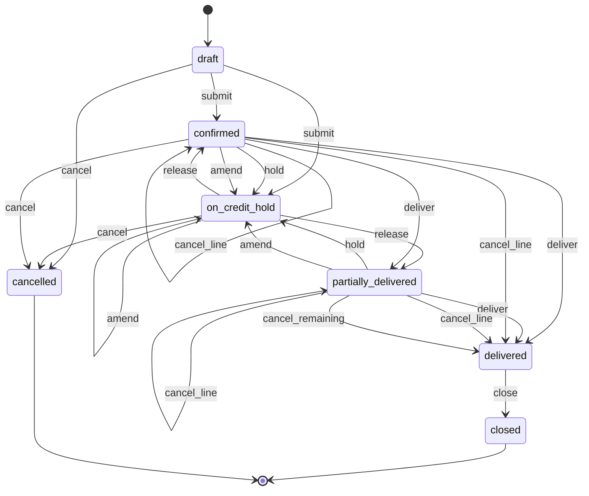
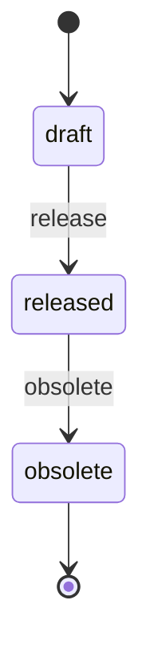
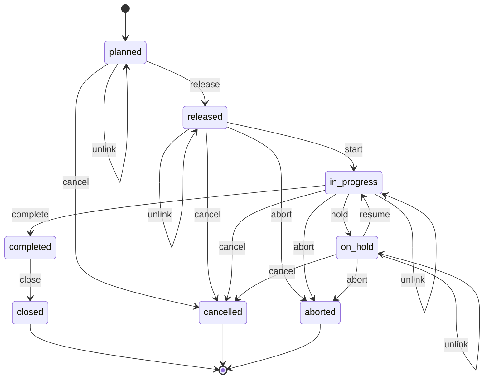
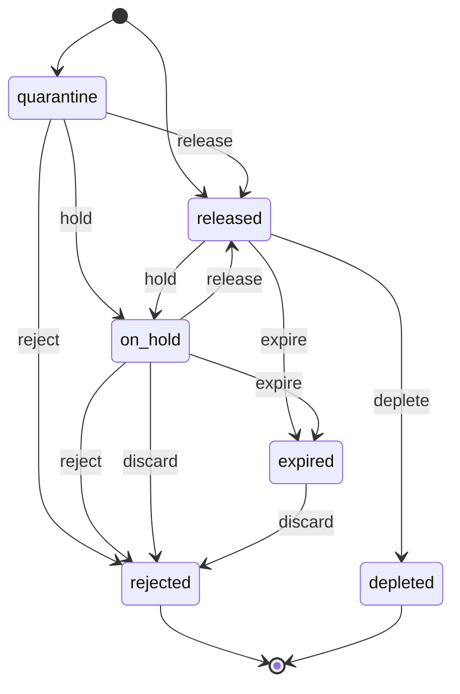
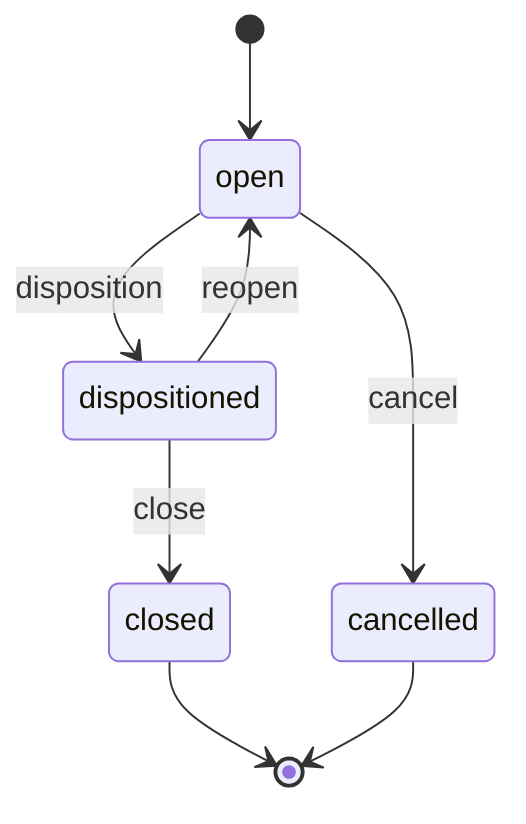
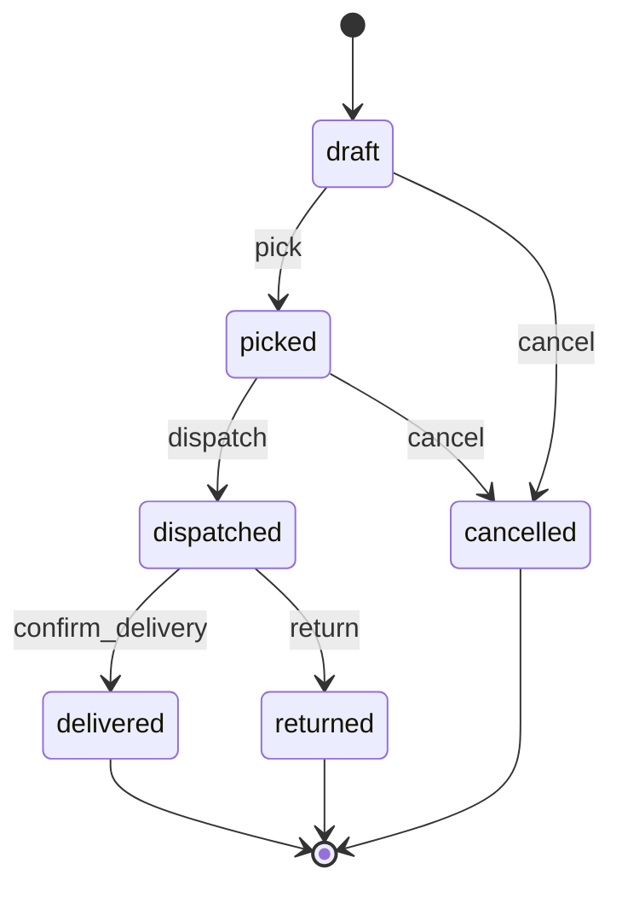

# 07 — Light Manufacturing & Assembly

> Status: accepted · Reviewed: 2026-10-15 · Last updated: 2026-10-16

## 1. Summary

Small and mid-sized UAE manufacturers make packaging, labels, plastic and metal parts,
furniture, LED fittings and electrical panels, mostly to order for B2B customers. They run
on Excel, a whiteboard on the shop floor and an accounting package, so they cannot say what
a job really cost, which raw material lot went into which delivery, or when an order will
ship. The app is a **deliberately light ERP**: sales orders, bills of materials, work orders,
shop-floor reporting on tablets, quality checks, lot traceability, dispatch, and a portal
where customers reorder and track their orders. Planning optimisation, machine integration
and the general ledger are explicitly out of scope.

## 2. Business context (UAE)

- **Customer size:** 20–250 staff, one plant (sometimes two), 1–8 production lines, 50–2,000
  active items, 30–300 B2B customers (FMCG, construction, retail, hospitality, oil and gas
  suppliers).
- **How they work today:** quotations and sales orders in Excel or an accounting package
  (Tally, Zoho, QuickBooks), job cards on paper, production plan on a whiteboard, stock
  counted monthly, quality records in binders, customers ordering by email and WhatsApp.
- **Rules and practice that shape the work:**
  - ✔ **Operation 300bn** is the national industrial strategy run by the Ministry of
    Industry and Advanced Technology (MoIAT). It aims to raise industry's contribution to
    GDP from AED 133bn (2021) to AED 300bn by 2031 [S1]. Manufacturers holding a MoIAT
    Industrial Production Licence get customs duty exemption on industrial inputs
    (machinery, raw materials, packaging) [S2]; the Emirates Development Bank finances
    manufacturers under *Make it in the Emirates* [S3].
  - ✔ **ICV (In-Country Value) certificate:** MoIAT runs the national programme;
    certificates are issued by MoIAT-authorised certifying bodies (audit firms) from IFRS
    audited financial statements. A certificate is valid for **14 months from the date of
    the audited statements**. For a manufacturer the score weighs manufacturing cost (50%),
    UAE assets, Emiratisation and expatriate contribution, plus bonuses for exports and for
    MoIAT's Industrial Technology Transformation Index (up to 6%) [S4]. SMEs registered with
    the national SME programme pay a reduced fee [S5]. ADNOC, government entities and their
    suppliers weigh it in tenders, each in its own way, so customers ask for it.
  - ✔ **Industrial licence:** the emirate's economic department or the free-zone authority
    (KEZAD, JAFZA, Dubai Industrial City and others) issues the local licence. MoIAT adds an
    Industrial Production Licence (unlocks duty exemption and value-added certificates)
    under Federal Decree-Law 25/2022 [S6], and every plant, free zones included, registers
    and updates yearly in MoIAT's Industrial Registry [S7].
  - ✔ **Product conformity:** regulated products, imported or made locally, need an ECAS
    certificate (valid 1 year) or an Emirates Quality Mark licence (valid 3 years, with a
    factory audit). Regulated groups include low-voltage electrical goods, lighting, toys
    and chemicals such as paints and detergents [S8][S9]. Food-contact materials are
    regulated federally by MoIAT; Dubai adds its own product registration [S19]. Whether a
    given product (e.g. LED fittings, building materials) is on the list is checked per
    product in MoIAT's product conformity service during onboarding `⚠ open: client (C-02)`.
  - ✔ **Single-use plastics:** since 1 January 2026 the manufacture, import and trade of
    single-use cups and lids, cutlery, plates, straws, Styrofoam food containers and thin
    bags are banned; goods made only for export are exempt (MOCCAE Ministerial Resolution
    380/2022) [S10]. Packaging makers must keep such items export only.
  - ✔ **Customs:** many raw materials are imported. Goods moving from a free zone to the
    mainland are treated as foreign and pay duty (generally 5% of CIF value). GCC-origin
    relief needs a certificate of origin and a value-added certificate (at least 40% local
    value added) [S11], which free-zone manufacturers generally cannot get [S12].
  - ✔ **VAT:** domestic sales are standard-rated at 5%. Exports are zero-rated when the
    goods leave within 90 days and one of the evidence sets of Art. 30 of the Executive
    Regulation (as amended from 15 November 2024) is kept [S17].
  - **Payment practice:** 30–120 day terms, often post-dated cheques; credit control
    matters as much as production.

## 3. Users and access

Follows [ACCESS-CONTROL.md](../ACCESS-CONTROL.md). Platform-wide rules (`PLT.ACL.*`) are not
repeated here.

### 3.1 Roles

| Role | Actor type | What they do | Permissions (summary) | Typical scope |
|---|---|---|---|---|
| General manager / owner | staff | Sees margins and cash; approves credit releases, big purchases, price exceptions | all | global |
| Sales / customer service | staff | Quotations, price lists, sales orders, customer communication | quotations, price lists, sales orders | global |
| Production manager / planner | staff | BOMs, work orders, production schedule, scrap and yield follow-up | BOMs, work orders, schedule, production reports | plant |
| Line supervisor | field | Starts and completes work orders on the line, records output, scrap and downtime | work order reporting, tickets | production line |
| Operator (line tablet) | field | Reports quantities on a shared tablet, identified by badge or PIN | output reporting on the line's work orders | production line |
| QC inspector | field | Incoming, in-process and final inspections; releases or rejects lots; raises NCRs | inspections, lot release, NCRs | plant |
| Storekeeper | field | Receives goods, issues materials to work orders, picks and dispatches | goods received, stock movements, dispatch | warehouse location |
| Procurement officer | staff | Purchase requests and orders, suppliers, imports | purchase orders, suppliers | global |
| Accountant | staff | Invoices, supplier bills, cheques, credit control, costing | finance, credit holds, cost reports | global |
| Maintenance technician | field | Breakdowns and planned maintenance of machines (Later) | tickets on machines | plant |
| Customer buyer | external | Reorders from the price list, tracks orders, downloads invoices and certificates | portal: orders, invoices, certificates | own company |
| Supplier | external | Sees purchase orders and payment status (Later) | portal: orders | own orders |

### 3.2 Scope

The scope unit is the **plant**, and within it the **production line**. Production managers
and QC inspectors are assigned per plant. Supervisors, operators and line tablets are
assigned per line: a line tablet uses a Renox device token scoped to its line. Storekeepers
are scoped to a warehouse location. Sales, procurement and accounts are usually global.

### 3.3 Access rules

| ID | Rule | Pattern | Applies to | Parameter (default) |
|---|---|---|---|---|
| `MFG.ACL.01` | A line tablet and its operators report only on work orders scheduled on that line | scope, `ASG` | operator, supervisor | — |
| `MFG.ACL.02` | A finished lot is released to stock only by QC after a passed final inspection; the person who produced it cannot release it | `STA`, `SOD` | QC inspector, supervisor | on |
| `MFG.ACL.03` | A *use as is* disposition on an NCR needs approval by someone other than the inspector who raised it | `SOD` | QC inspector, production manager | on |
| `SAL.ACL.03` *(shared, formerly `MFG.ACL.04`)* | A sales order goes on credit hold when the customer's open balance would exceed their credit limit or they have invoices overdue beyond a threshold; the hold is released only by a role with `credit.release`, not by the order's creator | `LIM`, `SOD` | sales, accountant | overdue > 30 days |
| `SAL.ACL.02` *(shared, formerly `MFG.ACL.05`)* | A price below the customer's price list, or a discount above a threshold, needs a sales manager's approval | `LIM` | sales | 5% |
| `MFG.ACL.06` | A released BOM cannot be edited; changes are made in a new version | `STA` | production manager | — |
| `FIN.ACL.08` *(shared, formerly `MFG.ACL.07`)* | Costs, margins and supplier prices are hidden from floor roles and from the customer portal | `FLD` | operator, supervisor, storekeeper, customer buyer | — |
| `MFG.ACL.08` | A customer buyer sees only their company's price list, orders, deliveries, invoices and certificates | `OWN` | customer buyer | — |
| `STK.ACL.02` *(shared, formerly `MFG.ACL.09`)* | Stock adjustments above a value need approval, and the user who made the adjustment cannot approve it | `LIM`, `SOD` | storekeeper | AED 2,000 |
| `MFG.ACL.10` | A completed work order is locked; corrections are made with reversing stock movements | `STA` | supervisor, production manager | — |
| `MFG.ACL.11` | A regulated item is dispatched only while a valid conformity certificate is on file; an *export only* item cannot be sold for domestic delivery | `STA` | sales, storekeeper | — |
| `STK.ACL.01` *(shared)* | The user who creates a purchase order cannot approve it | `SOD` | procurement | on |
| `FIN.ACL.03` *(shared)* | A supplier bill is approved for payment only after a 3-way match within tolerance, otherwise it needs approval | `STA`, `LIM` | accountant | 2% |
| `FIN.ACL.01` *(shared)* | An issued invoice cannot be edited; it is corrected with a credit note | `STA` | all staff | — |
| `POR.ACL.01` *(shared)* | When a customer account is closed, its buyers keep read-only access to orders, invoices and certificates, then the portal closes | `TIM` | customer buyer | closes after 90 days |
| `MFG.ACL.12` | A work order that has issued materials or reported output is stopped only by `abort`, with an outcome for the work in progress (materials back to store, scrap, partial output to quarantine), approved by the production manager; the user who asked for the abort cannot approve it | `STA`, `SOD` | planner, supervisor, production manager | on |
| `SAL.ACL.05` *(shared)* | Amending or cancelling a sales order, or one of its lines, after its work order started or its goods were picked needs an outcome per line (return to stock, finish to stock, scrap, with or without a cancellation fee) and a manager's approval | `STA`, `SOD` | sales, production manager | fee 0% |
| `STK.ACL.05` *(shared)* | Stock held by a recall is released only by a second holder of `lots.release`, not the one who decided the line | `SOD` | QC inspector, production manager | on |
| `STK.ACL.06` *(shared)* | A Return to supplier or a landed cost adjustment above a value needs approval, not by its creator | `LIM`, `SOD` | procurement, storekeeper | AED 5,000 |
| `FIN.ACL.15` *(shared)* | An invoice is written off as bad debt only with approval above the limit; the requester cannot approve | `LIM`, `SOD` | accountant, general manager | AED 0 (always approval) |
| `DOC.ACL.02` *(shared)* | A transition blocked by an expired document runs only with a one-use override approved by a second user; never for legal blocks | `SOD`, `TIM`, `STA` | general manager | conformity certificates: never |

## 4. Value streams

### 4.1 Order to cash (make to order)

1. A customer sends an RFQ; sales issues a quotation (`FIN.QUO.01`, `DOC.GEN.01`).
2. The customer's PO arrives by email, or through the portal as a reorder or PO upload
   (`POR.SLF.01`). A sales order is created at the customer's price list (`SAL.ORD.01`,
   `SAL.CAT.01`).
3. Credit is checked. If it fails, the order goes on hold (`SAL.CRD.01`,
   `SAL.ACL.03`).
4. Finished-goods stock is checked. What is missing becomes a work order
   (`MFG.PRD.01`, `MFG.RUL.01`).
5. The order is produced and passes final QC (§4.2, §4.4).
6. The order is picked, packed and dispatched with a delivery note (`STK.DSP.01`).
7. The driver captures proof of delivery: signature, photo, time (`WRK.POD.01`).
8. A tax invoice is created for the delivered quantities (`FIN.INV.01`, `MFG.RUL.04`).
9. Payment arrives, often as post-dated cheques, and is allocated (`FIN.PAY.01`,
   `FIN.CHQ.01`, `FIN.REC.01`).

**When it goes wrong**

| Situation | What happens |
|---|---|
| The customer changes the order (quantity, date, items) | Sales order `amend`: a new revision, the old one kept. Work orders not yet started take the new quantity; a started work order keeps its quantity, an increase creates an extra planned work order and a decrease finishes the excess to stock (`MFG.RUL.09`). After a work order started, `SAL.ACL.05` applies. A higher value re-runs the credit check |
| The customer cancels after its work order started | Sales order `cancel` (or `cancel_line`) with an outcome per line and approval (`SAL.ACL.05`): *finish to stock* (the work order runs on, its output goes to free stock), *scrap* (the work order is aborted and the work in progress scrapped, `MFG.ACL.12`), or *return to stock* for picked finished goods; a cancellation fee may be added (default 0%). The customer gets a cancellation note; a fee is invoiced |
| The customer's credit worsens before dispatch (overdue invoice, bounced cheque) | Dispatch `dispatch` runs `credit_recheck`; a failure puts the order on `on_credit_hold` with the goods reserved (`SAL.RUL.01` notifies). A bounced cheque holds every open order on account at once (`SAL.RUL.05`). Only `credit.release` lets it go (`SAL.ACL.03`) |
| The customer accepts only part of a delivery | The driver records delivered and refused quantity per line with a reason (`WRK.POD.01`). The order is fulfilled for the accepted quantity only; the invoice covers accepted quantities (`MFG.RUL.04`). Refused goods come back to quarantine for QC (`MFG.RUL.10`); sales re-delivers them or cancels the open quantity (`cancel_line`) |
| The whole delivery is refused or returned | Dispatch `return`: goods back to quarantine and a complaint ticket. QC inspects: release back to stock, NCR (rework or scrap). Sales re-delivers or cancels the line (`MFG.RUL.10`) |
| The same customer PO is uploaded or entered twice | `submit` refuses a second order with the same customer PO number and call-off number for the same customer and points to the existing order (wl-sales setting *Unique customer PO number per customer*, on in this vertical); numbers are compared trimmed and case-insensitive, other characters as entered ("PO 8812" and "PO-8812" are different numbers), and a cancelled order still holds its number. A call-off against a blanket PO is entered with its own call-off number, so the same PO number with a new call-off number is accepted |
| A post-dated cheque bounces | Cheque `bounced` (`wl-payments`): reminders at 3 and 14 days, then re-presentation, replacement, legal case or write-off (`FIN.RUL.18`). No bounce fee by default; a client that charges one sets the charge type and amount at onboarding |
| An invoice is disputed (quantity, price, quality) | Invoice `dispute` by the accountant, or by the customer buyer in the portal (on in this vertical); reminders pause and a ticket is linked; resolved as upheld or by credit note. A quality dispute opens an `open` NCR on each invoiced lot of the disputed lines with the buyer's text (or links that lot's open NCR; an item not lot-tracked gets one on the item and dispatch) and notifies QC; the NCR follows its own lifecycle. The disputed lines are the invoice lines ticked on the quality dispute form (all lines when none is ticked); an invoice line leads to its lots through the dispatch line it was drafted from (`MFG.RUL.04`) |
| The customer never pays | Invoice `write_off` with approval (`FIN.ACL.15`, AED 0) and a notice to the customer; VAT bad-debt relief is proposed after 6 months (`FIN.RUL.14`) |
| An export does not leave within 90 days | `MFG.RUL.08`: alert at 60 days, flag at 90 days that 5% VAT is due, and a task to correct the invoice |

### 4.2 Plan to produce

1. Demand from confirmed sales orders and minimum stock levels is listed per item.
2. The BOM is exploded against stock to show material shortages (`STK.BOM.01`,
   `STK.LOC.01`).
3. Shortages become purchase requests (`STK.PRQ.01`).
4. Work orders are released and placed on a line in the schedule board (`MFG.PRD.01`,
   `MFG.PLN.01`).
5. Materials are issued to the work order, with lot numbers captured (`MFG.PRD.02`,
   `STK.MOV.01`, `STK.LOT.01`).
6. The line reports output and scrap from its tablet (`MFG.PRD.02`).
7. Finished goods enter stock as a new lot in quarantine until QC releases it
   (`STK.LOT.01`, `MFG.ACL.02`).
8. Actual material and labour cost is compared with the standard cost (`MFG.CST.01`,
   `FIN.CST.01`).

**When it goes wrong**

| Situation | What happens |
|---|---|
| A work order must stop after materials were issued (order cancelled, wrong BOM, material defect) | Work order `abort` with approval (`MFG.ACL.12`): unused issued materials go back to the store, the work in progress is scrapped (wastage, `STK.ACL.02` above AED 2,000), good output already made goes to quarantine as a lot. Actual cost is closed and the loss reported |
| A sales order is cancelled but the goods are worth finishing | Work order `unlink`: it keeps running and its output goes to free stock |
| Wi-Fi drops on the line | Operators use paper job cards; the supervisor enters them at the end of the shift with the business time and a late-entry flag (`PLT.ACL.10`; more than 24 hours late needs the production manager's approval) |
| A material is short when it should be issued | The location's negative stock policy is `block`. A material issue to a work order is posted by the work order as consumption (`ConsumptionSource`, `wl-inventory`), so its short quantity waits as a pending issue (`STK.RUL.06`), without a lot until it posts; any other movement below zero (transfer, dispatch) is refused. `hold` stays a user transition: for an `in_progress` work order the line's supervisor gets one task to put it `on_hold` with reason *material* (no breakdown ticket); a `released` one is not held and the pending issue shows on the schedule board. When no pending issue of the work order is `open` any more (each one `posted` or `cleared`): a work order `on_hold` with reason *material* gives the supervisor a task to `resume` it; a work order still `in_progress` has its open hold task closed instead (no resume task) |

### 4.3 Procure to pay

1. Purchase requests are approved and turned into purchase orders, in AED or a foreign
   currency for imports (`STK.PRQ.01`, `STK.PUR.01`, `FIN.CUR.01`).
2. Goods are received against the PO with the supplier's lot numbers (`STK.GRN.01`,
   `STK.LOT.01`).
3. Items that need it get an incoming inspection; the lot stays in quarantine until it
   passes (`WRK.CHK.01`, `MFG.QCL.01`).
4. The supplier bill is matched to the PO and goods received, then paid (`FIN.PAB.01`,
   `FIN.ACL.03`, `FIN.PAY.01`, `FIN.CHQ.01`).

**When it goes wrong**

| Situation | What happens |
|---|---|
| Goods are damaged, wrong or short at the door | The storekeeper records accepted and rejected quantity per line with a reason. Only accepted quantity enters stock and the 3-way match; refused goods leave with the supplier's driver on a Return to supplier dispatched at once (`STK.GRN.01`) |
| A lot fails incoming inspection | Lot `reject` and an NCR. The NCR disposition *return to supplier* creates a Return to supplier from the quarantine location (`STK.ACL.06` above AED 5,000). On dispatch, a supplier debit note is drafted for *credit* lines (`FIN.RUL.17`); *replace* lines reopen the PO quantity. `STK.RUL.08` chases the supplier after 30 days. If the Return to supplier is cancelled (the supplier refuses collection), the NCR is reopened for a new disposition |
| The supplier changes price, quantity or date after the PO was issued | PO `revise`: a new revision is sent; a higher total is approved again |
| Freight, duty or clearing is billed after the landed cost was allocated | Landed cost `adjust`: stock still on hand is re-valued, the consumed share goes to the landed cost variance; standard cost is not changed until the next BOM roll-up |

### 4.4 Quality

1. Each product has a QC plan: inspection points, characteristics, limits (`MFG.QCL.01`).
2. Inspectors fill the checklists on a tablet, with photos, at incoming, in-process and
   final stages (`WRK.CHK.01`).
3. A failure raises a non-conformance report (NCR) (`MFG.QCL.02`).
4. The NCR is dispositioned: rework (new work order), scrap, use as is (approved), or return
   to supplier, which creates a Return to supplier in `wl-inventory` (`MFG.ACL.03`).
5. A passed final inspection releases the lot. A certificate of analysis or conformity is
   generated per lot when the customer requires it (`MFG.QCL.03`, `DOC.GEN.01`).
6. Any lot can be traced back to its raw material lots and forward to the customers it was
   delivered to (`MFG.TRC.01`).
7. A suspected defect or a complaint places a stock hold on the lot (lot `on_hold`); each
   held quantity is decided: release, discard or return to supplier (`STK.RUL.07` reminds
   after 24 hours).
8. A recall is opened from a supplier or authority notice, or an internal finding, by the
   general manager or the production manager (`recalls.manage`). Every lot in scope is held
   at every location. The forward trace follows the lot genealogy through work orders to
   the finished lots, and through dispatches to the customers (`TracePartyResolver`:
   dispatch → its sales order's customer; a work order for an undelivered order → that
   order's customer, marked *not shipped*, and its dispatch is stopped: its `draft` or
   `picked` dispatches holding the work order's output lots are flagged for re-pick with a
   task to the storekeeper, and a `dispatched` one is listed for the recall owner to bring
   back). Notices go to every active customer buyer in EN/AR, or to the customer's main
   contact email when it has none. Each held lot gets an outcome: discard, return to supplier, or
   release by a second person (`STK.ACL.05`). The recall report is kept with the lot
   documents. Whether the business must notify MoIAT or another authority is
   `⚠ open: authority (AU-20)`.
9. Customer complaints and returns are handled as tickets linked to the lot (Later,
   `SAL.RET.01`).

### 4.5 Customer self-service ordering

1. A customer buyer logs in to the portal (`POR.SLF.01`).
2. They repeat a previous order or upload their PO. Sales checks it against the contract
   price list and confirms it (`SAL.CAT.01`, `SAL.ORD.01`). An upload whose customer PO
   number and call-off number already have an order is refused and the buyer is shown the
   existing order's number and status.
   Ordering from a full catalogue with a cart is Later.
3. They follow the order's status: confirmed, in production, dispatched, delivered.
4. They download delivery notes, invoices and certificates for their lots.
5. They may flag an invoice as disputed with a reason; for reason *quality* they may tick
   the affected invoice lines (all lines when none is ticked). Sales and the accountant see
   it on the linked ticket.

### 4.6 Machine breakdown

1. An operator raises a breakdown ticket on the machine from the line tablet
   (`WRK.TKT.01`).
2. Maintenance is assigned and records the repair with photos (`WRK.TKT.02`,
   `WRK.TKT.03`).
3. Downtime is logged against the line (Later, `STK.AST.01`). Planned maintenance on
   machines follows a schedule (Later, `WRK.PPM.01`).

## 5. Capabilities

| ID | Capability | Shared or specific | Proposed module | Scope |
|---|---|---|---|---|
| `PLT.ORG.01` | Branded deployment | shared | wl-kernel | MVP |
| `PLT.USR.01` | Staff users, roles, permissions scoped per plant and line; device tokens for line tablets | shared | Renox Permissions | MVP |
| `PLT.AUD.01` | Audit trail | shared | Renox Audit | MVP |
| `PLT.APR.01` | Approval requests (credit release, price exceptions, stock adjustments, NCR use-as-is) | shared | wl-kernel | MVP |
| `PLT.WFL.01` | State machines with history | shared | Renox (R12) + wl-kernel | MVP |
| `PLT.ATM.01` | Default automation rules | shared | wl-kernel | MVP |
| `PLT.HOK.01` | Outbound webhooks | shared | Renox (R11) | Later |
| `PTY.PTY.01` | Parties: customers, suppliers, carriers | shared | wl-parties | MVP |
| `PTY.KYC.01` | Identity fields: trade licence, TRN, industrial licence | shared | wl-parties | MVP |
| `DOC.FIL.01` | Attach documents (drawings, specs, test reports, customer POs) | shared | wl-documents | MVP |
| `DOC.EXP.01` | Expiry reminders (industrial licence, conformity certificates, ICV certificate, calibration, Halal and ISO certificates, trademark) | shared | wl-documents | MVP |
| `DOC.GEN.01` | Generate documents (quotation, order confirmation, delivery note, certificate, lot labels) | shared | wl-documents | MVP |
| `FIN.QUO.01` | Quotations | shared | wl-invoicing | MVP |
| `FIN.CST.01` | Job costing per work order: standard vs actual | shared | wl-invoicing | MVP |
| `FIN.INV.01` | Tax invoices with VAT (standard and zero-rated exports) | shared | wl-invoicing | MVP |
| `FIN.PAY.01` | Record and allocate payments | shared | wl-payments | MVP |
| `FIN.CHQ.01` | Post-dated cheque register | shared | wl-payments | MVP |
| `FIN.REC.01` | Receivables ageing and reminders | shared | wl-invoicing | MVP |
| `FIN.PAB.01` | Supplier bills with 3-way match | shared | wl-invoicing | MVP |
| `FIN.EXT.01` | Export to accounting software | shared | wl-invoicing | Later |
| `FIN.CUR.01` | Multi-currency for imported purchases and export sales | shared | wl-invoicing | MVP |
| `WRK.TKT.01` | Raise tickets (machine breakdowns, complaints) | shared | wl-ticketing | MVP |
| `WRK.TKT.02` | Triage and assignment | shared | wl-ticketing | MVP |
| `WRK.TKT.03` | Field updates with photos | shared | wl-ticketing | MVP |
| `WRK.PPM.01` | Planned preventive maintenance of machines | shared | wl-ticketing | Later |
| `WRK.CHK.01` | Inspection checklists on tablets (incoming, in-process, final) | shared | wl-ticketing | MVP |
| `WRK.POD.01` | Proof of delivery (signature, photo, time, location) | shared | wl-delivery | MVP |
| `WRK.DSP.01` | Dispatch notes handed to drivers and runs for own deliveries | shared | wl-delivery | MVP |
| `POR.SLF.01` | Customer portal: order status, delivery notes, invoices and certificates to download; reorder from a previous order or upload a PO, confirmed by sales (full catalogue ordering Later) | shared | wl-portal | MVP |
| `NTF.MSG.01` | Email notifications | shared | wl-notify | MVP |
| `NTF.MSG.02` | WhatsApp notifications | shared | wl-notify | Later |
| `RPT.DSH.01` | Role-based dashboards | shared | Renox charts + wl-kernel | MVP |
| `HRM.ATT.01` | Shift attendance | shared | wl-attendance | Later |
| `HRM.TMS.01` | Labour hours booked to work orders | shared | wl-attendance | Later |
| `HRM.EMP.01` | Minimal employee records: person, line, cost rate, documents (no payroll or visas); needed by onboarding (`HRM.ONB.01`), later by labour booking | shared | wl-hr | MVP |
| `STK.ITM.01` | Item catalogue: raw materials, components, finished goods, units of measure and conversions | shared | wl-inventory | MVP |
| `STK.LOC.01` | Stock per location (raw material store, WIP, finished goods, quarantine) | shared | wl-inventory | MVP |
| `STK.MOV.01` | Stock movements: receive, issue to work order, output, transfer, adjust | shared | wl-inventory | MVP |
| `STK.PRQ.01` | Purchase requests | shared | wl-inventory | MVP |
| `STK.PUR.01` | Purchase orders | shared | wl-inventory | MVP |
| `STK.GRN.01` | Goods received with supplier lot | shared | wl-inventory | MVP |
| `STK.AST.01` | Machine register (absorbs `MFG.MNT.01`) | shared | wl-inventory | Later |
| `STK.LOT.01` | Lot/batch tracking with status and expiry, for items flagged lot-tracked | shared | wl-inventory | MVP |
| `STK.LND.01` | Landed cost: freight, duty and clearing spread over received raw materials | shared | wl-inventory | MVP |
| `STK.BOM.01` | Bills of materials with versions; explosion against stock | shared | wl-inventory | MVP |
| `SAL.CRM.01` | Leads and enquiries pipeline | shared | wl-sales | MVP |
| `SAL.CAT.01` | Sellable catalogue and customer price lists | shared | wl-sales | MVP |
| `SAL.ORD.01` | Sales orders | shared | wl-sales | MVP |
| `SAL.CRD.01` | Customer credit limits, credit check and credit hold | shared (**new**) | wl-sales | MVP |
| `STK.DSP.01` | Pick, pack and dispatch with delivery notes | shared (**new**) | wl-inventory | MVP |
| `PLT.ENT.01` | Legal entities: several trade licences and TRNs in one deployment; issuer on every document | shared | wl-kernel | MVP |
| `PLT.IMP.01` | Data import and migration: Excel templates per entity, validation, dry run, rollback | shared | wl-kernel | MVP |
| `PLT.SRC.01` | Global search across records, including Arabic names | shared | wl-kernel + Renox search | MVP |
| `PLT.NOT.01` | Notes, comments and @mentions on any record, with an activity timeline | shared | wl-kernel | MVP |
| `PLT.SSO.01` | Staff single sign-on with Microsoft 365 or Google Workspace | shared | Renox OAuth (renox-oauth) | Later |
| `RPT.LIB.01` | Report library: filtered reports with export to Excel, CSV and PDF | shared | wl-kernel | MVP |
| `RPT.SCH.01` | Scheduled reports sent by email | shared | wl-kernel | Later |
| `FIN.VAT.01` | VAT summary per period and entity: output and input VAT, for the accountant | shared | wl-invoicing | MVP |
| `FIN.EXP.01` | Expense claims and petty cash: submit with receipt, approve, reimburse, top up | shared | wl-payments | Later |
| `FIN.BNK.01` | Bank statement import and matching of receipts to open invoices | shared | wl-payments | Later |
| `WRK.SVC.01` | Vendor service contracts (AMC): scope, assets, planned visits, SLA, cost | shared | wl-ticketing | Later |
| `MFG.PRD.01` | Work orders from sales orders (make to order, the default) or for stock from minimum levels or the plan | specific | apps/manufacturing | MVP |
| `MFG.PRD.02` | Material issue to work orders and output reporting with scrap, from line tablets | specific | apps/manufacturing | MVP |
| `MFG.PRD.03` | Routings: operations, work centres, standard times | specific | apps/manufacturing | Later |
| `MFG.PLN.01` | Production schedule board per line (manual placement, no optimisation) | specific | apps/manufacturing | MVP |
| `MFG.QCL.01` | QC plans per product: inspection points and limits | specific | apps/manufacturing | MVP |
| `MFG.QCL.02` | Non-conformance reports and disposition | specific | apps/manufacturing | MVP |
| `MFG.QCL.03` | Certificates of analysis / conformity per lot | specific | apps/manufacturing | MVP |
| `MFG.TRC.01` | Lot traceability: raw lots → finished lots → customer deliveries | specific | apps/manufacturing | MVP |
| `MFG.CST.01` | Standard cost roll-up: BOM materials at landed cost plus standard hours × an hourly rate per line (labour and overhead); actual cost from materials issued and the work order's start/stop hours | specific | apps/manufacturing | MVP |
| `MFG.ICV.01` | ICV data pack: manufacturing cost, local spend, Emirati headcount, assets, export revenue for the certifying body (the certificate itself is a document with expiry in the MVP) | specific | apps/manufacturing | Later |
| `MFG.CMP.01` | Product conformity register: schemes, test reports, certifying bodies, links to lots (the *regulated* and *export only* item flags and certificates as documents are in the MVP) | specific | apps/manufacturing | Later |
| `SAL.RET.01` | Customer complaints and returns linked to lots (formerly `MFG.RTN.01`) | shared (**new**) | wl-sales | Later |
| `SAL.CRM.02` | Lead sources and campaigns: cost per campaign, conversion by source and channel, cost per lead, customer acquisition cost and return on ad spend | shared | wl-sales | MVP |
| `FIN.CFL.01` | Cash-flow forecast: expected receipts and payments by week from invoices, supplier bills, scheduled charges, post-dated cheques, payroll and budgets | shared | wl-invoicing | MVP |
| `STK.SUP.01` | Supplier scorecard and alternative suppliers: on-time delivery, rejected quantity, NCRs, price variance; preferred and alternative suppliers per item | shared | wl-inventory | MVP |
| `FIN.BUD.01` | Company budget vs actual by period, category and entity; owner drawings kept apart from operating cost | shared | wl-invoicing | MVP |
| `HRM.ONB.01` | Staff onboarding checklists per role and a library of SOP documents with acknowledgement | shared | wl-hr + wl-documents | MVP |
| `MFG.RPT.01` | Production reports: output vs plan, yield and scrap, on-time delivery, WIP | specific | apps/manufacturing | MVP |

*New* = a shared capability first needed by this vertical among 03–10.

## 6. Key entities

| Entity | Description | Important fields | Owned by |
|---|---|---|---|
| Item | Raw material, component or finished good | code, name, type, base unit, fixed unit conversions (purchase, stock, sales units), lot-tracked flag, regulated flag, accepted conformity certificate kinds (regulated items; ECAS, EQM, food-contact, set per item at onboarding, default all three), export-only flag, customer-specific flag, shelf life, min stock, standard cost | wl-inventory |
| BOM | Recipe for one finished item | item, version, components with quantity per unit and scrap %, standard hours per line, status | wl-inventory |
| Price list | Prices per customer or group | customer, items, prices, validity | wl-sales |
| Customer | A B2B buyer (party) | trade licence, TRN, credit limit, payment terms, price list | wl-parties + wl-sales |
| Sales order | Customer's order | customer, lines, promised dates, price source, status | wl-sales |
| Work order | Instruction to produce | item, BOM version, quantity, quantity for stock (excess after an order decrease), line, planned dates, actual start/stop, source (sales order or stock), status | apps/manufacturing |
| Production report | Output from a line | work order, quantity good, scrap, operator, time | apps/manufacturing |
| Lot | A batch of one item | item, number, source (supplier lot or work order), quantity, expiry, status | wl-inventory |
| QC plan | What to inspect | item, stage, characteristics, limits, sampling | apps/manufacturing |
| Inspection | One filled checklist | plan, lot, results, photos, inspector, result | wl-ticketing |
| NCR | Non-conformance report | lot, defect, quantity, disposition, approval, status | apps/manufacturing |
| Dispatch | Delivery to a customer | sales order, lots and quantities, vehicle, delivery note no., POD, status | wl-inventory |
| Certificate | Certificate of analysis or conformity | lot, results, signed by | apps/manufacturing |
| Machine | Production equipment | line, code, service schedule | wl-inventory |

## 7. Workflow

Follows [WORKFLOW.md](../WORKFLOW.md). **Quotation, purchase request and purchase order**
reuse [02-construction.md](02-construction.md#71-state-machines) unchanged. **Invoice, cheque
and ticket** (breakdowns, complaints) reuse [01-property.md](01-property.md#71-state-machines)
unchanged.

### 7.1 State machines

#### Sales order *(shared — wl-sales)*

> **Canonical definition:** *Sales order* in [`wl-sales` §4](../modules/wl-sales.md#4-lifecycles). This section is this vertical's original requirement; where it differs, the module definition wins and its vertical mapping table records the difference.

| State | Tone | Terminal | Meaning |
|---|---|---|---|
| `draft` | neutral | no | Being entered |
| `on_credit_hold` | warning | no | Blocked by the credit check (`SAL.ACL.03`) |
| `confirmed` | info | no | Accepted; production and dispatch can proceed |
| `partially_delivered` | info | no | Some lines delivered |
| `delivered` | success | no | All lines delivered |
| `closed` | success | yes | Delivered and fully invoiced |
| `cancelled` | neutral | yes | Cancelled before any delivery |

| Transition | From | To | By | Guards | Effects |
|---|---|---|---|---|---|
| `submit` | draft | confirmed, on_credit_hold | `sales_orders.create` | lines priced; `SAL.ACL.02` for price exceptions; customer PO number not already used by an order of the same customer (call-offs carry a call-off number) | credit check decides the target; confirmation PDF sent; event `SalesOrderConfirmed` |
| `hold` | confirmed, partially_delivered | on_credit_hold | system (dispatch `credit_recheck` fails, or `SAL.RUL.05` on a bounced cheque) | order on account | state before the hold kept; dispatch blocked, goods stay reserved; accountant and sales notified (`SAL.RUL.01`) |
| `release` | on_credit_hold | confirmed, partially_delivered | `credit.release` | approval (`PLT.APR.01`); releaser ≠ creator (`SAL.ACL.03`) | back to the state before the hold; event `SalesOrderConfirmed` when first confirmed |
| `amend` | on_credit_hold, confirmed, partially_delivered | same state, or on_credit_hold | `sales_orders.amend` | reason; no line below its delivered quantity; `SAL.ACL.02`; approval when a linked work order started or goods were picked (`SAL.ACL.05`) | new revision, previous kept; work orders adjusted (`MFG.RUL.09`); credit check re-run when the value rises; revised confirmation sent; event `SalesOrderAmended` |
| `deliver` | confirmed, partially_delivered | partially_delivered, delivered | system (dispatch `confirm_delivery`) | dispatch passed `credit_recheck` | accepted quantities delivered, refused quantities stay open; `delivered` when every line is delivered or cancelled |
| `cancel_line` | confirmed, partially_delivered | same state, delivered | `sales_orders.cancel` | reason; open quantity only; outcome per line and approval when its work order started or its goods were picked (`SAL.ACL.05`) | outcome applied (`MFG.RUL.09`); a cancellation fee line invoiced when set; event `SalesOrderLineCancelled` |
| `cancel_remaining` | partially_delivered | delivered | `sales_orders.cancel` | reason; outcome per line and approval as for `cancel_line` | open quantities cancelled with their outcomes; reservations released |
| `close` | delivered | closed | system | all delivered quantities invoiced | — |
| `cancel` | draft, on_credit_hold, confirmed | cancelled | `sales_orders.cancel` | nothing dispatched; reason given; outcome per line and approval when a linked work order started or goods were picked (`SAL.ACL.05`) | reservations released; work orders not started cancelled, started ones follow the outcome (`MFG.RUL.09`); cancellation fee invoiced when set; customer notified; event `SalesOrderCancelled` |

Cancellation outcomes offered in this vertical: *finish to stock* (default for standard
items), *scrap* (default for items flagged *customer-specific*, such as printed labels and
packaging; the flag is off by default), *return to stock* for picked finished goods. Sales
may change the proposed outcome per line. Cancellation fee: 0% by default; the client may
set a percentage per customer. VAT on a fee kept from a prepayment is `⚠ open: accountant (A-04)`
(see `wl-sales`).

#### BOM *(shared — wl-inventory)*

> **Canonical definition:** *BOM* in [`wl-inventory` §4](../modules/wl-inventory.md#4-lifecycles). This section is this vertical's original requirement; where it differs, the module definition wins and its vertical mapping table records the difference.

| State | Tone | Terminal | Meaning |
|---|---|---|---|
| `draft` | neutral | no | Being defined; editable |
| `released` | success | no | Used by new work orders; locked (`MFG.ACL.06`) |
| `obsolete` | neutral | yes | Replaced by a newer version; kept for traceability |

| Transition | From | To | By | Guards | Effects |
|---|---|---|---|---|---|
| `release` | draft | released | `boms.release` | at least one component; all quantities > 0; components exist | standard cost rolled up (`MFG.CST.01`); previous released version `obsolete` |
| `obsolete` | released | obsolete | `boms.release` or system | — | — |

#### Work order

| State | Tone | Terminal | Meaning |
|---|---|---|---|
| `planned` | neutral | no | Created; not yet on the floor |
| `released` | info | no | On a line in the schedule; materials can be issued |
| `in_progress` | info | no | Production started |
| `on_hold` | warning | no | Stopped; reason from a list (material, machine, quality) |
| `completed` | success | no | Output reported; finished lot in quarantine; locked (`MFG.ACL.10`) |
| `closed` | success | yes | Actual cost calculated |
| `cancelled` | neutral | yes | Cancelled before any material issue or output report |
| `aborted` | error | yes | Stopped after materials were issued; work in progress returned, scrapped or put to quarantine; actual cost closed |

| Transition | From | To | By | Guards | Effects |
|---|---|---|---|---|---|
| `release` | planned | released | `work_orders.release` | BOM version released; line set; shortages listed or approved | material pick list generated |
| `start` | released | in_progress | `work_orders.report` (`MFG.ACL.01`) | — | start time recorded |
| `hold` | in_progress | on_hold | `work_orders.report` | reason chosen | breakdown ticket created when the reason is *machine* |
| `resume` | on_hold | in_progress | `work_orders.report` | — | — |
| `complete` | in_progress | completed | `work_orders.report` | good quantity and scrap reported | the output lot (the finished lot, opened in `quarantine` by the first production report) takes no more output; final inspection requested |
| `close` | completed | closed | system or `work_orders.close` | all issues and output posted | actual vs standard cost calculated (`MFG.CST.01`) |
| `cancel` | planned, released, in_progress, on_hold | cancelled | `work_orders.release`, or system (`MFG.RUL.09`) | no material issued and no output reported; reason given from `in_progress` or `on_hold` | pick list withdrawn; sales order link removed; an open breakdown ticket stays open |
| `unlink` | planned, released, in_progress, on_hold | same state | `work_orders.release` or system (`MFG.RUL.09`: outcome *finish to stock*, or the line's open quantity cut to 0) | reason given; source is still the sales order | source changed from the sales order to stock; output goes to free stock, and output lots already reserved for a cancelled line are released to free stock; planner notified |
| `abort` | released, in_progress, on_hold | aborted | `work_orders.release` | material issued or output reported; reason given; outcome per line: unused materials back to store (not more than issued less returned per item and lot), work in progress scrapped, good output to a lot in quarantine; one approval request: step 1 the production manager, not the requester (`MFG.ACL.12`), step 2 under `STK.ACL.02` only when the scrap value is above its limit; the posted quantities still match the request at final approval | at final approval, in one transaction: return and `wastage` movements posted; good output stays in the work order's output lot in `quarantine` with a final inspection requested; actual cost calculated and the loss reported (`MFG.CST.01`); linked sales order line's owner told the outcome; event `WorkOrderAborted` |

A work order is *started* once it is `in_progress` or `on_hold`, or has material issued or
output reported; this decides whether `SAL.ACL.05` and the outcomes of `MFG.RUL.09` apply.

Each production report posts a `produce` movement of its good quantity into the work order's
output lot and a `wastage` movement of its scrap (`wl-inventory`). The output lot (one per
work order, source = the work order) is created in `quarantine` at the line's finished goods
location by the first report with good quantity; it is the finished lot of `complete` and
cannot be picked or issued before QC releases it (`MFG.ACL.02`).

While an `abort` request waits, new issues and production reports on the work order are
refused ("abort pending"); if the posted quantities differ at final approval (a late entry),
the request fails and a new one is made. The scrap value is the cost of materials issued,
less materials returned, less good output × the BOM's standard material cost per unit, never
below 0, at the cost each issue was posted with; a returned quantity is valued at the
average unit cost of this work order's issues of the same item and lot (issued value ÷
issued quantity). The loss is the actual cost (materials issued less returned, plus
start/stop hours × the line rate) less good output at standard cost; it is shown on the work
order and in the aborted work orders report. Start/stop hours run from the start time
recorded by `start` to the stop time (for `abort`, the final approval time; 0 when the work
order never started), time `on_hold` included. The line rate is the hourly rate of the work
order's line (labour and overhead, `MFG.CST.01`). Standard cost per unit is the BOM
version's rolled-up cost: materials at landed cost plus standard hours × the line rate.

A completed work order stays locked (`MFG.ACL.10`); a production report entered on the wrong
work order before `complete` is voided with a reason (`PLT.ACL.09`) and its movements
reversed. The void is approved by the line's supervisor or the production manager, not the
requester; it is refused when the output lot no longer holds the report's good quantity
(part of it was moved, issued or picked; the production manager then corrects with a
reversing movement).

#### Lot *(shared — wl-inventory)*

> **Canonical definition:** *Lot* in [`wl-inventory` §4](../modules/wl-inventory.md#4-lifecycles). The table below is aligned with it, including the system `expired` state, `discard` and the system `hold` from stock holds and recalls. This section is this vertical's original requirement; where it differs, the module definition wins and its vertical mapping table records the difference.

| State | Tone | Terminal | Meaning |
|---|---|---|---|
| `quarantine` | warning | no | Received or produced; not usable until inspected |
| `released` | success | no | Usable and sellable |
| `on_hold` | warning | no | Blocked by an open stock hold (complaint, suspected defect, recall) |
| `expired` | error | no | Past its expiry date; blocked; awaiting disposal |
| `rejected` | error | yes | Failed, discarded or returned to the supplier; handled through an NCR |
| `depleted` | neutral | yes | Quantity reached zero |

| Transition | From | To | By | Guards | Effects |
|---|---|---|---|---|---|
| `release` | quarantine, on_hold | released | `lots.release` (QC), or system (stock hold line decided `release`) | passed inspection; `MFG.ACL.02`; from `on_hold`: no other open hold, and a second person for a recall hold (`STK.ACL.05`) | certificate generated when the customer requires one |
| `hold` | quarantine, released | on_hold | system (stock hold `place` by a holder of `stock.hold`, or recall `open`) | reason given (complaint, quality, recall) | stock blocked from picking, issue and dispatch; picked dispatches with the lot flagged for re-pick |
| `expire` | released, on_hold | expired | system | expiry date reached | lot blocked; storekeeper and planner notified |
| `reject` | quarantine, on_hold | rejected | `lots.release`, or system (Return to supplier `dispatch` takes the last quantity) | failed inspection recorded | NCR created; remaining quantity to scrap or to a Return to supplier per the NCR disposition |
| `discard` | on_hold, expired | rejected | `lots.release`, or system (stock hold line decided `discard`) | reason given; `STK.ACL.02` above AED 2,000 | remaining quantity written off to scrap with the reason |
| `deplete` | released | depleted | system | quantity = 0 | — |

Lots of items that need no inspection are created directly in `released`.

#### NCR (non-conformance report)

| State | Tone | Terminal | Meaning |
|---|---|---|---|
| `open` | error | no | Defect recorded |
| `dispositioned` | warning | no | Decision taken; actions in progress |
| `closed` | success | yes | Actions done |
| `cancelled` | neutral | yes | Raised in error |

| Transition | From | To | By | Guards | Effects |
|---|---|---|---|---|---|
| `disposition` | open | dispositioned | `ncrs.disposition` | disposition chosen (rework, scrap, use as is, return to supplier); `MFG.ACL.03` for use as is; return to supplier: supplier lot known, outcome *credit* or *replace* | rework → work order; scrap → lot `discard` or a `wastage` movement (`STK.ACL.02`); return → a draft Return to supplier in `wl-inventory` for the lot's supplier, from the quarantine location (`STK.ACL.06` on dispatch) |
| `close` | dispositioned | closed | `ncrs.disposition` | rework work order completed, scrap posted, or the Return to supplier `dispatched` | supplier credit chased on the Return to supplier (`STK.RUL.08`), not on the NCR |
| `reopen` | dispositioned | open | system (the linked Return to supplier is `cancelled`, or the rework work order is `cancelled` or `aborted`), or `ncrs.disposition` | the disposition's action did not happen; reason given | previous disposition kept in history; QC gets a task to choose a new disposition (`MFG.ACL.03` again for *use as is*) |
| `cancel` | open | cancelled | `ncrs.disposition` | reason given | — |

When the rework work order completes, the scrap posts or the Return to supplier is
`dispatched`, QC gets a task to `close` the NCR; it is not closed by the system.

An NCR may cover only part of a lot. Then the lot is not `reject`ed or `discard`ed (those
move the whole lot): it keeps its state and is not `release`d while the NCR is `open` or
`dispositioned`. The NCR quantity leaves the lot through the disposition's own movement: a
`wastage` movement for *scrap* (`STK.ACL.02`), or `return_out` when the Return to supplier
is `dispatched`. QC may then release what remains (`MFG.ACL.02`); *use as is* releases the
whole lot. When the NCR covers the whole remaining quantity, lot `reject` or `discard`
applies as in the table.

#### Dispatch *(shared — wl-inventory)*

> **Canonical definition:** *Dispatch* in [`wl-inventory` §4](../modules/wl-inventory.md#4-lifecycles). `confirm_delivery` and `return` become system transitions run on `DeliveryDelivered` and `DeliveryReturned` from `wl-delivery`. This section is this vertical's original requirement; where it differs, the module definition wins and its vertical mapping table records the difference.

| State | Tone | Terminal | Meaning |
|---|---|---|---|
| `draft` | neutral | no | Lines and lots being chosen |
| `picked` | info | no | Goods picked and packed |
| `dispatched` | info | no | Left the plant with the delivery note |
| `delivered` | success | yes | Proof of delivery captured |
| `returned` | error | yes | Refused or returned by the customer |
| `cancelled` | neutral | yes | Not shipped |

| Transition | From | To | By | Guards | Effects |
|---|---|---|---|---|---|
| `pick` | draft | picked | `dispatch.manage` | only `released` lots, no held quantity; `MFG.ACL.11` (a regulated item needs one of its conformity certificate kinds accepted and valid on the pick date; export-only flag) | stock reserved |
| `dispatch` | picked | dispatched | `dispatch.manage` | vehicle and driver set; no picked lot on hold (re-pick otherwise); `MFG.ACL.11` again on the dispatch date (an expired certificate refuses it; the dispatch may be `cancel`led); `credit_recheck` for orders on account (fails → sales order `hold`) | stock moved out; delivery note PDF |
| `confirm_delivery` | dispatched | delivered | driver or `dispatch.manage` | proof of delivery captured (`WRK.POD.01`) with delivered and refused quantity per line; every refused quantity has a reason; at least one unit delivered | sales order `deliver` for the accepted quantities; refused goods back to quarantine with their reason (`MFG.RUL.10`); event `DispatchDelivered` |
| `return` | dispatched | returned | `dispatch.manage` | reason recorded | goods back to quarantine; complaint ticket created; QC inspection and sales decision (`MFG.RUL.10`) |
| `cancel` | draft, picked | cancelled | `dispatch.manage` | — | reservation released |

Partial acceptance is on for this vertical's deliveries. Refusing every line is a failed
attempt with reason *refused* in `wl-delivery`, which ends in `return`.

#### Negative-flow settings (WORKFLOW §8)

Approvals that are rejected, returned or expire leave the record in the state it had
before the request (`wl-kernel`). Settings for this vertical:

| Question | Answer in this vertical |
|---|---|
| Void | Production reports before the work order is `completed`, goods receipts not yet billed (`reverse`), draft dispatches (`cancel`). Never invoices, delivery notes or certificates already sent to a customer: those are corrected by credit note or a new version |
| Cancel after work started | Sales order outcomes (*finish to stock*, *scrap*, *return to stock*, fee 0%) with `SAL.ACL.05`; work order `abort` with `MFG.ACL.12` |
| Document blocks | Conformity certificate (ECAS, EQM, food-contact) of a regulated item blocks `dispatch.pick` and `dispatch.dispatch` (block; any one valid kind among the item's accepted kinds passes; a renewal still in `pending_review` does not); override `never` (proposed; legal block `⚠ open: lawyer (L-19)`). Industrial licence, Industrial Registry and ICV certificate: reminders only (`DOC.RUL.01`), no block. Expiry look-ahead 30 days |
| Party blocked | Sales orders not yet dispatched are held (module default); their work orders continue and the planner may `unlink` them to stock; money in continues |
| Integrations | Line tablets offline → paper job cards, late entry (`PLT.ACL.10`). E-invoicing provider down (from 2027) → invoices queued and sent on recovery (`PLT.RUL.05`). Email down → documents downloaded from the record and sent by hand |
| Late entry | Production reports, inspections and goods receipts keep their business time; more than 24 hours late needs the production manager (`PLT.ACL.10`) |
| Disputes | Invoices, by the accountant or the customer buyer in the portal (on); a quality dispute links an NCR; `FIN.RUL.15` escalates after 14 days |
| Compliance-critical rules | `MFG.RUL.08` (export VAT), `DOC.RUL.03` for conformity certificates; owner role: general manager / owner (`PLT.RUL.04`) |
| Bad debt and cheques | Write-off limit AED 0 (`FIN.ACL.15`); bounce fee off unless the client sets a charge type; maximum two presentations |
| Responsible role per document kind (wl-documents §5.2) | conformity certificates (ECAS, EQM, food-contact) → QC inspectors of each plant that holds stock of the item or has an open work order for it (every plant when none does; the item has no scope of its own); calibration certificates → QC inspector of the plant; industrial licence, Industrial Registry and ICV certificate → general manager / owner; export exit evidence → accountant |
| Cash-flow forecast alert (`FIN.CFL.01`, `FIN.RUL.23`) | projected balance below AED 200,000 in any of the next 13 weeks (weeks start Monday): `FIN.RUL.23` alerts the general manager / owner and the accountant, checked daily at 06:00; foreign-currency supplier bills at the latest rate; due dates adjusted by each customer's average days late: on; disputed amounts counted: off |
| Budget categories and approval (`FIN.BUD.01`, `FIN.RUL.24`) | categories owned by the accountant and mapped to the export accounts; one budget per legal entity and month, approved by the general manager / owner; `FIN.RUL.24` warns the category's owner role and the accountant when a month's actual reaches 100% of its line |
| Owner drawings (`FIN.BUD.01`, `FIN.ACL.21`) | expense category and payment purpose *owner drawings*, kept out of operating cost, product cost and profit; every drawing (AED 0) approved by the general manager / owner, never by the requester (`FIN.ACL.21`) |
| Lead sources used (`SAL.CRM.02`) | referral, website, event, partner (distributors, agents), paid ads, other; enquiries and RFQs are leads (`SAL.CRM.01`); no source requires a campaign |
| Campaign channels (`SAL.CRM.02`, `SAL.ACL.07`) | trade exhibitions, LinkedIn, search ads, email; converted value: the customer's first sales order; a cost entry that takes a campaign over its budget needs a manager (`SAL.ACL.07`: on) |
| Supplier scorecard review (`STK.SUP.01`, `STK.RUL.09`, `STK.ACL.07`) | score on a 0–100 scale over a 3-month window (monthly snapshots, at least 3 receipts); below 70: `STK.RUL.09` opens a review task to the procurement officer, the QC inspector told; preferred and alternative suppliers per raw material offered on purchase requests; changing an item's preferred supplier needs a second person (`STK.ACL.07`: on) |
| Onboarding checklists (`HRM.ONB.01`, `HRM.RUL.16`, `HRM.RUL.17`, `HRM.ACL.10`) | templates for operator, line supervisor, QC inspector, storekeeper and maintenance technician, started by `HRM.RUL.16` when an employee record (`HRM.EMP.01`) is created; checklist steps use `WRK.CHK.01`; tasks to the production manager, the line supervisor and the employee; the employee's own steps recorded only by them (`HRM.ACL.10`); `HRM.RUL.17` reminds overdue steps every 2 days and tells the production manager and the line supervisor after 5 days; completion blocks nothing (role activation not blocked) |
| SOP library (`HRM.ONB.01`, `DOC.RUL.04`, `HRM.ACL.10`) | SOP owners: production manager (work instructions per line) and QC inspector (inspection and quality SOPs); required readers by role per plant; `DOC.RUL.04` asks each reader to acknowledge within 7 days, reminds every 3 days and tells the manager and the owner role after 7 days; acknowledged only by the reader (`HRM.ACL.10`); a new version asks for a new acknowledgement |
| Registration and certification kinds (`DOC.EXP.01`, `DOC.RUL.01`) | *Halal certificate* (subject: item or legal entity), *ISO certificate* and *Other certification* (legal entity or plant): responsible role QC inspector; *Trademark registration* (legal entity): general manager / owner; product conformity stays on the conformity kinds; `DOC.RUL.01` at 90, 30 and 7 days; no `blocks` |

**Notification types registered by 07** (wl-notify §5.4: each names its group):

| Type | Sent by | Group | Urgency | Give-up reaction |
|---|---|---|---|---|
| `mfg.recall_notice` | recall `send_notices` to customer buyers (§4.4 step 8) | — | urgent | *Urgent types* row: task to the recall owner with an in-app alert |

No type of this vertical is statutory. Order confirmations and cancellation notes are
wl-sales' types; invoices, statements, dispute and write-off notices are wl-invoicing's. The other alerts of `MFG.RUL.01`–`10` and the work order `unlink` and `abort`
notices go to staff users only: they name no group and take `none` (staff always also get
the in-app notification, wl-notify §5.1).

### 7.2 Automations

Reused unchanged: `FIN.RUL.01`–`04` ([01-property.md](01-property.md#72-automations)),
`DOC.RUL.01` (licences, conformity and ICV certificates, calibration), `WRK.RUL.01`–`02`
(breakdowns, complaints), `STK.RUL.01` ([02-construction.md](02-construction.md#72-automations)),
`SAL.RUL.01` (credit hold notice), `SAL.RUL.05` (bounced cheque puts the customer's open
orders on credit hold), `FIN.RUL.14`–`18` (bad-debt relief, disputes, e-invoice rejection,
supplier debit note, bounced cheque follow-up), `STK.RUL.06`–`08` (pending issues, open
stock holds, returns to suppliers).
`STK.RUL.02` (low stock) is **on** by default for this vertical.

| ID | When | If | Then | Parameters (default) | Default | Scope |
|---|---|---|---|---|---|---|
| `MFG.RUL.01` | sales order → `confirmed` | finished-goods stock does not cover the order | create a planned work order for the shortfall and purchase request suggestions for missing materials; notify planner | — | on | MVP |
| `MFG.RUL.02` | N hours after a work order's planned start | work order still `released` | notify supervisor and planner | N = 2 | on | MVP |
| `MFG.RUL.03` | N hours after a lot enters `quarantine` | still in `quarantine` | notify QC | N = 24 | on | MVP |
| `MFG.RUL.04` | dispatch → `delivered` | — | create a draft invoice for the delivered quantities; notify accountant | — | on | MVP |
| `MFG.RUL.05` | N days before a sales order line's promised date | linked work order not `completed` | notify sales and planner | N = 2 | on | MVP |
| `MFG.RUL.06` | work order → `completed` | scrap above P% of good quantity | create an NCR; notify production manager | P = 5 | on | MVP |
| `STK.RUL.03` *(shared)* | N days before a lot's expiry date | lot `released` with quantity > 0 | notify storekeeper and planner | N = 30 | on | MVP |
| `MFG.RUL.07` | schedule: yearly, N days before the ICV certificate expires | — | prepare the ICV data pack; notify GM | N = 60 | off | Later |
| `MFG.RUL.08` | N days after a zero-rated export dispatch (checked daily at 08:00 Asia/Dubai) | exit evidence (customs exit certificate, bill of lading or airway bill) not attached | notify the accountant; at M days flag that 5% VAT is due and create a task to correct the invoice (credit note and a standard-rated invoice); whether the VAT is recharged to the customer depends on the contract. Evidence attached after day M keeps the flag and notifies the accountant "evidence received after correction"; nothing is reversed (A-12). Compliance-critical | N = 60, M = 90 | on | MVP |
| `MFG.RUL.09` | `SalesOrderAmended`, `SalesOrderLineCancelled` or `SalesOrderCancelled` | linked work orders exist | not started: change the quantity to the line's new open quantity or, at 0, `cancel`; started: an increase creates a planned work order for the difference; a decrease keeps the work order's quantity and flags the output above the line's new open quantity *for stock* (released to free stock when reported); an open quantity cut to 0 or outcome *finish to stock* runs `unlink`; outcome *scrap* gives the production manager a task to request `abort` (`MFG.ACL.12`), or runs `cancel` when nothing was issued or reported; notify planner | — | on | MVP |
| `MFG.RUL.10` | the goods of a dispatch → `returned`, or the refused quantity of `DispatchDelivered`, are booked into quarantine (run close) | — | create a QC inspection per returned lot in quarantine; create a task for sales to re-deliver or cancel the open quantity (`cancel_line`), closed when all of it is re-dispatched or cancelled (a part re-dispatched lowers the task's open quantity); notify the account's sales person (the sales role in scope when the account has none) | — | on | MVP |

## 8. Integrations

| System | Purpose | Required for MVP | Access / notes |
|---|---|---|---|
| Excel import | Items, BOMs, price lists, opening stock | Yes | Renox import |
| Barcode / QR scanners | Scan lots and items at receiving, issue, picking | Yes | Keyboard-wedge scanners work in the browser |
| Label printing | Lot and pallet labels | Yes (PDF to any printer) | Direct thermal printing (ZPL) Later |
| Line tablets | Output reporting, inspections | Yes | PWA with a device token per line (Renox kiosks). Online only, like the rest of the platform ([UX.md](../UX.md)); when Wi-Fi drops, paper job cards are entered by the supervisor at the end of the shift |
| Email | Order confirmations, delivery notes, invoices, certificates | Yes | Renox mail |
| Accounting software | Ledger | No (Later): CSV export first | — |
| Customs (Dubai Trade, free-zone portals) | Import declarations | No | Out of scope; declarations attached as documents |
| Weighing scales | Output by weight | No (Later) | — |
| Machines, PLC, MES, SCADA | Automatic counts | No | Out of scope |
| Customer EDI | Orders from large retailers | No | Out of scope; portal or email instead |
| WhatsApp | Order and delivery updates | No (Later) | BSP |

## 9. Compliance and data

- **VAT:** ✔ 5% on domestic sales; exports zero-rated with evidence and exit within 90 days
  [S17]; foreign-currency invoices show the VAT amount in AED. Designated zones (Cabinet
  Decision 59/2017) are outside the UAE for goods only when the Art. 51 conditions are met;
  supplies from them to the mainland are taxable [S12]. The accountant sets the VAT
  category per customer and delivery address. Export evidence is tracked per dispatch;
  `MFG.RUL.08` alerts at 60 days and flags at 90 days that the zero rate no longer holds
  [S17]. Whether a zero rate can be restored when evidence arrives after the correction is
  `⚠ open: accountant (A-12)`.
- **Bad debt and cancellation fees:** an invoice written off keeps its VAT until the
  bad-debt relief conditions are met (`wl-invoicing`, `FIN.RUL.14`). VAT on a cancellation
  fee is decided with the accountant `⚠ open: accountant (A-04)` (see `wl-sales`).
- **Corporate tax:** ✔ manufacturing and processing are qualifying activities for a
  qualifying free zone person (Ministerial Decision 229/2025) [S13]. Sales of own-made goods
  to mainland *businesses* are qualifying income; sales to individuals are not, and
  non-qualifying revenue must stay within 5% or AED 5m [S14]. The app reports sales by
  customer type (business or individual) and location so the accountant can check.
- **Customs:** ✔ duty on goods moving from a free zone to the mainland is part of the
  buyer's or importer's cost; for imported raw materials it is captured as landed cost
  (`STK.LND.01`). Declarations are attached to the purchase or dispatch [S12].
- **E-invoicing:** ✔ B2B and B2G invoices go through an accredited service provider: from
  1 January 2027 for revenue of AED 50m or more, from 1 July 2027 for the rest [S18].
- **Product conformity:** ✔ items carry a *regulated* flag; a regulated item is dispatched
  only while a valid ECAS, EQM or food-contact certificate of one of its accepted kinds is on
  file (`MFG.ACL.11`).
  Certificates are documents with expiry (`DOC.EXP.01`) whose kind blocks
  `dispatch.pick` and `dispatch.dispatch` without override (proposed; `⚠ open: lawyer (L-19)` on the legal block); orders
  planned to ship after the expiry date are listed 30 days ahead (`DOC.RUL.02`). Items
  under the single-use plastics ban carry an *export only* flag and cannot be sold for
  domestic delivery [S10].
- **Traceability and recall:** lot genealogy is kept so that a recall can name the affected
  customers. Every issue of a lot-tracked material to a work order records its lot; only the
  short quantity of an issue that waits as a pending issue (§4.2) gets its lot when it posts
  (*assigned on arrival*, a recall treats it as *lot uncertain*). A recall
  (`wl-inventory`) holds every lot in scope, traces forward to customers, sends notices and
  keeps a report. Whether a recall must be notified to MoIAT or another authority is
  `⚠ open: authority (AU-20)`.
- **PDPL:** low exposure (B2B contacts, employee data). Standard platform rules apply.
- **Records:** ✔ commercial books, invoices and correspondence at least 5 years (Art. 29
  Federal Decree-Law 50/2022) [S15]; corporate tax records 7 years after the tax period
  (Art. 56 Federal Decree-Law 47/2022) [S16]; VAT records 5 years. Default: 7 years for
  everything. No statutory period was found for production and quality records; they
  follow the same 7 years unless a certification scheme or contract asks for more.

## 10. Reports and KPIs

- Order book: open sales orders by promised date; on-time delivery %
- Output vs plan per line per day/week
- Yield and scrap % per product and line
- Actual vs standard cost per work order; gross margin per product and customer
- Inventory value by location; days of stock; slow-moving and expiring lots
- Material shortages for released work orders
- Quality: lots in quarantine, NCRs open, rejection rate by supplier, open stock holds and
  recalls, returns to suppliers awaiting credit
- Aborted work orders and cancelled order lines with their outcome and cost
- Receivables ageing with disputed amounts, cheques due and bounced, orders on credit hold

## 11. Platform fit

- **Renox provides:** users and scoped roles, device tokens for line tablets (as the bike
  shop's kiosks), import from Excel, grids, kanban (schedule board, NCRs), charts, queue and
  scheduler, uploads and camera (R5), PDF for delivery notes, labels and certificates (R3).
- **Shared modules provide:** parties, documents and expiry, quotations, sales orders,
  price lists and credit control, inventory with lots, BOMs, purchasing and dispatch,
  invoicing with multi-currency, payments and cheques, job costing, checklists, tickets,
  proof of delivery, portal, notifications, approvals and state machines.
- **Specific to this vertical:** work orders and shop-floor reporting, the schedule board,
  QC plans, NCRs, certificates, traceability, standard costing, ICV data, conformity
  register, downtime, returns, production reports.
- **Estimated reuse:** 67 of 79 capabilities (85%) come from shared modules or Renox.

## 12. MVP scope

**Included:** items with units and lots, BOMs with versions, customer price lists, quotations,
sales orders with credit check, work orders from sales orders or for stock, schedule board per line,
material issue and output reporting from line tablets, incoming/in-process/final inspection,
NCRs, lot release, certificates, traceability, purchase requests and orders with
multi-currency, goods received with landed cost, supplier bills with matching, dispatch with delivery notes
and proof of delivery, invoices, cheques and receivables, standard vs actual cost, customer
portal (status, documents, reorder), dashboards and production reports. Lot tracking is
switched on per item; standard hours sit on the BOM per line. The ICV certificate and conformity
certificates are kept as documents with expiry; regulated and export-only flags guard
dispatch and sales (`MFG.ACL.11`). Negative flows in the MVP: order amendment and
cancellation after production started (finish to stock, scrap, fee), work order abort,
credit re-check at dispatch, partial acceptance at delivery, returned deliveries to
quarantine, rejection at goods receipt and returns to suppliers with debit notes, stock
holds and recalls through lot genealogy, bounced cheque follow-up, invoice disputes and
bad-debt write-off, export evidence alerts.

**Also included:** leads with sources and campaigns (`SAL.CRM.01`, `SAL.CRM.02`), the
cash-flow forecast (`FIN.CFL.01`), supplier scorecards (`STK.SUP.01`), budget with owner
drawings (`FIN.BUD.01`), onboarding and SOPs (`HRM.ONB.01`) on minimal employee records
(`HRM.EMP.01`, no payroll or visas; labour booking stays Later), Halal, ISO and trademark
reminders (`DOC.EXP.01`).

**Excluded from the MVP:** routings with standard times per operation, shift attendance and
labour booking, machine register, planned maintenance, downtime and OEE, customer returns,
ICV data pack, conformity register, supplier portal, accounting export, portal catalogue
ordering, offline mode for line tablets, dimension-based unit formulas, weighing scales,
direct label printers.

**Excluded from the product altogether:** MRP optimisation and finite-capacity scheduling,
MES/PLC/SCADA integration, a general ledger and financial statements, EDI, product
lifecycle management (PLM), ISO document control systems.

## 13. Open questions

1. ~~What share of their business is make-to-order vs make-to-stock?~~ Decided (2026-10-15): both,
   with make to order as the default. One work order model; it comes from a sales order or
   from minimum stock or the plan (`MFG.PRD.01`).
2. ~~Are all items lot-tracked, or only some?~~ Decided (2026-10-15): a flag per item. On by default
   for food-contact materials, chemicals and certified materials; off for consumables. Lot
   genealogy covers flagged items only.
3. ~~Is landed cost (freight, duty) needed in item cost from day one?~~ Decided (2026-10-15): yes.
   `STK.LND.01` is already in the MVP for Auto, so raw materials enter standard and actual
   cost at landed cost.
4. ~~Do customers actually want to order through a portal?~~ Decided (2026-10-15): status and
   documents, plus reorder from a previous order or PO upload, confirmed by sales. Full
   catalogue ordering is Later.
5. ~~Are there tablets and reliable Wi-Fi on the shop floor?~~ Decided (2026-10-15): line tablets
   stay online only, as on the rest of the platform. When Wi-Fi drops, operators use paper
   job cards that the supervisor enters at the end of the shift. The offline queue stays
   one shared Renox gap (R25, Later). Clients are advised to cover the floor with Wi-Fi.
6. ~~How is labour cost set?~~ Decided (2026-10-15): an hourly rate per line covering labour and
   overhead. Standard = standard hours on the BOM × rate; actual = the work order's
   start/stop hours × rate (`MFG.CST.01`). Labour booking per employee (`HRM.TMS.01`) stays
   Later; the minimal employee record (`HRM.EMP.01`) is MVP since 2026-10-16 for onboarding.
7. ~~How many of their customers require an ICV certificate or certificates of analysis?~~
   Decided (2026-10-15): certificates of analysis or conformity per lot are in the MVP
   (`MFG.QCL.03`). The ICV certificate is kept as a document with expiry (reminder 60 days
   before), attached to quotations and shown in the portal; the ICV data pack stays Later
   (`MFG.ICV.01`) [S4].
9. ~~How are product conformity and the single-use plastics ban handled?~~ Decided
   (2026-10-15): *regulated* and *export only* flags per item (`MFG.ACL.11`); certificates as
   documents with expiry; the full conformity register stays Later (`MFG.CMP.01`)
   [S8][S10].
8. ~~How complex are unit conversions?~~ Decided (2026-10-15): a base unit plus fixed conversions
   per item (e.g. 1 roll = 500 m, 1 carton = 24 pcs); purchase, stock and sales units may
   differ. Variable quantities (roll weights) are recorded per lot. No dimension formulas.

## Sources

Checked 2026-10-15. *Official* = government or legislation; others are secondary.

| # | Source | Type | Used for |
|---|---|---|---|
| S1 | MoIAT, launch of the national industrial strategy, https://moiat.gov.ae/en/media-center/news/2021/05/23/he-dr-sultan-bin-ahmad-al-jaber---minister-of-industry-and-advanced-technology | Official | Operation 300bn target |
| S2 | MoIAT, "Request customs duty exemption for industrial inputs", https://moiat.gov.ae/en/services/request-customs-duty-exemption-for-industrial-inputs | Official | Duty exemption for licensed manufacturers |
| S3 | Emirates Development Bank, "Make it in the Emirates", https://www.edb.gov.ae/solutions/make-it-in-the-emirates | Official | Financing for manufacturers |
| S4 | MoIAT, "National ICV Certification Guidelines for Suppliers" (Sep 2025), https://moiat.gov.ae/-/media/site/moiat/programs/icv-formula/icv-supplier-certification-guidelines-sep-2025-v1.ashx | Official | ICV rules, validity, score |
| S5 | WAM, "MoIAT, MoE reduce ICV certification fee for SMEs", https://www.wam.ae/en/article/hszrhd4h-moiat-moe-reduce-icv-certification-fee-for-smes | Official | ICV fee for SMEs |
| S6 | MoIAT, "Issue Industrial Production License", https://moiat.gov.ae/en/services/issue-industrial-production-license | Official | Industrial licence |
| S7 | MoIAT, "Industrial Registry", https://moiat.gov.ae/en/industrial-registry | Official | Yearly registration of plants |
| S8 | MoIAT, "Issue Conformity Certificates for Regulated Products", https://moiat.gov.ae/en/services/issue-conformity-certificates-for-regulated-products | Official | ECAS and EQM |
| S9 | SGS, "Navigating UAE product conformity: ECAS and EQM", https://www.sgs.com/en-ae/news/2024/06/pca-2024-q2-navigating-uae-product-conformity-understanding-ecas-and-eqm-certification | Secondary | Regulated product groups, validity |
| S10 | WAM, "Second phase of nationwide ban on single-use products", https://www.wam.ae/en/article/bn8qxpm-second-phase-nationwide-ban-import-trade | Official | Single-use plastics ban from 2026 |
| S11 | MoIAT, "Issue Value-Added Certificate", https://moiat.gov.ae/en/services/issue-value-added-certificate | Official | GCC origin and value added |
| S12 | Al Tamimi, "Incentivising manufacturing: the customs duty implications", https://www.tamimi.com/law-update/may-8/articles/incentivising-manufacturing-the-customs-duty-implications-for-manufacturing-entities-in-dubai/ | Secondary | Free-zone goods, duty, designated zones |
| S13 | MoF, Ministerial Decision 229/2025 on qualifying activities, https://mof.gov.ae/wp-content/uploads/2025/09/EN-Ministerial-Decision-No.-229-of-2025-Regarding-Qualifying-Activities-and-Excluded-Activities.pdf | Official | Manufacturing as a qualifying activity |
| S14 | MoF, Cabinet Decision 100/2023 on qualifying income, https://mof.gov.ae/wp-content/uploads/2023/11/Cabinet-Decision-No.-100-of-2023-on-Determining-Qualifying-Income-for-the-Qualifying-Free-Zone-Person.pdf | Official | Mainland sales and de minimis |
| S15 | Federal Decree-Law 50/2022 (Commercial Transactions), https://uaelegislation.gov.ae/en/legislations/1610/download | Official | 5-year retention of books and invoices |
| S16 | taxo.online, "Article 56 – Record Keeping", https://taxo.online/corporate-tax-law/article-56-record-keeping | Secondary | 7-year corporate tax retention |
| S17 | PwC, "UAE VAT Executive Regulation amendments", https://www.pwc.com/m1/en/services/tax/me-tax-legal-news/2024/uae-vat-executive-regulation-amendments.html | Secondary | Export evidence and 90-day window |
| S18 | Andersen, e-invoicing alert, https://ae.andersen.com/insights/E-Invoicing%20Alert.pdf | Secondary | E-invoicing phases |
| S19 | MoIAT, recycled plastic food packaging workshop, https://moiat.gov.ae/en/media-center/news/2023/08/21/rep-workshop | Official | Food-contact materials |
