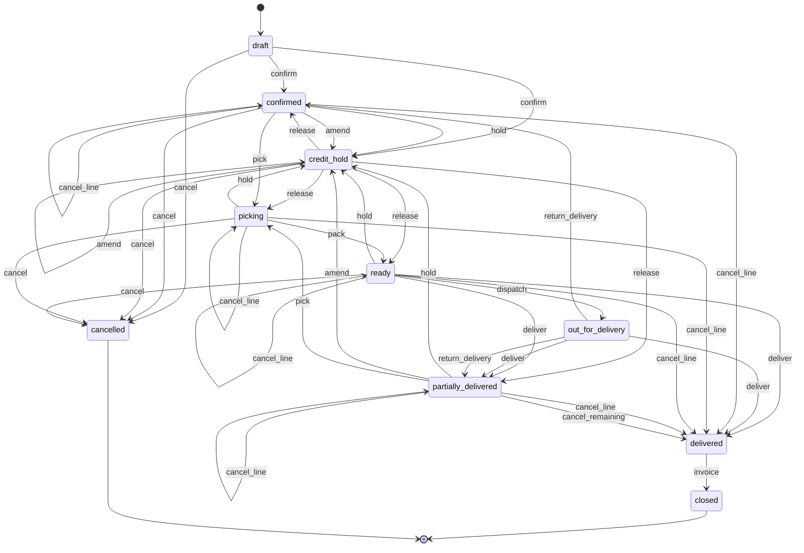
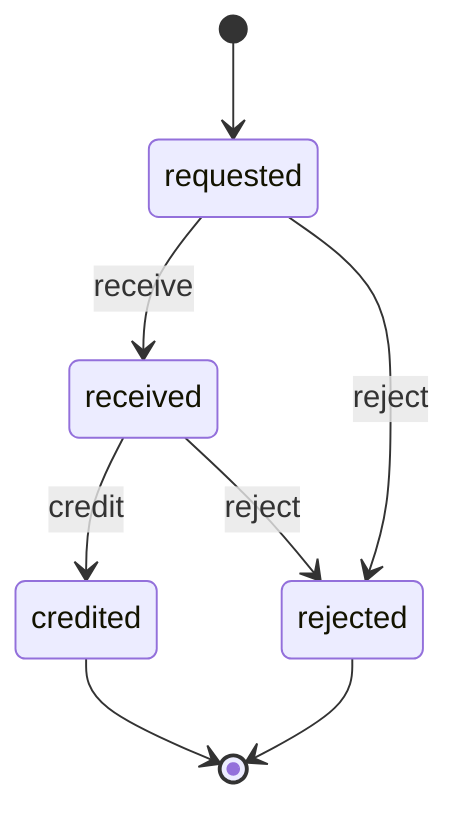
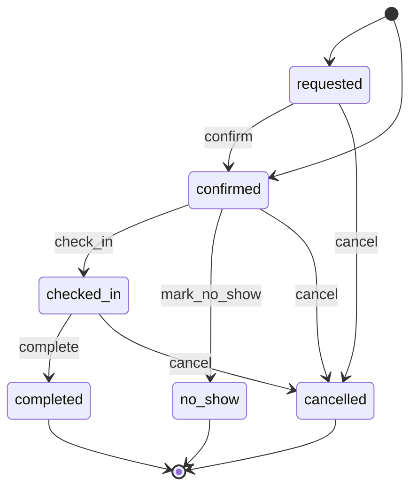
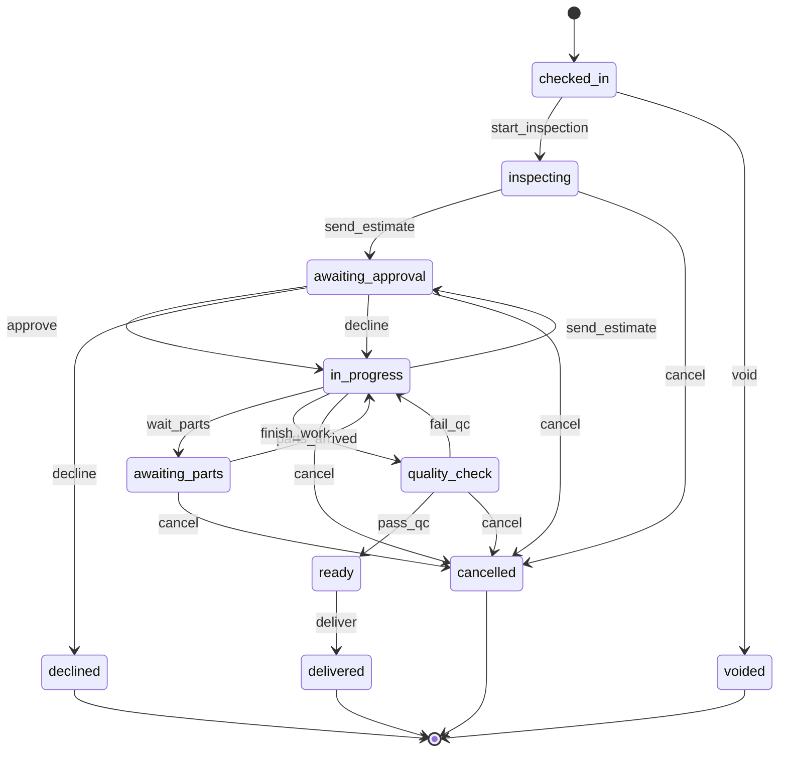
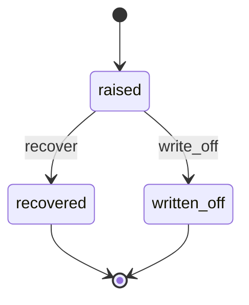
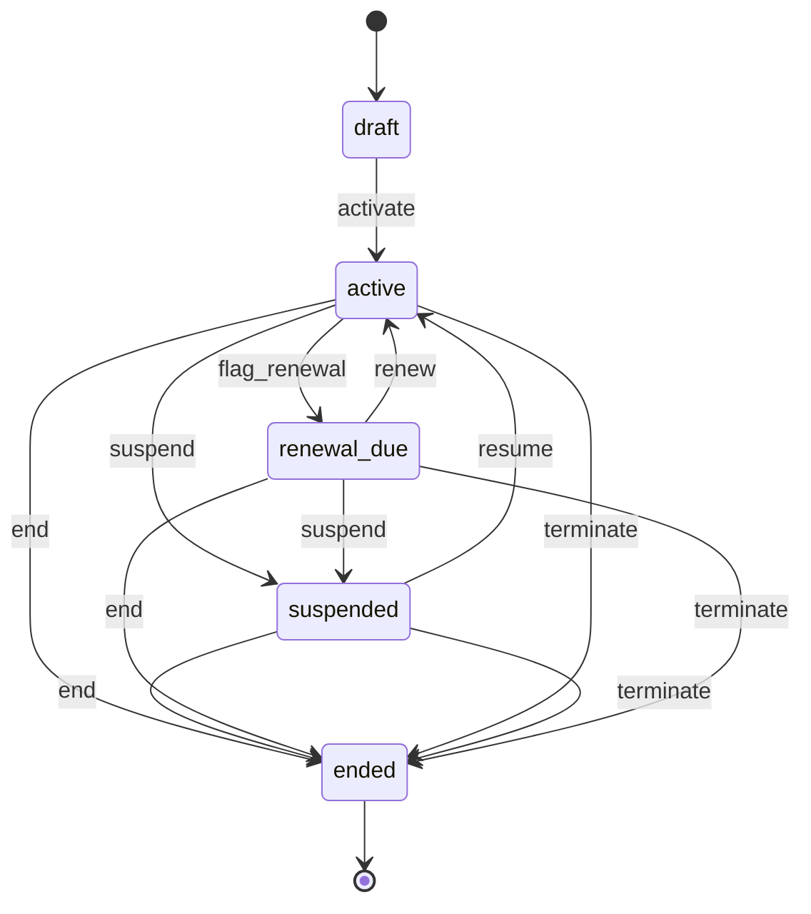
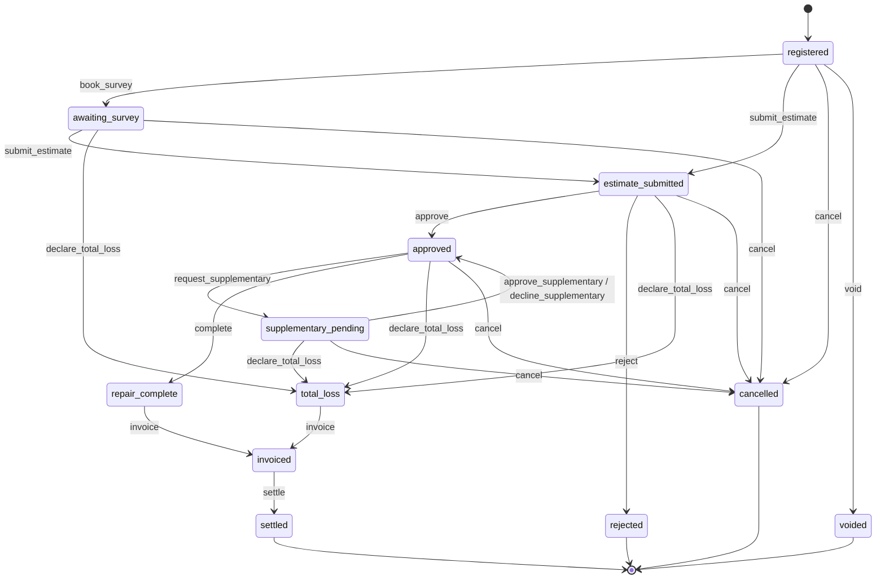

# 08 — Auto Parts Suppliers & Fleet/Workshop Services

> Status: accepted · Reviewed: 2026-10-15 · Last updated: 2026-10-15

## 1. Summary

Auto parts traders in Deira, Sharjah Industrial Area, Al Quoz and Ras Al Khor sell genuine,
aftermarket and used parts to workshops, fleets and walk-in customers. Many also run a
workshop or service fleets under contract. Orders arrive by WhatsApp with a photo of the old
part, prices live in the owner's head, credit is extended without limits, and warranty
claims are lost between the customer and the supplier. The app gives them a searchable parts
catalogue with fitment and cross-references, B2B ordering with credit control, a counter
POS, workshop job cards, fleet service contracts, and warranty tracking in both directions.
Workshops also earn a large share of their revenue from **insurance accident repairs**:
the app tracks each claim from police report and surveyor estimate to insurer approval,
split billing (insurer and customer excess) and collection of the insurer's payment.

## 2. Business context (UAE)

- **Customer size:** 5–80 staff, 1–5 branches or warehouses, 5,000–100,000 part numbers,
  often a workshop with 4–20 bays. Customers are independent workshops, fleet operators
  (logistics, rent-a-car, contractors, government suppliers) and individual car owners.
- **How they work today:** a desktop trading or accounting package (often Tally or a local
  POS), Excel price lists, WhatsApp for orders and photos, paper job cards in the workshop,
  and a notebook for credit customers.
- **Rules and practice that shape the work:**
  - Parts are identified by **OEM part numbers** with **cross-references** (interchange)
    between brands and quality grades (genuine, OEM, aftermarket, used/refurbished).
  - Buyers search by **vehicle** (make, model, year, engine) or by **VIN**. Commercial parts
    data (e.g. TecDoc, licensed by TecAlliance per volume and users) is Later; its coverage
    of GCC-spec vehicles is unconfirmed [S10].
  - B2B customers buy on **credit terms (30–90 days)**, often against **post-dated cheques**.
    Credit limits are informal.
  - The Deira/Sharjah market is a **re-export hub** to Africa, the GCC and Central Asia.
    Exports can be **zero-rated** for VAT if the goods leave the UAE within **90 days**,
    with a customs exit certificate and commercial evidence (bill of lading or airway bill)
    (Executive Regulation Art. 30). Imports carry customs duty of generally **5% of CIF**
    value, and import VAT on CIF plus duty ✔ [S8].
  - Purchases are often imported in **USD, JPY, EUR or CNY**. Landed cost (freight, duty,
    clearing) decides the real margin.
  - Workshops need a trade licence for vehicle repair from the emirate's economic department
    (ISIC 4520; mobile repair needs RTA pre-approval; fixed workshops need industrial
    zoning and Civil Defence approval) [S9]. Secondary sources disagree on the sub-codes
    (e.g. 4520.01, 4520.95, 4520.99 for mobile repair); the exact DET activities per
    workshop type are taken from DET's activity search during onboarding `⚠ open: authority (AU-19)`. Waste oil and battery
    disposal is regulated but out of scope.
  - **Consumer protection** (Federal Law 15 of 2020, Cabinet Resolution 66 of 2023): the
    workshop documents the vehicle's condition at intake and gets written consent to cost,
    time and warranty; invoices state whether each part is **new, used or renovated**;
    repairs and parts carry a warranty of at least **15 days**; a warranted repair longer
    than 7 days needs a substitute; spare parts must be supplied within 7, 14 or 30 days
    depending on demand and source (Arts. 13, 14, 17, 26) ✔ [S6].
  - **UAE plates** are an emirate + a code (letter or number) + a number, e.g. `Dubai A 12345`.
  - **Insurance accident repairs** are a major revenue stream for workshops:
    - A garage may not repair accident damage without a **repair permit from the traffic
      authority** (Federal Decree-Law 14 of 2024, Art. 28, in force 29 March 2025); the
      police accident report serves as that permit ✔ [S1]. Minor accidents are
      self-reported in the Dubai Police app, at petrol stations, through **Saaed** (Abu
      Dhabi, Ajman) or **Rafid** (Sharjah) ✔ [S2]. No exception allowing repair without a
      report was found.
    - The insurer sends a **surveyor** (or asks for photos) and approves an **estimate**,
      issuing an approval or LPO for an **approved amount**. Damage found after strip-down
      needs a **supplementary approval**.
    - **Unified motor policy** (Insurance Authority Decision 25 of 2016, now under the
      Central Bank) ✔ [S3]: for **third-party** claims, a car in its first year of
      registration is repaired at the agency with new original parts; after that, suitable
      workshops and same-grade non-original parts are allowed, with depreciation (5% in
      year 2 rising to 30% from year 6) if the owner asks for new parts. Safety parts
      (glass, brakes, steering, seat belts) are always new. For **own-damage**
      (comprehensive) claims, agency repair is a commercial option of the policy.
    - The customer pays the policy **excess (deductible)** and anything not covered; the
      insurer pays the approved amount, usually by bank transfer on 30–120 day terms.
    - **Replacement car:** third-party claims pay loss of use up to **AED 300 a day for 10
      days**, or a substitute car; own-damage policies vary ✔ [S3]. **Total loss** applies
      when the repair cost exceeds 50% of the value; the insurer decides, and it ends the
      repair claim ✔ [S3].

## 3. Users and access

Follows [ACCESS-CONTROL.md](../ACCESS-CONTROL.md). Platform-wide rules (`PLT.ACL.*`) are not
repeated here.

### 3.1 Roles

| Role | Actor type | What they do | Permissions (summary) | Typical scope |
|---|---|---|---|---|
| Owner / GM | staff | Pricing policy, credit decisions, all reports | all | global |
| Branch manager | staff | Runs a branch or workshop; approves discounts, returns, write-offs, warranty claims | sales, stock, job cards, approvals, branch reports | branch |
| Counter sales | staff | Counter sales and phone/WhatsApp orders | catalogue, POS, sales orders, customers (read) | branch |
| Sales representative | field | Visits workshops and fleets, takes orders, collects cheques | catalogue, sales orders, own customers, cheque receipt | global (own customers) |
| Purchaser / importer | staff | Reorders, imports, supplier warranty recovery | purchase orders, suppliers, landed cost, supplier claims | global |
| Storekeeper | staff | Receives, puts away, picks, transfers, counts stock | goods received, stock movements, picking | branch |
| Accountant | staff | Invoices, receipts, cheques, credit limits, credit holds | finance, credit, reports | global |
| Service advisor | staff | Bookings, vehicle check-in, estimates, customer approval, delivery | bookings, vehicles, job cards, estimates | workshop |
| Workshop manager | staff | Assigns bays and technicians, QC, productivity | job cards, bays, technicians, QC | workshop |
| Insurance coordinator | staff | Registers claims, collects the police report and policy documents, submits estimates to insurers, records approvals and supplementaries, chases insurer payments | insurance claims, estimates, insurer receivables (read) | workshop |
| Technician | field | Works assigned job cards, requests parts, records findings | `job_cards.work` on assigned jobs | workshop |
| Delivery driver | field | Delivers orders, collects proof of delivery and cheques; hands cheques over at the end of the day (`FIN.CSH.01`) | own deliveries for today | branch |
| B2B buyer (workshop) | external | Searches the catalogue, orders, sees invoices and statement | portal: catalogue, orders, finance | own account |
| Fleet contact | external | Sees fleet vehicles, service history, bookings, costs; approves estimates | portal: fleet | own contracts |
| Individual car owner | external | Books a service, approves an estimate, pays (Later) | portal: own vehicles | own vehicles |
| Insurer / surveyor | external | Receives estimates, approves claims and supplementaries, sees repair status and invoices (portal Later; by email in the MVP) | portal: insurance claims (Later) | own claims |

### 3.2 Scope

The scope unit is the **branch** (a parts shop or warehouse) or the **workshop**. A company
with a parts shop and a workshop at the same address has two scopes. Counter staff,
storekeepers and drivers are scoped to their branch. Service advisors, workshop managers and
technicians are scoped to their workshop. Owners, accountants and purchasers are usually
global. Sales representatives are global but see only the customers assigned to them.

### 3.3 Access rules

| ID | Rule | Pattern | Applies to | Parameter (default) |
|---|---|---|---|---|
| `AUT.ACL.01` | A B2B buyer sees only their own account's orders, invoices, statement, and the prices of their price tier | `OWN` | B2B buyer | — |
| `AUT.ACL.02` | A fleet contact sees only vehicles under their fleet contracts, and their job cards, estimates and invoices | `OWN` | fleet contact | — |
| `SAL.ACL.02` *(shared, formerly `AUT.ACL.03`)* | A discount beyond the customer's tier price needs branch manager approval | `LIM` | counter sales, sales rep, service advisor | above 5% |
| `SAL.ACL.03` *(shared, formerly `AUT.ACL.04` and `AUT.ACL.05`)* | An order that exceeds the customer's or group's credit limit, or a customer with invoices overdue beyond the grace period, goes on credit hold; the hold is released only by a role with `credit.release`, not by the order's creator | `LIM`, `SOD` | all sales roles; accountant, branch manager | grace 30 days past terms |
| `SAL.ACL.04` *(shared, formerly `AUT.ACL.06`)* | A completed counter sale cannot be edited or voided; it is reversed by a sales return with a credit note | `STA` | counter sales | — |
| `FIN.ACL.08` *(shared, formerly `AUT.ACL.07`)* | Cost price, landed cost and margin are hidden from counter sales, technicians, drivers and external users; sales reps see the minimum selling price only | `FLD` | listed roles | — |
| `AUT.ACL.08` | A technician sees only job cards assigned to them; customer contact details are hidden from technicians | `ASG`, `FLD` | technician | — |
| `AUT.ACL.09` | A job card can be delivered only after the QC checklist is complete and all added work was approved by the customer | `STA` | service advisor | — |
| `STK.ACL.02` *(shared, formerly `AUT.ACL.10`)* | Stock adjustments and write-offs above a value need branch manager approval, and the person who counts cannot approve | `LIM`, `SOD` | storekeeper | AED 1,000 |
| `STK.ACL.04` *(shared, formerly `AUT.ACL.11`)* | Staff see stock levels in every branch, but sell, pick or move stock only from their own branch | scope, `FLD` | counter sales, storekeeper | — |
| `AUT.ACL.12` | Changing a customer's price tier or credit limit is proposed by one user and approved by another | `SOD` | sales rep, accountant, owner | on |
| `AUT.ACL.13` | A warranty claim above a value needs branch manager approval | `LIM` | counter sales, service advisor | AED 2,000 |
| `WRK.ACL.05` *(shared, formerly `AUT.ACL.14`)* | A driver sees only deliveries assigned to them for the current day | `ASG`, `TIM` | driver | — |
| `AUT.ACL.15` | Work on an insurance job is limited to the insurer's approved lines; anything beyond needs a recorded supplementary approval or the customer's own approval as a private item | `STA`, `LIM` | service advisor, technician | tolerance AED 0 |
| `AUT.ACL.16` | An approved amount is changed only by attaching the insurer's written approval | `STA` | insurance coordinator | — |
| `AUT.ACL.17` | An insurance vehicle is released only after the excess and private items are paid, or the insurer confirms the excess is waived | `STA` | service advisor | — |
| `AUT.ACL.18` | Claim documents (police report, driving licence, Mulkiya, Emirates ID) need `kyc.sensitive.view`; each view is audited | `SEN` | all staff | — |
| `AUT.ACL.19` | An insurer or surveyor user sees only claims where their company is the insurer (Later, portal) | `OWN` | insurer | — |
| `FIN.ACL.01` *(shared)* | An issued invoice cannot be edited; it is corrected with a credit note | `STA` | all staff | — |
| `AUT.ACL.20` | Accident damage is repaired only when the police accident report (the repair permit) is attached to the job card or its insurance claim; no override, also for private repairs ✔ [S1] | `STA` | service advisor, insurance coordinator, workshop manager | legal block |
| `AUT.ACL.21` | A job card is cancelled after work started only by the service advisor with a reason, the work done recorded per line and the customer's acknowledgement; billing less than the work done, or waiving it, needs branch manager approval | `STA`, `SOD` | service advisor, branch manager | on |
| `AUT.ACL.22` | A vehicle incident (damage while in the workshop's care or on a test drive) is closed only with a liability decision by the branch manager, not by the technician or advisor involved | `SOD` | branch manager | — |
| `SAL.ACL.05` *(shared)* | Amending or cancelling a sales order line after its goods were picked needs an outcome (return to stock) and branch manager approval | `STA`, `SOD` | counter sales, sales rep | — |
| `STK.ACL.06` *(shared)* | A Return to supplier or a landed cost adjustment above a value needs approval, not by its creator | `LIM`, `SOD` | purchaser | AED 5,000 |
| `FIN.ACL.15` *(shared)* | An invoice is written off as bad debt only with approval above the limit; the requester cannot approve | `LIM`, `SOD` | accountant, owner | AED 0 (always approval) |
| `FIN.ACL.20` *(shared)* | A cheque collected by a driver or sales rep is deposited only after a handover counted by another person | `SOD` | driver, sales rep, accountant | on |

## 4. Value streams

### 4.1 B2B order to cash

1. A workshop searches the catalogue in the portal, or sends a WhatsApp photo that counter
   staff turn into a search: by part number, cross-reference, or vehicle fitment
   (`AUT.CAT.01`, `AUT.CAT.02`, `SAL.CAT.01`, `POR.SLF.01`).
2. Prices come from the customer's tier and special prices. Stock is shown per branch
   (`SAL.CAT.01`, `STK.LOC.01`).
3. A sales order is created and stock is reserved (`SAL.ORD.01`).
4. The credit limit and overdue balance are checked. The order may go on credit hold
   (`SAL.CRD.01`, `SAL.ACL.03`).
5. The order is picked, packed and either collected or dispatched to a driver
   (`STK.MOV.01`, `WRK.DSP.01`).
6. The driver delivers it, with photo, signature and location, and may collect a cheque
   (`WRK.POD.01`, `FIN.CHQ.01`).
7. The tax invoice is issued on delivery (`FIN.INV.01`).
8. Payment is allocated. Receivables and statements are visible to both sides
   (`FIN.PAY.01`, `FIN.REC.01`).
9. Cheques collected by drivers and sales reps are handed over at the end of the day and
   counted by another person before they go on the deposit list (`FIN.CSH.01`,
   `FIN.ACL.20`).

**When it goes wrong**

| Situation | What happens |
|---|---|
| A part is not in stock | The line is back-ordered: it stays open, the rest is picked and delivered (`partially_delivered`). The back-order feeds reorder suggestions (`STK.RUL.04`); on receipt it is allocated first-come and the customer is told. The customer may cancel the open line (`cancel_line`) |
| The customer changes the order | Sales order `amend` (new revision); a higher value re-runs the credit check; after picking, `SAL.ACL.05` applies |
| The customer's credit worsens before dispatch | `credit_recheck` at dispatch; a failure puts the order on `credit_hold` with the goods reserved (`SAL.RUL.01`); only `credit.release` lets it go |
| A post-dated cheque bounces | Cheque `bounced`: the customer and its credit group go on credit hold (`SAL.RUL.05`, group on), so open orders on account are held and new ones refused until the cheque is replaced or the balance paid. Reminders at 3 and 14 days, then re-presentation (at most 2), legal case or write-off (`FIN.RUL.18`). Bounce fee off unless the client sets a charge type and amount |
| The workshop accepts only part of a delivery | The driver records delivered and refused quantity per line with a reason (partial acceptance on for parts deliveries). The order is fulfilled and invoiced for the accepted quantity; refused parts come back to quarantine at run close, where they are inspected and released to stock or rejected; the line is re-delivered or cancelled |
| The whole delivery is refused or nobody is there | Failed attempt; after the last attempt the delivery is returned (`DeliveryReturned`): parts back to quarantine through the dispatch, the order line stays open for re-delivery (the new dispatch reserves again) or is cancelled; the sales rep is told |
| A driver or rep does not hand over a cheque | The handover is `short` with the cheque missing: the accountant asks the customer; a lost cheque is returned and a replacement asked for |
| An invoice is disputed | Invoice `dispute` by the accountant, or by the B2B buyer in the portal (on); reminders pause and a ticket is linked |
| The customer never pays | Invoice `write_off` with approval (`FIN.ACL.15`) and a notice to the customer; VAT bad-debt relief proposed after 6 months (`FIN.RUL.14`) |
| An export does not leave within 90 days | `AUT.RUL.15` creates the correction task: credit note for the zero-rated invoice and a new invoice at 5% |

### 4.2 Counter sale

1. A walk-in customer or a mechanic asks for a part. Counter staff find it by number or
   vehicle (`AUT.CAT.01`, `AUT.CAT.02`).
2. The sale is rung up at the POS: cash, card or account, with a VAT receipt (`SAL.POS.01`).
3. Stock is deducted from the branch (`STK.MOV.01`).
4. A wrong part brought back within the return window becomes a sales return with a credit
   note or a refund (`SAL.RET.01`).

### 4.3 Import to stock

1. Items below their reorder point, and customer back-orders, produce reorder suggestions
   per supplier (`STK.ROP.01`).
2. The purchaser issues a PO in the supplier's currency (`STK.PUR.01`, `FIN.CUR.01`).
3. When the shipment arrives, freight, duty and clearing charges are added as landed cost
   (`STK.LND.01`).
4. Goods are received against the PO into the branch, at landed cost (`STK.GRN.01`).
5. Selling prices are reviewed against the new cost (`SAL.CAT.01`).
6. The supplier bill is matched and paid, in foreign currency where needed (`FIN.PAB.01`,
   `FIN.CUR.01`).

**When it goes wrong**

| Situation | What happens |
|---|---|
| Parts arrive damaged, wrong or short | Accepted and rejected quantity per line with a reason; only accepted quantity enters stock and the 3-way match. Rejected parts go on a Return to supplier (dispatched at once when refused at the door); on dispatch a supplier debit note is drafted for *credit* lines and *replace* lines reopen the PO (`STK.ACL.06` above AED 5,000; `STK.RUL.08` chases after 30 days) |
| Freight, duty or clearing is billed after allocation | Landed cost `adjust`: stock on hand re-valued, the share of parts already sold goes to the landed cost variance; the purchaser reviews selling prices again |
| The supplier changes the PO | PO `revise` with a new revision sent to the supplier |

### 4.4 Workshop service

1. The customer books a slot by phone, WhatsApp or online, or walks in (`SCH.BKG.01`,
   `SCH.SLF.01`, `SCH.RES.01`).
2. At check-in, the service advisor records the vehicle (plate, VIN, mileage, fuel level),
   photos of the body, and the customer's complaint (`AUT.VEH.01`, `AUT.JOB.01`).
3. The technician inspects the vehicle with a checklist (`WRK.CHK.01`).
4. An estimate from menu labour and catalogue parts is sent to the customer, who approves it
   by link (`FIN.QUO.01`, `AUT.JOB.03`, `DOC.SIG.01`).
5. Work proceeds on the job card. Parts are issued from stock to the job, and extra work
   found during the job needs a new approval (`AUT.JOB.01`, `AUT.JOB.02`, `STK.MOV.01`).
6. A QC checklist is completed and the vehicle is marked ready. The customer is notified
   (`WRK.CHK.01`, `NTF.MSG.03`).
7. The invoice is issued and paid on collection (`FIN.INV.01`, `FIN.PAY.01`).
8. The next service date and mileage are recorded for a reminder (`AUT.JOB.04`).

**When it goes wrong**

| Situation | What happens |
|---|---|
| The customer does not answer the estimate | `AUT.RUL.03` reminds the advisor after 4 hours. After 7 days with nothing approved the estimate expires and the job card is `declined` by the system; the customer is asked to collect the vehicle (`AUT.RUL.17`) |
| The customer stops the job after work started | Job card `cancel` (`AUT.ACL.21`): work done is recorded per line and invoiced (labour done, parts fitted; special-order parts that cannot be returned, when the customer agreed to them in the estimate); issued parts not fitted go back to stock; the vehicle is put back in a safe, drivable state where possible, or released as is with the customer's signature. The booking is cancelled by staff with the work done (`SCH.ACL.06`) |
| Parts do not arrive | `AUT.RUL.16` counts days in `awaiting_parts` against the legal supply period (7, 14 or 30 days ✔ [S6]); the customer is told the new date. A warranty repair that takes longer than 7 days gets a substitute vehicle, recorded on the job card ✔ [S6] |
| The vehicle is damaged in the workshop or on a test drive | An incident ticket (category *vehicle incident*) linked to the job card, with photos compared to the check-in photos; the branch manager decides liability (`AUT.ACL.22`). Damage the workshop caused is repaired on an internal job card at no charge; accident damage needs a police report first (`AUT.ACL.20`). Test drives are recorded on the job card: driver, time, mileage out and in |
| The vehicle is not collected | `AUT.RUL.18` reminds the customer after 3 and 7 days and gives the branch manager a task after 30 days. A storage fee is charged only when the client turns it on and the customer agreed to it at check-in. What the workshop may do with an abandoned vehicle is `⚠ open: lawyer (L-36)` |
| The customer disputes the invoice | Invoice `dispute`; the vehicle is released only under `AUT.ACL.17` or on account; a warranty or quality complaint opens a *warranty* ticket |
| A job card was opened in error (duplicate check-in) | `void` from `checked_in` before any work or parts (`PLT.ACL.09`); its booking is cancelled by staff with work done *none* |

### 4.5 Fleet service contract

1. A contract is agreed with a fleet: vehicles, labour rates, part price tier, inclusions,
   and a service schedule by time or mileage (`AUT.FLT.01`).
2. Services that fall due create bookings and notify the fleet contact (`WRK.PPM.01`,
   `SCH.BKG.01`).
3. Each visit is a job card under the contract. Work outside the inclusions needs the fleet
   contact's approval (`AUT.JOB.01`, `AUT.JOB.02`).
4. Once a month, a consolidated invoice lists each vehicle, job and PO reference
   (`FIN.USG.01`, `FIN.BIL.01`, `FIN.INV.01`).
5. Later: the fleet portal shows each vehicle's history and cost per vehicle (`POR.SLF.02`).
6. A contract ended early (fleet sold, non-payment, breach) is `terminate`d with a notice
   and an effective date: future schedules and bookings are cancelled, open job cards are
   finished and billed at contract rates, a final consolidated invoice covers the period up
   to the effective date, and an early termination fee is invoiced when the contract has
   one. The owner approves.

### 4.6 Warranty claim

1. A customer returns a failed part or a vehicle comes back with the same fault. A claim is
   opened as a *warranty* ticket against the original sale or job card, with photos
   (`WRK.TKT.01`).
2. The part is inspected. The claim is accepted or rejected (`AUT.ACL.13`).
3. Accepted: the part is replaced or the customer is credited (`SAL.RET.01`,
   `FIN.INV.01` credit note).
4. If a supplier warranty applies, a claim is raised to the supplier and tracked until the
   credit or replacement arrives (`AUT.WAR.02`). The failed part goes back on a Return to
   supplier (`wl-inventory`, outcome *credit*); its dispatch drafts a supplier debit note.
   A replacement part sent free of charge is received against the claim at zero cost.

### 4.7 Insurance accident repair

1. The customer brings the damaged vehicle with the police report, or the insurer refers
   it. The coordinator registers the claim: insurer, policy and claim number, accident date,
   police report, driving licence and Mulkiya, agency or non-agency repair, excess
   (`AUT.INS.01`, `PTY.PTY.01`, `DOC.FIL.01`, `AUT.ACL.18`).
2. The vehicle is checked in on a job card linked to the claim, with damage photos
   (`AUT.VEH.01`, `AUT.JOB.01`).
3. An estimate is prepared from the labour menu and parts (genuine or approved
   alternatives) and sent to the insurer; the surveyor inspects on site or from photos
   (`AUT.INS.02`, `FIN.QUO.01`, `DOC.GEN.01`).
4. The insurer's approval or LPO is recorded with the approved amount per line. The job card
   starts with the approved lines only (`AUT.INS.02`, `AUT.ACL.15`).
5. Parts are ordered or issued; hidden damage found during strip-down goes back to the
   insurer as a supplementary estimate with photos (`AUT.INS.03`, `STK.PUR.01`,
   `STK.MOV.01`).
6. The repair is completed and passes QC. The customer is notified (`WRK.CHK.01`,
   `NTF.MSG.03`).
7. Billing is split: a tax invoice to the insurer for the approved amount, and an invoice to
   the customer for the excess and any private items (`AUT.INS.04`, `FIN.INV.01`).
8. The vehicle is released once the customer's share is paid (`AUT.ACL.17`, `FIN.PAY.01`).
9. The insurer's payment is followed up on a claim-by-claim statement until it arrives by
   transfer and is allocated (`FIN.TPP.01`, `FIN.REC.01`; bank statement matching `FIN.BNK.01` is Later).
10. Where the policy includes it, a replacement car is allocated for the repair period and
    recharged to the insurer (Later, `AUT.INS.06`).

**When it goes wrong**

| Situation | What happens |
|---|---|
| No police report | The claim cannot be submitted or approved and the job card cannot start accident repair (`AUT.ACL.20`, legal block). The vehicle may stay checked in for inspection only |
| The insurer rejects the claim | Claim `rejected`; the customer is offered a private estimate on the same job card; the police report rule still applies |
| The customer withdraws the claim after approval | Claim `cancel` (reason *withdrawn*); the insurer is told in writing. The customer either continues privately (new private estimate approved on the job card) or stops the job: job card `cancel`, work done billed to the customer |
| The insurer declares a total loss after approval or strip-down | Claim `declare_total_loss` with the insurer's notice: work stops, job card `cancel` with reason *total loss*; strip-down, labour done and storage are invoiced to the insurer as far as it approved them, the rest to the customer; the vehicle is released to the insurer or the owner on the insurer's instruction, with a signature |
| The insurer pays less than invoiced, or late | Payer bill short payment: resubmit, transfer to the customer where the approval allows, or write off with approval (`FIN.TPP.01`); `FIN.RUL.13` and `AUT.RUL.13` chase |
| A claim was registered in error | `void` from `registered`, before anything was sent to the insurer |

## 5. Capabilities

| ID | Capability | Shared or specific | Proposed module | Scope |
|---|---|---|---|---|
| `PLT.ORG.01` | Branded deployment | shared | wl-kernel | MVP |
| `PLT.USR.01` | Staff users, roles, permissions scoped per branch or workshop | shared | Renox Permissions | MVP |
| `PLT.AUD.01` | Audit trail (prices, credit limits, stock adjustments) | shared | Renox Audit | MVP |
| `PLT.APR.01` | Approval requests (discounts, credit holds, write-offs, warranty) | shared | wl-kernel | MVP |
| `PLT.WFL.01` | State machines with history | shared | Renox (R12) + wl-kernel | MVP |
| `PLT.ATM.01` | Default automation rules | shared | wl-kernel | MVP |
| `PLT.HOK.01` | Outbound webhooks | shared | Renox (R11) | Later |
| `PTY.PTY.01` | Parties: B2B customers, fleets, walk-ins, suppliers | shared | wl-parties | MVP |
| `PTY.KYC.01` | Identity fields: trade licence, TRN, Emirates ID | shared | wl-parties | MVP |
| `DOC.FIL.01` | Attach documents (photos of parts, delivery notes, supplier invoices) | shared | wl-documents | MVP |
| `DOC.EXP.01` | Expiry reminders (customer trade licences, fleet contracts) | shared | wl-documents | MVP |
| `DOC.GEN.01` | Generate documents (estimates, job cards, delivery notes, statements) | shared | wl-documents | MVP |
| `DOC.SIG.01` | Customer approval of estimates and sign-off at delivery | shared | wl-documents | MVP |
| `FIN.BIL.01` | Charge schedule from a fleet contract | shared | wl-invoicing | MVP |
| `FIN.INV.01` | Tax invoices and credit notes with VAT | shared | wl-invoicing | MVP |
| `FIN.PAY.01` | Record and allocate payments | shared | wl-payments | MVP |
| `FIN.PAY.02` | Online payment by link or card | shared | wl-payments | Later |
| `FIN.CHQ.01` | Post-dated cheque register | shared | wl-payments | MVP |
| `FIN.CSH.01` | Cash custody: counter till sessions, and cheques collected by drivers and sales reps handed over per person per day | shared | wl-payments | MVP |
| `FIN.REC.01` | Receivables ageing, statements, reminders | shared | wl-invoicing | MVP |
| `FIN.PAB.01` | Supplier bills with 3-way match | shared | wl-invoicing | MVP |
| `FIN.EXT.01` | Export to accounting software | shared | wl-invoicing | Later |
| `FIN.QUO.01` | Quotations and workshop estimates | shared | wl-invoicing | MVP |
| `FIN.CUR.01` | Multi-currency purchases and exports | shared | wl-invoicing | MVP |
| `SAL.CRD.01` | Credit limits per customer and automatic credit hold | shared | wl-sales | MVP |
| `PTY.REL.01` | Company groups: fleets and related companies sharing a credit group | shared | wl-parties | MVP |
| `WRK.PPM.01` | Planned service schedules for fleet vehicles (time or mileage) | shared | wl-ticketing | MVP |
| `WRK.CHK.01` | Checklists with photos (check-in, inspection, QC) | shared | wl-ticketing | MVP |
| `WRK.POD.01` | Proof of delivery: photo, signature, location | shared | wl-delivery | MVP |
| `WRK.DSP.01` | Assign deliveries to drivers and runs; driver's list for the day | shared | wl-delivery | MVP |
| `POR.SLF.01` | B2B buyer portal: catalogue, orders, invoices, statement | shared | wl-portal | MVP |
| `POR.SLF.02` | Fleet portal: vehicles, history, bookings, estimates, costs | shared | wl-portal | Later |
| `NTF.MSG.01` | Email notifications | shared | wl-notify | MVP |
| `NTF.MSG.02` | WhatsApp notifications | shared | wl-notify | Later |
| `NTF.MSG.03` | SMS notifications (vehicle ready, booking reminders) | shared | wl-notify | MVP |
| `RPT.DSH.01` | Role-based dashboards | shared | Renox charts + wl-kernel | MVP |
| `SAL.CRM.01` | Leads and enquiries pipeline (fleet contracts) | shared | wl-sales | Later |
| `SAL.CAT.01` | Sellable catalogue with price tiers and special prices | shared | wl-sales | MVP |
| `SAL.ORD.01` | Sales orders with reservation, picking and fulfilment | shared | wl-sales | MVP |
| `SAL.POS.01` | Counter sale / POS with VAT receipt | shared | wl-sales | MVP |
| `SAL.RET.01` | Sales returns with inspection, credit note or refund, restocking | shared | wl-sales | MVP |
| `SCH.RES.01` | Resources and availability (bays, technicians) | shared | wl-scheduling | MVP |
| `SCH.BKG.01` | Bookings (staff side) | shared | wl-scheduling | MVP |
| `SCH.SLF.01` | Online self-booking | shared | wl-scheduling | Later |
| `SCH.RMD.01` | Booking reminders and no-shows | shared | wl-scheduling | MVP |
| `HRM.TMS.01` | Technician time on job cards (clock on/off) | shared | wl-attendance | Later |
| `HRM.EMP.01` | Minimal technician records for job-card time: person, branch, cost rate | shared | wl-hr | Later |
| `STK.ITM.01` | Item catalogue with units of measure | shared | wl-inventory | MVP |
| `STK.LOC.01` | Stock per location and bin | shared | wl-inventory | MVP |
| `STK.MOV.01` | Stock movements: receive, pick, issue to job, transfer, adjust, count | shared | wl-inventory | MVP |
| `STK.CNT.01` | Stock count sessions with variance and approved adjustment (`STK.ACL.02`) | shared | wl-inventory | MVP |
| `STK.PUR.01` | Purchase orders to suppliers | shared | wl-inventory | MVP |
| `STK.GRN.01` | Goods received against a PO | shared | wl-inventory | MVP |
| `STK.ROP.01` | Reorder points and suggested purchase lists per supplier | shared (**new**) | wl-inventory | MVP |
| `STK.LND.01` | Landed cost: freight, duty and clearing spread over received items | shared (**new**) | wl-inventory | MVP |
| `PLT.ENT.01` | Legal entities: several trade licences and TRNs in one deployment; issuer on every document | shared | wl-kernel | MVP |
| `PLT.IMP.01` | Data import and migration: Excel templates per entity, validation, dry run, rollback | shared | wl-kernel | MVP |
| `PLT.SRC.01` | Global search across records, including Arabic names | shared | wl-kernel + Renox search | MVP |
| `PLT.NOT.01` | Notes, comments and @mentions on any record, with an activity timeline | shared | wl-kernel | MVP |
| `PLT.SSO.01` | Staff single sign-on with Microsoft 365 or Google Workspace | shared | Renox OAuth (renox-oauth) | Later |
| `RPT.LIB.01` | Report library: filtered reports with export to Excel, CSV and PDF | shared | wl-kernel | MVP |
| `RPT.SCH.01` | Scheduled reports sent by email | shared | wl-kernel | Later |
| `FIN.VAT.01` | VAT summary per period and entity: output and input VAT, for the accountant | shared | wl-invoicing | MVP |
| `FIN.EXP.01` | Expense claims and petty cash: submit with receipt, approve, reimburse, top up | shared | wl-payments | Later |
| `FIN.BNK.01` | Bank statement import and matching of receipts to open invoices | shared | wl-payments | Later |
| `WRK.FBK.01` | Customer feedback and ratings after a completed service; low ratings open a ticket | shared | wl-ticketing | MVP |
| `AUT.CAT.01` | Part master: OEM numbers, brand, quality grade, cross-references | specific | apps/auto | MVP |
| `AUT.CAT.02` | Vehicle fitment: parts by make, model, year, engine | specific | apps/auto | MVP |
| `AUT.CAT.03` | VIN decoding and licensed parts data import | specific | apps/auto | Later |
| `AUT.VEH.01` | Vehicle register: plate, VIN, make/model/year, mileage, owner or fleet | specific | apps/auto | MVP |
| `AUT.JOB.01` | Job card: check-in, complaints, labour, parts issued, technician, QC | specific | apps/auto | MVP |
| `AUT.JOB.02` | Additional work authorisation during a job | specific | apps/auto | MVP |
| `AUT.JOB.03` | Labour operations catalogue (menu and flat-rate pricing) | specific | apps/auto | MVP |
| `AUT.JOB.04` | Vehicle service history and next-service reminder | specific | apps/auto | MVP |
| `AUT.FLT.01` | Fleet service contracts: vehicles, rates, inclusions, schedules | specific | apps/auto | MVP |
| `FIN.USG.01` | Consolidated monthly fleet invoicing with per-vehicle lines (formerly `AUT.FLT.02`) | shared | wl-invoicing | MVP |
| `FIN.RAT.01` | Rate cards for fleet service contracts (labour, parts markup, per-vehicle fees) | shared | wl-invoicing | MVP |
| `WRK.TKT.01` | Customer warranty claims as tickets of category *warranty*, linked to the sale or job (formerly `AUT.WAR.01`) | shared | wl-ticketing | MVP |
| `AUT.WAR.02` | Supplier warranty recovery, with warranty terms per brand or supplier | specific | apps/auto | MVP |
| `AUT.INS.01` | Insurance claim registration: insurer, policy and claim number, police report, agency or non-agency repair, excess | specific | apps/auto | MVP |
| `AUT.INS.02` | Estimates to insurers and surveyor approvals (LPO) with the approved amount per line | specific | apps/auto | MVP |
| `AUT.INS.03` | Supplementary estimates and approvals for hidden damage | specific | apps/auto | MVP |
| `AUT.INS.04` | Split billing: approved amount to the insurer; excess and private items to the customer | specific | apps/auto | MVP |
| `FIN.TPP.01` | Third-party payer billing: split billing between insurer and customer, insurer invoices, remittance reconciliation, insurer receivables board and statements (formerly `AUT.INS.05`) | shared (**new**) | wl-invoicing | MVP |
| `AUT.INS.06` | Replacement car allocation and recharge to the insurer | specific | apps/auto | Later |
| `AUT.INS.07` | Insurer and surveyor portal: claims, estimates, approvals, repair status | specific | apps/auto | Later |
| `AUT.EXP.01` | Export sales: zero-rated VAT invoice, packing list and commercial invoice in USD; exit certificate and bill of lading tracked within 90 days | specific | apps/auto | MVP |
| `AUT.RPT.01` | Reports: sales and margin by brand and part, dead stock, bay utilisation, technician productivity | specific | apps/auto | MVP |

## 6. Key entities

| Entity | Description | Important fields | Owned by |
|---|---|---|---|
| Part | A sellable part | OEM number, brand, quality grade, description, cross-references, fitment, unit, bins | apps/auto (+ wl-inventory item) |
| Fitment | Which vehicles a part fits | part, make, model, year range, engine | apps/auto |
| Price tier | Customer price level | name, rule (list − %, cost + %), special prices per customer | wl-sales |
| Customer account | B2B buyer or fleet | party, tier, credit limit, terms, sales rep, status | wl-sales (+ wl-parties) |
| Sales order | Customer order | customer, branch, lines, reservations, delivery method, status | wl-sales |
| Counter sale | POS ticket | branch, lines, payment method, receipt | wl-sales |
| Sales return | Goods returned | original sale, lines, reason, inspection result, credit note | wl-sales |
| Delivery | A drop to a customer | order, driver, run, POD, cheque collected | wl-delivery |
| Vehicle | A customer's vehicle | plate (emirate, code, number), VIN, make, model, year, mileage, owner/fleet | apps/auto |
| Booking | A workshop slot | vehicle, customer, service, bay, time, status | wl-scheduling |
| Job card | Workshop work order | vehicle, check-in data, complaints, accident damage flag and police report, labour lines, parts issued, work done per line, technician, QC, test drives (driver, time, mileage out/in), parts wait start and legal supply date, substitute vehicle (plate, from, to), cancellation (reason, acknowledgement), vehicle released at, status | apps/auto |
| Labour operation | Menu item | code, description, flat hours, rate | apps/auto |
| Fleet contract | Service agreement | fleet, vehicles, rates, inclusions, schedule, term, notice period, early termination fee, termination (reason, notice date, effective date), status | apps/auto |
| Warranty claim | A ticket of category *warranty* | original sale/job, part, failure, photos, warranty decision | wl-ticketing |
| Supplier warranty claim | Recovery from the supplier | warranty ticket, supplier, part, claim document, status | apps/auto |
| Insurer | An insurance company (and its surveyors) | party, payment terms, claim email, surveyor contacts, labour rate agreed | wl-parties (role) |
| Insurance claim | One accident repair funded by an insurer | insurer, policy no., claim no., police report no. and date, accident date, agency/non-agency, excess, vehicle, job card, approved amount, status | apps/auto |
| Insurer approval | An approval or LPO for an estimate or a supplementary | claim, reference, lines approved, approved amount, date, document | apps/auto |
| Replacement car (Later) | A car lent during the repair | claim, vehicle, from/to dates, daily rate recharged | apps/auto |
| Landed cost | Import costs | shipment, POs, freight, duty, clearing, allocation basis | wl-inventory |

## 7. Workflow

Follows [WORKFLOW.md](../WORKFLOW.md). **Invoice and cheque** reuse
[01-property.md](01-property.md#71-state-machines). **Quotation** (estimates) and **purchase
order** reuse [02-construction.md](02-construction.md#71-state-machines).

### 7.1 State machines

#### Sales order *(shared — wl-sales)*

> **Canonical definition:** *Sales order* in [`wl-sales` §4](../modules/wl-sales.md#4-lifecycles). This section is this vertical's original requirement; where it differs, the module definition wins and its vertical mapping table records the difference.

| State | Tone | Terminal | Meaning |
|---|---|---|---|
| `draft` | neutral | no | Being entered |
| `confirmed` | info | no | Accepted; stock reserved |
| `credit_hold` | warning | no | Blocked by credit limit or overdue balance (`SAL.ACL.03`) |
| `picking` | info | no | Being picked and packed |
| `ready` | info | no | Ready for collection or dispatch |
| `out_for_delivery` | info | no | With a driver |
| `partially_delivered` | info | no | Some quantities delivered; back-ordered or refused lines still open |
| `delivered` | success | no | Handed over (or the rest cancelled); proof of delivery recorded |
| `closed` | success | yes | Invoiced |
| `cancelled` | neutral | yes | Cancelled before delivery; reservations released |

| Transition | From | To | By | Guards | Effects |
|---|---|---|---|---|---|
| `confirm` | draft | confirmed, credit_hold | `sales_orders.create` | customer and lines set; prices within `SAL.ACL.02` or approved | stock reserved; lines without stock back-ordered; `credit_hold` if the credit check fails |
| `hold` | confirmed, picking, ready, partially_delivered | credit_hold | system (`credit_recheck` at dispatch or collection fails, or `SAL.RUL.05` on a bounced cheque of the customer or its credit group) | order on account | state before the hold kept; reservations kept; accountant and sales rep notified (`SAL.RUL.01`) |
| `release` | credit_hold | confirmed, picking, ready, partially_delivered | `credit.release` | `SAL.ACL.03` (SoD) | back to the state before the hold |
| `amend` | confirmed, credit_hold, picking, ready, partially_delivered | same state, or credit_hold | `sales_orders.amend` | reason; no line below its delivered quantity; `SAL.ACL.02`; after picking: `SAL.ACL.05` | new revision, previous kept; reservations adjusted; credit check re-run when the value rises; revised confirmation sent |
| `pick` | confirmed, partially_delivered | picking | `stock.pick` | branch stock available | pick list generated |
| `pack` | picking | ready | `stock.pick` | all lines picked or back-ordered | delivery note generated |
| `dispatch` | ready | out_for_delivery | `deliveries.dispatch` | driver assigned; `credit_recheck` for orders on account | driver's list updated |
| `deliver` | ready, out_for_delivery | partially_delivered, delivered | `deliveries.complete` or counter staff (collection) | proof of delivery captured (`WRK.POD.01`) with delivered and refused quantity per line and a reason for each refusal; collection on account passes `credit_recheck` | stock issued for accepted quantities; refused parts back to quarantine at run close (released to stock after inspection); tax invoice drafted for accepted quantities; `delivered` when nothing is open |
| `return_delivery` | out_for_delivery | confirmed, partially_delivered | system (`DeliveryReturned`) | — | parts back to quarantine; the lines keep their reservation request and a new dispatch reserves again; sales rep and customer told; re-deliver or cancel the lines |
| `cancel_line` | confirmed, picking, ready, partially_delivered | same state, delivered | `sales_orders.create` | reason; open quantity only; picked lines: outcome *return to stock* and `SAL.ACL.05` | quantity cancelled; reservation released; back-order removed from reorder suggestions |
| `cancel_remaining` | partially_delivered | delivered | `sales_orders.create` | reason given | open lines and back-orders cancelled; customer told |
| `invoice` | delivered | closed | system or `invoices.issue` | — | tax invoice issued (`FIN.INV.01`) |
| `cancel` | draft, confirmed, credit_hold, picking, ready | cancelled | `sales_orders.create` | reason given; after picking: outcome *return to stock* and `SAL.ACL.05` | reservations released; picked parts put back |

Back-orders: a line without stock stays open and feeds reorder suggestions
(`STK.RUL.04`). When the parts arrive they are reserved for open back-orders first come,
first served, and the customer is told.

#### Sales return *(shared — wl-sales)*

> **Canonical definition:** *Sales return* in [`wl-sales` §4](../modules/wl-sales.md#4-lifecycles). This section is this vertical's original requirement; where it differs, the module definition wins and its vertical mapping table records the difference.

| State | Tone | Terminal | Meaning |
|---|---|---|---|
| `requested` | neutral | no | Customer wants to return goods |
| `received` | info | no | Goods back; being inspected |
| `credited` | success | yes | Credit note or refund issued; stock restored or quarantined |
| `rejected` | neutral | yes | Not accepted (damaged, fitted, outside the window) |

| Transition | From | To | By | Guards | Effects |
|---|---|---|---|---|---|
| `receive` | requested | received | `returns.handle` | original sale linked; within the return window or approved | goods booked to a quarantine location |
| `credit` | received | credited | `returns.handle` | inspection passed; restocking fee set | credit note or refund; stock restored or written off |
| `reject` | requested, received | rejected | `returns.handle` | reason given | goods handed back |

#### Booking *(shared — wl-scheduling)*

> **Canonical definition:** *Booking* in [`wl-scheduling` §4](../modules/wl-scheduling.md#4-lifecycles). `confirmed` here is the canonical `booked`. This section is this vertical's original requirement; where it differs, the module definition wins and its vertical mapping table records the difference.

| State | Tone | Terminal | Meaning |
|---|---|---|---|
| `requested` | neutral | no | Requested online; waiting for confirmation |
| `confirmed` | info | no | Slot and resource reserved |
| `checked_in` | info | no | Customer arrived |
| `completed` | success | yes | Service delivered |
| `no_show` | error | yes | Customer did not come |
| `cancelled` | neutral | yes | Cancelled by either side |

| Transition | From | To | By | Guards | Effects |
|---|---|---|---|---|---|
| `confirm` | requested | confirmed | `bookings.manage` | slot and resource free | confirmation sent |
| `check_in` | confirmed | checked_in | `bookings.manage` | — | job card opened (`AUT.JOB.01`) |
| `complete` | checked_in | completed | system (job card `deliver`) | — | — |
| `mark_no_show` | confirmed | no_show | `bookings.manage` or system | grace period after slot start passed | slot released |
| `cancel` | requested, confirmed | cancelled | `bookings.manage` or the customer | reason code; initiated by customer or workshop | slot released; customer notified |
| `cancel` | checked_in | cancelled | `bookings.manage` only (`SCH.ACL.06`) | reason code; the job card is `cancel`led with its work done, `declined`, or `void`ed | slot released for the remaining time; work done billed on the job card |

Staff bookings start in `confirmed`. Bookings take no deposit in the MVP (online payment is
Later); when a client takes deposits, `SCH.ACL.05` applies. A technician or bay that
becomes unavailable moves its bookings through the module's bulk move (reassign,
reschedule or cancel with one message to the customer).

#### Job card

| State | Tone | Terminal | Meaning |
|---|---|---|---|
| `checked_in` | neutral | no | Vehicle received; check-in data recorded |
| `inspecting` | info | no | Technician diagnosing |
| `awaiting_approval` | warning | no | Estimate or added work sent to the customer |
| `in_progress` | info | no | Work approved and under way |
| `awaiting_parts` | warning | no | Waiting for parts from stock, another branch or a supplier |
| `quality_check` | info | no | Work done; QC checklist in progress |
| `ready` | success | no | Ready for collection; customer notified |
| `delivered` | success | yes | Collected and invoiced |
| `declined` | neutral | yes | Customer declined the estimate, or it expired; inspection fee invoiced if any |
| `cancelled` | neutral | yes | Stopped after work started (customer, claim withdrawn, total loss); work done invoiced; unused parts returned |
| `voided` | neutral | yes | Opened in error; no work or parts recorded |

| Transition | From | To | By | Guards | Effects |
|---|---|---|---|---|---|
| `start_inspection` | checked_in | inspecting | `job_cards.work` | technician assigned | — |
| `send_estimate` | inspecting, in_progress | awaiting_approval | `job_cards.advise` | estimate lines priced | approval link sent (`DOC.SIG.01`) |
| `approve` | awaiting_approval | in_progress | customer or `job_cards.advise` (recorded approval) | accident damage flagged: police report attached (`AUT.ACL.20`, legal block) | parts reserved |
| `decline` | awaiting_approval | declined, in_progress | customer, `job_cards.advise`, or system (estimate expired, `AUT.RUL.17`) | — | `declined` if nothing was approved yet; otherwise work continues without the added items; customer asked to collect the vehicle |
| `wait_parts` | in_progress | awaiting_parts | `job_cards.work` | parts request raised | parts wait start and legal supply date recorded (`AUT.RUL.16`) |
| `parts_arrived` | awaiting_parts | in_progress | system (stock issued) | — | — |
| `finish_work` | in_progress | quality_check | `job_cards.work` | all labour lines done | — |
| `pass_qc` | quality_check | ready | `job_cards.qc` | QC checklist complete (`AUT.ACL.09`) | customer notified (`NTF.MSG.03`) |
| `fail_qc` | quality_check | in_progress | `job_cards.qc` | findings recorded | technician notified |
| `deliver` | ready | delivered | `job_cards.advise` | invoice paid or on account | invoice issued; booking `complete`; next service recorded |
| `cancel` | inspecting, awaiting_approval, in_progress, awaiting_parts, quality_check | cancelled | `job_cards.advise`, or system (claim `cancel` or `declare_total_loss` when the customer does not continue privately) | reason (customer stopped, claim withdrawn, total loss); work done recorded per line; customer acknowledgement (`DOC.SIG.01`) or the insurer's notice; `AUT.ACL.21` | invoice for work done (labour done, parts fitted, agreed special-order parts) to the customer or, for a total loss, to the insurer as approved; issued parts not fitted returned to stock; open parts requests cancelled; booking `cancel` (`SCH.ACL.06`); vehicle released when paid or on account, or under `AUT.ACL.17` for insurance jobs; event `JobCardCancelled` |
| `void` | checked_in | voided | `job_cards.advise` | reason given; no labour or parts recorded (`PLT.ACL.09`) | booking cancelled with work done *none* |

#### Warranty claim *(shared — wl-ticketing)*

> **Canonical definition:** *Ticket* in [`wl-ticketing` §4.1](../modules/wl-ticketing.md#41-ticket), category *warranty* (decided 2026-10-15). A customer warranty claim is a ticket linked to the original sale or job card. The vertical adds a required custom field, *warranty decision* (accepted or rejected), filled on `resolve`.

| Vertical step | Ticket state or transition |
|---|---|
| Claim opened with the failed part or vehicle | `open` |
| Assigned to the parts or service adviser | `assign` → `assigned` |
| Failure being assessed | `start` → `in_progress` |
| Accepted (limit `AUT.ACL.13`) or rejected with a reason | `resolve` with the *warranty decision* field; customer notified |
| Customer replaced or credited (`SAL.RET.01`, credit note) | `close` |

#### Supplier warranty claim

Raised from a closed warranty ticket whose decision is *accepted* and whose part carries a
supplier warranty (`AUT.WAR.02`). Warranty terms (period, mileage, labour included) are
stored per brand or supplier in the catalogue. Claims go to suppliers by email or PDF.

| State | Tone | Terminal | Meaning |
|---|---|---|---|
| `raised` | warning | no | Claim document sent to the supplier |
| `recovered` | success | yes | Supplier credited or replaced |
| `written_off` | neutral | yes | Supplier refused; cost absorbed as warranty expense |

| Transition | From | To | By | Guards | Effects |
|---|---|---|---|---|---|
| `raise` | — | raised | `supplier_claims.manage` | warranty ticket closed as *accepted*; supplier warranty applies | claim document sent to supplier; the failed part, when kept, goes on a Return to supplier (`wl-inventory`, outcome *credit*) |
| `recover` | raised | recovered | `supplier_claims.manage`, or system (`SupplierReturnCredited`) | supplier credit note (supplier debit note `settled` in `wl-invoicing`) or replacement received | — |
| `write_off` | raised | written_off | `supplier_claims.manage` + branch manager approval | reason recorded | cost booked as warranty expense |

#### Fleet contract

| State | Tone | Terminal | Meaning |
|---|---|---|---|
| `draft` | neutral | no | Being negotiated |
| `active` | success | no | In force; services scheduled |
| `suspended` | warning | no | Paused (e.g. unpaid invoices) |
| `renewal_due` | warning | no | Inside the renewal window |
| `ended` | neutral | yes | Expired or terminated |

| Transition | From | To | By | Guards | Effects |
|---|---|---|---|---|---|
| `activate` | draft | active | `fleet_contracts.manage` | vehicles, rates and schedule set; signed contract attached | service schedules created (`WRK.PPM.01`) |
| `suspend` | active, renewal_due | suspended | `fleet_contracts.manage` | reason given (unpaid invoices, fleet put on hold) | new bookings blocked; open job cards finish |
| `resume` | suspended | active | `fleet_contracts.manage` | — | — |
| `flag_renewal` | active | renewal_due | system | end date within N days | notify owner and sales rep |
| `renew` | renewal_due | active | `fleet_contracts.manage` | new end date and rates set | — |
| `end` | active, suspended, renewal_due | ended | system (end date passed) | — | future schedules and bookings cancelled; last consolidated invoice drafted; fleet contact notified |
| `terminate` | active, suspended, renewal_due | ended | `fleet_contracts.manage` | reason (fleet sold, non-payment, breach, agreement); notice date and effective date; approval by the owner (`PLT.APR.01`) | on the effective date: future schedules and bookings cancelled; open job cards finished and billed at contract rates; final consolidated invoice for the period up to the effective date; early termination fee invoiced when the contract has one; fleet contact notified; event `FleetContractTerminated` |

#### Insurance repair claim

An insurance claim **funds** a job card: the job card follows its own machine above, and
the claim records what the insurer approved and who pays what. For a job card linked to a
claim, the job card's `approve` is run by the system when the claim is approved, and
`send_estimate` for added work starts a supplementary.

| State | Tone | Terminal | Meaning |
|---|---|---|---|
| `registered` | neutral | no | Claim and documents recorded; vehicle checked in |
| `awaiting_survey` | info | no | Surveyor inspection booked or photos requested |
| `estimate_submitted` | info | no | Estimate sent to the insurer |
| `approved` | success | no | Approval or LPO received; work on approved lines may proceed |
| `supplementary_pending` | warning | no | Hidden damage found; supplementary estimate waiting for the insurer |
| `repair_complete` | success | no | Job card passed QC; ready for billing |
| `total_loss` | warning | no | Insurer declared the vehicle a total loss; work stopped; strip-down, labour and storage to bill |
| `invoiced` | info | no | Insurer invoice and customer excess invoice issued |
| `settled` | success | yes | Insurer paid and customer share paid |
| `rejected` | error | yes | Insurer declined the claim; the customer may pay privately |
| `cancelled` | neutral | yes | Withdrawn by the customer |
| `voided` | neutral | yes | Registered in error; nothing sent to the insurer |

| Transition | From | To | By | Guards | Effects |
|---|---|---|---|---|---|
| `book_survey` | registered | awaiting_survey | `insurance.manage` | insurer, policy and claim number recorded; police report (repair permit) attached ✔ [S1] | surveyor contacted by email |
| `submit_estimate` | registered, awaiting_survey | estimate_submitted | `insurance.manage` | estimate lines priced; damage photos attached; police report attached (`AUT.ACL.20`) | estimate PDF sent to the insurer (`DOC.GEN.01`) |
| `approve` | estimate_submitted | approved | `insurance.manage` | approval document attached; approved amount per line recorded (`AUT.ACL.16`); police report attached (`AUT.ACL.20`, legal block) | job card `approve` (system) for approved lines; excess amount set; customer notified |
| `reject` | estimate_submitted | rejected | `insurance.manage` | insurer's reason recorded | customer offered a private estimate |
| `request_supplementary` | approved | supplementary_pending | `job_cards.advise` | findings and photos recorded | supplementary estimate sent to the insurer; affected lines on hold |
| `approve_supplementary` | supplementary_pending | approved | `insurance.manage` | approval document attached | approved amount increased; job card lines released |
| `decline_supplementary` | supplementary_pending | approved | `insurance.manage` | insurer's reason recorded | lines removed, or offered to the customer as private items (`AUT.ACL.15`) |
| `complete` | approved | repair_complete | system (job card `pass_qc`) | no supplementary pending | coordinator notified to bill |
| `invoice` | repair_complete, total_loss | invoiced | `invoices.issue` | — | from `repair_complete`: insurer invoice for the approved amount, customer invoice for excess and private items (`AUT.INS.04`); from `total_loss`: insurer invoice for strip-down, labour done and storage as the insurer approved, customer invoice for the rest |
| `settle` | invoiced | settled | system (both invoices paid) | — | claim closed in the insurer statement |
| `declare_total_loss` | awaiting_survey, estimate_submitted, approved, supplementary_pending | total_loss | `insurance.manage` | insurer's total-loss notice attached ✔ [S3] | work stops; job card `cancel` (reason *total loss*); charges for strip-down, labour done and storage listed for the insurer's approval; vehicle released to the insurer or the owner on the insurer's written instruction, with a signature (`DOC.SIG.01`); customer notified |
| `cancel` | registered, awaiting_survey, estimate_submitted, approved, supplementary_pending | cancelled | `insurance.manage` | reason given (withdrawn by the customer); from `approved` or `supplementary_pending`: the customer's written withdrawal | insurer told in writing; job card: `decline` when no work started; otherwise the customer chooses to continue privately (a private estimate approved on the job card) or to stop (job card `cancel`, work done invoiced to the customer); inspection or storage fee invoiced if any |
| `void` | registered | voided | `insurance.manage` | reason given; nothing sent to the insurer (`PLT.ACL.09`) | job card unlinked from the claim |

#### Negative-flow settings (WORKFLOW §8)

Approvals that are rejected, returned or expire leave the record in the state it had
before the request (`wl-kernel`). Settings for this vertical:

| Question | Answer in this vertical |
|---|---|
| Void | Job cards from `checked_in` and insurance claims from `registered` (above); draft sales orders. Never counter sales (`SAL.ACL.04`), invoices or anything sent to an insurer: those are corrected by sales return, credit note or a supplementary |
| Cancel after work started | Job card `cancel` (`AUT.ACL.21`): work done billed, unused parts returned; booking `cancel` after check-in by staff only; sales order lines after picking: *return to stock* (`SAL.ACL.05`), no cancellation fee by default |
| Document blocks | Police accident report (job card or claim): `job_card.approve` and `insurance_claim.approve` (block), override `never` (legal block ✔ [S1]). Customer trade licences and fleet contracts: reminders only (`DOC.RUL.01`) |
| Party blocked | Sales orders not yet dispatched held (module default); fleet contract: review (the owner decides `suspend` or `terminate`); vehicles in the workshop: review (finish safety work, then release); insurance claims with a blocked insurer continue (money in continues) |
| Integrations | SMS gateway down → advisors call the customer, messages queued (`PLT.RUL.05`). E-invoicing provider down (from 2027) → invoices queued and sent on recovery. Insurer portals and police reports are manual already (§8) |
| Late entry | Job card times, test drives and deliveries keep their business time; more than 24 hours late needs the branch or workshop manager (`PLT.ACL.10`) |
| Disputes | Invoices, by the accountant or the B2B buyer in the portal (on); insurer short payments go through the payer bill (`FIN.TPP.01`) |
| Compliance-critical rules | `AUT.RUL.15` (export VAT), `AUT.RUL.16` (legal parts supply period and substitute vehicle); owner role: Owner / GM (`PLT.RUL.04`) |
| Bad debt and cheques | Write-off limit AED 0 (`FIN.ACL.15`); bounce fee off unless the client sets a charge type; maximum two presentations; bounced cheque holds the whole credit group (`SAL.RUL.05`) |
| Recall | A supplier recall of a part is traced through job cards and sales (`TracePartyResolver`: job card → vehicle owner or fleet; sales order and account sale → customer; walk-in counter sales → a count per branch and day). Parts are not lot-tracked in the MVP, so the trace covers parts sold or fitted since the date the client gives |

### 7.2 Automations

Reused unchanged: `FIN.RUL.01`–`04` (invoice reminders, overdue, cheques), `FIN.RUL.13`
(insurer has not paid N days after its invoice; follow-up task for the insurance
coordinator, N = 30), `FIN.RUL.14`–`18` (bad-debt relief, disputes, e-invoice
rejection, supplier debit note, bounced cheque follow-up), `SAL.RUL.05` (bounced cheque
holds the customer and its credit group), `DOC.RUL.01` (trade licences, contracts),
`STK.RUL.01` (late POs), `STK.RUL.08` (returns to suppliers). `STK.RUL.02` (stock below
minimum) is **on** by default in this vertical.

| ID | When | If | Then | Parameters (default) | Default | Scope |
|---|---|---|---|---|---|---|
| `AUT.RUL.01` | N days before a vehicle's next service date (or estimated date from mileage) | vehicle has a contact who opted in | send a service reminder with a booking link | N = 7 | on | MVP |
| `AUT.RUL.02` | job card → `ready` | — | notify the customer by SMS | — | on | MVP |
| `AUT.RUL.03` | N hours after job card → `awaiting_approval` | still waiting | remind the service advisor to chase the customer | N = 4 | on | MVP |
| `AUT.RUL.04` | N days before a fleet vehicle's scheduled service | fleet contract `active` | create a booking request; notify the fleet contact | N = 7 | on | MVP |
| `AUT.RUL.05` | schedule: monthly on day D | fleet contract `active` | draft the consolidated fleet invoice for the previous month; notify accountant | D = 1 | on | MVP |
| `SAL.RUL.04` *(shared, formerly `AUT.RUL.06`)* | N days after sales order → `ready` for collection | not collected | notify the customer and sales rep | N = 3 | on | MVP |
| `AUT.RUL.07` | warranty ticket → `closed` | *warranty decision* is accepted and the part has a supplier warranty | create a task for the purchaser to raise the supplier claim | — | on | MVP |
| `AUT.RUL.08` | N days after supplier warranty claim → `raised` | not `recovered` | notify purchaser and branch manager | N = 60 | on | MVP |
| `STK.RUL.05` *(shared, formerly `AUT.RUL.09`)* | schedule: monthly | item had no sale or issue for N days | add to the dead-stock report; notify owner | N = 180 | on | MVP |
| `AUT.RUL.10` | N working days after insurance claim → `estimate_submitted` | not `approved` or `rejected` | notify the insurance coordinator to chase the insurer | N = 3 | on | MVP |
| `AUT.RUL.11` | N working days after claim → `supplementary_pending` | still pending | notify the coordinator and the workshop manager | N = 2 | on | MVP |
| `AUT.RUL.12` | insurance claim → `approved` | — | notify the customer by SMS with the expected completion date | — | on | MVP |
| `AUT.RUL.13` | schedule: weekly | insurer has unpaid insurance invoices | send the insurer a statement of open claims and invoices; notify the accountant of items overdue beyond the insurer's terms | Monday 08:00 | on | MVP |
| `AUT.RUL.14` | N days after check-in of an insurance vehicle | claim not `approved` | notify the workshop manager (bay and storage occupied) | N = 7 | on | MVP |
| `AUT.RUL.15` | N days after a zero-rated export sale | exit certificate or bill of lading missing | notify the accountant; at 90 days, flag that 5% VAT is due and create a task to correct the invoice (credit note and a new invoice at 5%; recharge the VAT to the customer where the sale terms allow, otherwise absorb it). Compliance-critical | N = 60, 90 | on | MVP |
| `AUT.RUL.16` | daily, for job cards in `awaiting_parts` | days waiting reach N days before the legal supply date, or the date itself | notify the service advisor and the customer with the new date; at the legal date notify the branch manager. For a warranty repair (linked *warranty* ticket) still open after 7 days: task to provide a substitute vehicle, recorded on the job card ✔ [S6]. Compliance-critical | N = 2; supply period per part source set at onboarding (7, 14 or 30 days) | on | MVP |
| `AUT.RUL.17` | N days after job card → `awaiting_approval` | nothing approved yet | estimate expires; job card `decline` (system, reason *no response*); customer asked to collect the vehicle; inspection fee invoiced if agreed at check-in | N = 7 | on | MVP |
| `AUT.RUL.18` | N days after job card → `ready`, `declined` or `cancelled` | vehicle not released | remind the customer at each N; at M create a task for the branch manager; storage fee charged per day only when turned on and agreed at check-in | N = 3, 7; M = 30; storage fee off | on | MVP |
| `SAL.RUL.01` *(shared)* | sales order → `credit_hold` | — | notify accountant and the sales rep | — | on | MVP |
| `SCH.RUL.01` *(shared)* | N hours before a booking | booking `confirmed` | send a reminder to the customer | N = 24 | on | MVP |
| `STK.RUL.04` *(shared)* | schedule: daily at time T | items at or below reorder point | build reorder suggestions per supplier; notify purchaser | T = 07:00 | on | MVP |

## 8. Integrations

| System | Purpose | Required for MVP | Access / notes |
|---|---|---|---|
| Excel import | Part master, cross-references, fitment, price lists, opening stock | Yes | Renox import |
| Barcode scanner | Picking, receiving, counter sales | Yes | USB/Bluetooth scanners act as a keyboard in the browser |
| Label / receipt printer | Bin labels, POS receipts | Yes | Browser printing; thermal printers via their driver |
| SMS gateway | Vehicle ready, booking reminders | Yes | Sender IDs registered with e& and du under TDRA policy; promotional IDs use the `AD-` prefix (see [05-clinics.md](05-clinics.md) [S9]) |
| Email | Notifications, statements, POs | Yes | Renox mail |
| Card payment terminal | Card payments at the counter | No: amount keyed in, terminal standalone | Integrated terminals Later |
| Licensed parts data (e.g. TecDoc) / VIN decoder | Fitment and cross-references at scale | No (Later) | Paid licence from TecAlliance; GCC coverage to confirm with the vendor [S10] |
| WhatsApp Business | Orders, estimates, reminders | No (Later) | BSP; template approval |
| Accounting software | Ledger | No (Later): CSV export first | — |
| Dubai Customs / freight forwarders | Import declarations, export evidence | No | Documents attached manually |
| Insurer claim portals and surveyor platforms | Estimates, approvals, supplementaries | No: estimates by email (PDF) and approvals attached manually | Each insurer has its own portal or email process; no shared insurer–garage platform or API found [S4]. Dubai Police sends the accident report to insurers ✔ [S2] |
| Police accident reports (Dubai Police app, Saaed, Rafid) | Repair permit | No: report number and PDF attached | No API; the report is the legal repair permit ✔ [S1], [S2] |

## 9. Compliance and data

- **VAT:** 5% on domestic sales and workshop services. A simplified tax invoice is allowed
  when the recipient is not VAT-registered, or is registered and the value is at most AED
  10,000, **until e-invoicing applies to the client**; Cabinet Decision 100 of 2025 removes
  simplified invoices under e-invoicing (1 January or 1 July 2027) ✔ [S7]. Exports are
  zero-rated with the 90-day exit evidence ✔ [S8]. ✔ A designated zone is outside the UAE
  for VAT on goods, but goods consumed in the zone are taxed as a UAE supply, and services
  there are always inside the UAE (Executive Regulation Art. 51) [S11]. Which treatment
  applies to a given sale into a zone is set per customer by the client's accountant
  `⚠ open: accountant (A-03)`.
- **Customs:** import duty is part of landed cost. The app records it; it does not file
  declarations.
- **E-invoicing:** B2B invoices, including those to insurers and fleets, fall under the
  mandate: go-live 1 January 2027 for revenue of AED 50m or more, 1 July 2027 for others
  ✔ [S7].
- **Exports not leaving in time:** after 90 days without exit evidence the zero rate no
  longer holds ✔ [S8]; `AUT.RUL.15` creates the correction (credit note, new invoice at 5%).
  Whether a zero rate can be restored when evidence arrives later is `⚠ open: accountant (A-12)`.
- **Bad debt:** written-off invoices keep their VAT until the bad-debt relief conditions are
  met (`wl-invoicing`, `FIN.RUL.14`).
- **Consumer protection:** intake condition, customer consent to cost and time, part
  condition (new, used, renovated) on the invoice, and a warranty of at least 15 days on
  repairs and parts are part of the job card and invoice ✔ [S6]. The legal parts supply
  period (7, 14 or 30 days) and the substitute vehicle for warranted repairs longer than 7
  days are tracked by `AUT.RUL.16` ✔ [S6]; which period applies to which part (by demand
  and source) is set per part source at onboarding `⚠ open: lawyer (L-35)`. A job stopped by the
  customer is billed for work done only (`AUT.ACL.21`). What a workshop may do with a vehicle
  that is never collected, and whether a storage fee needs more than the customer's
  agreement at check-in, is `⚠ open: lawyer (L-36)`.
- **Insurance repairs:** no accident repair starts without a police report, which is the
  repair permit ✔ [S1]. The guard sits on the job card's `approve` and the claim's
  `submit_estimate` and `approve`, also for private repairs and rejected claims, with no
  override (`AUT.ACL.20`). A total loss ends the repair claim ✔ [S3]; strip-down, labour
  and storage are billed as the insurer approves;
  agency/non-agency repair follows the policy; approved amounts and supplementaries are kept
  with the insurer's written approval (`AUT.ACL.16`). Motor insurance is regulated by the
  Central Bank of the UAE (formerly the Insurance Authority); the unified motor policy sets
  the agency, parts, depreciation and replacement car rules above ✔ [S3].
- **VAT on insurance repairs:** when the insurer buys the repair, the insurer is the
  recipient for the approved amount and recovers the input VAT; the excess is billed to the
  owner as part of the garage's taxable repair (FTA insurance guide VATGIN1) ✔ [S5].
  Invoice wording per insurer (approval reference, excess line, claim number) is agreed
  with each insurer `⚠ open: onboarding (O-04)`.
- **PDPL:** vehicle owners' names, phone numbers and plates are personal data. Marketing
  reminders only to customers who opted in (`AUT.RUL.01`).
- **Audit:** price changes, credit limit changes, discounts above tier, stock adjustments and
  credit-hold releases are audited.

## 10. Reports and KPIs

- Sales and gross margin by branch, brand, category and customer
- Top-selling parts; lost sales (searched but not in stock)
- Stock value, stock turns, dead stock (no movement in 180 days)
- Reorder suggestions and back-orders
- Receivables ageing with disputed amounts, customers on credit hold, cheques due and
  bounced, cheque handovers short
- Back-orders by age; refused and returned deliveries by reason
- Workshop exceptions: cancelled job cards with work done billed, expired estimates,
  vehicles waiting for parts past the legal date, uncollected vehicles, vehicle incidents
- Workshop: vehicles in, average time in workshop, bay utilisation, technician productivity
  (sold hours vs clocked hours, Later), estimate approval rate
- Fleet: cost per vehicle, services due, contract revenue
- Warranty: claims by part and supplier, recovery rate
- Insurance: claims by status, claims pending approval and supplementaries pending, approval
  turnaround per insurer (submitted → approved), approved vs estimated amount, insurer
  receivables ageing per insurer, average days to payment, vehicles waiting for approval

## 11. Platform fit

- **Renox provides:** users and per-branch roles, import from Excel, grids for parts and
  stock, search (part numbers, cross-references), forms and wizards (check-in), uploads,
  queue and scheduler, charts, kanban (workshop board), month calendar and availability
  blocks (bookings), audit.
- **Shared modules provide:** parties, documents and signatures, quotations, invoices and
  credit notes, payments and cheques, credit limits, multi-currency, catalogue and price
  tiers, sales orders, POS, returns, dispatch and proof of delivery, bookings and reminders,
  checklists and planned services, inventory, purchasing, reorder and landed cost, portals,
  notifications, approvals and state machines.
- **Specific to this vertical:** part master with cross-references and fitment, VIN
  decoding, vehicles, job cards and labour menus, added-work authorisation, service history,
  fleet contracts and consolidated billing, warranty claims both ways, insurance accident
  repairs (claims, insurer approvals, split billing, insurer receivables), export sales,
  auto-specific reports.
- **Estimated reuse:** 70 of 88 capabilities (80%) come from shared modules or Renox. This
  vertical leans most on the sales module (`wl-sales`: catalogue, price tiers, sales orders,
  POS, returns, credit limits), shared with F&B, manufacturing, clinics and EdTech.

## 12. MVP scope

**Included:** part master with cross-references and fitment (imported from Excel), price
tiers and special prices, stock per branch and bin, B2B portal ordering, sales orders with
credit limits and credit hold, picking, dispatch and proof of delivery, counter POS with VAT
receipts, sales returns, reorder suggestions, POs in foreign currency with landed cost, goods
received, supplier bills, invoices, cheques and receivables; workshop bookings, vehicle
check-in, inspection and QC checklists, estimates approved by link, job cards with intake condition,
customer consent, part condition (new, used, renovated), flat-rate labour menu and hourly
work, SMS when ready, service reminders; fleet contracts with scheduled services and
consolidated monthly invoices; warranty claims as tickets and supplier recovery; insurance
accident repairs with claim registration, estimates and approvals by email, supplementaries,
split billing to insurer and customer with per-insurer rate cards, and insurer receivables
follow-up (`FIN.TPP.01`); export sales with
zero-rated invoices and tracked export evidence; dashboards and reports. Negative flows in
the MVP: job card cancellation after work started, estimate expiry and uncollected
vehicles, parts-wait timer and substitute vehicle record, vehicle incidents, claim
withdrawal and total-loss billing (strip-down, labour, storage), back-orders, partial
acceptance and returned deliveries, order amendment, credit re-check at dispatch,
bounced-cheque credit hold for the credit group, cheque handover by drivers and reps
(`FIN.CSH.01`), returns to suppliers with debit notes, late landed cost, fleet contract
termination, invoice disputes and bad-debt write-off.

**Excluded from the MVP:** licensed parts data and VIN decoding, online self-booking,
online payment, WhatsApp, fleet portal, lead pipeline, technician time clocking, customs
documents (certificate of origin, declarations), integrated card terminals, accounting export, marketplace listings
(e.g. third-party parts marketplaces), tyre storage (hotel) and vehicle rental, replacement
cars for insurance repairs, insurer portal and insurer system integrations, salvage
handling (sale or disposal of a total-loss wreck).

## 13. Open questions

1. ~~How do clients identify parts?~~ Answered (2026-10-15): by OEM number and their own
   code. The MVP catalogue is built from the client's data: cross-references between brands
   and grades (genuine, OEM, aftermarket, used) and vehicle fitment by make, model and year,
   all importable from Excel. *(client)*
2. ~~Licensed parts database from day one?~~ Answered (2026-10-15): no. The client's own
   data is enough to start. TecDoc and a VIN decoder are Later, as an optional integration
   whose licence the client pays ([S10]). *(client)*
3. ~~Do they need export documents in the MVP?~~ Answered (2026-10-15): yes, for VAT.
   Export invoices are zero-rated with a packing list and a commercial invoice in USD; the
   exit certificate and bill of lading are tracked, with a warning before the 90-day limit
   (`AUT.EXP.01`, `AUT.RUL.15`). Customs documents stay with the freight forwarder.
   *(client)*
4. ~~Credit limits per customer or per group?~~ Answered (2026-10-15): per customer, with
   an optional combined limit for a group of companies under one owner. An order goes on
   hold when either limit is exceeded; exposure includes open invoices and uncleared
   post-dated cheques (`SAL.CRD.01`). *(client / accountant)*
5. ~~Flat-rate menu or actual hours?~~ Answered (2026-10-15): both. Common jobs (oil
   change, brakes, periodic service) use a flat-rate menu with standard times per vehicle
   class; diagnostics and body work are billed per hour at an hourly rate; insurance work
   uses the hourly rate agreed with the insurer. Hours are entered on the job card;
   technician time clocking stays Later. *(client)*
6. ~~When is a simplified tax invoice allowed?~~ Answered by verification: recipient not
   VAT-registered, or registered and at most AED 10,000, until e-invoicing applies to the
   client in 2027; then full e-invoices only for B2B ([S7]). *(accountant / FTA)*
7. ~~Fleet PO per job or per month?~~ Answered (2026-10-15): set per fleet contract: none,
   one PO per month (for the consolidated invoice), or one per job. When a PO per job is
   required, the job card cannot be closed without it. The PO is printed on the invoice and
   searchable. *(client)*
8. ~~How are warranty claims handled?~~ Decided (2026-10-15): a customer claim is a
   *warranty* ticket in `wl-ticketing`; supplier recovery stays in the vertical
   (`AUT.WAR.02`). Warranty terms (period, mileage, labour included) are stored per brand
   or supplier. Supplier claims go by email or PDF; no supplier is assumed to accept
   electronic claims. *(client)*
9. ~~How do insurers exchange estimates and approvals?~~ Answered by verification: each
   insurer uses its own portal or email; no shared platform or API exists ([S4]). The MVP
   works by email and PDF. The share of insurance revenue is asked per prospect. *(client)*
10. ~~Rates agreed per insurer?~~ Answered (2026-10-15): yes. Each insurer has a rate card
    (`FIN.RAT.01`): hourly labour, paint per panel and parts price rules (discount from list,
    genuine or aftermarket). Estimates for a claim use that insurer's card, and the unified
    policy's depreciation can be applied. *(client)*
11. ~~Who is the VAT recipient on insurance repairs?~~ Answered by verification: the
    insurer, when it buys the repair; the excess is billed to the owner as part of the
    taxable repair ([S5]). Invoice wording per insurer is set at onboarding. *(accountant /
    FTA)*
12. ~~Is a police report always required before repair?~~ Answered by verification: yes.
    Federal Decree-Law 14 of 2024 Art. 28 requires a repair permit from the traffic
    authority, which the police report provides; no exception was found ([S1], [S2]).
    *(authority)*

## Sources

Checked 2026-10-15. *Official* = government or legislation; others are secondary.

| # | Source | Kind |
|---|---|---|
| S1 | [Federal Decree-Law 14 of 2024 on traffic](https://uaelegislation.gov.ae/en/legislations/2598), Art. 28 (repair permit) | official |
| S2 | [Ajman — Saaed accident report with repair permit](https://www.ajman.ae/en/servicecatalog/services/3863) · Abu Dhabi Police news on workshops repairing without a permit (2021) · Dubai Police app and petrol-station reporting (media) | official / media |
| S3 | Unified motor insurance policies (Insurance Authority Decision 25 of 2016, amended by 42 of 2017), third-party and own-damage policy texts on the Central Bank's smart services site | official |
| S4 | No shared insurer–garage platform found (Khaleej Times, Gulf News on Addenda and insurer portals) | media |
| S5 | FTA insurance VAT guide VATGIN1, via Dhruva Consultants | advisory |
| S6 | Cabinet Resolution 66 of 2023 (consumer protection executive regulations), Arts. 13, 14, 17, 26, 28, published on moet.gov.ae | official |
| S7 | Ministerial Decision 244 of 2025 (e-invoicing) on mof.gov.ae; Cabinet Decision 100 of 2025 (simplified invoices under e-invoicing), via Grant Thornton and Crowe | official / advisory |
| S8 | VAT Executive Regulation Art. 30 (exports within 90 days) and GCC customs duty, via ICAI Dubai and Virtuzone | advisory |
| S9 | Workshop activity codes (ISIC 4520) and approvals, via Business Dubai and Meydan Free Zone | advisory |
| S10 | TecAlliance (TecDoc) licensing, via Automechanika Dubai exhibitor page | vendor |
| S11 | [FTA — Cabinet Decision 52 of 2017 on the VAT Executive Regulation](https://tax.gov.ae/-/media/Files/FTA/links/Legislation/VAT/03-Cabinet-Decision-52-of-2017.pdf), Art. 51 (designated zones) | official |
