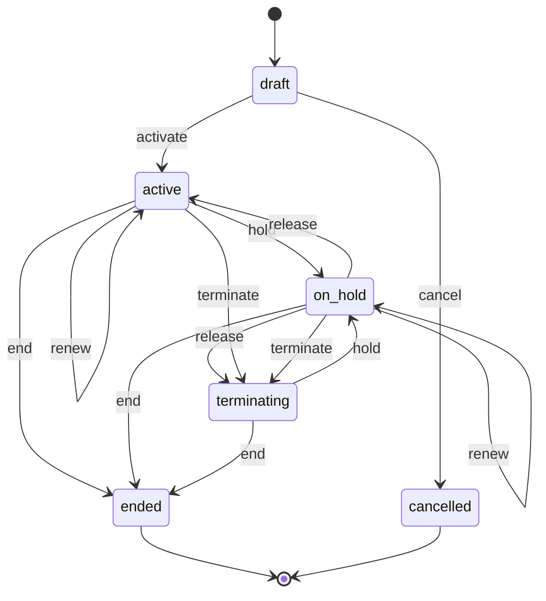
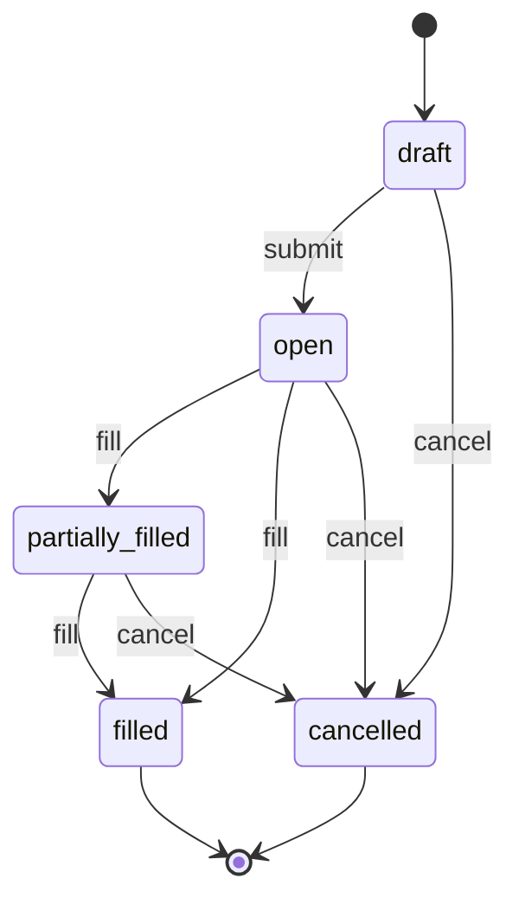
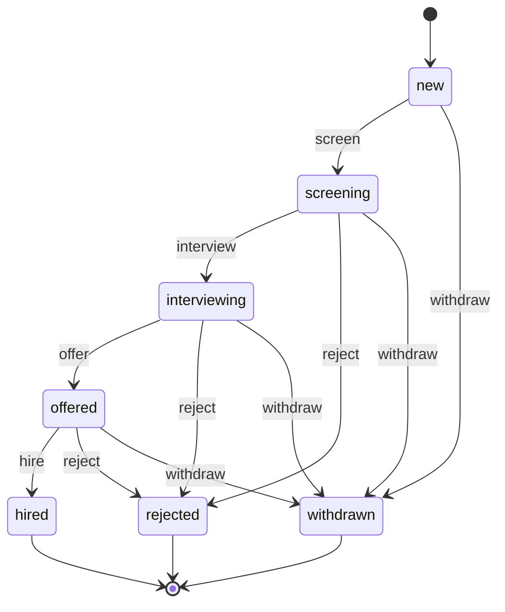
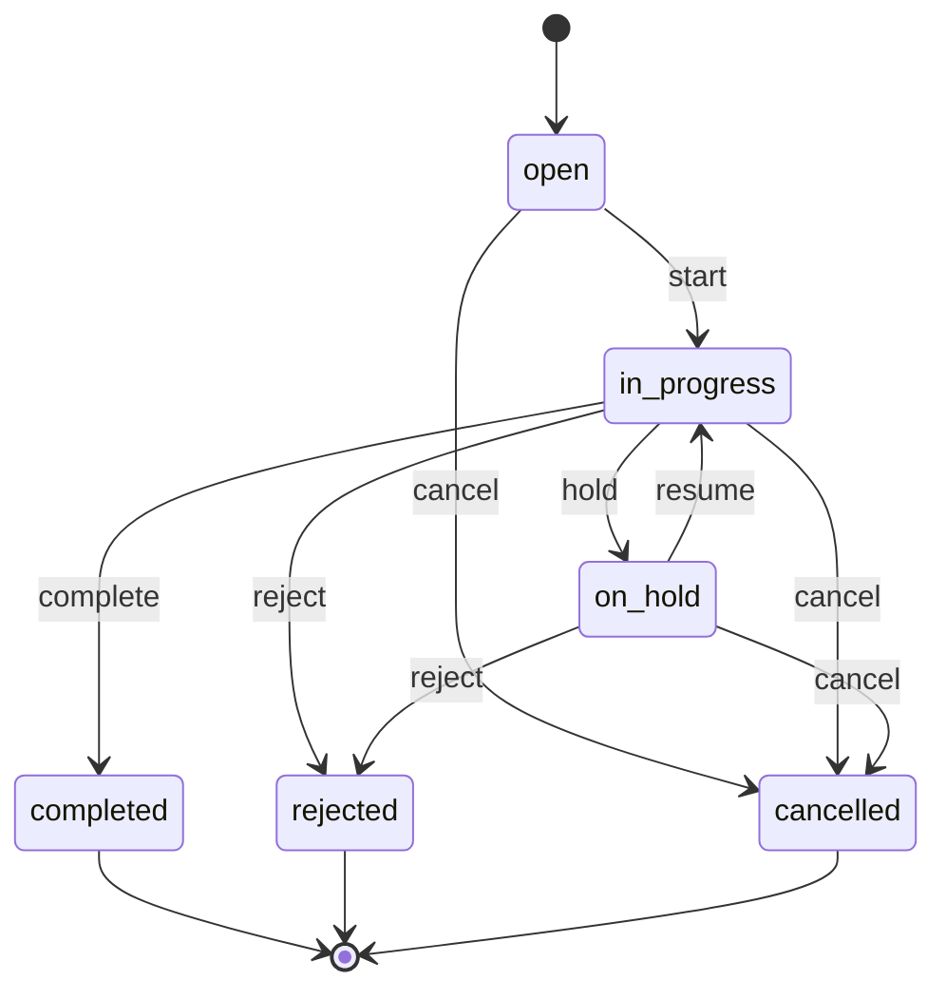
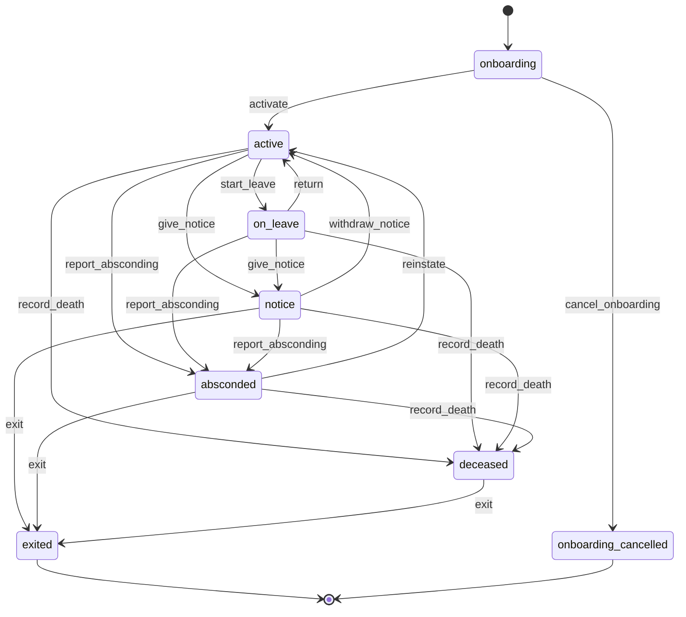
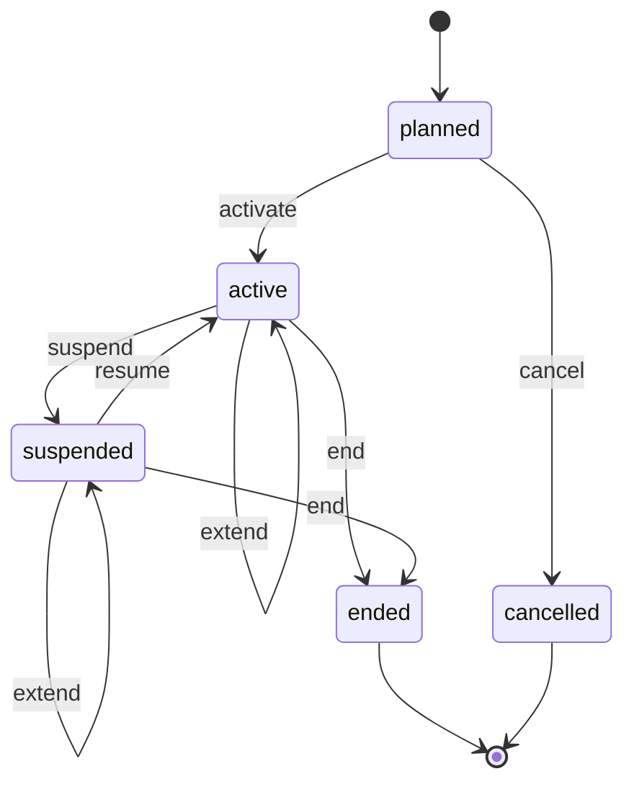
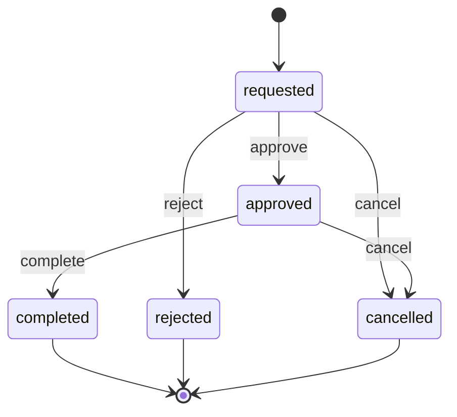
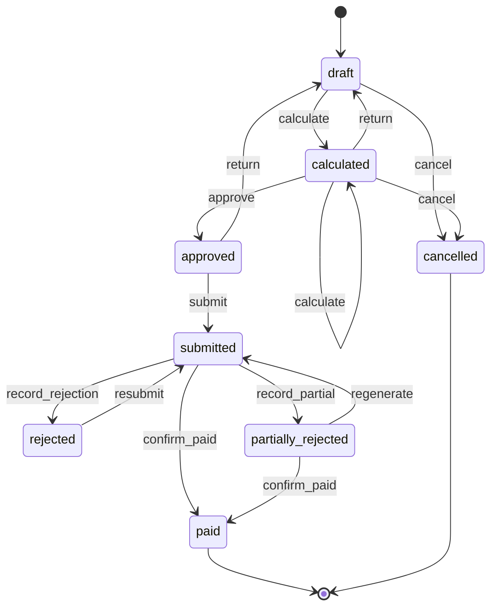
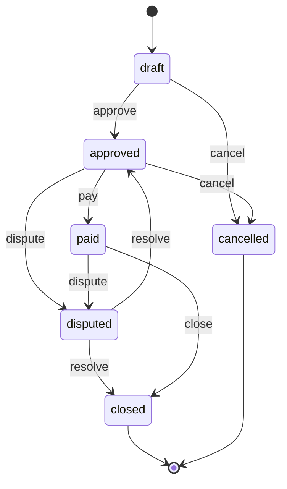
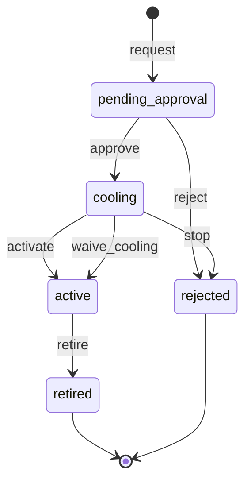

# 09 — Manpower Supply & Outsourcing

> Status: accepted · Reviewed: 2026-10-15 · Last updated: 2026-10-16

## 1. Summary

Mid-sized manpower agencies in the UAE employ and sponsor workers (IT staff, cleaners,
security guards, labourers, drivers, hospitality staff) and deploy them to client companies.
They earn the margin between the client's bill rate and the full cost of the worker. Today
they lose money and sleep over expired visas, unbilled hours, late client approvals and
salary deadlines. The app tracks every worker from onboarding to exit, deploys them to client
sites, turns client-approved timesheets into invoices and WPS-compliant payroll, and shows
margin per client and per worker.

Manpower is built in phase **F9** ([decision 0005](../decisions/0005-phases-follow-vertical-numbers.md); it was the second
vertical under [decision 0001](../decisions/0001-first-two-verticals.md), superseded).
Its purpose is to prove that the modules built for Property, together with the attendance and
timesheet modules first described in Construction, can be reused without being rewritten.
[§11](#11-platform-fit) lists exactly what is reused.

## 2. Business context (UAE)

- **Customer size:** 100–3,000 deployed workers, 10–60 office staff, 20–300 client
  companies and sites.
- **How they work today:** worker records and visa dates in Excel, attendance from client
  sign-in sheets or biometric devices, timesheets approved by email or on paper, invoices
  and payroll in separate spreadsheets, WPS files built by hand in the bank's template, and
  accounting in Tally/Zoho/QuickBooks.
- **Rules and practice that shape the work:**
  - Supplying workers to third parties needs a **MoHRE licence**. There are three types:
    mediation (recruitment), temporary employment and outsourcing (supplying workers to third
    parties), or both. Bank guarantee at least AED 300,000 for mediation and AED 1,000,000
    for the other two; licence fees AED 25,000 / 50,000 / 75,000. Basis: Administrative
    Resolution 26 of 2022 ✔ [S1], [S2]. Domestic worker offices (Tadbeer) are a separate
    regime.
  - The agency is the **employer and visa sponsor**. Onboarding a worker runs through:
    MoHRE work permit, entry permit or change of status, medical fitness test, Emirates ID
    biometrics, residence visa, labour contract, health insurance and unemployment insurance
    (ILOE). Steps run through the MoHRE portal and app, business service centres
    (Tasheel/Tawseel) and, in Dubai, Amer for GDRFA. The **Work Bundle** platform
    (workinuae.ae, UAE-wide since June 2024) cuts this to about five steps and two visits
    ✔ [S3], [S4]. No public government APIs for agencies were found ✔ [S3]. Health insurance
    is required before the residence permit is issued ✔ [S3].
  - **Recruitment and employment costs are borne by the employer**; charging the worker
    directly or indirectly is prohibited (Art. 6(4)). Employers may not withhold workers'
    official documents (Art. 13(2)). Fines AED 100,000–1,000,000 (Art. 60, as amended by
    Decree-Law 9 of 2024) ✔ [S5].
  - Labour contracts are **fixed-term and renewable** (Federal Decree-Law 33 of 2021, Art.
    8(3)); since Decree-Law 14 of 2022 there is no three-year maximum. If both sides keep
    working after expiry, the contract continues on the same terms (Art. 8(5)) ✔ [S5].
    **Probation** at most 6 months, once per employer; the employer gives 14 days' written
    notice; a worker moving to another UAE employer gives one month (Art. 9) ✔ [S5].
  - Salaries must be paid through **WPS** (Art. 22). Since 1 June 2026, Ministerial
    Resolution 340 of 2026 replaces 598 of 2022: wages are due by the 1st of the following
    month with no grace period; at least 85% of wages must be paid; warnings from day 2,
    **new work permits suspended from day 5**, fines and a lower establishment category from
    day 11 for repeat cases, then labour disputes and possible prosecution ✔ [S6], [S7],
    checked against the official text ✔ [S17]. Its stricter day-16 and day-21 measures name
    recruitment agencies, cleaning and security services among the targeted sectors.
  - **End-of-service gratuity:** 21 days' basic salary per year for the first five years,
    30 days per year after that, on the last basic wage, pro rata for part years after the
    first full year, unpaid absence excluded, capped at two years' wages (Art. 51) ✔ [S5].
  - **Annual leave** 30 days per year; 2 days per month between six and twelve months of
    service (Art. 29) ✔ [S5]. **Overtime** at least +25%; +50% between 10pm and 4am
    (except shift workers); work on the rest day earns a substitute day or +50%; at most 2
    overtime hours a day and 144 hours per three weeks (Art. 19, ER Art. 15) ✔ [S5].
  - The **midday break**: no outdoor work in direct sun from 12:30 to 15:00, 15 June to 15
    September, with exemptions for continuous or emergency work ✔ [S8], [S9] (see
    `HRM.RUL.01`).
  - Some roles need extra licences: security guards need a **SIRA** guard card in Dubai
    (secondary sources only). Outside Dubai, secondary sources point to the Ministry of
    Interior's private security department working with Abu Dhabi Police; the issuing body
    and guard card process `⚠ open: authority (AU-11)`. Food handlers in Dubai need an occupational
    health card, tested by DHA; public sources do not name cleaners in food establishments,
    so this stays a per-site requirement (`MPW.CMP.01`) `⚠ open: authority (AU-12)`.
  - **Emiratisation** (Nafis): companies with 50 or more employees add 2% Emiratis in
    skilled roles each year, reaching 10% by the end of 2026; contributions are AED 10,000
    per month per unfilled position from July 2026. Selected companies with 20–49 employees
    in 14 sectors had to hire one Emirati in 2024 and another in 2025 ✔ [S10], [S11]. Deployed
    workers count towards the agency's headcount.
  - **VAT:** manpower supply is standard-rated at 5% on the full consideration, including
    recharged salaries (FTA public clarification VATP038, 2024) ✔ [S12].

## 3. Users and access

Follows [ACCESS-CONTROL.md](../ACCESS-CONTROL.md). Platform-wide rules (`PLT.ACL.*`) are not
repeated here.

### 3.1 Roles

| Role | Actor type | What they do | Permissions (summary) | Typical scope |
|---|---|---|---|---|
| Company admin / MD | staff | Configures the company; approves salary changes, payroll and settlements; sees all margins | all | global |
| Account manager | staff | Owns client accounts: contracts and rate cards, manpower requests, deployments, timesheet follow-up | clients, contracts, requests, deployments, timesheets, invoices (read) | client company |
| Recruiter | staff | Sources candidates, interviews, makes offers (Later) | candidates, offers | global |
| PRO / visa officer | staff | Runs visa cases: new, renewal, cancellation; keeps documents current | visa cases, worker documents (sensitive) | global |
| HR / payroll officer | staff | Employee records, leave, payroll runs, WPS files, final settlements (prepare) | employees, leave, payroll (prepare), settlements (prepare) | global |
| Site supervisor | field | Agency staff at a client site: marks attendance, handles no-shows and replacements | attendance, deployments (read), tickets | site |
| Accountant | staff | Invoices, receipts, cheques, receivables; approves payroll and settlements | finance, payroll (approve), settlements (approve) | global |
| Worker | external | Sees payslips, leave balance, own documents; requests leave; checks in where allowed | portal: own records; own attendance | own records |
| Client approver | external | Approves timesheets, sees invoices, requests manpower | portal: timesheets (approve), invoices, requests | own company |
| Client viewer | external | Sees deployed workers, attendance and invoices | portal: read only | own company |

### 3.2 Scope

There are two scope units: the **client company** and, within it, the **site**. Account
managers are assigned per client company. Site supervisors are assigned per site. PRO, HR,
payroll and accounts are usually global. Workers and client contacts have no scope. Their
access comes from party ownership (`OWN`).

Ticket visibility: the *labour case* category (wl-ticketing, opened by settlement `dispute`)
is confidential; in the 09 default roles only the HR / payroll officer, the accountant and
the company admin / MD hold `tickets.confidential.view`, so only they see labour cases (and
the confidential *grievance* tickets).

### 3.3 Access rules

| ID | Rule | Pattern | Applies to | Parameter (default) |
|---|---|---|---|---|
| `MPW.ACL.01` | A client contact sees only workers deployed to their company, and only those workers' attendance, timesheets and the company's invoices | `OWN` | client approver, client viewer | — |
| `MPW.ACL.02` | A client contact sees a worker's name, role, photo and attendance, but not salary, nationality documents or medical data | `FLD` | client approver, client viewer | — |
| `HRM.ACL.03` *(shared, formerly `MPW.ACL.03`)* | Salary, bank details, passport, visa and medical fitness results need `employees.sensitive.view`; each view is audited | `SEN` | all staff | — |
| `MPW.ACL.04` | Bill rates and margins are visible only to account managers, accountants and the MD | `FLD` | other staff | — |
| `HRM.ACL.04` *(shared, formerly `MPW.ACL.05` and `MPW.ACL.12`)* | A payroll run or a final settlement is prepared by one user and approved by another | `SOD` | payroll officer, HR, accountant | on |
| `MPW.ACL.06` | A salary change above a threshold needs MD approval | `LIM` | HR | 10% |
| `MPW.ACL.07` | A deployment can start (`activate`), `resume` or be `extend`ed only if the worker's residence visa, work permit, Emirates ID and health insurance pass `document_valid`, and the site's required licences for the deployment's role (SIRA for security roles, health card, site pass) pass `qualification_valid` (`HRM.QUA.01`), on the check date: the transition date + N days, or the deployment's end date if earlier (for `extend`, the new end date if earlier). A deployment shorter than N days needs its documents valid to its end only. This is a hard guard (mode `block`, §9) at the moment of the transition. Creating or rescheduling a `planned` deployment only warns (wl-documents §5.6 point 2), and `DOC.RUL.02` lists it again inside the look-ahead window. A renewal still in review does not count. ILOE and passport do not block. Override only as the kind allows (§9): never for visa, work permit and SIRA licence; with MD approval for the others (`DOC.ACL.02`, one use for this deployment and this transition) | `STA` | account manager | N = 30 |
| `HRM.ACL.02` *(shared, formerly `MPW.ACL.08`)* | A timesheet approved by the client is locked; reopening it needs an account manager and a new client approval | `STA` | all staff | — |
| `MPW.ACL.09` | An account manager may approve a timesheet on the client's behalf only by attaching the client's signed timesheet | `STA` | account manager | — |
| `MPW.ACL.10` | A worker sees only their own payslips, leave, documents and attendance | `OWN` | worker | — |
| `POR.ACL.01` *(shared, formerly `MPW.ACL.11`)* | After exit, a worker's portal is read-only, then closes | `TIM` | worker | closes after 60 days |
| `HRM.ACL.01` *(shared, formerly `MPW.ACL.13`)* | A site supervisor marks attendance only for workers deployed to their site, and only for today or recent days | scope, `TIM` | site supervisor | 1 day back |
| `HRM.ACL.08` *(shared)* | A `locked` timesheet is never edited or reopened; a correction is an adjustment timesheet approved by the original approver kind (here the client, or `MPW.ACL.09` with the signed agreed outcome), never by its creator | `STA`, `SOD` | all staff | — |
| `HRM.ACL.09` *(shared)* | Attendance flagged `overtime_cap`, `permit_invalid` or `overlap` is accepted only by `attendance.review` with a reason, not by the supervisor who marked it | `STA`, `SOD` | site supervisor, HR | — |
| `HRM.ACL.05` *(shared)* | A new pay account is approved by another user, the worker is told by SMS on the number on record, and payroll uses it only after the cooling period; waiving it needs the MD | `SOD`, `TIM` | HR, payroll officer | 5 days |
| `HRM.ACL.06` *(shared)* | Salary recoveries (supplementary run overpayments, advances, damage, settlement offsets) stay within the Art. 25 caps | `LIM` | payroll officer | 20% a month; 50% in total |
| `HRM.ACL.07` *(shared)* | `cancel_onboarding`, `withdraw_notice`, `report_absconding`, `reinstate` and `record_death` are requested by HR and approved by another user with `employees.exit.approve` | `SOD` | HR | approver: MD |
| `MPW.ACL.14` | While a client contract is `on_hold`, no manpower request is submitted and no deployment of that client is activated or extended (`resume` stays allowed; drafts and planned deployments may still be created); workers already on site stay unless the MD decides to withdraw them. Releasing the hold while a hold condition remains (`MPW.RUL.10`) needs MD approval, and the requester cannot approve; a release when no hold condition remains needs no approval | `STA`, `SOD` | account manager, accountant | approver: MD |
| `MPW.ACL.15` | A deployment cannot be activated or extended for an employee who already has an `active` or `suspended` deployment whose shift times overlap it | `STA` | account manager | — |
| `MPW.ACL.16` | A rate card change is a new rate card version with an effective date, accepted by the client (`DOC.SIG.01`); it never changes hours already invoiced or timesheets already `locked`. A version is *pending* until the client accepts it and prices nothing before; lines of an accepted version are never edited; two versions of one contract never share an effective date. A change dated in the past (effective before the day it is submitted) needs MD approval after the client's acceptance, and reprices only hours not yet invoiced or `locked` | `STA`, `LIM` | account manager | — |
| `MPW.ACL.17` | Early termination of a client contract (`terminate`), and ending active deployments because of it, is approved by the MD | `SOD` | account manager | approver: MD |

## 4. Value streams

### 4.1 Client order to deployment

1. A client signs a contract with a rate card: bill rate per role and shift, overtime and
   public holiday multipliers, minimum hours, billing cycle (`MPW.CTR.01`, `FIN.QUO.01`,
   `DOC.SIG.01`).
2. The client requests workers: role, headcount, site, shift pattern, start date, duration.
   The request comes through the portal or the account manager (`MPW.ORD.01`, `POR.SLF.01`).
3. Workers are taken from the bench (employed, not deployed) or recruited (`MPW.REC.01`,
   §4.2).
4. Each worker is deployed to the client site, with role, shift, start date and bill rate
   (`MPW.DEP.01`). The deployment starts only if documents and site licences are valid
   (`MPW.ACL.07`, `MPW.CMP.01`).
5. Later: shifts are rostered per site (`HRM.ROS.01`).

**When it goes wrong:**

| Situation | What happens |
|---|---|
| The client stops paying | `MPW.RUL.10` puts the client contract `on_hold` when an invoice is overdue more than N days (default 30) or a client cheque bounces. No new request or deployment starts (`MPW.ACL.14`); workers on site stay and are billed. The account manager and the MD are told; the MD decides whether to withdraw workers (deployment `end`, reason *client non-payment*, chosen only by the MD, with an end date at least the contract's notice period away unless the MD attaches a waiver). Payment, or the bounce resolved, releases the hold once no hold condition remains |
| The client is blocked as a party (`PartyBlocked`) | Block effect for deployments: `continue` for active ones (suspended ones stay suspended and may `resume`); while the block lasts, deployment `activate` and `extend`, contract `renew` and request `submit` are refused (wl-parties §5.6). The MD and the account manager get a task listing the client's deployments; the client gets no message about the block. The MD decides any ending, through `terminate`; the reason shown to staff without `parties.block_reason.view` is *On hold*. `PartyUnblocked` undoes nothing; the guards stop refusing |
| The contract expires, or ends early | `MPW.RUL.11` warns 60 and 30 days before the end date. The account manager `renew`s it, or lets it run out. Early ending is `terminate` with a notice date and the MD's approval (`MPW.ACL.17`). On the end date active and suspended deployments `end` (reason *contract end*), planned ones are cancelled, open requests are cancelled, the last timesheets are closed at the end date, submitted at once and billed, and the workers go back to the bench |
| The client rejects a deployed worker | Staff record it (the portal has no rejection action in the MVP): deployment `end` with reason *client rejected* and the client's note (required). If the contract requires cover, a replacement request opens at once (`MPW.DEP.02`; 1 worker, same role, site and shift, from the next day to the rejected deployment's end date); the worker returns to the bench. A complaint ticket (category conduct) records the reason when conduct is involved (`WRK.TKT.01`) |
| No replacement can be found | The replacement request stays `open`; `MPW.RUL.13` tells the client and the account manager once, N hours before the cover start (default 24), or at once when the request is created later than that. Uncovered days are not billed. Penalties for missing cover follow the contract `⚠ open: client (C-03)` |
| The worker is already deployed for the same hours | `activate` is refused (`MPW.ACL.15`); overlapping attendance is flagged `overlap` when it is recorded (an effect of `record` in [wl-attendance](../modules/wl-attendance.md) §4, across sites and projects); `HRM.RUL.13` checks only the overtime cap and the midday break |

### 4.2 Candidate to active employee

1. A candidate is screened and interviewed, and an offer letter is accepted
   (`MPW.REC.01`, `DOC.SIG.01`; Later).
2. A **visa case** of type *new* is opened. Its steps are tracked with dates, documents and
   fees: work permit, entry permit or change of status, medical fitness test, Emirates ID
   biometrics, residence visa, labour contract, health insurance, ILOE
   (`HRM.VIS.01`, `DOC.FIL.01`).
3. The employee record is created with personal data, documents, salary structure (basic,
   housing, transport, other allowances) and bank or exchange-house account
   (`HRM.EMP.01`, `PTY.KYC.01`).
4. When the visa case completes, every document is stored with its expiry date and the
   employee becomes active (`DOC.EXP.01`, `HRM.EMP.01`).
5. Visa, recruitment, insurance and medical costs are booked against the employee as a cost
   object (`FIN.CST.01`).

**When it goes wrong:**

| Situation | What happens |
|---|---|
| A visa step is late | Each step of the step template has a target number of days. `MPW.RUL.14` tells the PRO when a step passes its target and HR and the MD after a second period. Statutory time limits per step (e.g. entering the country on an entry permit) are not yet verified `⚠ open: authority (AU-21)` |
| The *new* visa case is rejected or cancelled | Visa case `reject` or `cancel`. HR gets a task to open another case or to `cancel_onboarding` (approved by the MD, `HRM.ACL.07`). Planned deployments of the worker are cancelled (`EmployeeOnboardingCancelled`); their requests stay unfilled and the account manager is told. Days already worked are paid; visa costs stay with the agency (Art. 6(4)) ✔ [S5] |
| The candidate withdraws or is medically unfit | As above, with that reason |

### 4.3 Time to bill

1. The worker checks in at the client site within the geofence, or the site supervisor
   marks the crew (`HRM.ATT.01`).
2. Hours are collected into a timesheet per deployment for the billing period
   (`HRM.TMS.01`).
3. The timesheet is sent to the client approver, who approves it in the portal
   (`HRM.TMS.01`, `POR.SLF.01`). Paper approvals are attached instead (`MPW.ACL.09`).
4. Approved hours × the contract's rate card (normal, overtime, holiday, minimums) produce a
   draft invoice per client per billing cycle (`FIN.USG.01`, `MPW.CTR.01`).
5. The invoice is issued with VAT and sent (`FIN.INV.01`, `DOC.GEN.01`).
6. Payment arrives by transfer or post-dated cheque and is allocated. Overdue amounts are
   chased (`FIN.PAY.01`, `FIN.CHQ.01`, `FIN.REC.01`).

**When it goes wrong:**

| Situation | What happens |
|---|---|
| The client does not approve the timesheet | `HRM.RUL.08` submits and reminds. `HRM.RUL.15` escalates at E = 6 days to the client's escalation contact (from the contract; skipped when the field is empty) and the account manager's manager (the account manager's line manager, found by wl-attendance §5; without one, the users with `timesheets.approve_on_behalf` in the client's scope), with a task to collect a signed sheet (`MPW.ACL.09`). If the contract has a deemed-approval clause, the timesheet is `deem_approve`d after its N days and the client is told the hours and how to dispute them. N is a contract field (whole days ≥ 1, or empty); the value in force when the timesheet was submitted applies; without the clause nothing is deemed. Billing waits for approval; payroll does not (§4.4) |
| The client rejects the timesheet | Back to `open` with the reason; the supervisor corrects attendance and it is resubmitted |
| The client disputes hours after invoicing | The invoice is flagged `disputed` (staff, or the client approver in the portal; on by default). Reminders pause; a billing-dispute ticket is linked; `FIN.RUL.15` escalates after 14 days. If the dispute ends `credited`, a credit note is issued and an adjustment timesheet (origin *client dispute*) records the hours, by default affecting `billing` only: the worker keeps the pay unless the attendance itself was wrong (then `both`, with the evidence) |
| Hours were wrong on a locked timesheet | Adjustment timesheet (`HRM.ACL.08`), approved by the client or with the signed agreed outcome; + hours billed on the next invoice, − hours by credit note |
| Attendance is flagged | `overtime_cap` (2 h a day, 144 h in 3 weeks) and `midday_break` (`HRM.RUL.13`), `permit_invalid` (`HRM.RUL.14`, hours paid but not billed until HR reviews) and `overlap`; accepted only by a reviewer with a reason (`HRM.ACL.09`) |
| The rate card changes | A new rate card version from its effective date (`MPW.ACL.16`); hours are priced by the accepted version in force on the work date (for a shift crossing midnight, the shift's start date), with that version's OT and holiday multipliers and its minimum hours per shift. A month rate whose version changes inside a billing period is split pro rata by calendar days per version (month rate × days of the version ÷ calendar days of the month); each priced line is rounded once, half-up to fils, after all multiplying |
| The e-invoice is rejected by the ASP | The invoice stands; `FIN.RUL.16` gives the accountant a task with the error codes. Content errors are fixed by credit note and a new invoice |
| The invoice is never paid | Ageing, reminders and `MPW.RUL.10` credit hold; then `write_off` with approval (`FIN.ACL.15`, limit AED 0: every write-off approved) and the VAT bad-debt relief proposed by `FIN.RUL.14` |
| A client cheque bounces | wl-payments re-presentation, legal or write-off path; `MPW.RUL.10` puts the contract on hold |

### 4.4 Time to pay (payroll)

1. At the cut-off, a payroll run is drafted for the month (`HRM.PAY.01`).
2. For each employee it takes the salary structure, approved hours, overtime, unpaid leave,
   allowances and deductions (within Art. 25: loans with written consent, overpayments up to 20%, disciplinary fines up
   to 5%, damage up to 5 days' wage a month; all deductions together at most 50% of the wage
   ✔ [S5]).
3. HR reviews; a different user approves (`HRM.ACL.04`, `PLT.APR.01`).
4. The WPS salary file (SIF) is generated and submitted to the bank or exchange house
   (`HRM.WPS.01`).
5. Once the bank confirms payment, payslips are published to each worker's portal
   (`DOC.GEN.01`, `POR.SLF.02`).
6. The month's salary cost per employee is posted to their cost object, so margin per
   deployment and per client is known (`FIN.CST.01`, `MPW.RPT.01`).

**When it goes wrong:**

| Situation | What happens |
|---|---|
| Timesheets are not approved at the cut-off | Salary does not wait for the client. Payroll uses the accepted attendance hours, marked *provisional* (policy `attendance`, fixed for external approvers). When the timesheet is approved or deemed approved, any difference becomes an adjustment (`TimesheetReconciliationNeeded`) paid or recovered in the next run (− within Art. 25) |
| The approver returns the run | `return` to `draft` with the reason and comments on the lines |
| The bank rejects the whole SIF | `record_rejection`; the preparer fixes the cause and `resubmit`s. `HRM.RUL.11` alerts the MD and accountant 1 day before the WPS due date; `HRM.RUL.03` keeps running |
| Some lines fail | `record_partial`: paid lines confirmed, a task per failed line; each is fixed (usually the pay account) or held, and `regenerate` builds a SIF with only the fixed lines |
| An error is found after `paid` | A *supplementary* run with the difference per employee. Underpayments are paid; overpayments are recovered over the next runs, at most 20% of the wage a month (Art. 25 ✔ [S5]; `HRM.ACL.06`) |
| A held line is released (absence case closed, account fixed) | `HRM.RUL.12` proposes an off-cycle run, paid before the WPS due date where possible; carrying it into the next regular run needs a reason and warns when it pays late |
| The pay account changes just before payroll | Change control (`HRM.ACL.05`): second approver, SMS to the number on record, 5-day cooling; the run uses the account active at `submit`. If the old account is closed, the line is held and paid off-cycle |

### 4.5 Keeping workers compliant

1. Every expiring document (visa, Emirates ID, passport, labour contract, health insurance,
   ILOE, site pass, SIRA licence, health card) triggers reminders (`DOC.EXP.01`,
   `DOC.RUL.01`).
2. For residence visas, a *renewal* visa case is opened automatically (`HRM.RUL.04`).
3. Workers whose documents will expire during a deployment are flagged to the account
   manager (`MPW.ACL.07`, `DOC.RUL.02` look-ahead of 30 days): one message per document per
   night lists the affected deployments, and each shows "document expiring: <kind>, <date>"
   in lists until the renewed document is accepted.

**When it goes wrong:**

| Situation | What happens |
|---|---|
| A visa, work permit, insurance, SIRA licence, health card or site pass expires during a deployment | On `DocumentExpired` / `QualificationExpired` the deployment is `suspend`ed (`MPW.RUL.12`): attendance at the site is disabled and nothing is billed. The client and the account manager are told; cover is requested if the contract requires it. When the renewed document is accepted (`DocumentAccepted`), the deployment `resume`s. Attendance that slips through is flagged `permit_invalid` (`HRM.RUL.14`) |
| The renewal visa is rejected | Visa case `reject`; HR gets a task due 30 days before the current visa expires: try another route, or `give_notice` and open a *cancellation* case. On `VisaCaseRejected` (*renewal*), `MPW.RUL.12` tells the account manager of each affected client and the MD which active, suspended and planned deployments run past the current visa's expiry date; nothing changes on the deployments until the visa expires. `DocumentExpiring` lists them again inside the look-ahead window |

### 4.6 Leave and replacement

1. A worker requests leave in the portal, or HR records it (`HRM.LEV.01`).
2. HR approves it against the balance (`HRM.LEV.01`).
3. The client is notified. If the contract requires cover, a replacement deployment is
   created for the leave period (`MPW.DEP.02`, `MPW.RUL.06`). If none is found in time,
   `MPW.RUL.13` tells the client and the account manager.

### 4.7 Exit and final settlement

1. A resignation or termination is recorded with notice dates (`HRM.EMP.01`).
2. The deployment is ended on the last working day, and the client is informed
   (`MPW.DEP.01`).
3. The final settlement is calculated: unpaid salary, leave encashment, gratuity, minus
   recoverable amounts (`HRM.EOS.01`).
4. HR prepares it and a different user approves it (`HRM.ACL.04`). It is paid through WPS
   or by transfer (`HRM.WPS.01`, `FIN.PAY.01`).
5. A *cancellation* visa case cancels the visa and work permit (`HRM.VIS.01`).
6. The worker's portal becomes read-only and later closes (`POR.ACL.01`).

**When it goes wrong:**

| Situation | What happens |
|---|---|
| The settlement is not paid in time | `HRM.RUL.09` alerts HR and the accountant 10 days after the last working day and the MD on the legal deadline, 14 days after the end of the contract (the last working day; Art. 53 ✔ [S5]) |
| The worker disputes the settlement or files a MoHRE complaint | Settlement `dispute`; a labour-case ticket tracks the hearing or reply dates; the undisputed amount is still paid on time. `resolve` ends it `upheld` or `revised` |
| Recoveries exceed the amounts due | Nothing is paid; the negative net becomes a receivable from the worker, offset only within the Art. 25 caps `⚠ open: lawyer (L-23)` (wl-hr §10) |
| The notice is withdrawn | `withdraw_notice` with the other party's written agreement (`HRM.ACL.07`), only while the visa is not yet cancelled. The deployment end date set by `give_notice` goes back to the one it replaced (empty if none), the draft settlement and the cancellation case are cancelled, and the client is told |
| The worker absconds | `MPW.RUL.09` opens the absence case after 7 consecutive calendar days without attendance or approved leave. HR records each attempt to reach the worker on the employee (date, method, by whom, outcome). Once more than 7 days have passed, with at least two failed attempts on different days and the MoHRE absence report number recorded, HR runs `report_absconding` (MD approval): pay held, deployments ended, settlement drafted, cancellation case opened from the *absconding* variant of the step template. Exit does not wait for the worker's signature or payment |
| The worker dies in service | `record_death`: messages to the worker stop, deployments end, the settlement is drafted to the estate, HR gets the task list (visa cancellation, insurance, repatriation). Payee and documents `⚠ open: lawyer (L-25)` (wl-hr §10) |

### 4.8 Complaints and incidents

1. A client complaint (a no-show, conduct) or a worker grievance is raised as a ticket
   (`WRK.TKT.01`).
2. It is triaged and assigned to the account manager or HR (`WRK.TKT.02`).

## 5. Capabilities

| ID | Capability | Shared or specific | Proposed module | Scope |
|---|---|---|---|---|
| `PLT.ORG.01` | Branded deployment | shared | wl-kernel | MVP |
| `PLT.USR.01` | Staff users, roles, permissions scoped per client company and site | shared | Renox Permissions | MVP |
| `PLT.AUD.01` | Audit trail (salaries, documents, approvals) | shared | Renox Audit | MVP |
| `PLT.APR.01` | Approval requests (payroll, salary changes, settlements) | shared | wl-kernel | MVP |
| `PLT.WFL.01` | State machines with history | shared | Renox (R12) + wl-kernel | MVP |
| `PLT.ATM.01` | Default automation rules | shared | wl-kernel | MVP |
| `PLT.HOK.01` | Outbound webhooks | shared | Renox (R11) | Later |
| `PTY.PTY.01` | Parties: client companies, contacts, workers, candidates | shared | wl-parties | MVP |
| `PTY.KYC.01` | Identity fields: passport, Emirates ID, visa, trade licence, TRN | shared | wl-parties | MVP |
| `DOC.FIL.01` | Attach documents (contracts, visa pages, medical results, licences) | shared | wl-documents | MVP |
| `DOC.EXP.01` | Expiry reminders (visa, Emirates ID, passport, insurance, ILOE, site passes, licences, trademark and other registrations) | shared | wl-documents | MVP |
| `DOC.GEN.01` | Generate documents (offer letter, contract, payslip, invoice, settlement) | shared | wl-documents | MVP |
| `DOC.SIG.01` | E-signature / acceptance (client contract, offer letter, settlement acknowledgement) | shared | wl-documents | MVP |
| `FIN.QUO.01` | Quotations to clients with rate cards | shared | wl-invoicing | MVP |
| `FIN.CST.01` | Cost objects: cost per employee and deployment (visa, insurance, salary, accommodation) | shared | wl-invoicing | MVP |
| `FIN.INV.01` | Tax invoices with VAT | shared | wl-invoicing | MVP |
| `FIN.PAY.01` | Record and allocate payments | shared | wl-payments | MVP |
| `FIN.CHQ.01` | Post-dated cheque register | shared | wl-payments | MVP |
| `FIN.REC.01` | Receivables ageing and reminders | shared | wl-invoicing | MVP |
| `FIN.EXT.01` | Export to accounting software | shared | wl-invoicing | Later |
| `FIN.USG.01` | Billing from approved quantities (hours, days, trips) × a rate card with multipliers and minimums | shared | wl-invoicing | MVP |
| `FIN.RAT.01` | Rate cards per client contract: roles, shifts, multipliers, minimums | shared | wl-invoicing | MVP |
| `WRK.TKT.01` | Raise tickets (client complaints, worker grievances) | shared | wl-ticketing | MVP |
| `WRK.TKT.02` | Triage and assignment | shared | wl-ticketing | MVP |
| `WRK.CHK.01` | Checklists with photos and signature (onboarding and deployment induction steps, `HRM.ONB.01`) | shared | wl-ticketing | MVP |
| `POR.SLF.01` | Client portal: deployed workers, timesheet approval, invoices, requests | shared | wl-portal | MVP |
| `POR.SLF.02` | Worker portal (PWA, SMS one-time code login): payslips, leave, documents | shared | wl-portal | MVP |
| `POR.DOC.01` | Secure document upload by workers and clients | shared | wl-portal | Later |
| `NTF.MSG.01` | Email notifications | shared | wl-notify | MVP |
| `NTF.MSG.02` | WhatsApp notifications | shared | wl-notify | Later |
| `NTF.MSG.03` | SMS notifications (workers without email) | shared | wl-notify | MVP |
| `RPT.DSH.01` | Role-based dashboards | shared | Renox charts + wl-kernel | MVP |
| `SAL.CRM.01` | Leads and enquiries from prospective clients | shared | wl-sales | MVP |
| `HRM.EMP.01` | Employee records: personal data, salary structure, bank account, documents | shared | wl-hr | MVP |
| `HRM.ATT.01` | Attendance at client sites (supervisor marking, self check-in in a geofence) | shared | wl-attendance | MVP |
| `HRM.TMS.01` | Timesheets per deployment, overtime, approval (absorbs `MPW.TSA.01`) | shared | wl-attendance | MVP |
| `HRM.LEV.01` | Leave and absence with balances | shared | wl-hr | MVP |
| `HRM.PAY.01` | Payroll calculation: salary structure, overtime, leave, allowances, deductions | shared (**new**) | wl-hr | MVP |
| `HRM.WPS.01` | WPS salary file (SIF) export | shared | wl-hr | MVP |
| `HRM.VIS.01` | Visa cases (new, renewal, cancellation) as tracked steps with documents, dates and fees | shared (**new**) | wl-hr | MVP |
| `HRM.EOS.01` | Final settlement: gratuity, leave encashment, unpaid salary, recoveries | shared (**new**) | wl-hr | MVP |
| `HRM.ROS.01` | Shift rosters per site: shift patterns, assignment, gaps | shared | wl-attendance | Later |
| `HRM.QUA.01` | Qualifications and licences per role and site (SIRA licence, health card, site pass) with a validity guard | shared | wl-hr | MVP |
| `PLT.ENT.01` | Legal entities: several trade licences and TRNs in one deployment; issuer on every document | shared | wl-kernel | MVP |
| `PLT.IMP.01` | Data import and migration: Excel templates per entity, validation, dry run, rollback | shared | wl-kernel | MVP |
| `PLT.SRC.01` | Global search across records, including Arabic names | shared | wl-kernel + Renox search | MVP |
| `PLT.NOT.01` | Notes, comments and @mentions on any record, with an activity timeline | shared | wl-kernel | MVP |
| `PLT.SSO.01` | Staff single sign-on with Microsoft 365 or Google Workspace | shared | Renox OAuth (renox-oauth) | Later |
| `RPT.LIB.01` | Report library: filtered reports with export to Excel, CSV and PDF | shared | wl-kernel | MVP |
| `RPT.SCH.01` | Scheduled reports sent by email | shared | wl-kernel | Later |
| `FIN.VAT.01` | VAT summary per period and entity: output and input VAT, for the accountant | shared | wl-invoicing | MVP |
| `FIN.EXP.01` | Expense claims and petty cash: submit with receipt, approve, reimburse, top up | shared | wl-payments | Later |
| `FIN.BNK.01` | Bank statement import and matching of receipts to open invoices | shared | wl-payments | MVP |
| `SAL.CRM.02` | Lead sources and campaigns: cost per campaign, conversion by source and channel, cost per lead, customer acquisition cost and return on ad spend | shared | wl-sales | MVP |
| `FIN.CFL.01` | Cash-flow forecast: expected receipts and payments by week from invoices, supplier bills, scheduled charges, post-dated cheques, payroll and budgets | shared | wl-invoicing | MVP |
| `FIN.BUD.01` | Company budget vs actual by period, category and entity; owner drawings kept apart from operating cost | shared | wl-invoicing | MVP |
| `HRM.ONB.01` | Staff onboarding checklists per role and a library of SOP documents with acknowledgement | shared | wl-hr + wl-documents | MVP |
| `MPW.CTR.01` | Client contracts and rate cards (roles, shifts, multipliers, minimums, billing cycle) | specific | apps/manpower | MVP |
| `MPW.ORD.01` | Manpower requests from clients | specific | apps/manpower | MVP |
| `MPW.REC.01` | Candidate pipeline: sourcing, screening, interview, offer | specific | apps/manpower | Later |
| `MPW.DEP.01` | Deployments: worker → client site, role, shift, dates, bill rate | specific | apps/manpower | MVP |
| `MPW.DEP.02` | Replacements and cover during leave or absence | specific | apps/manpower | MVP |
| `MPW.CMP.01` | Site requirements: licences, passes and inductions a site requires | specific | apps/manpower | MVP |
| `MPW.ACM.01` | Accommodation and transport allocation and cost | specific | apps/manpower | Later |
| `MPW.EMR.01` | Emiratisation quota tracking | specific | apps/manpower | Later |
| `MPW.RPT.01` | Margin per client, deployment and worker; utilisation and bench | specific | apps/manpower | MVP |

## 6. Key entities

| Entity | Description | Important fields | Owned by |
|---|---|---|---|
| Client contract | Agreement with a client company | client, start/end, rate card, billing cycle, payment terms, cover obligation, deemed-approval days (none by default), escalation contact, notice period, open hold reasons with their invoices or cheques, state before the hold, status | apps/manpower |
| Rate card line | One billable rate | rate card version, effective from, role, shift type, bill rate per hour/day/month, OT and holiday multipliers, minimum hours | apps/manpower |
| Manpower request | Client's order for workers | client, site, role, headcount, shift pattern, start, duration, status | apps/manpower |
| Candidate | Person being recruited (Later) | party, role applied, source, stage, offer | apps/manpower |
| Employee | A worker employed by the agency | party, trade/role, joining date, salary structure, bank/exchange account, visa sponsor (employing legal entity), status | wl-hr |
| Visa case | A visa process | employee, type (new/renewal/cancellation), steps with dates, documents and fees, status | wl-hr |
| Document | Visa, EID, passport, contract, insurance, licence | subject, kind, number, expiry, file | wl-documents |
| Site | A client location | client, address, geofence, required licences and passes | apps/manpower |
| Deployment | A worker placed at a site | employee, site, role, shift, start/end, bill rate, suspension reason and dates, end reason, status | apps/manpower |
| Attendance | Presence at a site | employee, site, in/out, method, location | wl-attendance |
| Timesheet | Hours for a billing period | deployment, entries, overtime, client approval, status | wl-attendance |
| Invoice | Tax invoice to a client | client, lines from timesheets, VAT, status | wl-invoicing |
| Leave request | Leave or absence | employee, type, dates, days, status | wl-hr |
| Payroll run | A month's payroll for one legal entity | entity, period, lines per employee, totals, SIF file, status | wl-hr |
| Payslip | One employee's pay for a run | employee, earnings, deductions, net | wl-hr |
| Final settlement | Exit payment | employee, gratuity, leave encashment, unpaid salary, recoveries, status | wl-hr |

## 7. Workflow

Follows [WORKFLOW.md](../WORKFLOW.md). Reused unchanged:

- **Invoice, Cheque, Ticket** from [01-property.md](01-property.md#71-state-machines), with
  the wl-invoicing and wl-payments negative paths: invoice `dispute` (the client approver may
  raise it in the portal: on), `write_off` (limit AED 0, every write-off approved,
  `FIN.ACL.15`), `unallocate` on a reversed payment, e-invoice transmission; cheque
  `represent`, `refer_to_legal` and `write_off` after `bounced` (no bounce fee by default).
- **Quotation** and **Timesheet** from [02-construction.md](02-construction.md#71-state-machines).
  Here the timesheet's `approve` transition is run by the **client approver** through the
  portal (or by an emailed signed link): the portal role holds `timesheets.approve`, limited
  by `MPW.ACL.01`. Approved timesheets are read by payroll and billing; the first consumer
  moves them to `locked` (see [wl-attendance](../modules/wl-attendance.md)). The canonical
  machine adds what 09 needs: `deem_approve` (system, `HRM.RUL.15`, only when the client
  contract sets deemed-approval days), `open_adjustment` for locked timesheets
  (`HRM.ACL.08`), and provisional use by payroll at the cut-off (wl-attendance §5.7, policy
  `attendance`).

### 7.1 State machines

#### Client contract

| State | Tone | Terminal | Meaning |
|---|---|---|---|
| `draft` | neutral | no | Being negotiated; rate card proposed |
| `active` | success | no | Signed; requests and deployments allowed |
| `on_hold` | warning | no | Credit hold: no new requests or deployments; workers on site stay |
| `terminating` | warning | no | Notice of early termination given; ends on the end date |
| `ended` | neutral | yes | End date reached; deployments ended |
| `cancelled` | neutral | yes | Never signed |

| Transition | From | To | By | Guards | Effects |
|---|---|---|---|---|---|
| `activate` | draft | active | `contracts.manage` | contract signed (`DOC.SIG.01`); rate card version accepted | requests allowed |
| `renew` | active, on_hold | same state | `contracts.manage` | new end date later than the current one; renewal signed; changed rates as a new rate card version (`MPW.ACL.16`); client not blocked (`PartyBlocked`) | deployment end dates are not changed: the next `MPW.RUL.11` notice lists them for `extend`; `MPW.RUL.11` restarts from the new end date |
| `hold` | active, terminating | on_hold | system (`MPW.RUL.10`) or `contracts.manage` | reason (overdue, bounced cheque, other with text) | state before the hold kept, with the reason, the triggering invoices or cheque, and who held it; no request `submit` and no deployment `activate` or `extend` (`MPW.ACL.14`); account manager and MD notified once with the overdue amount and the workers on site; the client gets the normal overdue reminders, not a hold notice. On a contract already `on_hold`, a new cause is added to its open hold reasons instead (no second `hold`) |
| `release` | on_hold | active, terminating | system (no hold condition left: every invoice that caused an *overdue* reason paid, no other invoice under the contract meets the `MPW.RUL.10` invoice condition (not `disputed` nor `written_off`, open balance overdue more than N days), every bounced cheque that caused a reason resolved) or `contracts.manage` (with MD approval while a hold condition remains, `MPW.ACL.14`) | — | back to the state before the hold; account manager notified; the client is not told. A dispute raised after the hold does not release it. After an MD-approved release, `MPW.RUL.10` does not hold the contract again for the same invoices or cheques; a system release withdraws a pending manual request |
| `terminate` | active, on_hold | terminating | `contracts.manage`, approved by the MD (`MPW.ACL.17`) | initiated by (client or agency), reason, notice date and end date recorded; end date not later than the current one; end date ≥ notice date + the contract's notice period in calendar days, or the waiver attached | nothing changes before the approval (a `hold` meanwhile does not stop the request: `terminate` is allowed from `on_hold`; an `end` or a `renew` meanwhile withdraws it); then: any hold cleared; end dates of active and suspended deployments set to the contract end date when theirs is later or empty; planned deployments starting after it cancelled (reason *contract terminated*), the others capped at it; open requests starting after it cancelled, the others at `end`; client sent the confirmation letter (`DOC.GEN.01`) |
| `end` | active, on_hold, terminating | ended | system (first daily run after the end date) | not renewed | active and suspended deployments `end` (reason *contract end*, end date = the contract end date); planned ones cancelled; open requests cancelled; hold reasons closed (overdue invoices stay in receivables); each open timesheet closed at the end date and submitted to the client at once, and billed after approval by `MPW.RUL.05` though the contract is `ended`; workers still `active` back on the bench; account manager notified |
| `cancel` | draft | cancelled | `contracts.manage` | reason given | — |

A blocked client (`PartyBlocked`, wl-parties §5.6) does not change the contract state:
deployments follow their own block effect (*continue*), and the MD decides any `terminate`.

#### Manpower request

| State | Tone | Terminal | Meaning |
|---|---|---|---|
| `draft` | neutral | no | Being written by the client or account manager |
| `open` | info | no | Confirmed; workers being found |
| `partially_filled` | info | no | Some positions deployed |
| `filled` | success | yes | All positions deployed |
| `cancelled` | neutral | yes | Withdrawn by the client or us |

| Transition | From | To | By | Guards | Effects |
|---|---|---|---|---|---|
| `submit` | draft | open | `requests.create` (staff or client approver) | the contract's rate card covers the role and shift; contract `active` (not `on_hold`, `MPW.ACL.14`, nor `terminating`); client not blocked. The portal refusal does not mention a hold | account manager notified |
| `fill` | open, partially_filled | partially_filled, filled | system (deployment `activate`) | — | `filled` when deployments = headcount |
| `cancel` | draft, open, partially_filled | cancelled | `requests.manage`, client approver, or system (contract `terminate` or `end`) | reason given | planned deployments for it cancelled |

#### Candidate (Later)

| State | Tone | Terminal | Meaning |
|---|---|---|---|
| `new` | neutral | no | Sourced or applied |
| `screening` | info | no | CV and documents checked |
| `interviewing` | info | no | Interviews scheduled or done |
| `offered` | warning | no | Offer letter sent |
| `hired` | success | yes | Offer signed; employee created |
| `rejected` | neutral | yes | Not selected |
| `withdrawn` | neutral | yes | Candidate withdrew |

| Transition | From | To | By | Guards | Effects |
|---|---|---|---|---|---|
| `screen` | new | screening | `candidates.manage` | — | — |
| `interview` | screening | interviewing | `candidates.manage` | — | — |
| `offer` | interviewing | offered | `candidates.offer` | salary within the role's band, otherwise approval | offer letter generated for signature (`DOC.SIG.01`) |
| `hire` | offered | hired | `candidates.offer` | offer signed | employee created in `onboarding`; *new* visa case opened |
| `reject` | screening, interviewing, offered | rejected | `candidates.manage` | reason given | — |
| `withdraw` | new, screening, interviewing, offered | withdrawn | `candidates.manage` | — | — |

#### Visa case *(shared — wl-hr)*

> **Canonical definition:** *Visa case* in [`wl-hr` §4](../modules/wl-hr.md#4-lifecycles). This section is this vertical's original requirement; where it differs, the module definition wins and its vertical mapping table records the difference.

Each case has a type (*new*, *renewal*, *cancellation*) and a checklist of steps for that
type. Each step has a date, a document, a fee and a target number of days (`MPW.RUL.14`),
counted from the completion of the previous mandatory step, or from the case's creation for
the first step. The state machine covers the case. Steps are checklist items. 09 seeds the
step templates per emirate (wl-hr `VisaStepTemplate`), with three *cancellation* variants:
*standard*; *absconding*, which starts from the MoHRE absence report and needs no worker
signature; and *death*, which starts from the death certificate.

| State | Tone | Terminal | Meaning |
|---|---|---|---|
| `open` | neutral | no | Created; steps not started |
| `in_progress` | info | no | At least one step done |
| `on_hold` | warning | no | Waiting (medical re-test, missing document, authority delay) |
| `completed` | success | yes | All mandatory steps done; documents stored with expiry dates |
| `rejected` | error | yes | Refused by the authority (MoHRE, GDRFA or ICP) |
| `cancelled` | neutral | yes | Abandoned (candidate withdrew, no longer needed) |

| Transition | From | To | By | Guards | Effects |
|---|---|---|---|---|---|
| `start` | open | in_progress | `visas.manage` | first step recorded | — |
| `hold` | in_progress | on_hold | `visas.manage` | reason given | HR notified |
| `resume` | on_hold | in_progress | `visas.manage` | — | — |
| `complete` | in_progress | completed | `visas.manage` | all mandatory steps done; resulting documents attached with numbers and expiry dates | *new*: employee may `activate`; *renewal*: suspended deployments re-checked (`DocumentAccepted`); *cancellation*: employee may `exit`; fees posted to the employee cost object |
| `cancel` | open, in_progress, on_hold | cancelled | `visas.manage` | reason given | fees already paid stay posted; *new*: HR task to open another case or `cancel_onboarding` |
| `reject` | in_progress, on_hold | rejected | `visas.manage` | authority reference and reason recorded | fees stay posted; *new*: HR task to open another case or `cancel_onboarding`; *renewal*: HR task due 30 days before the current visa expires (another route, or `give_notice`); `VisaCaseRejected` tells the account managers and the MD which deployments are affected (`MPW.RUL.12`) |

#### Employee *(shared — wl-hr)*

> **Canonical definition:** *Employee* in [`wl-hr` §4](../modules/wl-hr.md#4-lifecycles). This section is this vertical's original requirement; where it differs, the module definition wins and its vertical mapping table records the difference.

| State | Tone | Terminal | Meaning |
|---|---|---|---|
| `onboarding` | neutral | no | Hired; visa and contract in progress |
| `active` | success | no | Can be deployed and paid |
| `on_leave` | info | no | On approved leave |
| `notice` | warning | no | Resigned or terminated; serving notice |
| `absconded` | error | no | Absent without notice; MoHRE absence report filed; outside WPS while the report is valid |
| `deceased` | neutral | no | Died in service; settlement due to the estate |
| `exited` | neutral | yes | Settled and visa cancelled |
| `onboarding_cancelled` | neutral | yes | Never started work (visa refused or cancelled, candidate withdrew, medically unfit) |

| Transition | From | To | By | Guards | Effects |
|---|---|---|---|---|---|
| `activate` | onboarding | active | `employees.manage` | *new* visa case `completed`; labour contract signed; health insurance recorded (ILOE is tracked but does not block: the worker has 4 months to subscribe, see [wl-hr](../modules/wl-hr.md)) | joins the bench; portal account created |
| `start_leave` | active | on_leave | system (leave start date) | approved leave | deployments flagged for cover |
| `return` | on_leave | active | system (leave end date) or `employees.manage` | — | — |
| `give_notice` | active, on_leave | notice | `employees.manage` | notice date, last working day and reason recorded | deployment end scheduled; final settlement drafted; *cancellation* visa case opened (`HRM.RUL.05`) |
| `withdraw_notice` | notice | active | `employees.manage`, approved under `HRM.ACL.07` | other party's written agreement attached `⚠ open: lawyer (L-26)` (wl-hr §10); *cancellation* case not `completed` | deployment end date set by `give_notice` replaced by the one it replaced (empty if none); client told; settlement and *cancellation* case cancelled |
| `cancel_onboarding` | onboarding | onboarding_cancelled | `employees.manage`, approved under `HRM.ACL.07` | reason given; *new* case `cancel`led or `rejected`; *cancellation* case `completed` when a permit was issued; days worked paid | planned deployments cancelled (`EmployeeOnboardingCancelled`); account manager told; costs stay with the agency (Art. 6(4)) |
| `report_absconding` | active, on_leave, notice | absconded | `employees.manage`, approved under `HRM.ACL.07` | absence case from `MPW.RUL.09` open; more than 7 consecutive calendar days since the last day with attendance or approved leave; the worker unreachable: at least two failed contact attempts recorded on the employee on different days of the absence (ER Art. 28 ✔ [S5]); MoHRE absence report number and date recorded | payroll lines held (outside WPS, MR 340/2026 Art. 4 ✔ [S17]); deployments ended and planned ones cancelled (`EmployeeAbsconded`); client told only that the worker is no longer available; portal and attendance disabled; settlement drafted; *cancellation* case opened from the *absconding* variant of the step template |
| `reinstate` | absconded | active | `employees.manage`, approved under `HRM.ACL.07` | the worker returned; the report's withdrawal reference recorded `⚠ open: authority (AU-22)` | held lines released (`HRM.RUL.12`); absence case closed; back on the bench (a new deployment is needed) |
| `record_death` | active, on_leave, notice, absconded | deceased | `employees.manage`, approved under `HRM.ACL.07` | date of death and certificate or authority notice attached | deployments ended and planned ones cancelled (`EmployeeDeceased`); client told only that the worker is no longer available (the account manager may add a personal note); messages to the worker stopped; settlement drafted to the estate; HR task list opened |
| `exit` | notice | exited | `employees.manage` | final settlement `paid`; *cancellation* visa case `completed` | portal read-only (`POR.ACL.01`) |
| `exit` | absconded, deceased | exited | `employees.manage` | *cancellation* case `completed` or the authority's cancellation reference recorded; settlement `approved` (absconded) or `paid` to the estate (deceased); no signed acknowledgement needed | as above |

#### Deployment

| State | Tone | Terminal | Meaning |
|---|---|---|---|
| `planned` | neutral | no | Agreed with the client; not started |
| `active` | success | no | Worker on site |
| `suspended` | warning | no | Worker may not work at the site for now (expired document or licence, site access withdrawn); no attendance, no billing |
| `ended` | neutral | yes | Finished (end date, contract end, replacement, client rejection, exit, absconding, death) |
| `cancelled` | neutral | yes | Never started |

| Transition | From | To | By | Guards | Effects |
|---|---|---|---|---|---|
| `activate` | planned | active | `deployments.manage` | employee `active`; `MPW.ACL.07` documents and site licences valid; client contract `active` or `terminating` (`MPW.ACL.14`); client not blocked; no overlapping deployment (`MPW.ACL.15`) | request `fill`; attendance enabled at the site; client notified |
| `extend` | active, suspended | same state | `deployments.manage` | new end date within the contract; `MPW.ACL.07` on its check date; contract not `on_hold`; client not blocked; no overlap | client notified |
| `suspend` | active | suspended | system (`MPW.RUL.12` on `DocumentExpired` or `QualificationExpired` for a kind the deployment needs) or `deployments.manage` | reason given (document kind, site access withdrawn, investigation) | suspension date = the day after the expiry date for a document reason; attendance at the site disabled; suspended days not billed (no attendance, so hour and day rates bill nothing for them; a month rate is reduced by the suspended calendar days over the calendar days of the month; no minimum hours for suspended days); client and account manager told with a neutral reason ("temporarily unavailable"); cover request if the contract requires it (`MPW.DEP.02`; 1 worker, same role, site and shift, from the suspension date, open-ended). On a deployment already `suspended`, a further expired kind is added to its suspension reasons (no second transition, no second client message) |
| `resume` | suspended | active | system (`DocumentAccepted` for the expired kind, when no other reason remains; document reasons only) or `deployments.manage` | `MPW.ACL.07` checks pass again; end date not passed; contract not `ended` | attendance enabled; client told; the cover deployment ends on its own end date; a cover request still `open` or `partially_filled` is cancelled (reason *worker returned*). When a check still fails, the deployment stays `suspended` with the reason removed for the accepted kind only, and the account manager is told the kind still failing |
| `end` | active, suspended | ended | `deployments.manage` or system (end date; contract `end`; employee `exit`, `report_absconding`, `record_death`) | end reason recorded (end date, contract end, client rejected, client non-payment, replaced, exit, absconded, deceased, entered in error); *client rejected* needs the client's note; *client non-payment* only by the MD, with an end date at least the contract's notice period away unless a waiver is attached | open timesheet closed for the period; client notified; *client rejected*: replacement request if the contract requires cover; *entered in error*: its attendance rejected (hours already in a `locked` timesheet need an adjustment timesheet, `HRM.ACL.08`); worker back on the bench when still `active`; a request filled by it does not reopen (the account manager may create a replacement) |
| `cancel` | planned | cancelled | `deployments.manage` or system (`EmployeeOnboardingCancelled`, `EmployeeAbsconded`, `EmployeeDeceased`, contract `terminate` or `end`, request `cancel`) | reason given | client told when the start date was already communicated |

A deployment entered in error is `cancel`led while `planned`; once active it is ended with
reason *entered in error* and its attendance rejected (no `void`). `give_notice` stores the
end date it replaces; on `EmployeeNoticeWithdrawn` that end date is restored (empty if there
was none). On `EmployeeAbsconded` and `EmployeeDeceased` the end date is the date in the event
(the report date; the date of death); absence days before it have no attendance and are not
billed. Billing for a suspended deployment stops on the suspension date; a deployment that
stays `suspended` beyond the contract's cover terms is decided by the account manager (`end`,
or keep waiting; the list shows the days suspended), and one whose end date passes ends
through the normal end-date run (reason *end date*).

#### Leave request *(shared — wl-hr)*

> **Canonical definition:** *Leave request* in [`wl-hr` §4](../modules/wl-hr.md#4-lifecycles). This section is this vertical's original requirement; where it differs, the module definition wins and its vertical mapping table records the difference.

| State | Tone | Terminal | Meaning |
|---|---|---|---|
| `requested` | info | no | Waiting for HR |
| `approved` | success | no | Approved; not finished |
| `completed` | success | yes | Leave period over |
| `rejected` | neutral | yes | Not approved |
| `cancelled` | neutral | yes | Withdrawn before it started |

| Transition | From | To | By | Guards | Effects |
|---|---|---|---|---|---|
| `approve` | requested | approved | `leave.approve` | balance sufficient, or marked unpaid | client notified; cover request if the contract requires it (`MPW.RUL.06`) |
| `reject` | requested | rejected | `leave.approve` | reason given | worker notified |
| `cancel` | requested, approved | cancelled | worker or `leave.approve` | start date not reached | balance restored |
| `complete` | approved | completed | system (end date) | — | balance deducted; payroll uses the days |

#### Payroll run *(shared — wl-hr)*

> **Canonical definition:** *Payroll run* in [`wl-hr` §4](../modules/wl-hr.md#4-lifecycles). This section is this vertical's original requirement; where it differs, the module definition wins and its vertical mapping table records the difference.

| State | Tone | Terminal | Meaning |
|---|---|---|---|
| `draft` | neutral | no | Created for the period |
| `calculated` | info | no | Lines calculated; under review |
| `approved` | success | no | Approved by a second user (`HRM.ACL.04`) |
| `submitted` | info | no | WPS file generated and sent to the bank or exchange house |
| `rejected` | error | no | The bank or exchange house rejected the whole file |
| `partially_rejected` | warning | no | Some lines paid; others failed with the bank's reason |
| `paid` | success | yes | Bank confirmed payment of every line not held; payslips published |
| `cancelled` | neutral | yes | Discarded before approval |

| Transition | From | To | By | Guards | Effects |
|---|---|---|---|---|---|
| `calculate` | draft, calculated | calculated | `payroll.prepare` | timesheets for the period approved, or attendance hours used as *provisional* (wl-attendance §5.7) | lines recalculated; lines with an open absence case *held* |
| `approve` | calculated | approved | `payroll.approve` | `HRM.ACL.04` (SoD) | — |
| `return` | calculated, approved | draft | `payroll.approve` | reason; comments on the lines to fix | preparer notified |
| `submit` | approved | submitted | `payroll.prepare` | every employee has an `active` WPS-eligible pay account (`HRM.ACL.05`) | SIF file generated (`HRM.WPS.01`); held lines left out |
| `record_rejection` | submitted | rejected | `payroll.prepare` | bank's rejection notice attached | lines `failed`; `HRM.RUL.11`; `HRM.RUL.03` keeps running |
| `record_partial` | submitted | partially_rejected | `payroll.prepare` | bank's result file attached; reason per failed line | paid lines confirmed and payslips published; task per failed line (`HRM.RUL.11`) |
| `resubmit` | rejected | submitted | `payroll.prepare` | cause fixed; amounts unchanged | new SIF version |
| `regenerate` | partially_rejected | submitted | `payroll.prepare` | each failed line fixed or moved out (held, or an approved non-WPS method) | SIF with only the fixed lines |
| `confirm_paid` | submitted, partially_rejected | paid | `payroll.approve` | bank confirmation attached for every line not held; no line left `failed` | payslips published; salary cost posted to cost objects per deployment; held lines wait for `HRM.RUL.12` |
| `cancel` | draft, calculated | cancelled | `payroll.prepare` | — | — |

Run types: `regular` (monthly, `HRM.RUL.02`), `off_cycle` (released held lines, fixed failed
lines; `HRM.RUL.12`) and `supplementary` (correction of a `paid` run, which is never edited;
overpayments recovered at most 20% of the wage a month, `HRM.ACL.06`). Each has its own SIF
file per legal entity and the same approval.

#### Final settlement *(shared — wl-hr)*

> **Canonical definition:** *Final settlement* in [`wl-hr` §4](../modules/wl-hr.md#4-lifecycles). This section is this vertical's original requirement; where it differs, the module definition wins and its vertical mapping table records the difference.

| State | Tone | Terminal | Meaning |
|---|---|---|---|
| `draft` | neutral | no | Calculated from the exit data; editable |
| `approved` | success | no | Approved by a second user (`HRM.ACL.04`) |
| `disputed` | warning | no | The worker contests the amounts, or a MoHRE complaint or court case is open |
| `paid` | success | no | Paid (or nothing payable); acknowledgement requested |
| `closed` | success | yes | No dispute open; the dispute period passed or the dispute ended |
| `cancelled` | neutral | yes | Not needed (notice withdrawn, worker reinstated) |

| Transition | From | To | By | Guards | Effects |
|---|---|---|---|---|---|
| `approve` | draft | approved | `settlements.approve` | `HRM.ACL.04` (SoD) | settlement statement generated |
| `pay` | approved | paid | `settlements.pay` | payment recorded (WPS or transfer), or net ≤ 0 | acknowledgement sent for signature (`DOC.SIG.01`; not for the estate); employee may `exit`; a negative net becomes a receivable from the worker, offset only within Art. 25 |
| `dispute` | approved, paid | disputed | `settlements.prepare` | source (worker, MoHRE complaint, court) and reference given | labour-case ticket opened with hearing or reply dates; HR, accountant and MD notified; the undisputed amount can still be paid |
| `resolve` | disputed | approved, closed | `settlements.approve` | outcome (`upheld`, `revised`) and the decision or agreement attached | `revised`: recalculated, approved again by another user, difference paid; ticket closed |
| `close` | paid | closed | system | 30 days after `pay` with no dispute, or acknowledgement signed | — |
| `cancel` | draft, approved | cancelled | `settlements.prepare` or system (`withdraw_notice`, `reinstate`) | nothing paid against it | — |

#### Pay account *(shared — wl-hr)*

> **Canonical definition:** *Pay account* in [`wl-hr` §4](../modules/wl-hr.md#4-lifecycles). Used unchanged. 09 settings: cooling 5 days; the notice goes by SMS (`NTF.MSG.03`) to the mobile number on record before the change, because most workers have no e-mail; workers can request a change in the portal.

| State | Tone | Terminal | Meaning |
|---|---|---|---|
| `pending_approval` | warning | no | Requested by HR or by the worker in the portal |
| `cooling` | info | no | Approved; the worker has been told; not yet used by payroll |
| `active` | success | no | Used by the next payroll run submitted |
| `retired` | neutral | yes | Replaced by a newer account |
| `rejected` | neutral | yes | Not approved, or stopped by the worker |

| Transition | From | To | By | Guards | Effects |
|---|---|---|---|---|---|
| `request` | — | pending_approval | `employees.manage`, or the worker (portal) | IBAN or card and routing code valid; holder name matches, or the mismatch explained | approver notified |
| `approve` | pending_approval | cooling | `pay_accounts.approve` | approver ≠ requester (`HRM.ACL.05`) | SMS to the number on record with the last 4 digits and the start date |
| `reject` | pending_approval | rejected | `pay_accounts.approve` | reason given | requester notified |
| `stop` | cooling | rejected | the worker (SMS link, portal) or `employees.manage` | — | old account stays active; security ticket opened; MD notified |
| `activate` | cooling | active | system (cooling ended) | — | previous account `retired` |
| `waive_cooling` | cooling | active | `payroll.approve` + MD approval | reason (e.g. failed WPS line, worker verified in person) | as `activate`; audited |
| `retire` | active | retired | system | a newer account activated | — |

### 7.2 Automations

Reused unchanged: `FIN.RUL.01`–`04` from [01-property.md](01-property.md#72-automations),
`DOC.RUL.01` (visas, Emirates IDs, passports, insurance, licences), `WRK.RUL.01`–`02`
(complaints and grievances), and `HRM.RUL.01` (midday break) from
[02-construction.md](02-construction.md#72-automations). Also used from the modules with
their defaults: `DOC.RUL.02`–`03` (look-ahead 30 days, expiry), `FIN.RUL.14`–`16` (bad-debt
relief, disputed invoices, e-invoice rejection), `FIN.RUL.18` (bounced cheque),
`NTF.RUL.01` (message gave up: SMS to workers → task to HR; invoices → other finance contact
of the client), `PLT.RUL.04`–`06`.

**Compliance-critical** (`PLT.RUL.04`: a failure alerts the MD as business owner and the
admin at once): `HRM.RUL.03`, `HRM.RUL.04`, `HRM.RUL.09`, `HRM.RUL.10`, `HRM.RUL.11`,
`HRM.RUL.14`, `MPW.RUL.09`, `MPW.RUL.12`, `DOC.RUL.03`.

Daily rules run at 02:00 Asia/Dubai; the contract `end` runs at 00:05 on the day after the
end date. A second run with the same facts changes nothing and sends nothing.

| ID | When | If | Then | Parameters (default) | Default | Scope |
|---|---|---|---|---|---|---|
| `HRM.RUL.04` *(shared, formerly `MPW.RUL.01`)* | N days before a residence visa expires | employee `active` or `on_leave` | open a *renewal* visa case; notify PRO | N = 60 | on | MVP |
| `HRM.RUL.07` *(shared, formerly `MPW.RUL.02`)* | M minutes after a deployment's shift start | no attendance recorded | notify site supervisor and account manager (no-show) | M = 30 | on | MVP |
| `HRM.RUL.08` *(shared, formerly `MPW.RUL.03` and `MPW.RUL.04`)* | end of a timesheet period; N days after submission | deployment `active`; not approved | submit the timesheet to the client approver; remind the approver, and on the second reminder notify the account manager | N = 3 | on | MVP |
| `MPW.RUL.05` | end of the contract's billing cycle | approved timesheets not yet billed | create a draft invoice per client from the rate card; notify the accountant | — | on | MVP |
| `MPW.RUL.06` | leave request → `approved` | contract requires cover | create a replacement request for the leave period; notify the account manager | — | on | MVP |
| `HRM.RUL.05` *(shared, formerly `MPW.RUL.07`)* | employee → `notice` | — | draft the final settlement; open a *cancellation* visa case dated after the last working day | — | on | MVP |
| `HRM.RUL.06` *(shared, formerly `MPW.RUL.08`)* | N days before the end of probation | employee `active` | notify HR to confirm or end employment | N = 14 | on | MVP |
| `MPW.RUL.09` | daily: N consecutive calendar days without attendance or approved leave, counted from the last day with either (or from the deployment's `activate` or `resume` if later); that day is day 0, so the case opens at the first run after day N | employee `active` with an `active` deployment (a worker on the bench, or whose deployments are all suspended, has no attendance expected); no absence case already open | open an *absence* case (ticket category) for HR; flag the deployment for cover (a replacement request when the contract requires it) and tell the client the worker is absent (no reason); hold the next salary payment pending the case; remind HR daily, until the case closes, to record contact attempts on the employee (at least two failed attempts on different days) and to file the MoHRE absence report and record its number; once both are recorded, HR may run `report_absconding` (`HRM.ACL.07`); the deployment is not stopped by the case; if the worker returns, HR closes the case with a reason, held pay is released (`HRM.RUL.12` proposes an off-cycle run, prepared and approved like any run, `HRM.ACL.04`) and any cover deployment runs to its end date | N = 7: the employer may report work abandonment once absence exceeds 7 consecutive days and the worker cannot be reached (ER Art. 28) ✔ [S5]; a reported worker is outside WPS while the report is valid (MR 340/2026 Art. 4) ✔ [S17] | on | MVP |
| `HRM.RUL.02` *(shared)* | schedule: monthly on cut-off day D | — | create a draft payroll run; notify the payroll officer | D = 25 | on | MVP |
| `HRM.RUL.03` *(shared)* | N days before the WPS due date (1st of the following month), and on day 2 and day 5 after it | payroll run not `paid` | notify the MD and accountant; from day 5, warn that new work permits are suspended | N = 3 | on | MVP |
| `HRM.RUL.09` *(shared)* | N days after the last working day, and on the legal deadline | final settlement not `paid` (nor `cancelled`) | notify HR and the accountant at N; on the deadline notify the MD; for `disputed`, remind to pay the undisputed amount | N = 10; deadline 14 days after the end of the contract (Art. 53 ✔ [S5]) | on | MVP |
| `HRM.RUL.10` *(shared)* | `DocumentExpired` for an employee kind | — | `qualification_valid` answers *no*; emit `QualificationExpired` with the worker's active and planned deployments | — | on | MVP |
| `HRM.RUL.11` *(shared)* | payroll run `rejected` or `partially_rejected` | — | task per failed line; notify the approver; N days before the WPS due date notify the MD and accountant | N = 1 | on | MVP |
| `HRM.RUL.12` *(shared)* | hold reason cleared; each cut-off | line held in a `paid` run | propose an off-cycle run; carry-over needs a reason and warns past the WPS due date | — | on | MVP |
| `HRM.RUL.13` *(shared)* | attendance recorded or corrected | hours above 2 h overtime a day or 144 h in 3 weeks; marked hours crossing the midday break at outdoor sites | flag `overtime_cap` or `midday_break`; notify the site supervisor | as wl-attendance ✔ [S5], [S8] | on | MVP |
| `HRM.RUL.14` *(shared)* | attendance recorded | work permit or residence visa not valid on the date, or a site qualification (SIRA licence, health card) not valid | flag `permit_invalid`; notify HR and the supervisor; hours paid, not billed until HR reviews | kinds: work permit, residence visa, plus the site's required qualifications | on | MVP |
| `HRM.RUL.15` *(shared)* | E days after a timesheet is submitted; N days after | still `submitted` to the client | at E: client escalation contact and the account manager's manager, task to collect a signed sheet; at N: `deem_approve` and tell the client | E = 6; N = the client contract's deemed-approval days (none by default) | on | MVP |
| `MPW.RUL.10` | daily; `ChequeBounced` and `ChequeBounceResolved` for the client; a payment allocation that changes an invoice balance of the client | client contract `active` or `terminating`; an invoice issued under the contract, not `disputed` nor `written_off`, with an open balance overdue more than N days (today minus the due date > N), or a bounced cheque of the client not resolved (every `active` or `terminating` contract of that client) | contract `hold`, or a new reason added to an `on_hold` contract; notify the account manager and the MD once with the overdue amount and the workers on site; when no hold condition remains, `release`. Invoices and cheques already covered by an MD-approved release do not hold again | N = 30 | on | MVP |
| `MPW.RUL.11` | daily: N and M days before a client contract's end date | contract `active` or `on_hold`; not renewed | notify the account manager with the deployments that will end; second notice at M days; one notice per threshold per end date (a contract created or renewed inside the window gets the missed notice at the next run); on the end date the contract `end`s | N = 60; M = 30 | on | MVP |
| `MPW.RUL.12` | `DocumentExpired` or `QualificationExpired` for a worker; `DocumentAccepted`; `VisaCaseRejected` (*renewal*); `EmployeeAbsconded`, `EmployeeDeceased`; `EmployeeOnboardingCancelled`; `EmployeeNoticeWithdrawn` | the worker has an `active`, `suspended` or `planned` deployment | expired kind needed by an `active` deployment → `suspend`, tell the client and the account manager, cover request if the contract requires it; by a `suspended` one → the kind added to its suspension reasons (no second message); `planned` ones are not changed (their `activate` is refused by `MPW.ACL.07`); renewed document accepted and all `MPW.ACL.07` checks pass → `resume`; renewal visa rejected → tell the account managers and the MD which deployments run past the current visa's expiry date (no state change); absconded or deceased → `end` active and suspended deployments, `cancel` planned ones; onboarding cancelled → `cancel` planned deployments, their requests stay unfilled and the account manager is told; notice withdrawn → restore the end date stored by `give_notice`. A repeated event changes nothing | — | on | MVP |
| `MPW.RUL.13` | N hours before the start of a cover period (the replacement request's start date and shift start time); at once for a request created less than N hours before it | replacement request still `open` or `partially_filled` | notify the client and the account manager once that cover is not yet found; no penalty line | N = 24 | on | MVP |
| `MPW.RUL.14` | daily: a visa case step passes its target days (today minus the step start > target, the step start being the completion of the previous mandatory step, or the case's creation); again after M more days | case `open`, `in_progress` or `on_hold`; step not done; step has a target | first: notify the PRO; second: notify HR and the MD; once each per step | targets per step in the step template (`⚠ open: authority (AU-21)` for statutory limits); M = 7 | on | MVP |

**Notification types.** Each type 09 registers names its group (the row of the wl-notify
§5.4 default table) in `register_type`, which sets its give-up reaction (`NTF.RUL.01`):

| 09 notification types | Group (wl-notify §5.4) | Give-up reaction |
|---|---|---|
| Contract termination confirmation; notice that workers are withdrawn for non-payment | Statutory notices (09 marks them statutory) | `mark_contact_invalid` + `statutory_notice` to the account manager |
| Invoices, statements, overdue reminders | Invoices, statements, payment reminders | `mark_contact_invalid` + `alternative_recipient` (the client's other finance contact), then `staff_task` to the accountant |
| Timesheet approval requests, reminders and escalations; deemed-approval notice; rate card and renewal signature requests | Portal invitations, document requests, signature requests | `mark_contact_invalid` + `staff_task` to the account manager |
| Deployment notices to the client (activated, extended, suspended, resumed, ended, cancelled; worker absent; cover not found, `urgent`) | none (09 sets the reaction) | `mark_contact_invalid` + `staff_task` to the account manager; for the `urgent` cover notice also the in-app alert |
| Messages to workers by SMS (payslip published, document expiry, leave decisions, shift changes) | none (09 sets the reaction) | `mark_contact_invalid` + `staff_task` to HR to reach the worker through the site supervisor |

The pay account change SMS (wl-hr, *Security notices to an employee*) and portal one-time
codes (*OTP*) keep their module groups. Types sent only to staff users name no group and
take `none`: staff always also get the in-app notification (wl-notify §5.1).

**Settings for the shared sales, finance, staff and document capabilities (09
defaults):**

| Setting | 09 value |
|---|---|
| Cash-flow forecast alert (`FIN.CFL.01`, `FIN.RUL.23`) | projected balance below AED 250,000 in any of the next 13 weeks (weeks start Monday): `FIN.RUL.23` alerts the MD and the accountant, checked daily at 06:00; payroll by the WPS due date; visa and insurance costs by their schedule (a `CashForecastSource` of 09); due dates adjusted by each client's average days late: on; disputed amounts counted: off |
| Budget categories and approval (`FIN.BUD.01`, `FIN.RUL.24`) | categories (payroll, visa and insurance costs, accommodation, transport, office) owned by the accountant and mapped to the export accounts; approved by the MD; `FIN.RUL.24` warns the category's owner role and the accountant when a month's actual reaches 100% of its line |
| Owner drawings (`FIN.BUD.01`, `FIN.ACL.21`) | expense category and payment purpose *owner drawings*, kept out of operating cost, margin and profit; every drawing approved, whatever its amount (`FIN.ACL.21` limit AED 0), by the MD, never by the requester (`FIN.ACL.21`) |
| Lead sources used (`SAL.CRM.02`) | referral, website, paid ads, partner, event, other; on prospective client leads (`SAL.CRM.01`); no source requires a campaign |
| Campaign channels (`SAL.CRM.02`, `SAL.ACL.07`) | LinkedIn, search ads, email, industry events; converted value: the first client contract's first invoice; a cost entry that takes a campaign over its budget needs a manager (`SAL.ACL.07`: on) |
| Onboarding checklists (`HRM.ONB.01`, `HRM.RUL.16`, `HRM.RUL.17`, `HRM.ACL.10`) | templates for worker (deployment induction, PPE, site pass), recruiter, site supervisor and account manager, started by `HRM.RUL.16` when an employee is created in `onboarding` (`HRM.EMP.01`); induction and PPE steps use `WRK.CHK.01` checklists with photos and the worker's signature; tasks to the HR / payroll officer, the account manager and the employee; the employee's own steps recorded only by them, in the worker portal or in person with a drawn signature and a staff witness (`HRM.ACL.10`); `HRM.RUL.17` reminds the assignees of an overdue step on the first run after its due date, then every 2 days, and tells the HR / payroll officer and the line manager after 5 days; visa steps stay in visa cases; completion blocks nothing (deployment stays guarded by documents) |
| SOP library (`HRM.ONB.01`, `DOC.RUL.04`, `HRM.ACL.10`) | SOP owners: HR / payroll officer (HR and payroll SOPs) and account manager (client-site rules per contract); required readers by role; `DOC.RUL.04` asks each reader to acknowledge within 7 days, reminds every 3 days and tells the reader's manager and the SOP's owner role (the SOP owner named above) after 7 days overdue; workers acknowledge in the worker portal or in person with a drawn signature and a staff witness, never by someone else (`HRM.ACL.10`); a new version asks for a new acknowledgement |
| Registration and certification kinds (`DOC.EXP.01`, `DOC.RUL.01`) | *Trademark registration* and *Other certification* (subject: legal entity); responsible role MD; `DOC.RUL.01` at 180, 90 and 30 days for trademarks and 90, 30 and 7 days for the others; no `blocks` |

## 8. Integrations

| System | Purpose | Required for MVP | Access / notes |
|---|---|---|---|
| WPS (bank or exchange house) | Salary payment | Yes: SIF file generated and uploaded manually | SIF: one SCR header record and one EDR line per employee; file name is the MoHRE establishment ID plus a timestamp ✔ [S13]. Layout details per agent bank or exchange house `⚠ open: onboarding (O-01)` (confirm with each client's bank) |
| MoHRE / ICP / GDRFA portals, typing centres (Tasheel, Amer) | Work permits, visas, Emirates ID | No: visa case steps recorded manually | No public API for agencies ✔ [S3]; Work Bundle portal ✔ [S4] |
| Health insurance and ILOE providers | Policies per worker | No: policy numbers and expiry recorded | — |
| Browser geolocation + camera | Self check-in at client sites | Yes | PWA (R5, R6) |
| Biometric / face devices at client sites | Attendance import | No (Later) | CSV import first |
| Email, SMS | Client and worker notifications | Yes | Renox mail; SMS provider per client |
| WhatsApp (via a BSP) | Worker notifications | No (Later) | — |
| Accounting software | Ledger | No (Later): CSV export first | — |
| Client vendor-management systems (e.g. SAP Fieldglass) | Timesheet and invoice submission | No | Out of scope; PDFs and portal |
| E-invoicing service provider (ASP) | B2B e-invoice transmission | Yes, per legal entity from its go-live date | Rejections and outages follow wl-invoicing §5.12 (`FIN.RUL.16`); invoices are still issued and sent as PDF while the ASP is down |

When an integration is down (`PLT.RUL.05`), the manual fallbacks are: the SIF file is
uploaded by hand in the bank's portal and the bank's result file attached; SMS give-ups
become a task to HR to reach the worker through the site supervisor; attendance is marked
on paper and entered late (`HRM.ACL.01`, late-entry flag).

## 9. Compliance and data

- **Labour law:** fixed-term contracts, working hours, overtime premiums, annual leave,
  probation and gratuity rules are parameters of `wl-hr`, with UAE defaults that can be
  updated without code. Defaults verified against the consolidated law ✔ [S5].
- **WPS:** salaries paid through WPS by the 1st of the following month (MR 340/2026). Late
  runs are flagged before the due date and on days 2 and 5 (`HRM.RUL.03`).
- **Recruitment costs and passports:** the app never records deductions for visa or
  recruitment costs from a worker's salary, and has no "passport held by employer" status
  (Art. 6(4), 13(2)) ✔ [S5]. Salary deductions are limited to the Art. 25 types and caps.
- **Insurance:** health insurance is mandatory in all emirates since 1 January 2025 and is
  a precondition for the residence permit ✔ [S14]. ILOE is mandatory but is the worker's own
  obligation (AED 400 fine; unpaid fines can block a new work permit) ✔ [S15]; agencies
  usually arrange it. Both are tracked with expiry.
- **VAT:** 5% on manpower supply invoices. E-invoicing covers all B2B supplies: go-live 1
  January 2027 for revenue of AED 50m or more (service provider appointed by 30 October
  2026), 1 July 2027 for others ✔ [S16].
- **PDPL:** passports, visas, Emirates IDs, medical fitness results and salaries are
  sensitive (`HRM.ACL.03`). Clients never see them (`MPW.ACL.02`). Location is captured only
  at check-in and check-out.
- **Documents that block work:** set per document kind (wl-documents §5.6). Override mode
  `never` is proposed as a legal block `⚠ open: lawyer (L-19)`.

  | Document kind | `blocks` (mode) | Override | Responsible role |
  |---|---|---|---|
  | Residence visa, work permit | `deployment.activate`, `deployment.extend`, `deployment.resume` (block); `attendance_record.accept` (flag) | never | PRO / visa officer |
  | SIRA licence (security roles) | `deployment.activate`, `deployment.extend`, `deployment.resume` (block); `attendance_record.accept` (flag) | never | PRO / visa officer |
  | Emirates ID, health insurance, health card | `deployment.activate`, `deployment.extend`, `deployment.resume` (block); `attendance_record.accept` (flag) | with MD approval (`DOC.ACL.02`) | PRO / visa officer |
  | Site pass | as above | with MD approval (`DOC.ACL.02`) | account manager |
  | Passport, labour contract, ILOE | none | — | PRO / visa officer (labour contract: HR / payroll officer) |
  | Client contract, rate card acceptance, signed timesheet | none | — | account manager |

  The responsible role's holders are the kind's responsible staff (wl-documents §5.2): the
  PRO role is global; for a worker's document the account manager is taken in the client
  company of the deployments the document guards or lists as `affected`. The account
  manager of each affected client also gets the `DOC.RUL.02` list (§4.5 step 3). The client
  may change the role per kind.

  Expiry of any of these during a deployment suspends it (`MPW.RUL.12`). The deployment
  module registers `BlockSubjects` (deployment → the employee for visa, work permit,
  Emirates ID and health insurance; the employee with the deployment's role and site scope
  for the site's kinds) and `FutureWork` (deployments `planned` with a start after the
  expiry date, and `active` or `suspended` with an end date after it or none).
- **Payroll when the client is late:** salary is paid from accepted attendance at the
  cut-off, whatever the client's approval status (wl-attendance §5.7); the client's delay
  is never a reason to pay late under WPS ✔ [S17]. Corrections after `paid` use a
  supplementary run; recoveries stay within Art. 25 ✔ [S5].
- **Exit paths:** the final settlement is due within 14 days of the end of the contract
  (Art. 53 ✔ [S5]; `HRM.RUL.09`). Absconding follows the MoHRE absence report (ER Art. 28
  ✔ [S5]); what may be withheld from an absconded worker's dues, and settlement to the
  estate, are `⚠ open: lawyer (L-24, L-25)`.
- **Bad debts:** client write-offs need approval (limit AED 0); VAT bad-debt relief is
  proposed only when the wl-invoicing conditions are met.
- **Retention:** worker files kept at least two years after the end of service (Art. 13(1))
  ✔ [S5]; payroll and accounting records follow the longer tax retention period.

## 10. Reports and KPIs

- Headcount: deployed, on the bench, on leave, in onboarding
- Utilisation % (deployed days ÷ available days) per role
- Gross margin per client, per deployment and per worker (billed − salary − visa, insurance,
  accommodation and transport costs)
- Open manpower requests and average days to fill
- Timesheets awaiting client approval; unbilled approved hours
- Receivables ageing and days sales outstanding per client
- Documents expiring in 30/60/90 days; visa cases in progress and average days per case
- Payroll paid on time %; final settlements pending
- Attrition per month

## 11. Platform fit

- **Renox provides:** users and per-client/per-site roles, grids for rosters and timesheets,
  import from Excel (workers, documents), uploads, queue and scheduler, charts, audit,
  renox-2fa.
- **Reused from Property** (`01-property.md`), without changes:
  - parties and identity fields;
  - documents, expiry reminders, document generation;
  - invoices, payments, cheques, receivables;
  - tickets and checklists with photos and signature (`WRK.CHK.01`, for onboarding);
  - portal;
  - email;
  - approvals, state machines, automation rules;
  - the Invoice, Cheque and Ticket state machines;
  - the `FIN.RUL.01–04`, `DOC.RUL.01` and `WRK.RUL.01–02` automations.
- **Reused from Construction** (`02-construction.md`), without changes:
  - quotations;
  - cost objects;
  - attendance with geofence;
  - timesheets and the WPS export;
  - the Quotation and Timesheet state machines (the client approves in the portal through a
    portal role);
  - `HRM.RUL.01`.
- **New shared capabilities** first needed here:
  - employees, leave and payroll (`HRM.EMP.01`, `HRM.LEV.01`, `HRM.PAY.01`);
  - visa cases and final settlements (`HRM.VIS.01`, `HRM.EOS.01`);
  - billing from rate cards (`FIN.USG.01`), also needed by accounting firms
    (billable hours) and logistics (per trip).

  These form a proposed shared module **wl-hr**, separate from `wl-attendance`. Construction,
  clinics and F&B employ and sponsor workers too.
- **Specific to this vertical:** client contracts and rate cards, manpower requests,
  deployments and replacements, client timesheet approval, site requirements, candidates,
  accommodation, Emiratisation, margin reporting.
- **Estimated reuse:** 57 of 66 capabilities (86%) come from shared modules or Renox. 40 of
  them already exist in Property or Construction.

## 12. MVP scope

**Included:**
- client contracts with rate cards (hour, day or month per role; holiday and rest-day
  multipliers; minimum hours);
- manpower requests and deployments with document checks; replacements;
- employee records with salary structure and documents;
- visa cases as tracked steps;
- expiry reminders and automatic renewal cases;
- attendance by supervisor and self check-in;
- timesheets with client approval in the portal or by emailed link, and signed paper
  sheets uploaded by staff;
- invoicing from approved timesheets × rate cards;
- receivables and cheques;
- leave with balances;
- payroll calculation per legal entity with approval, WPS file and payslips in the worker
  portal (PWA, SMS one-time code login);
- final settlements with gratuity;
- complaints and absence (absconding) cases as tickets;
- client contract lifecycle: credit hold, renewal, early termination, end with deployments
  ended;
- deployment suspension on expired documents and resume on renewal; overlap guard;
  rate card versions;
- timesheet escalation, deemed approval per contract, adjustment timesheets and client
  disputes on invoices;
- payroll from provisional attendance at the cut-off, WPS rejection and partial failure,
  supplementary and off-cycle runs, pay account change control;
- non-standard exits (onboarding cancelled, notice withdrawn, absconding, death) and
  settlement disputes;
- email and SMS;
- client leads with sources and campaigns, cash-flow forecast, budget with owner drawings,
  onboarding checklists with photos and signature and SOPs, trademark reminders
  (`SAL.CRM.01`, `SAL.CRM.02`, `FIN.CFL.01`, `FIN.BUD.01`, `HRM.ONB.01`, `WRK.CHK.01`,
  `DOC.EXP.01`);
- margin reports with visa and insurance costs amortised, utilisation reports, dashboards.

**Excluded from the MVP:**
- candidate pipeline;
- shift rostering;
- accommodation and transport;
- Emiratisation tracking;
- WhatsApp;
- document upload by workers and clients;
- biometric device import;
- accounting export;
- government portal integrations;
- domestic worker placement (Tadbeer centres; a different licence and rule set);
- client vendor-management systems.

## 13. Open questions

1. Which MoHRE licence do target clients hold? Answered in part: the temporary employment
   and outsourcing licence (or the combined one) is the one for supplying workers ([S1]).
   Still open: whether it limits roles or durations. *(client / authority)*
2. ~~Do clients bill per hour, per day or per month?~~ Answered (2026-10-15): the unit is
   set per role on the client's rate card (`FIN.RAT.01`): hour, day or month. Multipliers
   for overtime, public holidays and rest days, and a minimum of hours per shift, are
   configurable. Defaults: hourly for casual workers, monthly for long-term placements.
   *(client)*
3. ~~Do client approvers sign timesheets in a portal or on paper?~~ Answered (2026-10-15):
   both. The default is the client portal, including approval from an emailed link without a
   full login. For clients on paper, agency staff upload the signed sheet and mark the
   timesheet approved offline, with the file attached. Only approved timesheets are
   invoiced. *(client)*
4. ~~Do workers have smartphones and email?~~ Answered (2026-10-15): assume most have a
   smartphone but no email. Workers sign in to the PWA with their mobile number and an SMS
   one-time code. Shift, payslip and document expiry notices go by SMS (`NTF.MSG.03`);
   WhatsApp is Later. A supervisor checks in workers without a phone. *(client)*
5. ~~Are visa and insurance costs expensed or amortised for margin reporting?~~ Answered
   (2026-10-15): amortised. Visa, Emirates ID, medical and insurance costs are spread evenly
   over the visa or contract term (default 24 months) and charged to the worker's active
   deployments each month. This is management reporting only; the books stay in the
   accounting software. *(accountant)*
6. ~~Which deductions from salary are allowed?~~ Answered by verification: Art. 25 lists
   the allowed types and caps, at most 50% in total ([S5]). Decided (2026-10-15):
   accommodation and transport deductions are off by default. When a client turns them on,
   each needs the worker's signed written consent attached, the 50% cap still applies, and
   the setting shows a warning to take legal advice. *(authority / lawyer)*
7. ~~Do agencies operate several legal entities?~~ Answered (2026-10-15), building on
   [decision 0003](../decisions/0003-legal-entities.md): each worker belongs to the entity
   that sponsors their visa (its MoHRE establishment). Payroll runs and WPS files are per
   entity, and visa quotas are tracked per entity. Client invoices are issued by the
   employing entity; a client contract that uses workers of two entities produces one
   invoice per entity. *(client)*
8. ~~How are absconding workers handled?~~ Answered (2026-10-15): after N consecutive
   calendar days without attendance or approved leave (default 7) an absence case opens for HR
   (`MPW.RUL.09`): cover is requested, the client is notified and the next salary payment is
   held pending the case. The PRO files the MoHRE absence report manually and records its
   number. If the worker returns, the case is closed with a reason. Still to verify: the
   current MoHRE reporting conditions and what may lawfully be withheld. *(client / lawyer)*

## Sources

Checked 2026-10-15. *Official* = government or legislation; others are secondary.

| # | Source | Kind |
|---|---|---|
| S1 | [MoHRE — Issuance of a new licence for temporary employment and mediation agency](https://www.mohre.gov.ae/en/services/issuance-of-a-new-license-for-temporary-employment-and-mediation-agency-2022) | official |
| S2 | Administrative Resolution 26 of 2022 (text in the Gulf Labour Markets and Migration database, gulfmigration.grc.net) | secondary |
| S3 | [u.ae — Work permits](https://u.ae/en/information-and-services/jobs/employment-in-the-private-sector/work-permits) | official |
| S4 | WAM — Work Bundle launch (wam.ae, 2024) | official news agency |
| S5 | [MoHRE — Federal Decree-Law 33 of 2021 and its amendments (consolidated)](https://www.mohre.gov.ae/assets/download/3bde4984/Federal%20Decree-Law%20No.%2033%20of%202021%20Regarding%20the%20Regulation%20of%20Employment%20Relationship%20and%20its%20amendments_638990571068264034.pdf.aspx) | official |
| S6 | [Baker McKenzie — New resolution impacting payroll (2026)](https://www.bakermckenzie.com/en/insight/publications/2026/06/uae-new-resolution-impacting-payroll-immediate-action-required) | law firm |
| S7 | [Morgan Lewis — New Wage Protection System resolution effective 1 June 2026](https://morganlewis.com/pubs/2026/05/uae-introduces-new-wage-protection-system-resolution-effective-1-june-2026) · [Clyde & Co](https://www.clydeco.com/en/insights/2026/06/uae-introduces-stricter-wage-protection) | law firm |
| S8 | [MoHRE — Midday break 2024](https://mohre.gov.ae/en/media-center/news/31/5/2024/mohre-implements-midday-break-from-15-june-to-15-september-2024) | official |
| S9 | [What's On — Midday work ban 2026](https://whatson.ae/2026/06/midday-work-ban-uae-2026/) | media |
| S10 | [u.ae — Emiratis' employment in the private sector](https://u.ae/en/information-and-services/jobs/employment-in-the-private-sector/emiratis-employment-in-private-sector) | official |
| S11 | WAM — Emiratisation targets and contributions (June 2026) | official news agency |
| S12 | FTA public clarification VATP038 (May 2024), via KPMG, Deloitte and Andersen summaries | advisory |
| S13 | [Mashreq — WPS file format](https://netbanking.mashreqbank.com/B001/WPS_File_Format_eng.html) | bank |
| S14 | [MoHRE — Basic health insurance scheme](https://www.mohre.gov.ae/en/guidance-and-awareness-portal-new/the-basic-health-insurance-scheme) | official |
| S15 | ILOE fines (Arabian Business and other media; iloe.ae not checked) | media |
| S16 | [WAM — E-invoicing timeline](https://wam.ae/en/article/c055277) | official news agency |
| S17 | [MoHRE — Ministerial Resolution 340 of 2026 concerning the Wage Protection System](https://www.mohre.gov.ae/assets/download/9e530b2e/Ministerial%20Resolution%20No.%200340%20of%202026.pdf.aspx) | official |
