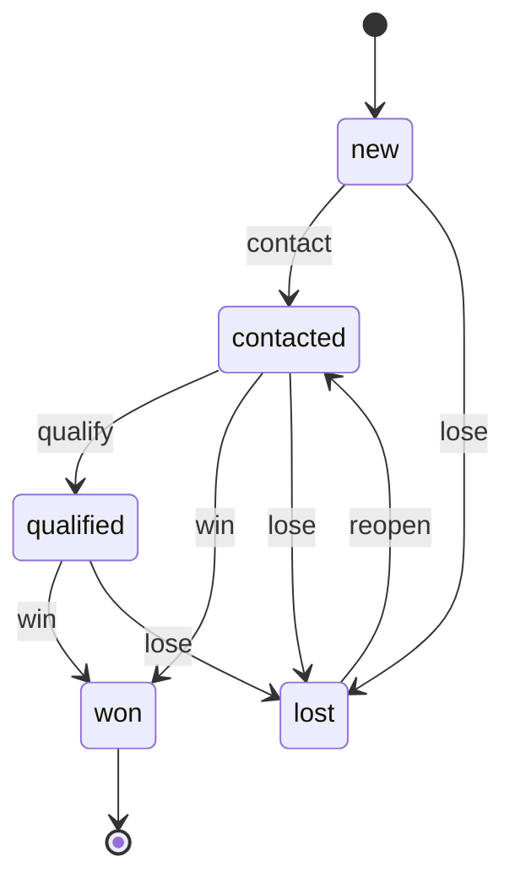
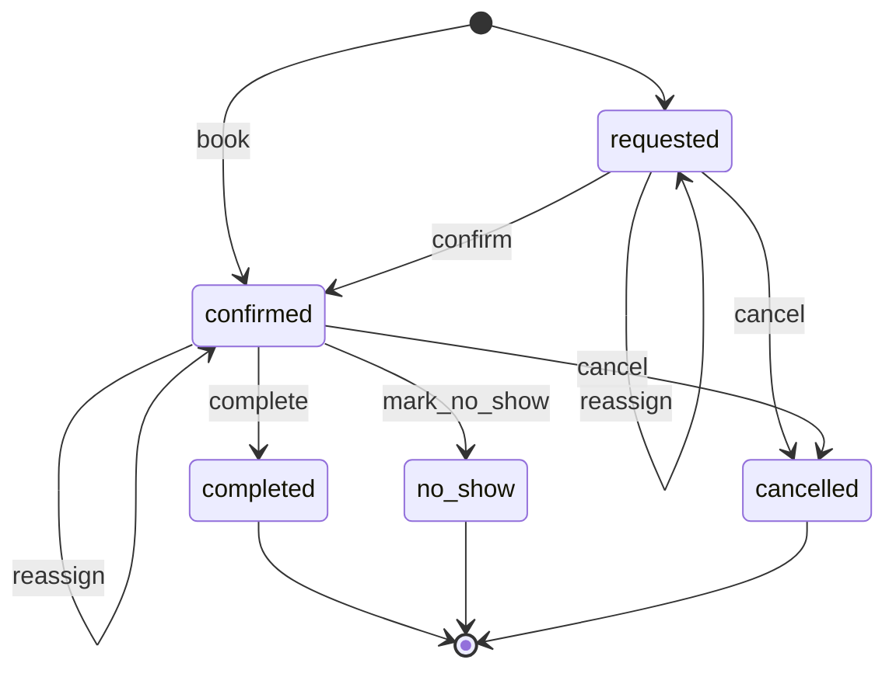
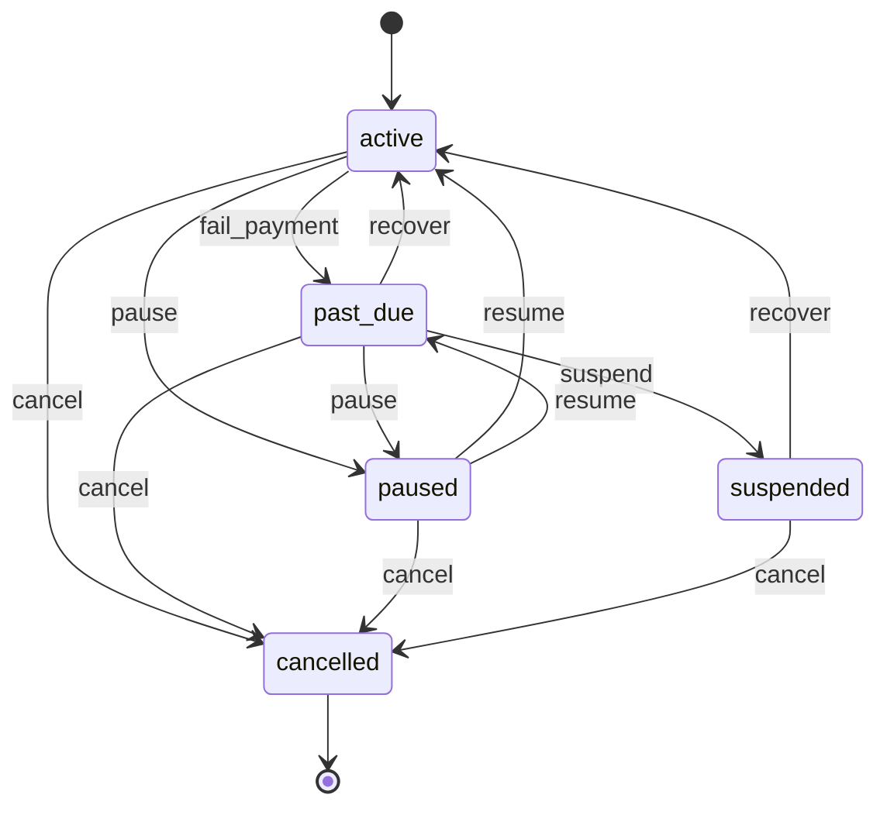
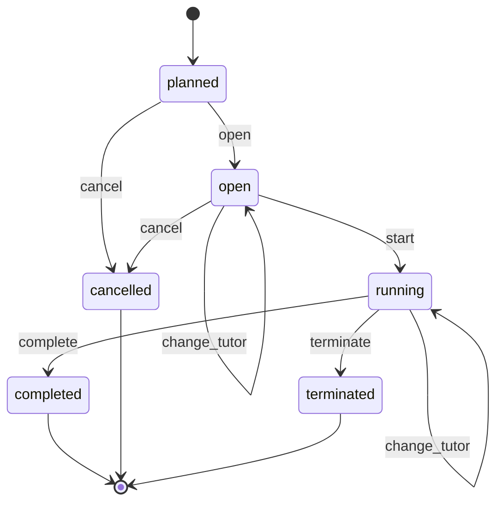
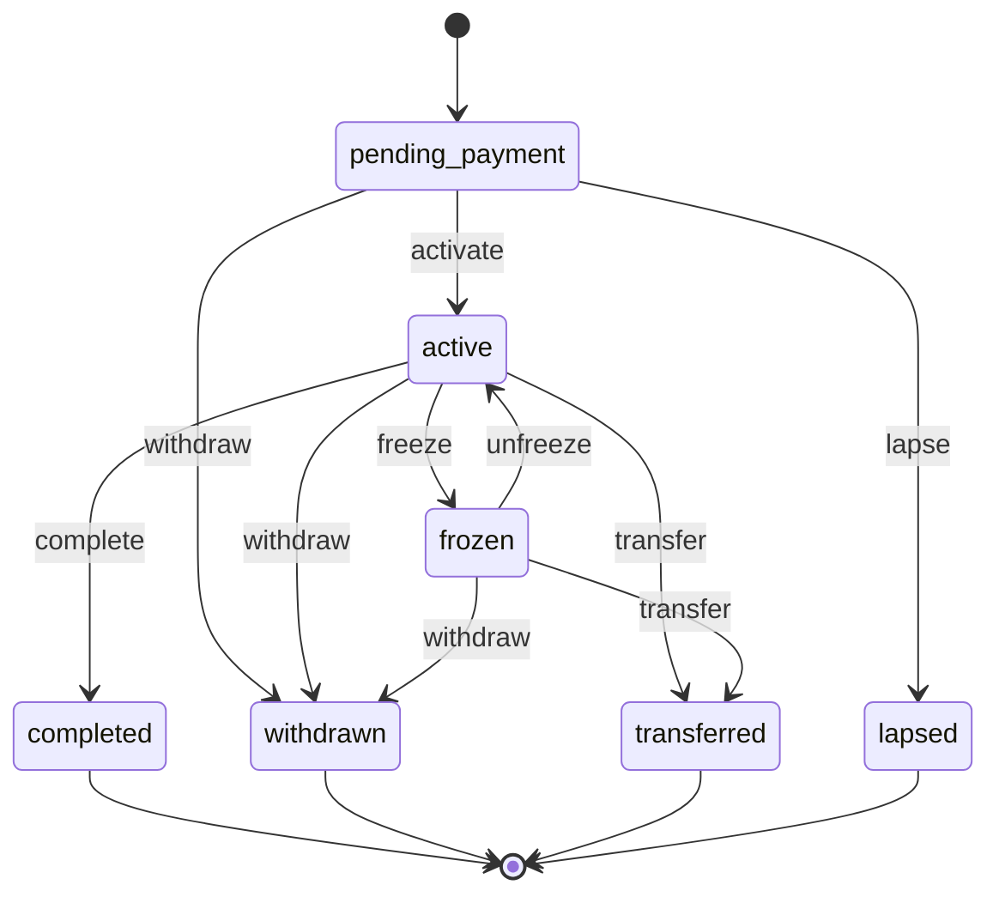
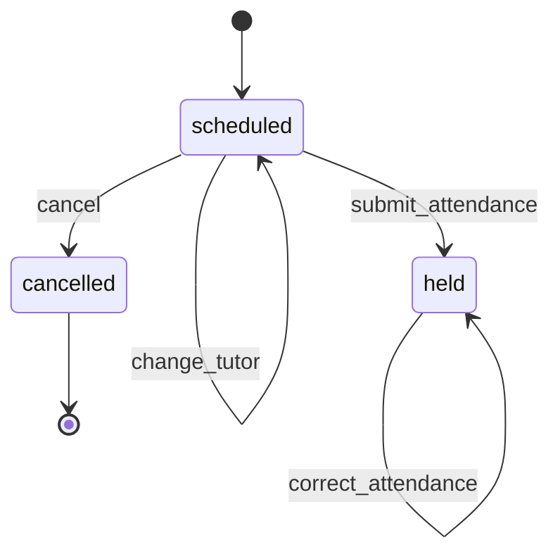
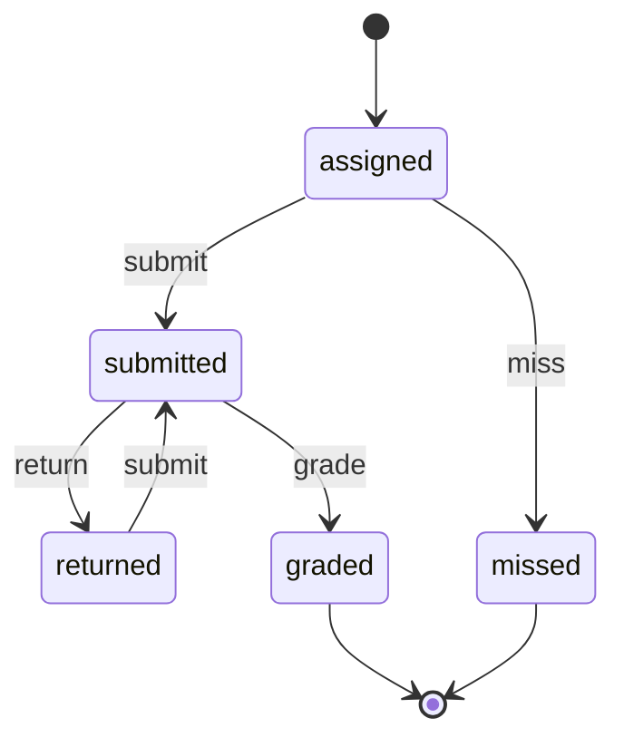
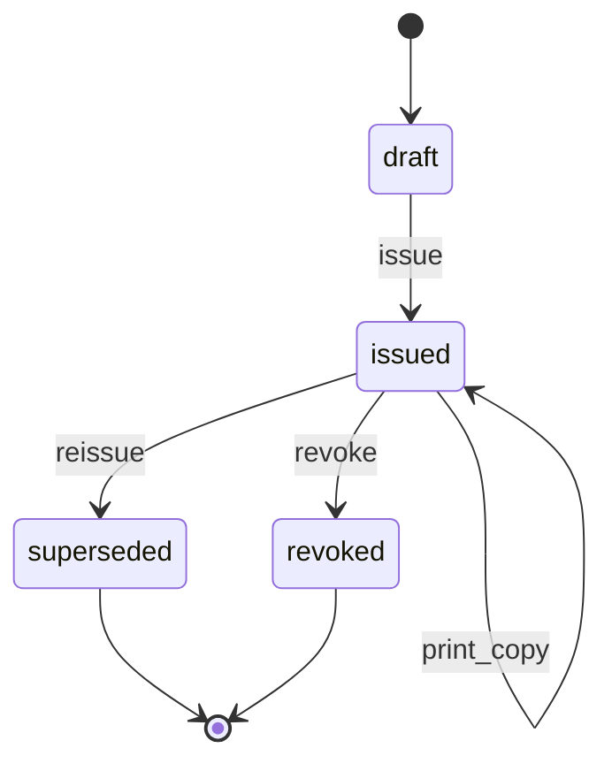

# 10 — Training Centres & EdTech

> Spec: accepted · Reviewed: 2026-10-15 · Spec text last changed: 2026-10-22

**Build status (2026-10-24):** Built in F10 (#517), merged. **Built:** the Batch, Enrolment, Session and Certificate machines of §7.1, seats, withdrawal with tiered refund approval, freeze and unfreeze, transfer, absence policy and credits, attendance, certificates with public verification, the EdTech demo (`edtech:demo`). **Not built (MVP items still open):** leads, trial classes and the catalogue (left to the shared modules), e-signature of terms and guardian consent (`DOC.SIG.01`), the QR image and PDF of a certificate (`DOC.GEN.01`), `EDU.RUL.01`, `05`, `08`, `09`, tutor timesheets (`EDU.RUL.10`), make-up booking in another batch (`EDU.MKP.01`), the student and guardian portal, the loyalty segments. **Resolved contradiction:** §7.1 specifies a Submission machine and `EDU.ASM.01` and §12 *Included* list "materials, assessments and gradebook", while §12 *Excluded* lists "assignments and submissions". As built, and consistent with `apps/edtech/README.md`, the Submission machine, materials, assessments and the gradebook are **Later**: there is no Submission machine in the app. §7.1 and §12 below carry that marker. Machines in code but not in the spec: none. See [STATUS.md](STATUS.md) and [apps/edtech/README.md](../../apps/edtech/README.md).

## 1. Summary

Licensed training institutes and tutoring centres in the UAE sell courses, session packages
and monthly memberships for professional certification, languages, IT skills, test
preparation and school tutoring. They run admissions from WhatsApp, timetables in Excel or
Google Sheets, attendance on paper, and collect fees by card terminal and bank transfer, with
no clear view of unused sessions or overdue fees. The app runs the student journey from
enquiry and trial class to enrolment, timetable, attendance, fees, light learning materials
and certificates. Students, parents and corporate clients get a branded portal.

## 2. Business context (UAE)

- **Customer size:** 1–5 branches, 5–60 tutors (many part-time or freelance), 150–3,000
  active students, 20–200 classes a week. Some also deliver corporate training cohorts for
  companies.
- **How they work today:** enquiries on WhatsApp and Instagram, a spreadsheet of students,
  timetables shared as images, paper or Google Form attendance, fees tracked in the
  accounting tool or a notebook, certificates designed in Word.
- **Rules and practice that shape the work:**
  - Training institutes and tutoring centres need a permit from their emirate's regulator:
    **KHDA** in Dubai, including free zones such as DIFC (Executive Council Resolution 50 of
    2015; permit valid one year, alongside the trade licence) ✔ [S1]; **ACTVET** in Abu Dhabi
    (ADEK regulates schools) ✔ [S2]; **SPEA** in Sharjah, including its free zones ✔ [S3].
    For the other emirates, MoHESR enforced in 2025 [S4]. Its 2024 inspection framework
    says training providers outside Abu Dhabi and Dubai are licensed by the local
    authorities, with MoHESR accreditation only for programmes leading to national
    qualifications; in Ras Al Khaimah the Department of Knowledge regulates private
    education, and RAKEZ licenses centres in its free zone ✔ [S11], [S12]. The licensing body
    for a training centre in Ajman, Umm Al Quwain or Fujairah is confirmed per client
    `⚠ open: authority (AU-13)`.
  - In Dubai **each programme needs KHDA approval**; a single course can be authorised
    with the instructor's ID and CV. There is no separate trainer licence. Certificates of
    KHDA-authorised courses can be **attested by KHDA**; the law sets no wording, so a
    certificate must not claim an approval the course lacks. Advertisements need approval
    (misleading ads fined AED 25,000) (Administrative Resolution 2 of 2018) ✔ [S5].
  - **Fees and refunds:** KHDA requires fees to be declared before an activity runs, but sets
    no refund rule for training institutes; learners must be settled only if an
    authorisation is revoked ✔ [S1], [S5]. Refunds follow the centre's own published policy
    and consumer law.
  - **Private tutors** working outside a licensed centre need the free MoHRE private tutor
    permit (since December 2023, valid two years, good-conduct certificate and code of
    conduct required) ✔ [S6]. It is a personal permit; a centre's own tutors are covered by
    the centre's permit and their employment or freelance status, which the centre checks.
  - Many students are **minors**: a parent or guardian enrols, pays and receives reports.
    No training-centre rule on police clearance was found; the app tracks a good-conduct
    certificate for staff working with minors as best practice (child protection policy
    and Wadeema Law 3 of 2016 may apply) [S7].
  - Pricing is a mix of **course fees** (upfront or in instalments), **session packages**
    (e.g. 10 sessions within 3 months), **monthly memberships**, and **corporate cohorts**
    invoiced to a company.
  - **VAT:** training courses, test preparation and private tutoring are standard-rated at
    5%. Zero-rating needs a qualifying institution and a recognised curriculum, read
    narrowly; a KHDA permit alone does not qualify (FTA education guide VATGED1, June
    2026) ✔ [S8].

## 3. Users and access

Follows [ACCESS-CONTROL.md](../ACCESS-CONTROL.md). Platform-wide rules (`PLT.ACL.*`) are not
repeated here.

### 3.1 Roles

| Role | Actor type | What they do | Permissions (summary) | Typical scope |
|---|---|---|---|---|
| Company admin / owner | staff | Configures the company, branches, fees, users; sees all figures | all | global |
| Centre manager | staff | Runs a campus: timetable, tutors, discounts and refunds approval, reports | batches, enrolments, approvals, reports | campus |
| Admissions counsellor (front desk) | staff | Enquiries, trial classes, enrolments, fee collection at the desk | leads, bookings, enrolments, payments (record) | campus |
| Academic coordinator | staff | Course structure, batches, tutor and room allocation, assessments, certificates | courses, batches, timetable, grades (approve), certificates | campus or course |
| Tutor / trainer | staff (or freelance) | Teaches sessions, marks attendance, publishes materials and assignments, grades | `sessions.teach`, attendance, materials, grading on assigned batches | assigned batches |
| Accountant | staff | Invoices, subscriptions, refunds, tutor pay, receivables | finance, tutor pay | global |
| Student (adult) | external | Sees timetable, materials, assignments, grades, certificates, invoices; books trial or make-up sessions; pays | portal: own learning and fees | own enrolments |
| Parent / guardian | external | Enrols and pays for minors, sees attendance and progress reports | portal: dependants' learning and fees | own dependants |
| Corporate client contact | external | Sees cohort attendance, results and invoices for their employees (Later) | portal: corporate | own company |

### 3.2 Scope

The scope unit is the **campus** (branch). A tutor's access comes from **assignment** to
batches (`ASG`), not from a campus role, so a tutor teaching at two campuses sees only their
batches at both. Academic coordinators may be scoped to a **course** across campuses.
Company admins and accountants are usually global. External users have no scope; access
comes from party ownership (`OWN`) and guardian links.

### 3.3 Access rules

| ID | Rule | Pattern | Applies to | Parameter (default) |
|---|---|---|---|---|
| `EDU.ACL.01` | A student sees only their own enrolments, sessions, materials of enrolled batches, grades, certificates and invoices | `OWN` | student | — |
| `EDU.ACL.02` | A guardian sees the records of linked dependants only; a dependant under the age of majority has no portal login of their own for payments | `OWN` | guardian, student | — |
| `PTY.ACL.01` *(shared)* | Guardian access ends when the dependant reaches the age of majority | `TIM` | guardian | 18 years (Decree-Law 25 of 2025) |
| `EDU.ACL.03` | A tutor sees only batches assigned to them; for minors, the tutor sees names but not phone numbers, email or ID | `ASG`, `FLD` | tutor | — |
| `EDU.ACL.04` | A tutor can mark or change attendance only until a time after the session ends; later changes need the coordinator | `TIM` | tutor | 24 hours |
| `EDU.ACL.05` | Published grades are locked; changing one needs the coordinator's approval | `STA`, `LIM` | tutor, coordinator | — |
| `EDU.ACL.06` | A certificate is issued only when the completion criteria are met (attendance and assessment) | `STA` | coordinator | attendance ≥ 80%, assessment passed |
| `SAL.ACL.02` *(shared, formerly `EDU.ACL.07`)* | A discount above a threshold needs the centre manager's approval | `LIM` | counsellor, accountant | 10% |
| `FIN.ACL.04` *(shared, formerly `EDU.ACL.08`)* | The user who records a refund cannot approve it | `SOD` | counsellor, accountant | on |
| `EDU.ACL.09` | Minors' personal data (date of birth, ID, photos, learning-support notes) needs `students.sensitive.view`; each view is audited | `SEN` | all staff | — |
| `EDU.ACL.10` | A corporate client contact sees only the enrolments, attendance and results of their own employees | `OWN` | corporate contact | — |
| `EDU.ACL.11` | Tutor pay rates are visible only to the accountant, centre manager and the tutor themself | `FLD` | all staff | — |
| `EDU.ACL.12` | An online class link is visible only to enrolled students, from a short time before the session | `OWN`, `TIM` | student | 30 minutes before |
| `EDU.ACL.13` | An enrolment with an attended session cannot be deleted; it ends through `withdraw` or `transfer` | `STA` | all staff | — |
| `EDU.ACL.14` | A tutor is assigned to a batch, a session or a one-to-one booking only if `qualification_valid` passes on every session date for the kinds the course requires (police clearance when minors are enrolled: the course is marked *for minors*, or the batch has a `pending_payment`, `active` or `frozen` enrolment of a student under 18 on the session date; MoHRE private tutor permit or freelance visa, either one, for freelance tutors). Override per §9 | `STA` | coordinator, counsellor | — |
| `EDU.ACL.15` | Terminating a running batch is requested by the coordinator and approved by the centre manager; refunds from it follow `FIN.ACL.04` | `SOD` | coordinator, centre manager | — |
| `EDU.ACL.16` | Correcting attendance of a `held` session after the tutor's window (`EDU.ACL.04`) needs the coordinator and a reason; a change that affects an issued certificate goes through certificate `reissue` or `revoke` | `STA` | coordinator | — |
| `EDU.ACL.17` | Seats are taken atomically: an enrolment or seat hold is refused when active, frozen and held enrolments reach the batch capacity; only the centre manager may exceed capacity, up to the room's limit (for a room without a limit, the capacity is the hard limit) | `STA`, `LIM` | counsellor, portal | — |
| `FIN.ACL.06` *(shared)* | A cash shortage at the desk is written off only with approval | `LIM` | counsellor, accountant | AED 0 |

## 4. Value streams

### 4.1 Enquiry to enrolment

1. An enquiry comes in from the website, WhatsApp, a walk-in or a referral and is recorded
   as a lead with the course of interest (`SAL.CRM.01`).
2. The counsellor qualifies it (level, goals, schedule) and books a trial class or placement
   test, from the desk or by self-booking in the portal (`EDU.TRL.01`, `SCH.BKG.01`,
   `SCH.SLF.01`).
3. A reminder goes out before the trial. Attendance or no-show is recorded (`SCH.RMD.01`).
4. The student (or a guardian for a minor) is registered as a party, with guardian links
   (`PTY.PTY.01`, `PTY.REL.01`).
5. The student is enrolled in a batch, a session package or a membership, at the catalogue
   price minus any discount (`EDU.ENR.01`, `SAL.PKG.01`, `SAL.CAT.01`, `SAL.DSC.01`).
6. Terms, refund policy and (for minors) photo and data consent are accepted electronically
   (`DOC.SIG.01`).
7. Fees are billed: upfront, in instalments, or as a monthly subscription. The first payment
   is taken online or at the desk (`FIN.BIL.01`, `FIN.SUB.01`, `FIN.INV.01`,
   `FIN.PAY.01`, `FIN.PAY.02`).
8. Portal access is created for the student and/or guardian (`POR.SLF.01`).

**When it goes wrong:**

| Situation | What happens |
|---|---|
| The first payment never arrives | The seat is held in `pending_payment` for N hours (default 48; *seat hold until* is stored on the enrolment). `EDU.RUL.11` then runs `lapse`: the seat is released, the payment link is cancelled and the guardian is told. A partial first payment counts as a payment: the enrolment does not lapse and the counsellor sees the balance. A discount approval still pending does not stop the lapse. An online payment still `pending` is settled by `FIN.RUL.19`, and the enrolment lapses at once if it fails. A payment that arrives after the lapse is refunded automatically (wl-payments `late_confirm`: the lapsed enrolment is no longer an active subject), also when the counsellor has meanwhile re-enrolled the student; the new enrolment is paid through its own payment link |
| The online payment fails | The enrolment stays `pending_payment`; the guardian gets a new payment link; the seat hold keeps running and is not extended |
| Two people take the last seat | Seats are taken atomically (`EDU.ACL.17`); the second attempt is refused and offered other `open` batches of the same course and level with free seats, or an entry on the batch's waiting list: a plain list (student, payer, created at) that counsellors see; no seat is held and nothing is offered automatically when a seat frees |
| The payer is blocked (`PartyBlocked`) | Enrolment block effect, for enrolments whose payer or student is the blocked party: pause through `freeze` without the freeze-day limit; the seat is kept; nothing is sent to the blocked party, and staff without `parties.block_reason.view` see *On hold*. An enrolment already frozen by the student keeps its freeze and gets the block as a second cause; `PartyUnblocked` removes only the block's cause. `pending_payment` enrolments are left to lapse. Only the centre manager may `withdraw`; the credit note is issued and the refund waits (`PTY.ACL.03`) |
| A message to a guardian cannot be delivered | `NTF.RUL.01`: the message goes to the other guardian (`alternative_recipient`), then a task to the counsellor |

### 4.2 Timetable to delivery

1. The coordinator defines courses with levels, modules and hours (`EDU.CRS.01`), and
   records regulator approvals where required (`EDU.CRS.02`).
2. Batches are planned with capacity, start and end dates, a weekly pattern, a tutor and a
   room. Availability of rooms and tutors is checked (`EDU.BAT.01`, `SCH.RES.01`).
3. Sessions are generated from the weekly pattern, skipping public holidays (`EDU.BAT.01`).
4. The tutor marks attendance per session, from a phone or the classroom PC (`EDU.ATT.01`).
5. Each attended session consumes a credit from a package where applicable (`SAL.PKG.01`).
6. Absent students can book a make-up session in another batch, or transfer
   (`EDU.MKP.01`).
7. Cancelled or rescheduled sessions are announced to students and guardians
   (`NTF.MSG.01`, `NTF.MSG.02`).

**When it goes wrong:**

| Situation | What happens |
|---|---|
| A tutor's police clearance or permit will expire | `DOC.RUL.02` looks 30 days ahead; `EDU.RUL.12` lists the tutor's batches, sessions and one-to-one bookings after the expiry date and gives the coordinator a task to change the tutor. On expiry the tutor cannot be assigned or teach (`EDU.ACL.14`); open conflicts H hours before a session go to the centre manager. A minor may still enrol in a batch whose tutor lacks a valid clearance (enrolment is not guarded); the batch's sessions are flagged by `EDU.RUL.12` |
| A tutor is sick or leaves | A manual availability block on the tutor (wl-scheduling; tutor leave from `HRM.LEV.01` is Later for 10) raises conflicts for bookings (wl-scheduling §5.5) and `EDU.RUL.12` flags the sessions it overlaps: the coordinator runs `change_tutor` on the batch or session, or cancels the session with a make-up. One-to-one bookings are reassigned or rescheduled; a business-initiated cancel refunds any deposit in full |
| The course approval or centre permit expires | `batch.open` is blocked, and `certificate.issue` always by the centre permit, by the course approval only when the certificate states it (§9). `EDU.RUL.13` tells the coordinator, the centre manager and the owner about running batches and gives the kind's responsible role (centre permit: centre manager; course approval: academic coordinator) a renewal task; whether a running batch may finish under an expired approval is `⚠ open: authority (AU-25)` |
| A running batch must stop | Batch `terminate` (`EDU.ACL.15`): remaining sessions cancelled; each enrolment is transferred to another batch or withdrawn with a refund of the unused sessions without admin fee; students and guardians told. If the regulator revoked the authorisation, learners must be settled ✔ [S1], [S5] |
| Attendance was marked wrong | Within 24 hours the tutor corrects it; later the coordinator runs `correct_attendance` with a reason (`EDU.ACL.16`). Credits are reversed or consumed, completion is re-evaluated, and a locked tutor timesheet is corrected by an adjustment |
| A student is absent | The catalogue item's absence policy (the one stored with the enrolment) decides: by default an unexcused absence consumes a package credit; an absence notified at least N hours before the session start (default 24) is *excused*, consumes nothing and gives a make-up right. The notice comes through the portal, or the counsellor records it, with its time; the student is then pre-marked *excused*. A later notice is unexcused unless the coordinator excuses it with a reason. Late arrival counts as present. Memberships consume nothing; course-fee enrolments have no credits, but an excused absence still gives a make-up right. A make-up right is one per excused absence and lasts until the enrolment ends |

### 4.3 Fees to cash

1. Instalments and memberships create invoices on their due dates (`FIN.BIL.01`,
   `FIN.SUB.01`, `FIN.INV.01`).
2. Card payments renew automatically. Failed payments are retried and the student or
   guardian is notified (`FIN.SUB.01`, `FIN.RUL.06`).
3. Overdue fees appear in ageing, and reminders go out (`FIN.REC.01`, `FIN.RUL.01`).
4. A withdrawal calculates the refund per policy (`EDU.REF.01`). The refund is approved and
   paid (`FIN.ACL.04`, `PLT.APR.01`, `FIN.PAY.01`).
5. Corporate cohorts are quoted and invoiced to the company (`FIN.QUO.01`, `FIN.INV.01`).
6. Cash and cheques taken at the desk are handed over per counsellor per day and counted by
   another user (`FIN.CSH.01`).

**When it goes wrong:**

| Situation | What happens |
|---|---|
| A student withdraws | `withdraw` calculates the refund per the accepted policy. A credit note covers the paid amount not used; scheduled instalments are cancelled; a membership is `cancel`led; a package is `refund`ed. If the sessions used plus fees exceed what was paid, an invoice for the amount owed is issued instead. The refund is approved by another user (`FIN.ACL.04`) |
| The refund fails | `FIN.RUL.21` retries once after 24 hours (module default), then gives the accountant a task to pay by another method; meanwhile wl-invoicing restores the credit note balance (`RefundFailed`) and the enrolment stays `withdrawn` |
| A card payment is charged back | The payment is reversed and the invoice reopened (`InvoiceReopened`); a membership goes `past_due`; for a course fee, instalment or package invoice the counsellor gets a task (one per enrolment, due in 2 working days, closed automatically when the invoice is paid again). Evidence is collected under `FIN.RUL.20` |
| The membership is paused | Pausing the subscription freezes the enrolment and the other way round (`EDU.RUL.14`); the allowance (30 days a year, shared by membership pause and enrolment freeze) is checked and counted once, on the side the user acted on |
| The desk cash is short | Recovered from the counsellor or written off with approval (`FIN.ACL.06`, AED 0); salary recovery is off by default |
| A corporate invoice is disputed or the e-invoice is rejected | Invoice `dispute` (corporate contacts may raise it in the portal: off until the corporate portal ships); e-invoice rejection by `FIN.RUL.16`. Write-off needs approval (`FIN.ACL.15`, AED 0) |

### 4.4 Learning and certification

1. The tutor publishes materials per course or session: files, links, videos
   (`EDU.LMS.01`).
2. Assignments are set with due dates. Students submit in the portal, and the tutor grades
   and comments (`EDU.LMS.02`).
3. Assessments and exams are recorded in the gradebook. Results are published
   (`EDU.ASM.01`).
4. Progress reports go to students, guardians or corporate clients at set intervals
   (`EDU.PRG.01`).
5. When the completion criteria are met, a certificate is generated in EN/AR with a
   verification code and QR. Anyone can verify it on a public page (`EDU.CRT.01`,
   `DOC.GEN.01`).

**When it goes wrong:**

| Situation | What happens |
|---|---|
| A name or date is wrong, or a result changed | Certificate `reissue`: the old one becomes `superseded` (the public page points to the new number) and a new draft is issued |
| A copy is lost | A copy of the same certificate is generated; nothing changes in its state |
| The certificate was issued in error or by misconduct | `revoke` |

### 4.5 Tutor time to pay

1. Sessions taught are collected per tutor and period (`HRM.TMS.01`).
2. Employed tutors' hours go to payroll (`HRM.PAY.01`, Later). Freelance tutors submit a bill
   for their sessions (`FIN.PAB.01`).
3. Tutor documents (permit, police clearance, qualification) are tracked for expiry and
   guard assignments (`HRM.EMP.01`, `HRM.QUA.01`, `DOC.EXP.01`, `EDU.ACL.14`).
4. Sessions corrected after the timesheet is locked reach the tutor's pay through an
   adjustment timesheet (`HRM.ACL.08`).

## 5. Capabilities

| ID | Capability | Shared or specific | Proposed module | Scope |
|---|---|---|---|---|
| `PLT.ORG.01` | Branded deployment | shared | wl-kernel | MVP |
| `PLT.USR.01` | Staff users, roles, permissions scoped per campus | shared | Renox Permissions | MVP |
| `PLT.AUD.01` | Audit trail | shared | Renox Audit | MVP |
| `PLT.APR.01` | Approval requests (discounts, refunds, grade changes) | shared | wl-kernel | MVP |
| `PLT.WFL.01` | State machines with history | shared | Renox (R12) + wl-kernel | MVP |
| `PLT.ATM.01` | Default automation rules | shared | wl-kernel | MVP |
| `PLT.HOK.01` | Outbound webhooks | shared | Renox (R11) | Later |
| `PTY.PTY.01` | Parties: students, guardians, corporate clients, freelance tutors | shared | wl-parties | MVP |
| `PTY.CNS.01` | Consent records: guardian consent for minors' data and photos, marketing opt-in | shared | wl-parties | MVP |
| `PTY.KYC.01` | Identity fields: Emirates ID, passport, trade licence, TRN | shared | wl-parties | MVP |
| `PTY.REL.01` | Guardian–dependant relationships with delegated access and billing | shared | wl-parties | MVP |
| `DOC.FIL.01` | Attach documents to any record | shared | wl-documents | MVP |
| `DOC.EXP.01` | Expiry reminders (centre permit, course approvals, tutor permits, police clearance, trademark and other registrations) and blocks on expiry | shared | wl-documents | MVP |
| `DOC.GEN.01` | Generate documents (enrolment form, receipt, progress report, certificate) | shared | wl-documents | MVP |
| `DOC.SIG.01` | E-signature / consent capture (terms, refund policy, guardian consent) | shared | wl-documents | MVP |
| `FIN.BIL.01` | Instalment schedule from an enrolment | shared | wl-invoicing | MVP |
| `FIN.INV.01` | Tax invoices with VAT | shared | wl-invoicing | MVP |
| `FIN.PAY.01` | Record and allocate payments (card terminal, cash, transfer) | shared | wl-payments | MVP |
| `FIN.PAY.02` | Online payment by link or card from the portal | shared | wl-payments | MVP |
| `FIN.CSH.01` | Cash custody: desk cash and cheques per counsellor per day, handover, shortages | shared | wl-payments | MVP |
| `FIN.SUB.01` | Monthly memberships billed automatically | shared | wl-invoicing (+ renox-billing via wl-payments) | MVP |
| `SAL.DSC.01` | Discounts: sibling, early-bird, corporate, scholarship, promo codes | shared | wl-sales | MVP |
| `FIN.REC.01` | Receivables ageing and reminders | shared | wl-invoicing | MVP |
| `FIN.QUO.01` | Quotations for corporate cohorts | shared | wl-invoicing | Later |
| `FIN.PAB.01` | Bills from freelance tutors | shared | wl-invoicing | MVP |
| `FIN.EXT.01` | Export to accounting software | shared | wl-invoicing | Later |
| `SAL.CRM.01` | Leads and enquiries pipeline | shared | wl-sales | MVP |
| `SAL.CAT.01` | Catalogue of courses, packages and memberships with price lists | shared | wl-sales | MVP |
| `SCH.RES.01` | Resources and availability (tutors, rooms) | shared | wl-scheduling | MVP |
| `SCH.BKG.01` | Bookings from the desk (trial classes, placement tests, 1:1 sessions) | shared | wl-scheduling | MVP |
| `SCH.SLF.01` | Online self-booking from the portal (trials, make-ups) | shared | wl-scheduling | Later |
| `SCH.RMD.01` | Booking reminders and no-show handling | shared | wl-scheduling | MVP |
| `HRM.EMP.01` | Tutor records with documents, qualifications and permits | shared | wl-hr | MVP |
| `HRM.QUA.01` | Tutor qualifications (police clearance, teaching permit) with a validity guard on assignments | shared | wl-hr | MVP |
| `HRM.TMS.01` | Tutor timesheets from sessions taught | shared | wl-attendance | MVP |
| `HRM.LEV.01` | Tutor leave and substitute cover | shared | wl-hr | Later |
| `HRM.PAY.01` | Payroll calculation for employed tutors | shared | wl-hr | Later |
| `POR.SLF.01` | Student and guardian portal | shared | wl-portal | MVP |
| `POR.SLF.02` | Corporate client portal | shared | wl-portal | Later |
| `NTF.MSG.01` | Email notifications | shared | wl-notify | MVP |
| `NTF.MSG.02` | WhatsApp notifications (main channel for guardians; email as fallback) | shared | wl-notify | MVP |
| `NTF.MSG.03` | SMS notifications | shared | wl-notify | Later |
| `RPT.DSH.01` | Role-based dashboards | shared | Renox charts + wl-kernel | MVP |
| `PLT.ENT.01` | Legal entities: several trade licences and TRNs in one deployment; issuer on every document | shared | wl-kernel | MVP |
| `PLT.IMP.01` | Data import and migration: Excel templates per entity, validation, dry run, rollback | shared | wl-kernel | MVP |
| `PLT.SRC.01` | Global search across records, including Arabic names | shared | wl-kernel + Renox search | MVP |
| `PLT.NOT.01` | Notes, comments and @mentions on any record, with an activity timeline | shared | wl-kernel | MVP |
| `PLT.SSO.01` | Staff single sign-on with Microsoft 365 or Google Workspace | shared | Renox OAuth (renox-oauth) | Later |
| `RPT.LIB.01` | Report library: filtered reports with export to Excel, CSV and PDF | shared | wl-kernel | MVP |
| `RPT.SCH.01` | Scheduled reports sent by email | shared | wl-kernel | Later |
| `FIN.VAT.01` | VAT summary per period and entity: output and input VAT, for the accountant | shared | wl-invoicing | MVP |
| `FIN.EXP.01` | Expense claims and petty cash: submit with receipt, approve, reimburse, top up | shared | wl-payments | Later |
| `FIN.BNK.01` | Bank statement import and matching of receipts to open invoices | shared | wl-payments | Later |
| `WRK.FBK.01` | Customer feedback and ratings after a completed service; low ratings open a ticket | shared | wl-ticketing | Later |
| `WRK.TKT.01` | Tickets opened from low ratings and complaints | shared | wl-ticketing | Later |
| `EDU.CRS.01` | Course structure: programme, levels, modules, hours, prerequisites, delivery mode | specific | apps/edtech | MVP |
| `EDU.CRS.02` | Regulator approvals for courses and trainers (permit numbers, expiry) | specific | apps/edtech | MVP |
| `EDU.BAT.01` | Batches with capacity, weekly pattern, tutor, room; sessions generated around holidays | specific | apps/edtech | MVP |
| `EDU.ENR.01` | Enrolments in batches, packages or memberships, with completion criteria | specific | apps/edtech | MVP |
| `SAL.PKG.01` | Prepaid session packages: credits, consumption per attended session, expiry (formerly `EDU.PKG.01`) | shared | wl-sales | MVP |
| `SAL.CRM.02` | Lead sources and campaigns: cost per campaign, conversion by source and channel, cost per lead, customer acquisition cost and return on ad spend | shared | wl-sales | MVP |
| `FIN.CFL.01` | Cash-flow forecast: expected receipts and payments by week from invoices, supplier bills, scheduled charges, post-dated cheques, payroll and budgets | shared | wl-invoicing | MVP |
| `SAL.LOY.01` | Loyalty and retention: points or visit rewards, customer segments, and retention campaigns sent with marketing consent | shared | wl-sales + wl-notify | MVP |
| `FIN.BUD.01` | Company budget vs actual by period, category and entity; owner drawings kept apart from operating cost | shared | wl-invoicing | MVP |
| `HRM.ONB.01` | Staff onboarding checklists per role and a library of SOP documents with acknowledgement | shared | wl-hr + wl-documents | MVP |
| `WRK.CHK.01` | Checklists with photos and signature (onboarding steps, `HRM.ONB.01`) | shared | wl-ticketing | MVP |
| `EDU.ATT.01` | Student attendance per session | specific | apps/edtech | MVP |
| `EDU.MKP.01` | Make-up sessions and transfers between batches | specific | apps/edtech | MVP |
| `EDU.TRL.01` | Trial classes and placement tests (required per catalogue item; score or level entered by the tutor, suggested batch) with conversion tracking | specific | apps/edtech | MVP |
| `EDU.REF.01` | Withdrawal and refund calculation per policy (tiered default template, editable per catalogue item) | specific | apps/edtech | MVP |
| `EDU.LMS.01` | Learning materials per course and session | specific | apps/edtech | MVP |
| `EDU.LMS.02` | Assignments, submissions, grading and feedback | specific | apps/edtech | Later |
| `EDU.ASM.01` | Assessments, exams and gradebook | specific | apps/edtech | MVP (not built; Later, see §12) |
| `EDU.CRT.01` | Certificates with verification code, QR and public verification page | specific | apps/edtech | MVP |
| `EDU.PRG.01` | Progress reports for students, guardians and corporate clients | specific | apps/edtech | Later |
| `EDU.ONL.01` | Online class links per session (Zoom, Teams, Meet) | specific | apps/edtech | Later |
| `EDU.RPT.01` | Reports: enrolments, conversion, utilisation, attendance, retention, revenue per course | specific | apps/edtech | MVP |

*New* = a shared capability first needed by this vertical among verticals 03–10 (to be
reconciled in [CAPABILITY-MAP.md](../CAPABILITY-MAP.md)).

## 6. Key entities

| Entity | Description | Important fields | Owned by |
|---|---|---|---|
| Party | Student, guardian, corporate client, freelance tutor | type, names EN/AR, date of birth, Emirates ID, contacts, guardian links | wl-parties |
| Lead | An enquiry | source, course of interest, level, preferred times, owner, status | wl-sales |
| Catalogue item | A sellable course, package or membership | type, course, sessions, validity, price, registration fee and admin fee (set per item at onboarding; no platform default), VAT category, refund policy, absence policy (unexcused absence consumes a credit: yes; notice for an excused absence: 24 h), freeze and pause allowance (30 days a year) | wl-sales |
| Course | What is taught | programme, level, modules, hours, prerequisites, delivery mode, approval no. | apps/edtech |
| Batch | One run of a course | course, campus, capacity, start/end, weekly pattern, tutor, room, waiting list (student, payer, created at), termination reason, status | apps/edtech |
| Session | One class meeting | batch, date, time, room, tutor, online link, status | apps/edtech |
| Booking | A trial, placement test or 1:1 slot | resource(s), party, time, type, status | wl-scheduling |
| Enrolment | A student in a batch, package or membership | student, payer, campus, counsellor (the user who enrolled the student; reassignable), batch or package, price, discount, completion criteria, seat hold until, withdrawal refund or amount owed, status | apps/edtech |
| Package balance | Credits of a session package (the *Package* in `wl-sales`) | enrolment, credits total/used, expiry | wl-sales |
| Attendance | Presence at a session | session, student, present/absent/late/excused, make-up link | apps/edtech |
| Material | Learning resource | course or session, file or link, visibility | apps/edtech |
| Assignment / submission | Work set and handed in | assignment, student, files, grade, feedback, status | apps/edtech |
| Assessment result | Score in a test or exam | assessment, student, score, pass/fail, published | apps/edtech |
| Certificate | Proof of completion | enrolment, number, verification code, issued date, supersedes / superseded by, status | apps/edtech |
| Subscription | Monthly membership | party, plan, billing day, payment method, status | wl-invoicing (+ wl-payments for card payments) |
| Tutor | Teaching staff | party, employment type (employed or freelance), rate, qualifications, permit, police clearance | wl-hr |
| Invoice, payment | Fees | see 01-property | wl-invoicing, wl-payments |

## 7. Workflow

Follows [WORKFLOW.md](../WORKFLOW.md). **Invoice** reuses the state machine in
[01-property.md](01-property.md#71-state-machines) unchanged. **Quotation** (corporate
cohorts) and **Timesheet** (tutor time) reuse [02-construction.md](02-construction.md#71-state-machines).

### 7.1 State machines

#### Lead *(shared — wl-sales)*

> **Canonical definition:** *Lead* in [`wl-sales` §4](../modules/wl-sales.md#4-lifecycles). This section is this vertical's original requirement; where it differs, the module definition wins and its vertical mapping table records the difference.

| State | Tone | Terminal | Meaning |
|---|---|---|---|
| `new` | neutral | no | Recorded, not yet contacted |
| `contacted` | info | no | First contact made |
| `qualified` | info | no | Need, level and schedule known; trial or offer next |
| `won` | success | yes | Converted (here: enrolled) |
| `lost` | neutral | yes | Not converting; reason recorded |

| Transition | From | To | By | Guards | Effects |
|---|---|---|---|---|---|
| `contact` | new | contacted | `leads.manage` | contact note recorded | — |
| `qualify` | contacted | qualified | `leads.manage` | course of interest and level set | — |
| `win` | contacted, qualified | won | system (enrolment `activate`) | — | conversion recorded with source |
| `lose` | new, contacted, qualified | lost | `leads.manage` | reason chosen | — |
| `reopen` | lost | contacted | `leads.manage` | — | — |

#### Booking *(shared — wl-scheduling)*

> **Canonical definition:** *Booking* in [`wl-scheduling` §4](../modules/wl-scheduling.md#4-lifecycles). `confirmed` here is the canonical `booked`. This section is this vertical's original requirement; where it differs, the module definition wins and its vertical mapping table records the difference.

| State | Tone | Terminal | Meaning |
|---|---|---|---|
| `requested` | neutral | no | Requested from the portal; waiting for confirmation |
| `confirmed` | info | no | Slot and resource reserved |
| `completed` | success | yes | Took place |
| `no_show` | error | yes | The party did not attend |
| `cancelled` | neutral | yes | Cancelled by either side |

| Transition | From | To | By | Guards | Effects |
|---|---|---|---|---|---|
| `confirm` | requested | confirmed | `bookings.manage` or system (auto-confirm setting) | resource free at that time; tutor eligible (`EDU.ACL.14`) | confirmation sent; reminders scheduled |
| `book` | — (new) | confirmed | `bookings.manage` | resource free at that time; tutor eligible (`EDU.ACL.14`) | confirmation sent; reminders scheduled |
| `reschedule` | confirmed | confirmed | `bookings.manage` or the party | new slot free; before the cut-off; tutor eligible on the new date | updated confirmation |
| `reassign` | requested, confirmed | same state | `bookings.manage` | same time; new tutor free and eligible | party told the new tutor with accept, reschedule and cancel links (no reason given); conflict cleared |
| `complete` | confirmed | completed | `bookings.manage` or the resource (tutor) | start time passed; tutor eligible today | event `BookingCompleted` |
| `mark_no_show` | confirmed | no_show | `bookings.manage` or the resource | start time passed; no open conflict | event `BookingNoShow` |
| `cancel` | requested, confirmed | cancelled | `bookings.manage` or the party | party: before the cut-off; reason code and *initiated by* recorded | resource released; party notified; business-initiated (tutor sick, tutor ineligible): any deposit refunded in full (`SCH.ACL.05`); a package credit is not consumed |

Check-in is not used in 10, so cancel after check-in does not arise. One-to-one service
types list the tutor kinds they require (police clearance when the student is a minor;
private tutor permit or freelance visa for freelance tutors); `SCH.RUL.05` checks bookings
D = 30 days ahead and raises `BookingConflict` (cause `eligibility`); `SCH.RUL.06` escalates
an open conflict H = 2 hours before the start. No booking deposit by default; where a service
type takes one, `SCH.ACL.05` applies.

#### Subscription *(shared — wl-invoicing)*

> **Canonical definition:** *Subscription* in [`wl-invoicing` §4](../modules/wl-invoicing.md#4-lifecycles). It belongs to `wl-invoicing`; automatic card charging goes through `wl-payments`. This section is this vertical's original requirement; where it differs, the module definition wins and its vertical mapping table records the difference.

| State | Tone | Terminal | Meaning |
|---|---|---|---|
| `active` | success | no | Billed each period |
| `past_due` | warning | no | A payment failed; retries running |
| `paused` | neutral | no | Frozen for a period (travel, illness) |
| `suspended` | error | no | Retries exhausted; access to sessions blocked |
| `cancelled` | neutral | yes | Ended |

| Transition | From | To | By | Guards | Effects |
|---|---|---|---|---|---|
| `fail_payment` | active | past_due | system (gateway; also a paid cycle invoice reopened by a chargeback) | — | party notified; retry schedule starts |
| `recover` | past_due, suspended | active | system (payment succeeded) | — | access restored |
| `suspend` | past_due | suspended | system | retries exhausted | enrolment access blocked; counsellor notified |
| `pause` | active, past_due | paused | `subscriptions.manage`, or system (enrolment `freeze`, `PartyBlocked`) | user pause within the allowance: 30 days a year, shared with enrolment `freeze` (10 overrides the wl-invoicing default of 0); a system pause is not counted | billing stops; end date extended; enrolment `freeze` (`EDU.RUL.14`) |
| `resume` | paused | active, past_due | `subscriptions.manage` or system (pause end, enrolment `unfreeze`, `PartyUnblocked`) | each trigger removes only its own pause cause; resumes when none remains | billing resumes; back to `past_due` when cycle invoices from before the pause are still overdue; enrolment `unfreeze` either way (session access is decided by `suspend`) |
| `cancel` | active, past_due, paused, suspended | cancelled | `subscriptions.manage`, the party, or system (enrolment `withdraw`) | notice period respected (not on withdrawal) | ends at period end, or at once on withdrawal with a pro rata credit; enrolment `complete` or `withdraw` |

#### Batch

| State | Tone | Terminal | Meaning |
|---|---|---|---|
| `planned` | neutral | no | Being scheduled; not visible to students |
| `open` | info | no | Open for enrolment |
| `running` | success | no | Sessions in progress |
| `completed` | success | yes | Last session held; results being finalised |
| `cancelled` | neutral | yes | Did not run |
| `terminated` | error | yes | Stopped after it started; remaining sessions cancelled |

| Transition | From | To | By | Guards | Effects |
|---|---|---|---|---|---|
| `open` | planned | open | `batches.manage` | tutor and room available for every session; `document_valid` for the centre permit and the course approval where required (§9) on the batch's last session date; tutor passes `EDU.ACL.14` on every session date | sessions generated; listed in the catalogue |
| `change_tutor` | open, running | same state | `batches.manage` | from a date; the new tutor is free and passes `EDU.ACL.14` on every remaining session date (all or nothing: the failing dates are shown) | remaining sessions of the batch's current tutor reassigned (sessions already moved to another tutor keep theirs); batch tutor set from that date; each student or guardian told once; conflicts on the old tutor cleared |
| `start` | open | running | system (first session date) | — | — |
| `complete` | running | completed | system (last session held) or `batches.manage` | all session attendance submitted | completion criteria evaluated per enrolment |
| `cancel` | planned, open | cancelled | `batches.manage` | reason given; per enrolment the choice *transfer to batch X* or *withdraw* (default withdraw) | enrolments transferred, or withdrawn with a full refund including the registration fee (business-initiated); a transfer whose target seat is gone at that moment falls back to withdraw and the coordinator is told; `pending_payment` enrolments withdrawn with nothing to refund and the link cancelled; parties notified |
| `terminate` | running | terminated | `batches.manage`, approved by the centre manager (`EDU.ACL.15`) | reason (tutor unavailable, approval expired or revoked, venue, too few students); per enrolment the choice *transfer to batch X* or *withdraw* (default withdraw) | sessions held before the approval count as used; remaining sessions cancelled; each `active` or `frozen` enrolment transferred (seat in the target batch at approval, else withdraw and the coordinator told; the unused value moves to the new enrolment, price differences invoiced or credited there) or withdrawn with the unused sessions refunded pro rata (price paid ÷ sessions × unused, capped at the amount paid) without admin fee or the no-refund tier, the registration fee not refunded; `pending_payment` enrolments withdrawn with nothing to refund; tutor paid only for sessions taught; students and guardians told; centre manager and owner told when the reason is regulatory |

A `terminate` is asked by the coordinator and decided by a holder of `batches.approve` (the centre
manager) other than the requester; the batch stays `running` and its sessions go on until the
approval, and the sessions held meanwhile count as used. The choice per enrolment is checked when it
is asked; the seat in a transfer target is taken at the approval. Both `cancel` and `terminate`
cancel the sessions still `scheduled`, so the tutor's timesheet counts the sessions `held` only, and
every refund they give waits for its own approval (`FIN.ACL.04`), recorded by the coordinator.

#### Enrolment

| State | Tone | Terminal | Meaning |
|---|---|---|---|
| `pending_payment` | warning | no | Seat held; first payment or approval outstanding |
| `active` | success | no | Attending |
| `frozen` | neutral | no | Paused at the student's request, with a membership pause, or while the payer is blocked; package expiry extended |
| `completed` | success | yes | Course ended or package used up |
| `withdrawn` | neutral | yes | Left early; refund or amount owed settled |
| `transferred` | neutral | yes | Moved to another batch (a new enrolment exists) |
| `lapsed` | neutral | yes | Seat hold expired without payment |

| Transition | From | To | By | Guards | Effects |
|---|---|---|---|---|---|
| `activate` | pending_payment | active | system (first payment) or `enrolments.manage` | terms accepted (`DOC.SIG.01`); discount approved if above limit | portal access; lead `win`; seat confirmed |
| `lapse` | pending_payment | lapsed | system (`EDU.RUL.11`) | no payment N hours after the hold | seat released; open payment link cancelled; guardian told; a later payment is refunded automatically |
| `freeze` | active | frozen | `enrolments.manage`, or system (subscription `pause`, `PartyBlocked`) | within the allowance of 30 days a year, shared with membership `pause` (not counted for a block or a mirrored system freeze) | each freeze cause stored (a freeze on a `frozen` enrolment only adds its cause); package `extend` by the frozen days; membership `pause` (`EDU.RUL.14`) |
| `unfreeze` | frozen | active | `enrolments.manage` or system (freeze end, subscription `resume`, `PartyUnblocked`) | each trigger removes only its own cause; unfreezes when none remains | membership `resume` |
| `complete` | active | completed | system (batch `complete` or credits used up) | — | certificate evaluated (`EDU.ACL.06`) |
| `withdraw` | pending_payment, active, frozen | withdrawn | `enrolments.manage` (the centre manager while the party is blocked), or system (batch `terminate` or `cancel` when no transfer is chosen) | refund calculated per policy (`EDU.REF.01`), or per batch `terminate` or `cancel`; approval per `FIN.ACL.04` (the state changes only on approval); refund paid only when the party is not blocked, or with a compliance exception (`PTY.ACL.03`) | credit note for the refund the policy gives (the admin fee and a kept registration fee stay revenue; session value = price ÷ sessions; *used* = sessions `held` up to the withdrawal date, attended or not); issued but unpaid instalment invoices credited in full and future instalments cancelled; membership `cancel`led at once (its own pro rata credit, not repeated); package `refund`ed (its own valuation); refund paid (`wl-payments`); if used sessions and fees exceed what was paid, one invoice for the amount owed; from `pending_payment`: no credit note, payment link cancelled; seat released |
| `transfer` | active, frozen | transferred | `enrolments.manage`, or system (batch `terminate`) | target batch has a seat (`EDU.ACL.17`) | new `active` enrolment with remaining credits or balance |

A paid course fee reopened by a chargeback (`InvoiceReopened`) does not change the
enrolment by itself; the enrolment's counsellor (or, when that user is no longer active, the
counsellors of the enrolment's campus) gets a task to collect or `withdraw`. A refund that
fails (`RefundFailed`) leaves the enrolment `withdrawn`; wl-invoicing restores the credit note
balance. The approval of a `withdraw` that gives a refund (`FIN.ACL.04`) is decided by a holder of
`enrolments.approve_refund` (the centre manager, the accountant) who is not the user who asked; a
withdrawal that gives no refund (from `pending_payment`, or one that only leaves an amount owed)
needs no approval and runs at once. The refund the approver saw is the one that is paid, whatever
sessions are held meanwhile. `transfer` moves a student to another `open` or `running` batch of
the same course.

The block of a payer or a student (`PartyBlocked`) freezes the `active` enrolments they pay for or
attend with the cause *block*. The cause is removed by `PartyUnblocked` only when neither the payer
nor the student of the enrolment is still blocked, so an enrolment of a blocked student whose
guardian is released stays frozen. The package is given back the days from the day the enrolment
became `frozen` to the day its last cause ended (two causes that overlap give the days once), as the
system's `extend` of wl-sales, which is not an extension the package's limit counts. While the payer
or the student is blocked, only a holder of `enrolments.approve` (the centre manager) may `withdraw`
the enrolment.

`EDU.RUL.14` runs on the cause of the pause. A pause the user asked for (the guardian or staff on the
subscription, cause `user`) freezes the enrolment with the cause *linked* and its end removes that
cause; a pause the enrolment asked for itself (cause `agreement`) and a block's (cause `party_block`) are
not heard, and a freeze with the cause *linked* or *block* pauses nothing, so nothing loops. Staff
freezing the enrolment pause the subscription after the commit, unless it is already `paused`, and
the last cause's end resumes it when no other pause cause is left. A subscription that resumes into
`past_due` still unfreezes the enrolment.

The task for a payment charged back is made for an invoice whose source is the enrolment (the course
fee, an instalment, a package, the registration fee) when wl-invoicing reopens it because its payment
was reversed (`InvoiceReopened`, whatever the reversal reason: a chargeback, a bank return); the
cycle invoices of a membership have the subscription as source and make none. There is one open task
per enrolment: it goes to the counsellor, else to the counsellors of the campus (the first holds it, all
are told), is due in two working days and carries the amount, the payer and the links *send payment
link* and *withdraw*; another reopened invoice adds a comment to it. It closes when every reopened
invoice is paid again, or when the student is withdrawn. A counsellor who is no longer active is an
employee wl-hr no longer lists, or a user who no longer holds `enrolments.manage` in the campus.

#### Session

| State | Tone | Terminal | Meaning |
|---|---|---|---|
| `scheduled` | info | no | Planned with tutor, room and time |
| `held` | success | no | Took place; attendance submitted; can be corrected |
| `cancelled` | neutral | yes | Did not take place; a make-up may be added |

| Transition | From | To | By | Guards | Effects |
|---|---|---|---|---|---|
| `reschedule` | scheduled | scheduled | `batches.manage` | tutor and room free at the new time; tutor passes `EDU.ACL.14` on the new date | students and guardians notified |
| `change_tutor` | scheduled | scheduled | `batches.manage`, or system (batch `change_tutor`) | new tutor free and passes `EDU.ACL.14` on the date | students and guardians told (no reason given); conflict cleared |
| `submit_attendance` | scheduled | held | `sessions.teach` (`EDU.ACL.03`, `EDU.ACL.04`) | start time passed; every enrolled student marked | package credits consumed per the absence policy; absences evaluated (`EDU.RUL.02`); session flagged for the centre manager if the session's tutor failed `EDU.ACL.14` that day (police clearance or freelance permit; §9 `flag`), whoever submitted; the centre manager closes the flag with a note; credits and tutor pay are not changed by it |
| `correct_attendance` | held | held | `sessions.teach` within 24 hours of the scheduled end, then the coordinator (`EDU.ACL.16`) | reason given | credits `reverse`d or consumed (with no credit left, the correction is saved and the counsellor gets a task to sell credits); completion re-evaluated (a draft certificate whose criteria now fail is discarded; an issued one gets a coordinator task to `reissue` or `revoke`); guardian told when an absence alert was sent; tutor timesheet adjusted only when a timesheet entry changes (adjustment when locked) |
| `cancel` | scheduled | cancelled | `batches.manage` | reason given | students notified; no credits consumed; optional make-up session added to the batch |

#### Submission

*Build status (2026-10-24): Later, not built. The machine below is kept as the specification; there is no Submission machine in `apps/edtech`.*

| State | Tone | Terminal | Meaning |
|---|---|---|---|
| `assigned` | neutral | no | Set for the student, not handed in |
| `submitted` | info | no | Handed in |
| `returned` | warning | no | Sent back for resubmission |
| `graded` | success | yes | Grade and feedback published |
| `missed` | error | yes | Due date passed without submission (after grace) |

| Transition | From | To | By | Guards | Effects |
|---|---|---|---|---|---|
| `submit` | assigned, returned | submitted | the student | before the due date plus grace | tutor notified |
| `return` | submitted | returned | `sessions.teach` | feedback given | student notified |
| `grade` | submitted | graded | `sessions.teach` | grade within the scale | grade added to the gradebook |
| `miss` | assigned | missed | system | due date plus grace passed | student and guardian notified |

#### Certificate

| State | Tone | Terminal | Meaning |
|---|---|---|---|
| `draft` | neutral | no | Generated for review |
| `issued` | success | no | Published; verifiable on the public page |
| `superseded` | neutral | yes | Replaced by a reissued certificate; the public page points to the new one |
| `revoked` | error | yes | Withdrawn (error or misconduct); the public page says so |

| Transition | From | To | By | Guards | Effects |
|---|---|---|---|---|---|
| `issue` | draft | issued | `certificates.issue` | `EDU.ACL.06` criteria met; `document_valid` for the centre permit, and for the course approval when the certificate states it (§9); for a reissued draft both checks use the enrolment's completion date | number and verification code assigned; PDF in the portal; a superseded certificate's page now links this one |
| `reissue` | issued | superseded | `certificates.issue` | reason (name or date correction, changed result that still meets the criteria; otherwise `revoke`); the corrected data saved | new draft created, linked to the old one, numbered when issued; the old page shows "superseded, replacement pending" until then; a recorded KHDA attestation is copied only if the coordinator confirms; student notified when the new one is issued |
| `revoke` | issued | revoked | `certificates.revoke` (company admin) | reason given | public verification shows *revoked*; student notified |
| `print_copy` | issued | issued | `certificates.issue` | — | the same document is regenerated with the same number and verification code, marked nowhere; nothing about the certificate changes; the run is counted and kept in its history (§4.4 *A copy is lost*) |

A certificate is never edited: a wrong name or date is a `reissue` and a result that no longer
meets the criteria is a `revoke`. The student is told, with the new number and the page that
verifies it, when the reissued draft is issued, not when the draft is made; the guardian is told
for a student under 18. `reissue` and `print_copy` are offered only on an issued certificate.

### 7.2 Automations

Reused unchanged: `FIN.RUL.01`–`02` (fee reminders, overdue) from
[01-property.md](01-property.md#72-automations), `DOC.RUL.01` (centre permit, course
approvals, tutor permits, police clearance). Also used from the modules with their defaults:
`DOC.RUL.02`–`03` (look-ahead 30 days, expiry), `SCH.RUL.05` (D = 30) and `SCH.RUL.06`
(H = 2 h) for one-to-one bookings, `FIN.RUL.15`–`16` (corporate invoices), `FIN.RUL.19`–`21`
(pending payments, chargebacks, failed refunds), `NTF.RUL.01` (guardian messages:
`alternative_recipient`, then a task to the counsellor), `PLT.RUL.04`–`06`.

**Compliance-critical** (`PLT.RUL.04`: a failure alerts the company owner and the admin at
once): `DOC.RUL.03`, `EDU.RUL.12`, `EDU.RUL.13`.

| ID | When | If | Then | Parameters (default) | Default | Scope |
|---|---|---|---|---|---|---|
| `EDU.RUL.01` | N hours before a session | session `scheduled` | remind enrolled students (and guardians of minors) | N = 24 | on | MVP |
| `EDU.RUL.02` | session → `held` | a student has been absent N sessions in a row | notify coordinator and guardian | N = 2 | on | MVP |
| `SAL.RUL.03` *(shared, formerly `EDU.RUL.03`)* | package credit used | credits remaining ≤ N | notify student or guardian with a renewal link | N = 2 | on | MVP |
| `SAL.RUL.02` *(shared, formerly `EDU.RUL.04`)* | N days before package expiry | unused credits > 0 | notify student or guardian | N = 14 | on | MVP |
| `EDU.RUL.05` | N days before batch start | batch `open`, enrolments below the minimum | notify coordinator to decide: run, merge or cancel | N = 7; minimum = 5 | on | MVP |
| `EDU.RUL.06` | enrolment → `completed` | completion criteria met | generate a certificate draft; notify coordinator | auto-issue = off | on | MVP |
| `EDU.RUL.07` | N days before an assignment due date | submission `assigned` | remind the student | N = 1 | on | Later |
| `EDU.RUL.08` | N hours after a session's end | session still `scheduled` | notify the tutor, then the coordinator | N = 2 | on | MVP |
| `EDU.RUL.09` | booking (trial) → `completed` | no enrolment within N days | create a follow-up task for the counsellor | N = 3 | on | MVP |
| `EDU.RUL.10` | schedule: monthly on day D | — | collect sessions taught per tutor into timesheets; notify accountant | D = 1 | on | MVP |
| `SCH.RUL.01` *(shared)* | N hours before a booking | booking `confirmed` | remind the party | N = 24, 2 | on | MVP |
| `FIN.RUL.06` *(shared)* | subscription → `past_due` | — | retry the payment on a schedule; notify the party each time; `suspend` after the last retry | retries at 1, 3, 7 days | on | MVP |
| `EDU.RUL.11` | N hours after an enrolment is created; a gateway payment of a held enrolment failing (`PaymentFailed`) after that time | still `pending_payment`; nothing paid; no payment `pending` at the gateway | `lapse` the enrolment; release the seat; cancel the payment link; tell the student or guardian and the counsellor | N = 48 | on | MVP |
| `EDU.RUL.12` | `DocumentExpiring`, `DocumentExpired`, `QualificationExpired`, `EmployeeNoticeGiven` for a tutor, or a manual availability block on the tutor (wl-scheduling) created or changed; daily. `LeaveApproved` is a trigger too but stays inactive until tutor leave (`HRM.LEV.01`, Later for 10) is enabled | the tutor is assigned to sessions or one-to-one bookings dated on or after the date and no more than D days after the later of the date and today (the window moves with the daily run): the date is the day after the expiry date for document events, the leave or block start, the day after the last working day for a notice (for leave and blocks, only sessions inside the period) | flag the sessions; one task per tutor and trigger to the coordinator to `change_tutor` or reschedule, updated by the daily run as sessions enter the window; one-to-one bookings are listed in the task but flagged and escalated only by wl-scheduling (`BookingConflict`, `SCH.RUL.05`–`06`); if a flagged session is still unresolved H hours before it, notify the centre manager once | D = 30; H = 24 | on | MVP |
| `EDU.RUL.13` | `DocumentExpiring` or `DocumentExpired` for the centre permit or a course approval | — | list the `open` and `running` batches of that course (or campus): no new batch `open`, and certificates blocked as in §9; tell the coordinator, the centre manager and the owner in one message; renewal task to the kind's responsible role (§9: centre permit → centre manager; course approval → academic coordinator), due on the expiry date; running batches are not stopped | look-ahead 60 days | on | MVP |
| `EDU.RUL.14` | subscription `pause` or `resume`; enrolment `freeze` or `unfreeze` | the membership and the enrolment belong together (the subscription was created by the enrolment) and the other side is not already in that state | run the matching transition on the other side, with cause *linked* (it neither triggers this rule again nor counts against the allowance); a subscription resumed into `past_due` still unfreezes the enrolment; `suspended` is not a pause | — | on | MVP |

**`EDU.RUL.12` in the app.** Each trigger is a *tutor alert* (the tutor and the trigger: a
document that expires on a date, a notice, a block, a leave), kept until it is resolved. A
manual availability block reaches the rule as wl-scheduling's `AvailabilityBlockAdded`
(source `manual`; a leave, a roster, a holiday and the tutor's own sessions are not triggers).
The sessions are flagged only if the tutor's batch needs the document of them (the police
clearance when minors are enrolled, §9) and the document does not cover the session's day:
the rule asks `qualification_valid` again, so a renewal already accepted flags nothing. A
flag is resolved when the tutor is changed, the session moved to a day the tutor can teach or
cancelled, the document renewed (`DocumentAccepted`, or the next daily run), the block is
over or the notice withdrawn; the coordinator's task is then completed. The centre manager is
told once per session when it is still flagged 24 hours before it starts (the job runs every
15 minutes). Each run is compliance-critical: one that fails is tried again with a backoff
and the owner and the company admin are alerted after the fifth failure.

**Attendance and the absence policy in the app.** The roster of a session is the `active`
course enrolments of its batch and the guests added to it (a package student takes a
session as a guest); a student whose seat is only held or who is frozen is not expected. A
notice of absence is kept on the student's row of the session with its time; the policy used
is the one stored on the enrolment (`unexcused absence consumes a credit`, default yes;
`notice for an excused absence`, default 24 hours). A late arrival counts as present. A
tutor cannot excuse an absence: only a notice in time or the coordinator (with a reason)
does. The credit a mark costs is worked out when the attendance is stored and taken from
the package after the commit, once per attendance row; when none is left the attendance and
a correction are saved and the counsellor has one task to sell credits, and the credit is
taken when a package is sold. `EDU.RUL.02` counts absences (excused or not) in a row.

**Correcting the attendance in the app.** A correction changes the marks of one session in
one step, with one reason. The credit of each corrected mark is priced again by the policy
stored with the enrolment and only the difference moves; the attendance of a course is the
share of the sessions held in which the student was present or late (an excused absence
counts against it) and a certificate asks for at least 80% (`EDU.ACL.06`). A certificate that
no longer meets the criteria is never changed by the correction: the coordinator gets one
task to `reissue` or `revoke` it. A tutor's pay follows the sessions taught, which a mark
does not change, so a correction of marks moves no timesheet entry.

**Notification types.** Each type 10 registers names its group (the row of the wl-notify
§5.4 default table) in `register_type`, which sets its give-up reaction (`NTF.RUL.01`).
10 marks no type statutory.

| 10 notification types | Group (wl-notify §5.4) | Give-up reaction |
|---|---|---|
| Messages to students and guardians: session reminders and changes, absence alerts, tutor changes, seat hold and lapse notices, package reminders, certificate notices | Guardian messages | `alternative_recipient` (the other guardian), then `staff_task` to the counsellor; an adult student without a guardian goes straight to the task |
| Invoices, membership charges, failed payment notices, payment links, overdue reminders | Invoices, statements, payment reminders | `mark_contact_invalid` + `alternative_recipient` (the other guardian or payer contact), then `staff_task` to the accountant |
| Terms, refund policy and guardian consent requests | Portal invitations, document requests, signature requests | `mark_contact_invalid` + `staff_task` to the counsellor |

Trial and one-to-one booking messages keep the wl-scheduling group (*Booking confirmations
and reminders*). Types sent only to staff users name no group and take `none`: staff always
also get the in-app notification (wl-notify §5.1).

**The notification types and the settings in the app (BL-EDU-17).** The messages to
students and guardians are one type, `edtech.family_notice` (WhatsApp, then e-mail);
terms, refund policy and consent requests are `edtech.terms_request`; a message to staff
is `edtech.notice`. The invoice and membership types are the shared modules' and the
host gives them the reactions above. The one-to-one service type asks the police
clearance of its tutor whoever the student is (wl-scheduling's eligibility names no
student, so a clearance asked "only for a minor" cannot be told apart); a freelance tutor
needs the permit or visa too. The owner decides the override of a police clearance block
when the client switches it to `with_approval`. The four segments of the loyalty row are
not seeded yet; the rest of the rows are.

**Settings for the shared sales, finance, staff and document capabilities (10
defaults):**

| Setting | 10 value |
|---|---|
| Cash-flow forecast alert (`FIN.CFL.01`, `FIN.RUL.23`) | projected balance below AED 25,000 in any of the next 13 weeks (weeks start Monday): `FIN.RUL.23` alerts the company owner and the accountant, checked daily at 06:00; instalments by due date; due dates adjusted by each payer's average days late: on; disputed amounts counted: off |
| Budget categories and approval (`FIN.BUD.01`, `FIN.RUL.24`) | categories (tutor costs, rent, marketing, materials, staff) owned by the accountant and mapped to the export accounts; one budget per legal entity and fiscal year, by month, approved by the company owner; `FIN.RUL.24` warns the category's owner role and the accountant when a month's actual reaches 100% of its line |
| Owner drawings (`FIN.BUD.01`, `FIN.ACL.21`) | expense category and payment purpose *owner drawings*, kept out of operating cost and profit; every drawing approved, whatever its amount (`FIN.ACL.21` limit AED 0), by the company owner, never by the requester (`FIN.ACL.21`) |
| Lead sources used (`SAL.CRM.02`) | referral, walk-in, website, social, paid ads, event (school fairs), partner (schools, corporates), other; recorded on the lead (`SAL.CRM.01`) and on the student or guardian party; no source requires a campaign |
| Campaign channels (`SAL.CRM.02`, `SAL.ACL.07`) | Instagram, TikTok, search ads, WhatsApp, email, school and community events; converted value: the first enrolment invoice; a cost entry that takes a campaign over its budget needs a manager (`SAL.ACL.07`: on) |
| Loyalty earn and redeem (`SAL.LOY.01`, `SAL.RUL.07`) | `SAL.RUL.07` earns 1 point per AED 10 of fees paid by the student or guardian (none on corporate-paid fees) and reverses in proportion on a refund or credit note; 100 points = an AED 10 discount line on a later enrolment or package, at most 10% of its fee, confirmed by a one-time code to the member (VAT on the discounted supply: `⚠ open: accountant (A-15)`) |
| Loyalty expiry, adjustments and segments (`SAL.LOY.01`, `SAL.RUL.08`, `SAL.ACL.07`, `NTF.RUL.02`, `NTF.ACL.03`) | points expire 12 months after they are earned, with a reminder 30 days before (`SAL.RUL.08`); a manual adjustment above 500 points, or closing an account with points at staff's initiative (never at the member's request), needs a manager (`SAL.ACL.07`); segments: package with 2 credits or fewer, course completed without re-enrolment in 30 days, trial attended and not enrolled, guardians with two or more students; campaigns only with marketing consent (`NTF.ACL.01`), the guardian's for a minor, with opt-out; sent 07:00–21:00 and at most 2 marketing messages per recipient in 7 days (`NTF.RUL.02`); a broadcast to more than 200 recipients needs a second approver (`NTF.ACL.03`) |
| Onboarding checklists (`HRM.ONB.01`, `HRM.RUL.16`, `HRM.RUL.17`, `HRM.ACL.10`) | templates for tutor / trainer, admissions counsellor and academic coordinator, started by `HRM.RUL.16` when the employee record (`HRM.EMP.01`) is created in `onboarding` (none for a record created directly `active`, e.g. by a data import); checklist steps use `WRK.CHK.01`; tasks to the centre manager, the academic coordinator and the employee; the employee's own steps recorded only by them (`HRM.ACL.10`); `HRM.RUL.17` reminds the assignees of an overdue step on the first run after its due date, then every 2 days, and tells the centre manager (HR) and the line manager after 5 days; completion blocks nothing (sessions stay guarded by tutor permits and police clearance) |
| SOP library (`HRM.ONB.01`, `DOC.RUL.04`, `HRM.ACL.10`) | SOP owners: academic coordinator (teaching, assessment, safeguarding) and centre manager (front desk, refunds); required readers by role per campus; `DOC.RUL.04` asks each reader to acknowledge within 7 days, reminds every 3 days and tells the reader's manager and the SOP's owner role (the SOP owner named above) after 7 days overdue; acknowledged only by the reader (`HRM.ACL.10`); a new version asks for a new acknowledgement |
| Registration and certification kinds (`DOC.EXP.01`, `DOC.RUL.01`) | *Trademark registration* and *Other certification* (subject: legal entity); responsible role company owner; `DOC.RUL.01` at 180, 90 and 30 days for trademarks and 90, 30 and 7 days for the others; no `blocks` |

**The money settings in the app (BL-EDU-18).** Every write-off, whatever its amount, is
approved by the centre manager or the company admin, never the user who asked; the centre
manager also approves a desk cash shortage (`cash.write_off`) and the accountant counts the
cash. *Tutor costs* is added to the budget categories the module seeds (materials are *Cost
of sales*, staff *Salaries and staff costs*, rent *Rent and utilities*), and the accountant
owns them all. The package refund and the catalogue defaults wait for the wl-sales package
`refund` and the catalogue item; a new enrolment takes the tiered refund policy and the
absence policy meanwhile.

## 8. Integrations

| System | Purpose | Required for MVP | Access / notes |
|---|---|---|---|
| Payment gateway (Stripe, N-Genius, Telr) | Online fees, recurring card payments | Yes | renox-billing has Stripe/Xendit; a UAE gateway needs the gateway trait. N-Genius and Telr both support recurring payments (Telr with a token vault) ✔ [S9] |
| Email | Notifications, receipts, certificates | Yes | Renox mail |
| WhatsApp Business (via a BSP) | Reminders, absence alerts, invoices and announcements to guardians | Yes | Template approval through the BSP; email fallback |
| Video meetings (Zoom, Teams, Google Meet) | Online and hybrid classes | No (Later): links pasted per session in the MVP | APIs to create meetings automatically |
| Regulator e-services (KHDA, ACTVET, SPEA) | Permits, course and trainer approvals | No: recorded manually | No integration API; KHDA open data on Dubai Pulse only ✔ [S10] |
| Calendar (ICS feed) | Timetable in students' and tutors' calendars | No (Later) | — |
| Accounting software | Ledger | No (Later): CSV export first | — |
| E-invoicing service provider (ASP) | Corporate (B2B) invoices | Yes, per legal entity from its go-live date | Rejections and outages follow wl-invoicing §5.12 (`FIN.RUL.16`) |

When an integration is down (`PLT.RUL.05`), the manual fallbacks are: the desk card
terminal or cash with a receipt instead of the gateway (payment links resent on recovery);
email instead of WhatsApp; attendance on paper, entered later by the tutor or the
coordinator (`EDU.ACL.04`, `EDU.ACL.16`).

## 9. Compliance and data

- **Licensing:** the centre permit, approved courses and approved trainers are recorded
  with expiry dates and shown on certificates only where allowed; KHDA attestation is
  recorded on the certificate when obtained ✔ [S5].
- **Refund policy:** no regulator sets refund rules for training institutes ✔ [S5]. The
  calculation follows the centre's published policy (default template below); the policy
  accepted at enrolment is stored with the enrolment.
- **VAT:** 5% on training courses, test preparation and tutoring ✔ [S8]; the rare
  zero-rated course type is configured per catalogue item with the accountant.
- **E-invoicing:** corporate (B2B) invoices fall under the mandate: go-live 1 January 2027
  for revenue of AED 50m or more, 1 July 2027 for others (see
  [04-accounting.md](04-accounting.md) [S7]); B2C fees to guardians are out of scope.
- **PDPL and minors:** guardian consent is captured for minors' data and photos
  (`DOC.SIG.01`). Minors' data is sensitive (`EDU.ACL.09`). Tutors do not see minors'
  contact details (`EDU.ACL.03`).
- **Child protection:** staff working with minors have a valid good-conduct (police
  clearance) certificate on file, tracked for expiry. No training-centre rule requires it;
  it is the platform default as best practice [S7].
- **Documents that block work:** set per document kind (wl-documents §5.6). Override mode
  `never` below is the platform default; which kinds are legal blocks is `⚠ open: lawyer (L-19)`.

  | Document kind (subject) | `blocks` (mode) | Override | Responsible role |
  |---|---|---|---|
  | Centre permit (legal entity, campus) | `batch.open`, `certificate.issue` (block, always) | never | centre manager |
  | Course approval (course, where required) | `batch.open` (block); `certificate.issue` (block, condition: the certificate states the approval) | never | academic coordinator |
  | Police clearance (tutor; required for courses with minors) | `batch.open`, `batch.change_tutor`, `session.change_tutor`, `session.reschedule`, `booking.book`, `booking.reassign` (block); `session.submit_attendance` (flag) | never by default (best practice, not a legal block; the client may switch it to approval by the owner, one use, 72 hours) | academic coordinator |
  | MoHRE private tutor permit or freelance visa (freelance tutor) | as police clearance (block and flag) | never | academic coordinator |

  The responsible role's holders are the kind's responsible staff (wl-documents §5.2): in the
  campus of the subject, or for a tutor (no scope) in the campuses of the batches and
  bookings the document guards or lists as `affected`; the coordinator may be scoped to the
  course. The client may change the role per kind. Look-ahead: 60 days for the centre permit
  and course approvals (`EDU.RUL.13`), 30 days for the tutor kinds.

  The batch and session records register `BlockSubjects` (batch → course, campus, tutor;
  session → tutor) and `FutureWork` (sessions and one-to-one bookings after the expiry
  date). A running batch whose course approval expires is not stopped by the system; the
  centre manager decides (`EDU.RUL.13`) `⚠ open: authority (AU-25)`.

  The centre permit is attached to the legal entity that issues for the campus (the default
  entity where the campus is linked to none); `batch.open` is judged on the last session date
  of the batch, `certificate.issue` on the day it is issued (on the enrolment's completion date
  for a reissued draft). The message of `EDU.RUL.13` is sent once for the reminder 60 days ahead
  and once on the expiry, and says that a running batch is not stopped and that the centre
  manager decides whether it finishes (the open question AU-25 is shown to the three people it
  is sent to, not decided by the system). The renewal task is the centre manager's of the
  campus for a permit and the academic coordinator's for an approval.

  A tutor is assigned (`batch.open`, `batch.change_tutor`, `session.change_tutor`,
  `session.reschedule`) only when `qualification_valid` passes on **every** session date they
  would teach, not on the first alone: the police clearance when the course is marked *for
  minors* or the batch has a `pending_payment`, `active` or `frozen` enrolment of a student
  under 18, and, for a freelance tutor, the permit or the visa. The permit and the visa are one
  document kind: a tutor holding either one valid on the date passes. The refusal names the
  tutor, the document and the first date it does not cover, with the other dates, and never a
  student. A student under 18 who enrols into a batch whose tutor has no valid clearance is
  allowed to (`EDU.RUL.12` flags the sessions); the next assignment is then refused.
- **Recordings:** online sessions are recorded only with consent, and recordings are
  retained for a limited period.
- **Academic records:** KHDA requires learner registers, contracts and training records to
  be kept for the period it determines, with fines for not keeping them; no fixed period is
  published ✔ [S1], [S5]. Default: attendance and results kept at least 5 years after the
  student leaves; certificates kept for as long as public verification is offered.

## 10. Reports and KPIs

- New leads by source; trial-to-enrolment conversion
- Active students and enrolments by course and campus
- Batch fill rate; batches at risk of not running
- Room and tutor utilisation (hours booked vs available)
- Attendance % by batch and tutor; students at risk (consecutive absences)
- Membership churn and retention; failed payments
- Revenue by course and campus; outstanding fees and ageing
- Unused package credits and upcoming expiries (deferred revenue)
- Certificates issued; pass rates by course

## 11. Platform fit

- **Renox provides:** users and per-campus roles, renox-billing (recurring billing with a
  gateway trait), month calendar and availability blocks, wizard (enrolment), live
  components (attendance sheet), grids, uploads and editors (materials), mail, queue and
  scheduler, charts, audit.
- **Shared modules provide:** parties with guardians, documents and expiry, e-signature,
  invoicing, payments and memberships, discounts, leads and catalogue, resources and
  bookings, tutor records and timesheets, portal, notifications, approvals and state
  machines.
- **Specific to this vertical:** courses and approvals, batches and sessions, enrolments,
  student attendance, make-ups and transfers, trials, refunds, light LMS,
  assessments, certificates with verification, progress reports.
- **Estimated reuse:** 62 of 77 capabilities (81%) come from shared modules or Renox.
- **Gaps in Renox:** a week/resource calendar (R5 `rx-week-calendar`) for timetables; no
  video-meeting integration.

## 12. MVP scope

**Included:** leads, trial classes and placement tests (manual score or level), catalogue and price lists, courses with regulator
approvals, batches with tutor and room allocation, sessions around holidays, enrolments in
batches, packages and memberships, e-signed terms and guardian consent, instalments,
memberships and online payment, discounts with approval, attendance by tutor, make-ups and
transfers, withdrawal and refund calculation with a tiered default policy, materials, assessments and gradebook (*Later, not built: resolved 2026-10-24 to agree with the Excluded list and `apps/edtech/README.md`*),
certificates with public verification, freelance tutor bills and timesheets, student and
guardian portal, WhatsApp and email notifications, dashboards and reports. Negative paths
in the MVP: seat hold lapse and last-seat lock, withdrawal with credit note and cancelled
future charges, batch termination with transfers or refunds, document blocks on batches,
sessions, bookings and certificates, tutor change, attendance correction, absence policy per
catalogue item, certificate reissue, membership pause linked to freeze, failed refunds and
chargebacks, desk cash handover.

**Also included:** lead sources and campaigns (`SAL.CRM.02`), loyalty and retention
campaigns (`SAL.LOY.01`), the cash-flow forecast (`FIN.CFL.01`), budget with owner drawings
(`FIN.BUD.01`), onboarding and SOPs (`HRM.ONB.01`) with checklists with photos and signature
(`WRK.CHK.01`) for the onboarding steps, and trademark reminders (`DOC.EXP.01`).

**Excluded from the MVP:** online self-booking, assignments and submissions, progress
reports, corporate portal and quotations, SMS, video-meeting integration, ICS
calendar feeds, tutor leave and payroll, a full LMS (SCORM, quizzes, video hosting),
accounting export, multi-currency.

## 13. Open questions

1. ~~Is WhatsApp a must-have for the MVP?~~ Decided (2026-10-15): yes. WhatsApp through a
   BSP is the main channel to guardians for absence alerts, schedules, invoices and package
   reminders, with email as fallback (`NTF.MSG.02`, MVP). *(client)*
2. ~~Which pricing models do target clients use?~~ Answered (2026-10-15): all of them, per
   catalogue item: course batches (upfront or instalments), session packages, monthly
   memberships and corporate cohorts. A centre usually runs two or three at once. *(client)*
3. ~~How are tutors engaged and paid?~~ Answered (2026-10-15): both. Employed tutors are on
   salary (payroll outside the MVP). Freelance tutors are paid per session or per hour from
   recorded attendance, with a monthly tutor bill; the app keeps each freelancer's permit or
   freelance visa status with its expiry ([S6]). Rates are set per tutor. *(client)*
4. ~~What must a certificate show, and which courses need approval?~~ Answered by
   verification: in Dubai every programme needs KHDA approval; the law sets no certificate
   wording, and KHDA attests certificates of authorised courses ([S5]). The app prints the
   approval or attestation only when recorded. Abu Dhabi (ACTVET) and Sharjah (SPEA, with
   National Qualifications Center certification) rules are checked per client. *(regulator)*
5. ~~What are the refund rules for withdrawal?~~ Answered (2026-10-15): no regulator rule
   exists ([S5]), so the platform ships a tiered default, editable per catalogue item:
   before the start, 100% minus the registration fee; after the start, the unused sessions
   pro rata minus an admin fee; after N% of the course (default 50%), no refund. For
   packages, unused sessions are valued at the single-session price, without the package
   discount. The policy is accepted at enrolment and stored with it. *(regulator)*
6. ~~Placement test or trial class?~~ Answered (2026-10-15): both, optional per catalogue
   item. In the MVP the tutor enters a score or level (for example A1–C2) and the app
   suggests a matching batch. Online auto-scored tests come later with quizzes. *(client)*
7. ~~Full LMS or materials and assignments?~~ Answered (2026-10-15): a light LMS. MVP:
   materials per batch (files and links), assessments and a gradebook. Assignment
   submissions and auto-scored quizzes are Later. SCORM and video hosting are out of scope;
   videos are unlisted links. *(client)*
8. ~~Which VAT treatment applies to each course type?~~ Answered by verification: 5% for
   training, test preparation and tutoring; zero-rating only for a qualifying institution
   with a recognised curriculum ([S8]). *(accountant)*

## Sources

Checked 2026-10-15. *Official* = government or legislation; others are secondary.

| # | Source | Kind |
|---|---|---|
| S1 | [Dubai Executive Council Resolution 50 of 2015 (training institutes)](https://dlp.dubai.gov.ae/Legislation%20Reference/2015/Executive%20Council%20Resolution%20No.%20(50)%20of%202015.html) | official |
| S2 | [Abu Dhabi Media Office — ACTVET](https://www.mediaoffice.abudhabi/en/education/abu-dhabi-centre-for-technical-and-vocational-education-and-training-partners-with-abu-dhabi-early-childhood-authority/) · [Al Tamimi — Education in MENA 2022](https://turtl.tamimi.com/story/law-update-education-in-mena-2022/page/6) | official media / law firm |
| S3 | [SPEA — Training centres](https://spea.shj.ae/en/educational-institutions/training-centers/c2022021) | official |
| S4 | [Gulf Today — Unlicensed training centre shut down (October 2025)](https://www.gulftoday.ae/news/2025/10/15/training-centre-shut-down-for-unlicensed-educational-operations-and-safety-violations-in-uae) | media |
| S5 | [Dubai Administrative Resolution 2 of 2018](https://dlp.dubai.gov.ae/Legislation%20Reference/2018/Administrative%20Resolution%20No.%20(2)%20of%202018.html) · [KHDA — Certificate attestation](https://web.khda.gov.ae/en/Services/Training-Institute-Permit-Services/Attestation-of-Training-Institute-Certificate) | official |
| S6 | [MoHRE — Private tutor licensing](https://www.mohre.gov.ae/en/services/private-tutor-licensing) | official |
| S7 | Child protection: National Child Protection Policy in Educational Institutions (2022), Wadeema Law 3 of 2016; no training-centre clearance rule found (Khaleej Times on KHDA staff deregistration) | media |
| S8 | FTA VAT guide for the education sector VATGED1 (June 2026), via [PwC](https://www.pwc.com/m1/en/services/tax/middle-east-tax-news-alerts/2026/uae-fta-publishes-vat-guide-for-the-education-sector.html) and Alvarez & Marsal | advisory |
| S9 | [N-Genius — Recurring payments](https://docs.ngenius-payments.com/reference/recurring-payments) · [Telr — Repeat billing](https://docs.telr.com/reference/repeat-billing-for-remote) | vendor |
| S10 | [KHDA — Data and statistics](https://web.khda.gov.ae/en/Resources/KHDA-data-statistics) (open data on Dubai Pulse) | official |
| S11 | [MoHESR — Framework for compliance inspection of vocational education institutions (2024)](https://www.mohesr.gov.ae/En/ImportantLinks/Documents/Framework%20for%20Compliance%20Inspection%20of%20Vocational%20Education%20Institutions%20-%202024.pdf) · [u.ae — Licensing private educational institutes](https://u.ae/en/information-and-services/education/licensing-private-educational-institutes) | official |
| S12 | [RAK Department of Knowledge — Investor guide (May 2026)](https://dok.rak.ae/wp-content/uploads/2026/05/Investor-Guide-to-Establishing-a-Private-School-in-Ras-Al-Khaimah_May-2026-English.pdf) · [RAKEZ — Training regulations](https://rakez.com/Upload/ManageDocument/training_regulations_20211122101303.pdf) | official |
